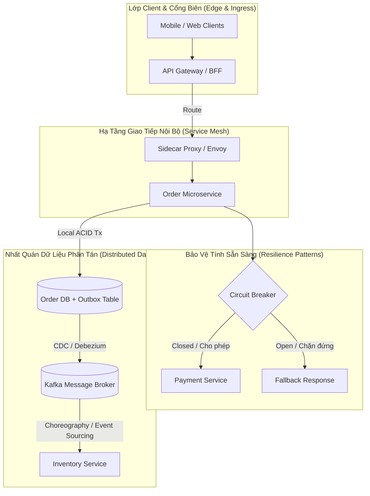
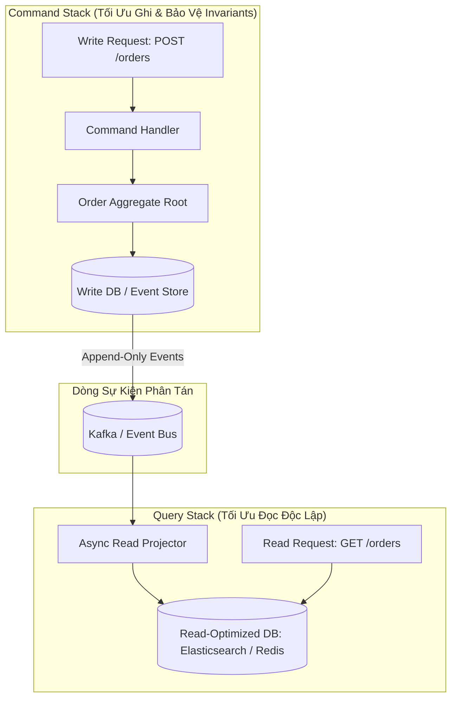
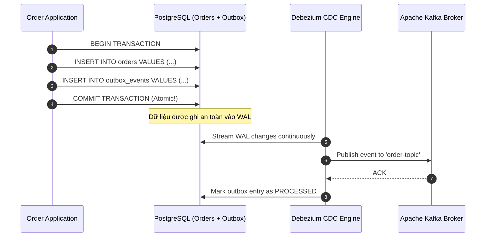
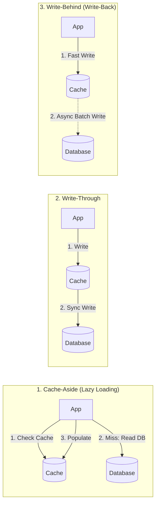

# 4.7. Các Mẫu Kiến Trúc Hệ Thống Nâng Cao (Advanced Architectural Patterns)

> [!IMPORTANT]
> **Nếu bạn chỉ được nhớ một điều duy nhất:** Các mẫu kiến trúc phân tán nâng cao (CQRS, Saga, Outbox, Circuit Breaker) không phải là các tính năng nghiệp vụ, mà là những cơ chế sống còn để bảo vệ tính nhất quán dữ liệu và ngăn chặn hiệu ứng sụp đổ dây chuyền (Cascading Failure) khi vận hành hệ thống ở quy mô lớn trên môi trường mạng không tin cậy.

---

## 1. Kiến trúc Tổng quan & Mô hình Tư duy (Mental Model)

### Ẩn dụ Đời sống: Mạng Lưới Điện Cao Thế và Hệ Thống An Toàn Hàng Hải
Hãy hình dung các mẫu kiến trúc phân tán nâng cao tương tự như hạ tầng an ninh và an toàn trong đời sống thực tế:
- **Circuit Breaker (Aptomat Chống Giật / Cầu Chì Tự Động)**: Khi đường dây điện trong nhà bị chập cháy (Downstream service sập), aptomat lập tức bật sang trạng thái ngắt mạch (Open) để bảo vệ toàn bộ mạng lưới điện không bị thiêu rụi. Sau một thời gian, bạn bật thử nấc kiểm tra (Half-Open), nếu không còn khói thì mới đóng điện hoàn toàn (Closed).
- **Bulkhead (Các Khoang Kín Chống Chìm Tàu Titanic)**: Đáy tàu thủy được chia thành 16 khoang kín nước độc lập. Nếu tàu va phải tảng băng thủng một khoang, nước tràn vào nhưng chỉ cô lập trong khoang đó mà không làm chìm cả con tàu. Trong phần mềm, đó là việc chia Thread Pools và Connection Pools riêng biệt cho từng service.
- **Saga Pattern (Quy Trình Chuyển Nhà Đa Chặng)**: Bạn cần: (1) Đóng gói đồ đạc, (2) Thuê xe tải vận chuyển, (3) Dọn vào nhà mới. Nếu đến chặng (3) chủ nhà mới bùng kèo, bạn không thể "Ctrl+Z" thời gian được, mà phải thực hiện giao dịch bù trừ (Compensating Transaction): Thuê xe chở đồ quay về nhà cũ và yêu cầu bồi thường cọc.
- **Transactional Outbox (Hòm Thư Bưu Điện Có Ký Xác Nhận)**: Bạn muốn vừa ký hợp đồng mua đất, vừa thông báo cho ngân hàng giải ngân. Thay vì tự chạy ra ngân hàng (dễ bị cướp giữa đường - Dual Write Problem), bạn nhét phong bì vào Hòm thư chuyển phát bảo đảm đặt ngay trong văn phòng công chứng trong cùng một thời điểm ký (Local ACID Transaction). Người đưa thư (CDC Connector) sau đó sẽ tự động gom thư đi phát.



---

## 2. Chi tiết từng Keyword (Under-the-Hood Deep Dive)

### 2.1. Inversion of Control (IoC), Dependency Injection (DI) & Service Locator (Anti-pattern)

#### 1. Inversion of Control (IoC - Đảo Ngược Điều Khiển)
- **Triết lý Hollywood**: *"Don't call us, we'll call you"*.
- Trong lập trình truyền thống, mã nguồn của bạn kiểm soát toàn bộ luồng thực thi và chủ động gọi các thư viện. Trong IoC, một **Framework (Khung điều khiển)** nắm giữ vòng đời chương trình và gọi ngược lại mã của bạn thông qua các hooks, callbacks hoặc lifecycle events.

#### 2. Dependency Injection (DI - Tiêm Phụ Thuộc)
- Là kỹ thuật hiện thực hóa IoC ở cấp độ hướng đối tượng.
- Thay vì một class tự khởi tạo các đối tượng phụ thuộc bên trong thân của nó (`auto repo = new SqlOrderRepository();`), các đối tượng phụ thuộc được truyền (injected) vào từ bên ngoài thông qua Constructor (Constructor Injection), Setter (Setter Injection) hoặc Interface.
- *Lợi ích*: Phá vỡ sự ghép nối chặt (Decoupling), cho phép hoán đổi các Mock / Stub một cách dễ dàng phục vụ Unit Testing.

#### 3. Service Locator (Anti-Pattern Cần Tránh)
- Một đối tượng singleton toàn cục (Registry) cho phép các components tự tìm kiếm dependencies (`ServiceLocator::get<IDatabase>()`).
- *Tại sao là Anti-pattern?*: Nó che giấu các mối quan hệ phụ thuộc bên trong class (Hidden Dependencies), khiến lập trình viên không biết class đó thực sự cần những gì cho đến khi chạy chương trình và bị ném `NullPointerException`. Constructor Injection luôn là giải pháp ưu việt hơn.

---

### 2.2. CQRS và Event Sourcing: Tách Rời Mô Hình & Dòng Sự Kiện Bất Biến



#### 1. CQRS (Command Query Responsibility Segregation - Greg Young)
- Tách đôi hoàn toàn hệ thống thành hai nhánh riêng biệt:
  - **Command Side**: Chịu trách nhiệm thực hiện các hành động thay đổi trạng thái (Create, Update, Delete). Tập trung vào Domain Logic, xác thực tính toàn vẹn và các Invariants. Không trả về dữ liệu phức tạp (chỉ trả về ID hoặc Success/Failure).
  - **Query Side**: Chịu trách nhiệm cho các thao tác đọc dữ liệu. Dữ liệu được phi chuẩn hóa (Denormalized) thành các bảng phẳng tối ưu sẵn cho giao diện hiển thị, hoàn toàn không có logic nghiệp vụ phức tạp.

#### 2. Event Sourcing
- Thay vì ghi đè trạng thái hiện tại (ví dụ: `UPDATE accounts SET balance = 500 WHERE id = 1`), hệ thống **chỉ ghi thêm (Append-Only) một chuỗi các sự kiện quá khứ đã diễn ra**:
  1. `AccountOpenedEvent { initial: 100 }`
  2. `MoneyDepositedEvent { amount: 500 }`
  3. `MoneyWithdrawnEvent { amount: 100 }`
- **Tái tạo trạng thái**: Trạng thái hiện tại ($100 + 500 - 100 = 500$) được tái tạo bằng cách phát lại (Replay) toàn bộ chuỗi sự kiện.
- **Ưu điểm tối thượng**: Cung cấp khả năng kiểm toán toàn vẹn $100\%$ (Audit Trail không thể chối cãi), phân tích lịch sử theo thời gian thực (Temporal Queries) và khôi phục hệ thống khi có lỗi logic bằng cách sửa đổi logic tính toán và replay lại sự kiện.

---

### 2.3. Quản Trị Giao Dịch Phân Tán: Saga Pattern vs Two-Phase Commit (2PC)

#### 1. Sự Hạn Chế Của Two-Phase Commit (2PC)
- Giao dịch phân tán cổ điển 2PC (Phase 1: Prepare, Phase 2: Commit) dựa vào một Coordinator trung tâm và việc giữ **Khóa Phân Tán (Distributed Locks)** trên toàn bộ các database tham gia.
- *Hạn chế*: Không thể mở rộng (Unscalable), độ trễ cực cao, và nếu Coordinator bị chết giữa hai phase, toàn bộ các cơ sở dữ liệu sẽ bị khóa cứng (Blocking Coordinator Problem). 2PC bị xem là cấm kỵ trong kiến trúc Cloud-Native Microservices hiện đại.

#### 2. Saga Pattern: Quản Trị Giao Dịch Bằng Giao Dịch Bù Trừ
Saga chia một giao dịch lớn thành một chuỗi các giao dịch cục bộ độc lập:

$$\text{Saga} = [T_1, T_2, \dots, T_n]$$

Nếu giao dịch $T_k$ bị thất bại giữa chừng, hệ thống sẽ kích hoạt một chuỗi các **Giao Dịch Bù Trừ (Compensating Transactions - $C$)** theo thứ tự ngược lại để hoàn tác trạng thái:

$$\text{Rollback} = [C_{k-1}, C_{k-2}, \dots, C_1]$$

| Tiêu Chí | Choreography Saga (Vũ Điệu Tự Do) | Orchestration Saga (Nhạc Trưởng Điều Phối) |
| :--- | :--- | :--- |
| **Cơ chế** | Các service tự lắng nghe và phản ứng với Domain Events của nhau qua Message Broker. | Một dịch vụ trung tâm (Saga Orchestrator) gửi lệnh trực tiếp tới từng service. |
| **Độ Phức Tạp** | Thấp khi luồng ngắn ($2-4$ bước). Rất khó truy vết khi luồng dài. | Dễ dàng giám sát và debug vì toàn bộ trạng thái luồng tập trung một nơi. |
| **Rủi Ro** | Dễ rơi vào hiện tượng Circular Event Dependencies (Vòng lặp sự kiện). | Single Point of Failure nếu Orchestrator không được thiết kế chịu lỗi tốt. |
| **Áp dụng** | Các luồng xử lý đơn giản, ít dịch vụ tham gia. | Các luồng thanh toán phức tạp (Order $\to$ Payment $\to$ Stock $\to$ Delivery). |

---

### 2.4. Giải Quyết Bài Toán Ghi Kép: Transactional Outbox Pattern & CDC

#### 1. Vấn Đề Ghi Kép Dữ Liệu (The Dual-Write Problem)
Khi một service muốn: (1) Lưu bản ghi đơn hàng vào SQL Database, và (2) Bắn một event lên Apache Kafka:
```python
# CODE NGUY HIỂM: DUAL-WRITE ANTIPATTERN
db.orders.insert(order)        # Bước 1: Thành công!
kafka.send("order_events", ev) # Bước 2: Mạng rớt -> Exception!
# Kết quả: Database có đơn hàng nhưng Kafka không có -> Hệ thống mất nhất quán vĩnh viễn!
```

#### 2. Giải Pháp: Transactional Outbox Pattern kết hợp Change Data Capture (CDC)
1. Trong cùng một Database Transaction của SQL, ta ghi đồng thời vào bảng nghiệp vụ `orders` và bảng trung gian `outbox_events` (Đảm bảo ACID tuyệt đối).
2. Một tiến trình phụ trợ sử dụng kỹ thuật **Change Data Capture (CDC - Debezium)** đọc trực tiếp từ Write-Ahead Log (WAL) của PostgreSQL/MySQL để lấy các bản ghi mới từ bảng `outbox_events` và stream sang Kafka.
3. Đảm bảo cam kết phân phát: **Ít nhất một lần (At-least-once Delivery)** mà không làm suy giảm hiệu năng của ứng dụng chính.



---

### 2.5. Các Chiến Lược Caching Hiệu Năng Cao



1. **Cache-Aside (Lazy Loading - Phổ biến nhất)**:
   - Ứng dụng tự quản lý cả Cache và Database. Đọc từ Cache trước; nếu Cache Miss thì đọc từ DB rồi ghi ngược lại vào Cache.
   - *Ưu điểm*: Chỉ cache những dữ liệu thực sự được truy vấn; Cache chết thì hệ thống vẫn sống (fallback DB).
2. **Read-Through / Write-Through**:
   - Ứng dụng chỉ giao tiếp với Cache. Lớp Caching tự động truy vấn DB khi miss (Read-Through) hoặc tự động ghi đồng bộ xuống DB khi có lệnh update (Write-Through).
3. **Write-Behind (Write-Back)**:
   - Ứng dụng ghi thẳng vào Cache ở tốc độ cực cao rồi trả về ngay lập tức. Cache tích lũy các bản ghi và ghi xuống DB một cách bất đồng bộ theo mẻ (Batching).
   - *Rủi ro*: Nếu máy chủ Cache bị mất điện đột ngột trước khi kịp xả dữ liệu xuống đĩa, dữ liệu sẽ bị mất vĩnh viễn!

---

### 2.6. Mạng Lưới và Biên Dịch Vụ: API Gateway, BFF, Sidecar & Service Mesh

1. **API Gateway**: Cổng duy nhất tiếp nhận toàn bộ lưu lượng Ingress từ Internet vào mạng nội bộ. Đảm nhiệm: Chấm dứt SSL (SSL Termination), Xác thực JWT (Authentication), Cân bằng tải, Giới hạn tần suất (Rate Limiting).
2. **Backend For Frontend (BFF - Sam Newman)**: Thay vì dùng 1 API Gateway chung cho mọi loại thiết bị, ta xây dựng các backend riêng biệt: Một BFF chuyên phục vụ giao diện Mobile (dữ liệu nén gọn nhẹ, ít trường), một BFF cho Web Desktop (dữ liệu chi tiết, rich UI).
3. **Sidecar Pattern**: Triển khai một tiến trình hoặc container phụ trợ chạy song hành với container chính trong cùng một Kubernetes Pod (chia sẻ Network Namespace `localhost`).
4. **Service Mesh (Istio, Envoy)**: Hạ tầng điều khiển giao tiếp giữa các services nội bộ (East-West Traffic). Mỗi service có một Envoy Proxy (Sidecar) đứng chặn trước cổng. Service Mesh tự động mã hóa đường truyền bằng **Mutual TLS (mTLS)**, tự động retry, phân tán tracing và thu thập telemetry mà ứng dụng không cần viết một dòng code nào.

---

### 2.7. Chống Chịu Lỗi và Hiện Đại Hóa: Circuit Breaker, Bulkhead, Rate Limiter & Strangler Fig

#### 1. Circuit Breaker (Cầu Giao Ngắt Mạch)
- Hoạt động theo mô hình máy trạng thái 3 nấc:
  - **CLOSED (Đóng)**: Hệ thống bình thường, mọi request được chuyển tiếp tới đích.
  - **OPEN (Mở)**: Khi số lượng lỗi liên tiếp hoặc tỷ lệ lỗi vượt ngưỡng ($> 50\%$), mạch lập tức bật sang OPEN. Toàn bộ request trong trạng thái này bị từ chối ngay lập tức (**Fail-Fast**) hoặc trả về dữ liệu dự phòng (Fallback) mà không gửi qua mạng.
  - **HALF-OPEN (Nửa mở)**: Sau một khoảng thời gian chờ (Reset Timeout), mạch cho phép một số lượng nhỏ request thử nghiệm đi qua. Nếu các request này thành công, mạch đóng lại (CLOSED); nếu tiếp tục thất bại, mạch quay về OPEN.

#### 2. Strangler Fig Pattern (Cây Đa Siết Cây - Martin Fowler)
- Chiến lược di chuyển từng bước từ hệ thống cũ (Legacy Monolith) sang kiến trúc mới (Microservices) mà không cần đập đi xây lại từ đầu:
  1. Dựng một Proxy / API Gateway ở phía trước toàn bộ hệ thống.
  2. Bóc tách một tính năng nhỏ (ví dụ: Service Thông Báo) sang microservice mới.
  3. Cấu hình Proxy để định tuyến các request thông báo sang microservice mới, trong khi 99% request còn lại vẫn đổ vào Monolith cũ.
  4. Lặp lại chu trình cho đến khi Monolith cũ bị "siết chết" hoàn toàn và biến mất.

---

## 3. Thực thi Mã nguồn & Mô phỏng Chuyên sâu (Dual-Engine Implementation)

### 3.1. C++20 Implementation: Thread-Safe State Machine for Circuit Breaker Pattern
Chương trình C++20 dưới đây cài đặt một **Circuit Breaker** chuẩn công nghiệp hỗ trợ đa luồng an toàn, chuyển đổi trạng thái giữa CLOSED, OPEN, HALF-OPEN dựa trên bộ đếm nguyên tử và thời gian phục hồi.

```cpp
#include <iostream>
#include <chrono>
#include <atomic>
#include <mutex>
#include <thread>
#include <stdexcept>
#include <functional>

enum class CircuitState { CLOSED, OPEN, HALF_OPEN };

class CircuitBreaker {
private:
    CircuitState state_{CircuitState::CLOSED};
    uint32_t failureCount_{0};
    const uint32_t failureThreshold_{3};           // Cho phép tối đa 3 lỗi liên tiếp
    const uint32_t halfOpenSuccessThreshold_{2};   // Cần 2 request thành công ở Half-Open để phục hồi
    uint32_t halfOpenSuccessCount_{0};

    std::chrono::steady_clock::time_point lastStateChangeTime_;
    const std::chrono::milliseconds resetTimeout_{1500}; // 1.5 giây chờ ở trạng thái OPEN
    mutable std::mutex mtx_;

    void transitionTo(CircuitState newState) {
        state_ = newState;
        lastStateChangeTime_ = std::chrono::steady_clock::now();
        if (newState == CircuitState::CLOSED) {
            failureCount_ = 0;
            halfOpenSuccessCount_ = 0;
            std::cout << "  [CircuitBreaker] >>> Transitioned to CLOSED (System Healthy)\n";
        } else if (newState == CircuitState::OPEN) {
            std::cout << "  [CircuitBreaker] >>> Transitioned to OPEN (Failing Fast, Network Shield Activated)\n";
        } else if (newState == CircuitState::HALF_OPEN) {
            halfOpenSuccessCount_ = 0;
            std::cout << "  [CircuitBreaker] >>> Transitioned to HALF_OPEN (Probing Destination Health)\n";
        }
    }

public:
    CircuitBreaker() : lastStateChangeTime_(std::chrono::steady_clock::now()) {}

    bool allowExecution() {
        std::lock_guard<std::mutex> lock(mtx_);
        auto now = std::chrono::steady_clock::now();

        if (state_ == CircuitState::OPEN) {
            if (now - lastStateChangeTime_ >= resetTimeout_) {
                transitionTo(CircuitState::HALF_OPEN);
                return true;
            }
            return false; // Fast Fail!
        }
        return true;
    }

    void recordSuccess() {
        std::lock_guard<std::mutex> lock(mtx_);
        if (state_ == CircuitState::HALF_OPEN) {
            ++halfOpenSuccessCount_;
            if (halfOpenSuccessCount_ >= halfOpenSuccessThreshold_) {
                transitionTo(CircuitState::CLOSED);
            }
        } else if (state_ == CircuitState::CLOSED) {
            failureCount_ = 0;
        }
    }

    void recordFailure() {
        std::lock_guard<std::mutex> lock(mtx_);
        if (state_ == CircuitState::HALF_OPEN) {
            // Chỉ cần 1 lỗi trong giai đoạn thử nghiệm là mở mạch lại ngay lập tức
            transitionTo(CircuitState::OPEN);
        } else if (state_ == CircuitState::CLOSED) {
            ++failureCount_;
            std::cout << "  [CircuitBreaker Alert] Consecutive failures: " 
                      << failureCount_ << "/" << failureThreshold_ << "\n";
            if (failureCount_ >= failureThreshold_) {
                transitionTo(CircuitState::OPEN);
            }
        }
    }

    [[nodiscard]] CircuitState currentState() const {
        std::lock_guard<std::mutex> lock(mtx_);
        return state_;
    }
};

// Hàm điều hành gọi dịch vụ được bảo vệ bởi Circuit Breaker
void executeProtectedCall(CircuitBreaker& cb, int requestId, std::function<void()> externalCall) {
    std::cout << "\n[Request #" << requestId << "] Dispatching call...";
    if (!cb.allowExecution()) {
        std::cout << " -> ⚡ REJECTED BY CIRCUIT BREAKER (Fast Fail Fallback!)\n";
        return;
    }

    try {
        externalCall();
        cb.recordSuccess();
        std::cout << " -> ✅ SUCCESS (200 OK)\n";
    } catch (const std::exception& ex) {
        cb.recordFailure();
        std::cout << " -> ❌ CALL FAILED (" << ex.what() << ")\n";
    }
}

int main() {
    std::cout << "=== C++20 Thread-Safe Circuit Breaker Simulation ===\n";
    CircuitBreaker cb;

    auto failingService = []() { throw std::runtime_error("Downstream Connection Timeout"); };
    auto healthyService = []() { /* Mock thành công */ };

    // Kích hoạt 3 lỗi liên tiếp để ngắt mạch sang OPEN
    executeProtectedCall(cb, 1, failingService);
    executeProtectedCall(cb, 2, failingService);
    executeProtectedCall(cb, 3, failingService); // Ngưỡng kích hoạt OPEN!

    // Các request kế tiếp bị Fast-Fail ngay lập tức không tốn tài nguyên mạng
    executeProtectedCall(cb, 4, failingService);
    executeProtectedCall(cb, 5, healthyService);

    // Chờ 1.6 giây để hết hạn Reset Timeout
    std::cout << "\n[Sleeping 1600ms for Reset Timeout]...\n";
    std::this_thread::sleep_for(std::chrono::milliseconds(1600));

    // Request kế tiếp chuyển sang HALF-OPEN và thăm dò dịch vụ
    executeProtectedCall(cb, 6, healthyService); // Probe 1 thành công
    executeProtectedCall(cb, 7, healthyService); // Probe 2 thành công -> Mạch đóng lại CLOSED!

    // Hệ thống phục hồi hoàn toàn
    executeProtectedCall(cb, 8, healthyService);

    return 0;
}
```

#### Terminal Output Mẫu (C++20):
```text
=== C++20 Thread-Safe Circuit Breaker Simulation ===

[Request #1] Dispatching call...  [CircuitBreaker Alert] Consecutive failures: 1/3
 -> ❌ CALL FAILED (Downstream Connection Timeout)

[Request #2] Dispatching call...  [CircuitBreaker Alert] Consecutive failures: 2/3
 -> ❌ CALL FAILED (Downstream Connection Timeout)

[Request #3] Dispatching call...  [CircuitBreaker Alert] Consecutive failures: 3/3
  [CircuitBreaker] >>> Transitioned to OPEN (Failing Fast, Network Shield Activated)
 -> ❌ CALL FAILED (Downstream Connection Timeout)

[Request #4] Dispatching call... -> ⚡ REJECTED BY CIRCUIT BREAKER (Fast Fail Fallback!)

[Request #5] Dispatching call... -> ⚡ REJECTED BY CIRCUIT BREAKER (Fast Fail Fallback!)

[Sleeping 1600ms for Reset Timeout]...

[Request #6] Dispatching call...  [CircuitBreaker] >>> Transitioned to HALF_OPEN (Probing Destination Health)
 -> ✅ SUCCESS (200 OK)

[Request #7] Dispatching call...  [CircuitBreaker] >>> Transitioned to CLOSED (System Healthy)
 -> ✅ SUCCESS (200 OK)

[Request #8] Dispatching call... -> ✅ SUCCESS (200 OK)
```

---

### 3.2. Python 3.11+ Implementation: Transactional Outbox Pattern with Simulated CDC Worker
Chương trình Python 3.11+ dưới đây sử dụng SQLite để minh họa việc giải quyết bài toán Dual-Write: Ghi nguyên tử đơn hàng và sự kiện outbox trong một Local Transaction, sau đó một Background CDC Worker đọc và đẩy lên Message Broker.

```python
from __future__ import annotations
import sqlite3
import json
import time
import uuid
from typing import Any

# Khởi tạo cơ sở dữ liệu in-memory SQLite mô phỏng Transactional Database
def setup_database() -> sqlite3.Connection:
    conn = sqlite3.connect(":memory:")
    cursor = conn.cursor()
    # 1. Bảng nghiệp vụ Orders
    cursor.execute("""
        CREATE TABLE orders (
            order_id TEXT PRIMARY KEY,
            customer_id TEXT NOT NULL,
            total_amount REAL NOT NULL,
            status TEXT NOT NULL
        )
    """)
    # 2. Bảng Transactional Outbox
    cursor.execute("""
        CREATE TABLE outbox_events (
            event_id TEXT PRIMARY KEY,
            aggregate_type TEXT NOT NULL,
            aggregate_id TEXT NOT NULL,
            event_type TEXT NOT NULL,
            payload JSON NOT NULL,
            created_at REAL NOT NULL,
            processed INTEGER DEFAULT 0
        )
    """)
    conn.commit()
    return conn

# ============================================================================
# 1. APPLICATION LAYER: ATOMIC LOCAL TRANSACTION (SOLVING DUAL WRITE)
# ============================================================================
def create_order_with_outbox(conn: sqlite3.Connection, customer_id: str, amount: float) -> str:
    order_id = f"ORD-{uuid.uuid4().hex[:6].upper()}"
    event_id = str(uuid.uuid4())
    
    event_payload = json.dumps({
        "order_id": order_id,
        "customer_id": customer_id,
        "total_amount": amount,
        "timestamp": time.time()
    })

    cursor = conn.cursor()
    try:
        # BẮT ĐẦU TRANSACTION ACID CỤC BỘ
        cursor.execute("BEGIN TRANSACTION")

        # Bước 1: Lưu đơn hàng vào bảng nghiệp vụ
        cursor.execute(
            "INSERT INTO orders (order_id, customer_id, total_amount, status) VALUES (?, ?, ?, ?)",
            (order_id, customer_id, amount, "PENDING")
        )

        # Bước 2: Lưu sự kiện vào bảng Outbox (Trong cùng 1 transaction!)
        cursor.execute(
            """INSERT INTO outbox_events 
               (event_id, aggregate_type, aggregate_id, event_type, payload, created_at, processed) 
               VALUES (?, ?, ?, ?, ?, ?, 0)""",
            (event_id, "Order", order_id, "OrderCreatedEvent", event_payload, time.time())
        )

        # XÁC NHẬN GIAO DỊCH NGUYÊN TỬ
        conn.commit()
        print(f"[Application Tx Success] Created {order_id} & Outbox Record {event_id[:8]} atomically.")
        return order_id

    except Exception as ex:
        conn.rollback()
        print(f"[Application Tx Error] Transaction rolled back: {ex}")
        raise

# ============================================================================
# 2. BACKGROUND CDC / DEBEZIUM SIMULATOR WORKER
# ============================================================================
class MockKafkaBroker:
    @staticmethod
    def publish(topic: str, message: dict[str, Any]) -> None:
        print(f"    🚀 [Kafka Broker Topic: '{topic}'] Published message: {message['event_type']} "
              f"for Aggregate: {message['aggregate_id']}")

def run_cdc_outbox_processor(conn: sqlite3.Connection):
    cursor = conn.cursor()
    # Tìm các sự kiện chưa được xử lý
    cursor.execute("SELECT event_id, aggregate_id, event_type, payload FROM outbox_events WHERE processed = 0")
    pending_events = cursor.fetchall()

    if not pending_events:
        print("[CDC Worker] No pending events to stream.")
        return

    print(f"\n[CDC Worker] Detected {len(pending_events)} pending Outbox events from Write-Ahead Log...")
    for ev_id, agg_id, ev_type, raw_payload in pending_events:
        data = json.loads(raw_payload)
        # Bắn message lên Kafka
        MockKafkaBroker.publish("order-events-stream", {
            "event_id": ev_id,
            "aggregate_id": agg_id,
            "event_type": ev_type,
            "payload": data
        })

        # Đánh dấu sự kiện đã được gửi thành công
        cursor.execute("UPDATE outbox_events SET processed = 1 WHERE event_id = ?", (ev_id,))
    
    conn.commit()
    print("[CDC Worker] All events committed to Message Broker successfully.\n")


if __name__ == "__main__":
    print("=== Python 3.11+ Transactional Outbox Pattern Simulation ===")
    db_conn = setup_database()

    # 1. Ứng dụng ghi 2 đơn hàng nguyên tử vào DB
    create_order_with_outbox(db_conn, "CUST-ALICE", 299.95)
    create_order_with_outbox(db_conn, "CUST-BOB", 1450.00)

    # 2. Tiến trình CDC chạy bất đồng bộ để quét và stream sự kiện
    run_cdc_outbox_processor(db_conn)

    # 3. Kiểm tra trạng thái đã xử lý
    cur = db_conn.cursor()
    cur.execute("SELECT count(*) FROM outbox_events WHERE processed = 1")
    processed_count = cur.fetchone()[0]
    print(f"[Audit Check] Verified {processed_count} Outbox records marked as PROCESSED in Database.")
```

#### Terminal Output Mẫu (Python 3.11+):
```text
=== Python 3.11+ Transactional Outbox Pattern Simulation ===
[Application Tx Success] Created ORD-9A1B2C & Outbox Record 3c4d5e6f atomically.
[Application Tx Success] Created ORD-4F5E6D & Outbox Record 7a8b9c0d atomically.

[CDC Worker] Detected 2 pending Outbox events from Write-Ahead Log...
    🚀 [Kafka Broker Topic: 'order-events-stream'] Published message: OrderCreatedEvent for Aggregate: ORD-9A1B2C
    🚀 [Kafka Broker Topic: 'order-events-stream'] Published message: OrderCreatedEvent for Aggregate: ORD-4F5E6D
[CDC Worker] All events committed to Message Broker successfully.

[Audit Check] Verified 2 Outbox records marked as PROCESSED in Database.
```

---

## 4. Systems Engineering & Production Pitfalls

### Các Cạm Bẫy Thực Chiến (Gotchas & Production Antipatterns)

1. **Hiệu Ứng Bão Thử Lại Trong Circuit Breaker (Retry Storm & Thundering Herd)**:
   - *Bản chất*: Khi Circuit Breaker chuyển từ OPEN sang HALF-OPEN, nếu hàng chục ngàn clients đang chờ đợi đồng loạt xông vào gửi request thăm dò cùng một lúc (Thundering Herd), lượng tải đột ngột này sẽ lập tức làm sập lại service vừa mới hồi phục.
   - *Khắc phục*: Kết hợp Circuit Breaker với **Exponential Backoff và Jitter (Nhiễu loạn ngẫu nhiên)** để giãn cách thời gian retry của các clients.

2. **Độ Trễ Nhất Quán Trong CQRS Gây Hiểu Lầm Cho Người Dùng**:
   - *Bản chất*: Người dùng bấm "Cập nhật Avatar" (Gửi lệnh Command), nhận phản hồi thành công và trang web tự động refresh. Tuy nhiên, luồng Projector bất đồng bộ sang Elasticsearch (Query DB) bị lag 200ms. Kết quả: Trang web tải lại vẫn hiển thị avatar cũ, khiến người dùng tưởng lỗi và bấm nút cập nhật liên tục 10 lần.
   - *Khắc phục*: Áp dụng kỹ thuật **Optimistic UI Updates** trên Frontend hoặc cho phép Query Side trả về dữ liệu từ Write Replica cục bộ trong vòng vài giây đầu.

3. **Cạm Bẫy Quên Giao Dịch Bù Trừ Trong Saga (Idempotency Defect)**:
   - *Bản chất*: Trong Saga, một Compensating Transaction có thể được gọi nhiều lần do mạng chập chờn. Nếu hàm hoàn tác không đảm bảo tính **Idempotent (Khả năng bảo toàn khi chạy nhiều lần)**, khách hàng có thể được hoàn tiền 2 hoặc 3 lần cho cùng một đơn hàng bị hủy!
   - *Khắc phục*: Bắt buộc phải gắn `Idempotency-Key` (dựa trên `sagaId` hoặc `orderId`) cho tất cả các bước bù trừ trong Saga.

4. **Kỹ Thuật Chẩn Đoán & Giám Sát Bằng CLI**:
   ```bash
   # 1. Kiểm tra trạng thái Circuit Breaker qua Envoy Admin API
   curl -s http://localhost:15000/stats | grep "circuit_breakers"

   # 2. Giám sát độ trễ tích lũy (Replication Lag) của Debezium CDC Connector
   curl -s http://localhost:8083/connectors/outbox-connector/status | jq .

   # 3. Theo dõi Consumer Lag trên Topic Kafka của Saga Orchestrator
   kafka-consumer-groups.sh --bootstrap-server localhost:9092 --describe --group saga-orchestrator-group
   ```

---

## 5. Bảng So sánh & Decision Matrix

### 5.1. So Sánh Các Chiến Lược Nhất Quán Dữ Liệu Phân Tán

| Tiêu Chí | Two-Phase Commit (2PC) | Saga Orchestration | Transactional Outbox + CDC |
| :--- | :--- | :--- | :--- |
| **Loại Nhất Quán** | Nhất quán tức thì (ACID) | Nhất quán cuối cùng (BASE) | Nhất quán cuối cùng (At-Least-Once) |
| **Khóa Tài Nguyên** | Giữ khóa phân tán kéo dài (Blocking) | Không giữ khóa phân tán | Không giữ khóa phân tán |
| **Khả Năng Mở Rộng**| Rất kém; suy thoái theo số nodes | Rất cao | Rất cao |
| **Độ Phức Tạp Cài Đặt**| Thấp (Hỗ trợ bởi DB Driver) | Rất cao (Cần viết Compensations) | Trung bình (Cần hạ tầng Debezium) |
| **Rủi Ro Trọng Tâm** | Treo toàn bộ hệ thống nếu Coordinator chết| Khó gỡ lỗi khi luồng bù trừ bị fail | Trùng lặp event (Consumer phải idempotent) |

### 5.2. Ma Trận Lựa Chọn Chiến Lược Caching

| Chiến Lược Caching | Khả Năng Chống Mất Dữ Liệu | Độ Phức Tạp Ứng Dụng | Độ Trễ Ghi (Write Latency) | Phù Hợp Cho |
| :--- | :--- | :--- | :--- | :--- |
| **Cache-Aside** | Tuyệt đối an toàn (DB là nguồn chân lý) | Thấp | Bình thường | 90% ứng dụng Web/API đọc nhiều ghi ít |
| **Read/Write-Through**| Rất cao | Trung bình (Cần Cache Provider hỗ trợ)| Chậm hơn một chút (Ghi đồng bộ) | Hệ thống yêu cầu mã nguồn sạch, che giấu DB |
| **Write-Behind** | **Có nguy cơ mất dữ liệu nếu sập RAM** | Rất cao (Cần hàng đợi xả đĩa an toàn) | **Cực nhanh (Ghi vào RAM)** | Sàn giao dịch chứng khoán, IoT Telemetry, Game |
