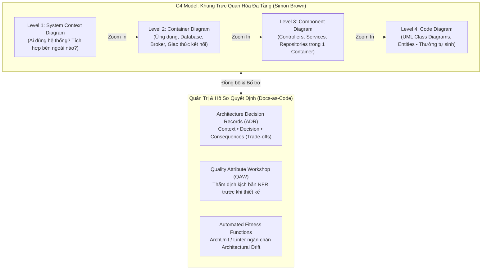
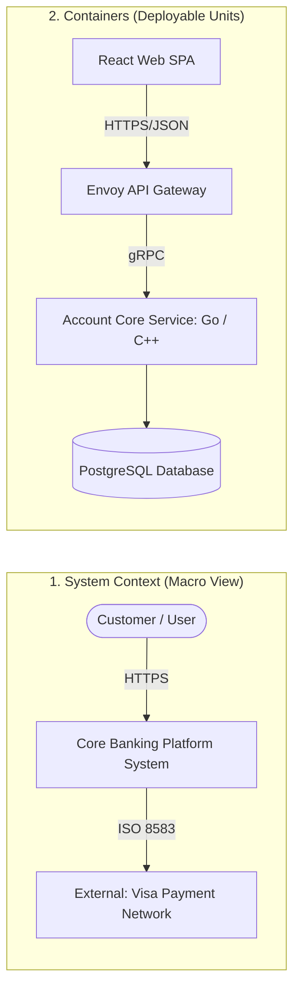
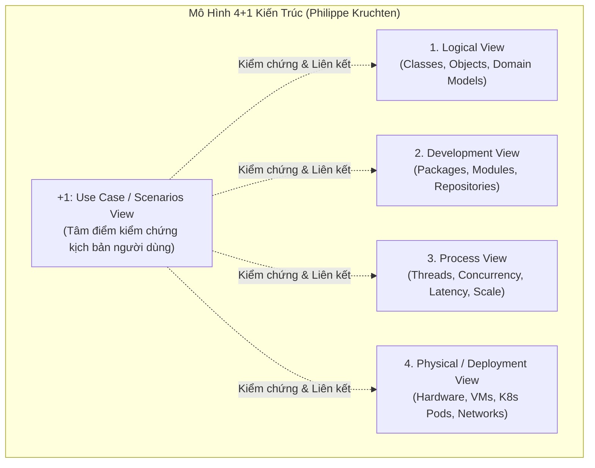

# 4.8. Tài Liệu Hóa và Thẩm Định Kiến Trúc (Architecture Documentation & Review)

> [!IMPORTANT]
> **Nếu bạn chỉ được nhớ một điều duy nhất:** Bản vẽ kiến trúc chỉ có giá trị khi nó phản ánh sự thật đang chạy trên Production; tài liệu kiến trúc hiện đại tuân theo triết lý Docs-as-Code và C4 Model để có thể kiểm thử tự động, lưu trữ cùng mã nguồn trong Git và bảo vệ các quyết định kỹ thuật thông qua Architecture Decision Records (ADR).

---

## 1. Kiến trúc Tổng quan & Mô hình Tư duy (Mental Model)

### Ẩn dụ Đời sống: Google Maps Đa Tầng và Nhật Ký Công Trình Của Kỹ Sư Trưởng
Hãy hình dung việc lập tài liệu kiến trúc tương tự như cách chúng ta quan sát thế giới qua ứng dụng Google Maps:
- **C4 Level 1: System Context (Bản đồ Trái Đất / Vệ tinh)**: Nhìn từ quỹ đạo vũ trụ, bạn chỉ thấy biên giới các lục địa, đại dương và vị trí các quốc gia (Hệ thống của bạn tương tác với Ngân hàng, Khách hàng, Cổng SMS). Bạn không nhìn thấy ô tô hay nhà cửa.
- **C4 Level 2: Container Diagram (Bản đồ Thành phố / Giao thông)**: Phóng to vào một thành phố, bạn thấy các khu đô thị, sân bay, bến xe, đường cao tốc nối các quận (Web SPA, API Gateway, Microservices, PostgreSQL, Kafka và giao thức kết nối HTTP/gRPC).
- **C4 Level 3: Component Diagram (Bản vẽ Mặt bằng Khu nhà)**: Phóng to vào một tòa chung cư, bạn thấy các phòng chức năng, cầu thang, hành lang (Controllers, Use Cases, Repositories bên trong một Microservice).
- **C4 Level 4: Code Diagram (Bản vẽ Mạch điện / Ống nước chi tiết)**: Phóng to vào chân ổ cắm điện hoặc chi tiết cấu trúc ren của van nước (UML Class Diagram của một thuật toán phức tạp).
- **Architecture Decision Record - ADR (Nhật ký Công trình)**: Khi kỹ sư trưởng quyết định dùng móng cọc bê tông dự ứng lực thay vì móng băng vì địa chất có túi bùn, quyết định này được ký tên và đóng dấu vào sổ nhật ký công trình. Mười năm sau, dù kỹ sư trưởng đã nghỉ hưu, người tiếp quản vẫn biết chính xác lý do tại sao không được phép đào sâu thêm mà không cần đoán mò.



---

## 2. Chi tiết từng Keyword (Under-the-Hood Deep Dive)

### 2.1. Mô Hình C4 Trực Quan Hóa Kiến Trúc Phần Mềm (Simon Brown: 4 Cấp Độ)
Được phát minh bởi Simon Brown, C4 Model giải quyết căn bệnh muôn thuở của sơ đồ kiến trúc: **Các hình hộp và mũi tên vô nghĩa không có ngữ cảnh rõ ràng**. C4 phân cấp thành 4 mức trừu tượng:



1. **Level 1: System Context Diagram (Bối cảnh Hệ thống)**:
   - Dành cho: Ban giám đốc, Product Managers, và mọi đối tượng kỹ thuật lẫn phi kỹ thuật.
   - Thể hiện: Hệ thống phần mềm của bạn nằm ở đâu trong bức tranh toàn cảnh; ai là người dùng tương tác trực tiếp; hệ thống phụ thuộc vào những đối tác bên ngoài nào.
   - *Nguyên tắc*: Không hiển thị bất kỳ chi tiết công nghệ, framework, hay cơ sở dữ liệu nào.
2. **Level 2: Container Diagram (Các Khối Triển Khai)**:
   - Dành cho: Kỹ sư phần mềm, Kiến trúc sư, DevOps/SRE.
   - Định nghĩa *"Container"*: Bất kỳ đơn vị phần mềm nào có thể chạy và triển khai độc lập (Web SPA, Mobile App, Microservice, Database, Message Queue, Cron Job).
   - Thể hiện: Trách nhiệm của từng Container, công nghệ sử dụng (Go, React, PostgreSQL) và giao thức mạng truyền thông (gRPC over HTTP/2, TLS 1.3).
3. **Level 3: Component Diagram (Các Thành Phần Bên Trong Container)**:
   - Dành cho: Các kỹ sư trực tiếp lập trình trên Container đó.
   - Thể hiện: Cấu trúc bên trong của một Container được chia thành các Components nào (theo Clean Architecture: Controllers, Use Cases, Repositories) và cách chúng liên kết qua Interfaces.
4. **Level 4: Code Diagram (Mức Mã Nguồn)**:
   - Dành cho: Lập trình viên chuyên sâu.
   - Thể hiện: Các sơ đồ lớp (UML Class Diagrams), State Machines hoặc Entity Relationship. Thường chỉ nên vẽ cho các thuật toán rất phức tạp; không nên vẽ cho toàn bộ code vì sẽ nhanh chóng bị lỗi thời.

---

### 2.2. Mô Hình Góc Nhìn 4+1 (Philippe Kruchten Architectural View Model)
Được chuẩn hóa trong tài liệu IEEE 1471, mô hình 4+1 của Philippe Kruchten cung cấp 5 góc nhìn đa chiều để thỏa mãn nhu cầu thông tin của các nhóm bên liên quan khác nhau:



1. **Logical View (Góc Nhìn Logic)**: Phục vụ End-Users và Architects. Mô tả cấu trúc các khái niệm nghiệp vụ, thực thể Domain, và các mối quan hệ trừu tượng.
2. **Development View (Góc Nhìn Phát Triển)**: Phục vụ Lập trình viên và Quản lý Cấu hình. Mô tả cấu trúc phân chia mã nguồn trong Git, quản lý thư viện phụ thuộc (Maven, Cargo, Go Modules) và quy trình biên dịch.
3. **Process View (Góc Nhìn Tiến Trình)**: Phục vụ Tích hợp Hệ thống. Mô tả các luồng thực thi (Threads), tiến trình (Processes), đồng bộ hóa, độ trễ mạng và hiệu năng khi hệ thống chạy ở runtime.
4. **Physical / Deployment View (Góc Nhìn Vật Lý)**: Phục vụ DevOps và SRE. Mô tả cách phần mềm được ánh xạ lên máy chủ vật lý, máy ảo, container Kubernetes, cấu hình tường lửa và cân bằng tải.
5. **+1: Use Case / Scenarios View (Góc Nhìn Kịch Bản Cốt Lõi)**: Tâm điểm liên kết toàn bộ 4 góc nhìn trên. Mỗi kịch bản nghiệp vụ đóng vai trò sợi chỉ đỏ xuyên suốt để kiểm chứng xem 4 góc nhìn kia có phối hợp nhịp nhàng với nhau không.

---

### 2.3. Architecture Decision Records (ADR) và Triết Lý Docs-as-Code

#### 1. Triết Lý Docs-as-Code
- Tài liệu kiến trúc được đối xử bình đẳng như mã nguồn:
  - Viết bằng văn bản thuần túy (Markdown / AsciiDoc) thay vì Word hay PDF.
  - Lưu trữ trực tiếp trong cùng Git Repository của dự án (`docs/adr/`).
  - Được review thông qua Pull Request (PR) có sự phê duyệt của Tech Leads.
  - Được kiểm thử cú pháp và liên kết tự động bằng CI/CD Pipelines.

#### 2. Cấu Trúc Chuẩn Của Một Bản ADR (Michael Nygard Standard)
Một tài liệu ADR hoàn chỉnh bắt buộc phải có 5 phần ngắn gọn:
1. **Title**: Số thứ tự và quyết định (ví dụ: `ADR-012: Sử dụng gRPC thay thế REST cho giao tiếp nội bộ`).
2. **Status**: Trạng thái hiện tại: `PROPOSED` (Đang đề xuất), `ACCEPTED` (Đã duyệt), `REJECTED` (Bị bác bỏ), hoặc `SUPERSEDED` (Bị thay thế bởi ADR mới hơn).
3. **Context (Bối cảnh)**: Trình bày bài toán kỹ thuật, các ràng buộc và lý do tại sao quyết định này cần được đưa ra.
4. **Decision (Quyết định)**: Giải pháp kỹ thuật được chọn lựa để áp dụng.
5. **Consequences (Hệ quả & Đánh đổi)**: Phân tích khách quan: Quyết định này mang lại lợi ích gì (Pros) và chúng ta chấp nhận đánh mất điều gì (Cons / Trade-offs).

---

### 2.4. Quality Attribute Workshop (QAW) và Đánh Giá Kiến Trúc Định Kỳ
- **QAW (SEI)**: Một buổi hội thảo tạo điều kiện (Facilitated Workshop) diễn ra trong 1 ngày giữa các Kiến trúc sư, Lập trình viên, Product Owners và các bên liên quan để tìm ra các kịch bản thuộc tính chất lượng (QAS) quan trọng nhất trước khi bắt đầu thiết kế.
- **Architecture Review Meetings**:
  - Diễn ra định kỳ (hàng tuần hoặc trước mỗi quý).
  - Mục tiêu: Rà soát các ADR mới được đề xuất, kiểm tra xem có service nào bị "suy thoái kiến trúc" không, và đưa ra quyết định nâng cấp hạ tầng.

---

### 2.5. Automated Fitness Functions: Biến Tài Liệu Thành Mã Kiểm Thử Sống
- Vấn đề lớn nhất của tài liệu bằng lời nói là: **Tài liệu nói một đằng, code chạy một nẻo**.
- **Giải pháp**: Hiện thực hóa các quy tắc kiến trúc thành các bài kiểm thử tự động (Automated Fitness Functions) chạy trực tiếp trong CI/CD bằng các công cụ như ArchUnit, Deptrac hoặc Custom Linters:
  - *"Tầng Domain không được phép import bất kỳ package nào từ Infrastructure"*.
  - *"Không có circular dependency giữa các modules"*.
  - *"Thời gian đáp ứng của API thanh toán phải dưới 50ms"*.

---

### 2.6. Quản Trị Kiến Trúc Doanh Nghiệp (Architecture Governance & Anti-Erosion)
- **Architectural Erosion / Drift**: Hiện tượng mã nguồn theo thời gian bị xói mòn do áp lực tiến độ (Deadlines), các kỹ sư mới tạo đường tắt (Shortcuts) phá vỡ ranh giới kiến trúc.
- **Biện pháp ngăn chặn**:
  1. Thiết lập **Quality Gates** tự động từ chối merge PR nếu vi phạm ranh giới.
  2. Bổ nhiệm **Architecture Champions** trong từng đội nhóm để giám sát và hướng dẫn.
  3. Dành riêng $20\%$ ngân sách kỹ thuật trong mỗi Sprint để trả nợ kỹ thuật kiến trúc.

---

## 3. Thực thi Mã nguồn & Mô phỏng Chuyên sâu (Dual-Engine Implementation)

### 3.1. C++20 Implementation: Automated Architecture Compliance & Fitness Checker
Chương trình C++20 dưới đây mô phỏng một công cụ kiểm định quy tắc kiến trúc (Architecture Compliance Checker) chạy trong chu trình kiểm thử tự động, quét ma trận phụ thuộc giữa các module và cảnh báo nếu có vi phạm Architectural Drift.

```cpp
#include <iostream>
#include <vector>
#include <string>
#include <unordered_map>
#include <unordered_set>
#include <stdexcept>
#include <iomanip>

// ============================================================================
// ARCHITECTURAL LAYER DEFINITIONS & RULES ENGINE
// ============================================================================
enum class Layer { PRESENTATION, APPLICATION, DOMAIN, INFRASTRUCTURE };

std::string layerToString(Layer l) {
    switch (l) {
        case Layer::PRESENTATION:   return "Presentation";
        case Layer::APPLICATION:    return "Application";
        case Layer::DOMAIN:         return "Domain";
        case Layer::INFRASTRUCTURE: return "Infrastructure";
    }
    return "Unknown";
}

struct DependencyRule {
    Layer source;
    Layer target;
    bool isAllowed;
    std::string ruleDescription;
};

class ArchitectureFitnessEngine {
private:
    std::vector<DependencyRule> rules_;
    std::unordered_map<std::string, Layer> moduleLayerRegistry_;
    std::vector<std::pair<std::string, std::string>> declaredDependencies_;

public:
    void registerModule(const std::string& moduleName, Layer layer) {
        moduleLayerRegistry_[moduleName] = layer;
    }

    void addRule(Layer src, Layer dst, bool allowed, const std::string& desc) {
        rules_.push_back({src, dst, allowed, desc});
    }

    void recordDependency(const std::string& fromModule, const std::string& toModule) {
        declaredDependencies_.emplace_back(fromModule, toModule);
    }

    bool evaluateCompliance() {
        std::cout << "[Architecture Fitness Evaluation Started]\n";
        bool allPassed = true;

        for (const auto& [from, to] : declaredDependencies_) {
            Layer srcLayer = moduleLayerRegistry_.at(from);
            Layer dstLayer = moduleLayerRegistry_.at(to);

            // Kiểm tra các quy tắc bị cấm
            for (const auto& rule : rules_) {
                if (rule.source == srcLayer && rule.target == dstLayer && !rule.isAllowed) {
                    std::cout << "  ❌ ARCHITECTURAL DRIFT DETECTED: "
                              << "Module '" << from << "' (" << layerToString(srcLayer) << ") "
                              << "depends on '" << to << "' (" << layerToString(dstLayer) << ")!\n"
                              << "     Rule Violated: " << rule.ruleDescription << "\n";
                    allPassed = false;
                }
            }
        }

        if (allPassed) {
            std::cout << "  ✅ ALL ARCHITECTURAL FITNESS FUNCTIONS PASSED! Zero drift detected.\n";
        }
        return allPassed;
    }
};

int main() {
    std::cout << "=== C++20 Automated Architecture Fitness Rule Verifier ===\n";
    ArchitectureFitnessEngine engine;

    // 1. Đăng ký các modules vào từng tầng kiến trúc Clean Architecture
    engine.registerModule("OrderController", Layer::PRESENTATION);
    engine.registerModule("CreateOrderUseCase", Layer::APPLICATION);
    engine.registerModule("OrderAggregate", Layer::DOMAIN);
    engine.registerModule("PostgresOrderRepository", Layer::INFRASTRUCTURE);

    // 2. Thiết lập các quy tắc bất biến của kiến trúc
    // Quy tắc: Domain Layer CẤM tiệt phụ thuộc vào Infrastructure hoặc Presentation
    engine.addRule(Layer::DOMAIN, Layer::INFRASTRUCTURE, false, "Domain must not depend on Infrastructure (DIP)");
    engine.addRule(Layer::DOMAIN, Layer::PRESENTATION, false, "Domain must not know about Presentation");
    // Quy tắc: Presentation CẤM gọi thẳng vào Infrastructure (Closed Layering)
    engine.addRule(Layer::PRESENTATION, Layer::INFRASTRUCTURE, false, "Presentation must not bypass Application layer");

    // 3. Ghi nhận các quan hệ phụ thuộc thực tế trong mã nguồn
    engine.recordDependency("OrderController", "CreateOrderUseCase");       // Hợp lệ
    engine.recordDependency("CreateOrderUseCase", "OrderAggregate");        // Hợp lệ
    engine.recordDependency("PostgresOrderRepository", "OrderAggregate");   // Hợp lệ (DIP)

    // Cố tình ghi nhận 1 vi phạm kiến trúc: Domain gọi thẳng Database!
    std::cout << "\n--- Scenario 1: Clean Architecture Verification ---\n";
    engine.evaluateCompliance();

    std::cout << "\n--- Scenario 2: Injecting Malicious Architectural Drift ---\n";
    engine.recordDependency("OrderAggregate", "PostgresOrderRepository");   // VI PHẠM!
    bool result = engine.evaluateCompliance();

    if (!result) {
        std::cout << "\n[CI/CD Quality Gate Result]: ❌ BUILD FAILED! Blocking Pull Request.\n";
    }

    return 0;
}
```

#### Terminal Output Mẫu (C++20):
```text
=== C++20 Automated Architecture Fitness Rule Verifier ===

--- Scenario 1: Clean Architecture Verification ---
[Architecture Fitness Evaluation Started]
  ✅ ALL ARCHITECTURAL FITNESS FUNCTIONS PASSED! Zero drift detected.

--- Scenario 2: Injecting Malicious Architectural Drift ---
[Architecture Fitness Evaluation Started]
  ❌ ARCHITECTURAL DRIFT DETECTED: Module 'OrderAggregate' (Domain) depends on 'PostgresOrderRepository' (Infrastructure)!
     Rule Violated: Domain must not depend on Infrastructure (DIP)

[CI/CD Quality Gate Result]: ❌ BUILD FAILED! Blocking Pull Request.
```

---

### 3.2. Python 3.11+ Implementation: Git CI ADR Validator & Markdown Compliance Checker
Script Python 3.11+ dưới đây đóng vai trò một Git Pre-commit Hook hoặc CI/CD Action để tự động thẩm định tính hợp lệ của các file Architecture Decision Record (ADR), đảm bảo các trường bắt buộc (Status, Context, Decision, Consequences) không bị bỏ trống.

```python
from __future__ import annotations
import re
from pathlib import Path
from dataclasses import dataclass

@dataclass
class ADRValidationResult:
    is_valid: bool
    errors: list[str]
    status: str = ""

class ADRValidator:
    REQUIRED_SECTIONS = ["bối cảnh", "quyết định", "hệ quả"]
    VALID_STATUSES = {"PROPOSED", "ACCEPTED", "REJECTED", "SUPERSEDED"}

    @classmethod
    def validate_content(cls, content: str) -> ADRValidationResult:
        errors = []
        lower_content = content.lower()

        # 1. Kiểm tra Tiêu đề H1
        title_match = re.search(r"^#\s+ADR-\d+:\s+(.+)$", content, re.MULTILINE)
        if not title_match:
            errors.append("Missing or malformed H1 title. Required format: '# ADR-XXX: Title'")

        # 2. Kiểm tra Trạng thái (Status)
        status_match = re.search(r"\*\s+Trạng thái\s*\*:\s*([A-Z]+)", content, re.IGNORECASE)
        status = ""
        if status_match:
            status = status_match.group(1).upper()
            if status not in cls.VALID_STATUSES:
                errors.append(f"Invalid status '{status}'. Must be one of: {cls.VALID_STATUSES}")
        else:
            errors.append("Missing Status metadata line: '* Trạng thái*: ACCEPTED'")

        # 3. Kiểm tra các Section bắt buộc
        for sec in cls.REQUIRED_SECTIONS:
            if f"## {sec}" not in lower_content:
                errors.append(f"Missing mandatory section header: '## {sec.capitalize()}'")

        # 4. Kiểm tra độ dài nội dung (Tránh việc viết stub rỗng)
        if len(content.strip().splitlines()) < 15:
            errors.append("ADR content is too brief (< 15 lines). Please provide detailed trade-off analysis.")

        return ADRValidationResult(is_valid=(len(errors) == 0), errors=errors, status=status)


if __name__ == "__main__":
    print("=== Python 3.11+ CI/CD Architecture Decision Record (ADR) Linter ===")

    # Test 1: Tài liệu ADR chuẩn mực
    valid_adr_markdown = """
# ADR-015: Sử dụng PostgreSQL thay cho MongoDB cho Sổ Cái Kế Toán

* **Trạng thái**: ACCEPTED
* **Người đề xuất**: Staff Software Engineer
* **Ngày duyệt**: 2026-11-15

## Bối cảnh (Context)
Hệ thống kế toán yêu cầu tính toàn vẹn giao dịch ACID tuyệt đối. Đội ngũ đang gặp vấn đề mất tính nhất quán khi lưu trữ dữ liệu tài chính trên MongoDB.

## Quyết định (Decision)
Chúng tôi quyết định di chuyển toàn bộ dữ liệu sổ cái sang PostgreSQL, áp dụng mức cô lập giao dịch Serializable Isolation.

## Hệ quả (Consequences)
- **Tích cực**: Bảo toàn tính đúng đắn của tiền tệ, ngăn ngừa chi tiêu kép.
- **Tiêu cực**: Việc mở rộng ghi ngang (Sharding) sẽ phức tạp hơn MongoDB; cần cấu trúc lại bảng dữ liệu.
"""

    res1 = ADRValidator.validate_content(valid_adr_markdown)
    print(f"\n[Evaluating Valid ADR-015]: Status='{res1.status}'")
    if res1.is_valid:
        print("  ✅ ADR Validation: PASSED! High quality architectural document.")

    # Test 2: Tài liệu ADR cẩu thả, thiếu các phần cốt lõi
    corrupt_adr_markdown = """
# Bad ADR: Change some DB
Just decided to use Redis because it is very fast.
"""
    res2 = ADRValidator.validate_content(corrupt_adr_markdown)
    print(f"\n[Evaluating Malformed ADR]:")
    print("  ❌ ADR Validation: FAILED with following violations:")
    for err in res2.errors:
        print(f"     - {err}")
```

#### Terminal Output Mẫu (Python 3.11+):
```text
=== Python 3.11+ CI/CD Architecture Decision Record (ADR) Linter ===

[Evaluating Valid ADR-015]: Status='ACCEPTED'
  ✅ ADR Validation: PASSED! High quality architectural document.

[Evaluating Malformed ADR]:
  ❌ ADR Validation: FAILED with following violations:
     - Missing or malformed H1 title. Required format: '# ADR-XXX: Title'
     - Missing Status metadata line: '* Trạng thái*: ACCEPTED'
     - Missing mandatory section header: '## Bối cảnh'
     - Missing mandatory section header: '## Quyết định'
     - Missing mandatory section header: '## Hệ quả'
     - ADR content is too brief (< 15 lines). Please provide detailed trade-off analysis.
```

---

## 4. Systems Engineering & Production Pitfalls

### Các Cạm Bẫy Thực Chiến (Gotchas & Production Antipatterns)

1. **Căn Bệnh Tài Liệu Viết Xong Rồi Quên (Write-and-Forget Stale Docs)**:
   - *Bản chất*: Trong tuần đầu tiên thành lập dự án, các kỹ sư vẽ nên những sơ đồ hoành tráng trên Confluence hoặc Miro. Sáu tháng sau, mã nguồn đã thay đổi hoàn toàn nhưng tài liệu không được cập nhật, biến tài liệu thành cái bẫy nguy hiểm cho các lập trình viên mới gia nhập.
   - *Khắc phục*: Triệt để tuân theo **Docs-as-Code**. Tài liệu phải nằm cùng Git repo với code; một PR thay đổi kiến trúc mà không cập nhật ADR/C4 Diagram sẽ bị chặn merge!

2. **Cạm Bẫy C4 Level 4 Gây Phình To Tài Liệu (Level 4 Diagram Bloat)**:
   - *Bản chất*: Lập trình viên cố gắng vẽ chi tiết sơ đồ lớp (Class Diagrams) cho từng component trong hệ thống. Chỉ sau 1 lần refactor, hàng trăm sơ đồ này lập tức bị sai lệch.
   - *Khắc phục*: Dừng lại ở **Level 2 (Containers)** và **Level 3 (Components)**. Đối với Level 4, chỉ sử dụng các công cụ tự động sinh từ code (như `javadoc`, `doxygen`, `mermaid-js AST generators`) khi thực sự cần.

3. **Hội Chứng Tê Liệt Vì Quyết Định (ADR Paralysis)**:
   - *Bản chất*: Đội ngũ đòi hỏi phải viết ADR cho cả những việc nhỏ nhặt (như đổi tên một biến, chọn thư viện format ngày tháng). Việc này làm chậm tốc độ phát triển và biến quy trình kỹ thuật thành thủ tục hành chính quan liêu.
   - *Khắc phục*: Chỉ viết ADR cho những quyết định thực sự **"quan trọng, khó đảo ngược và tốn kém"** (ví dụ: Thay đổi Database, giao thức truyền thông, hoặc cơ chế xác thực người dùng).

4. **Kỹ Thuật Chẩn Đoán & Giám Sát Tài Liệu Bằng CLI**:
   ```bash
   # 1. Tự động sinh sơ đồ C4 Model sang file ảnh PNG từ mã nguồn Structurizr DSL
   structurizr-cli export -w workspace.dsl -f mermaid

   # 2. Quét kiểm tra các liên kết hỏng (Broken Links) trong thư mục tài liệu Docs-as-Code
   markdown-link-check docs/**/*.md

   # 3. Tạo báo cáo danh mục các ADR hiện có trong dự án bằng công cụ adr-tools
   adr generate toc > docs/adr/README.md
   ```

---

## 5. Bảng So sánh & Decision Matrix

### 5.1. So Sánh Các Khung Tài Liệu Hóa Kiến Trúc (Architecture Frameworks)

| Tiêu Chí | C4 Model (Simon Brown) | 4+1 View Model (Kruchten) | UML Chuẩn Cổ Điển |
| :--- | :--- | :--- | :--- |
| **Độ Phức Tạp Học Tập**| Cực thấp (Chỉ cần 30 phút) | Trung bình | Rất cao (Hàng trăm ký hiệu khắt khe) |
| **Tính Trực Quan** | Rất cao (Tương tự Google Maps) | Rất cao (Theo góc nhìn đối tượng) | Thấp đối với người phi kỹ thuật |
| **Hỗ Trợ Docs-as-Code** | Hoàn hảo (Mermaid, Structurizr) | Tốt (Markdown, PlantUML) | Kém (Cần công cụ vẽ chuyên biệt nặng nề) |
| **Trọng Tâm** | Cấu trúc phân cấp thành phần | Đa chiều (Logic, Tiến trình, Vật lý) | Chi tiết cú pháp hướng đối tượng |
| **Khuyến Nghị Áp Dụng** | **Tiêu chuẩn số 1 cho 95% dự án hiện đại**| Dự án Enterprise quy mô lớn, phức tạp | Các thuật toán khoa học máy tính đặc thù |

### 5.2. Ma Trận Phân Định Các Loại Tài Liệu Kỹ Thuật

| Loại Tài Liệu | Mục Đích Trọng Tâm | Vòng Đời & Tính Ổn Định | Đối Tượng Đọc Chính |
| :--- | :--- | :--- | :--- |
| **RFC (Request for Comments)** | Đề xuất giải pháp và thu thập phản biện | Tạm thời (Bị đóng sau khi thống nhất) | Toàn bộ kỹ sư trong team |
| **Design Doc (Bản Thiết Kế)** | Đặc tả chi tiết tính năng trước khi code | Trung hạn (Theo chu kỳ của Feature) | Developers trực tiếp phát triển |
| **ADR (Architecture Decision Record)**| **Văn bản hóa lý do chọn giải pháp & Trade-offs** | **Bất biến vĩnh viễn (Lịch sử dự án)** | Tất cả kỹ sư hiện tại và tương lai |
