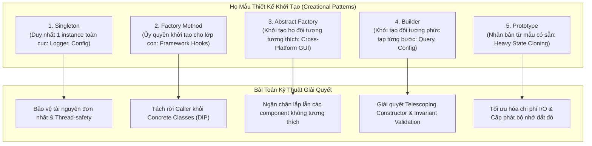
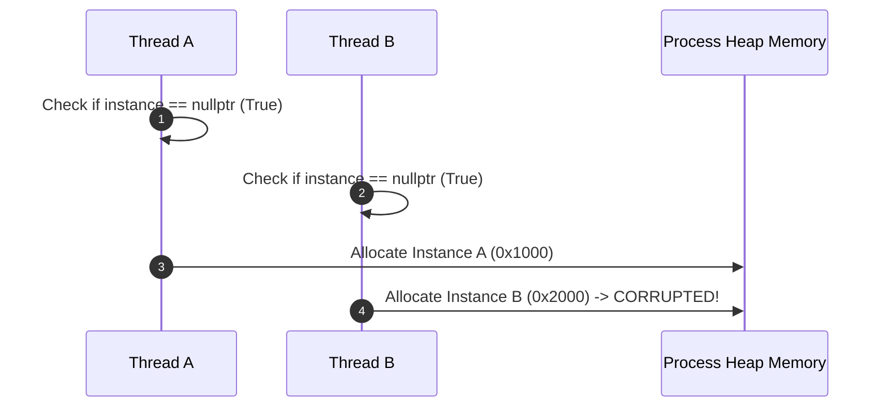
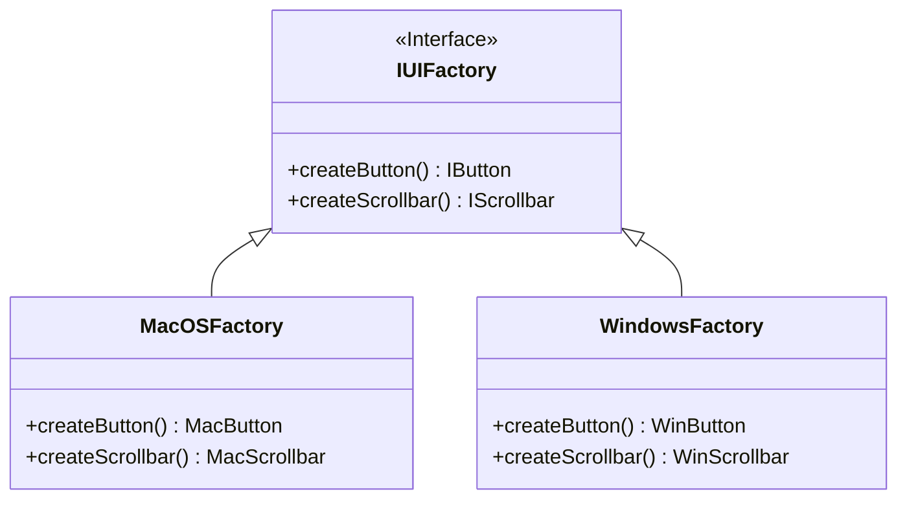
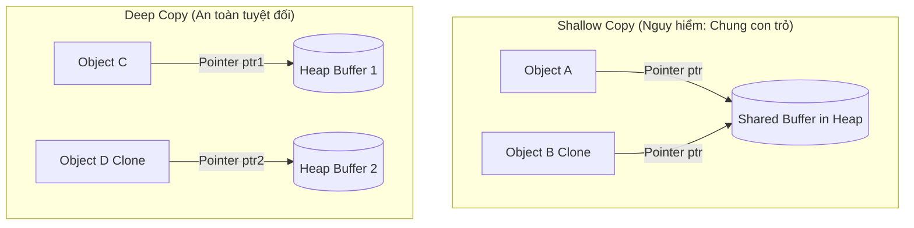

# 5.1. Các Mẫu Thiết Kế Khởi Tạo (Creational Design Patterns)

> [!IMPORTANT]
> **Nếu bạn chỉ được nhớ một điều duy nhất:** Nhóm Creational Patterns giải phóng mã nguồn khỏi sự trói buộc cứng nhắc vào toán tử `new` cụ thể bằng cách đóng gói tri thức về cách thức đối tượng được cấp phát bộ nhớ, cấu hình và tổng hợp; một kiến trúc khởi tạo chuẩn mực sẽ bảo vệ tính toàn vẹn đa luồng và tách biệt hoàn toàn việc tạo lập đối tượng khỏi việc sử dụng đối tượng.

---

## 1. Kiến trúc Tổng quan & Mô hình Tư duy (Mental Model)

### Ẩn dụ Đời sống: Tổ Hợp Sản Xuất Xe Hơi Hiện Đại
Hãy hình dung quá trình khởi tạo đối tượng trong phần mềm tương tự như một tổ hợp công nghiệp chế tạo xe hơi:
- **Singleton (Nhà Máy Điện Trung Tâm)**: Toàn bộ nhà máy chỉ có duy nhất một trạm biến áp cao thế cung cấp năng lượng cho hàng trăm robot. Không ai xây 10 trạm biến áp cho 10 robot vì vừa lãng phí tài nguyên vừa gây xung đột pha điện.
- **Factory Method (Phân Xưởng Khung Gầm Linh Hoạt)**: Băng chuyền định nghĩa quy trình ráp khung xe chuẩn, nhưng việc gắn khung gầm Sedan hay SUV được giao quyền cho phân xưởng chuyên biệt quyết định tại thời điểm thực thi.
- **Abstract Factory (Gói Tùy Chọn Nội Ngoại Thất Tương Thích)**: Khi khách chọn phiên bản "Luxury Pack", nhà máy tự động ráp ghế da Ý đi cùng viền gỗ óc chó; nếu chọn "Sport Pack", nhà máy ráp ghế sợi carbon đi cùng vô lăng thể thao. Tuyệt đối không bao giờ để xảy ra lỗi lắp lẫn vô lăng carbon vào nội thất cổ điển.
- **Builder (Dây Chuyền Tùy Biến Theo Yêu Cầu Khách Hàng)**: Chiếc xe có hơn 50 tùy chọn (cửa sổ trời, sưởi ghế, phanh gốm, dàn loa Burmester). Thay vì yêu cầu khách hàng điền một tờ đơn 50 dòng (Telescoping Constructor), nhân viên bán hàng dùng ứng dụng iPad tích chọn từng món và kiểm tra xung đột kỹ thuật trước khi bấm "Đặt Hàng" (`build()`).
- **Prototype (Máy Dập Khuôn Thân Vỏ 3D)**: Thay vì gò từng tấm thép từ đầu (tốn hàng tuần tính toán), robot dùng một khuôn mẫu thép chuẩn (Prototype) để dập hàng ngàn cánh cửa giống hệt nhau trong chớp mắt (Cloning).



---

## 2. Chi tiết từng Keyword (Under-the-Hood Deep Dive)

### 2.1. Singleton Pattern: Cơ Chế Meyers' Singleton, DCLP và Cạm Bẫy Global State

#### 1. Bản Chất và Bài Toán Đa Luồng (Thread-Safety Internals)
Mục tiêu: Đảm bảo một class chỉ có duy nhất một instance trong bộ nhớ và cung cấp một điểm truy cập toàn cục.
Trong môi trường đa luồng (Multi-threaded Systems), việc kiểm tra `if (instance == nullptr)` ngây thơ sẽ dẫn đến Race Condition: Hai luồng cùng đọc thấy `nullptr` và cùng cấp phát hai vùng nhớ khác nhau, gây rò rỉ bộ nhớ hoặc xung đột dữ liệu.



#### 2. Meyers' Singleton (C++11 Trở Đi - Khuyên Dùng Tuyệt Đối)
Được đặt tên theo Scott Meyers, kỹ thuật này tận dụng chuẩn ngôn ngữ C++: **Biến tĩnh cục bộ (Static Local Variable) được khởi tạo an toàn luồng (Thread-safe) trong lần đầu tiên luồng thực thi đi qua nó**.
- *Under-the-hood*: Trình biên dịch (GCC/Clang) tự động chèn các cờ nguyên tử nội tại (`__cxa_guard_acquire` và `__cxa_guard_release`) để bảo vệ quá trình khởi tạo mà lập trình viên không cần dùng `std::mutex` thủ công.

#### 3. Double-Checked Locking Pattern (DCLP) & Memory Barrier
Trong các ngôn ngữ như Java hoặc C++ cổ điển, DCLP cố gắng tối ưu hiệu năng bằng cách kiểm tra con trỏ hai lần:
```cpp
// DCLP CỔ ĐIỂN CÓ THỂ BỊ LỖI DO CPU REORDERING NẾU THIẾU MEMORY BARRIER
if (instance.load(std::memory_order_acquire) == nullptr) {
    std::lock_guard<std::mutex> lock(mtx);
    if (instance.load(std::memory_order_relaxed) == nullptr) {
        // CPU có thể reorder: Gán địa chỉ con trỏ trước khi Constructor hoàn tất ghi dữ liệu!
        instance.store(new Singleton(), std::memory_order_release);
    }
}
```

#### 4. Cạm Bẫy Global State & State Pollution Trong Testing
- Singleton bản chất là một biến toàn cục trá hình (Global State in Disguise).
- **Tác hại lớn nhất**: Phá hủy tính độc lập của Unit Test. Khi chạy 50 test cases song song trên nhiều luồng, Test A sửa đổi trạng thái của Singleton làm cho Test B bị thất bại ngẫu nhiên (Flaky Tests).
- **Giải pháp Hiện đại**: Thay thế Singleton bằng **Dependency Injection Container (IoC Container)** với vòng đời đăng ký `LifetimeScope.Singleton`.

---

### 2.2. Factory Method Pattern: Đa Hình Hóa Quá Trình Tạo Lập
- **Định nghĩa**: Định nghĩa một phương thức tạo lập trừu tượng trong lớp cơ sở, nhưng giao quyền quyết định lớp cụ thể nào sẽ được khởi tạo cho các lớp con.
- **Nguyên lý Thiết kế**: Tuân thủ triệt để **Open/Closed Principle (OCP)** và **Dependency Inversion Principle (DIP)**. Khi cần thêm một loại sản phẩm mới, ta chỉ cần tạo một subclass Factory mới mà không cần sửa đổi bất kỳ dòng mã nào của bên sử dụng (Client).

---

### 2.3. Abstract Factory Pattern: Đồng Bộ Hóa Họ Đối Tượng Tương Thích
- **Định nghĩa**: Cung cấp một giao diện trừu tượng để tạo ra **một họ các đối tượng có quan hệ mật thiết hoặc phụ thuộc lẫn nhau (A family of related products)** mà không chỉ định các lớp cụ thể của chúng.
- **Giải quyết bài toán tương thích hệ thống**:
  - Khi ứng dụng chạy trên macOS: Abstract Factory cung cấp `MacButton`, `MacScrollbar`, `MacDialog`.
  - Khi chạy trên Windows: Cung cấp `WinButton`, `WinScrollbar`, `WinDialog`.
  - Hệ thống đảm bảo 100% các thành phần UI luôn thuộc cùng một phong cách thiết kế, ngăn chặn hoàn toàn việc nhầm lẫn giao diện.



---

### 2.4. Builder Pattern: Khắc Phục Telescoping Constructor & Fluent Interface

#### 1. Telescoping Constructor Anti-Pattern
Khi một đối tượng có 10-15 trường cấu hình (Configuration Parameters):
```cpp
// ANTI-PATTERN: Không ai nhớ nổi thứ tự 10 tham số boolean và string này!
UserAccount acc("John", "Doe", "john@corp.com", true, false, 0, 100, "Admin", false, 5000);
```

#### 2. Giải Pháp Chuẩn Mực Bằng Fluent Builder
- Tách rời quá trình dựng đối tượng phức tạp khỏi biểu diễn nội tại của nó.
- Cung cấp các phương thức biểu cảm: `.withEmail("...")`, `.withRole("Admin")`, `.enableTwoFactor()`.
- **Validation tại hàm `.build()`**: Builder là chốt chặn cuối cùng kiểm tra toàn bộ Class Invariants. Nếu các tham số mâu thuẫn nhau (ví dụ: Role là "Admin" nhưng không cấu hình "TwoFactor"), phương thức `.build()` sẽ ném exception ngay lập tức trước khi đối tượng rác được sinh ra.

---

### 2.5. Prototype Pattern: Cơ Chế Sao Chép (Shallow vs Deep Copy) & Prototype Registry

#### 1. Bản Chất Kỹ Thuật
- Cho phép tạo ra đối tượng mới bằng cách **Sao chép (Clone)** từ một đối tượng mẫu (Prototype) đã được nạp sẵn vào bộ nhớ, thay vì thực hiện lại toàn bộ chuỗi khởi tạo đắt đỏ (truy vấn DB, đọc file XML/JSON từ ổ đĩa).

#### 2. Phân Biệt Shallow Copy vs Deep Copy
- **Shallow Copy (Sao chép nông)**: Chỉ sao chép giá trị của các kiểu nguyên thủy và sao chép **địa chỉ con trỏ**. Cả bản gốc và bản sao cùng trỏ vào một vùng nhớ heap chung. Khi một bên hủy con trỏ, bên kia sẽ dính lỗi **Dangling Pointer** hoặc **Double-Free Crash**.
- **Deep Copy (Sao chép sâu)**: Cấp phát vùng nhớ mới hoàn toàn trên heap cho các con trỏ và đệ quy sao chép toàn bộ cây dữ liệu.



---

### 2.6. Quản Trị Vòng Đời Khởi Tạo Hiện Đại Với Dependency Injection Containers
Trong các hệ thống Enterprise hiện đại, lập trình viên hầu như không còn viết các lớp Singleton hay Factory thủ công. Thay vào đó, toàn bộ quy trình khởi tạo được ủy quyền cho **IoC Containers** (Spring IoC, Microsoft.Extensions.DependencyInjection, Boost.DI):
- **Transient**: Mỗi lần yêu cầu một instance mới được tạo ra (Prototype-like).
- **Scoped**: Một instance duy nhất cho mỗi vòng đời HTTP Request.
- **Singleton**: Một instance duy nhất cho toàn bộ vòng đời ứng dụng, được Container khởi tạo an toàn và quản lý việc giải phóng bộ nhớ khi tắt tiến trình.

---

## 3. Thực thi Mã nguồn & Mô phỏng Chuyên sâu (Dual-Engine Implementation)

### 3.1. C++20 Implementation: Thread-Safe Meyers' Singleton & Validating Fluent Builder
Chương trình C++20 dưới đây minh họa sự kết hợp hoàn hảo giữa Meyers' Singleton luồng an toàn (xóa bỏ copy/move) và một Fluent Builder có kiểm soát Invariant khắt khe.

```cpp
#include <iostream>
#include <string>
#include <optional>
#include <stdexcept>
#include <utility>
#include <chrono>

// ============================================================================
// 1. MEYERS' SINGLETON: THREAD-SAFE DATABASE CONNECTION POOL
// ============================================================================
class GlobalDatabasePool {
private:
    std::string connectionString_;
    uint32_t maxConnections_{10};

    // Private constructor
    GlobalDatabasePool() {
        connectionString_ = "postgresql://cluster-primary.internal:5432/core_banking";
        std::cout << "[Singleton Engine] Initializing Global DB Pool instance at address: " 
                  << this << "...\n";
    }

public:
    // Xóa bỏ triệt để copy & move semantics
    GlobalDatabasePool(const GlobalDatabasePool&) = delete;
    GlobalDatabasePool& operator=(const GlobalDatabasePool&) = delete;
    GlobalDatabasePool(GlobalDatabasePool&&) = delete;
    GlobalDatabasePool& operator=(GlobalDatabasePool&&) = delete;

    // Meyers' Singleton: Luồng an toàn tuyệt đối theo chuẩn C++11/C++20
    static GlobalDatabasePool& instance() noexcept {
        static GlobalDatabasePool pool; // Magic static guarantee
        return pool;
    }

    [[nodiscard]] const std::string& connectionString() const noexcept {
        return connectionString_;
    }
};

// ============================================================================
// 2. PRODUCT: COMPLEX ENTERPRISE SERVER CONFIGURATION
// ============================================================================
class ServerConfiguration {
    friend class ServerConfigBuilder;
private:
    std::string host_{"0.0.0.0"};
    uint16_t port_{8080};
    uint32_t threadPoolSize_{4};
    bool enableTls_{false};
    std::string tlsCertPath_;
    uint32_t timeoutMs_{3000};

    // Constructor private để ép buộc phải đi qua Builder
    ServerConfiguration() = default;

public:
    void printSummary() const {
        std::cout << "[Server Config Output]\n"
                  << "  Host/Port  : " << host_ << ":" << port_ << "\n"
                  << "  Workers    : " << threadPoolSize_ << " threads\n"
                  << "  TLS Enabled: " << (enableTls_ ? "YES" : "NO") << "\n"
                  << "  Timeout    : " << timeoutMs_ << " ms\n";
    }
};

// ============================================================================
// 3. FLUENT BUILDER WITH INVARIANT VALIDATION
// ============================================================================
class ServerConfigBuilder {
private:
    ServerConfiguration config_;

public:
    ServerConfigBuilder& bindAddress(std::string host, uint16_t port) {
        config_.host_ = std::move(host);
        config_.port_ = port;
        return *this;
    }

    ServerConfigBuilder& workers(uint32_t numThreads) {
        config_.threadPoolSize_ = numThreads;
        return *this;
    }

    ServerConfigBuilder& enableTls(std::string certPath) {
        config_.enableTls_ = true;
        config_.tlsCertPath_ = std::move(certPath);
        return *this;
    }

    ServerConfigBuilder& timeoutMs(uint32_t ms) {
        config_.timeoutMs = ms;
        return *this;
    }

    // Chốt chặn cuối cùng kiểm tra toàn bộ Invariants
    ServerConfiguration build() {
        if (config_.port_ == 0) {
            throw std::invalid_argument("Builder Validation Error: Port 0 is reserved!");
        }
        if (config_.threadPoolSize_ == 0 || config_.threadPoolSize_ > 256) {
            throw std::invalid_argument("Builder Validation Error: Thread pool size must be between 1 and 256!");
        }
        if (config_.enableTls_ && config_.tlsCertPath_.empty()) {
            throw std::logic_error("Builder Invariant Error: TLS enabled but cert path is missing!");
        }
        return std::move(config_);
    }
};

int main() {
    std::cout << "=== C++20 Creational Patterns (Singleton & Fluent Builder) ===\n";

    // 1. Kiểm chứng Singleton Identity
    auto& db1 = GlobalDatabasePool::instance();
    auto& db2 = GlobalDatabasePool::instance();
    std::cout << "[Singleton Verification] db1 addr: " << &db1 << " | db2 addr: " << &db2 << "\n";

    // 2. Xây dựng đối tượng thành công bằng Builder
    try {
        std::cout << "\n--- Building Valid Enterprise Server Config ---\n";
        ServerConfiguration prodServer = ServerConfigBuilder()
            .bindAddress("10.0.0.1", 443)
            .workers(32)
            .enableTls("/etc/ssl/certs/prod-gateway.pem")
            .timeoutMs(5000)
            .build();
        prodServer.printSummary();

        // 3. Thử nghiệm vi phạm Invariant: Bật TLS nhưng không truyền đường dẫn cert
        std::cout << "\n--- Testing Invariant Violation in Builder ---\n";
        ServerConfiguration brokenServer = ServerConfigBuilder()
            .bindAddress("127.0.0.1", 80)
            .workers(8)
            .enableTls("") // Lỗi logic!
            .build();

    } catch (const std::exception& ex) {
        std::cout << "  🛡️ Builder Guard Intercepted: " << ex.what() << "\n";
    }

    return 0;
}
```

#### Terminal Output Mẫu (C++20):
```text
=== C++20 Creational Patterns (Singleton & Fluent Builder) ===
[Singleton Engine] Initializing Global DB Pool instance at address: 0x104b2c040...
[Singleton Verification] db1 addr: 0x104b2c040 | db2 addr: 0x104b2c040

--- Building Valid Enterprise Server Config ---
[Server Config Output]
  Host/Port  : 10.0.0.1:443
  Workers    : 32 threads
  TLS Enabled: YES
  Timeout    : 5000 ms

--- Testing Invariant Violation in Builder ---
  🛡️ Builder Guard Intercepted: Builder Invariant Error: TLS enabled but cert path is missing!
```

---

### 3.2. Python 3.11+ Implementation: Abstract Factory for Multi-Cloud Resource Provisioning
Chương trình Python 3.11+ dưới đây minh họa việc sử dụng **Abstract Factory Pattern** để khởi tạo đồng bộ một họ tài nguyên đám mây (Compute VM + Object Storage) cho hai nhà cung cấp AWS và Google Cloud (GCP) mà không làm rò rỉ SDK cụ thể ra ngoài Client.

```python
from __future__ import annotations
from abc import ABC, abstractmethod
from typing import NamedTuple

# ============================================================================
# ABSTRACT PRODUCTS (PRODUCT INTERFACES)
# ============================================================================
class VirtualMachine(ABC):
    @abstractmethod
    def boot(self) -> str: ...

class ObjectStorage(ABC):
    @abstractmethod
    def put_blob(self, key: str, data: bytes) -> str: ...

# ============================================================================
# CONCRETE PRODUCTS: AWS CLOUD FAMILY
# ============================================================================
class EC2Instance(VirtualMachine):
    def __init__(self, instance_type: str):
        self.instance_type = instance_type

    def boot(self) -> str:
        return f"[AWS Cloud] Booting EC2 instance ({self.instance_type}) with Nitro Hypervisor."

class S3Bucket(ObjectStorage):
    def __init__(self, bucket_name: str):
        self.bucket_name = bucket_name

    def put_blob(self, key: str, data: bytes) -> str:
        return f"[AWS Cloud] Storing {len(data)} bytes to 's3://{self.bucket_name}/{key}' with SSE-KMS encryption."

# ============================================================================
# CONCRETE PRODUCTS: GOOGLE CLOUD (GCP) FAMILY
# ============================================================================
class ComputeEngineVM(VirtualMachine):
    def __init__(self, machine_type: str):
        self.machine_type = machine_type

    def boot(self) -> str:
        return f"[GCP Cloud] Spinning up Google Compute Engine VM ({self.machine_type}) on Borg Cluster."

class CloudStorageBucket(ObjectStorage):
    def __init__(self, bucket_name: str):
        self.bucket_name = bucket_name

    def put_blob(self, key: str, data: bytes) -> str:
        return f"[GCP Cloud] Streaming {len(data)} bytes to 'gs://{self.bucket_name}/{key}' with Dual-Region redundancy."

# ============================================================================
# ABSTRACT FACTORY
# ============================================================================
class CloudInfrastructureFactory(ABC):
    @abstractmethod
    def create_compute(self) -> VirtualMachine: ...

    @abstractmethod
    def create_storage(self) -> ObjectStorage: ...

# ============================================================================
# CONCRETE FACTORIES
# ============================================================================
class AWSInfrastructureFactory(CloudInfrastructureFactory):
    def create_compute(self) -> VirtualMachine:
        return EC2Instance("c6i.4xlarge")

    def create_storage(self) -> ObjectStorage:
        return S3Bucket("enterprise-data-lake-aws")

class GCPInfrastructureFactory(CloudInfrastructureFactory):
    def create_compute(self) -> VirtualMachine:
        return ComputeEngineVM("c2-standard-16")

    def create_storage(self) -> ObjectStorage:
        return CloudStorageBucket("enterprise-data-lake-gcp")

# ============================================================================
# CLIENT CODE (INDEPENDENT OF CONCRETE CLOUD SDKs)
# ============================================================================
def deploy_environment(factory: CloudInfrastructureFactory) -> None:
    print(f"\n[Client Orchestrator] Deploying cloud workloads using {factory.__class__.__name__}...")
    vm = factory.create_compute()
    storage = factory.create_storage()

    # Kích hoạt tài nguyên
    print("  -> " + vm.boot())
    print("  -> " + storage.put_blob("models/weights.bin", b"AI_MODEL_WEIGHTS_BINARY_BLOB"))


if __name__ == "__main__":
    print("=== Python 3.11+ Multi-Cloud Abstract Factory Pattern Demo ===")

    # Triển khai trên môi trường AWS
    aws_factory = AWSInfrastructureFactory()
    deploy_environment(aws_factory)

    # Triển khai trên môi trường GCP (Chỉ đổi đúng 1 dòng khởi tạo Factory!)
    gcp_factory = GCPInfrastructureFactory()
    deploy_environment(gcp_factory)
```

#### Terminal Output Mẫu (Python 3.11+):
```text
=== Python 3.11+ Multi-Cloud Abstract Factory Pattern Demo ===

[Client Orchestrator] Deploying cloud workloads using AWSInfrastructureFactory...
  -> [AWS Cloud] Booting EC2 instance (c6i.4xlarge) with Nitro Hypervisor.
  -> [AWS Cloud] Storing 27 bytes to 's3://enterprise-data-lake-aws/models/weights.bin' with SSE-KMS encryption.

[Client Orchestrator] Deploying cloud workloads using GCPInfrastructureFactory...
  -> [GCP Cloud] Spinning up Google Compute Engine VM (c2-standard-16) on Borg Cluster.
  -> [GCP Cloud] Streaming 27 bytes to 'gs://enterprise-data-lake-gcp/models/weights.bin' with Dual-Region redundancy.
```

---

## 4. Systems Engineering & Production Pitfalls

### Các Cạm Bẫy Thực Chiến (Gotchas & Production Antipatterns)

1. **Hiểm Họa Thứ Tự Hủy Singleton Trong C++ (Static Destruction Order Fiasco)**:
   - *Bản chất*: Nếu Singleton $A$ phụ thuộc vào Singleton $B$, khi tiến trình kết thúc, thứ tự gọi destructor của các biến tĩnh là không xác định giữa các Translation Units (Undefined Order). Nếu Destructor của $A$ cố gắng gọi $B$ sau khi $B$ đã bị hủy trước đó, hệ thống sẽ gặp lỗi nghiêm trọng **Segmentation Fault** hoặc **Core Dump** khi shutdown.
   - *Khắc phục*: Tránh để các Singleton giữ tham chiếu phụ thuộc lẫn nhau khi hủy, hoặc sử dụng cơ chế `Phoenix Singleton` hay rò rỉ có chủ đích bằng `new` mà không `delete` cho các tài nguyên chỉ sống theo vòng đời tiến trình.

2. **Cạm Bẫy Đệ Quy Vô Tận Trong Prototype Deep Copy**:
   - *Bản chất*: Khi thực hiện Deep Copy trên một cấu trúc đồ thị đối tượng có liên kết vòng (Circular References: Đối tượng Cha trỏ con, Con trỏ ngược lại Cha), thuật toán sao chép đệ quy sẽ lặp vô tận và làm tràn ngăn xếp (**Stack Overflow Crash**).
   - *Khắc phục*: Sử dụng bảng băm ghi nhớ bản đồ địa chỉ (Identity Map / Memoization `dict[old_id, new_instance]`) trong quá trình clone để nhận diện các nút đã được sao chép.

3. **Lạm Dụng Abstract Factory Gây Ra Hiện Tượng Phình To Mã Nguồn**:
   - *Bản chất*: Khi một họ sản phẩm chỉ có 1 biến thể duy nhất và không bao giờ thay đổi, việc tạo ra 4 Interfaces và 8 Factories trung gian gây tốn chi phí nhận thức cho đội ngũ mà không mang lại giá trị kiến trúc nào.
   - *Khắc phục*: Tuân thủ nguyên lý YAGNI (You Aren't Gonna Need It); chỉ nâng cấp từ hàm khởi tạo thông thường lên Abstract Factory khi hệ thống thực sự có từ 2 biến thể sản phẩm trở lên.

4. **Kỹ Thuật Chẩn Đoán & Giám Sát Bằng CLI**:
   ```bash
   # 1. Phát hiện Race Conditions trong quá trình khởi tạo Singleton bằng ThreadSanitizer
   clang++ -std=c++20 -fsanitize=thread -g src/singleton_demo.cpp -o singleton_tsan && ./singleton_tsan

   # 2. Kiểm tra bộ nhớ rò rỉ khi Clone Prototype bằng Valgrind
   valgrind --leak-check=full --track-origins=yes ./prototype_benchmark

   # 3. Phân tích số lượng Instance Singleton được cấp phát trong JVM
   jcmd $(pgrep java) GC.class_histogram | grep "ConfigurationManager"
   ```

---

## 5. Bảng So sánh & Decision Matrix

### 5.1. So Sánh Toàn Diện Các Mẫu Thiết Kế Khởi Tạo (Creational Patterns)

| Mẫu Thiết Kế | Trọng Tâm Khởi Tạo | Mức Độ Phức Tạp | Vấn Đề Giải Quyết | Triệu Chứng Cần Áp Dụng |
| :--- | :--- | :---: | :--- | :--- |
| **Singleton** | Duy nhất 1 instance toàn cục | Thấp | Kiểm soát tập trung tài nguyên | Quản lý Thread Pool, Logger, Cấu hình |
| **Factory Method** | Ủy quyền tạo 1 đối tượng cho lớp con | Trung bình | Tách rời Caller khỏi Concrete Classes | Framework hooks, Plugin mở rộng |
| **Abstract Factory** | Tạo một **họ** các đối tượng tương thích | Cao | Ngăn chặn lắp lẫn component không đồng bộ| Đa nền tảng (AWS/GCP, Mac/Windows/Linux) |
| **Builder** | Xây dựng đối tượng phức tạp từng bước | Trung bình | Telescoping Constructor, Validation | Query Builder, HTTP Request, Server Config |
| **Prototype** | Sao chép/Clone từ đối tượng mẫu | Trung bình | Chi phí cấp phát/tính toán khởi tạo quá đắt | Cấu hình nặng nề, Game state snapshots |

### 5.2. Ma Trận Quyết Định Lựa Chọn Mẫu Khởi Tạo

| Yêu Cầu Bài Toán | Mẫu Khuyên Dùng | Lý Do Kỹ Thuật |
| :--- | :--- | :--- |
| **Cần duy nhất 1 nguồn chân lý cho toàn bộ app** | Singleton (qua DI Container) | Tiết kiệm RAM, đồng bộ hóa trạng thái toàn cục |
| **Hệ thống có nhiều tùy chọn tham số, nhiều giá trị mặc định** | **Builder Pattern** | Cú pháp Fluent rõ ràng, kiểm soát chặt Class Invariants |
| **Hệ thống hỗ trợ nhiều Cloud Provider hoặc nhiều OS** | **Abstract Factory Pattern** | Đảm bảo các resource luôn đi theo cặp tương thích |
| **Khởi tạo đối tượng tốn 500ms đọc DB hoặc parse file** | **Prototype Pattern** | Clone vùng nhớ in-memory ở tốc độ micro-giây |
