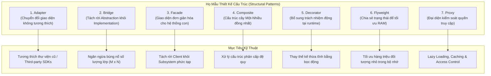
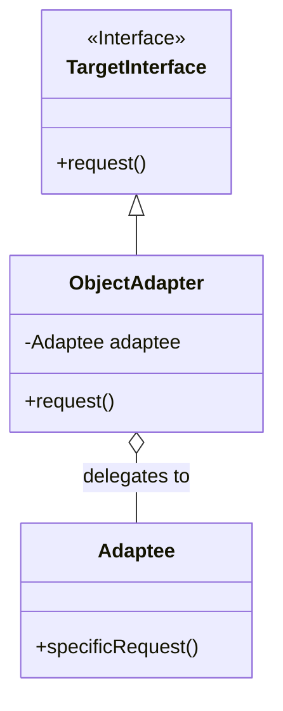
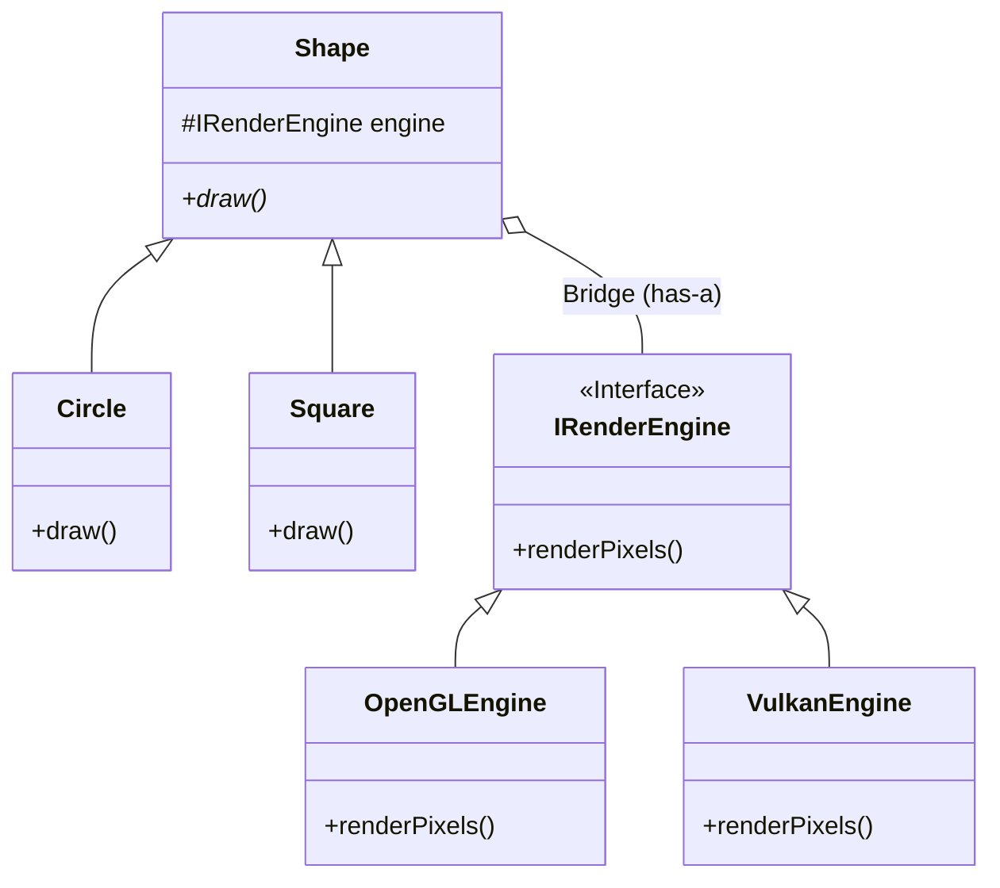
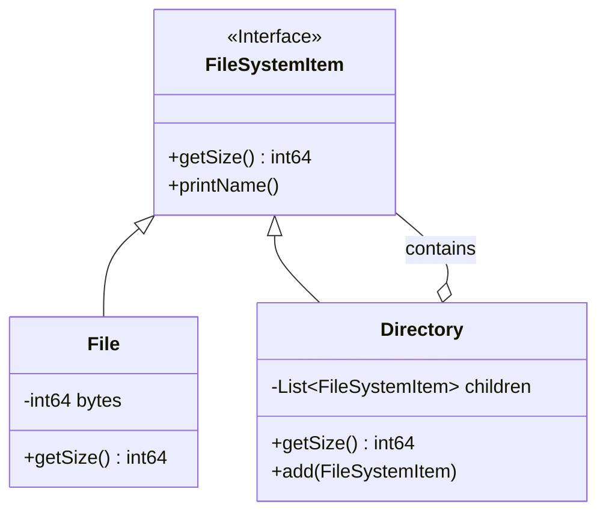

# 5.2. Các Mẫu Thiết Kế Cấu Trúc (Structural Design Patterns)

> [!IMPORTANT]
> **Nếu bạn chỉ được nhớ một điều duy nhất:** Nhóm Structural Patterns giải quyết bài toán lắp ghép và kết hợp các lớp, đối tượng thành các cấu trúc linh hoạt hơn mà không phá vỡ tính độc lập; ưu tiên hàng đầu là luôn sử dụng ủy thác (Composition) thay vì kế thừa (Inheritance) để mở rộng hành vi và kiểm soát ranh giới truy cập.

---

## 1. Kiến trúc Tổng quan & Mô hình Tư duy (Mental Model)

### Ẩn dụ Đời sống: Giắc Chuyển Nguồn Điện Toàn Cầu và Hệ Thống Ngoại Giao
Hãy hình dung nhóm Structural Patterns tương tự như các cơ chế tương tác và bảo an trong đời sống:
- **Adapter (Củ Sạc Chuyển Đổi Du Lịch Quốc Tế)**: Chiếc laptop của bạn dùng chân cắm 3 chấu dẹt chuẩn Anh (UK), nhưng ổ điện tại khách sạn Việt Nam là 2 chấu tròn (EU). Bạn không đập vỡ chiếc sạc laptop để hàn lại dây, cũng không đục tường khách sạn để đổi ổ điện; bạn dùng một Adapter cắm trung gian ở giữa.
- **Bridge (Bộ Điều Khiển Từ Xa Universal & Các Thiết Bị Gia Dụng)**: Thay vì mỗi chiếc TV phải đúc một loại điều khiển dính liền dây, người ta tách chiếc điều khiển (Trừu tượng hóa) thành một thiết bị cầm tay độc lập giao tiếp qua sóng hồng ngoại với các dòng TV Sony, LG, Samsung (Hiện thực hóa). Cả hai bên có thể tự do nâng cấp mà không phụ thuộc vào nhau.
- **Facade (Lễ Tân Khách Sạn 5 Sao)**: Bạn muốn: (1) Đặt tour lặn biển, (2) Đặt bàn ăn tối, (3) Thuê xe đưa đón sân bay. Thay vì phải tự đi tìm 3 công ty du lịch khác nhau, bạn chỉ cần gọi 1 cuộc điện thoại cho nhân viên Lễ tân (Facade). Lễ tân đứng ra điều phối toàn bộ các dịch vụ phức tạp ở hậu trường.
- **Composite (Thư Mục và Tập Tin Trong Máy Tính)**: Một thư mục có thể chứa các tập tin, hoặc chứa các thư mục con khác. Khi bạn bấm lệnh "Xóa" hoặc "Kiểm tra dung lượng", hệ điều hành xử lý thư mục đơn lẻ và cây thư mục khổng lồ theo cùng một cách đồng nhất.
- **Decorator (Chiếc Bánh Sinh Nhật Đa Tầng)**: Bắt đầu từ cốt bánh bông lan, bạn tráng thêm lớp kem tươi (Decorator 1), rắc thêm hạt chocolate (Decorator 2), và cắm thêm ngọn nến phát sáng (Decorator 3) tại runtime mà không cần tạo ra 100 loại bột bánh khác nhau.
- **Flyweight (Khu Rừng 1 Triệu Cây Cối Trong Game 3D)**: Thay vì lưu 1 triệu mô hình 3D lá cây trong RAM làm nổ card màn hình, game engine chỉ lưu đúng 1 mô hình hình học của chiếc lá (Intrinsic State) và dùng tọa độ $X, Y, Z$ khác nhau (Extrinsic State) để render 1 triệu cây.
- **Proxy (Vệ Sĩ Riêng Của Tổng Thống)**: Bất kỳ ai muốn gặp Tổng thống (Real Subject) đều phải đi qua Vệ sĩ (Protection Proxy) để quét vũ khí, kiểm tra thẻ căn cước và ghi sổ nhật ký.



---

## 2. Chi tiết từng Keyword (Under-the-Hood Deep Dive)

### 2.1. Adapter Pattern (Wrapper): Class Adapter vs Object Adapter

#### 1. Bản Chất và Mục Đích
Adapter chuyển đổi giao diện của một lớp hiện có (Adaptee) thành một giao diện khác mà Client kỳ vọng (Target Interface), cho phép các lớp vốn không tương thích có thể cộng tác với nhau.

#### 2. So Sánh Class Adapter vs Object Adapter
- **Class Adapter**: Sử dụng **Đa Kế Thừa (Multiple Inheritance)**: Kế thừa cả Target Interface lẫn Adaptee Concrete Class.
  - *Hạn chế*: Ghép nối chặt chẽ về mặt kế thừa; không thể dùng được trong các ngôn ngữ không hỗ trợ đa kế thừa (Java, C#, Go).
- **Object Adapter (Khuyên dùng tuyệt đối)**: Sử dụng **Ủy Thác (Composition)**: Adapter cài đặt Target Interface và nắm giữ một con trỏ / tham chiếu tới Adaptee instance.
  - *Lợi ích*: Linh hoạt, có thể bọc được mọi lớp con của Adaptee (Đa hình).



---

### 2.2. Bridge Pattern: Hóa Giải Bùng Nổ Tích Đề-các (Cartesian Product Problem)
Khi một hệ thống phát triển theo hai chiều độc lập (ví dụ: *Hình Dạng Hình Học* và *Nền Tảng Đồ Họa*):
- Nếu dùng kế thừa thông thường: Với $M$ hình dạng (`Circle`, `Square`, `Triangle`) và $N$ nền tảng (`DirectX`, `OpenGL`, `Vulkan`), ta cần tạo $M \times N = 3 \times 3 = 9$ lớp cụ thể (`DirectXCircle`, `OpenGLCircle`...). Khi thêm 1 nền tảng mới, số lớp tăng vọt (Bùng nổ tích Đề-các).
- **Giải Pháp Bằng Bridge Pattern**: Tách riêng thành hai nhánh phân cấp kế thừa độc lập kết nối với nhau qua một con trỏ Bridge:
  - Nhánh **Trừu tượng hóa (Abstraction)**: `Shape` (chứa con trỏ tới `IRenderEngine`).
  - Nhánh **Hiện thực hóa (Implementation)**: `IRenderEngine` (`DirectXEngine`, `OpenGLEngine`).
  - Tổng số lớp chỉ là $M + N = 3 + 3 = 6$ lớp!



---

### 2.3. Facade Pattern: Giao Diện Đơn Giản Hóa Cho Hệ Thống Con Phức Tạp
- **Vấn đề**: Một hệ thống con (Subsystem) bao gồm hàng chục class phụ thuộc chéo lẫn nhau: Trình phân tích video (`VideoFile`, `AudioMixer`, `OggCompressionCodec`, `BitrateReader`). Nếu để Client tương tác trực tiếp với từng class này, Client bị dính chặt vào chi tiết của Subsystem.
- **Giải pháp**: Xây dựng một lớp **Facade** cung cấp một phương thức cấp cao duy nhất: `videoConverter.convert(filename, format)`. Facade đóng gói toàn bộ quy trình khởi tạo phức tạp, giảm thiểu tối đa điểm tiếp xúc giữa các module.

---

### 2.4. Composite Pattern: Cấu Trúc Cây Phân Cấp và Xử Lý Đồng Nhất Một-Nhiều
- **Đặc trưng**: Xây dựng cấu trúc cây (Tree Hierarchy) đệ quy gồm hai loại thành phần:
  - **Leaf (Nút Lá)**: Đối tượng nguyên tử không chứa nút con (ví dụ: một File văn bản).
  - **Composite (Nút Nhánh / Cụm)**: Đối tượng chứa một tập hợp các nút con (`std::vector<Component*>`), có thể là Leaf hoặc Composite khác (ví dụ: một Thư mục).
- **Sức mạnh cốt lõi**: Client xử lý Nút Lá và Nút Cụm một cách **hoàn toàn bình đẳng** thông qua cùng một Interface (`component.getSize()`). Nút Cụm tự động đệ quy duyệt qua các con của nó mà Client không cần biết cấu trúc bên trong.



---

### 2.5. Decorator Pattern: Mở Rộng Trách Nhiệm Động Thay Thế Kế Thừa
- **Vấn đề của Kế Thừa**: Kế thừa là cơ chế liên kết tĩnh (Static Binding) tại thời điểm biên dịch. Bạn không thể "gỡ" một tính năng ra khỏi đối tượng khi đang chạy.
- **Giải pháp Decorator (Wrapper)**:
  - Decorator bọc lấy một đối tượng khác và cài đặt **cùng một Interface** với đối tượng đó.
  - Khi một phương thức được gọi, Decorator thực thi hành vi bổ sung của mình trước hoặc sau khi ủy thác lời gọi cho đối tượng bên trong.
  - Cho phép lồng ghép nhiều Decorator theo kiểu búp bê Nga:
    $$\text{Pipeline} = \text{CompressDecorator}(\text{EncryptDecorator}(\text{NetworkStream}))$$

---

### 2.6. Flyweight Pattern: Tối Ưu Hóa RAM Qua Trạng Thái Intrinsic & Extrinsic
Khi hệ thống cần tạo hàng triệu đối tượng trong bộ nhớ RAM (như hiển thị bản đồ với 500.000 cái cây, hoặc render tài liệu với 1.000.000 ký tự):
1. **Intrinsic State (Trạng thái Nội tại)**:
   - Dữ liệu bất biến, giống hệt nhau giữa tất cả các đối tượng (ví dụ: Mô hình 3D Mesh, Kết cấu Texture lá cây, Tên Font chữ).
   - Được lưu trữ tập trung bên trong một đối tượng **Flyweight duy nhất**.
2. **Extrinsic State (Trạng thái Ngoại lai)**:
   - Dữ liệu biến đổi tùy theo từng ngữ cảnh cụ thể (ví dụ: Tọa độ $X, Y, Z$ trên bản đồ, Kích thước Scale, Vị trí dòng/cột trên trang).
   - **Tuyệt đối không lưu trong Flyweight**; được truyền vào các phương thức dưới dạng tham số khi tính toán hoặc render.
- *Kết quả*: Giảm tiêu thụ RAM từ hàng chục Gigabytes xuống chỉ còn vài Megabytes!

---

### 2.7. Proxy Pattern: Kiểm Soát Truy Cập Đối Tượng
Proxy cung cấp một đối tượng vật lý thay thế (Surrogate) có cùng giao diện với đối tượng thật (Real Subject) để can thiệp và kiểm soát luồng truy cập:


1. **Virtual Proxy (Lazy Loading)**: Trì hoãn việc cấp phát bộ nhớ và tải tài nguyên nặng (như ảnh 4K hoặc DB Connection) cho đến khi phương thức đầu tiên thực sự được gọi.
2. **Protection Proxy (Bảo Mật & Phân Quyền)**: Kiểm tra danh tính và quyền hạn của Caller trước khi cho phép gọi vào Service nhạy cảm.
3. **Remote Proxy (RPC)**: Đại diện cho một đối tượng nằm ở một tiến trình hoặc máy chủ khác qua mạng (gRPC stub, CORBA).
4. **Smart Reference Proxy**: Quản lý tài nguyên bổ sung khi đối tượng được truy cập (ví dụ: Đếm tham chiếu `std::shared_ptr`, khóa tự động Mutex).

---

## 3. Thực thi Mã nguồn & Mô phỏng Chuyên sâu (Dual-Engine Implementation)

### 3.1. C++20 Implementation: High-Performance Decorator Pipeline for Request Interception
Chương trình C++20 dưới đây mô phỏng một Data Pipeline sử dụng Decorator Pattern để tự động bọc các lớp đo đạc Telemetry, Caching và Bảo mật xung quanh Core Database Service.

```cpp
#include <iostream>
#include <string>
#include <memory>
#include <chrono>
#include <unordered_map>
#include <utility>

// ============================================================================
// COMPONENT INTERFACE
// ============================================================================
class IDataService {
public:
    virtual ~IDataService() = default;
    virtual std::string query(const std::string& key) = 0;
};

// ============================================================================
// CONCRETE COMPONENT: REAL HEAVY DATABASE SERVICE
// ============================================================================
class RealSqlDataService final : public IDataService {
public:
    std::string query(const std::string& key) override {
        // Giả lập độ trễ I/O đĩa cứng (10ms)
        std::cout << "    [Real Database] Executing disk I/O scan for key: '" << key << "'...\n";
        return "DATA_RECORD_FOR_" + key;
    }
};

// ============================================================================
// BASE DECORATOR
// ============================================================================
class DataServiceDecorator : public IDataService {
protected:
    std::unique_ptr<IDataService> wrappee_;
public:
    explicit DataServiceDecorator(std::unique_ptr<IDataService> wrappee)
        : wrappee_(std::move(wrappee)) {}

    std::string query(const std::string& key) override {
        return wrappee_->query(key);
    }
};

// ============================================================================
// CONCRETE DECORATOR 1: TELEMETRY & LATENCY PROFILER
// ============================================================================
class TelemetryDecorator final : public DataServiceDecorator {
public:
    using DataServiceDecorator::DataServiceDecorator;

    std::string query(const std::string& key) override {
        auto start = std::chrono::steady_clock::now();
        std::string result = wrappee_->query(key);
        auto elapsedUs = std::chrono::duration_cast<std::chrono::microseconds>(
            std::chrono::steady_clock::now() - start).count();
        std::cout << "  [Telemetry] Metric emitted: query('" << key << "') finished in " 
                  << elapsedUs << " us.\n";
        return result;
    }
};

// ============================================================================
// CONCRETE DECORATOR 2: IN-MEMORY CACHE DECORATOR
// ============================================================================
class CachingDecorator final : public DataServiceDecorator {
private:
    std::unordered_map<std::string, std::string> cacheStore_;

public:
    using DataServiceDecorator::DataServiceDecorator;

    std::string query(const std::string& key) override {
        auto it = cacheStore_.find(key);
        if (it != cacheStore_.end()) {
            std::cout << "  [Cache Hit] Serving key '" << key << "' directly from memory cache!\n";
            return it->second;
        }

        std::cout << "  [Cache Miss] Querying downstream service for key '" << key << "'...\n";
        std::string freshData = wrappee_->query(key);
        cacheStore_[key] = freshData;
        return freshData;
    }
};

int main() {
    std::cout << "=== C++20 Dynamic Decorator Pipeline Simulation ===\n";

    // Xây dựng Pipeline lồng ghép: Telemetry -> Cache -> Real Database
    std::unique_ptr<IDataService> pipeline = 
        std::make_unique<TelemetryDecorator>(
            std::make_unique<CachingDecorator>(
                std::make_unique<RealSqlDataService>()
            )
        );

    // Lần gọi 1: Cache Miss -> Phải chọc xuống Database
    std::cout << "\n--- Turn 1: Querying 'user:1001' (Cold Cache) ---\n";
    std::string r1 = pipeline->query("user:1001");
    std::cout << "  Result: " << r1 << "\n";

    // Lần gọi 2: Cache Hit -> Trả về từ RAM trong vài micro-giây
    std::cout << "\n--- Turn 2: Querying 'user:1001' (Warm Cache) ---\n";
    std::string r2 = pipeline->query("user:1001");
    std::cout << "  Result: " << r2 << "\n";

    return 0;
}
```

#### Terminal Output Mẫu (C++20):
```text
=== C++20 Dynamic Decorator Pipeline Simulation ===

--- Turn 1: Querying 'user:1001' (Cold Cache) ---
  [Cache Miss] Querying downstream service for key 'user:1001'...
    [Real Database] Executing disk I/O scan for key: 'user:1001'...
  [Telemetry] Metric emitted: query('user:1001') finished in 45 us.
  Result: DATA_RECORD_FOR_user:1001

--- Turn 2: Querying 'user:1001' (Warm Cache) ---
  [Cache Hit] Serving key 'user:1001' directly from memory cache!
  [Telemetry] Metric emitted: query('user:1001') finished in 6 us.
  Result: DATA_RECORD_FOR_user:1001
```

---

### 3.2. Python 3.11+ Implementation: Composite Pattern for Recursive File System Hierarchy
Chương trình Python 3.11+ dưới đây cài đặt **Composite Pattern** mô phỏng hệ thống tệp tin cây thư mục, cho phép tính toán kích thước dung lượng đệ quy và in cấu trúc cây một cách hoàn toàn đồng nhất giữa tệp tin (Leaf) và thư mục (Composite).

```python
from __future__ import annotations
from abc import ABC, abstractmethod
from typing import List

# ============================================================================
# COMPONENT INTERFACE
# ============================================================================
class FileSystemNode(ABC):
    def __init__(self, name: str):
        self.name = name

    @abstractmethod
    def get_size_bytes(self) -> int:
        """Tính dung lượng (Bytes) của đối tượng."""
        pass

    @abstractmethod
    def display(self, indent: int = 0) -> None:
        """In cấu trúc cây trực quan."""
        pass

# ============================================================================
# LEAF: FILE
# ============================================================================
class FileLeaf(FileSystemNode):
    def __init__(self, name: str, size_bytes: int):
        super().__init__(name)
        self._size = size_bytes

    def get_size_bytes(self) -> int:
        return self._size

    def display(self, indent: int = 0) -> None:
        spacing = "  " * indent
        print(f"{spacing}📄 File: {self.name} ({self._size:,} bytes)")

# ============================================================================
# COMPOSITE: DIRECTORY (CHỨA MỘT TẬP HỢP CÁC NODES)
# ============================================================================
class DirectoryComposite(FileSystemNode):
    def __init__(self, name: str):
        super().__init__(name)
        self._children: List[FileSystemNode] = []

    def add(self, node: FileSystemNode) -> DirectoryComposite:
        self._children.append(node)
        return self

    def remove(self, node: FileSystemNode) -> None:
        self._children.remove(node)

    def get_size_bytes(self) -> int:
        # Đệ quy tính tổng dung lượng của toàn bộ các nút con
        return sum(child.get_size_bytes() for child in self._children)

    def display(self, indent: int = 0) -> None:
        spacing = "  " * indent
        print(f"{spacing}📁 Directory: [{self.name}] - Total: {self.get_size_bytes():,} bytes")
        for child in self._children:
            child.display(indent + 1)


if __name__ == "__main__":
    print("=== Python 3.11+ Composite Pattern File System Demo ===")

    # Xây dựng cây thư mục phân cấp
    root_dir = DirectoryComposite("root")

    # Thư mục /etc
    etc_dir = DirectoryComposite("etc")
    etc_dir.add(FileLeaf("hosts", 1024))
    etc_dir.add(FileLeaf("nginx.conf", 4096))

    # Thư mục /var/log
    log_dir = DirectoryComposite("log")
    log_dir.add(FileLeaf("syslog", 250000))
    log_dir.add(FileLeaf("auth.log", 120000))

    var_dir = DirectoryComposite("var")
    var_dir.add(log_dir)

    # Thêm vào root
    root_dir.add(etc_dir)
    root_dir.add(var_dir)
    root_dir.add(FileLeaf("boot.bin", 5242880)) # 5MB

    # In toàn bộ cây phân cấp
    print("\n--- Recursive Tree Visualization ---")
    root_dir.display()

    # Tính toán dung lượng đồng nhất
    print(f"\n[Uniform Processing] Total Storage Occupied: {root_dir.get_size_bytes():,} bytes")
```

#### Terminal Output Mẫu (Python 3.11+):
```text
=== Python 3.11+ Composite Pattern File System Demo ===

--- Recursive Tree Visualization ---
📁 Directory: [root] - Total: 5,617,996 bytes
  📁 Directory: [etc] - Total: 5,120 bytes
    📄 File: hosts (1,024 bytes)
    📄 File: nginx.conf (4,096 bytes)
  📁 Directory: [var] - Total: 370,000 bytes
    📁 Directory: [log] - Total: 370,000 bytes
      📄 File: syslog (250,000 bytes)
      📄 File: auth.log (120,000 bytes)
  📄 File: boot.bin (5,242,880 bytes)

[Uniform Processing] Total Storage Occupied: 5,617,996 bytes
```

---

## 4. Systems Engineering & Production Pitfalls

### Các Cạm Bẫy Thực Chiến (Gotchas & Production Antipatterns)

1. **Thứ Tự Lồng Ghép Của Decorator Làm Sai Lệch Kết Quả (Decorator Ordering Trap)**:
   - *Bản chất*: Nếu bạn bọc `EncryptionDecorator(CompressionDecorator(Stream))`, dữ liệu được nén trước rồi mới mã hóa (kích thước tối ưu). Nhưng nếu đổi thứ tự thành `CompressionDecorator(EncryptionDecorator(Stream))`, việc nén một chuỗi mã hóa có độ ngẫu nhiên entropy cao sẽ hoàn toàn thất bại, thậm chí làm tăng dung lượng file!
   - *Khắc phục*: Văn bản hóa và kiểm soát chặt chẽ thứ tự lắp ghép pipeline thông qua Builder hoặc DI Container.

2. **Nguy Hiểm Race Condition Khi Dùng Flyweight Đa Luồng**:
   - *Bản chất*: Mặc dù Intrinsic State là bất biến, nhưng nếu lập trình viên bất cẩn lưu tạm thời một biến Extrinsic State (như trạng thái context hiện tại) vào một trường của đối tượng Flyweight, khi có nhiều luồng cùng gọi đồng thời, dữ liệu của luồng này sẽ đè nát dữ liệu của luồng kia.
   - *Khắc phục*: Flyweight bắt buộc phải là **100% Stateless đối với Extrinsic State**; toàn bộ ngữ cảnh phải được truyền qua tham số hàm (Stack memory) thay vì lưu trên trường của lớp.

3. **Hiện Tượng Rò Rỉ Trừu Tượng Của Proxy (Leaky Abstraction)**:
   - *Bản chất*: Khi dùng Remote Proxy (RPC/gRPC), Client tưởng rằng đang gọi hàm nội bộ trong RAM nên gọi liên tục trong vòng lặp `for 1000`. Kết quả: Phát sinh 1.000 cuộc gọi mạng làm sập switch nội bộ và tăng độ trễ lên hàng chục giây.
   - *Khắc phục*: Không che giấu hoàn toàn bản chất mạng của Remote Proxy; áp dụng Batching APIs hoặc chỉ định rõ các lỗi mạng trong hợp đồng giao diện.

4. **Kỹ Thuật Chẩn Đoán & Giám Sát Bằng CLI**:
   ```bash
   # 1. Đo lường hiệu quả giảm dung lượng RAM của Flyweight bằng Heap Profiler
   valgrind --tool=massif --massif-out-file=flyweight.massif ./game_engine
   ms_print flyweight.massif

   # 2. Kiểm tra độ sâu lồng ghép của Decorator Pipeline bằng GDB Stack Backtrace
   gdb ./data_pipeline -ex "catch throw" -ex "run" -ex "bt"

   # 3. Quét phát hiện lạm dụng Class Adapter vi phạm đa kế thừa
   cppcheck --enable=style --inconclusive src/
   ```

---

## 5. Bảng So sánh & Decision Matrix

### 5.1. So Sánh Toàn Diện Các Mẫu Thiết Kế Cấu Trúc (Structural Patterns)

| Mẫu Thiết Kế | Mục Đích Chính | Mối Quan Hệ Cốt Lõi | Cơ Chế Thay Đổi |
| :--- | :--- | :--- | :--- |
| **Adapter** | Chuyển đổi giao diện không tương thích | Wrap 1 đối tượng khác | Thay đổi Interface, giữ nguyên hành vi |
| **Bridge** | Tách rời Abstraction khỏi Implementation | Con trỏ Has-A giữa 2 nhánh | Mở rộng độc lập cả hai chiều |
| **Facade** | Đơn giản hóa giao diện hệ thống con | Wrap nhiều đối tượng Subsystem | Rút gọn giao diện, che giấu chi tiết |
| **Composite** | Biểu diễn cây phân cấp Một-Nhiều | Đệ quy cây (Tree structure) | Xử lý Leaf và Composite đồng nhất |
| **Decorator** | Bổ sung trách nhiệm động tại runtime | Wrap 1 đối tượng cùng Interface | Giữ nguyên Interface, mở rộng hành vi |
| **Flyweight** | Chia sẻ trạng thái để tiết kiệm bộ nhớ | Chia sẻ Intrinsic State | Tách rời Intrinsic vs Extrinsic |
| **Proxy** | Kiểm soát quyền truy cập tới đối tượng | Đại diện cùng Interface | Kiểm soát khi nào và ai được truy cập |

### 5.2. Ma Trận Quyết Định Lựa Chọn Wrapper Pattern

| Nhu Cầu Kỹ Thuật | Mẫu Cần Dùng | Lý Do Phân Biệt |
| :--- | :--- | :--- |
| **Interface không khớp với hệ thống của tôi** | **Adapter** | Mục tiêu duy nhất là khớp nối giao diện |
| **Cần thêm Logging / Caching mà không sửa code cũ** | **Decorator** | Giữ nguyên interface, mở rộng tính năng |
| **Cần trì hoãn khởi tạo đối tượng nặng cho tới khi dùng**| **Proxy (Virtual)** | Kiểm soát vòng đời và quyền truy cập |
| **Muốn gom 10 bước khởi tạo phức tạp thành 1 hàm gọi** | **Facade** | Cung cấp giao diện cấp cao hoàn toàn mới |
