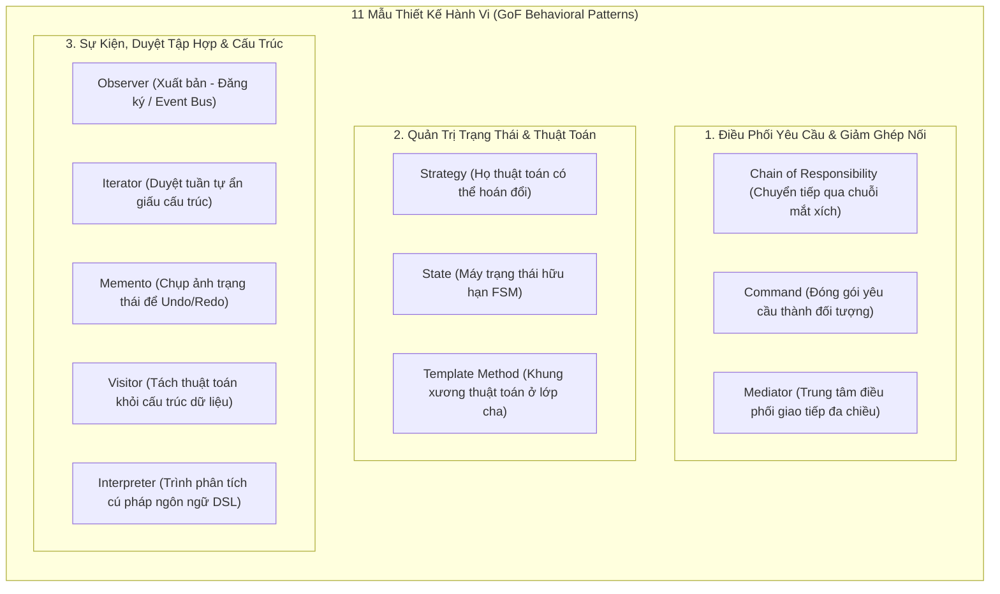
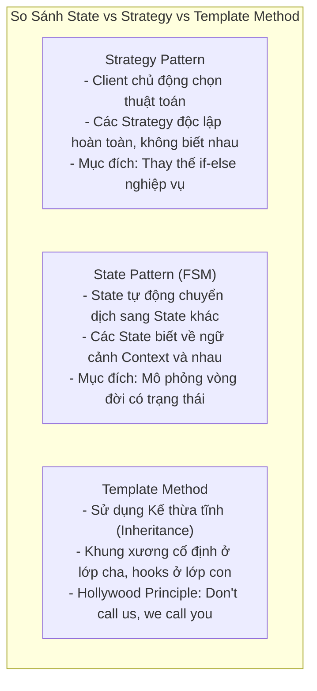

# 5.3. Các Mẫu Thiết Kế Hành Vi (Behavioral Design Patterns)

> [!IMPORTANT]
> **Nếu bạn chỉ được nhớ một điều duy nhất:** Nhóm Behavioral Patterns không tập trung vào cách thức tạo lập hay ghép nối các lớp, mà tập trung vào các mô hình giao tiếp (Communication Protocols) và sự phân bổ trách nhiệm linh hoạt giữa các đối tượng tại runtime; việc lựa chọn đúng mẫu hành vi sẽ triệt tiêu các cấu trúc rẽ nhánh `if-else` khổng lồ và biến các luồng xử lý phức tạp thành các mắt xích độc lập, dễ kiểm thử.

---

## 1. Kiến trúc Tổng quan & Mô hình Tư duy (Mental Model)

### Ẩn dụ Đời sống: Tháp Điều Khiển Không Lưu và Trạm An Ninh Đa Cấp
Hãy hình dung các mẫu thiết kế hành vi tương tự như các quy trình giao tiếp và điều phối trong xã hội:
- **Chain of Responsibility (Cửa Kiểm Soát An Ninh Sân Bay)**: Hành khách đi qua 3 cửa liên tiếp: (1) Kiểm tra vé máy bay, (2) Soi chiếu hành lý kim loại, (3) Kiểm tra hộ chiếu xuất cảnh. Nếu túi xách có dao ở trạm (2), quy trình bị chặn ngay lập tức (Fail-Fast); hành khách không cần và không thể nhảy cóc đến trạm (3).
- **Command (Tờ Phiếu Kêu Món Của Bồi Bàn)**: Bồi bàn ghi yêu cầu "1 Bít-tết Tái, 1 Rượu Vang Đỏ" vào một mảnh giấy (Command Object) rồi kẹp vào thanh trượt nhà bếp. Mảnh giấy này có thể được xếp hàng đợi (Queue), ghi sổ kế toán (Log), hoặc hủy bỏ (Undo) mà bồi bàn không cần biết đầu bếp nào sẽ nấu.
- **Mediator (Tháp Điều Khiển Không Lưu Sân Bay)**: 50 chiếc máy bay chuẩn bị hạ cánh không tự gọi bộ đàm cho nhau (vì quan hệ $50 \times 49 = 2450$ đường truyền sẽ gây nhiễu loạn). Tất cả phi công chỉ liên lạc với Tháp điều khiển trung tâm (Mediator) để nhận lệnh cấp đường băng.
- **State (Máy Bán Hàng Tự Động)**: Cùng là hành vi "Bấm nút chọn nước ngọt", nhưng nếu máy đang ở trạng thái `Chưa Bỏ Tiền`, nó sẽ nhấp nháy đèn đỏ từ chối; nếu đang ở trạng thái `Đã Bỏ Đủ 20.000đ`, nó sẽ nhả lon nước và tự chuyển sang trạng thái `Trả Lại Tiền Thừa`.
- **Strategy (Ứng Dụng Bản Đồ Chỉ Đường Google Maps)**: Cùng điểm đi và điểm đến, bạn có thể chuyển đổi thuật toán tìm đường: Đi xe hơi (nhanh nhất), Đi xe máy (tránh đường cấm), hoặc Đi bộ (ngắn nhất) tại runtime chỉ bằng một cú chạm.
- **Observer (Kênh Youtube Có Nút Bật Chuông Thông Báo)**: Khi Youtuber tải lên video mới (Subject State Changed), hàng ngàn người hâm mộ đã bấm chuông (Observers) sẽ tự động nhận được thông báo đẩy trên điện thoại.



---

## 2. Chi tiết từng Keyword (Under-the-Hood Deep Dive)

### 2.1. Request Handling: Chain of Responsibility, Command và Mediator

#### 1. Chain of Responsibility Pattern
- **Bản chất**: Tránh việc gắn kết chặt chẽ giữa bên gửi yêu cầu (Sender) và bên nhận (Receiver) bằng cách cho nhiều đối tượng cơ hội xử lý yêu cầu đó. Các đối tượng được liên kết thành một chuỗi (Chain). Mỗi mắt xích có 2 lựa chọn: (1) Xử lý yêu cầu và dừng chuỗi, hoặc (2) Chuyển tiếp yêu cầu cho mắt xích tiếp theo.
- **Ứng dụng chuẩn mực**: Pipeline Middlewares trong Web Frameworks (Xác thực JWT $\to$ Giới hạn tần suất Rate Limit $\to$ Kiểm tra CORS $\to$ Router Handler).

#### 2. Command Pattern
- **Bản chất**: Đóng gói toàn bộ thông tin cần thiết để thực thi một hành động thành một đối tượng độc lập gồm: Phương thức thực thi (`execute()`), các tham số đầu vào và con trỏ đối tượng thụ hưởng (Receiver).
- **Khả năng nâng cao**:
  - **Queueing**: Đưa các command vào hàng đợi RabbitMQ/Kafka để xử lý nền bất đồng bộ.
  - **Undo / Redo (Hoàn tác)**: Command lưu trạng thái trước đó và cung cấp phương thức `undo()`. Lịch sử thao tác được lưu trong ngăn xếp `std::vector<std::unique_ptr<Command>>`.
  - **Transactional Write-Ahead Log (WAL)**: Ghi nhật ký các Command xuống đĩa trước khi thực thi để khôi phục trạng thái sau khi crash.

#### 3. Mediator Pattern
- **Bản chất**: Định nghĩa một đối tượng trung tâm đóng gói cách thức một tập hợp các đối tượng (Colleagues) tương tác với nhau. Thay vì các Colleague tham chiếu trực tiếp chéo nhau ($O(N^2)$ dependencies), chúng chỉ nắm giữ duy nhất một tham chiếu tới Mediator ($O(N)$ dependencies).
- **Ứng dụng**: Thư viện MediatR trong .NET / CQRS Command Bus, Hệ thống Chat Room, Giao diện Form phức tạp (thay đổi giá trị của Dropdown A làm thay đổi danh sách Checkbox B và vô hiệu hóa Nút C).

---

### 2.2. State vs Strategy vs Template Method



1. **Strategy Pattern**: Tập trung vào việc **Làm thế nào (How)**. Các thuật toán thực hiện cùng một mục tiêu nhưng bằng những cách khác nhau (ví dụ: `QuickSortStrategy` vs `MergeSortStrategy`, `StripePaymentStrategy` vs `PaypalStrategy`). Client thường là người khởi tạo và đưa Strategy vào Context.
2. **State Pattern**: Tập trung vào **Trạng thái hiện tại là gì (What State)**. Hành vi của Context phụ thuộc vào trạng thái nội bộ. Các Concrete State classes thường nhận biết về nhau và tự kích hoạt việc chuyển dịch trạng thái:
   $$\text{DraftState} \xrightarrow{\text{submit()}} \text{PendingReviewState} \xrightarrow{\text{approve()}} \text{PublishedState}$$
3. **Template Method Pattern**: Định nghĩa cấu trúc thuật toán cố định trong phương thức của lớp cha:
   ```cpp
   void executePipeline() { step1(); step2(); hookStep(); step3(); }
   ```
   Lớp con chỉ được quyền ghi đè (override) các bước cụ thể mà không được phép thay đổi trình tự thực thi của toàn bộ pipeline.

---

### 2.3. Observer Pattern: Xuất Bản - Đăng Ký (Pub/Sub) và Bất Đồng Bộ Hóa Sự Kiện
- **Bản chất**: Thiết lập mối quan hệ Một-Nhiều (1-to-Many Dependency). Khi đối tượng trung tâm (**Subject / Observable**) thay đổi trạng thái, tất cả các đối tượng đã đăng ký (**Observers / Listeners**) sẽ được tự động kích hoạt thông qua phương thức callback `update()`.
- **Cơ chế Push vs Pull**:
  - *Push Model*: Subject gửi toàn bộ dữ liệu sự kiện chi tiết sang cho Observer trong tham số hàm (dễ ghép nối dữ liệu).
  - *Pull Model*: Subject chỉ gửi một thông báo trống; Observer tự động truy vấn ngược lại Subject để lấy phần dữ liệu mà nó thực sự quan tâm.
- **Hiểm họa Lapsed Listener Problem (Rò rỉ bộ nhớ)**: Nếu Observer quên hủy đăng ký (`unsubscribe()`), Subject sẽ giữ một con trỏ tham chiếu mạnh (Strong Reference) tới Observer, khiến Garbage Collector hoặc bộ dọn RAM không bao giờ thu hồi được Observer đó!
  - *Khắc phục*: Sử dụng con trỏ yếu (**Weak References / `std::weak_ptr`**).

---

### 2.4. Iterator và Memento Patterns: Duyệt Tuần Tự và Hoàn Tác Trạng Thái

#### 1. Iterator Pattern
- Cung cấp một giao diện chuẩn hóa (`hasNext()`, `next()`, `current()`) để duyệt qua các phần tử của một tập hợp phức tạp (B-Tree, Graph, Hash Table, Circular Buffer) mà **hoàn toàn không làm lộ cấu trúc bộ nhớ bên trong**.
- Cho phép nhiều Iterator cùng duyệt đồng thời trên một tập hợp dữ liệu mà không can thiệp lẫn nhau.

#### 2. Memento Pattern (Snapshot / Rollback)
- Cho phép chụp lại và lưu trữ trạng thái nội bộ của một đối tượng (**Originator**) vào một đối tượng giữ chỗ (**Memento**) mà **không vi phạm tính đóng gói (Encapsulation)** (các trường private vẫn được bảo toàn).
- Đối tượng quản lý lịch sử (**Caretaker**) chỉ nắm giữ Memento như một "chiếc hộp đen" không thể đọc trộm dữ liệu, và chỉ chuyển trả lại cho Originator khi cần hoàn tác (`originator.restore(memento)`).

---

### 2.5. Visitor Pattern: Cơ Chế Double Dispatch
- **Bài toán**: Bạn có một cấu trúc cây gồm nhiều kiểu đối tượng khác nhau (`Paragraph`, `Image`, `Table`). Bạn muốn thêm các tính năng: (1) Export sang PDF, (2) Export sang Markdown, (3) Kiểm tra lỗi chính tả.
- Nếu thêm trực tiếp hàm vào từng class, bạn vi phạm SRP và OCP (mỗi lần thêm định dạng xuất file lại phải sửa toàn bộ các class tài liệu).
- **Giải Pháp Visitor**: Tách toàn bộ thuật toán ra khỏi cấu trúc dữ liệu bằng cơ chế **Double Dispatch**:
  1. Client gọi: `element->accept(visitor)`.
  2. Bên trong phương thức `accept`, phần tử gọi ngược lại: `visitor->visit(this)`.
  3. Nhờ cơ chế đa hình kép, compiler tự động định tuyến chính xác phương thức xử lý tương ứng với kiểu cụ thể của element mà không cần dùng `dynamic_cast` hay `instanceof`!

---

### 2.6. Interpreter Pattern: Phân Tích Cú Pháp Ngữ Pháp (DSL & AST)
- Định nghĩa ngữ pháp hình thức cho một ngôn ngữ đặc thù (Domain-Specific Language - DSL) dưới dạng các quy tắc ngữ pháp (Grammar Rules), biểu diễn các câu của ngôn ngữ đó dưới dạng một cây cú pháp trừu tượng (**Abstract Syntax Tree - AST**).
- Mỗi nút trong cây là một đối tượng `Expression` có hàm `interpret(Context)`.
- *Ứng dụng*: Trình đánh giá biểu thức toán học, bộ lọc tìm kiếm nâng cao (như query cú pháp Lucene/Elasticsearch: `age > 18 AND (city == 'Hanoi' OR city == 'HCM')`).

---

## 3. Thực thi Mã nguồn & Mô phỏng Chuyên sâu (Dual-Engine Implementation)

### 3.1. C++20 Implementation: Enterprise Finite State Machine (State Pattern)
Chương trình C++20 dưới đây cài đặt một **Máy Trạng Thái Hữu Hạn (FSM)** quản lý vòng đời đơn hàng thương mại điện tử bằng State Pattern, với sự chuyển dịch trạng thái tự động và kiểm soát tính toàn vẹn nghiệp vụ.

```cpp
#include <iostream>
#include <memory>
#include <string>
#include <utility>
#include <stdexcept>

class OrderFSMContext;

// ============================================================================
// STATE INTERFACE (HỢP ĐỒNG HÀNH VI TRẠNG THÁI)
// ============================================================================
class IOrderState {
public:
    virtual ~IOrderState() = default;
    virtual void pay(OrderFSMContext& ctx) = 0;
    virtual void ship(OrderFSMContext& ctx) = 0;
    virtual void cancel(OrderFSMContext& ctx) = 0;
    [[nodiscard]] virtual std::string stateName() const = 0;
};

// ============================================================================
// FSM CONTEXT (ĐỐI TƯỢNG NẮM GIỮ TRẠNG THÁI HIỆN TẠI)
// ============================================================================
class OrderFSMContext {
private:
    std::unique_ptr<IOrderState> currentState_;
    uint64_t orderId_;

public:
    OrderFSMContext(uint64_t id, std::unique_ptr<IOrderState> initialState);

    void transitionTo(std::unique_ptr<IOrderState> newState) {
        std::cout << "  [FSM Transition] Order #" << orderId_ << ": " 
                  << currentState_->stateName() << " ---> " << newState->stateName() << "\n";
        currentState_ = std::move(newState);
    }

    void pay() { currentState_->pay(*this); }
    void ship() { currentState_->ship(*this); }
    void cancel() { currentState_->cancel(*this); }

    [[nodiscard]] std::string currentStateName() const { return currentState_->stateName(); }
};

// ============================================================================
// CONCRETE STATES
// ============================================================================
class ShippedState;
class CancelledState;
class PaidState;

// 1. Trạng Thái: Vừa Tạo (Draft / Created)
class CreatedState final : public IOrderState {
public:
    void pay(OrderFSMContext& ctx) override;
    void ship(OrderFSMContext&) override {
        std::cout << "  ❌ Action Denied: Cannot ship an unpaid order!\n";
    }
    void cancel(OrderFSMContext& ctx) override;
    [[nodiscard]] std::string stateName() const override { return "CREATED"; }
};

// 2. Trạng Thái: Đã Thanh Toán (Paid)
class PaidState final : public IOrderState {
public:
    void pay(OrderFSMContext&) override {
        std::cout << "  ⚠️ Warning: Order is already paid. Ignoring duplicate payment.\n";
    }
    void ship(OrderFSMContext& ctx) override;
    void cancel(OrderFSMContext& ctx) override;
    [[nodiscard]] std::string stateName() const override { return "PAID"; }
};

// 3. Trạng Thái: Đã Giao Hàng (Shipped - Terminal State)
class ShippedState final : public IOrderState {
public:
    void pay(OrderFSMContext&) override { std::cout << "  ❌ Action Denied: Order already delivered.\n"; }
    void ship(OrderFSMContext&) override { std::cout << "  ⚠️ Warning: Order already in transit.\n"; }
    void cancel(OrderFSMContext&) override { 
        std::cout << "  ❌ Action Denied: Cannot cancel order after it has been shipped!\n"; 
    }
    [[nodiscard]] std::string stateName() const override { return "SHIPPED"; }
};

// 4. Trạng Thái: Bị Hủy (Cancelled - Terminal State)
class CancelledState final : public IOrderState {
public:
    void pay(OrderFSMContext&) override { std::cout << "  ❌ Action Denied: Cannot pay for a cancelled order.\n"; }
    void ship(OrderFSMContext&) override { std::cout << "  ❌ Action Denied: Cannot ship a cancelled order.\n"; }
    void cancel(OrderFSMContext&) override { std::cout << "  ⚠️ Warning: Order already cancelled.\n"; }
    [[nodiscard]] std::string stateName() const override { return "CANCELLED"; }
};

// --- Hiện Thực Hóa Chuyển Dịch Trạng Thái ---
void CreatedState::pay(OrderFSMContext& ctx) {
    std::cout << "  -> Payment processed successfully.\n";
    ctx.transitionTo(std::make_unique<PaidState>());
}

void CreatedState::cancel(OrderFSMContext& ctx) {
    std::cout << "  -> Order cancelled by customer before payment.\n";
    ctx.transitionTo(std::make_unique<CancelledState>());
}

void PaidState::ship(OrderFSMContext& ctx) {
    std::cout << "  -> Dispatching package to logistics courier.\n";
    ctx.transitionTo(std::make_unique<ShippedState>());
}

void PaidState::cancel(OrderFSMContext& ctx) {
    std::cout << "  -> Issuing full refund to payment gateway...\n";
    ctx.transitionTo(std::make_unique<CancelledState>());
}

OrderFSMContext::OrderFSMContext(uint64_t id, std::unique_ptr<IOrderState> initialState)
    : currentState_(std::move(initialState)), orderId_(id) {}

int main() {
    std::cout << "=== C++20 Order Lifecycle State Machine Demo ===\n";

    OrderFSMContext order(5001, std::make_unique<CreatedState>());
    std::cout << "[Init] Order #5001 current state: " << order.currentStateName() << "\n";

    // 1. Thử hành động không hợp lệ: Giao hàng khi chưa thanh toán
    std::cout << "\n--- Step 1: Attempting to ship unpaid order ---\n";
    order.ship();

    // 2. Thanh toán hợp lệ
    std::cout << "\n--- Step 2: Paying for order ---\n";
    order.pay();

    // 3. Giao hàng hợp lệ
    std::cout << "\n--- Step 3: Shipping order ---\n";
    order.ship();

    // 4. Thử hủy đơn hàng khi đã giao hàng (Bị từ chối)
    std::cout << "\n--- Step 4: Attempting to cancel shipped order ---\n";
    order.cancel();

    std::cout << "\n[Final State] Order ended in state: " << order.currentStateName() << "\n";
    return 0;
}
```

#### Terminal Output Mẫu (C++20):
```text
=== C++20 Order Lifecycle State Machine Demo ===
[Init] Order #5001 current state: CREATED

--- Step 1: Attempting to ship unpaid order ---
  ❌ Action Denied: Cannot ship an unpaid order!

--- Step 2: Paying for order ---
  -> Payment processed successfully.
  [FSM Transition] Order #5001: CREATED ---> PAID

--- Step 3: Shipping order ---
  -> Dispatching package to logistics courier.
  [FSM Transition] Order #5001: PAID ---> SHIPPED

--- Step 4: Attempting to cancel shipped order ---
  ❌ Action Denied: Cannot cancel order after it has been shipped!

[Final State] Order ended in state: SHIPPED
```

---

### 3.2. Python 3.11+ Implementation: Chain of Responsibility HTTP Middleware Pipeline
Chương trình Python 3.11+ dưới đây cài đặt **Chain of Responsibility Pattern** mô phỏng pipeline xử lý HTTP request qua các trạm kiểm soát an ninh (Authentication, Rate Limiting và Request Validation).

```python
from __future__ import annotations
from abc import ABC, abstractmethod
from typing import Optional, NamedTuple

class HttpRequest(NamedTuple):
    path: str
    token: Optional[str]
    client_ip: str
    payload: dict

class HttpResponse(NamedTuple):
    status_code: int
    message: str

# ============================================================================
# BASE HANDLER (MẮT XÍCH CHUỖI TRÁCH NHIỆM)
# ============================================================================
class HttpMiddleware(ABC):
    def __init__(self):
        self._next_handler: Optional[HttpMiddleware] = None

    def set_next(self, handler: HttpMiddleware) -> HttpMiddleware:
        self._next_handler = handler
        return handler

    @abstractmethod
    def handle(self, request: HttpRequest) -> HttpResponse:
        if self._next_handler:
            return self._next_handler.handle(request)
        return HttpResponse(200, "Request successfully processed by Endpoint Handler")

# ============================================================================
# CONCRETE HANDLER 1: AUTHENTICATION GUARD
# ============================================================================
class AuthenticationMiddleware(HttpMiddleware):
    def handle(self, request: HttpRequest) -> HttpResponse:
        print(f"  [Middleware: Auth] Checking token for path '{request.path}'...")
        if not request.token or request.token != "secret-jwt-token-xyz":
            print("  ❌ Auth Failed: Invalid or missing bearer token!")
            return HttpResponse(401, "Unauthorized: Invalid JWT credentials")
        
        print("  ✅ Auth Passed.")
        return super().handle(request)

# ============================================================================
# CONCRETE HANDLER 2: RATE LIMITING GUARD
# ============================================================================
class RateLimitingMiddleware(HttpMiddleware):
    def __init__(self, blocked_ips: set[str]):
        super().__init__()
        self.blocked_ips = blocked_ips

    def handle(self, request: HttpRequest) -> HttpResponse:
        print(f"  [Middleware: RateLimit] Checking traffic quota for IP '{request.client_ip}'...")
        if request.client_ip in self.blocked_ips:
            print("  ❌ Rate Limit Exceeded: IP is temporarily blacklisted!")
            return HttpResponse(429, "Too Many Requests: Rate limit exceeded")
        
        print("  ✅ Rate Limit Passed.")
        return super().handle(request)

# ============================================================================
# CONCRETE HANDLER 3: PAYLOAD VALIDATION GUARD
# ============================================================================
class SchemaValidationMiddleware(HttpMiddleware):
    def handle(self, request: HttpRequest) -> HttpResponse:
        print("  [Middleware: Schema] Validating JSON payload body...")
        if "order_id" not in request.payload:
            print("  ❌ Schema Error: Missing required field 'order_id'!")
            return HttpResponse(400, "Bad Request: Missing 'order_id'")
        
        print("  ✅ Schema Validation Passed.")
        return super().handle(request)


if __name__ == "__main__":
    print("=== Python 3.11+ Chain of Responsibility Middleware Pipeline ===")

    # Thiết lập chuỗi mắt xích liên hoàn: Auth -> RateLimit -> SchemaValidation
    pipeline = AuthenticationMiddleware()
    rate_limiter = pipeline.set_next(RateLimitingMiddleware(blocked_ips={"192.168.1.100"}))
    rate_limiter.set_next(SchemaValidationMiddleware())

    # Case 1: Request hoàn hảo vượt qua mọi trạm
    req_success = HttpRequest(
        path="/api/v1/orders",
        token="secret-jwt-token-xyz",
        client_ip="10.0.0.50",
        payload={"order_id": "ORD-12345", "amount": 99.5}
    )
    print("\n--- Dispatching Request 1 (Valid) ---")
    resp1 = pipeline.handle(req_success)
    print(f"  -> HTTP {resp1.status_code}: {resp1.message}")

    # Case 2: Bị chặn tại trạm đầu tiên (Auth Failed)
    req_unauth = HttpRequest(
        path="/api/v1/orders",
        token=None,
        client_ip="10.0.0.50",
        payload={"order_id": "ORD-12345"}
    )
    print("\n--- Dispatching Request 2 (Missing Token) ---")
    resp2 = pipeline.handle(req_unauth)
    print(f"  -> HTTP {resp2.status_code}: {resp2.message}")

    # Case 3: Qua được Auth nhưng bị chặn tại trạm 2 (Rate Limited IP)
    req_rate_limited = HttpRequest(
        path="/api/v1/orders",
        token="secret-jwt-token-xyz",
        client_ip="192.168.1.100", # Blocked IP
        payload={"order_id": "ORD-12345"}
    )
    print("\n--- Dispatching Request 3 (Spam IP) ---")
    resp3 = pipeline.handle(req_rate_limited)
    print(f"  -> HTTP {resp3.status_code}: {resp3.message}")
```

#### Terminal Output Mẫu (Python 3.11+):
```text
=== Python 3.11+ Chain of Responsibility Middleware Pipeline ===

--- Dispatching Request 1 (Valid) ---
  [Middleware: Auth] Checking token for path '/api/v1/orders'...
  ✅ Auth Passed.
  [Middleware: RateLimit] Checking traffic quota for IP '10.0.0.50'...
  ✅ Rate Limit Passed.
  [Middleware: Schema] Validating JSON payload body...
  ✅ Schema Validation Passed.
  -> HTTP 200: Request successfully processed by Endpoint Handler

--- Dispatching Request 2 (Missing Token) ---
  [Middleware: Auth] Checking token for path '/api/v1/orders'...
  ❌ Auth Failed: Invalid or missing bearer token!
  -> HTTP 401: Unauthorized: Invalid JWT credentials

--- Dispatching Request 3 (Spam IP) ---
  [Middleware: Auth] Checking token for path '/api/v1/orders'...
  ✅ Auth Passed.
  [Middleware: RateLimit] Checking traffic quota for IP '192.168.1.100'...
  ❌ Rate Limit Exceeded: IP is temporarily blacklisted!
  -> HTTP 429: Too Many Requests: Rate limit exceeded
```

---

## 4. Systems Engineering & Production Pitfalls

### Các Cạm Bẫy Thực Chiến (Gotchas & Production Antipatterns)

1. **Rò Rỉ Bộ Nhớ Của Observer (The Lapsed Listener Problem)**:
   - *Bản chất*: Trong Java, C# hoặc Node.js, khi một component vòng đời ngắn (Short-lived UI Widget) đăng ký lắng nghe sự kiện của một service toàn cục (Long-lived Singleton EventBus), nhưng khi Widget bị đóng lại, lập trình viên quên gọi `eventBus.unsubscribe(this)`. Singleton sẽ giữ tham chiếu mạnh tới Widget, khiến bộ dọn rác (GC) không thể giải phóng Widget, gây rò rỉ hàng trăm Megabytes bộ nhớ RAM sau vài giờ sử dụng.
   - *Khắc phục*: Sử dụng `WeakReference` trong EventBus, hoặc dùng thư viện quản lý vòng đời tự động hủy đăng ký (như RxJS `takeUntilDestroyed`).

2. **Cạn Kiệt Bộ Nhớ Do Hàng Đợi Command Không Có Giới Hạn (Unbounded Command Queue)**:
   - *Bản chất*: Áp dụng Command Pattern để đưa các tác vụ vào hàng đợi bộ nhớ trong RAM (`std::queue<Command*>`). Khi lưu lượng truy cập tăng đột biến (Traffic Spike), tốc độ thêm Command vượt xa tốc độ xử lý của Workers, hàng đợi phình to làm cạn kiệt RAM và kích hoạt **Linux Out-Of-Memory (OOM) Killer** làm sập tiến trình.
   - *Khắc phục*: Bắt buộc phải sử dụng **Bounded Queue (Hàng đợi có giới hạn kích thước)** kết hợp với cơ chế **Backpressure** (từ chối nhận thêm hoặc làm chậm Producer khi hàng đợi đạt $80\%$ sức chứa).

3. **Cạm Bẫy Bùng Nổ Trạng Thái Trong State Pattern (State Explosion)**:
   - *Bản chất*: Khi một quy trình nghiệp vụ có quá nhiều trạng thái phụ thuộc chéo (ví dụ: 15 trạng thái và 30 loại sự kiện), việc tạo 15 class cụ thể với hàng chục phương thức rỗng làm mã nguồn bị phân tán manh mún và cực kỳ khó nắm bắt luồng tổng thể.
   - *Khắc phục*: Sử dụng thư viện Finite State Machine chuyên dụng dựa trên bảng chuyển dịch (Transition Table FSM) hoặc cấu hình Declarative JSON/YAML thay vì tạo quá nhiều lớp OOP.

4. **Kỹ Thuật Chẩn Đoán & Giám Sát Bằng CLI**:
   ```bash
   # 1. Phát hiện rò rỉ tham chiếu Listener trong Node.js bằng heapdump & clinic
   clinic doctor -- node server.js

   # 2. Đo thời gian thực thi của từng Handler trong Chain of Responsibility
   perf record -g ./middleware_pipeline && perf report

   # 3. Theo dõi số lượng sự kiện đang xếp hàng đợi trong Command Bus bằng Prometheus
   curl -s http://localhost:9090/metrics | grep "command_queue_depth"
   ```

---

## 5. Bảng So sánh & Decision Matrix

### 5.1. Ma Trận Đánh Giá Toàn Diện 11 Mẫu Thiết Kế Hành Vi (GoF)

| Mẫu Thiết Kế | Trọng Tâm Giao Tiếp | Độ Phức Tạp | Vấn Đề Cốt Lõi Giải Quyết |
| :--- | :--- | :---: | :--- |
| **Chain of Responsibility** | Tuần tự qua chuỗi mắt xích | Thấp - TB | Tách rời Sender khỏi chuỗi kiểm duyệt |
| **Command** | Đóng gói yêu cầu thành Object | Trung bình | Xếp hàng, Undo/Redo, Async Task execution |
| **Mediator** | Trung tâm hóa giao tiếp đa chiều | Cao | Biến quan hệ mạng nhện $M \times N$ thành $1 \times N$ |
| **Observer** | Xuất bản - Đăng ký (Pub/Sub) | Thấp - TB | Thông báo 1-Nhiều khi trạng thái thay đổi |
| **Strategy** | Hoán đổi thuật toán linh hoạt | Thấp | Loại bỏ cấu trúc `if-else` / `switch` |
| **State** | Hành vi biến đổi theo trạng thái FSM | Trung bình | Quản lý vòng đời đối tượng có trạng thái |
| **Template Method** | Khung xương ở cha, chi tiết ở con | Thấp | Tái sử dụng cấu trúc thuật toán cố định |
| **Iterator** | Duyệt tuần tự tập hợp | Thấp | Ẩn giấu cấu trúc dữ liệu nội tại |
| **Memento** | Chụp và phục hồi snapshot | Trung bình | Lưu trạng thái mà không phá vỡ Encapsulation |
| **Visitor** | Tách thuật toán khỏi cấu trúc Object | Cao | Bổ sung hành vi mới mà không sửa lớp dữ liệu |
| **Interpreter** | Đánh giá ngữ pháp ngôn ngữ | Rất cao | Phân tích cú pháp biểu thức và câu lệnh DSL |

### 5.2. Ma Trận Quyết Định Lựa Chọn Xử Lý Yêu Cầu (Request Processing)

| Yêu Cầu Kỹ Thuật | Mẫu Khuyên Dùng | Lý Do Kỹ Thuật |
| :--- | :--- | :--- |
| **Cần chạy qua nhiều lớp kiểm duyệt bảo mật trước khi vào controller** | **Chain of Responsibility** | Hỗ trợ Fail-Fast, dễ thêm bớt middleware |
| **Cần lưu lại thao tác để hỗ trợ phím tắt Ctrl+Z (Undo) hoặc xếp hàng** | **Command Pattern** | Đóng gói trạng thái và hành động vào đối tượng |
| **Quá nhiều components gọi chéo nhau gây phụ thuộc vòng luẩn quẩn** | **Mediator Pattern** | Gom logic giao tiếp về một nhạc trưởng duy nhất |
| **Một thực thể thay đổi và nhiều phân hệ khác cần phản ứng tự động** | **Observer Pattern** | Giảm thiểu tối đa sự ghép nối trực tiếp |
