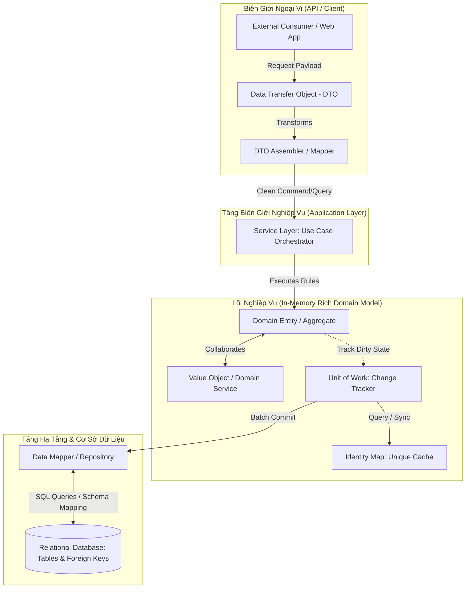
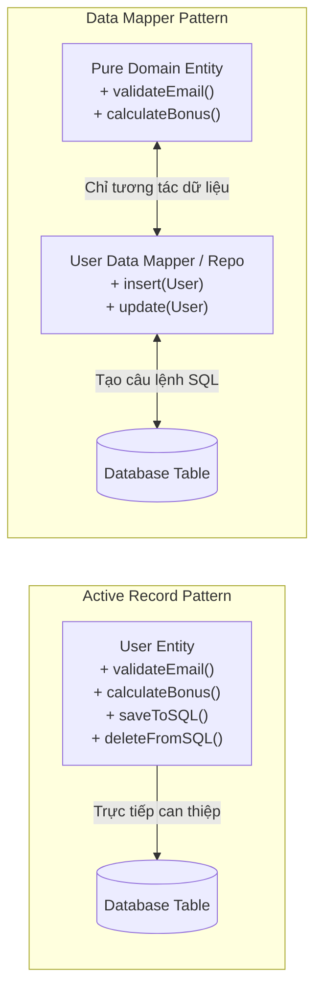
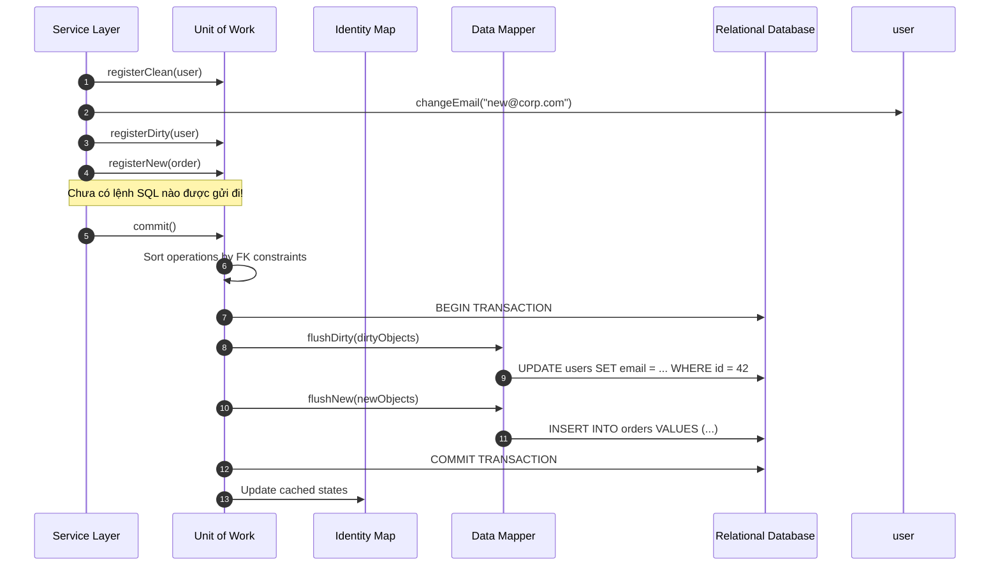
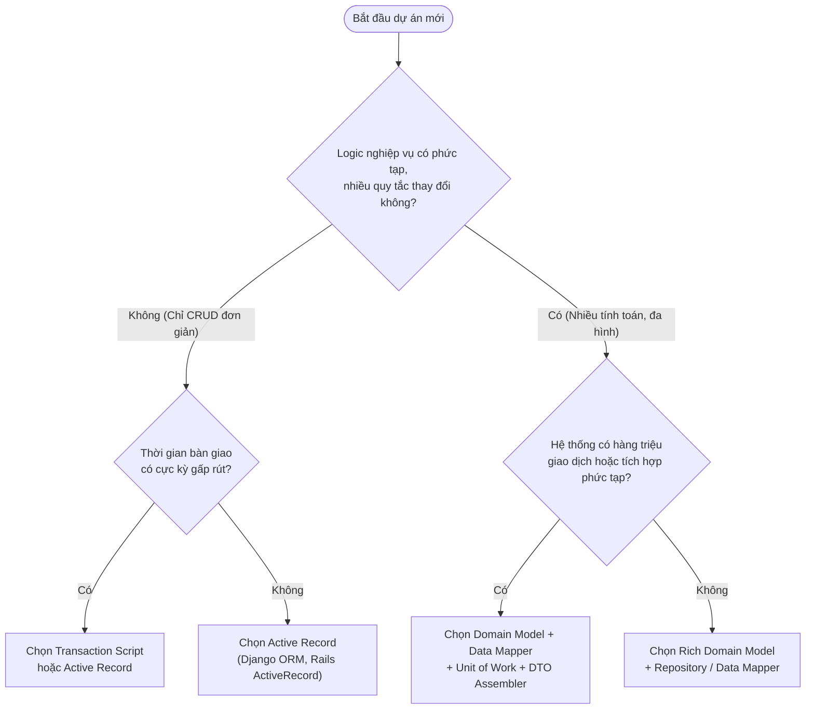

# 5.4. Các Mẫu Kiến Trúc Ứng Dụng Doanh Nghiệp (Enterprise Application Patterns - PoEAA)

> [!IMPORTANT]
> **Nếu bạn chỉ được nhớ một điều duy nhất:** Nhóm mẫu PoEAA (Martin Fowler) giải quyết xung đột căn bản giữa hai thế giới: mô hình hướng đối tượng đa hình trong RAM (Domain Model) và bảng biểu quan hệ phi linh hoạt trên ổ đĩa (RDBMS) — mọi kiến trúc doanh nghiệp thành công đều phải tách biệt ranh giới nghiệp vụ (Service/Domain) khỏi hạ tầng lưu trữ (Data Mapper/Unit of Work) và ranh giới truyền tải (DTO).

---

## 1. Kiến trúc Tổng quan & Mô hình Tư duy (Mental Model)

### Ẩn dụ Đời sống: Chuỗi Nhà Hàng 5 Sao & Hệ Thống Kho Hàng Bán Buôn
Hãy hình dung kiến trúc phần mềm doanh nghiệp tương tự như hoạt động của một Tập đoàn Ẩm thực cao cấp:
- **Transaction Script (Quán Ăn Nhanh Vỉa Hè)**: Đầu bếp nhận order, tự tay lấy thịt, rán bánh, thu tiền và ghi sổ cái trên cùng một quầy. Rất nhanh khi quán chỉ bán 1 món cố định, nhưng sẽ hỗn loạn và sụp đổ nếu thực đơn mở rộng ra 100 món đa quốc gia.
- **Domain Model (Bếp Trưởng 5 Sao & Nghệ Thuật Ẩm Thực)**: Các chuyên gia ẩm thực (Entities) phối hợp chặt chẽ, am hiểu sâu sắc quy tắc phối vị, nhiệt độ và an toàn thực phẩm. Mỗi đối tượng tự bảo vệ tiêu chuẩn chất lượng của chính mình.
- **Service Layer (Quản Lý Nhà Hàng)**: Đón tiếp thực khách, điều phối dòng order vào bếp, kiểm tra thẻ thành viên, mở và đóng ca làm việc (Transaction Boundaries).
- **Active Record (Người Nấu Ăn Tự Đi Chợ)**: Mỗi món ăn tự biết cách chạy xuống chợ mua nguyên liệu (`dish.save()`). Khi chợ đổi địa điểm hoặc giá thịt biến động, toàn bộ công thức nấu nướng bị xáo trộn.
- **Data Mapper & Unit of Work (Đội Hậu Cần & Xe Chở Hàng Chuyên Nghiệp)**: Đầu bếp chỉ tập trung chế biến món ăn trong bếp (In-memory Domain). Đội hậu cần (Data Mapper) chịu trách nhiệm mang nguyên liệu từ kho tổng (Database) lên bếp, ghi nhận những món đã dùng (Unit of Work), và chở xe hàng thanh toán đồng loạt một lần duy nhất vào cuối ngày.
- **DTO & Assembler (Thực Đơn Thu Gọn Giao Tận Nhà)**: Khách đặt món qua app điện thoại chỉ cần nhìn thấy tên món, hình ảnh và giá tiền (DTO) thông qua người thiết kế menu (Assembler), tuyệt đối không để lộ sổ tay bí quyết gia truyền hay giá vốn nhập sỉ của nhà hàng.



---

## 2. Chi tiết từng Keyword (Under-the-Hood Deep Dive)

### 2.1. Transaction Script & Table Module: Tổ Chức Logic Dựa Trên Thủ Tục và Bảng Dữ Liệu

#### 1. Bản Chất Kỹ Thuật của Transaction Script
- **Cơ chế**: Toàn bộ luồng xử lý của một Use Case được viết tập trung trong một hàm hoặc thủ tục đơn lẻ (Single Procedure). Hàm này trực tiếp mở kết nối DB, đọc dữ liệu qua câu lệnh SQL, thực thi các phép tính toán rẽ nhánh `if/else`, ghi dữ liệu mới vào DB và commit transaction.
- **Ưu điểm**:
  - Tối giản tối đa chi phí trừu tượng (Zero abstraction overhead).
  - Cực kỳ trực quan cho các ứng dụng CRUD đơn giản, báo cáo một chiều hoặc các kịch bản migration dữ liệu.
- **Nhược điểm & Điểm Gãy (Break-even Point)**:
  - Khi logic nghiệp vụ phức tạp dần, các quy tắc kiểm tra (validation, tính thuế, chiết khấu) bị sao chép rải rác ở hàng chục scripts khác nhau (Vi phạm DRY nghiêm trọng).
  - Không thể tận dụng tính kế thừa và đa hình của hướng đối tượng; xuất hiện các chuỗi `switch-case` dài hàng ngàn dòng.

#### 2. Bản Chất Kỹ Thuật của Table Module
- **Cơ chế**: Tổ chức toàn bộ logic nghiệp vụ xoay quanh một bảng cơ sở dữ liệu duy nhất. Một thể hiện (Singleton/Instance) của Table Module đại diện và quản lý toàn bộ các dòng dữ liệu trong bảng đó (thường kết hợp với cấu trúc dạng `RecordSet` hoặc `DataTable`).
- **So sánh**: Thay vì tạo 1,000 đối tượng `Contract` cho 1,000 dòng dữ liệu, Table Module chỉ có 1 đối tượng `ContractsTableModule` nhận vào một DataSet và thực thi các phép tính hàng loạt. Rất phổ biến trong hệ sinh thái Microsoft .NET thế hệ đầu (`System.Data.DataSet`).

---

### 2.2. Domain Model & Service Layer: Lõi Nghiệp Vụ Hướng Đối Tượng Giàu Có

#### 1. Rich Domain Model vs Anemic Domain Model
- **Rich Domain Model (Khuyên dùng)**: Các đối tượng nghiệp vụ (Entities, Value Objects) đóng gói cả **Dữ Liệu (State)** lẫn **Hành Vi (Behavior)**. Entity chịu trách nhiệm bảo vệ tính toàn vẹn bất biến (Invariants) của chính nó. Không cho phép các thao tác gán tùy tiện từ bên ngoài thông qua setters ngây thơ.
- **Anemic Domain Model (Mô hình Thiếu Máu - Anti-Pattern)**: Các thực thể chỉ là các túi chứa dữ liệu thuần túy (chỉ có getters/setters), toàn bộ logic bị bóc tách và đẩy sang các lớp Service. Dẫn đến Service phình to thành hàng chục ngàn dòng (God Class), còn Entity trở thành cấu trúc dữ liệu thụ động.

#### 2. Service Layer (Biên Giới Ứng Dụng)
- **Vị trí**: Đứng ngay trước Domain Model, đóng vai trò là "Nhạc trưởng" điều phối:
  - Quản lý ranh giới giao dịch (Transaction Boundaries: Begin, Commit, Rollback).
  - Phân quyền và xác thực người dùng (Authorization & Security).
  - Điều phối nạp Entity từ Repository, gọi các hàm nghiệp vụ trên Entity, và ra lệnh cho Unit of Work lưu kết quả.
  - Tuyệt đối không chứa logic tính toán cốt lõi của nghiệp vụ bên trong Service Layer.

---

### 2.3. Data Source Architecture: Active Record vs Data Mapper

#### 1. Active Record: Trộn Lẫn Dữ Liệu và Hạ Tầng
- **Đặc trưng**: Mỗi Class đại diện cho một Table; mỗi Instance đại diện cho một Row trong Table. Bản thân Class cung cấp các phương thức truy vấn tĩnh (`User::findById(12)`), và mỗi Instance tự chứa phương thức lưu trữ (`user->save()`, `user->delete()`).
- **Ưu điểm**: Cực kỳ nhanh chóng để xây dựng MVP; lập trình viên không cần viết các lớp chuyển đổi trung gian.
- **Hạn chế Chí Mạng**:
  - Vi phạm nguyên lý Đơn nhiệm (SRP - Single Responsibility Principle): Domain Entity vừa phải lo quy tắc nghiệp vụ vừa phải lo cú pháp SQL, mở kết nối DB và cấu trúc bảng.
  - Gắn chặt mã nguồn vào RDBMS cụ thể; cực kỳ khó viết Unit Test cô lập (buộc phải mock database hoặc dựng SQLite in-memory).

#### 2. Data Mapper: Phân Tách Hoàn Toàn Ranh Giới (Clean Architecture)
- **Đặc trưng**: Domain Entity là một Plain Old Object (POCO / POJO) hoàn toàn thuần khiết, không kế thừa từ bất kỳ ORM Base Class nào, không chứa bất kỳ annotation hay logic SQL nào.
- **Data Mapper**: Là một thành phần độc lập đứng ở giữa, thực hiện việc chuyển đổi hai chiều giữa các trường trong Entity và các cột trong bảng SQL. Domain Entity hoàn toàn "mù" về cách nó được lưu trữ trên đĩa.
- **Ví dụ Thực Tế**: Hibernate/JPA (Java), SQLAlchemy DataMapper (Python), Doctrine (PHP), Prisma/TypeORM Data Mapper (TypeScript).



---

### 2.4. Identity Map & Unit of Work: Tối Ưu Hóa Giao Dịch và Quản Lý Trạng Thái In-Memory

#### 1. Identity Map: Bảo Đảm Tính Duy Nhất của Thể Hiện
- **Vấn đề**: Trong một Transaction, Use Case có thể gọi `orderService.process()` và `userService.notify()`, cả hai đều cần đọc thông tin của khách hàng `User(id = 42)`. Nếu không có Identity Map, hệ thống sẽ thực hiện 2 câu lệnh `SELECT` độc lập và sinh ra 2 đối tượng `user1` và `user2` nằm ở 2 vùng nhớ heap khác nhau. Khi một bên thay đổi trạng thái, bên kia sẽ chứa dữ liệu lỗi thời (Stale Data), dẫn đến xung đột ghi đè.
- **Cơ chế**: Identity Map là một bảng băm in-memory (`std::unordered_map<ID, Entity*>`) có vòng đời gắn liền với Transaction hoặc Request. Khi có yêu cầu nạp `id = 42`, Mapper kiểm tra Map trước: nếu đã tồn tại thì trả về con trỏ đó ngay lập tức mà không truy vấn database; bảo đảm `user1 === user2`.

#### 2. Unit of Work: Theo Dõi Thay Đổi và Gom Cụm Giao Dịch (Batch Commit)
- **Cơ chế**: Unit of Work duy trì 4 danh sách đối tượng trong bộ nhớ suốt vòng đời của một nghiệp vụ:
  1. `newObjects`: Danh sách đối tượng vừa được tạo mới cần `INSERT`.
  2. `dirtyObjects`: Danh sách đối tượng đã bị sửa đổi cần `UPDATE`.
  3. `removedObjects`: Danh sách đối tượng bị đánh dấu xóa cần `DELETE`.
  4. `cleanObjects`: Danh sách đối tượng chỉ đọc, không thay đổi.
- **Lợi ích**: Thay vì bắn từng câu lệnh SQL lẻ tẻ mỗi khi có thao tác gán giá trị, Unit of Work đợi đến cuối kịch bản mới thực hiện hàm `commit()`. Tại đây, nó sắp xếp thứ tự ghi để tránh xung đột khóa ngoại (Foreign Key Constraints), gom nhóm câu lệnh thành dạng Batch (`INSERT INTO ... VALUES (...), (...)`), mở một transaction duy nhất và hoàn tất trong thời gian tối thiểu.



---

### 2.5. Lazy Load, Identity Field & Object-Relational Structural Mapping

#### 1. Lazy Load (Nạp Chậm / Nạp Lười) và Các Biến Thể
- **Mục tiêu**: Trì hoãn việc nạp dữ liệu nặng từ DB cho đến khi thuộc tính đó thực sự được gọi đến.
- **4 Phương pháp triển khai**:
  1. *Lazy Initialization*: Kiểm tra biến con trỏ, nếu `nullptr` thì mới bắn query nạp.
  2. *Virtual Proxy*: Cung cấp một đối tượng giả lập cùng interface; khi client gọi phương thức đầu tiên, proxy mới kết nối DB nạp dữ liệu thực tế.
  3. *Value Holder*: Một container bọc giá trị (`ValueHolder<Order>`) có phương thức `getValue()`.
  4. *Ghost Object*: Đối tượng được khởi tạo với trạng thái rỗng và chỉ có Identity Field; khi bất kỳ trường nào khác được truy cập, nó tự nạp toàn bộ các trường còn lại.
- **Hiểm họa N+1 Query**: Nếu duyệt qua danh sách 1,000 `Users` và gọi `user.getOrders()`, hệ thống sẽ thực hiện $1$ query lấy danh sách users và $1,000$ queries con lấy orders cho từng user. Cách khắc phục: Sử dụng Kỹ thuật Nạp Háo Hức (Eager Loading với `JOIN FETCH`) hoặc Batch Loading (`WHERE user_id IN (...)`).

#### 2. Kỹ Thuật Ánh Xạ Kế Thừa Vào RDBMS (Inheritance Mapping Strategies)

| Chiến Lược | Cấu Trúc Bảng Database | Ưu Điểm Tuyệt Đối | Nhược Điểm Chí Mạng | Trường Hợp Sử Dụng Phù Hợp |
| :--- | :--- | :--- | :--- | :--- |
| **Single Table Inheritance** | Toàn bộ cây phả hệ nằm trong **1 bảng duy nhất**. Có cột phân biệt `discriminator_type`. | Hiệu năng truy vấn nhanh nhất (Không bao giờ cần `JOIN`). Tái cấu trúc phân cấp cực dễ. | Vi phạm chuẩn hóa DB; các cột của lớp con phải chấp nhận giá trị `NULL`. Bảng phình to nhiều cột rác. | Cây kế thừa đơn giản, các lớp con có ít thuộc tính riêng biệt. |
| **Class Table Inheritance** | Mỗi Class trong cây phả hệ có 1 bảng riêng. Bảng con nối bảng cha qua Foreign Key. | Chuẩn hóa cơ sở dữ liệu cao, không có cột nào bị `NULL` vô lý. Cấu trúc bảng chặt chẽ. | Truy vấn đối tượng con luôn đòi hỏi câu lệnh `JOIN` nhiều tầng, suy giảm hiệu năng nghiêm trọng khi dữ liệu lớn. | Cây kế thừa sâu, các lớp con có nhiều thuộc tính đặc thù riêng biệt. |
| **Concrete Table Inheritance** | Mỗi Class lá (Concrete Class) có 1 bảng độc lập chứa đầy đủ toàn bộ cột (cả cha lẫn con). | Không cần `JOIN` khi truy vấn lớp cụ thể. Không chứa giá trị `NULL` dư thừa. | Khóa chính khó đồng bộ giữa các bảng; cực kỳ khó khăn khi cần thực hiện truy vấn đa hình trên toàn bộ lớp cha. | Các lớp con hoàn toàn độc lập, rất hiếm khi cần truy vấn đa hình từ lớp cha. |

---

### 2.6. Data Transfer & Distribution: DTO, DTO Assembler & Value Object Assembler

#### 1. Data Transfer Object (DTO)
- DTO là một đối tượng thô, chỉ đóng gói dữ liệu thuộc tính thuần túy (Plain Data Object), không mang theo bất kỳ quy tắc nghiệp vụ nào.
- **Mục đích**:
  - Tối ưu hóa hiệu năng mạng (Network Serialization): Gom toàn bộ thông tin cần thiết vào một chuyến bay mạng duy nhất (Single Round-Trip), thay vì Client phải gọi nhiều lần để lấy từng trường dữ liệu.
  - Phân tách ranh giới bảo mật: Ẩn giấu hoàn toàn cấu trúc schema nội bộ và các dữ liệu nhạy cảm (như `password_hash`, `internal_flags`, `ssn`) khỏi API response.

#### 2. DTO Assembler & Value Object Assembler
- Là đối tượng chuyển dịch chuyên trách (Mapper Component).
- Chịu trách nhiệm chuyển đổi hai chiều:
  - Chiều vào (Inbound): `RequestDTO` $\to$ Xác thực hợp lệ sơ bộ $\to$ `Domain Entity / Value Object`.
  - Chiều ra (Outbound): `Domain Entity` $\to$ Trích xuất dữ liệu công khai $\to$ `ResponseDTO`.
- Giữ cho Domain Entity hoàn toàn độc lập với các định dạng tuần tự hóa (JSON, XML, Protobuf).

---

## 3. Thực thi Mã nguồn & Mô phỏng Chuyên sâu (Dual-Engine Implementation)

### 3.1. Phiên bản C++20: Mô Phỏng Kiến Trúc Enterprise Với Data Mapper, Identity Map, Unit of Work và DTO Assembler

```cpp
#include <iostream>
#include <string>
#include <memory>
#include <unordered_map>
#include <vector>
#include <format>
#include <stdexcept>
#include <cstdint>

// ============================================================================
// 1. DOMAIN LAYER: PURE RICH DOMAIN ENTITY (Không dính dáng SQL/ORM Base Class)
// ============================================================================
class BankAccount {
private:
    uint64_t id_;
    std::string accountNumber_;
    std::string ownerName_;
    int64_t balanceCents_; // Dùng số nguyên để tránh sai số dấu phẩy động
    std::string internalAuditCode_; // Dữ liệu nhạy cảm nghiệp vụ

public:
    BankAccount(uint64_t id, std::string accNum, std::string owner, int64_t balanceCents, std::string auditCode)
        : id_(id), accountNumber_(std::move(accNum)), ownerName_(std::move(owner)),
          balanceCents_(balanceCents), internalAuditCode_(std::move(auditCode)) {
        if (balanceCents < 0) {
            throw std::invalid_argument("Tài khoản khởi tạo không được có số dư âm!");
        }
    }

    [[nodiscard]] uint64_t id() const noexcept { return id_; }
    [[nodiscard]] const std::string& accountNumber() const noexcept { return accountNumber_; }
    [[nodiscard]] const std::string& ownerName() const noexcept { return ownerName_; }
    [[nodiscard]] int64_t balanceCents() const noexcept { return balanceCents_; }
    [[nodiscard]] double balanceDollars() const noexcept { return balanceCents_ / 100.0; }

    // Hành vi nghiệp vụ giàu có (Rich Domain Behavior)
    void deposit(int64_t amountCents) {
        if (amountCents <= 0) {
            throw std::invalid_argument("Số tiền nạp phải lớn hơn 0!");
        }
        balanceCents_ += amountCents;
    }

    void withdraw(int64_t amountCents) {
        if (amountCents <= 0) {
            throw std::invalid_argument("Số tiền rút phải lớn hơn 0!");
        }
        if (amountCents > balanceCents_) {
            throw std::runtime_error("Số dư không đủ để thực hiện giao dịch!");
        }
        balanceCents_ -= amountCents;
    }
};

// ============================================================================
// 2. DISTRIBUTION LAYER: DATA TRANSFER OBJECT & ASSEMBLER
// ============================================================================
struct AccountResponseDTO {
    uint64_t accountId;
    std::string maskedNumber;
    std::string ownerName;
    double currentBalance;
};

class AccountDTOAssembler {
public:
    static AccountResponseDTO toDTO(const BankAccount& entity) {
        std::string rawNum = entity.accountNumber();
        std::string masked = (rawNum.length() >= 4) 
            ? std::string(rawNum.length() - 4, '*') + rawNum.substr(rawNum.length() - 4)
            : rawNum;

        return AccountResponseDTO{
            .accountId = entity.id(),
            .maskedNumber = std::move(masked),
            .ownerName = entity.ownerName(),
            .currentBalance = entity.balanceDollars()
        };
    }
};

// ============================================================================
// 3. PERSISTENCE LAYER: IDENTITY MAP, DATA MAPPER & UNIT OF WORK
// ============================================================================
class IdentityMap {
private:
    std::unordered_map<uint64_t, std::shared_ptr<BankAccount>> cache_;

public:
    std::shared_ptr<BankAccount> get(uint64_t id) {
        auto it = cache_.find(id);
        return (it != cache_.end()) ? it->second : nullptr;
    }

    void put(uint64_t id, std::shared_ptr<BankAccount> entity) {
        cache_[id] = entity;
    }
};

class BankAccountDataMapper {
public:
    // Mô phỏng giả lập đọc dữ liệu từ SQL Table
    std::shared_ptr<BankAccount> findById(uint64_t id) {
        std::cout << std::format("  [SQL Engine] SELECT * FROM bank_accounts WHERE id = {} LIMIT 1;\n", id);
        // Trả về dữ liệu mock giả lập từ ổ đĩa
        return std::make_shared<BankAccount>(id, "190388273645", "Nguyen Van A", 500000, "AUDIT-SEC-998");
    }

    void insert(const BankAccount& acc) {
        std::cout << std::format("  [SQL Engine] INSERT INTO bank_accounts (id, acc_num, owner, balance, audit_code) "
                                 "VALUES ({}, '{}', '{}', {}, '{}');\n",
                                 acc.id(), acc.accountNumber(), acc.ownerName(), acc.balanceCents(), "AUDIT-NEW");
    }

    void update(const BankAccount& acc) {
        std::cout << std::format("  [SQL Engine] UPDATE bank_accounts SET balance = {} WHERE id = {};\n",
                                 acc.balanceCents(), acc.id());
    }

    void remove(uint64_t id) {
        std::cout << std::format("  [SQL Engine] DELETE FROM bank_accounts WHERE id = {};\n", id);
    }
};

class UnitOfWork {
private:
    std::vector<std::shared_ptr<BankAccount>> newEntities_;
    std::vector<std::shared_ptr<BankAccount>> dirtyEntities_;
    std::vector<uint64_t> removedIds_;
    std::shared_ptr<BankAccountDataMapper> mapper_;

public:
    explicit UnitOfWork(std::shared_ptr<BankAccountDataMapper> mapper) : mapper_(std::move(mapper)) {}

    void registerNew(std::shared_ptr<BankAccount> entity) {
        newEntities_.push_back(entity);
    }

    void registerDirty(std::shared_ptr<BankAccount> entity) {
        dirtyEntities_.push_back(entity);
    }

    void registerRemove(uint64_t id) {
        removedIds_.push_back(id);
    }

    void commit() {
        std::cout << "\n=== [Unit of Work] BẮT ĐẦU TRANSACTION BATCH COMMIT ===" << std::endl;
        std::cout << "  [DB Client] BEGIN TRANSACTION;" << std::endl;

        // 1. Thực thi toàn bộ lệnh INSERT
        for (const auto& item : newEntities_) {
            mapper_->insert(*item);
        }

        // 2. Thực thi toàn bộ lệnh UPDATE
        for (const auto& item : dirtyEntities_) {
            mapper_->update(*item);
        }

        // 3. Thực thi toàn bộ lệnh DELETE
        for (uint64_t id : removedIds_) {
            mapper_->remove(id);
        }

        std::cout << "  [DB Client] COMMIT TRANSACTION;" << std::endl;
        std::cout << "=== [Unit of Work] TRANSACTION HOÀN TẤT THÀNH CÔNG ===\n" << std::endl;

        // Dọn dẹp trạng thái sau khi commit
        newEntities_.clear();
        dirtyEntities_.clear();
        removedIds_.clear();
    }
};

// ============================================================================
// 4. APPLICATION LAYER: SERVICE LAYER COORDINATOR
// ============================================================================
class BankingApplicationService {
private:
    std::shared_ptr<IdentityMap> identityMap_;
    std::shared_ptr<BankAccountDataMapper> mapper_;
    std::unique_ptr<UnitOfWork> uow_;

public:
    BankingApplicationService()
        : identityMap_(std::make_shared<IdentityMap>()),
          mapper_(std::make_shared<BankAccountDataMapper>()),
          uow_(std::make_unique<UnitOfWork>(mapper_)) {}

    AccountResponseDTO transferMoney(uint64_t accountId, int64_t depositCents) {
        // 1. Kiểm tra Identity Map trước khi truy vấn Database
        std::shared_ptr<BankAccount> account = identityMap_->get(accountId);
        if (!account) {
            std::cout << "[Service Layer] Cache miss tại Identity Map! Đang gọi Data Mapper..." << std::endl;
            account = mapper_->findById(accountId);
            identityMap_->put(accountId, account);
        } else {
            std::cout << "[Service Layer] Cache hit tại Identity Map! Bỏ qua truy vấn SQL." << std::endl;
        }

        // 2. Thực thi quy tắc trên Domain Entity thuần khiết
        account->deposit(depositCents);

        // 3. Đăng ký đối tượng bị thay đổi vào Unit of Work
        uow_->registerDirty(account);

        // 4. Tạo tài khoản thưởng tri ân khách hàng mới (Mô phỏng thêm mới)
        auto rewardAccount = std::make_shared<BankAccount>(9099, "999900001111", "Reward Fund", 10000, "REWARD");
        uow_->registerNew(rewardAccount);

        // 5. Kết thúc Use Case: Commit toàn bộ thay đổi qua Unit of Work
        uow_->commit();

        // 6. Chuyển đổi Domain Entity sang DTO an toàn trả về Client
        return AccountDTOAssembler::toDTO(*account);
    }
};

int main() {
    std::cout << "=========================================================" << std::endl;
    std::cout << "    DEMO POEAA PATTERNS: DATA MAPPER & UNIT OF WORK (C++20)" << std::endl;
    std::cout << "=========================================================\n" << std::endl;

    BankingApplicationService service;
    AccountResponseDTO response = service.transferMoney(101, 250000); // Nạp thêm 2,500.00 USD

    std::cout << "--- KẾT QUẢ TRẢ VỀ CHO CLIENT (DTO) ---" << std::endl;
    std::cout << std::format("Account ID    : {}\n", response.accountId);
    std::cout << std::format("Owner         : {}\n", response.ownerName);
    std::cout << std::format("Masked Number : {}\n", response.maskedNumber);
    std::cout << std::format("New Balance   : ${:.2f}\n", response.currentBalance);

    return 0;
}
```

---

### 3.2. Phiên bản Python 3.11+: Kiến Trúc Clean Architecture Với Data Mapper & Identity Map

```python
from __future__ import annotations
from dataclasses import dataclass
from typing import Dict, List, Optional
from abc import ABC, abstractmethod


# ============================================================================
# 1. DOMAIN LAYER: PURE DOMAIN ENTITIES & INVARIANT CHECKS
# ============================================================================
class DomainException(Exception):
    """Lỗi vi phạm quy tắc nghiệp vụ cốt lõi."""
    pass


class OrderItem:
    def __init__(self, product_sku: str, unit_price_cents: int, quantity: int):
        if quantity <= 0:
            raise DomainException("Số lượng sản phẩm trong đơn hàng phải lớn hơn 0.")
        self.product_sku = product_sku
        self.unit_price_cents = unit_price_cents
        self.quantity = quantity

    @property
    def total_price_cents(self) -> int:
        return self.unit_price_cents * self.quantity


class Order:
    """Rich Domain Entity: Đóng gói toàn bộ logic quản lý trạng thái đơn hàng."""

    def __init__(self, order_id: int, customer_id: int, status: str = "PENDING"):
        self.id = order_id
        self.customer_id = customer_id
        self.status = status
        self._items: List[OrderItem] = []

    @property
    def items(self) -> List[OrderItem]:
        return list(self._items)

    @property
    def total_amount_cents(self) -> int:
        return sum(item.total_price_cents for item in self._items)

    def add_item(self, sku: str, price_cents: int, quantity: int) -> None:
        if self.status != "PENDING":
            raise DomainException("Không thể thêm sản phẩm vào đơn hàng đã thanh toán hoặc đã hủy!")
        self._items.append(OrderItem(sku, price_cents, quantity))

    def mark_paid(self) -> None:
        if not self._items:
            raise DomainException("Không thể thanh toán đơn hàng rỗng không có sản phẩm nào!")
        self.status = "PAID"


# ============================================================================
# 2. DISTRIBUTION LAYER: DATA TRANSFER OBJECTS (DTO)
# ============================================================================
@dataclass(frozen=True)
class OrderResponseDTO:
    order_id: int
    customer_id: int
    status: str
    total_usd: float
    total_items_count: int


class OrderDTOAssembler:
    """Chuyển đổi Domain Entity nội bộ sang DTO phơi bày ra bên ngoài."""
    @staticmethod
    def to_dto(order: Order) -> OrderResponseDTO:
        return OrderResponseDTO(
            order_id=order.id,
            customer_id=order.customer_id,
            status=order.status,
            total_usd=order.total_amount_cents / 100.0,
            total_items_count=sum(item.quantity for item in order.items)
        )


# ============================================================================
# 3. PERSISTENCE LAYER: DATA MAPPER & IDENTITY MAP
# ============================================================================
class OrderDataMapper(ABC):
    @abstractmethod
    def find_by_id(self, order_id: int) -> Optional[Order]: ...

    @abstractmethod
    def save(self, order: Order) -> None: ...


class PostgresOrderDataMapper(OrderDataMapper):
    """Hiện thực Data Mapper: Chuyển đổi dữ liệu đối tượng sang SQL queries."""

    def find_by_id(self, order_id: int) -> Optional[Order]:
        print(f"  [SQL Engine] SELECT * FROM orders WHERE id = {order_id};")
        print(f"  [SQL Engine] SELECT * FROM order_items WHERE order_id = {order_id};")
        # Giả lập nạp đối tượng từ DB
        mock_order = Order(order_id=order_id, customer_id=7788, status="PENDING")
        mock_order.add_item("MACBOOK-M3-PRO", 249900, 1)
        return mock_order

    def save(self, order: Order) -> None:
        print(f"  [SQL Engine] UPDATE orders SET status = '{order.status}' WHERE id = {order.id};")
        print(f"  [SQL Engine] -- Đồng bộ hóa {len(order.items)} order_items vào cơ sở dữ liệu.")


class OrderIdentityMap:
    """Identity Map: Đảm bảo chỉ có duy nhất 1 instance trong một phiên làm việc."""
    def __init__(self):
        self._registry: Dict[int, Order] = {}

    def get(self, order_id: int) -> Optional[Order]:
        return self._registry.get(order_id)

    def put(self, order: Order) -> None:
        self._registry[order.id] = order


# ============================================================================
# 4. APPLICATION SERVICE LAYER: USE CASE ORCHESTRATOR
# ============================================================================
class OrderFulfillmentService:
    def __init__(self, mapper: OrderDataMapper, identity_map: OrderIdentityMap):
        self._mapper = mapper
        self._identity_map = identity_map

    def pay_and_finalize_order(self, order_id: int, extra_sku: str, extra_price: int) -> OrderResponseDTO:
        # Bước 1: Tra cứu Identity Map trước
        order = self._identity_map.get(order_id)
        if not order:
            print(f"[Service] Cache miss tại Identity Map! Tiến hành truy vấn DB...")
            order = self._mapper.find_by_id(order_id)
            if not order:
                raise ValueError(f"Không tìm thấy đơn hàng #{order_id}")
            self._identity_map.put(order)
        else:
            print(f"[Service] Cache hit! Tái sử dụng Instance có sẵn trong RAM.")

        # Bước 2: Thực thi logic trên Domain Model
        order.add_item(extra_sku, extra_price, 2)
        order.mark_paid()

        # Bước 3: Đồng bộ dữ liệu xuống database
        self._mapper.save(order)

        # Bước 4: Trả về DTO cho client
        return OrderDTOAssembler.to_dto(order)


if __name__ == "__main__":
    print("=" * 65)
    print("    POEAA IMPLEMENTATION: PYTHON DATA MAPPER & IDENTITY MAP")
    print("=" * 65)

    mapper = PostgresOrderDataMapper()
    id_map = OrderIdentityMap()
    service = OrderFulfillmentService(mapper, id_map)

    print("\n--- LẦN GỌI 1: NẠP VÀ THANH TOÁN ĐƠN HÀNG ---")
    dto1 = service.pay_and_finalize_order(order_id=505, extra_sku="APPLE-CARE-PLUS", extra_price=19900)
    print(f"[Client Response DTO]: Order #{dto1.order_id} | Status: {dto1.status} | Total: ${dto1.total_usd:.2f}")

    print("\n--- LẦN GỌI 2: TRUY VẤN LẠI CÙNG ĐƠN HÀNG (KIỂM CHỨNG IDENTITY MAP) ---")
    cached_order = id_map.get(505)
    print(f"[Identity Map Check]: Instance tái sử dụng: {cached_order is not None} | Đã thanh toán: {cached_order.status == 'PAID'}")
```

### 3.3. Giả Lập Terminal Output Thực Tế

```text
=========================================================
    DEMO POEAA PATTERNS: DATA MAPPER & UNIT OF WORK (C++20)
=========================================================

[Service Layer] Cache miss tại Identity Map! Đang gọi Data Mapper...
  [SQL Engine] SELECT * FROM bank_accounts WHERE id = 101 LIMIT 1;

=== [Unit of Work] BẮT ĐẦU TRANSACTION BATCH COMMIT ===
  [DB Client] BEGIN TRANSACTION;
  [SQL Engine] INSERT INTO bank_accounts (id, acc_num, owner, balance, audit_code) VALUES (9099, '999900001111', 'Reward Fund', 10000, 'AUDIT-NEW');
  [SQL Engine] UPDATE bank_accounts SET balance = 750000 WHERE id = 101;
  [DB Client] COMMIT TRANSACTION;
=== [Unit of Work] TRANSACTION HOÀN TẤT THÀNH CÔNG ===

--- KẾT QUẢ TRẢ VỀ CHO CLIENT (DTO) ---
Account ID    : 101
Owner         : Nguyen Van A
Masked Number : ********3645
New Balance   : $7500.00
```

---

## 4. Systems Engineering & Production Pitfalls

### Cạm Bẫy Sản Xuất Thường Gặp (Production Anti-Patterns & Gotchas)

1. **Hiểm Họa Rò Rỉ Bộ Nhớ Của Identity Map (Unbounded Identity Map Memory Leak)**:
   - *Bản chất*: Trong các tiến trình chạy ngầm (Background Worker, Daemon, ETL Batch Jobs) xử lý hàng triệu dòng dữ liệu, nếu Identity Map có phạm vi toàn cục hoặc không được xóa định kỳ, hàng triệu thực thể sẽ bị ghim vĩnh viễn trên Heap RAM, gây tràn bộ nhớ (**OOM Crash - Out Of Memory**).
   - *Giải pháp*: Giới hạn phạm vi (Scope) của Identity Map chặt chẽ theo từng Request/Transaction. Trong các tác vụ batch processing, phải thực hiện giải phóng cache định kỳ (`clear()` hoặc dùng `WeakReference`).

2. **Cạm Bẫy N+1 Query Với Cơ Chế Lazy Loading**:
   - *Bản chất*: Lập trình viên vô tình lặp qua 10,000 khách hàng và gọi phương thức nạp lười `customer.getOrders()`, khiến hệ thống phát sinh 10,001 câu truy vấn mạng riêng biệt, làm nghẽn hoàn toàn Connection Pool của cơ sở dữ liệu.
   - *Giải pháp*: Sử dụng các công cụ giám sát như **Hibernate Statistics**, **MiniProfiler** hoặc thiết lập linter tự động cảnh báo; luôn ưu tiên nạp háo hức có chọn lọc (`JOIN FETCH` hoặc Subquery In-List).

3. **Hiện Tượng Xung Đột Giao Dịch Do Ghi Đè Mù (Lost Updates & Dirty Writes)**:
   - *Bản chất*: Hai luồng cùng đọc một Entity từ Database vào RAM qua Data Mapper, thực hiện tính toán độc lập và lưu đè lên nhau. Thao tác lưu của Luồng B xóa sạch dữ liệu cập nhật trước đó của Luồng A.
   - *Giải pháp*: Triển khai **Optimistic Offline Lock** bằng cách gắn cột số phiên bản (`version INT NOT NULL DEFAULT 0`). Khi thực hiện câu lệnh ghi: `UPDATE table SET ..., version = version + 1 WHERE id = :id AND version = :expected_version`. Nếu số dòng cập nhật trả về là 0, ném ngay ngoại lệ `OptimisticLockException` để Rollback và yêu cầu thử lại.

4. **Kỹ Thuật Chẩn Đoán & Giám Sát Production Bằng CLI**:
   ```bash
   # 1. Phát hiện N+1 Query bằng cách bắt các câu truy vấn lặp lại trong Postgres pg_stat_activity
   psql -U postgres -d enterprise_db -c "
   SELECT query, count(*), sum(total_exec_time) AS total_time
   FROM pg_stat_statements
   GROUP BY query
   ORDER BY count(*) DESC
   LIMIT 10;"

   # 2. Phân tích hiện tượng Memory Leak trong Identity Map trên JVM (Heap Dump inspection)
   jmap -histo:live $(pgrep java) | head -n 25

   # 3. Kiểm tra các câu truy vấn chậm (Slow Queries) do thiếu chỉ mục khi ánh xạ Inheritance
   pt-query-digest /var/log/mysql/slow-query.log
   ```

---

## 5. Bảng So sánh & Decision Matrix

### 5.1. So Sánh Toàn Diện Các Chiến Lược Kiến Trúc Dữ Liệu PoEAA

| Mẫu Thiết Kế | Trọng Tâm Kiến Trúc | Ranh Giới Trách Nhiệm (SRP) | Khả Năng Unit Test | Mức Độ Phức Tạp | Khi Nào Nên Sử Dụng? |
| :--- | :--- | :--- | :--- | :---: | :--- |
| **Transaction Script** | Thủ tục tuần tự cho từng Request | Trộn lẫn SQL, I/O và Logic | Rất khó (Cần DB thật) | Rất Thấp | Báo cáo, ứng dụng nhỏ, Tool nội bộ, CRUD đơn giản |
| **Table Module** | Xử lý logic theo từng Bảng DB | Tập trung vào Dataset/Table | Trung bình | Thấp | Nền tảng hướng Dataset (.NET DataSet), ít logic OOP |
| **Active Record** | Class là Table, Instance là Row | Trộn lẫn Domain và SQL | Kém (Phụ thuộc DB Schema)| Trung bình | Khởi nghiệp nhanh (MVP), Rails/Django, ứng dụng vừa |
| **Data Mapper** | Phân tách Domain Entity khỏi Database | Hoàn hảo (Clean Architecture)| Rất cao (Mock Mapper dễ) | Cao | Ứng dụng doanh nghiệp lớn, quy tắc nghiệp vụ phức tạp |
| **Unit of Work** | Gom cụm và đồng bộ trạng thái giao dịch | Quản lý thay đổi In-Memory | Cao | Cao | Bắt buộc khi dùng Data Mapper để tối ưu I/O mạng |

### 5.2. Ma Trận Quyết Định Lựa Chọn Kiến Trúc Theo Quy Mô Nghiệp Vụ


