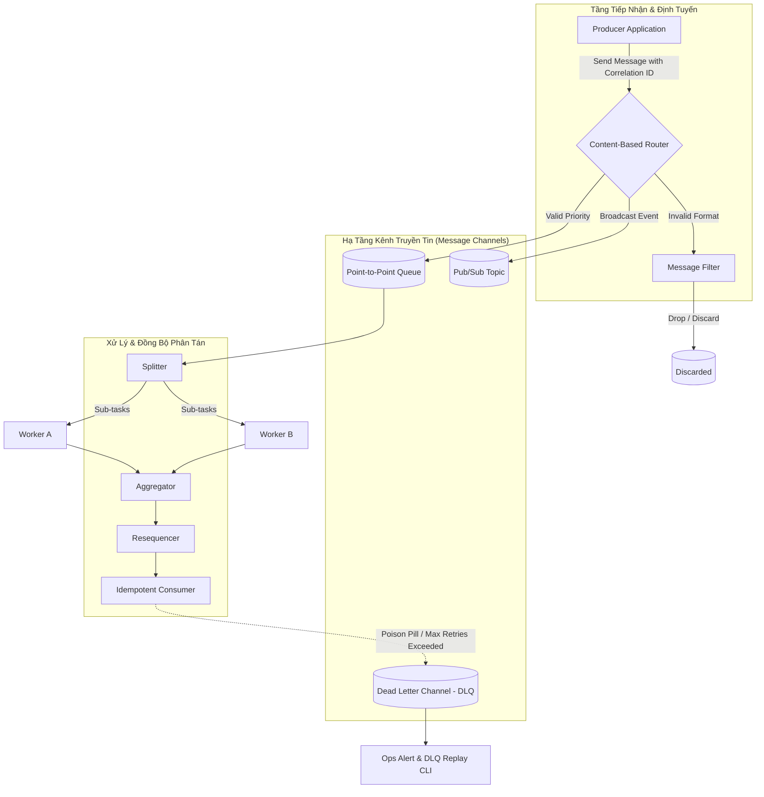
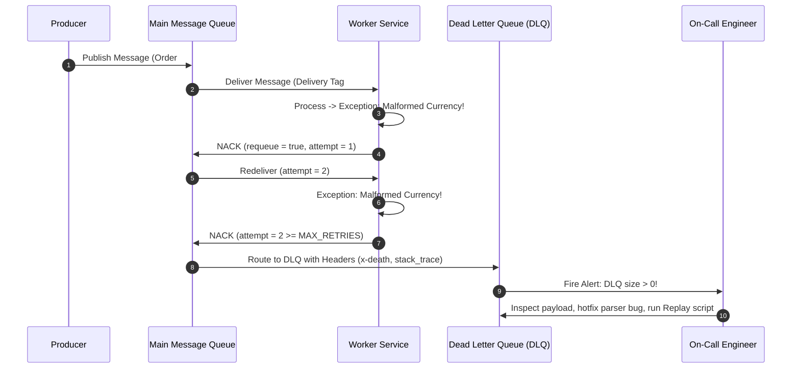

# 5.5. Các Mẫu Tích Hợp Hệ Thống Doanh Nghiệp (Enterprise Integration Patterns - EIP)

> [!IMPORTANT]
> **Nếu bạn chỉ được nhớ một điều duy nhất:** Enterprise Integration Patterns (EIP - Gregor Hohpe & Bobby Woolf) giải phóng các hệ thống phần mềm không đồng nhất khỏi sự phụ thuộc đồng bộ (Temporal Coupling) bằng kênh truyền tin phi đồng bộ (Asynchronous Messaging); trong đó tính bất biến tác dụng (Idempotency), xử lý thông điệp độc (Dead Letter Channel) và truy vết tương quan (Correlation ID) là bộ ba trụ cột sống còn để duy trì tính toàn vẹn phân tán.

---

## 1. Kiến trúc Tổng quan & Mô hình Tư duy (Mental Model)

### Ẩn dụ Đời sống: Trung Tâm Phân Loại Hàng Hóa và Bưu Chính Quốc Tế
Hãy tưởng tượng kiến trúc tích hợp hệ thống phân tán tương tự như mạng lưới vận chuyển hàng hóa toàn cầu của FedEx hoặc Amazon:
- **Message Channel (Đường Bay & Băng Chuyền Chuyên Tuyến)**: Đường ống vận chuyển bưu kiện giữa các thành phố.
- **Point-to-Point Channel (Hộp Thư Bảo Mật Giao Tận Tay)**: Bưu kiện chỉ giao cho đúng một người nhận duy nhất. Dù có 5 nhân viên giao hàng đứng chờ ở sảnh chung cư (Competing Consumers), chỉ 1 người bốc gói hàng và mang đi giao.
- **Publish-Subscribe Channel (Tạp Chí Phát Hành Định Kỳ)**: Tòa soạn in 1 bản mẫu, hệ thống in ấn tự động nhân bản thành hàng triệu bản và phát về hòm thư của tất cả độc giả đã đăng ký (Subscribers).
- **Guaranteed Delivery (Két Sắt Chống Cháy Trên Xe Tải)**: Bưu kiện được đóng gói, dán tem mã vạch và ghi sổ cái trên đĩa cứng bền bỉ (WAL / Persistence disk). Dù xe hỏng hóc giữa đường (Broker sập nguồn), hàng hóa vẫn nguyên vẹn khi xe khác đến cứu hộ.
- **Dead Letter Channel (Khu Vực Bưu Kiện Lỗi / Hàng Cấm)**: Gói hàng bị rách tem địa chỉ, sai định dạng hoặc chứa chất cấm (Poison Pill) khiến máy quét từ chối 3 lần. Thay vì làm kẹt toàn bộ băng chuyền chính, cánh tay robot đẩy nó sang khu vực cách ly (Dead Letter Queue - DLQ) để chuyên viên kiểm tra thủ công.
- **Content-Based Router & Filter (Cánh Tay Robot Đọc Mã Vạch)**: Robot quét mã bưu kiện: nếu mã vùng "VN" chuyển sang máng bay Nội Bài; nếu mã "US" chuyển sang container bay Los Angeles. Các bưu kiện hết hạn bị bộ lọc (Filter) tiêu hủy ngay.
- **Splitter & Aggregator (Phân Tách & Gom Kiện)**: Khách gửi một pallet gồm 10 kiện hàng lớn. Máy tách pallet ra thành 10 gói nhỏ để các xe tải nhỏ chở đi các ngõ ngách (Splitter). Tại kho đích, hệ thống đợi đủ 10 gói gom lại thành kiện hoàn chỉnh trước khi bàn giao cho khách (Aggregator).
- **Resequencer (Băng Chuyền Sắp Lại Thứ Tự Tập Hồ Sơ)**: Các tập tài liệu đánh số 1, 2, 3 bị máy bay chở tới lộn xộn thành 2, 1, 3. Resequencer giữ tập 2 và 3 trong khay chờ cho đến khi tập 1 cập bến, sau đó bàn giao lần lượt 1 -> 2 -> 3.
- **Idempotent Receiver (Máy Quẹt Thẻ Từ Không Trừ Tiền Trùng)**: Nhân viên quẹt thẻ vào cổng nhiều lần do chập chờn. Hệ thống chỉ ghi nhận 1 lượt vào cổng duy nhất trong ngày dựa trên mã vạch (`idempotency_key`).
- **Correlation Identifier (Mã Vận Đơn Tracking Number)**: Dãy mã in trên hóa đơn giúp khách hàng truy vết bưu kiện từ lúc xuất kho, qua máy bay, hải quan cho tới khi giao đến tận cửa nhà.



---

## 2. Chi tiết từng Keyword (Under-the-Hood Deep Dive)

### 2.1. Message Channels: Point-to-Point, Pub/Sub, Guaranteed Delivery & Dead Letter Channel

#### 1. Point-to-Point Channel (Kênh Điểm - Điểm / Queue)
- **Bản chất**: Kênh hàng đợi đảm bảo mỗi thông điệp gửi vào chỉ được tiêu thụ bởi **chính xác một consumer**.
- **Cơ chế Competing Consumers**: Cho phép gắn nhiều worker lắng nghe cùng một hàng đợi để scale ngang năng lực tính toán. Broker sẽ luân phiên phân phối tin (Round-Robin hoặc Prefetch Count) cho từng worker rảnh rỗi.
- **Ví dụ thực tế**: RabbitMQ Classic Queues, ActiveMQ Queues, AWS SQS Standard.

#### 2. Publish-Subscribe Channel (Kênh Xuất Bản - Đăng Ký / Topic)
- **Bản chất**: Thực hiện mô hình 1-Nhiều (1-to-Many Fanout). Khi một sự kiện xuất hiện, Broker sẽ phát tán bản sao của thông điệp tới **tất cả các consumer nhóm độc lập** đã đăng ký topic.
- **Phân biệt Partitioned Topic (Kafka) vs Exchange Fanout (RabbitMQ)**:
  - *RabbitMQ Fanout Exchange*: Sao chép thông điệp vật lý vào từng Queue riêng của mỗi subscriber.
  - *Apache Kafka Topic*: Lưu thông điệp một lần duy nhất vào Commit Log phân vùng (Partition log file). Mỗi Consumer Group tự duy trì một con trỏ `offset` riêng để đọc tuần tự từ đĩa cứng.

#### 3. Guaranteed Delivery (Chuyển Giao Đảm Bảo / Persistence)
- **Bản chất**: Đảm bảo thông điệp không bị thất thoát khi phần cứng gặp sự cố bằng kỹ thuật lưu trữ bền vững (Durable Storage / Write-Ahead Logging - WAL) kết hợp xác nhận đa chiều (`fsync` trên đĩa cứng + Publisher Confirm / Consumer ACK).
- **Mức độ cam kết chuyển giao (Delivery Semantics)**:
  - *At-Most-Once*: Gửi và quên (Fire-and-forget). Nhanh nhất nhưng có thể mất dữ liệu.
  - *At-Least-Once*: Đảm bảo không mất dữ liệu bằng cơ chế thử lại (Retry on ACK timeout), nhưng thông điệp có thể bị trùng lặp.
  - *Exactly-Once (Thực tế là At-Least-Once + Idempotency)*: Kết hợp transactional coordinator hoặc idempotency keys để triệt tiêu trùng lặp.

#### 4. Dead Letter Channel (Hàng Đợi Thư Chết - DLQ)
- **Bản chất**: Kênh cách ly chứa các "thông điệp độc" (Poison Pills) — những thông điệp bị lỗi cấu trúc, sai JSON schema, hoặc khiến consumer crash liên tục (Out of Memory, Exception không thể khắc phục).
- **Chiến lược vận hành DLQ**:
  - Khi một thông điệp thất bại, áp dụng Exponential Backoff với số lần thử lại tối đa (ví dụ: `max_retries = 3` hoặc `5`).
  - Nếu vẫn thất bại, đóng gói toàn bộ Stack Trace lỗi vào Message Headers (`x-death-reason`, `x-failed-at`) và đẩy sang DLQ.
  - Tích hợp cảnh báo PagerDuty/Datadog khi tốc độ tăng trưởng của DLQ vượt ngưỡng. Cung cấp CLI tool để kỹ sư sau khi sửa lỗi phần mềm có thể "Replay" toàn bộ message từ DLQ trở lại Main Queue.



---

### 2.2. Message Routing: Content-Based Router, Filter, Splitter, Aggregator & Resequencer

#### 1. Content-Based Router & Message Filter
- **Content-Based Router**: Đọc sâu vào phần Header (Metadata) hoặc Body (JSON/Protobuf payload) của thông điệp để định tuyến đường đi. Giúp Producer hoàn toàn độc lập với danh sách đích đến.
- **Message Filter**: Là trường hợp đặc biệt của router, hoạt động như một van một chiều: chỉ những thông điệp thỏa mãn biểu thức logic (ví dụ: `payload.amount > 1000` hoặc `header.tenant_id == 'ENTERPRISE'`) mới được đi tiếp; các thông điệp khác bị hủy bỏ im lặng.

#### 2. Splitter (Bộ Phân Tách) & Aggregator (Bộ Gom Cụm)
- **Splitter Pattern**: Tách một thông điệp dạng danh sách (Composite Message) thành $N$ thông điệp nguyên tử độc lập. Mỗi thông điệp con được gắn:
  - `CorrelationId`: Mã định danh chung của toàn bộ lô hàng.
  - `SequenceNumber`: Vị trí của gói tin con (1, 2, ..., N).
  - `TotalCount`: Tổng số gói tin trong lô ($N$).
- **Aggregator Pattern**: Gom $N$ thông điệp con thành một thông điệp hợp nhất duy nhất.
  - *Trạng thái lưu trữ (Stateful Buffer)*: Aggregator phải lưu các mảnh ghép trung gian vào Redis hoặc Database có thời gian sống (TTL).
  - *Điều kiện hoàn thành (Completion Condition)*: Đạt đủ số lượng `TotalCount` hoặc kích hoạt bộ đếm thời gian hết hạn (Aggregation Timeout) để xả kho hàng một phần.

#### 3. Resequencer (Bộ Sắp Xếp Lại Thứ Tự Thông Điệp)
- **Vấn đề**: Trong mạng phân tán đa luồng, thông điệp $M_1, M_2, M_3$ phát đi tuần tự nhưng có thể đến đích theo thứ tự $M_2, M_3, M_1$ do nghẽn mạng cục bộ hoặc tải không đều giữa các partition.
- **Cơ chế**: Resequencer duy trì một Priority Queue in-memory theo số thứ tự `sequence_id`. Khi nhận được $M_2$, nó nhận diện chưa có $M_1$ nên giữ $M_2$ trong hàng đợi chờ. Khi $M_1$ cập bến, Resequencer lập tức xả $M_1$ rồi đến $M_2$ cho Consumer xử lý.

---

### 2.3. Endpoints & Reliability: Idempotent Receiver, Correlation ID & Message Translator

#### 1. Idempotent Receiver (Bên Nhận Bất Biến Tác Dụng)
- **Quy tắc vàng của hệ thống phân tán**: Vì mạng không đáng tin cậy, không thể có chuyển giao "Exactly-Once" thuần túy ở tầng vật lý mà không có sự phối hợp của ứng dụng. Do đó, Consumer **bắt buộc phải là Idempotent Receiver**.
- **Cơ chế triển khai tầng sâu**:
  1. *Unique Constraint DB*: Lưu `idempotency_key` vào một bảng quan hệ có ràng buộc `UNIQUE INDEX`. Thao tác insert trùng lặp sẽ bị DB chặn đứng bằng ngoại lệ `DuplicateKeyException`.
  2. *Redis Distributed Lock + Key Registry*: Kiểm tra `SETNX idempotency_key EX 86400`. Nếu key đã tồn tại, lập tức bỏ qua xử lý và trả về kết quả đã cache.
  3. *State Machine Validation*: Chỉ cho phép chuyển trạng thái hợp lệ (ví dụ: Chỉ chuyển từ `PENDING` sang `PAID`; nếu trạng thái hiện tại đã là `PAID`, thao tác trả tiền trùng lặp bị hủy bỏ mà không trừ tiền lần 2).

#### 2. Correlation Identifier & Causation Identifier (Truy Vết Phân Tán)
- **Correlation ID (Trace ID)**: Một chuỗi UUID duy nhất gán cho request ngay từ API Gateway, được truyền qua HTTP Headers (`X-Correlation-ID`), Message Headers và in vào mọi dòng Log trong toàn hệ thống.
- **Causation ID**: Định danh cho biết sự kiện hoặc câu lệnh trực tiếp nào đã sinh ra thông điệp hiện tại (Parent-Child tracking trong OpenTelemetry span).

#### 3. Message Translator (Bộ Chuyển Dịch Giao Thức & Định Dạng)
- Đóng vai trò là Anti-Corruption Layer (ACL) giữa hai hệ sinh thái phần mềm khác biệt: chuyển đổi thông điệp XML SOAP của hệ thống Core Banking cũ thành định dạng JSON/Protobuf chuẩn mực cho các Microservices hiện đại.

---

## 3. Thực thi Mã nguồn & Mô phỏng Chuyên sâu (Dual-Engine Implementation)

### 3.1. Phiên bản C++20: Mô Phỏng Router, Idempotent Receiver và Dead Letter Channel Đa Luồng

```cpp
#include <iostream>
#include <string>
#include <memory>
#include <unordered_set>
#include <unordered_map>
#include <queue>
#include <vector>
#include <format>
#include <stdexcept>
#include <mutex>
#include <chrono>

// ============================================================================
// 1. DATA CONTRACTS & MESSAGE ENVELOPE
// ============================================================================
struct MessageHeader {
    std::string correlationId;
    std::string idempotencyKey;
    int retryCount{0};
    int maxRetries{3};
    std::string routingKey;
};

struct OrderPayload {
    std::string orderId;
    std::string countryCode; // VN, US, EU...
    double amountUSD;
    bool isPoisonPill{false}; // Dùng để mô phỏng tin nhắn lỗi chết người
};

struct MessageEnvelope {
    MessageHeader header;
    OrderPayload payload;
};

// ============================================================================
// 2. DEAD LETTER CHANNEL (DLQ)
// ============================================================================
class DeadLetterChannel {
private:
    std::vector<MessageEnvelope> deadLetters_;
    std::mutex mtx_;

public:
    void sendToDeadLetter(const MessageEnvelope& msg, const std::string& failureReason) {
        std::lock_guard<std::mutex> lock(mtx_);
        deadLetters_.push_back(msg);
        std::cout << std::format("  [DLQ ALERT] Message ID: {} routed to DLQ! Reason: {}\n", 
                                 msg.header.correlationId, failureReason);
    }

    [[nodiscard]] size_t size() {
        std::lock_guard<std::mutex> lock(mtx_);
        return deadLetters_.size();
    }
};

// ============================================================================
// 3. IDEMPOTENT RECEIVER (CONSUMER)
// ============================================================================
class IdempotentOrderConsumer {
private:
    std::unordered_set<std::string> processedKeys_; // In-memory Idempotency Registry
    std::shared_ptr<DeadLetterChannel> dlq_;
    std::mutex mtx_;

public:
    explicit IdempotentOrderConsumer(std::shared_ptr<DeadLetterChannel> dlq) : dlq_(std::move(dlq)) {}

    void process(MessageEnvelope msg) {
        std::lock_guard<std::mutex> lock(mtx_);

        // Bước 1: Kiểm tra tính bất biến tác dụng (Idempotency Check)
        if (processedKeys_.contains(msg.header.idempotencyKey)) {
            std::cout << std::format("  [Idempotent Consumer] DUPLICATE DETECTED: Key {} already settled. Bỏ qua!\n", 
                                     msg.header.idempotencyKey);
            return;
        }

        // Bước 2: Thử nghiệm xử lý nghiệp vụ với cơ chế Retry & DLQ
        while (msg.header.retryCount < msg.header.maxRetries) {
            try {
                if (msg.payload.isPoisonPill) {
                    throw std::runtime_error("Corrupted Payload (Poison Pill) Crash!");
                }

                // Xử lý thành công
                std::cout << std::format("  [Idempotent Consumer] SUCCESS: Xử lý Đơn Hàng {} (${:.2f}) cho Quốc Gia {}\n", 
                                         msg.payload.orderId, msg.payload.amountUSD, msg.payload.countryCode);
                
                // Đánh dấu đã xử lý
                processedKeys_.insert(msg.header.idempotencyKey);
                return;
            } catch (const std::exception& ex) {
                msg.header.retryCount++;
                std::cout << std::format("  [Consumer Warning] Xử lý thất bại (Lần {}/{}): {}. Đang thử lại...\n", 
                                         msg.header.retryCount, msg.header.maxRetries, ex.what());
            }
        }

        // Vượt quá Max Retries -> Đẩy sang Dead Letter Channel
        dlq_->sendToDeadLetter(msg, "Exceeded Max Retries limit due to Poison Pill payload");
    }
};

// ============================================================================
// 4. CONTENT-BASED ROUTER
// ============================================================================
class ContentBasedRouter {
private:
    std::shared_ptr<IdempotentOrderConsumer> domesticConsumer_;
    std::shared_ptr<IdempotentOrderConsumer> internationalConsumer_;

public:
    ContentBasedRouter(std::shared_ptr<IdempotentOrderConsumer> domestic,
                       std::shared_ptr<IdempotentOrderConsumer> intl)
        : domesticConsumer_(std::move(domestic)), internationalConsumer_(std::move(intl)) {}

    void routeAndDispatch(const MessageEnvelope& msg) {
        std::cout << std::format("[Content-Based Router] Inspecting payload for Order {}. Country: {}\n", 
                                 msg.payload.orderId, msg.payload.countryCode);

        if (msg.payload.countryCode == "VN") {
            std::cout << "  -> Định tuyến tới [DOMESTIC VN CHANNEL]\n";
            domesticConsumer_->process(msg);
        } else {
            std::cout << "  -> Định tuyến tới [INTERNATIONAL GLOBAL CHANNEL]\n";
            internationalConsumer_->process(msg);
        }
    }
};

int main() {
    std::cout << "=========================================================\n";
    std::cout << "  DEMO EIP PATTERNS: ROUTER, IDEMPOTENT CONSUMER & DLQ   \n";
    std::cout << "=========================================================\n\n";

    auto dlq = std::make_shared<DeadLetterChannel>();
    auto domesticWorker = std::make_shared<IdempotentOrderConsumer>(dlq);
    auto intlWorker = std::make_shared<IdempotentOrderConsumer>(dlq);

    ContentBasedRouter router(domesticWorker, intlWorker);

    // Kịch bản 1: Thông điệp hợp lệ định tuyến trong nước
    MessageEnvelope msg1{
        .header = {"trace-uuid-001", "idem-key-101", 0, 3, "orders"},
        .payload = {"ORD-VN-001", "VN", 450.0, false}
    };
    router.routeAndDispatch(msg1);

    // Kịch bản 2: Thông điệp trùng lặp do Broker gửi lại (At-Least-Once Delivery)
    std::cout << "\n--- MÔ PHỎNG BROKER GỬI TRÙNG LẶP DO TIMEOUT MẠNG ---\n";
    router.routeAndDispatch(msg1);

    // Kịch bản 3: Thông điệp độc (Poison Pill) làm sập worker và bị cách ly vào DLQ
    std::cout << "\n--- MÔ PHỎNG THÔNG ĐIỆP ĐỘC (POISON PILL ROUTING TO DLQ) ---\n";
    MessageEnvelope msgPoison{
        .header = {"trace-uuid-666", "idem-key-poison-999", 0, 3, "orders"},
        .payload = {"ORD-MALFORMED-999", "US", 9999.0, true}
    };
    router.routeAndDispatch(msgPoison);

    std::cout << std::format("\n[System Inspection] Tổng số thư độc bị cách ly trong DLQ: {}\n", dlq->size());
    return 0;
}
```

---

### 3.2. Phiên bản Python 3.11+: Triển Khai Splitter - Aggregator và Resequencer Pattern

```python
from __future__ import annotations
import uuid
import heapq
from dataclasses import dataclass, field
from typing import Dict, List, Optional


# ============================================================================
# 1. MESSAGE CONTRACTS
# ============================================================================
@dataclass(frozen=True)
class SplitMessageItem:
    correlation_id: str
    sequence_number: int
    total_count: int
    item_sku: str
    price_usd: float

    # So sánh theo sequence_number để phục vụ hàng đợi ưu tiên (Priority Queue)
    def __lt__(self, other: SplitMessageItem) -> bool:
        return self.sequence_number < other.sequence_number


@dataclass
class AggregatedOrderResult:
    correlation_id: str
    total_price: float
    items: List[str]
    is_complete: bool


# ============================================================================
# 2. SPLITTER PATTERN: PHÂN TÁCH ĐƠN HÀNG LỚN THÀNH CÁC GÓI NHỎ
# ============================================================================
class OrderSplitter:
    """Tách 1 danh sách sản phẩm thành N messages con có đánh số thứ tự."""
    @staticmethod
    def split(order_id: str, raw_items: List[tuple[str, float]]) -> List[SplitMessageItem]:
        correlation_id = f"corr-{order_id}-{uuid.uuid4().hex[:6]}"
        total = len(raw_items)
        messages = []
        for idx, (sku, price) in enumerate(raw_items, start=1):
            messages.append(
                SplitMessageItem(
                    correlation_id=correlation_id,
                    sequence_number=idx,
                    total_count=total,
                    item_sku=sku,
                    price_usd=price
                )
            )
        return messages


# ============================================================================
# 3. RESEQUENCER PATTERN: SẮP XẾP LẠI CÁC GÓI TIN ĐẾN SAI THỨ TỰ
# ============================================================================
class MessageResequencer:
    """Sử dụng Priority Queue (Min-Heap) để đảm bảo các gói tin ra theo đúng thứ tự 1 -> N."""
    def __init__(self):
        self._buffer: List[SplitMessageItem] = []
        self._expected_seq: int = 1

    def receive(self, msg: SplitMessageItem) -> List[SplitMessageItem]:
        heapq.heappush(self._buffer, msg)
        released_items: List[SplitMessageItem] = []

        # Kiểm tra xem gói tin nhỏ nhất trên đỉnh Heap có khớp số thứ tự mong đợi
        while self._buffer and self._buffer[0].sequence_number == self._expected_seq:
            item = heapq.heappop(self._buffer)
            released_items.append(item)
            self._expected_seq += 1

        return released_items


# ============================================================================
# 4. AGGREGATOR PATTERN: GOM CỤM CÁC THÀNH PHẦN THÀNH KẾT QUẢ CUỐI CÙNG
# ============================================================================
class OrderAggregator:
    """Gom đủ N items của một Correlation ID trước khi phát hành sự kiện hoàn tất."""
    def __init__(self):
        self._storage: Dict[str, List[SplitMessageItem]] = {}

    def aggregate(self, msg: SplitMessageItem) -> Optional[AggregatedOrderResult]:
        corr_id = msg.correlation_id
        if corr_id not in self._storage:
            self._storage[corr_id] = []

        self._storage[corr_id].append(msg)
        current_list = self._storage[corr_id]

        print(f"  [Aggregator] CorrID: {corr_id} | Đã gom {len(current_list)}/{msg.total_count} items")

        # Điều kiện hoàn tất (Completion Condition): Đã nhận đủ toàn bộ phần tử
        if len(current_list) == msg.total_count:
            total_sum = sum(item.price_usd for item in current_list)
            all_skus = [item.item_sku for item in current_list]
            del self._storage[corr_id] # Giải phóng bộ nhớ đệm
            return AggregatedOrderResult(
                correlation_id=corr_id,
                total_price=total_sum,
                items=all_skus,
                is_complete=True
            )
        return None


if __name__ == "__main__":
    print("=" * 65)
    print("    EIP DEMO: SPLITTER -> RESEQUENCER -> AGGREGATOR (PYTHON)")
    print("=" * 65)

    # 1. Khách đặt 1 đơn hàng gồm 3 món
    cart = [("IPHONE-15", 999.0), ("AIRPODS-PRO", 249.0), ("USB-C-CABLE", 29.0)]
    split_messages = OrderSplitter.split("ORD-9988", cart)
    print(f"\n[Splitter] Đã phân tách đơn hàng thành {len(split_messages)} messages con.")

    # 2. Giả lập độ trễ mạng làm xáo trộn thứ tự: [Gói 3, Gói 1, Gói 2]
    shuffled_messages = [split_messages[2], split_messages[0], split_messages[1]]
    print(f"[Network] Thứ tự gói tin nhận được qua mạng: {[m.sequence_number for m in shuffled_messages]}")

    resequencer = MessageResequencer()
    aggregator = OrderAggregator()

    print("\n--- BẮT ĐẦU ĐIỀU PHỐI VÀ GOM CỤM DỮ LIỆU ---")
    final_order: Optional[AggregatedOrderResult] = None

    for packet in shuffled_messages:
        print(f"\n-> Nhận gói #{packet.sequence_number} ({packet.item_sku})")
        ordered_packets = resequencer.receive(packet)
        if not ordered_packets:
            print(f"   [Resequencer] Giữ gói trong bộ đệm vì chưa nhận được gói tiếp theo hợp lệ.")
        for p in ordered_packets:
            print(f"   [Resequencer Release] Xả gói #{p.sequence_number} theo đúng thứ tự!")
            result = aggregator.aggregate(p)
            if result:
                final_order = result

    if final_order:
        print("\n" + "=" * 65)
        print("    KẾT QUẢ ĐƠN HÀNG HỢP NHẤT HOÀN TẤT (AGGREGATED ORDER)")
        print("=" * 65)
        print(f"Correlation ID : {final_order.correlation_id}")
        print(f"Danh Sách Món  : {final_order.items}")
        print(f"Tổng Thanh Toán: ${final_order.total_price:.2f} USD")
```

### 3.3. Giả Lập Terminal Output Thực Tế

```text
=========================================================
  DEMO EIP PATTERNS: ROUTER, IDEMPOTENT CONSUMER & DLQ   
=========================================================

[Content-Based Router] Inspecting payload for Order ORD-VN-001. Country: VN
  -> Định tuyến tới [DOMESTIC VN CHANNEL]
  [Idempotent Consumer] SUCCESS: Xử lý Đơn Hàng ORD-VN-001 ($450.00) cho Quốc Gia VN

--- MÔ PHỎNG BROKER GỬI TRÙNG LẶP DO TIMEOUT MẠNG ---
[Content-Based Router] Inspecting payload for Order ORD-VN-001. Country: VN
  -> Định tuyến tới [DOMESTIC VN CHANNEL]
  [Idempotent Consumer] DUPLICATE DETECTED: Key idem-key-101 already settled. Bỏ qua!

--- MÔ PHỎNG THÔNG ĐIỆP ĐỘC (POISON PILL ROUTING TO DLQ) ---
[Content-Based Router] Inspecting payload for Order ORD-MALFORMED-999. Country: US
  -> Định tuyến tới [INTERNATIONAL GLOBAL CHANNEL]
  [Consumer Warning] Xử lý thất bại (Lần 1/3): Corrupted Payload (Poison Pill) Crash!. Đang thử lại...
  [Consumer Warning] Xử lý thất bại (Lần 2/3): Corrupted Payload (Poison Pill) Crash!. Đang thử lại...
  [Consumer Warning] Xử lý thất bại (Lần 3/3): Corrupted Payload (Poison Pill) Crash!. Đang thử lại...
  [DLQ ALERT] Message ID: trace-uuid-666 routed to DLQ! Reason: Exceeded Max Retries limit due to Poison Pill payload

[System Inspection] Tổng số thư độc bị cách ly trong DLQ: 1
```

---

## 4. Systems Engineering & Production Pitfalls

### Cạm Bẫy Sản Xuất Thường Gặp (Production Anti-Patterns & Gotchas)

1. **Hiểm Họa Cơn Bão Hàng Đợi Thư Chết (DLQ Poison Pill Cascade Storm)**:
   - *Bản chất*: Khi một dịch vụ upstream thay đổi cấu trúc payload đột ngột mà không báo trước, hàng triệu thông điệp liên tiếp bị fail và cùng bị chuyển hướng sang DLQ trong vòng vài phút. Dung lượng lưu trữ của DLQ cạn kiệt, đẩy chi phí Cloud tăng vọt và làm sập chính Message Broker.
   - *Giải pháp*: Triển khai **Circuit Breaker cho DLQ routing**; khi tỷ lệ lỗi vượt quá 20% trong 1 phút, lập tức tạm ngưng tiêu thụ (Pause Consumer Group) và gửi cảnh báo khẩn cấp (P1 Outage Alert) thay vì tiếp tục nuốt và ném toàn bộ vào DLQ.

2. **Mất Thứ Tự Thông Điệp Khi Mở Rộng Competing Consumers**:
   - *Bản chất*: Trong một queue đơn lẻ, việc tăng số lượng workers từ 1 lên 10 sẽ phá hủy hoàn toàn thứ tự thông điệp logic (Message Ordering). Worker xử lý tin nhắn $M_2$ có thể hoàn tất trước worker đang xử lý tin nhắn $M_1$.
   - *Giải pháp*: Sử dụng **Partitioned Queues / Message Groups** (như Kafka Partitions hoặc AWS SQS FIFO MessageGroupId). Tất cả các thông điệp có cùng Khóa Nghiệp Vụ (ví dụ: `account_id`) bắt buộc phải băm vào cùng một partition duy nhất, đảm bảo chỉ có 1 worker duy nhất xử lý luồng sự kiện của tài khoản đó.

3. **Cạm Bẫy Consumer Lag & Head-of-Line Blocking**:
   - *Bản chất*: Một thông điệp tốn 30 giây để xử lý (chạy báo cáo nặng) nằm ở đầu hàng đợi, chặn đứng hàng vạn thông điệp micro-giây phía sau, dẫn đến Consumer Lag tăng vọt.
   - *Giải pháp*: Thiết lập các làn đường ưu tiên (Priority Queues hoặc Fast-lane vs Slow-lane Queues) dựa trên kích thước payload hoặc tính chất khẩn cấp.

4. **Kỹ Thuật Chẩn Đoán & Giám Sát Production Bằng CLI**:
   ```bash
   # 1. Kiểm tra Consumer Lag trên cụm Apache Kafka phân tán
   kafka-consumer-groups.sh --bootstrap-server localhost:9092 \
     --describe --group order-fulfillment-group

   # 2. Theo dõi số lượng thông điệp chưa xử lý và tốc độ ACK trong RabbitMQ
   rabbitmqctl list_queues name messages_ready messages_unacknowledged consumers

   # 3. Đọc và giải mã trực tiếp 5 thông điệp đầu tiên trong AWS SQS Dead Letter Queue
   aws sqs receive-message --queue-url https://sqs.ap-southeast-1.amazonaws.com/123456789012/order-dlq \
     --max-number-of-messages 5 --attribute-names All
   ```

---

## 5. Bảng So sánh & Decision Matrix

### 5.1. So Sánh Các Mô Hình Truyền Tin Phân Tán (Messaging Paradigms)

| Tiêu Chí Kỹ Thuật | Point-to-Point (Queue) | Publish-Subscribe (Topic) | Event Streaming Log (Kafka) |
| :--- | :--- | :--- | :--- |
| **Số lượng Consumer nhận 1 tin** | Chính xác 1 Consumer | Tất cả Subscribers đăng ký | Mỗi Consumer Group nhận 1 bản sao |
| **Cơ chế lưu trữ (Persistence)** | Xóa ngay sau khi nhận ACK | Xóa sau khi tất cả sub nhận | Giữ lại trên đĩa theo thời gian (Retention TTL) |
| **Khả năng Replay thông điệp cũ** | Không thể (Tin đã tiêu thụ bị hủy) | Không thể | Rất dễ dàng (Tua lại con trỏ `offset`) |
| **Bảo toàn thứ tự (Ordering)** | Bị phá vỡ nếu có nhiều workers | Theo từng subscriber độc lập | Đảm bảo tuyệt đối trên từng Partition |
| **Công nghệ tiêu biểu** | RabbitMQ, AWS SQS, ActiveMQ | AWS SNS, Google Cloud Pub/Sub | Apache Kafka, Apache Pulsar, AWS Kinesis |

### 5.2. Ma Trận Quyết Định Lựa Chọn Mẫu Tích Hợp Hệ Thống EIP

| Tình Huống Kỹ Thuật Thực Chiến | Mẫu Thiết Kế Khuyên Dùng | Lý Do Kỹ Thuật Cốt Lõi |
| :--- | :--- | :--- |
| **Cần phân phối tác vụ nặng cho nhiều máy chủ xử lý song song** | **Competing Consumers + Point-to-Point** | Tự động cân bằng tải, worker nào rảnh sẽ bốc việc |
| **Một sự kiện xảy ra cần báo cho 5 Microservices khác nhau** | **Publish-Subscribe (Topic Fanout)** | Tách rời hoàn toàn Producer khỏi danh sách Consumer |
| **Phát hiện gói tin độc làm crash dịch vụ liên tục** | **Dead Letter Channel (DLQ) + Retry Backoff** | Tránh nghẽn hàng đợi chính, lưu lại payload để debug |
| **Hệ thống mạng không ổn định, thường xuyên bị gửi lặp tin nhắn** | **Idempotent Receiver (Unique DB / Redis Key)** | Đảm bảo an toàn tài chính, không trừ tiền khách hàng 2 lần |
| **Một đơn hàng gồm 10 sản phẩm cần giao 10 kho hàng khác nhau** | **Splitter $\to$ Workers $\to$ Aggregator** | Tối ưu hóa tính song song và gom cụm khi hoàn tất |
