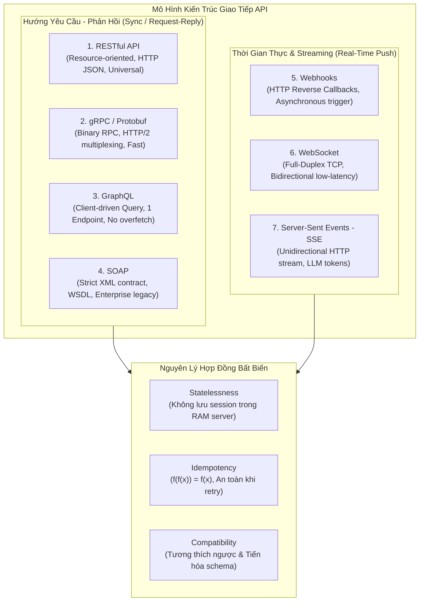
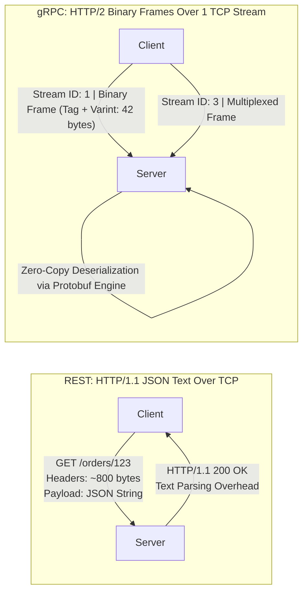
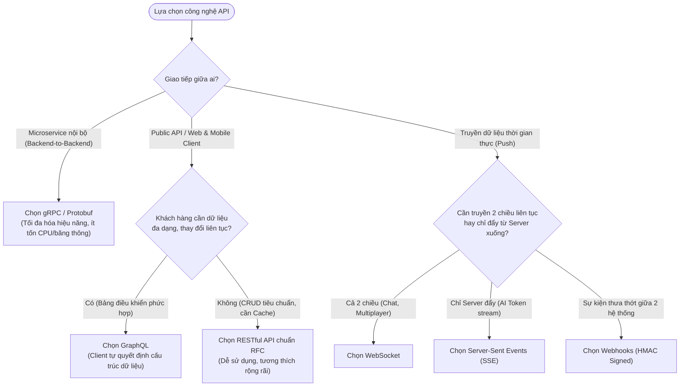

# 6.1. Nền Tảng Kỹ Nghệ Giao Diện Lập Trình Ứng Dụng (API Fundamentals)

> [!IMPORTANT]
> **Nếu bạn chỉ được nhớ một điều duy nhất:** Giao diện lập trình ứng dụng (API) không đơn thuần là các hàm hay đường dẫn mạng, mà là **bản hợp đồng kỹ thuật bất biến (Formal Technical Contract)** giữa hai ranh giới kiến trúc độc lập — sự bền vững của hệ thống phân tán được quyết định bởi tính phi trạng thái (Statelessness), tính bất biến tác dụng (Idempotency) và khả năng tiến hóa schema mà không làm đổ vỡ các client đang vận hành (Backward Compatibility).

---

## 1. Kiến trúc Tổng quan & Mô hình Tư duy (Mental Model)

### Ẩn dụ Đời sống: Cảng Hàng Không Quốc Tế & Hệ Thống Điều Phối Bay
Hãy hình dung hệ thống giao tiếp API tương tự như cách thức một Sân bay Quốc tế vận hành:
- **REST (Quầy Thủ Tục Hải Quan Truyền Thống)**: Hành khách xếp hàng, trình hộ chiếu, nhận thẻ lên máy bay bằng các mẫu đơn chuẩn hóa (HTTP Verbs: GET, POST, PUT, DELETE). Mọi tài nguyên đều có mã số định danh rõ ràng (URIs: Cổng 12, Chuyến bay VN123). Rất phổ quát, ai cũng hiểu nhưng mang tính văn bản thô cồng kềnh (JSON).
- **gRPC (Hệ Thống Điện Đàm Nội Bộ Phi Công - Kiểm Soát Không Lưu)**: Các phi công và trạm không lưu trao đổi bằng mã nhị phân tốc độ cao qua kênh tần số riêng (HTTP/2 Multiplexing & Protobuf). Giao tiếp cực ngắn gọn, chính xác tuyệt đối theo cấu trúc định sẵn (Schema Contract), không có một từ ngữ thừa thãi nào.
- **GraphQL (Bàn Tiếp Tân Theo Yêu Cầu Riêng Cho Khách VIP)**: Thay vì đi qua 5 quầy khác nhau để lấy thông tin chuyến bay, hành lý, khách sạn và xe đưa đón (Over-fetching & Under-fetching), hành khách VIP đưa một tờ giấy ghi chính xác 4 thứ mình cần vào quầy Concierge duy nhất (`/graphql`) và nhận về đúng những thông tin đó.
- **SOAP (Hiệp Định Ngoại Giao Bằng Văn Bản Đóng Dấu Đỏ)**: Bản hợp đồng pháp lý bằng văn bản XML dài dòng, có dấu niêm phong bảo mật nhiều tầng (WS-Security), cực kỳ khắt khe nhưng nặng nề, điển hình trong các cơ quan chính phủ và ngân hàng thế kỷ trước.
- **Webhooks (Dịch Vụ Nhắn Tin SMS Báo Chuyến Bay Hoãn)**: Thay vì hành khách cứ mỗi 5 phút phải chạy lại bảng điện tử nhìn (Polling), sân bay chủ động gửi tin nhắn SMS (HTTP POST callback) đến điện thoại của hành khách ngay khi có sự cố delay.
- **WebSocket (Bộ Đàm Thoại Trực Tiếp 2 Chiều Giữa Cơ Trưởng và Đài Chỉ Huy)**: Kênh âm thanh được mở thông suốt liên tục (Full-Duplex TCP). Cả hai bên có thể nói và nghe cùng một lúc theo thời gian thực mà không cần thiết lập lại cuộc gọi.
- **Server-Sent Events - SSE (Loa Phát Thanh Sân Bay)**: Đài chỉ huy liên tục phát thông báo cập nhật về thời tiết và cổng bay một chiều xuống toàn bộ nhà ga (Unidirectional Stream). Hành khách chỉ ngồi nghe loa mà không nói ngược lại vào loa; nếu mất sóng, radio tự động bắt lại tần số.



---

## 2. Chi tiết từng Keyword (Under-the-Hood Deep Dive)

### 2.1. Architectural Paradigms: REST, gRPC, GraphQL & SOAP

#### 1. REST (Representational State Transfer - Roy Fielding, 2000)
- **Bản chất**: Kiến trúc hướng tài nguyên (Resource-Oriented). Tài nguyên được định danh bằng danh từ số nhiều (`/api/v1/orders/101`). Khách hàng thao tác trên tài nguyên thông qua các động từ HTTP chuẩn hóa và nhận về biểu diễn trạng thái (JSON/XML).
- **Ràng buộc kiến trúc (Fielding Constraints)**:
  1. *Client-Server*: Phân tách giao diện người dùng và hạ tầng lưu trữ.
  2. *Stateless*: Mọi request phải tự chứa đủ thông tin xác thực.
  3. *Cacheable*: Phản hồi phải định nghĩa rõ khả năng cache (`Cache-Control`, `ETag`).
  4. *Uniform Interface*: Định danh tài nguyên, thao tác qua biểu diễn, thông điệp tự mô tả, và HATEOAS.
  5. *Layered System*: Client không thể biết nó kết nối trực tiếp đến Server hay qua các Proxy/Gateway trung gian.
- **Ưu / Nhược điểm**:
  - *Ưu điểm*: Cực kỳ phổ cập, tương thích hoàn hảo với mọi trình duyệt, hỗ trợ HTTP Caching tự nhiên.
  - *Nhược điểm*: Gánh nặng tuần tự hóa Text JSON (High CPU serialization), dễ gặp vấn đề Over-fetching (nhận quá nhiều trường thừa) hoặc Under-fetching (phải gọi 5 endpoint liên tiếp để gom đủ thông tin).

#### 2. gRPC (Google Remote Procedure Call) & Protocol Buffers
- **Bản chất**: Khung RPC hiện đại sử dụng **HTTP/2** làm tầng vận chuyển và **Protocol Buffers (Protobuf)** làm Interface Definition Language (IDL) và định dạng nhị phân.
- **Cơ chế tầng sâu HTTP/2 Framing**:
  - *Multiplexing (Đa luồng trên 1 kết nối TCP)*: Cho phép hàng trăm request/response nhị phân (Binary Streams) bay đồng thời trên một kết nối TCP duy nhất, xóa bỏ hoàn toàn hiện tượng Head-of-Line Blocking ở tầng HTTP.
  - *HPACK Header Compression*: Nén các headers trùng lặp, tiết kiệm hàng chục KB băng thông cho mỗi lời gọi.
  - *Protobuf Binary Encoding*: Dùng kỹ thuật Varint và ZigZag encoding. Không truyền tên thuộc tính (Field names) mà chỉ truyền mã định danh thẻ (Field Tags 1 byte), kích thước gói tin chỉ bằng $10\% - 20\%$ so với JSON tương đương.
- **4 Kiểu Streaming trong gRPC**:
  1. *Unary RPC*: 1 Request $\to$ 1 Response (Tương tự HTTP thông thường).
  2. *Server Streaming RPC*: 1 Request $\to$ Luồng Response liên tục (Download dữ liệu lớn).
  3. *Client Streaming RPC*: Luồng Request liên tục $\to$ 1 Response (Upload telemetry/IoT data).
  4. *Bidirectional Streaming RPC*: Cả hai phía cùng bắn dữ liệu song song qua lại.



#### 3. GraphQL (Facebook, 2015)
- **Bản chất**: Ngôn ngữ truy vấn dữ liệu cho API đi kèm với một Runtime thực thi truy vấn dựa trên hệ thống kiểu dữ liệu tĩnh (Type System Schema).
- **Đặc trưng cốt lõi**:
  - *Một Endpoint duy nhất*: Toàn bộ giao tiếp đều gửi `POST` tới `/graphql`.
  - *Truy vấn chính xác theo nhu cầu (No Over/Under-fetching)*: Client viết câu truy vấn chỉ định rõ trường cần lấy: `query { user(id: 1) { name, avatar_url } }`.
- **Cạm bẫy kỹ thuật**: Vấn đề $N+1$ Query trong Resolver; rủi ro bị tấn công từ chối dịch vụ (DoS) bằng các câu truy vấn đệ quy lồng nhau sâu (Deeply Nested Queries). Cần bảo vệ bằng **DataLoader** và giải thuật phân tích độ phức tạp truy vấn (Query Cost Analysis).

#### 4. SOAP (Simple Object Access Protocol)
- **Bản chất**: Giao thức dựa trên chuẩn XML khắt khe của W3C. Được định nghĩa qua file WSDL (Web Services Description Language).
- **Hệ thống mở rộng WS-\***: Cung cấp các tiêu chuẩn doanh nghiệp chặt chẽ về bảo mật (WS-Security), giao dịch phân tán (WS-AtomicTransaction), và độ tin cậy (WS-ReliableMessaging). Tuy nhiên, độ trễ lớn và cú pháp XML cồng kềnh khiến SOAP dần bị thay thế trong các hệ thống hiện đại.

---

### 2.2. Real-Time & Streaming: Webhooks, WebSocket & Server-Sent Events (SSE)

#### 1. Webhooks (HTTP Push / Reverse API)
- **Cơ chế**: Giao tiếp phi đồng bộ một chiều từ Server sang Client. Khi một sự kiện nghiệp vụ xảy ra (ví dụ: Thanh toán thẻ thành công, đơn hàng được giao), Server sẽ tạo một HTTP `POST` request chứa thông tin sự kiện và bắn tới Webhook URL do Client đăng ký trước.
- **Bảo mật và Độ tin cậy**:
  - *Chữ ký số HMAC (HMAC-SHA256)*: Server gửi chữ ký trong Header `X-Hub-Signature` tính toán từ payload và một `secret_key` dùng chung để ngăn chặn giả mạo dữ liệu.
  - *Timestamp & Replay Attack Defense*: Đính kèm `timestamp` trong header để Client từ chối các webhook cũ hơn 5 phút.
  - *Exponential Backoff Retry*: Nếu Client trả về mã lỗi 5xx hoặc timeout, Server phải thử lại có độ trễ lũy kế.

#### 2. WebSocket (RFC 6455)
- **Cơ chế**: Thiết lập một kênh truyền thông hai chiều toàn phần (Full-Duplex) liên tục qua 1 kết nối TCP.
- **Vòng đời kết nối**:
  1. *Handshake*: Client gửi HTTP request với headers `Upgrade: websocket` và `Connection: Upgrade`.
  2. *Switching Protocols*: Server phản hồi mã `HTTP 101 Switching Protocols`.
  3. *Framing*: Sau cú bắt tay, giao thức HTTP biến mất; dữ liệu được truyền qua các khung nhị phân siêu nhẹ (Frames) với overhead header chỉ từ 2 đến 10 bytes (so với hàng trăm bytes của HTTP header).
- **Ứng dụng**: Chat trực tuyến nhiều bên, game nhiều người chơi thời gian thực, bảng giá chứng khoán/tiền điện tử.

#### 3. Server-Sent Events (SSE - HTML5 EventSource)
- **Cơ chế**: Truyền thông một chiều từ Server xuống Client (Unidirectional Stream) chạy trên giao thức HTTP tiêu chuẩn với `Content-Type: text/event-stream`.
- **Ưu điểm vượt trội so với WebSocket**:
  - Tương thích $100\%$ với hạ tầng HTTP hiện có (đi qua dễ dàng các Proxy, Firewalls, API Gateways mà không bị ngắt kết nối).
  - Tích hợp sẵn cơ chế tự động kết nối lại (Auto-reconnection) và khôi phục sự kiện bị lỡ thông qua Header `Last-Event-ID`.
  - Là tiêu chuẩn vàng cho việc stream token phản hồi của các mô hình AI LLM (OpenAI, Gemini token generation).

---

### 2.3. Core Contract Principles: Statelessness, Idempotency & Compatibility

#### 1. Statelessness (Nguyên Lý Phi Trạng Thái)
- **Bản chất**: Máy chủ (API Server) không được lưu giữ bất kỳ trạng thái phiên làm việc nào của Client (Session State) trong bộ nhớ RAM nội bộ giữa các request.
- **Lợi ích kiến trúc**: Mọi node máy chủ trong cụm đều bình đẳng. Khi lưu lượng truy cập tăng đột biến, hệ thống Auto-scaling có thể bật thêm 100 containers phía sau Load Balancer mà không cần cấu hình Session Sticky (Session Affinity). Token xác thực (JWT mang chữ ký số RSA/Ed25519) tự chứa toàn bộ danh tính người dùng.

#### 2. Idempotency (Tính Bất Biến Tác Dụng)
- **Định nghĩa toán học**: Một thao tác $f$ là Idempotent nếu áp dụng nhiều lần liên tiếp không làm thay đổi kết quả so với áp dụng một lần duy nhất:
  $$\forall x, \quad f(f(x)) = f(x)$$
- **Phân loại theo chuẩn HTTP/1.1 (RFC 7231)**:
  - *Safe Methods (Không làm thay đổi tài nguyên)*: `GET`, `HEAD`, `OPTIONS`. (Safe luôn luôn là Idempotent).
  - *Idempotent Methods (Làm thay đổi tài nguyên nhưng lặp lại an toàn)*: `PUT` (thay thế toàn bộ), `DELETE` (xóa tài nguyên).
  - *Non-Idempotent Methods*: `POST` (tạo mới tài nguyên), `PATCH` (sửa đổi một phần có thể cộng dồn, ví dụ: tăng số dư).
- **Hiện thực Idempotency Header cho phương thức POST**:
  Client sinh UUID v4 ngẫu nhiên gửi kèm trong header: `Idempotency-Key: 7b89e3a1-9c88-...`. Server kiểm tra khóa trong Redis: nếu đã có kết quả thì trả về trực tiếp từ cache mà không chạy lại logic trừ tiền hay gửi hàng.

#### 3. Backward & Forward Compatibility (Khả Năng Tiến Hóa Hợp Đồng)
- **Luật Postel (Nguyên lý Thận trọng - Robustness Principle)**: *"Hãy bảo thủ trong những gì bạn gửi đi, và hãy hào phóng trong những gì bạn chấp nhận từ người khác"* (Be conservative in what you send, be liberal in what you accept).
- **Quy tắc vàng để không làm vỡ Client**:
  - Không bao giờ được xóa một trường đang tồn tại trong response.
  - Không bao giờ được đổi kiểu dữ liệu của một trường (ví dụ: từ `int` sang `string`).
  - Được phép thêm các trường mới tùy chọn (Optional fields). Client phải được thiết kế để bỏ qua các trường lạ mà nó không nhận biết.

---

## 3. Thực thi Mã nguồn & Mô phỏng Chuyên sâu (Dual-Engine Implementation)

### 3.1. Phiên bản C++20: Mô Phỏng Bộ Điều Phối API Hỗ Trợ Idempotency Filter và SSE Streamer

```cpp
#include <iostream>
#include <string>
#include <memory>
#include <unordered_map>
#include <vector>
#include <format>
#include <chrono>
#include <thread>
#include <optional>
#include <stdexcept>

// ============================================================================
// 1. API CONTRACT & HTTP ENVELOPE
// ============================================================================
enum class HttpMethod { GET, POST, PUT, DELETE };

struct HttpRequest {
    HttpMethod method;
    std::string path;
    std::unordered_map<std::string, std::string> headers;
    std::string body;
};

struct HttpResponse {
    int statusCode;
    std::string contentType;
    std::string body;
    std::unordered_map<std::string, std::string> headers;
};

// ============================================================================
// 2. IDEMPOTENCY MIDDLEWARE (Tránh trừ tiền trùng lặp cho POST Request)
// ============================================================================
struct CachedApiResponse {
    int statusCode;
    std::string body;
};

class IdempotencyEngine {
private:
    std::unordered_map<std::string, CachedApiResponse> cache_;

public:
    std::optional<CachedApiResponse> check(const std::string& key) {
        auto it = cache_.find(key);
        if (it != cache_.end()) {
            return it->second;
        }
        return std::nullopt;
    }

    void store(const std::string& key, int statusCode, std::string body) {
        cache_[key] = CachedApiResponse{statusCode, std::move(body)};
    }
};

// ============================================================================
// 3. API CONTROLLER & SSE STREAM GENERATOR
// ============================================================================
class OrderApiController {
private:
    IdempotencyEngine idempotencyEngine_;
    int balanceCents_{100000}; // $1,000.00 khởi điểm

public:
    HttpResponse handlePostPayment(const HttpRequest& req) {
        // Kiểm tra Idempotency-Key
        auto it = req.headers.find("Idempotency-Key");
        if (it == req.headers.end() || it->second.empty()) {
            return HttpResponse{400, "application/json", "{\"error\": \"Missing Idempotency-Key header\"}", {}};
        }
        std::string idemKey = it->second;

        // Nếu request đã xử lý trước đó, trả lại kết quả đã cache ngay lập tức
        if (auto cached = idempotencyEngine_.check(idemKey)) {
            std::cout << std::format("  [Idempotency Hit] Key '{}' detected! Replaying cached response.\n", idemKey);
            return HttpResponse{cached->statusCode, "application/json", cached->body, {{"X-Cache-Lookup", "HIT"}}};
        }

        // Mô phỏng parse body và trừ tiền (Giả lập trừ $150.00)
        int chargeCents = 15000;
        if (balanceCents_ < chargeCents) {
            return HttpResponse{422, "application/json", "{\"error\": \"Insufficient funds\"}", {}};
        }
        balanceCents_ -= chargeCents;

        std::string responsePayload = std::format(
            "{{\"status\": \"PAID\", \"charged_usd\": {:.2f}, \"remaining_balance_usd\": {:.2f}}}",
            chargeCents / 100.0, balanceCents_ / 100.0
        );

        std::cout << std::format("  [API Core] Debited $150.00. Current Balance: ${:.2f}\n", balanceCents_ / 100.0);

        // Lưu kết quả vào Idempotency Engine
        idempotencyEngine_.store(idemKey, 201, responsePayload);

        return HttpResponse{201, "application/json", responsePayload, {{"X-Cache-Lookup", "MISS"}}};
    }

    // Mô phỏng Server-Sent Events (SSE) Stream
    void streamAiTokensToClient() {
        std::cout << "\n=== [SSE Streaming Connection Opened: text/event-stream] ===\n";
        std::vector<std::string> tokens = {"Xin", " chào!", " Tôi", " là", " kiến", " trúc", " sư", " API."};

        for (size_t i = 0; i < tokens.size(); ++i) {
            std::this_thread::sleep_for(std::chrono::milliseconds(40));
            std::cout << std::format("id: {}\nevent: message\ndata: {{\"token\": \"{}\"}}\n\n", i + 1, tokens[i]);
        }
        std::cout << "event: done\ndata: [DONE]\n\n";
        std::cout << "=== [SSE Stream Closed] ===\n\n";
    }
};

int main() {
    std::cout << "=========================================================\n";
    std::cout << "       DEMO API FUNDAMENTALS & IDEMPOTENCY (C++20)       \n";
    std::cout << "=========================================================\n\n";

    OrderApiController api;

    HttpRequest req1{
        .method = HttpMethod::POST,
        .path = "/api/v1/payments",
        .headers = {{"Idempotency-Key", "tx-uuid-9900-1122"}, {"Content-Type", "application/json"}},
        .body = "{\"order_id\": 901, \"amount\": 150.0}"
    };

    std::cout << "--- 1. CLIENT GỬI REQUEST THANH TOÁN LẦN ĐẦU ---\n";
    HttpResponse res1 = api.handlePostPayment(req1);
    std::cout << std::format("HTTP Status: {} | Body: {}\n\n", res1.statusCode, res1.body);

    std::cout << "--- 2. CLIENT BỊ TIMEOUT MẠNG, THỬ LẠI CÙNG IDEMPOTENCY-KEY ---\n";
    HttpResponse res2 = api.handlePostPayment(req1);
    std::cout << std::format("HTTP Status: {} | Body: {}\n", res2.statusCode, res2.body);

    std::cout << "\n--- 3. MÔ PHỎNG SERVER-SENT EVENTS (SSE STREAMING) ---";
    api.streamAiTokensToClient();

    return 0;
}
```

---

### 3.2. Phiên bản Python 3.11+: Bộ Điều Phối Webhook Kèm Xác Thực Chữ Ký Số HMAC-SHA256

```python
from __future__ import annotations
import hmac
import hashlib
import time
import json
from dataclasses import dataclass
from typing import Dict, Any, Optional


@dataclass
class WebhookPayload:
    event_type: str
    timestamp: int
    data: Dict[str, Any]


class WebhookSigner:
    """Bên phát Webhook (Server): Ký số payload bằng HMAC-SHA256."""
    @staticmethod
    def generate_signature(secret_key: str, payload_json: str, timestamp: int) -> str:
        message = f"{timestamp}.{payload_json}".encode("utf-8")
        return hmac.new(secret_key.encode("utf-8"), message, hashlib.sha256).hexdigest()


class WebhookReceiver:
    """Bên nhận Webhook (Client): Thẩm định tính toàn vẹn và chống tấn công Replay."""
    def __init__(self, secret_key: str, tolerance_seconds: int = 300):
        self._secret = secret_key
        self._tolerance = tolerance_seconds

    def verify_and_consume(self, raw_body: str, signature_header: str, timestamp_header: int) -> bool:
        current_time = int(time.time())

        # 1. Chống tấn công Replay Attack (Từ chối request quá cũ)
        if abs(current_time - timestamp_header) > self._tolerance:
            print(f"  [Security Alert] Request timestamp expired! Drift: {current_time - timestamp_header}s")
            return False

        # 2. Tính toán chữ ký kỳ vọng
        expected_sig = WebhookSigner.generate_signature(self._secret, raw_body, timestamp_header)

        # 3. So sánh an toàn chống tấn công Timing Attack
        is_valid = hmac.compare_digest(expected_sig, signature_header)
        if not is_valid:
            print("  [Security Alert] Chữ ký số HMAC không khớp! Payload có thể đã bị sửa đổi.")
            return False

        print("  [Security Pass] Chữ ký số hợp lệ! Nguồn gốc Webhook được xác thực 100%.")
        return True


if __name__ == "__main__":
    print("=" * 65)
    print("    DEMO API WEBHOOK SECURITY: HMAC-SHA256 & REPLAY DEFENSE")
    print("=" * 65)

    SHARED_SECRET = "super-secret-enterprise-webhook-key-2026"
    receiver = WebhookReceiver(SHARED_SECRET, tolerance_seconds=60)

    # 1. Server tạo Webhook Event
    event = {
        "event": "invoice.payment_succeeded",
        "customer": "cus_9988",
        "amount_cents": 25000
    }
    payload_str = json.dumps(event, separators=(',', ':'))
    now = int(time.time())
    sig = WebhookSigner.generate_signature(SHARED_SECRET, payload_str, now)

    print("\n--- GIAO DỊCH 1: WEBHOOK HỢP LỆ ---")
    print(f"Payload: {payload_str}")
    print(f"Timestamp: {now} | Signature: {sig[:20]}...")
    success = receiver.verify_and_consume(payload_str, sig, now)
    print(f"Kết quả xử lý: {'THÀNH CÔNG' if success else 'TỪ CHỐI'}")

    print("\n--- GIAO DỊCH 2: HACKER SỬA ĐỔI DỮ LIỆU TRÊN ĐƯỜNG TRUYỀN (MAN-IN-THE-MIDDLE) ---")
    tampered_payload = payload_str.replace("25000", "9999999") # Đổi số tiền
    success_tampered = receiver.verify_and_consume(tampered_payload, sig, now)
    print(f"Kết quả xử lý: {'THÀNH CÔNG' if success_tampered else 'TỪ CHỐI'}")

    print("\n--- GIAO DỊCH 3: TẤN CÔNG PHÁT LẠI SAU ĐÓ 1 TIẾNG (REPLAY ATTACK) ---")
    one_hour_ago = now - 3600
    old_sig = WebhookSigner.generate_signature(SHARED_SECRET, payload_str, one_hour_ago)
    success_replay = receiver.verify_and_consume(payload_str, old_sig, one_hour_ago)
    print(f"Kết quả xử lý: {'THÀNH CÔNG' if success_replay else 'TỪ CHỐI'}")
```

### 3.3. Giả Lập Terminal Output Thực Tế

```text
=========================================================
       DEMO API FUNDAMENTALS & IDEMPOTENCY (C++20)       
=========================================================

--- 1. CLIENT GỬI REQUEST THANH TOÁN LẦN ĐẦU ---
  [API Core] Debited $150.00. Current Balance: $850.00
HTTP Status: 201 | Body: {"status": "PAID", "charged_usd": 150.00, "remaining_balance_usd": 850.00}

--- 2. CLIENT BỊ TIMEOUT MẠNG, THỬ LẠI CÙNG IDEMPOTENCY-KEY ---
  [Idempotency Hit] Key 'tx-uuid-9900-1122' detected! Replaying cached response.
HTTP Status: 201 | Body: {"status": "PAID", "charged_usd": 150.00, "remaining_balance_usd": 850.00}

--- 3. MÔ PHỎNG SERVER-SENT EVENTS (SSE STREAMING) ---
=== [SSE Streaming Connection Opened: text/event-stream] ===
id: 1
event: message
data: {"token": "Xin"}

id: 2
event: message
data: {"token": " chào!"}

id: 3
event: message
data: {"token": " Tôi"}

id: 4
event: message
data: {"token": " là"}

id: 5
event: message
data: {"token": " kiến"}

id: 6
event: message
data: {"token": " trúc"}

id: 7
event: message
data: {"token": " sư"}

id: 8
event: message
data: {"token": " API."}

event: done
data: [DONE]

=== [SSE Stream Closed] ===
```

---

## 4. Systems Engineering & Production Pitfalls

### Cạm Bẫy Sản Xuất Thường Gặp (Production Anti-Patterns & Gotchas)

1. **Cạn Kiệt File Descriptors Khi Vận Hành WebSocket Quy Mô Lớn (C10K/C1000K Problem)**:
   - *Bản chất*: Mỗi kết nối WebSocket là một Socket TCP giữ liên tục trong thời gian dài. Mặc định trên Linux, mỗi tiến trình chỉ được cấp `nofile = 1024` file descriptors. Khi có hàng ngàn user cùng online, máy chủ lập tức báo lỗi `EMFILE: Too many open files` và từ chối toàn bộ lưu lượng mới.
   - *Giải pháp*: Cấu hình `/etc/security/limits.conf` nâng `nofile` lên `1000000`. Phân tách máy chủ WebSocket ra cụm riêng sau Load Balancer chuyên dụng; tối ưu tham số hạt nhân TCP (`tcp_max_syn_backlog`, `tcp_tw_reuse`).

2. **Cơn Bão Thăm Dò Polling Gây Nghẽn Máy Chủ (Thundering Herd Polling Storm)**:
   - *Bản chất*: Khách hàng dùng giải pháp `setInterval(poll, 1000)` để kiểm tra trạng thái đơn hàng. Khi có 500,000 người dùng trực tuyến, hệ thống phải gánh 500,000 QPS chỉ để trả về phản hồi rỗng `{ status: "PENDING" }`, làm tê liệt Database.
   - *Giải pháp*: Thay thế Polling ngây thơ bằng **Long Polling**, **Server-Sent Events (SSE)** hoặc **WebSockets**. Nếu bắt buộc dùng polling, phải thêm Jitter ngẫu nhiên (`interval = base + rand(0, 500)ms`).

3. **Lỗ Hổng Tấn Công DoS Bằng Đệ Quy GraphQL (Nested Query Complexity Attack)**:
   - *Bản chất*: Kẻ tấn công gửi truy vấn đệ quy lồng nhau 100 tầng: `author { books { author { books { author ... } } } }`. Máy chủ cố gắng phân giải bằng hàng triệu câu truy vấn đệ quy, làm CPU chạm ngưỡng $100\%$ và treo toàn bộ tiến trình.
   - *Giải pháp*: Giới hạn độ sâu tối đa của truy vấn (`max_depth = 5`) và sử dụng thư viện tính điểm độ phức tạp (Query Complexity Analysis) để từ chối các query vượt quá 500 điểm trước khi thực thi.

4. **Kỹ Thuật Chẩn Đoán & Giám Sát Production Bằng CLI**:
   ```bash
   # 1. Đếm số lượng kết nối TCP WebSocket đang hoạt động trên cổng 8080
   ss -tan state established '( dport = :8080 or sport = :8080 )' | wc -l

   # 2. Benchmark kiểm tra hiệu năng gRPC bằng ghz tool
   ghz --insecure --proto=./order.proto --call=OrderService.GetOrder \
     -d '{"order_id": 101}' -c 50 -n 10000 localhost:50051

   # 3. Theo dõi trực tiếp dòng SSE Streaming bằng cURL
   curl -N -H "Accept: text/event-stream" https://api.enterprise.com/v1/ai/stream
   ```

---

## 5. Bảng So sánh & Decision Matrix

### 5.1. So Sánh Đa Chiều Các Mô Hình Giao Tiếp API

| Tiêu Chí | RESTful API | gRPC | GraphQL | Webhooks | WebSocket | Server-Sent Events |
| :--- | :--- | :--- | :--- | :--- | :--- | :--- |
| **Giao thức mạng** | HTTP/1.1 hoặc HTTP/2 | HTTP/2 | HTTP/1.1 hoặc HTTP/2 | HTTP POST Callback | WebSocket (TCP nâng cấp) | HTTP/1.1 hoặc HTTP/2 |
| **Định dạng dữ liệu** | JSON, XML | Binary Protobuf | JSON | JSON | Khung Text / Binary | Dòng Text UTF-8 |
| **Hướng truyền tin** | 1 Request $\to$ 1 Response | 4 kiểu (Unary & Stream)| 1 Request $\to$ 1 Response | 1 Chiều (Server $\to$ Client) | 2 Chiều (Full-Duplex) | 1 Chiều (Server $\to$ Client) |
| **Tốc độ tuần tự hóa** | Trung bình (Text parsing) | Cực nhanh ($10\times$ JSON) | Trung bình | Trung bình | Rất nhanh (Ít overhead) | Nhanh |
| **Hỗ trợ HTTP Caching**| Rất tốt (Native Browser) | Kém | Phức tạp (Cần POST) | Không áp dụng | Không | Không |
| **Trường hợp tối ưu** | Public Web APIs, Mobile apps| Microservices nội bộ | Bảng điều khiển đa dữ liệu | Thông báo sự kiện phân tán | Game online, Chat realtime | AI Streaming, Live Feeds |

### 5.2. Ma Trận Quyết Định Lựa Chọn Công Nghệ API


