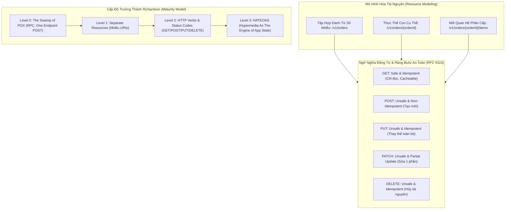
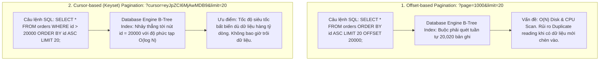

# 6.2. Thiết Kế Chuẩn Mực RESTful API (REST API Design & Best Practices)

> [!IMPORTANT]
> **Nếu bạn chỉ được nhớ một điều duy nhất:** Thiết kế RESTful API chuẩn mực không phải là nhét JSON vào URL bất kỳ, mà là **mô hình hóa tài nguyên (Resource Modeling) và tôn trọng tuyệt đối ngữ nghĩa giao thức HTTP** (RFC 9110) — dùng danh từ số nhiều cho URI, phân biệt rạch ròi tính Safe/Idempotent của các động từ, thay thế phân trang Offset bằng Cursor Pagination ở quy mô lớn và chuẩn hóa cấu trúc lỗi theo RFC 9457.

---

## 1. Kiến trúc Tổng quan & Mô hình Tư duy (Mental Model)

### Ẩn dụ Đời sống: Thư Viện Quốc Gia và Hệ Thống Tra Cứu Thẻ Mục Lục
Hãy hình dung thiết kế một hệ thống RESTful API chuẩn mực tương tự như cách tổ chức và vận hành một Thư viện Quốc gia quy mô triệu đầu sách:
- **Tài nguyên & Danh từ số nhiều (`/books`, `/authors`)**: Mỗi cuốn sách, tác giả hay thẻ mượn là một "Tài nguyên" có mã định danh bất biến. Khách không bao giờ nói: *"Cho tôi hành động lấy sách số 10"* (`/getBook?id=10` - Level 0/RPC), mà nói: *"Tôi muốn xem thông tin tại ngăn sách số 10"* (`GET /books/10` - Level 2/REST).
- **Quan hệ thứ bậc lồng ghép (`/authors/7/books`)**: Để tìm các cuốn sách của tác giả số 7, thủ thư mở ngăn kéo của tác giả đó và xem danh mục sách bên trong.
- **Richardson Maturity Model (Các cấp bậc hiện đại hóa thư viện)**:
  - *Level 0 (Hòm thư duy nhất)*: Mọi yêu cầu mượn, trả, tìm sách đều nhét chung vào một hòm thư giấy duy nhất (`POST /libraryEndpoint`).
  - *Level 1 (Chia từng quầy riêng biệt)*: Có quầy Sách, quầy Tác giả, quầy Thẻ mượn riêng (`/books`, `/authors`), nhưng mọi việc ở mọi quầy đều xử lý qua một loại giấy biên nhận chung (`POST`).
  - *Level 2 (Chuẩn hóa hành động & Biên lai)*: Đọc sách dùng mắt xem (`GET` - Safe), đăng ký thẻ mới điền đơn (`POST` - Non-idempotent), đổi toàn bộ thông tin thẻ (`PUT` - Idempotent), xé bỏ thẻ (`DELETE` - Idempotent). Trả biên lai chuẩn màu xanh `200/201` khi thành công, màu đỏ `400/404` khi lỗi.
  - *Level 3: HATEOAS (Tấm bản đồ chỉ đường thông minh đính kèm)*: Khi thủ thư trả sách cho bạn, trên phiếu mượn in sẵn các liên kết: *"Bấm vào đây để gia hạn"* (`rel: extend`), *"Bấm vào đây để thanh toán tiền phạt"* (`rel: pay`). Bạn không cần nhớ quy trình tiếp theo, chính tài nguyên sẽ hướng dẫn bạn.
- **Offset vs Cursor Pagination (Đếm từng trang sách vs Dải ruy băng đánh dấu trang)**:
  - *Offset Pagination*: Thủ thư bắt bạn lật từ trang 1 đến trang 100,000 để đọc tiếp trang 100,001 ($O(N)$ scan kiệt sức). Nếu ai đó xé mất 1 trang ở giữa, toàn bộ số trang bị lệch và bạn đọc trùng nội dung.
  - *Cursor Pagination*: Bạn kẹp một dải ruy băng ghi ID cuốn sách cuối cùng (`cursor = book_id_9988`). Lần sau chỉ cần mở ngay sau dải ruy băng qua Index B-Tree ($O(\log N)$).
- **RFC 9457 Problem Details (Phiếu báo lỗi tiêu chuẩn y tế/pháp lý)**: Không trả về thông báo lỗi chung chung kiểu `"Lỗi rồi!"`, mà có mẫu in chuẩn quốc tế: loại lỗi gì, tiêu đề, mã số, lý do chi tiết và đường dẫn request cụ thể.



---

## 2. Chi tiết từng Keyword (Under-the-Hood Deep Dive)

### 2.1. Resource Modeling, Naming & Richardson Maturity Model

#### 1. Quy Chuẩn Đặt Tên URI & Mô Hình Hóa Tài Nguyên
- **Sử dụng Danh từ số nhiều (Plural Nouns)**: Đại diện cho một tập hợp thực thể:
  - Chuẩn: `/v1/users`, `/v1/products`, `/v1/invoices`.
  - *Cấm tuyệt đối*: Dùng động từ trong URI (như `/v1/getUsers`, `/v1/createProduct`, `/v1/deleteInvoice`). Động từ phải được biểu đạt bằng chính các phương thức HTTP.
- **Ký tự và Định dạng (Kebab-case)**:
  - Sử dụng chữ viết thường và dấu gạch ngang: `/v1/payment-methods`, `/v1/customer-addresses`.
  - Không dùng camelCase (`/paymentMethods`) hay snake_case (`/payment_methods`) trong path URL.
- **Mô hình hóa quan hệ Cha - Con (Sub-resources)**:
  - Chỉ nên lồng tối đa 2 cấp để tránh URI quá dài và phức tạp:
    `/v1/teams/{teamId}/members/{memberId}`.
  - Nếu mối quan hệ phức tạp hơn, hãy làm phẳng (Flattening) tài nguyên: Thay vì `/v1/companies/{cId}/departments/{dId}/teams/{tId}/employees`, hãy dùng `/v1/employees?team_id={tId}`.

#### 2. Richardson Maturity Model (Mô Hình Trưởng Thành REST)
1. **Level 0: The Swamp of POX (Đầm lầy Plain Old XML/JSON)**:
   - Dùng HTTP chỉ như một giao thức truyền tải tầng dưới (Transport mechanism cho RPC).
   - Chỉ có 1 endpoint duy nhất (ví dụ: `POST /api/service`), mọi lệnh gọi được bọc trong body: `{"action": "createOrder", "data": {...}}`. Luôn trả về HTTP status 200 kèm body lỗi nếu thất bại.
2. **Level 1: Resources (Tài Nguyên Riêng Biệt)**:
   - Hệ thống bắt đầu phân tách các URIs khác nhau cho từng đối tượng (`/orders`, `/customers`), nhưng vẫn chỉ dùng một phương thức HTTP duy nhất (hầu hết là `POST`).
3. **Level 2: HTTP Verbs & Status Codes (Chuẩn Ngữ Nghĩa HTTP)**:
   - Áp dụng đầy đủ và chính xác các động từ HTTP (`GET` để truy vấn, `POST` để tạo mới, `PUT/PATCH` để cập nhật, `DELETE` để xóa).
   - Trả về mã HTTP Status Codes chuẩn (`201 Created`, `404 Not Found`, `409 Conflict`, `422 Unprocessable`).
   - *Hơn 95% API trong các tập đoàn công nghệ hiện nay vận hành ở Level 2*.
4. **Level 3: Hypermedia Controls (HATEOAS)**:
   - Hypermedia As The Engine Of Application State: Server trả về dữ liệu kèm theo các siêu liên kết (`_links` hoặc JSON:API format) mô tả các hành động tiếp theo mà Client có quyền thực hiện dựa trên trạng thái hiện tại của tài nguyên. Client không cần hardcode URL của các bước kế tiếp.

```json
{
  "orderId": "ORD-998877",
  "status": "AWAITING_PAYMENT",
  "totalAmountUSD": 149.99,
  "_links": {
    "self": { "href": "/v1/orders/ORD-998877", "method": "GET" },
    "payment": { "href": "/v1/orders/ORD-998877/payments", "method": "POST" },
    "cancel": { "href": "/v1/orders/ORD-998877/cancel", "method": "POST" }
  }
}
```

---

### 2.2. HTTP Methods Semantics: Safe vs Idempotent & Status Codes

#### 1. Bản Chất Kỹ Thuật: Safe Methods vs Idempotent Methods
- **Safe Methods (Phương thức An toàn - RFC 9110)**:
  - Các phương thức được định nghĩa là **chỉ đọc (Read-only)**, việc thực thi chúng không được gây ra bất kỳ tác dụng phụ (side-effects) làm thay đổi trạng thái dữ liệu trên máy chủ.
  - Các phương thức an toàn: `GET`, `HEAD`, `OPTIONS`, `TRACE`.
  - Các trình duyệt web, proxy và crawler (như Googlebot) giả định mọi lời gọi `GET` đều an toàn và có thể tự ý kích hoạt lại hoặc tải trước (Prefetching) mà không gây nguy hiểm.
- **Idempotent Methods (Phương thức Bất biến tác dụng)**:
  - Một phương thức là Idempotent nếu gọi $N$ lần liên tiếp ($N \ge 1$) với cùng tham số đều dẫn tới trạng thái dữ liệu trên máy chủ hoàn toàn đồng nhất như nhau.
  - `PUT`: Thay thế toàn bộ bản ghi. Gọi 10 lần vẫn là thay thế bản ghi đó bằng dữ liệu đó $\to$ **Idempotent**.
  - `DELETE`: Xóa bản ghi. Lần 1 xóa thành công (204/200), lần 2 báo không tìm thấy (404), nhưng trạng thái máy chủ sau lần 1 và lần 10 là như nhau (bản ghi không còn tồn tại) $\to$ **Idempotent**.
  - `POST`: Tạo mới bản ghi. Gọi 10 lần sinh ra 10 bản ghi khác nhau $\to$ **Non-Idempotent**.
  - `PATCH`: Về lý thuyết RFC là Non-Idempotent (nếu dùng thao tác cộng dồn `{"op": "increment", "value": 5}`), nhưng trong thực tế thường được thiết kế Idempotent (chỉ cập nhật một số trường cụ thể `{"status": "ACTIVE"}`).

#### 2. Hệ Thống Mã Trạng Thái HTTP (Status Codes Hierarchy) Chuẩn Mực

| Dải Mã | Mã Cụ Thể | Ý Nghĩa Kỹ Thuật Chuẩn | Ngữ Cảnh Sử Dụng Đúng |
| :--- | :--- | :--- | :--- |
| **2xx** | **200 OK** | Thành công chung | Trả về dữ liệu cho `GET`, `PUT`, `PATCH` |
| | **201 Created** | Tạo tài nguyên mới thành công | Trả về cho `POST` kèm Header `Location: /v1/orders/101` |
| | **202 Accepted** | Tiếp nhận tác vụ bất đồng bộ | Cho các tiến trình nền (Async Job/Worker chưa xong ngay) |
| | **204 No Content**| Thành công nhưng không có body | Thường dùng cho `DELETE` hoặc `PUT` không cần trả payload |
| **3xx** | **301 Moved** | Đổi URL vĩnh viễn | Chuyển hướng endpoint vĩnh viễn (SEO friendly) |
| | **304 Not Modified**| Dữ liệu cache chưa thay đổi | Cực kỳ quan trọng: Trả về khi khớp `ETag` / `If-None-Match` |
| **4xx** | **400 Bad Request**| Sai cú pháp request | JSON parse error, sai định dạng trường |
| | **401 Unauthorized**| Chưa định danh (Unauthenticated)| Thiếu JWT Token, Token hết hạn, sai chữ ký số |
| | **403 Forbidden** | Không có quyền (Unauthorized) | Đã xác thực nhưng Role/Permission không đủ quyền |
| | **404 Not Found** | Không tìm thấy tài nguyên | URI không tồn tại hoặc ID không có trong cơ sở dữ liệu |
| | **409 Conflict** | Xung đột trạng thái hệ thống | Trùng Email duy nhất, trùng phiên bản khóa lạc quan |
| | **422 Unprocessable**| Vi phạm quy tắc nghiệp vụ | Cú pháp JSON đúng nhưng tuổi < 18 hoặc số dư không đủ |
| | **429 Too Many Req**| Bị chặn do vượt quá Rate Limit | Vượt quota API, trả kèm header `Retry-After: 60` |
| **5xx** | **500 Internal Err**| Lỗi hệ thống không lường trước | Crash tiến trình, Unhandled Exception, OOM |
| | **502 Bad Gateway** | Cổng trung gian bị lỗi upstream | Nginx / Envoy không kết nối được tới Backend service |
| | **503 Service Unavail**| Dịch vụ đang quá tải / bảo trì | Hệ thống Circuit Breaker đang ngắt mạch |
| | **504 Gateway Timeout**| Hết thời gian chờ upstream | Microservice phía sau phản hồi quá chậm (> 30s) |

---

### 2.3. Query Engineering: Offset vs Cursor Pagination & RFC 9457 Problem Details

#### 1. So Sánh Bản Chất Kỹ Thuật: Offset-based vs Cursor-based Pagination



- **Offset-based Pagination (`LIMIT 20 OFFSET 1000000`)**:
  - *Cơ chế*: Database phải duyệt qua $1,000,000$ dòng dữ liệu đầu tiên, nạp vào RAM rồi sau đó vứt bỏ toàn bộ để chỉ lấy đúng 20 dòng cuối cùng.
  - *Hiện tượng trôi dữ liệu (Data Drift / Page Drift)*: Khi user đang ở trang 1, nếu có 1 đơn hàng mới được tạo chèn vào đầu bảng, khi user bấm sang trang 2, toàn bộ bản ghi bị đẩy lùi 1 nấc, khiến user nhìn thấy bản ghi cuối cùng của trang 1 lặp lại ở đầu trang 2.
- **Cursor-based / Keyset Pagination (`WHERE id > :last_seen_id LIMIT 20`)**:
  - *Cơ chế*: Con trỏ (Cursor) là một chuỗi mã hóa Base64 chứa giá trị của cột định danh sắp xếp (thường là `id` hoặc `created_at` có đánh chỉ mục B-Tree).
  - *Hiệu năng*: Database sử dụng phép tìm kiếm cây nhị phân (Index Seek) để nhảy trực tiếp đến nút con trỏ với chi phí $O(\log N)$, hoàn toàn miễn nhiễm với khối lượng dữ liệu khổng lồ phía trước.

#### 2. Chuẩn Hóa Lỗi Toàn Cầu Theo RFC 9457 (Problem Details for HTTP APIs)
- Thay thế cấu trúc báo lỗi tùy tiện (`{"err": "Lỗi", "code": 12}`) bằng định dạng chuẩn của IETF RFC 9457 với `Content-Type: application/problem+json`:
  - `type`: Đường dẫn URI chỉ tới tài liệu hướng dẫn chi tiết về loại lỗi này.
  - `title`: Tóm tắt ngắn gọn, dễ hiểu về lỗi (không thay đổi giữa các lần xuất hiện).
  - `status`: Mã HTTP Status Code tương ứng (trùng với HTTP header).
  - `detail`: Giải thích nguyên nhân cụ thể dẫn đến lỗi cho request hiện tại.
  - `instance`: URI của request cụ thể đã phát sinh lỗi (hỗ trợ điều tra log).
  - `invalid_params`: Trường mở rộng mô tả danh sách các thuộc tính không hợp lệ.

---

## 3. Thực thi Mã nguồn & Mô phỏng Chuyên sâu (Dual-Engine Implementation)

### 3.1. Phiên bản C++20: Mô Phỏng Động Cơ Keyset Pagination và RFC 9457 Problem Details Builder

```cpp
#include <iostream>
#include <string>
#include <vector>
#include <memory>
#include <format>
#include <optional>
#include <algorithm>
#include <cstdint>

// ============================================================================
// 1. DOMAIN DATA CONTRACT & REPOSITORY
// ============================================================================
struct OrderItemRecord {
    uint64_t id;
    std::string customerName;
    double amountUSD;
};

// ============================================================================
// 2. RFC 9457 PROBLEM DETAILS STANDARD BUILDER
// ============================================================================
struct InvalidFieldParam {
    std::string fieldName;
    std::string violationReason;
};

class ProblemDetailsException : public std::exception {
private:
    std::string typeUri_;
    std::string title_;
    int statusHttp_;
    std::string detail_;
    std::string instanceUri_;
    std::vector<InvalidFieldParam> invalidParams_;

public:
    ProblemDetailsException(std::string type, std::string title, int status, 
                            std::string detail, std::string instance, 
                            std::vector<InvalidFieldParam> params = {})
        : typeUri_(std::move(type)), title_(std::move(title)), statusHttp_(status),
          detail_(std::move(detail)), instanceUri_(std::move(instance)),
          invalidParams_(std::move(params)) {}

    [[nodiscard]] std::string serializeJson() const {
        std::string json = "{\n";
        json += std::format("  \"type\": \"{}\",\n", typeUri_);
        json += std::format("  \"title\": \"{}\",\n", title_);
        json += std::format("  \"status\": {},\n", statusHttp_);
        json += std::format("  \"detail\": \"{}\",\n", detail_);
        json += std::format("  \"instance\": \"{}\"", instanceUri_);

        if (!invalidParams_.empty()) {
            json += ",\n  \"invalid_params\": [\n";
            for (size_t i = 0; i < invalidParams_.size(); ++i) {
                json += std::format("    {{\"name\": \"{}\", \"reason\": \"{}\"}}", 
                                    invalidParams_[i].fieldName, invalidParams_[i].violationReason);
                if (i + 1 < invalidParams_.size()) json += ",";
                json += "\n";
            }
            json += "  ]\n";
        } else {
            json += "\n";
        }
        json += "}";
        return json;
    }
};

// ============================================================================
// 3. CURSOR-BASED (KEYSET) PAGINATION ENGINE
// ============================================================================
struct PageResult {
    std::vector<OrderItemRecord> items;
    std::optional<uint64_t> nextCursor;
    bool hasMore;
};

class OrderRestService {
private:
    std::vector<OrderItemRecord> databaseTable_;

public:
    OrderRestService() {
        // Khởi tạo 100 bản ghi giả lập trong cơ sở dữ liệu
        for (uint64_t i = 1; i <= 50; ++i) {
            databaseTable_.push_back({i, std::format("Khach_Hang_{:03d}", i), 50.0 + (i * 2.5)});
        }
    }

    // Hiện thực Keyset Pagination: WHERE id > cursor LIMIT limit
    PageResult listOrders(std::optional<uint64_t> cursor, size_t limit, const std::string& requestUri) {
        if (limit == 0 || limit > 100) {
            throw ProblemDetailsException(
                "https://api.enterprise.com/errors/invalid-pagination-limit",
                "Pagination limit parameter out of acceptable bounds.",
                400,
                "Tham số 'limit' phải nằm trong khoảng từ 1 đến 100 bản ghi.",
                requestUri,
                {{"limit", "Giá trị truyền vào không hợp lệ (nhỏ hơn 1 hoặc lớn hơn 100)"}}
            );
        }

        uint64_t startId = cursor.value_or(0);
        std::vector<OrderItemRecord> results;

        // Giả lập phép quét Index Seek B-Tree: WHERE id > startId LIMIT limit + 1
        for (const auto& row : databaseTable_) {
            if (row.id > startId) {
                results.push_back(row);
                if (results.size() == limit + 1) {
                    break;
                }
            }
        }

        bool hasMore = results.size() > limit;
        if (hasMore) {
            results.pop_back(); // Bỏ phần tử thứ limit + 1
        }

        std::optional<uint64_t> nextCursor = std::nullopt;
        if (hasMore && !results.empty()) {
            nextCursor = results.back().id;
        }

        return PageResult{std::move(results), nextCursor, hasMore};
    }
};

int main() {
    std::cout << "=========================================================\n";
    std::cout << "  DEMO REST API: KEYSET PAGINATION & RFC 9457 ERRORS     \n";
    std::cout << "=========================================================\n\n";

    OrderRestService service;

    // Kịch bản 1: Truy vấn trang đầu tiên (Cursor = null, Limit = 3)
    std::cout << "--- 1. TRUY VẤN TRANG ĐẦU TIÊN (GET /v1/orders?limit=3) ---\n";
    PageResult page1 = service.listOrders(std::nullopt, 3, "/v1/orders?limit=3");
    for (const auto& item : page1.items) {
        std::cout << std::format("  [Row ID: {:02d}] Customer: {} | Amount: ${:.2f}\n", 
                                 item.id, item.customerName, item.amountUSD);
    }
    std::cout << std::format("Next Cursor Token: {}\n\n", page1.nextCursor.value_or(0));

    // Kịch bản 2: Truy vấn trang kế tiếp dựa trên Next Cursor vừa nhận
    std::cout << std::format("--- 2. TRUY VẤN TRANG 2 DỰA TRÊN CURSOR (GET /v1/orders?cursor={}&limit=3) ---\n", 
                             page1.nextCursor.value());
    PageResult page2 = service.listOrders(page1.nextCursor, 3, "/v1/orders?cursor=3&limit=3");
    for (const auto& item : page2.items) {
        std::cout << std::format("  [Row ID: {:02d}] Customer: {} | Amount: ${:.2f}\n", 
                                 item.id, item.customerName, item.amountUSD);
    }
    std::cout << std::format("Next Cursor Token: {}\n\n", page2.nextCursor.value_or(0));

    // Kịch bản 3: Client truyền tham số limit = 500 (Gây lỗi và kích hoạt RFC 9457)
    std::cout << "--- 3. CLIENT GỬI LIMIT = 500 (BẮT LỖI VÀ XUẤT RFC 9457 PROBLEM DETAILS) ---\n";
    try {
        service.listOrders(std::nullopt, 500, "/v1/orders?limit=500");
    } catch (const ProblemDetailsException& pde) {
        std::cout << "HTTP/1.1 400 Bad Request\n";
        std::cout << "Content-Type: application/problem+json\n\n";
        std::cout << pde.serializeJson() << "\n";
    }

    return 0;
}
```

---

### 3.2. Phiên bản Python 3.11+: Bộ Điều Phối REST HATEOAS và Phân Trang Cursor Base64

```python
from __future__ import annotations
import base64
import json
from dataclasses import dataclass, field
from typing import Dict, List, Optional, Any


@dataclass
class Product:
    id: int
    name: str
    price_usd: float
    category: str


class RestProductCatalogService:
    def __init__(self):
        # 30 sản phẩm mẫu trong kho
        self._db: List[Product] = [
            Product(i, f"Pro-Item-{i:03d}", round(10.0 + (i * 3.5), 2), "Electronics")
            for i in range(1, 31)
        ]

    @staticmethod
    def encode_cursor(last_id: int) -> str:
        raw_json = json.dumps({"last_id": last_id})
        return base64.urlsafe_b64encode(raw_json.encode("utf-8")).decode("utf-8")

    @staticmethod
    def decode_cursor(cursor_str: str) -> int:
        try:
            raw_bytes = base64.urlsafe_b64decode(cursor_str.encode("utf-8"))
            data = json.loads(raw_bytes.decode("utf-8"))
            return int(data["last_id"])
        except Exception:
            raise ValueError("Con trỏ cursor bị hỏng hoặc không đúng định dạng Base64.")

    def get_paginated_products(self, cursor: Optional[str], limit: int = 4) -> Dict[str, Any]:
        start_id = self.decode_cursor(cursor) if cursor else 0

        # Keyset seek: Lọc các bản ghi có ID lớn hơn start_id
        matched = [p for p in self._db if p.id > start_id]
        page_items = matched[:limit]
        has_more = len(matched) > limit

        next_cursor = self.encode_cursor(page_items[-1].id) if has_more and page_items else None

        # Xây dựng phản hồi chuẩn HATEOAS (Richardson Level 3)
        response: Dict[str, Any] = {
            "data": [
                {
                    "id": p.id,
                    "name": p.name,
                    "price": p.price_usd,
                    "category": p.category,
                    "_links": {
                        "self": {"href": f"/v1/products/{p.id}", "method": "GET"},
                        "update": {"href": f"/v1/products/{p.id}", "method": "PATCH"},
                        "delete": {"href": f"/v1/products/{p.id}", "method": "DELETE"}
                    }
                }
                for p in page_items
            ],
            "pagination": {
                "limit": limit,
                "has_more": has_more,
                "next_cursor": next_cursor
            },
            "_links": {
                "self": {"href": f"/v1/products?limit={limit}" + (f"&cursor={cursor}" if cursor else "")}
            }
        }

        if next_cursor:
            response["_links"]["next"] = {
                "href": f"/v1/products?limit={limit}&cursor={next_cursor}",
                "method": "GET"
            }

        return response


if __name__ == "__main__":
    print("=" * 65)
    print("    REST API DEMO: HATEOAS LEVEL 3 & BASE64 CURSOR PAGINATION")
    print("=" * 65)

    api = RestProductCatalogService()

    # Trang 1
    print("\n--- 1. LẤY TRANG ĐẦU TIÊN (GET /v1/products?limit=2) ---")
    page1 = api.get_paginated_products(cursor=None, limit=2)
    print(json.dumps(page1, indent=2, ensure_ascii=False))

    # Trang 2 dùng next_cursor từ trang 1
    token = page1["pagination"]["next_cursor"]
    print(f"\n--- 2. LẤY TRANG THỨ HAI VỚI CURSOR TOKEN: '{token}' ---")
    page2 = api.get_paginated_products(cursor=token, limit=2)
    print(f"Nhận được {len(page2['data'])} sản phẩm tiếp theo:")
    for item in page2["data"]:
        print(f"  -> ID: {item['id']} | Tên: {item['name']} | Giá: ${item['price']}")
    print(f"Next Link HATEOAS: {page2['_links'].get('next', {}).get('href')}")
```

### 3.3. Giả Lập Terminal Output Thực Tế

```text
=========================================================
  DEMO REST API: KEYSET PAGINATION & RFC 9457 ERRORS     
=========================================================

--- 1. TRUY VẤN TRANG ĐẦU TIÊN (GET /v1/orders?limit=3) ---
  [Row ID: 01] Customer: Khach_Hang_001 | Amount: $52.50
  [Row ID: 02] Customer: Khach_Hang_002 | Amount: $55.00
  [Row ID: 03] Customer: Khach_Hang_003 | Amount: $57.50
Next Cursor Token: 3

--- 2. TRUY VẤN TRANG 2 DỰA TRÊN CURSOR (GET /v1/orders?cursor=3&limit=3) ---
  [Row ID: 04] Customer: Khach_Hang_004 | Amount: $60.00
  [Row ID: 05] Customer: Khach_Hang_005 | Amount: $62.50
  [Row ID: 06] Customer: Khach_Hang_006 | Amount: $65.00
Next Cursor Token: 6

--- 3. CLIENT GỬI LIMIT = 500 (BẮT LỖI VÀ XUẤT RFC 9457 PROBLEM DETAILS) ---
HTTP/1.1 400 Bad Request
Content-Type: application/problem+json

{
  "type": "https://api.enterprise.com/errors/invalid-pagination-limit",
  "title": "Pagination limit parameter out of acceptable bounds.",
  "status": 400,
  "detail": "Tham số 'limit' phải nằm trong khoảng từ 1 đến 100 bản ghi.",
  "instance": "/v1/orders?limit=500",
  "invalid_params": [
    {"name": "limit", "reason": "Giá trị truyền vào không hợp lệ (nhỏ hơn 1 hoặc lớn hơn 100)"}
  ]
}
```

---

## 4. Systems Engineering & Production Pitfalls

### Cạm Bẫy Sản Xuất Thường Gặp (Production Anti-Patterns & Gotchas)

1. **Hiểm Họa "HTTP 200 OK Nhưng Thất Bại" (The Pseudo-200 Anti-Pattern)**:
   - *Bản chất*: API luôn trả về mã trạng thái `200 OK`, nhưng trong body lại chứa `{ "status": "ERROR", "message": "Null Pointer Crash" }`.
   - *Hậu quả tai hại*: Toàn bộ hạ tầng mạng trung gian bị đánh lừa: Proxy Cache lưu lại kết quả lỗi; API Gateway tính tỷ lệ lỗi $0\%$ dù dịch vụ đang sập; các hệ thống giám sát SLO/SLA (như Prometheus, Datadog) không thể phát hiện sự cố tự động.
   - *Quy chuẩn*: Luôn phản ánh đúng bản chất sự cố bằng dải mã `4xx` hoặc `5xx`.

2. **Cú Sốc Hiệu Năng Phân Trang Deep Offset (Deep Offset Performance Cliff)**:
   - *Bản chất*: Lập trình viên phơi bày giao diện phân trang `?page=50000`. Khi bot cào dữ liệu lật tới trang thứ 50,000, database phải đọc 1,000,000 dòng khiến thời gian phản hồi tăng từ 10ms lên 45 giây, gây cạn kiệt Connection Pool và làm sập Database chính.
   - *Giải pháp*: Đối với Public API hoặc dữ liệu lớn, bắt buộc chặn cứng `max_offset = 1000` hoặc chuyển đổi toàn bộ sang Cursor-based Pagination.

3. **Rò Rỉ Thông Tin Nguy Hiểm Qua Báo Lỗi (Information Disclosure via Stack Traces)**:
   - *Bản chất*: Khi có Exception, server trả về nguyên văn vết ngăn xếp Java/Python/Node.js chứa tên bảng database, câu lệnh SQL nội bộ, đường dẫn file trên máy chủ. Kẻ tấn công lợi dụng thông tin này để khai thác SQL Injection.
   - *Giải pháp*: Ở môi trường Production, bắt buộc lọc sạch thông điệp lỗi qua Middleware, chỉ trả về mã lỗi chuẩn RFC 9457 và lưu vết chi tiết trong hệ thống giám sát nội bộ (ELK / CloudWatch) kèm theo `correlation_id`.

4. **Kỹ Thuật Chẩn Đoán & Giám Sát Production Bằng CLI**:
   ```bash
   # 1. Kiểm tra mã trạng thái HTTP trả về từ API bằng cURL (Xem cả Response Headers)
   curl -i -X POST https://api.enterprise.com/v1/orders \
     -H "Content-Type: application/json" \
     -d '{"items": []}'

   # 2. Benchmark độ trễ phân trang Keyset vs Offset bằng Apache Benchmark
   ab -n 1000 -c 20 "https://api.enterprise.com/v1/orders?cursor=eyJpZCI6MTAwMH0=&limit=50"

   # 3. Quét log tìm các request trả về mã lỗi 4xx/5xx trong Nginx Access Log
   awk '($9 >= 400) {print $7, $9}' /var/log/nginx/access.log | sort | uniq -c | sort -nr | head -n 20
   ```

---

## 5. Bảng So sánh & Decision Matrix

### 5.1. So Sánh Hai Chiến Lược Phân Trang (Pagination Strategies)

| Tiêu Chí Kỹ Thuật | Phân Trang Dựa Trên Offset (Page/Offset) | Phân Trang Dựa Trên Con Trỏ (Cursor/Keyset) |
| :--- | :--- | :--- |
| **Cú pháp URL điển hình** | `?page=5&limit=20` hoặc `?offset=80&limit=20` | `?cursor=eyJpZCI6ODF9&limit=20` |
| **Độ phức tạp SQL** | $O(N)$ — Càng về sau càng chậm | $O(\log N)$ — Luôn nhanh bất biến |
| **Hiện tượng trôi dữ liệu**| Có (Dễ đọc trùng hoặc sót khi có dữ liệu mới) | Không bao giờ bị trôi |
| **Nhảy tới trang bất kỳ** | Rất dễ dàng (`Jump to Page 10`) | Không hỗ trợ (Chỉ đi tới/lui từng bước) |
| **Trường hợp tối ưu** | Trang quản trị Admin nhỏ, dữ liệu tĩnh ít đổi | Feed mạng xã hội, Mobile Infinite Scroll, Big Data |

### 5.2. Ma Trận Quyết Định Lựa Chọn HTTP Methods và Mã Phản Hồi

| Hành Động Nghiệp Vụ Cần Thực Hiện | Động Từ Chuẩn | HTTP Status Thành Công | Mã Lỗi Điển Hình |
| :--- | :---: | :---: | :---: |
| **Đọc danh sách hoặc chi tiết bản ghi** | `GET` | `200 OK` (kèm body) | `404 Not Found` |
| **Tạo mới một tài nguyên (Đơn hàng, Khách hàng)** | `POST` | `201 Created` (`Location` header) | `400 Bad Request`, `422 Unprocessable` |
| **Thay thế toàn bộ thông tin tài nguyên** | `PUT` | `200 OK` hoặc `204 No Content` | `404 Not Found`, `409 Conflict` |
| **Chỉ cập nhật 1 trường (ví dụ: đổi trạng thái)** | `PATCH` | `200 OK` | `422 Unprocessable` |
| **Hủy bỏ / Xóa một tài nguyên** | `DELETE` | `204 No Content` | `404 Not Found` |
| **Gửi tác vụ nặng chạy ngầm (Export CSV 1 triệu dòng)**| `POST` | `202 Accepted` | `429 Too Many Requests` |
