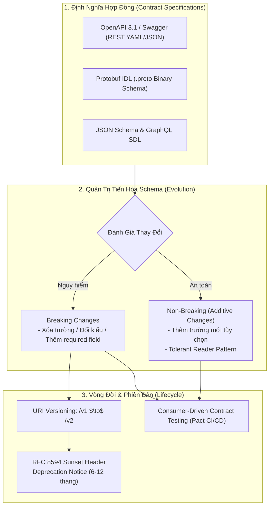
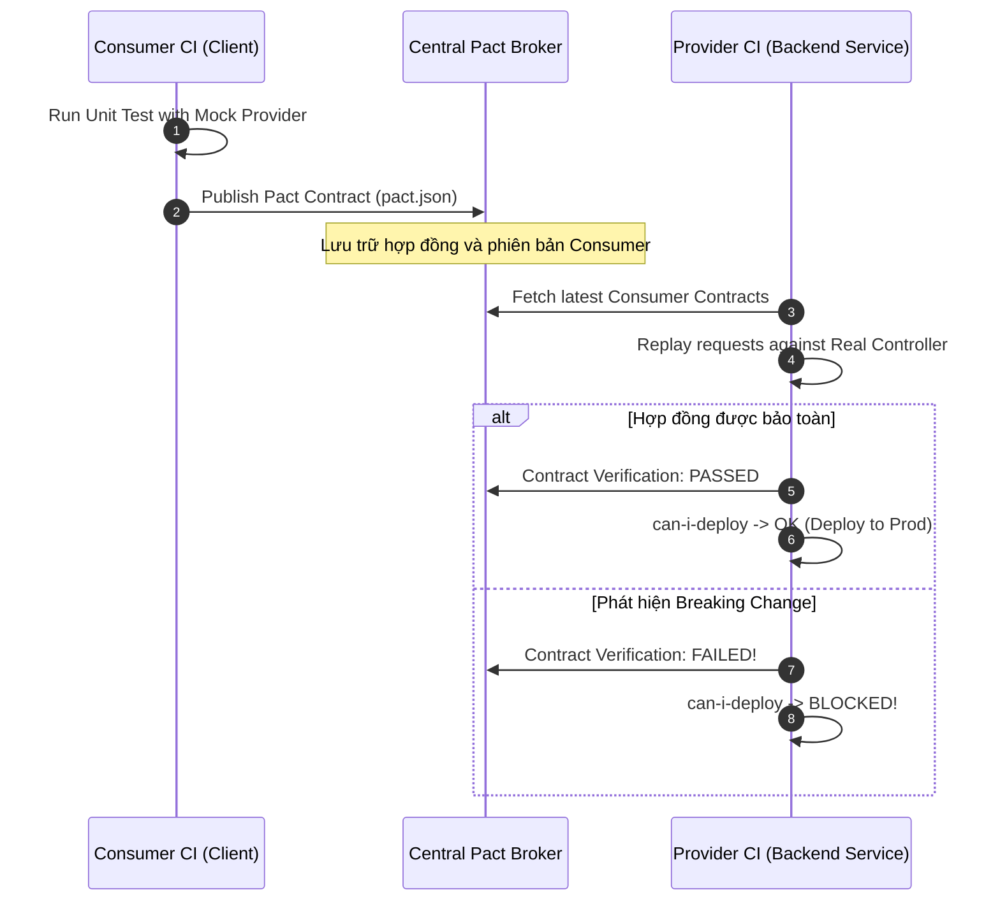

# 6.3. Kỹ Nghệ Hợp Đồng Giao Diện và Tiến Hóa Schema (API Contract Engineering & Schema Evolution)

> [!IMPORTANT]
> **Nếu bạn chỉ được nhớ một điều duy nhất:** API không chỉ là mã nguồn hay đường dẫn mạng mà là **bản cam kết pháp lý và kỹ thuật bất biến giữa các hệ thống độc lập** — mọi sự thay đổi phá vỡ tương thích ngược (Breaking Change) đều là một lỗi nghiêm trọng của kiến trúc; tiến hóa schema an toàn bắt buộc phải áp dụng nguyên lý Additive Changes, mẫu thiết kế Tolerant Reader, kiểm thử Consumer-Driven Contracts (Pact) và chính sách khai tử chuẩn mực với HTTP Sunset Header (RFC 8594).

---

## 1. Kiến trúc Tổng quan & Mô hình Tư duy (Mental Model)

### Ẩn dụ Đời sống: Bản Vẽ Quy Hoạch Xây Dựng và Hợp Đồng Thương Mại Quốc Tế
Hãy hình dung kỹ nghệ hợp đồng API tương tự như việc quản lý Bản vẽ kỹ thuật trong xây dựng một đại đô thị:
- **Contract Specifications (Bản Vẽ Kỹ Thuật Đóng Dấu Đỏ)**: Trước khi đặt bất kỳ viên gạch nào (viết code), kiến trúc sư trưởng phát hành bản vẽ tiêu chuẩn (OpenAPI / Protobuf IDL). Đội điện, đội nước và đội xây thô (Client và Server teams) căn cứ vào bản vẽ này để thi công song song độc lập mà không cần chờ đợi nhau.
- **Breaking Changes vs Additive Changes (Đập Bỏ Cột Trụ vs Lắp Thêm Ổ Cắm Điện)**:
  - *Breaking Change*: Đột ngột dời cột trụ chịu lực hoặc thu nhỏ kích thước cửa thoát hiểm (Xóa trường, đổi kiểu dữ liệu). Toàn bộ cư dân và xe cộ đang lưu thông lập tức gặp tai nạn (Client crash toàn diện).
  - *Additive Change*: Lắp thêm một ổ cắm điện dự phòng trên tường (Thêm trường mới). Cư dân cũ không dùng ổ cắm này vẫn sinh hoạt bình thường; cư dân mới có thể cắm thêm thiết bị thông minh.
- **Tolerant Reader Pattern (Người Đọc Khoan Dung)**: Người mua nhà chỉ quan tâm đến phòng ngủ và phòng bếp của họ. Nếu nhà thầu sơn thêm một họa tiết mới trên trần nhà mà họ chưa từng thấy, họ chỉ lướt qua mà không ngất xỉu hay khiếu nại (Client bỏ qua các trường lạ mà nó không nhận biết).
- **Consumer-Driven Contracts - CDC (Yêu Cầu Từ Người Tiêu Dùng)**: Thay vì chủ đầu tư tự ý xây những tiện ích không ai dùng, cư dân (Consumers) gửi trước danh sách các tiện ích tối thiểu mà họ bắt buộc phải có để sống. Chủ đầu tư (Provider) cam kết trong hợp đồng không được cắt giảm bất kỳ tiện ích nào trong danh sách đó.
- **API Versioning (Quy Hoạch Giai Đoạn 1 và Giai Đoạn 2)**: Khi công nghệ thay đổi hoàn toàn (từ đường dây đồng sang cáp quang quang học), thành phố mở một phân khu mới (/v2/) thay vì cắt đứt đường dây của toàn bộ khu dân cư cũ (/v1/).
- **Sunset Header (Thông Báo Giải Tỏa Mặt Bằng Có Kỳ Hạn)**: Chính quyền phát thông báo: *"Tuyến đường cũ sẽ chính thức đóng vào ngày 31/12/2026. Xin vui lòng chuyển sang đường cao tốc mới"* (`Sunset: RFC 8594`). Không bao giờ có chuyện sáng ngủ dậy thấy đường bị rào chắn đột ngột không báo trước.



---

## 2. Chi tiết từng Keyword (Under-the-Hood Deep Dive)

### 2.1. Contract Specifications: OpenAPI, Swagger, JSON Schema & Protobuf

#### 1. OpenAPI Specification (OAS 3.0 / 3.1) & Swagger
- **Bản chất**: Tiêu chuẩn đặc tả giao diện lập trình hướng tài nguyên mở dựa trên cấu trúc YAML hoặc JSON, hoàn toàn độc lập với ngôn ngữ lập trình.
- **Giá trị cốt lõi trong quy trình API-First Design**:
  - *Single Source of Truth*: File `openapi.yaml` là bản hợp đồng duy nhất giữa Backend, Frontend, Mobile và QA.
  - *Automated Code Generation*: Dùng công cụ `openapi-generator-cli` để sinh tự động Client SDKs (TypeScript, Swift, Kotlin, Dart) và Server Stubs (Go, Java, Python, C++).
  - *Interactive Documentation*: Tích hợp Swagger UI / Redoc giúp lập trình viên thử nghiệm trực tiếp API trên trình duyệt.
  - *Contract Mocking*: Tự động khởi chạy Mock Server (Prism, WireMock) dựa trên schema để Frontend có thể lập trình ngay cả khi Backend chưa code xong một dòng nào.

#### 2. JSON Schema (Draft 2020-12)
- Cung cấp cơ chế thẩm định (Validation) cấu trúc dữ liệu JSON chặt chẽ tại runtime: kiểm tra kiểu dữ liệu (`type: "string"`), độ dài tối thiểu (`minLength: 8`), định dạng đặc biệt (`format: "email"`, `format: "uuid"`), và các ràng buộc tổ hợp (`oneOf`, `anyOf`, `allOf`).

#### 3. Protocol Buffers (Protobuf IDL - Google)
- **Cơ chế Field Tags**: Trong file `.proto`, mỗi thuộc tính được gán một số nguyên dương bất biến gọi là **Field Tag / Number**:
  ```protobuf
  message UserResponse {
    uint64 id = 1;
    string username = 2;
    string email = 3;
  }
  ```
- **Tại sao Field Tag giải quyết triệt để bài toán tiến hóa schema?**
  Khi mã hóa nhị phân, Protobuf **không bao giờ gửi tên trường** (`"username"` tốn 8 bytes), mà chỉ gửi cặp giá trị: `(Field Tag << 3 | Wire Type)` chiếm đúng 1 byte.
  Nhờ đó:
  - Ta có thể đổi tên trường từ `username` thành `display_name` trong code mà không làm gãy kết nối nhị phân, miễn là Tag `2` được giữ nguyên.
  - Server gửi trường Tag `4` mới, Client phiên bản cũ không biết Tag `4` là gì sẽ tự động bỏ qua (Unknown Field skipping) mà không crash.

---

### 2.2. Schema Evolution: Breaking vs Non-Breaking Changes & Versioning Strategies

#### 1. Bản Chất của Breaking Changes (Thay Đổi Gây Gãy Đổ)
Một thay đổi được coi là Breaking nếu nó phá vỡ giả định của Client đang chạy:
- **Xóa bỏ (Removing)** một trường dữ liệu trong Response hoặc một Endpoint.
- **Đổi tên (Renaming)** trường dữ liệu (Client tìm kiếm key cũ sẽ nhận về `undefined`/`null`).
- **Thay đổi kiểu dữ liệu (Type Mutation)**: Đổi trường `id` từ số nguyên `int64` sang chuỗi `string UUID` (Gây lỗi giải mã kiểu dữ liệu nghiêm trọng).
- **Thêm trường bắt buộc mới (New Required Field)** trong Request Payload (Client cũ không gửi trường này sẽ bị Server từ chối bằng lỗi `400 Bad Request`).
- **Thu hẹp miền giá trị chấp nhận**: Ví dụ trường `status` trước đây chấp nhận chuỗi bất kỳ, nay chỉ chấp nhận Enum `["ACTIVE", "INACTIVE"]`.

#### 2. Non-Breaking Changes (Thay Đổi An Toàn / Additive Changes)
- **Thêm trường mới tùy chọn (Optional Field)** vào Request payload (đi kèm giá trị mặc định).
- **Thêm trường mới vào Response payload**: Được coi là an toàn nếu Client tuân thủ nguyên lý **Tolerant Reader Pattern** (nguyên lý của Martin Fowler: hệ thống chỉ trích xuất những trường nó cần và phớt lờ các trường chưa biết).
- **Thêm một Endpoint hoàn toàn mới** (`POST /v1/orders/bulk-cancel`).

#### 3. Các Chiến Lược Quản Lý Phiên Bản (API Versioning Strategies)

| Chiến Lược | Cú Pháp Minh Họa | Ưu Điểm Kỹ Thuật | Nhược Điểm / Đánh Đổi |
| :--- | :--- | :--- | :--- |
| **URI Versioning** *(Khuyên dùng)* | `https://api.corp.com/v1/orders`<br/>`https://api.corp.com/v2/orders` | Cực kỳ rõ ràng, trực quan. Định tuyến (Routing) tại API Gateway/Nginx rất dễ dàng. Hỗ trợ caching tuyệt đối. | Tạo ra nhiều endpoints trùng lặp; vi phạm thuần túy lý thuyết REST (URI nên đại diện cho tài nguyên, không phải phiên bản). |
| **Header Versioning (Custom Header)** | `X-API-Version: 2` | URI sạch sẽ, giữ nguyên địa chỉ tài nguyên. | Khó kiểm thử trên thanh địa chỉ trình duyệt. Phức tạp khi cấu hình CDN Caching (Cần cấu hình `Vary: X-API-Version`). |
| **Content Negotiation (Accept Header)** | `Accept: application/vnd.corp.v2+json` | Chuẩn mực học thuật REST nhất (HATEOAS). | Rất khó hiểu cho các lập trình viên mới, phức tạp khi gọi bằng cURL hoặc Postman. |
| **Query Parameter** | `https://api.corp.com/orders?version=2` | Dễ truyền tham số, có giá trị mặc định. | Dễ xung đột với các bộ lọc phân trang và caching. |

---

### 2.3. Consumer-Driven Contracts (CDC) & Deprecation Policy

#### 1. Consumer-Driven Contract Testing (Pact Framework)
- **Vấn đề của End-to-End Testing truyền thống**: Trong kiến trúc 50 Microservices, việc dựng toàn bộ 50 services lên môi trường Test để chạy integration tests cực kỳ chậm chạp, tốn kém tài nguyên và thường xuyên bị lỗi chập chờn (Flaky Tests).
- **Cơ chế Consumer-Driven Contracts**:
  1. *Consumer định nghĩa nhu cầu*: Client tạo một hợp đồng kiểm thử (Pact File JSON): *"Tôi gọi GET /v1/users/101, tôi mong đợi HTTP 200 và response tối thiểu phải có trường name kiểu string"*.
  2. *Publish Pact*: Pact File được tải lên máy chủ trung tâm **Pact Broker**.
  3. *Provider tự động xác thực*: Trong pipeline CI/CD của Provider (Backend), một test suite tự động nạp toàn bộ Pact Files từ Pact Broker và chạy giả lập trên code hiện tại của Provider.
  4. *Can-I-Deploy Gate*: Nếu Provider sửa code làm mất trường `name`, build pipeline sẽ bị chặn đứng ngay lập tức với thông báo: *"Consumer Mobile App v3.2 sẽ bị gãy đổ nếu bản build này được deploy!"*.



#### 2. Chính Sách Khai Tử API & Tiêu Chuẩn RFC 8594 Sunset Header
- **Quy trình khai tử chuẩn mực (Deprecation Lifecycle)**:
  1. *Giai đoạn Thông báo (Announcement)*: Duy trì phiên bản cũ tối thiểu từ 6 đến 12 tháng.
  2. *Giai đoạn Gắn nhãn kỹ thuật (Technical Notice)*: Trả về HTTP Headers chuẩn mực trên mọi response của phiên bản cũ:
     - `Deprecation: true` (hoặc `@deprecated` timestamp).
     - `Sunset: Wed, 11 Nov 2026 00:00:00 GMT` (Chỉ định chính xác thời điểm tắt server vĩnh viễn theo RFC 8594).
     - `Link: <https://api.corp.com/v2/migration-guide>; rel="sunset"`.
  3. *Giai đoạn Brownout (Tắt thử nghiệm)*: 1 tháng trước ngày Sunset, tắt API cũ trong 15 phút vào giờ thấp điểm để kiểm tra xem còn hệ thống nào quên chưa chuyển đổi.
  4. *Giai đoạn Tắt vĩnh viễn (Decommissioning)*: Chuyển toàn bộ lưu lượng của URL cũ sang mã phản hồi `410 Gone`.

---

## 3. Thực thi Mã nguồn & Mô phỏng Chuyên sâu (Dual-Engine Implementation)

### 3.1. Phiên bản C++20: Bộ Thẩm Định Hợp Đồng Schema & Middleware Tự Động Gắn RFC 8594 Sunset Header

```cpp
#include <iostream>
#include <string>
#include <vector>
#include <memory>
#include <format>
#include <unordered_map>
#include <chrono>
#include <optional>
#include <stdexcept>

// ============================================================================
// 1. CONTRACT DEFINITION & SCHEMA VALIDATOR
// ============================================================================
struct UserProfileContractV1 {
    uint64_t id;
    std::string fullName;
    std::string email; // Bắt buộc ở v1
};

struct UserProfileContractV2 {
    uint64_t id;
    std::string firstName;
    std::string lastName;
    std::string corporateEmail;
    std::optional<std::string> secondaryEmail; // Additive change (Optional)
};

// ============================================================================
// 2. HTTP ENVELOPE & SUNSET MIDDLEWARE (RFC 8594)
// ============================================================================
struct HttpResponseContext {
    int statusCode;
    std::unordered_map<std::string, std::string> headers;
    std::string body;
};

class ApiLifecycleMiddleware {
public:
    // Tự động gắn Sunset & Deprecation headers cho các Endpoint phiên bản cũ
    static void applyDeprecationHeaders(HttpResponseContext& response, const std::string& sunsetDateGmt) {
        response.headers["Deprecation"] = "true";
        response.headers["Sunset"] = sunsetDateGmt;
        response.headers["Link"] = "<https://api.enterprise.com/docs/v2/migration>; rel=\"sunset\"";
    }
};

// ============================================================================
// 3. API CONTROLLER DEMO SUPPORTING V1 (DEPRECATED) AND V2 (CURRENT)
// ============================================================================
class CustomerApiController {
public:
    // Endpoint V1: Đang trong lộ trình khai tử (Deprecated with Sunset RFC 8594)
    HttpResponseContext getUserV1(uint64_t userId) {
        HttpResponseContext res;
        res.statusCode = 200;
        res.headers["Content-Type"] = "application/json";

        // Gắn header khai tử chuẩn quốc tế
        ApiLifecycleMiddleware::applyDeprecationHeaders(res, "Wed, 11 Nov 2026 00:00:00 GMT");

        res.body = std::format(
            "{{\n"
            "  \"id\": {},\n"
            "  \"fullName\": \"Nguyen Van An\",\n"
            "  \"email\": \"an.nguyen@enterprise.vn\"\n"
            "}}", userId
        );
        return res;
    }

    // Endpoint V2: Phiên bản hiện đại tuân thủ Additive Changes
    HttpResponseContext getUserV2(uint64_t userId) {
        HttpResponseContext res;
        res.statusCode = 200;
        res.headers["Content-Type"] = "application/json";

        res.body = std::format(
            "{{\n"
            "  \"id\": {},\n"
            "  \"firstName\": \"An\",\n"
            "  \"lastName\": \"Nguyen Van\",\n"
            "  \"corporateEmail\": \"an.nguyen@enterprise.vn\",\n"
            "  \"secondaryEmail\": null\n"
            "}}", userId
        );
        return res;
    }
};

int main() {
    std::cout << "=========================================================\n";
    std::cout << "  DEMO API CONTRACT & RFC 8594 SUNSET HEADERS (C++20)    \n";
    std::cout << "=========================================================\n\n";

    CustomerApiController controller;

    // 1. Gọi API v1 cũ: Kiểm tra các Headers cảnh báo khai tử
    std::cout << "--- 1. CLIENT GỌI ENDPOINT V1 (GET /v1/users/101) ---\n";
    HttpResponseContext resV1 = controller.getUserV1(101);
    std::cout << std::format("HTTP Status Code: {}\n", resV1.statusCode);
    std::cout << "[Response Headers]:\n";
    for (const auto& [key, val] : resV1.headers) {
        std::cout << std::format("  {}: {}\n", key, val);
    }
    std::cout << "[Response Payload]:\n" << resV1.body << "\n\n";

    // 2. Gọi API v2 mới: Không có Sunset Header
    std::cout << "--- 2. CLIENT ĐÃ NÂNG CẤP LÊN V2 (GET /v2/users/101) ---\n";
    HttpResponseContext resV2 = controller.getUserV2(101);
    std::cout << std::format("HTTP Status Code: {}\n", resV2.statusCode);
    std::cout << std::format("Sunset Header Present: {}\n", resV2.headers.contains("Sunset") ? "YES" : "NO");
    std::cout << "[Response Payload]:\n" << resV2.body << "\n";

    return 0;
}
```

---

### 3.2. Phiên bản Python 3.11+: Mô Phỏng Kiểm Thử Consumer-Driven Contract (CDC)

```python
from __future__ import annotations
import json
from dataclasses import dataclass
from typing import Dict, Any, List


# ============================================================================
# 1. CONSUMER PACT CONTRACT DEFINITION
# ============================================================================
@dataclass
class PactInteraction:
    description: str
    endpoint: str
    expected_status: int
    expected_fields: Dict[str, type] # Cấu trúc tối thiểu mà Consumer bắt buộc cần


class ConsumerContractPact:
    """Bên Consumer (Mobile App) định nghĩa bản cam kết về dữ liệu nó cần."""
    @staticmethod
    def get_mobile_app_pact() -> PactInteraction:
        return PactInteraction(
            description="Lấy thông tin tài khoản cơ bản cho màn hình Profile",
            endpoint="/v1/accounts/me",
            expected_status=200,
            expected_fields={
                "account_id": int,
                "display_name": str,
                "tier": str
            }
        )


# ============================================================================
# 2. PROVIDER IMPLEMENTATION (BACKEND SERVICE)
# ============================================================================
class BackendAccountService:
    def __init__(self, simulate_breaking_change: bool = False):
        self._breaking = simulate_breaking_change

    def handle_request(self, endpoint: str) -> tuple[int, Dict[str, Any]]:
        if endpoint != "/v1/accounts/me":
            return 404, {"error": "Not Found"}

        if self._breaking:
            # LẬP TRÌNH VIÊN BACKEND VÔ TÌNH ĐỔI TÊN 'display_name' THÀNH 'user_fullname'!
            return 200, {
                "account_id": 9988,
                "user_fullname": "Tran Thi B", # BREAKING CHANGE!
                "tier": "PLATINUM"
            }
        else:
            # Phiên bản chuẩn mực bảo toàn tương thích ngược
            return 200, {
                "account_id": 9988,
                "display_name": "Tran Thi B",
                "tier": "PLATINUM",
                "extra_metadata": {"login_count": 42} # Additive change (An toàn)
            }


# ============================================================================
# 3. PACT VERIFIER ENGINE (Chạy trong CI/CD của Backend)
# ============================================================================
class PactVerifierEngine:
    @staticmethod
    def verify(provider: BackendAccountService, pact: PactInteraction) -> bool:
        print(f"\n[Pact Verifier] Đang kiểm tra hợp đồng: '{pact.description}'")
        status, response_payload = provider.handle_request(pact.endpoint)

        # 1. Kiểm tra HTTP Status
        if status != pact.expected_status:
            print(f"  ❌ FAILED: Kỳ vọng status {pact.expected_status} nhưng nhận được {status}")
            return False

        # 2. Kiểm tra từng trường dữ liệu cam kết
        for field_name, expected_type in pact.expected_fields.items():
            if field_name not in response_payload:
                print(f"  ❌ CONTRACT BREACH: Trường bắt buộc '{field_name}' bị thiếu trong response!")
                return False

            val = response_payload[field_name]
            if not isinstance(val, expected_type):
                print(f"  ❌ TYPE MISMATCH: Trường '{field_name}' kỳ vọng kiểu {expected_type.__name__} nhưng là {type(val).__name__}!")
                return False

        print("  ✅ VERIFICATION PASSED: Provider đáp ứng 100% hợp đồng cam kết với Consumer!")
        return True


if __name__ == "__main__":
    print("=" * 65)
    print("   DEMO CONSUMER-DRIVEN CONTRACT (CDC) VERIFICATION (PYTHON)")
    print("=" * 65)

    pact = ConsumerContractPact.get_mobile_app_pact()

    # Kịch bản 1: Backend chạy code chuẩn mực -> Test pass, cho phép deploy
    print("\n--- TEST CASE 1: BACKEND TUÂN THỦ HỢP ĐỒNG ---")
    good_backend = BackendAccountService(simulate_breaking_change=False)
    can_deploy_1 = PactVerifierEngine.verify(good_backend, pact)
    print(f"Trạng thái CI/CD Can-I-Deploy: {'CHO PHÉP DEPLOY' if can_deploy_1 else 'CHẶN DEPLOY'}")

    # Kịch bản 2: Backend đổi tên trường `display_name` -> Test phát hiện và chặn đứng
    print("\n--- TEST CASE 2: BACKEND VÔ TÌNH PHÁ VỠ HỢP ĐỒNG (BREAKING CHANGE) ---")
    broken_backend = BackendAccountService(simulate_breaking_change=True)
    can_deploy_2 = PactVerifierEngine.verify(broken_backend, pact)
    print(f"Trạng thái CI/CD Can-I-Deploy: {'CHO PHÉP DEPLOY' if can_deploy_2 else 'CHẶN DEPLOY (BUILD FAILED)'}")
```

### 3.3. Giả Lập Terminal Output Thực Tế

```text
=========================================================
  DEMO API CONTRACT & RFC 8594 SUNSET HEADERS (C++20)    
=========================================================

--- 1. CLIENT GỌI ENDPOINT V1 (GET /v1/users/101) ---
HTTP Status Code: 200
[Response Headers]:
  Content-Type: application/json
  Deprecation: true
  Sunset: Wed, 11 Nov 2026 00:00:00 GMT
  Link: <https://api.enterprise.com/docs/v2/migration>; rel="sunset"
[Response Payload]:
{
  "id": 101,
  "fullName": "Nguyen Van An",
  "email": "an.nguyen@enterprise.vn"
}

--- 2. CLIENT ĐÃ NÂNG CẤP LÊN V2 (GET /v2/users/101) ---
HTTP Status Code: 200
Sunset Header Present: NO
[Response Payload]:
{
  "id": 101,
  "firstName": "An",
  "lastName": "Nguyen Van",
  "corporateEmail": "an.nguyen@enterprise.vn",
  "secondaryEmail": null
}
```

---

## 4. Systems Engineering & Production Pitfalls

### Cạm Bẫy Sản Xuất Thường Gặp (Production Anti-Patterns & Gotchas)

1. **Hiểm Họa Zombie APIs & Chi Phí Hạ Tầng Bị Lãng Phí (Zombie Endpoints)**:
   - *Bản chất*: Phát hành API `/v2` nhưng không bao giờ khai tử `/v1`. Sau 5 năm, hệ thống tồn tại đồng thời `/v1`, `/v2`, `/v3`, `/v4`. Đội ngũ kỹ sư không dám xóa `/v1` vì sợ làm vỡ một ứng dụng nội bộ nào đó không rõ chủ sở hữu. Chi phí vận hành, bảo trì, vá lỗi bảo mật tăng gấp 4 lần.
   - *Giải pháp*: Thiết lập quy chế vòng đời bất biến: Bất kỳ API nào bị deprecated chỉ được phép sống tối đa 12 tháng. Phải có công cụ giám sát lưu lượng gọi vào URL cũ để chủ động liên hệ người dùng trước ngày Sunset.

2. **Xung Đột Field Tag Trong Protobuf (Tag Reuse Disaster)**:
   - *Bản chất*: Lập trình viên xóa trường cũ `string phone_number = 3;` và tạo một trường mới `int64 account_id = 3;` tái sử dụng Tag số 3. Khi server mới gửi dữ liệu cho client cũ, parser nhị phân sẽ cố ép kiểu chuỗi thành số nguyên và gây sập tiến trình ngay lập tức (**Crash Crash**).
   - *Giải pháp*: Khi ngừng sử dụng một trường trong Protobuf, bắt buộc dùng từ khóa `reserved 3; reserved "phone_number";`. Trình biên dịch `protoc` sẽ chặn đứng bất kỳ ai cố gắng dùng lại Tag số 3.

3. **Chủ Quan Tin Tưởng Vào Việc Khách Hàng Tuân Thủ Thông Báo Email**:
   - *Bản chất*: Gửi email thông báo đổi API nhưng các kỹ sư đối tác không đọc. Đến ngày cắt dịch vụ, hệ thống đối tác ngừng trệ gây kiện tụng thương mại.
   - *Giải pháp*: Tự động tiêm HTTP Sunset Header và kích hoạt cơ chế **Brownout Testing (Tắt ngắt quãng có chủ đích)** trước 30 ngày để buộc đối tác phải chú ý log lỗi và nâng cấp.

4. **Kỹ Thuật Chẩn Đoán & Giám Sát Production Bằng CLI**:
   ```bash
   # 1. Quét tìm các lời gọi API cũ còn dính líu đến v1 trong AWS CloudWatch Logs
   aws logs filter-log-events --log-group-name "/aws/apigateway/enterprise-api" \
     --filter-pattern '{ $.requestPath = "/v1/*" }' --limit 20

   # 2. Chạy Pact Broker CLI để kiểm tra tính sẵn sàng trước khi deploy
   pact-broker can-i-deploy \
     --pacticipant OrderService --version 2.4.1 \
     --to-environment production --broker-base-url https://pact.corp.com

   # 3. Thẩm định cú pháp file OpenAPI bằng Spectral Linter
   npx @stoplight/spectral-cli lint openapi/v1/customer-spec.yaml
   ```

---

## 5. Bảng So sánh & Decision Matrix

### 5.1. So Sánh Các Ngôn Ngữ Đặc Tả Hợp Đồng API (Contract Specifications)

| Tiêu Chí Kỹ Thuật | OpenAPI (OAS 3.1) | Protocol Buffers (Protobuf) | JSON Schema | GraphQL SDL |
| :--- | :--- | :--- | :--- | :--- |
| **Giao thức mục tiêu** | RESTful HTTP/1.1 & HTTP/2 | gRPC / HTTP/2 | JSON payloads tổng quát | GraphQL Engine |
| **Định dạng dữ liệu** | YAML / JSON | Binary Format | JSON | GraphQL Schema Definition |
| **Độ trễ tuần tự hóa**| Trung bình (Text parsing) | Cực nhanh ($10\times$) | N/A (Chỉ validate) | Trung bình |
| **Hỗ trợ Code Gen** | Rất mạnh (Swagger Codegen) | Hoàn hảo (protoc compiler) | Trung bình | Rất tốt |
| **Khả năng đọc hiểu** | Con người đọc trực tiếp dễ | Cần file `.proto` để dịch | Dễ | Dễ |
| **Trường hợp tối ưu** | Public Web/Mobile APIs | Microservice nội bộ, IoT | Thẩm định runtime payload | Dynamic Frontend Query |

### 5.2. Ma Trận Quyết Định Xử Lý Thay Đổi API (Change Decision Matrix)

| Hành Động Thay Đổi Đề Xuất | Loại Thay Đổi | Cách Xử Lý Chuẩn Mực | Cần Nâng Minor/Major? |
| :--- | :---: | :--- | :---: |
| **Thêm trường mới tùy chọn vào Request** | Non-Breaking | Cập nhật tài liệu OpenAPI, giữ nguyên URL `/v1` | Tăng Minor (`1.1.0`) |
| **Thêm trường mới vào Response JSON** | Non-Breaking | Yêu cầu Client dùng Tolerant Reader, giữ `/v1` | Tăng Minor (`1.1.0`) |
| **Xóa một trường đang tồn tại trong Response**| **Breaking** | **CẤM sửa trực tiếp!** Tạo `/v2`, gắn Sunset cho `/v1`| Tăng Major (`2.0.0`) |
| **Đổi kiểu dữ liệu từ `int` sang `string`** | **Breaking** | **CẤM sửa trực tiếp!** Tạo `/v2`, hỗ trợ migration | Tăng Major (`2.0.0`) |
| **Sửa lỗi chính tả tên trường JSON** | **Breaking** | Giữ trường cũ, thêm trường mới song song cả hai | Tăng Minor (`1.2.0`) |
| **Sửa đổi logic tính toán nội bộ (Bug fix)**| Safe | Triển khai trực tiếp không cần đổi schema | Tăng Patch (`1.0.1`) |
