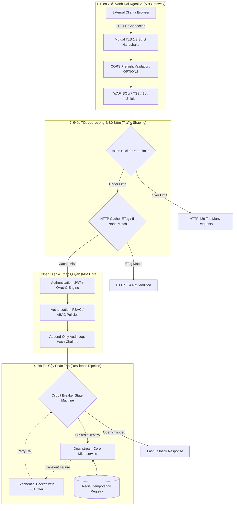
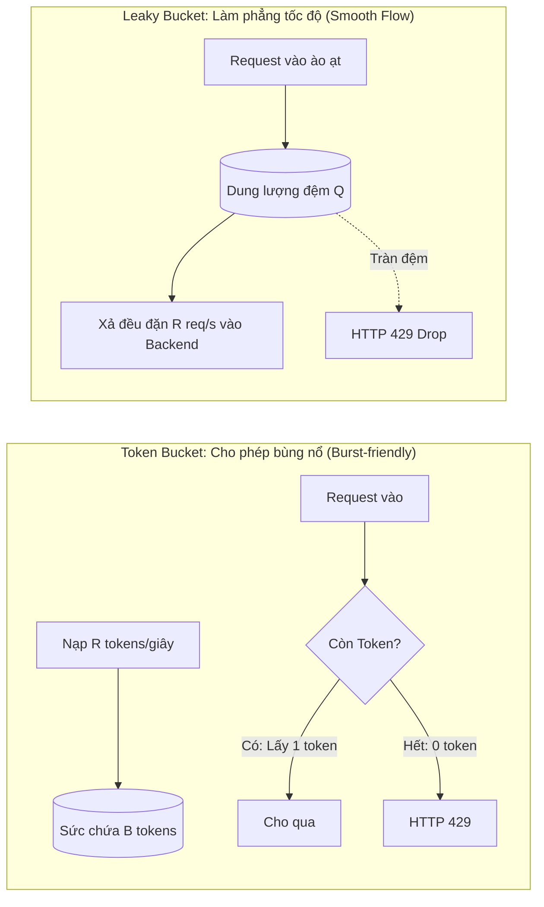
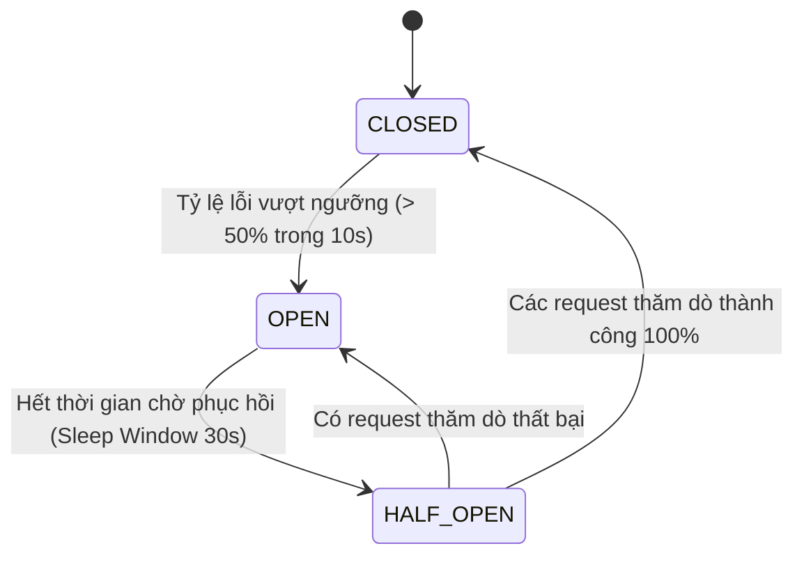

# 6.4. Độ Tin Cậy và Bảo Mật API (API Reliability & Security Engineering)

> [!IMPORTANT]
> **Nếu bạn chỉ được nhớ một điều duy nhất:** Một API mạnh mẽ không được thiết kế cho kịch bản lý tưởng, mà được trui rèn qua các điều kiện khắc nghiệt nhất: **phòng thủ đa tầng về danh tính (mTLS, JWT, RBAC/ABAC), điều tiết lưu lượng giao thông (Token Bucket Rate Limiting), tận dụng HTTP Caching (ETag/304) để giảm 90% tải, và cô lập sự cố phân tán bằng Circuit Breaker kết hợp Exponential Backoff có Jitter**.

---

## 1. Kiến trúc Tổng quan & Mô hình Tư duy (Mental Model)

### Ẩn dụ Đời sống: Đập Thủy Điện Trọng Yếu & Pháo Đài Quân Sự Đa Tầng
Hãy hình dung hệ sinh thái bảo mật và độ tin cậy của API tương tự như một Tổ hợp Công trình Thủy điện kiêm Căn cứ Quân sự tối mật:
- **Authentication & mTLS (Cổng Gác Kiểm Tra Thẻ Sĩ Quan Hai Chiều)**: Không chỉ người lính gác kiểm tra giấy tờ của người vào (Client Auth), mà người vào cũng kiểm tra quân phục và con dấu của người lính gác (Server Auth). Cả hai bên xác minh chứng chỉ số lẫn nhau (Mutual TLS).
- **Authorization - RBAC vs ABAC (Quyền Ra Vào Các Phòng Ban)**:
  - *RBAC (Role-Based)*: Huy hiệu Trung tá thì được vào phòng tác chiến; Binh nhì chỉ được vào nhà ăn.
  - *ABAC (Attribute-Based)*: Trung tá chỉ được vào phòng tác chiến nếu đang trong giờ trực chiến, có lệnh điều động từ Bộ tổng chỉ huy, và quét vân tay tại đúng vị trí phòng thủ.
- **CORS (Hàng Rào Cách Ly Ngoại Lai Của Trình Duyệt)**: Một kẻ giả danh đứng ở quán trà đá bên đường không thể ném thư nặc danh yêu cầu mở kho đạn. Trình duyệt đóng vai trò người cảnh vệ hỏi trước (Preflight `OPTIONS`): *"Cổng căn cứ có cho phép người từ quán trà đá gửi yêu cầu không?"* (`Access-Control-Allow-Origin`).
- **Rate Limiting - Token Bucket (Cửa Xoay Trạm Thu Phí Thủy Điện)**: Cửa xoay mỗi giây nhả ra 10 vé. Nếu 1,000 người cùng ùa vào một lúc, 10 người đầu tiên được qua cửa, 990 người còn lại bị chặn đứng ở rào chắn (`429 Too Many Requests`), bảo vệ cây cầu không bị sập vì quá tải.
- **HTTP Caching & ETag (Thẻ Nhận Dạng Dấu Nổi Hàng Hóa)**: Mỗi thùng hàng xuất xưởng được dán một con dấu vân tay SHA-256 (`ETag`). Khi khách đến hỏi: *"Hàng có đổi gì không?"* kèm dấu vân tay cũ (`If-None-Match`), thủ kho chỉ liếc nhìn và giơ biển: *"Chưa đổi gì cả!"* (`304 Not Modified`), không cần tốn công bốc dỡ toàn bộ thùng hàng.
- **Circuit Breaker (Cầu Dao Tự Động Chống Chập Điện)**: Khi một trạm điện phụ phía sau bị cháy (Downstream microservice sập), cầu dao chính lập tức **Bật ngắt mạch (OPEN)** để dòng điện không thiêu rụi toàn bộ máy phát trung tâm. Sau 30 giây, cầu dao hé mở thử nghiệm (**HALF-OPEN**) cho 5% dòng điện đi qua để kiểm tra xem đám cháy đã được dập tắt chưa.
- **Retry với Exponential Backoff & Jitter (Chiến Thuật Bấm Chuông Cửa Khi Chủ Nhà Bận)**: Đừng đứng bấm chuông liên thanh 100 lần trong 1 giây (Retry Storm làm cháy chuông). Bấm lần 1, đợi 1 giây; lần 2 đợi 2 giây; lần 3 đợi 4 giây; và cộng thêm một vài tích tắc ngẫu nhiên (Jitter) để tránh việc 1,000 vị khách cùng bấm chuông vào đúng một phần triệu giây.



---

## 2. Chi tiết từng Keyword (Under-the-Hood Deep Dive)

### 2.1. Identity & Access: Authentication, Authorization, CORS & Audit Logging

#### 1. Authentication (AuthN) vs Authorization (AuthZ)
- **Authentication (Xác thực - Bạn là ai?)**:
  - *API Keys*: Chuỗi bí mật tĩnh, chỉ phù hợp cho giao tiếp Service-to-Service nội bộ hoặc truy cập cấp thấp; dễ bị rò rỉ nếu hardcode trong mã nguồn client.
  - *OAuth 2.0 & OpenID Connect (OIDC)*: Khung ủy quyền chuẩn công nghiệp. OIDC bổ sung lớp danh tính trên nền OAuth 2.0 bằng việc phát hành **ID Token (JWT)** chứa thông tin người dùng (`sub`, `email`, `roles`).
  - *Mutual TLS (mTLS)*: Cả Client và Server đều xuất trình chứng chỉ X.509 được ký bởi Certificate Authority (CA) nội bộ trong quá trình bắt tay TLS. Xác thực ngay tại tầng mạng (Layer 4/Layer 7), cực kỳ an toàn cho giao tiếp East-West giữa các Kubernetes Pods (Istio / Linkerd Service Mesh).
- **Authorization (Phân quyền - Bạn được phép làm gì?)**:
  - *RBAC (Role-Based Access Control)*: Người dùng được gán các vai trò (`ADMIN`, `USER`, `AUDITOR`). Quyền hạn gắn liền với vai trò. Đơn giản, dễ quản trị nhưng thiếu linh hoạt trước các quy tắc ngữ cảnh phức tạp.
  - *ABAC (Attribute-Based Access Control)*: Phân quyền động dựa trên 4 chiều thuộc tính:
    1. *Subject Attributes* (Thuộc tính người dùng: Phòng ban, Chức danh).
    2. *Resource Attributes* (Thuộc tính tài nguyên: Mức độ bảo mật, Dự án sở hữu).
    3. *Action Attributes* (Hành động: Đọc, Ghi, Phê duyệt).
    4. *Environment Attributes* (Môi trường: Thời gian trong ngày, Địa chỉ IP, Thiết bị công ty).
    Hiện thực chuẩn hóa bằng chính sách Open Policy Agent (OPA / Rego language).

#### 2. CORS (Cross-Origin Resource Sharing) Tầng Sâu
- CORS là cơ chế **bảo vệ người dùng do Trình duyệt (Browser) thực thi**, không phải bảo vệ máy chủ Backend.
- **Cơ chế Preflight Request**: Với các request "không đơn giản" (có header tùy biến `Authorization`, hoặc phương thức `PUT`, `DELETE`, `PATCH`, hoặc `Content-Type: application/json`), trình duyệt sẽ tự động bắn một request giả định:
  ```http
  OPTIONS /v1/payments HTTP/1.1
  Origin: https://frontend.mycompany.com
  Access-Control-Request-Method: POST
  Access-Control-Request-Headers: Authorization, Content-Type
  ```
- **Phản hồi từ Server**:
  ```http
  HTTP/1.1 204 No Content
  Access-Control-Allow-Origin: https://frontend.mycompany.com
  Access-Control-Allow-Methods: GET, POST, PUT, DELETE, OPTIONS
  Access-Control-Allow-Headers: Authorization, Content-Type
  Access-Control-Allow-Credentials: true
  Access-Control-Max-Age: 86400
  ```
- *Lỗ hổng chết người*: Cấu hình `Access-Control-Allow-Origin: *` kết hợp với `Access-Control-Allow-Credentials: true` sẽ biến hệ thống thành mồi ngon cho tấn công Cross-Site Request Forgery (CSRF).

#### 3. Immutable Audit Logging (Nhật Ký Kiểm Toán Bất Biến)
- Nhật ký kiểm toán ghi lại mọi thay đổi trạng thái nhạy cảm nhằm đáp ứng các tiêu chuẩn khắt khe như SOC 2 Type II, PCI-DSS, HIPAA, ISO 27001.
- **Yêu cầu kỹ thuật bắt buộc**:
  - Lưu trữ trên hệ thống lưu trữ chỉ ghi (WORM - Write Once, Read Many / Append-only storage như AWS S3 Object Lock).
  - Cấu trúc bản ghi: `timestamp_utc`, `actor_id`, `actor_ip`, `action`, `resource_id`, `before_state_hash`, `after_state_hash`.
  - Áp dụng chuỗi băm mật mã học (Cryptographic Hash Chaining: Bản ghi thứ $N$ chứa băm của bản ghi $N-1$) để phát hiện tức thì nếu có ai can thiệp sửa đổi log quá khứ.

---

### 2.2. Traffic Shaping: Rate Limiting, Throttling & Quotas

#### 1. Các Thuật Toán Rate Limiting Phổ Biến
1. **Token Bucket (Thùng Chứa Thẻ - Khuyên dùng phổ quát)**:
   - Thùng có dung lượng tối đa $B$. Mỗi giây, một lượng $R$ tokens được nạp thêm vào thùng.
   - Khi có request tới, hệ thống lấy ra 1 token. Nếu thùng hết token, request bị từ chối (`429 Too Many Requests`).
   - *Ưu điểm*: Cho phép bùng nổ lưu lượng ngắn hạn (Traffic Bursts lên tới dung lượng $B$) nhưng vẫn kiểm soát tốc độ trung bình $R$.
2. **Leaky Bucket (Thùng Rò Rỉ - Làm phẳng lưu lượng)**:
   - Các request đổ vào thùng như nước và rò rỉ ra đáy thùng với tốc độ cố định $R$.
   - Nếu thùng đầy nước, request mới bị tràn ra ngoài và bị hủy.
   - *Ưu điểm*: Đảm bảo lưu lượng đi vào backend luôn phẳng tuyệt đối, triệt tiêu mọi xung đột bùng nổ.
3. **Fixed Window Counter (Bộ Đếm Cửa Sổ Cố Định)**:
   - Đếm số request trong khung giờ cố định (ví dụ: từ 12:00 đến 12:01).
   - *Lỗ hổng Boundary Spike*: Kẻ tấn công có thể gửi 100 requests vào giây 12:00:59 và 100 requests vào giây 12:01:01, khiến hệ thống phải gánh 200 requests trong vòng 2 giây (gấp đôi hạn mức cho phép).
4. **Sliding Window Log / Counter (Cửa Sổ Trượt)**:
   - Dùng Redis Sorted Set lưu trữ timestamp của từng request. Tính toán chính xác số request trong vòng 60 giây trượt tính từ thời điểm hiện tại. Chính xác $100\%$ nhưng tiêu tốn bộ nhớ RAM Redis lớn hơn.



#### 2. Throttling vs Quotas
- **Throttling (Van Tiết Lưu)**: Hành động làm chậm tốc độ xử lý hoặc đưa request vào hàng đợi (Queueing) thay vì từ chối thẳng tay.
- **Quotas (Hạn Mức Kinh Doanh)**: Giới hạn theo chu kỳ dài (tháng/quý) dựa trên gói thanh toán của khách hàng (ví dụ: Free tier: $50,000\text{ reqs/tháng}$; Pro tier: $5,000,000\text{ reqs/tháng}$). Quota vi phạm sẽ trả về mã `403 Forbidden` hoặc `429 Too Many Requests` kèm trang nâng cấp gói dịch vụ.

---

### 2.3. HTTP Caching: Cache-Control, ETag & Conditional Requests

#### 1. Các Chỉ Thị Cache-Control (RFC 9111)
- `max-age=<seconds>`: Thời gian dữ liệu được coi là "tươi mới" (Fresh) tính từ lúc sinh ra.
- `s-maxage=<seconds>`: Tương tự `max-age` nhưng chỉ áp dụng cho Shared Caches (CDN như Cloudflare, Akamai; Reverse Proxies như Nginx).
- `no-cache`: Dữ liệu có thể được lưu cache, nhưng **bắt buộc phải gửi request hỏi lại Server (Revalidate)** trước khi trả về cho người dùng.
- `no-store`: Tuyệt đối cấm ghi vào bất kỳ bộ đệm nào (không lưu RAM, không ghi ổ đĩa trình duyệt). Dùng cho thông tin thẻ tín dụng, mật khẩu, dữ liệu y tế.
- `public`: Cho phép mọi node mạng (trình duyệt, proxy trường học, CDN) lưu trữ.
- `private`: Chỉ cho phép trình duyệt của người dùng cuối lưu trữ (bảo vệ thông tin cá nhân).

#### 2. Cơ Chế Xác Thực Bằng ETag và HTTP 304 Not Modified
- **ETag (Entity Tag)**: Chuỗi mã băm biểu diễn trạng thái của tài nguyên (ví dụ: `ETag: "686897696a7c76"`).
  - *Strong ETag*: Khẳng định dữ liệu khớp chính xác đến từng byte.
  - *Weak ETag* (`W/"xyz"`): Khẳng định dữ liệu tương đương về mặt ngữ nghĩa dù định dạng byte có thể khác nhau (ví dụ: nén gzip khác mức độ).
- **Quy trình Conditional Request**:
  1. *Lần 1*: Client gửi `GET /v1/products/42`. Server trả về `200 OK`, `ETag: "hash-v1"` kèm payload $100\text{ KB}$.
  2. *Lần 2*: Client muốn nạp lại dữ liệu, gửi kèm: `If-None-Match: "hash-v1"`.
  3. Server tính toán nhanh hash của bản ghi trong database: nếu vẫn là `"hash-v1"`, Server lập tức ngắt luồng và trả về **`HTTP 304 Not Modified`** với body rỗng ($0\text{ bytes}$). Client tái sử dụng bản cache cục bộ trong RAM.

---

### 2.4. Distributed Resilience: Circuit Breaker, Retry Policy & Idempotency Keys

#### 1. Máy Trạng Thái Circuit Breaker (Michael Nygard - Release It!)
Ngăn chặn hiện tượng lỗi dây chuyền (Cascading Failure) làm sập toàn bộ hệ thống phân tán:
1. **Trạng Thái CLOSED (Đóng mạch - Bình thường)**:
   - Toàn bộ request được đi qua bình thường. Bộ đếm theo dõi tỷ lệ lỗi trong cửa sổ trượt (ví dụ: 100 requests gần nhất).
   - Nếu tỷ lệ lỗi vượt quá ngưỡng (ví dụ: $> 50\%$ request bị lỗi 5xx hoặc timeout), Circuit Breaker chuyển ngay sang **OPEN**.
2. **Trạng Thái OPEN (Hở mạch - Cắt điện khẩn cấp)**:
   - Toàn bộ request gọi tới downstream service bị chặn đứng ngay lập tức tại ranh giới client (**Fail-Fast**).
   - Trả về ngay lập tức giá trị mặc định (Fallback response hoặc cached data) trong thời gian dưới 1ms, không gửi bất kỳ kết nối mạng nào ra ngoài, giúp downstream service có thời gian hồi phục mà không bị ngạt thở.
   - Bộ đếm thời gian ngủ (Sleep Window, ví dụ: 30 giây) bắt đầu chạy.
3. **Trạng Thái HALF-OPEN (Nửa hở mạch - Kiểm tra sức khỏe)**:
   - Hết 30 giây, Circuit Breaker cho phép một lượng nhỏ request thử nghiệm (ví dụ: 5 requests) đi qua.
   - Nếu toàn bộ 5 requests thành công, Circuit Breaker giả định downstream đã hồi sinh và chuyển mạch về **CLOSED**.
   - Nếu có dù chỉ 1 request thất bại, nó lập tức bật trở lại **OPEN** và bắt đầu một chu kỳ ngủ mới dài hơn.



#### 2. Retry Policy: Exponential Backoff Kết Hợp Full Jitter
- **Công thức tính toán Full Jitter (AWS Architecture Center Standard)**:
  Khoảng thời gian chờ cho lần thử lại thứ $i$:
  $$T_{\text{sleep}} = \text{random}(0, \; \min(T_{\text{max}}, \; T_{\text{base}} \times 2^{i}))$$
- Việc nhân thêm hệ số ngẫu nhiên $\text{random}(0, \dots)$ phá vỡ tính đồng bộ của hàng ngàn clients cùng bị rớt mạng, phân tán lưu lượng đều theo trục thời gian, dập tắt hoàn toàn hiện tượng **Thundering Herd Problem**.

---

## 3. Thực thi Mã nguồn & Mô phỏng Chuyên sâu (Dual-Engine Implementation)

### 3.1. Phiên bản C++20: Mô Phỏng Máy Trạng Thái Circuit Breaker Hoàn Chỉnh Chuẩn Production

```cpp
#include <iostream>
#include <string>
#include <memory>
#include <chrono>
#include <thread>
#include <random>
#include <format>
#include <stdexcept>
#include <mutex>
#include <cstdint>

// ============================================================================
// 1. CIRCUIT BREAKER STATE MACHINE DEFINITIONS
// ============================================================================
enum class CircuitState { CLOSED, OPEN, HALF_OPEN };

class CircuitBreakerOpenException : public std::runtime_error {
public:
    explicit CircuitBreakerOpenException(const std::string& msg) : std::runtime_error(msg) {}
};

class CircuitBreaker {
private:
    CircuitState state_{CircuitState::CLOSED};
    int failureCount_{0};
    int failureThreshold_{3}; // Ngưỡng lỗi kích hoạt OPEN
    std::chrono::milliseconds sleepWindow_{1000}; // Thời gian chờ hồi phục (1s cho demo)
    std::chrono::steady_clock::time_point lastStateChangeTime_;
    int halfOpenSuccessCount_{0};
    int halfOpenRequiredSuccesses_{2}; // Số request thành công cần để về CLOSED
    std::mutex mtx_;

    void transitionTo(CircuitState newState) {
        state_ = newState;
        lastStateChangeTime_ = std::chrono::steady_clock::now();
        if (newState == CircuitState::OPEN) {
            std::cout << "\n  >>> [CIRCUIT BREAKER ALERT] Trạng thái chuyển sang: >>> OPEN <<< (Cắt mạch khẩn cấp!)\n";
        } else if (newState == CircuitState::HALF_OPEN) {
            std::cout << "\n  >>> [CIRCUIT BREAKER NOTICE] Trạng thái chuyển sang: >>> HALF-OPEN <<< (Thử nghiệm hồi phục)\n";
            halfOpenSuccessCount_ = 0;
        } else if (newState == CircuitState::CLOSED) {
            std::cout << "\n  >>> [CIRCUIT BREAKER RESTORED] Trạng thái chuyển sang: >>> CLOSED <<< (Hạ tầng phục hồi 100%)\n";
            failureCount_ = 0;
        }
    }

public:
    CircuitBreaker(int threshold = 3, std::chrono::milliseconds window = std::chrono::milliseconds(1000))
        : failureThreshold_(threshold), sleepWindow_(window),
          lastStateChangeTime_(std::chrono::steady_clock::now()) {}

    template <typename Func>
    auto execute(Func operation) -> decltype(operation()) {
        std::lock_guard<std::mutex> lock(mtx_);
        auto now = std::chrono::steady_clock::now();

        // 1. Kiểm tra chuyển trạng thái từ OPEN sang HALF-OPEN sau khi hết sleep window
        if (state_ == CircuitState::OPEN) {
            if (now - lastStateChangeTime_ >= sleepWindow_) {
                transitionTo(CircuitState::HALF_OPEN);
            } else {
                throw CircuitBreakerOpenException("Mạch đang HỞ (OPEN): Downstream service bị cách ly để tự phục hồi!");
            }
        }

        // 2. Thực thi thao tác nghiệp vụ
        try {
            auto result = operation();
            onSuccess();
            return result;
        } catch (const CircuitBreakerOpenException&) {
            throw; // Re-throw ngoại lệ mạch hở
        } catch (...) {
            onFailure();
            throw;
        }
    }

private:
    void onSuccess() {
        if (state_ == CircuitState::HALF_OPEN) {
            halfOpenSuccessCount_++;
            std::cout << std::format("  [Probe Success] Request thử nghiệm thành công ({}/{})\n", 
                                     halfOpenSuccessCount_, halfOpenRequiredSuccesses_);
            if (halfOpenSuccessCount_ >= halfOpenRequiredSuccesses_) {
                transitionTo(CircuitState::CLOSED);
            }
        } else if (state_ == CircuitState::CLOSED) {
            failureCount_ = 0; // Reset số lỗi tích lũy
        }
    }

    void onFailure() {
        if (state_ == CircuitState::HALF_OPEN) {
            std::cout << "  [Probe Failed] Request thử nghiệm thất bại! Lập tức tái kích hoạt OPEN.\n";
            transitionTo(CircuitState::OPEN);
        } else if (state_ == CircuitState::CLOSED) {
            failureCount_++;
            std::cout << std::format("  [Failure Recorded] Tích lũy lỗi ({}/{})\n", failureCount_, failureThreshold_);
            if (failureCount_ >= failureThreshold_) {
                transitionTo(CircuitState::OPEN);
            }
        }
    }
};

// ============================================================================
// 2. REMOTE SERVICE SIMULATOR
// ============================================================================
class PaymentGatewayService {
public:
    bool isDown{false};

    std::string processPayment(uint64_t accountId, double amount) {
        if (isDown) {
            throw std::runtime_error("Database Connection Pool Exhausted (500 Error)");
        }
        return std::format("Thanh toán thành công ${:.2f} cho tài khoản #{}", amount, accountId);
    }
};

int main() {
    std::cout << "=========================================================\n";
    std::cout << "    DEMO PRODUCTION-GRADE CIRCUIT BREAKER IN C++20       \n";
    std::cout << "=========================================================\n\n";

    CircuitBreaker breaker(3, std::chrono::milliseconds(800));
    PaymentGatewayService remoteService;

    // Giai đoạn 1: Hệ thống hoạt động bình thường
    std::cout << "--- GIAI ĐOẠN 1: MẠNG ỔN ĐỊNH (CLOSED STATE) ---\n";
    for (int i = 1; i <= 2; ++i) {
        std::string res = breaker.execute([&]() {
            return remoteService.processPayment(1001, 50.0);
        });
        std::cout << "  " << res << "\n";
    }

    // Giai đoạn 2: Downstream service sập nguồn đột ngột
    std::cout << "\n--- GIAI ĐOẠN 2: DOWNSTREAM SERVICE BỊ SẬP (KÍCH HOẠT OPEN) ---\n";
    remoteService.isDown = true;
    for (int i = 1; i <= 4; ++i) {
        try {
            breaker.execute([&]() {
                return remoteService.processPayment(1001, 50.0);
            });
        } catch (const std::exception& ex) {
            std::cout << "  [Call " << i << " Caught]: " << ex.what() << "\n";
        }
    }

    // Giai đoạn 3: Chờ Sleep Window trôi qua để vào HALF-OPEN và phục hồi
    std::cout << "\n--- GIAI ĐOẠN 3: CHỜ 1 GIÂY ĐỂ VÀO HALF-OPEN & HỒI SINH HẠ TẦNG ---\n";
    std::this_thread::sleep_for(std::chrono::milliseconds(900));
    remoteService.isDown = false; // Hạ tầng đã được SRE cứu hộ thành công!

    for (int i = 1; i <= 3; ++i) {
        try {
            std::string res = breaker.execute([&]() {
                return remoteService.processPayment(1001, 75.0);
            });
            std::cout << "  " << res << "\n";
        } catch (const std::exception& ex) {
            std::cout << "  Lỗi: " << ex.what() << "\n";
        }
    }

    return 0;
}
```

---

### 3.2. Phiên bản Python 3.11+: Bộ Điều Tiết Token Bucket Rate Limiter và ETag Revalidator

```python
from __future__ import annotations
import time
import hashlib
import json
from dataclasses import dataclass
from typing import Dict, Optional, Tuple


# ============================================================================
# 1. TOKEN BUCKET RATE LIMITER ENGINE
# ============================================================================
class TokenBucketRateLimiter:
    """Hiện thực giải thuật Token Bucket chính xác cao theo thời gian thực."""

    def __init__(self, capacity: int, refill_rate_per_sec: float):
        self._capacity = float(capacity)
        self._tokens = float(capacity)
        self._refill_rate = refill_rate_per_sec
        self._last_refill_timestamp = time.monotonic()

    def _refill(self) -> None:
        now = time.monotonic()
        elapsed = now - self._last_refill_timestamp
        self._tokens = min(self._capacity, self._tokens + (elapsed * self._refill_rate))
        self._last_refill_timestamp = now

    def allow_request(self, tokens_needed: int = 1) -> Tuple[bool, float]:
        """Trả về (Được phép đi qua, Số giây cần chờ nếu bị chặn)."""
        self._refill()
        if self._tokens >= tokens_needed:
            self._tokens -= tokens_needed
            return True, 0.0
        
        # Tính thời gian chờ để có đủ token
        missing_tokens = tokens_needed - self._tokens
        wait_seconds = missing_tokens / self._refill_rate
        return False, wait_seconds


# ============================================================================
# 2. HTTP ETAG CONDITIONAL REVALIDATOR
# ============================================================================
class HttpEtagEngine:
    @staticmethod
    def generate_etag(data: Dict) -> str:
        serialized = json.dumps(data, sort_keys=True, separators=(',', ':'))
        return f'"{hashlib.sha256(serialized.encode("utf-8")).hexdigest()[:16]}"'

    @staticmethod
    def process_conditional_get(data: Dict, client_if_none_match: Optional[str]) -> Tuple[int, Dict[str, str], Optional[Dict]]:
        current_etag = HttpEtagEngine.generate_etag(data)
        headers = {
            "Content-Type": "application/json",
            "ETag": current_etag,
            "Cache-Control": "public, max-age=300, must-revalidate"
        }

        # Nếu Client gửi ETag trùng khớp -> Trả ngay HTTP 304 Not Modified
        if client_if_none_match and client_if_none_match == current_etag:
            return 304, headers, None

        # Dữ liệu thay đổi hoặc lần đầu đọc -> Trả HTTP 200 OK kèm toàn bộ Body
        return 200, headers, data


if __name__ == "__main__":
    print("=" * 65)
    print("  DEMO TOKEN BUCKET RATE LIMITING & ETAG REVALIDATION (PYTHON)")
    print("=" * 65)

    # 1. Demo Token Bucket (Sức chứa 3 tokens, nạp lại 2 tokens/giây)
    print("\n--- PHẦN 1: THỬ NGHIỆM RATE LIMITER (CAPACITY = 3, REFILL = 2/s) ---")
    limiter = TokenBucketRateLimiter(capacity=3, refill_rate_per_sec=2.0)

    for i in range(1, 6):
        allowed, retry_after = limiter.allow_request(1)
        if allowed:
            print(f"Request #{i}: [200 OK] Chuyển tiếp vào Backend thành công!")
        else:
            print(f"Request #{i}: [429 Too Many Requests] Bị chặn! Vui lòng thử lại sau {retry_after:.2f}s")

    # 2. Demo HTTP 304 Conditional Requests
    print("\n--- PHẦN 2: THỬ NGHIỆM CONDITIONAL GET VỚI ETAG (RFC 9111) ---")
    product_data = {"id": 101, "name": "M3 Max MacBook Pro", "price": 3499.00}

    # Lần 1: Client chưa có cache
    status1, headers1, body1 = HttpEtagEngine.process_conditional_get(product_data, client_if_none_match=None)
    saved_etag = headers1["ETag"]
    print(f"Lần 1 (Cold Cache): Status {status1} OK | ETag: {saved_etag} | Body Size: {len(str(body1))} chars")

    # Lần 2: Client gửi kèm If-None-Match với ETag đã lưu
    status2, headers2, body2 = HttpEtagEngine.process_conditional_get(product_data, client_if_none_match=saved_etag)
    print(f"Lần 2 (Warm Cache): Status {status2} Not Modified | Payload trả về: {body2} (Tiết kiệm 100% băng thông!)")

    # Lần 3: Dữ liệu bị thay đổi giá
    product_data["price"] = 3299.00
    status3, headers3, body3 = HttpEtagEngine.process_conditional_get(product_data, client_if_none_match=saved_etag)
    print(f"Lần 3 (Data Mutated): Status {status3} OK | ETag Mới: {headers3['ETag']} | Body cập nhật nhận được!")
```

### 3.3. Giả Lập Terminal Output Thực Tế

```text
=========================================================
    DEMO PRODUCTION-GRADE CIRCUIT BREAKER IN C++20       
=========================================================

--- GIAI ĐOẠN 1: MẠNG ỔN ĐỊNH (CLOSED STATE) ---
  Thanh toán thành công $50.00 cho tài khoản #1001
  Thanh toán thành công $50.00 cho tài khoản #1001

--- GIAI ĐOẠN 2: DOWNSTREAM SERVICE BỊ SẬP (KÍCH HOẠT OPEN) ---
  [Failure Recorded] Tích lũy lỗi (1/3)
  [Call 1 Caught]: Database Connection Pool Exhausted (500 Error)
  [Failure Recorded] Tích lũy lỗi (2/3)
  [Call 2 Caught]: Database Connection Pool Exhausted (500 Error)
  [Failure Recorded] Tích lũy lỗi (3/3)

  >>> [CIRCUIT BREAKER ALERT] Trạng thái chuyển sang: >>> OPEN <<< (Cắt mạch khẩn cấp!)
  [Call 3 Caught]: Database Connection Pool Exhausted (500 Error)
  [Call 4 Caught]: Mạch đang HỞ (OPEN): Downstream service bị cách ly để tự phục hồi!

--- GIAI ĐOẠN 3: CHỜ 1 GIÂY ĐỂ VÀO HALF-OPEN & HỒI SINH HẠ TẦNG ---

  >>> [CIRCUIT BREAKER NOTICE] Trạng thái chuyển sang: >>> HALF-OPEN <<< (Thử nghiệm hồi phục)
  [Probe Success] Request thử nghiệm thành công (1/2)
  Thanh toán thành công $75.00 cho tài khoản #1001
  [Probe Success] Request thử nghiệm thành công (2/2)

  >>> [CIRCUIT BREAKER RESTORED] Trạng thái chuyển sang: >>> CLOSED <<< (Hạ tầng phục hồi 100%)
  Thanh toán thành công $75.00 cho tài khoản #1001
  Thanh toán thành công $75.00 cho tài khoản #1001
```

---

## 4. Systems Engineering & Production Pitfalls

### Cạm Bẫy Sản Xuất Thường Gặp (Production Anti-Patterns & Gotchas)

1. **Hiểm Họa Cơn Bão Thử Lại (The Retry Storm Disaster)**:
   - *Bản chất*: Khi Database bị chậm khiến request tăng độ trễ từ 10ms lên 2000ms, hàng ngàn client cùng lúc kích hoạt cơ chế Retry cố định (Fixed Retry không có Backoff và Jitter). 10,000 requests ban đầu nhân lên thành 50,000 requests, trực tiếp đánh sập Database hoàn toàn kể cả khi nguyên nhân nghẽn ban đầu đã qua đi.
   - *Giải pháp*: Bắt buộc triển khai **Exponential Backoff kết hợp Full Jitter** và áp dụng giới hạn ngân sách thử lại (**Retry Budget** — chỉ cho phép tối đa 10% tổng lưu lượng là các requests thử lại).

2. **Race Condition Trong Thuật Toán Rate Limiting Phân Tán Bằng Redis**:
   - *Bản chất*: Dùng hai lệnh Redis riêng biệt `GET key` rồi `INCR key`. Hai luồng đồng thời đọc cùng một giá trị token và cùng tăng, khiến số lượng request vượt qua ranh giới rate limit.
   - *Giải pháp*: Đóng gói toàn bộ logic Token Bucket vào một đoạn **Lua Script chạy nguyên tử (Atomic Redis Lua Script)** trên máy chủ Redis, đảm bảo việc đọc và trừ token không bao giờ bị chen ngang.

3. **Cấu Hình CORS Sai Lầm Gây Rò Rỉ Dữ Liệu Khách Hàng (Insecure CORS Origin Reflection)**:
   - *Bản chất*: Lập trình viên lười biếng viết mã đọc giá trị header `Origin` của request và phản hồi lại nguyên văn vào `Access-Control-Allow-Origin: <Origin_vừa_gửi>` kèm `Access-Control-Allow-Credentials: true`. Bất kỳ website độc hại nào cũng có thể gửi mã script đọc trộm dữ liệu nhạy cảm của người dùng đang đăng nhập.
   - *Giải pháp*: Duy trì một danh sách trắng (Whitelist) nghiêm ngặt các domain tin cậy được phép truy cập.

4. **Kỹ Thuật Chẩn Đoán & Giám Sát Production Bằng CLI**:
   ```bash
   # 1. Kiểm tra trạng thái CORS Preflight của một endpoint bằng cURL
   curl -i -X OPTIONS https://api.enterprise.com/v1/payments \
     -H "Origin: https://webapp.customer.com" \
     -H "Access-Control-Request-Method: POST" \
     -H "Access-Control-Request-Headers: Authorization"

   # 2. Theo dõi số lượng trạng thái HTTP 429 (Bị chặn Rate Limit) trong Envoy Proxy
   curl -s http://localhost:9901/stats | grep "http.ingress_http.downstream_rq_429"

   # 3. Kiểm tra khóa Idempotency Key trong cụm Redis phân tán
   redis-cli -h redis-cluster.internal -p 6379 TTL "idempotency:tx-uuid-9900-1122"
   ```

---

## 5. Bảng So sánh & Decision Matrix

### 5.1. So Sánh Các Thuật Toán Điều Tiết Lưu Lượng (Rate Limiting Algorithms)

| Thuật Toán | Khả Năng Xử Lý Bùng Nổ (Burst) | Độ Mịn Của Dòng Tải (Smoothing) | Mức Độ Tốn Kém Bộ Nhớ | Độ Phức Tạp Triển Khai |
| :--- | :---: | :---: | :---: | :---: |
| **Fixed Window Counter** | Rất kém (Dính lỗi Boundary Spike) | Kém | Rất Thấp (1 Counter) | Rất đơn giản |
| **Sliding Window Log** | Tốt | Tốt | Rất Cao (Lưu mọi timestamp)| Phức tạp |
| **Sliding Window Counter** | Tốt | Tốt | Thấp (2 Counters) | Trung bình |
| **Token Bucket** *(Khuyên dùng)*| **Xuất sắc (Cho phép Burst ngắn)** | Tốt | Thấp (Tokens + Timestamp) | Trung bình (Dùng Lua script) |
| **Leaky Bucket** | Kém (Triệt tiêu hoàn toàn Burst)| **Xuất sắc (Phẳng tuyệt đối)** | Trung bình (Cần Queue đệm) | Cao |

### 5.2. Ma Trận Quyết Định Lựa Chọn Cơ Chế Bảo Vệ API

| Mối Đe Dọa / Bài Toán Vận Hành | Cơ Chế Bảo Vệ Khuyên Dùng | Vị Trí Triển Khai Tối Ưu |
| :--- | :--- | :--- |
| **Client gọi liên tục làm sập cơ sở dữ liệu** | **Token Bucket Rate Limiting (Trả 429)** | API Gateway / Nginx / Envoy |
| **Tấn công cào trộm dữ liệu xuyên tên miền qua Web** | **CORS Strict Whitelist (Chặn Preflight)** | API Gateway Middleware |
| **Dịch vụ phụ trợ phía sau bị sập hoặc quá tải** | **Circuit Breaker + Fallback Default** | Phía Client / Service Mesh |
| **Độ trễ mạng chập chờn, gói tin bị rơi** | **Retry Exponential Backoff with Jitter** | HTTP Client Library / SDK |
| **Yêu cầu không tải lại dữ liệu khi chưa đổi mới** | **ETag + HTTP 304 Not Modified** | Web Server / CDN Edge Cache |
| **Phân quyền đa thuộc tính (Bác sĩ, giờ trực, bệnh án)**| **ABAC qua Open Policy Agent (OPA)** | Application Service / Authorizer |
