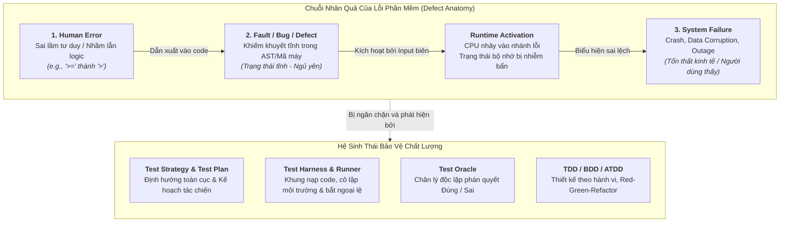
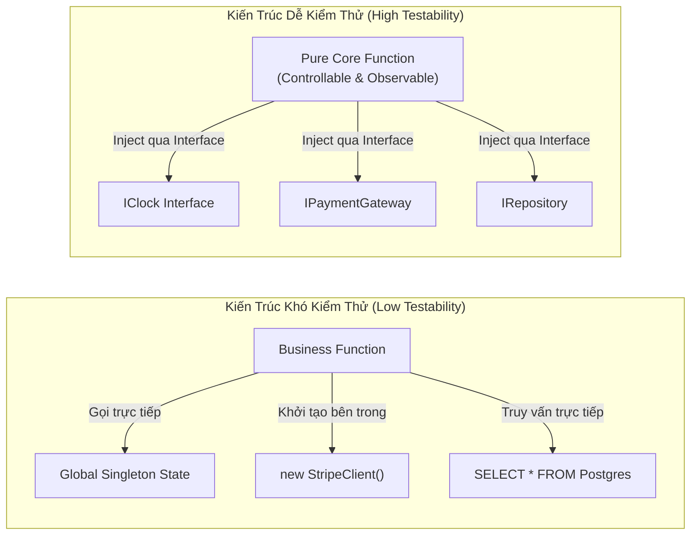
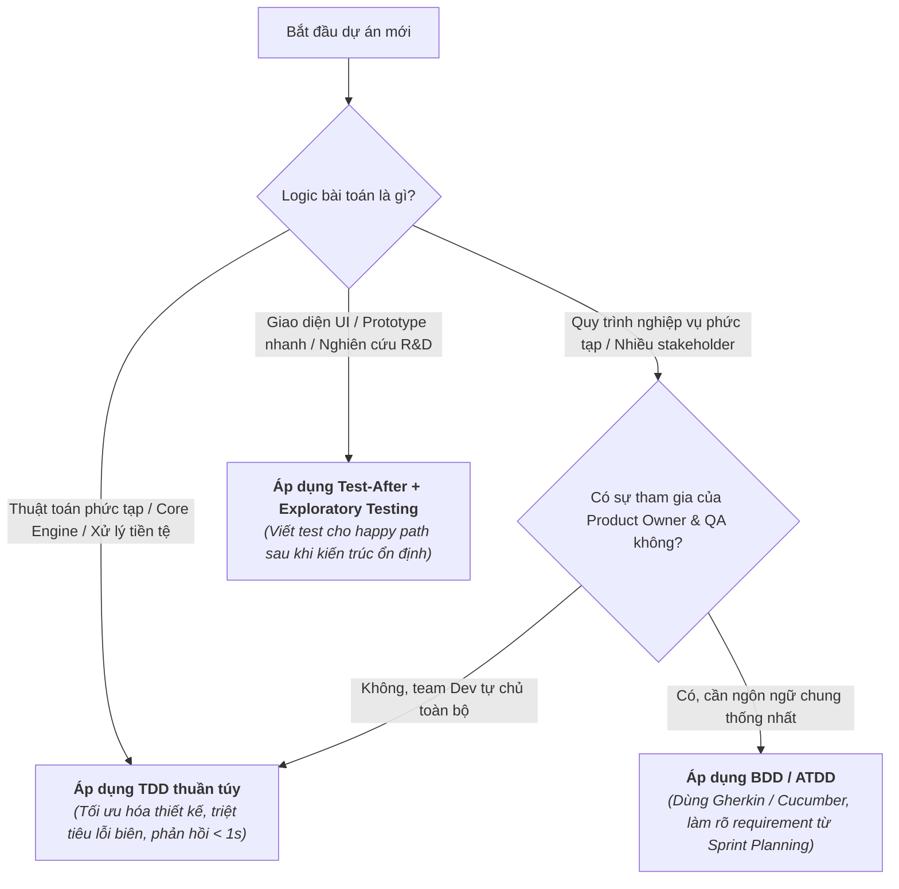

# 7.1. Nền Tảng Kỹ Nghệ Kiểm Thử Phần Mềm (Testing Fundamentals)

> [!IMPORTANT]
> **Nếu bạn chỉ được nhớ một điều duy nhất:** Kiểm thử không bao giờ có thể chứng minh phần mềm không có lỗi, mà chỉ có thể chứng minh sự tồn tại của lỗi; bản chất tối thượng của kiểm thử phần mềm là một **lưới an toàn cơ học (mechanical safety net)** giúp kỹ sư tự tin tái cấu trúc, kiểm soát rủi ro kinh tế và bảo vệ các bất biến của hệ thống trước khi mã nguồn chạm tới production.

---

## 1. Kiến trúc Tổng quan & Mô hình Tư duy (Mental Model)

### Phép loại suy thực tế: Kỹ nghệ Hàng không Vũ trụ
Hãy hình dung quá trình chế tạo một động cơ phản lực siêu thanh. 
* Một kỹ sư thiết kế nhầm lẫn độ dày của cánh tuabin trong bản vẽ do mệt mỏi: đó là **Error (Sai sót con người)**.
* Bản vẽ sai dẫn đến cánh tuabin bằng hợp kim titan đúc ra có một vết nứt vi mô vô hình: đó là **Fault / Defect / Bug (Khiếm khuyết cấu trúc)**. Khi động cơ nằm yên trên giá đỡ hoặc bay ở tốc độ thấp, vết nứt này hoàn toàn "ngủ yên", không ai hay biết.
* Khi máy bay đạt vận tốc Mach 3 tại độ cao 15,000 mét, dưới nhiệt độ 1,500°C và áp suất cực đại, vết nứt gãy vỡ, cánh tuabin xé toạc buồng đốt khiến động cơ phát nổ: đó là **Failure (Sự cố sụp đổ hệ thống)**.

Trong kỹ nghệ phần mềm, lập trình viên không thể chờ đến khi "máy bay đạt Mach 3" (hệ thống phục vụ hàng triệu người dùng trong ngày Black Friday) mới biết động cơ có nứt hay không. Chúng ta cần:
1. **Test Harness**: Buồng thử nghiệm mô phỏng áp suất cực đoan ngay trong xưởng chế tạo.
2. **Test Oracle**: Thước đo quang phổ và cảm biến sóng âm độc lập để xác định cánh quạt có đạt chuẩn cơ học hay không.
3. **Shift-Left & TDD**: Kiểm tra tính toán vật lý từng phân tử hợp kim ngay khi còn trên bản thiết kế thay vì chờ đúc xong toàn bộ phi thuyền.



---

## 2. Chi tiết từng Keyword (Under-the-Hood Deep Dive)

### 2.1. The Anatomy of Defects: Error, Fault/Defect/Bug & Failure
Theo tiêu chuẩn quốc tế IEEE 610.12 và ISO/IEC/IEEE 29119, ba thuật ngữ này phản ánh ba giai đoạn chuyển hóa hoàn toàn khác nhau trong vòng đời của một sự cố phần mềm:

*   **Error (Sai sót / Nhầm lẫn)**:
    *   *Bản chất*: Là một hành động hoặc quyết định sai lầm của con người (developer, architect, product manager). Nguyên nhân bắt nguồn từ sự thiếu hiểu biết về miền nghiệp vụ (domain knowledge), mệt mỏi nhận thức (cognitive overload), áp lực thời gian, hoặc sự phức tạp phi lý của ngôn ngữ lập trình (như con trỏ thô trong C++, cơ chế ép kiểu ngầm `==` trong JavaScript).
    *   *Ví dụ*: Nghĩ rằng số dư tài khoản người dùng không bao giờ vượt quá $2^{31}-1$, do đó chọn kiểu dữ liệu `int32` thay vì `int64`.
*   **Fault / Defect / Bug (Khiếm khuyết / Khuyết tật)**:
    *   *Bản chất*: Là biểu hiện vật lý, tĩnh (static manifest) của Error được lưu trữ trên đĩa cứng dưới dạng mã nguồn, tệp cấu hình (YAML/JSON) hoặc tài liệu đặc tả. Trong Abstract Syntax Tree (AST) của trình biên dịch, một Fault là một node cú pháp không khớp với ngữ nghĩa mong muốn.
    *   *Đặc tính ngủ yên (Dormant Fault)*: Một dòng code chứa lỗi có thể nằm im lìm trong hệ điều hành suốt 10 năm mà không gây hại gì nếu luồng thực thi (control flow) của CPU chưa từng phân nhánh vào nó với tập dữ liệu kích hoạt phù hợp.
*   **Failure (Thất bại / Sự cố thời gian chạy)**:
    *   *Bản chất*: Là một hiện tượng động (dynamic phenomenon) diễn ra khi phần mềm đang thực thi trong bộ nhớ (RAM/CPU). Khi CPU nạp mã máy chứa Fault và xử lý một tập input cụ thể khiến trạng thái nội tại (internal state) bị sai lệch (state infection), và sự sai lệch này lan truyền tới biên giao tiếp bên ngoài (external interface), hệ thống phát sinh Failure.
    *   *Biểu hiện*: Crash ứng dụng (SIGSEGV, OutOfMemoryError), HTTP 500 Internal Server Error, tính toán sai tiền thưởng của khách hàng, hoặc treo dead-lock hệ thống.

> [!NOTE]
> **Chuỗi lan truyền (Fault-Error-Failure Propagation Loop):**
> $\text{Mental Error} \longrightarrow \text{Code Fault} \xrightarrow{\text{Execution}} \text{State Infection} \xrightarrow{\text{Propagation}} \text{System Failure}$.
> Mục tiêu của White-Box Testing là rà soát Fault; mục tiêu của Black-Box Testing là kích thích để Fault biến thành Failure có thể quan sát được.

---

### 2.2. Test Case & Test Suite
*   **Test Case (Ca kiểm thử)**:
    *   *Cấu trúc hình thức*: Một Test Case chuẩn kỹ nghệ phần mềm bao gồm 6 thành phần bất biến:
        1.  `Identifier`: Định danh duy nhất (e.g., `TC_AUTH_TOKEN_EXPIRED_001`).
        2.  `Preconditions`: Trạng thái hệ thống trước khi chạy (DB có bản ghi user active, cache Redis đã warm up).
        3.  `Test Inputs`: Dữ liệu cụ thể được truyền vào hàm/API.
        4.  `Execution Steps`: Trình tự thao tác (Call API `/login`, đợi 3600s, Call API `/profile`).
        5.  `Expected Results / Assertion`: Trạng thái mong đợi (HTTP 401 Unauthorized, header `Token-Expired: true`).
        6.  `Postconditions / Cleanup`: Dọn dẹp dữ liệu để không gây ô nhiễm (idempotent rollback).
*   **Test Suite (Bộ ca kiểm thử)**:
    *   *Cơ chế thực thi tầng sâu*: Một Test Suite gom nhóm các Test Case dựa trên mục tiêu logic (e.g., Smoke Suite, Regression Suite, Billing Core Suite). Test runner thực thi Suite theo cơ chế phân bổ tài nguyên:
        *   Tuần tự (Sequential) để bảo đảm an toàn dữ liệu trên DB chia sẻ.
        *   Song song (Parallel Workers) bằng cách fork process hoặc phân chia thread pool, yêu cầu mỗi test case phải hoàn toàn độc lập (Thread-Safe, Shared-Nothing Architecture).
    *   *Sai lầm phổ biến*: **Test Interdependence (Các test phụ thuộc nhau)**. Test B chỉ chạy thành công khi Test A chạy trước để tạo record trong database. Khi Test A fail hoặc chạy song song đảo thứ tự, toàn bộ suite sụp đổ dây chuyền (Cascading Failure), tạo ra "bão lỗi giả".

---

### 2.3. Test Plan vs Test Strategy
Hai khái niệm này thường bị nhầm lẫn tai hại trong các dự án phần mềm:

| Đặc tính | Test Strategy (Chiến lược kiểm thử) | Test Plan (Kế hoạch kiểm thử) |
| :--- | :--- | :--- |
| **Cấp độ (Level)** | Cấp tổ chức, kiến trúc hệ thống (High-level, Organizational). | Cấp dự án, phiên bản phát hành (Operational, Project/Sprint-level). |
| **Thời hạn** | Ổn định dài hạn (1 - 3 năm), thay đổi khi đổi stack công nghệ. | Ngắn hạn, cập nhật theo từng Sprint hoặc từng chu kỳ Release. |
| **Trọng tâm (Focus)** | - Quy định tỷ lệ Test Pyramid (70% Unit, 20% Integration, 10% E2E).<br/>- Bộ tiêu chuẩn đo lường (SonarQube Quality Gate, MC/DC).<br/>- Tiêu chuẩn hạ tầng (Docker ephemeral DB, K6 cho Load test). | - Phạm vi tính năng Sprint này test cái gì, bỏ qua cái gì.<br/>- Ai phụ trách module Payment? Ai test module Auth?<br/>- Lịch trình test, môi trường Staging cụ thể, ngày Go-Live. |
| **Quyền sở hữu** | Lead QA, Principal Software Architect, VP of Engineering. | QA Lead, Project Manager, Scrum Master, Team Dev. |

---

### 2.4. Test Oracle & Test Harness
*   **Test Oracle (Tiên tri kiểm thử)**:
    *   *Bản chất*: Là cơ chế, tài liệu hoặc hệ thống độc lập dùng để xác định kết quả thực tế của một bài test là ĐÚNG (PASS) hay SAI (FAIL). Không có Oracle, máy tính có thể chạy code nhưng không thể biết output trả về có đúng với chân lý hay không (The Oracle Problem).
    *   *Các loại Oracle trong thực tế*:
        1.  *Specified Oracle*: Đặc tả toán học hoặc tài liệu RFC/Spec chuẩn (ví dụ: giải thuật băm SHA-256 đối chiếu với RFC 6234).
        2.  *Golden Master / Legacy System Oracle*: So sánh output của hệ thống mới viết lại bằng Go/Rust với output của hệ thống cũ viết bằng COBOL/Java chạy song song (Dual-run shadow testing).
        3.  *Heuristic / Property-Based Oracle*: Kiểm tra các tính chất bất biến (e.g., hàm sắp xếp thì độ dài mảng đầu ra luôn bằng đầu vào: `len(sort(x)) == len(x)`).
*   **Test Harness (Khung gá kiểm thử)**:
    *   *Bản chất*: Là toàn bộ hạ tầng phần mềm bao gồm Test Runner, Assertion Libraries, Test Drivers (giả lập các component gọi vào hệ thống), và Test Stubs/Mocks (giả lập các phụ thuộc bên dưới).
    *   *Hoạt động tầng sâu*: Test Harness móc (hook) vào runtime của ngôn ngữ. Khi một test chạy, harness thiết lập bộ đếm thời gian (timer), chặn các luồng xuất `stdout/stderr`, cô lập biến toàn cục, thực thi mã kiểm thử bên trong khối `try-catch`, bắt các tín hiệu HĐH (như `SIGABRT`, `SIGSEGV` thông qua signal handler), và trích xuất call stack khi assertion thất bại.

---

### 2.5. Testability Design (Thiết Kế Vì Khả Năng Kiểm Thử)
Một kiến trúc tồi sẽ biến việc viết một bài Unit Test đơn giản thành cơn ác mộng. Testability (Khả năng kiểm thử) là một thuộc tính phi chức năng sống còn của kiến trúc phần mềm, được đo bằng hai chiều kích cốt lõi:
1.  **Controllability (Khả năng kiểm soát)**: Mức độ kỹ sư có thể dễ dàng đẩy phần mềm vào bất kỳ trạng thái nội tại mong muốn nào bằng các đầu vào hợp lệ. Nếu hệ thống đọc trực tiếp `DateTime.Now` hoặc gọi thẳng API của Stripe bên trong thân hàm, Controllability bằng 0 vì bạn không thể ép nó giả lập lỗi hết hạn thẻ hay lỗi năm nhuận.
    *   *Giải pháp*: Dependency Inversion Principle (DIP). Inject `IClock` và `IPaymentGateway` qua Constructor.
2.  **Observability (Khả năng quan sát)**: Mức độ kỹ sư có thể nhận biết chính xác trạng thái nội tại của hệ thống thông qua các đầu ra khả kiến mà không cần dùng debugger. Nếu một phương thức thực hiện giao dịch ngân hàng thành công nhưng hàm trả về `void` và ghi log vào file mã hóa, Observability cực kỳ thấp.
    *   *Giải pháp*: Trả về `Result<T, E>` tường minh, thiết kế Domain Events, tách biệt Command và Query (CQRS).



---

### 2.6. Test-Driven Development (TDD)
Được hồi sinh và hệ thống hóa bởi Kent Beck, TDD là một kỹ thuật thiết kế phần mềm (Design Technique) được ngụy trang dưới vỏ bọc kiểm thử. TDD vận hành qua chu trình vi mô lặp lại liên tục: **Red - Green - Refactor**.

1.  **Red (Viết test fail trước)**: 
    *   Kỹ sư không viết một dòng code production nào trước khi có test case thất bại.
    *   *Tác dụng tầng sâu*: Xác minh rằng Test Harness hoạt động bình thường, Test Case thực sự phát hiện được sự thiếu vắng của tính năng, và giao diện API (API Ergonomics) do chính người gọi thiết kế nên rất tự nhiên, dễ dùng.
2.  **Green (Viết code tối thiểu để pass)**:
    *   Kỹ sư được phép "gian lận" (ví dụ: hardcode giá trị trả về) miễn là test chuyển sang màu xanh.
    *   *Tác dụng*: Ngăn chặn hội chứng over-engineering, YAGNI (You Aren't Gonna Need It), ép não bộ tập trung giải quyết bài toán nhỏ nhất hiện tại.
3.  **Refactor (Tái cấu trúc trong trạng thái an toàn)**:
    *   Loại bỏ sự trùng lặp (DRY), cải tiến thuật toán, trích xuất class/interface, cải thiện hiệu năng. Bộ test xanh đóng vai trò "lưới điện" bảo hộ: nếu vô tình làm hỏng logic, test lập tức báo đỏ trong vòng vài miligiây.

---

### 2.7. Behavior-Driven Development (BDD) & Acceptance Test-Driven Development (ATDD)
*   **Behavior-Driven Development (BDD - Dan North)**:
    *   TDD giải quyết câu hỏi của lập trình viên: *"Tôi đang xây dựng phần mềm đúng kỹ thuật không?"*
    *   BDD giải quyết câu hỏi: *"Tôi có đang xây dựng đúng thứ mà khách hàng muốn không?"*
    *   BDD sử dụng cú pháp **Gherkin** với ngôn ngữ chung (Ubiquitous Language) xoay quanh cấu trúc 3 thì:
        *   `Given`: Tiền điều kiện ngữ cảnh ban đầu (Given tài khoản có số dư 100 USD).
        *   `When`: Hành vi/Sự kiện được kích hoạt (When người dùng rút 40 USD tại cây ATM).
        *   `Then`: Kết quả kỳ vọng có thể quan sát được (Then số dư còn lại là 60 USD và ATM nhả tiền).
    *   *Cơ chế thực thi*: Cucumber hoặc Behave dùng regex ánh xạ từng dòng văn bản tự nhiên thành mã thực thi (Glue Code / Step Definitions).
*   **Acceptance Test-Driven Development (ATDD)**:
    *   Phương pháp cộng tác "Three Amigos" (Gồm: Product Owner/BA, Developer, QA/Tester). Trước khi một User Story được kéo vào Sprint Backlog để code, 3 bên phải cùng ngồi lại, thống nhất các tiêu chí chấp nhận (Acceptance Criteria) và biến chúng thành các test script tự động. Mã nguồn chỉ được coi là "Done" khi toàn bộ các bài Acceptance Tests này vượt qua.

---

### 2.8. Shift-Left Testing
*   **Khái niệm**: "Dịch chuyển về bên trái" trên trục thời gian của Vòng đời Phát triển Phần mềm (SDLC). Thay vì mô hình truyền thống: Dev code xong $\rightarrow$ đóng gói build $\rightarrow$ ném sang đội QA test thủ công ở bên phải trục thời gian; Shift-Left đưa các rào chắn chất lượng vào ngay lúc gõ code trên máy của lập trình viên.
*   **Định luật Kinh tế Boehm (Barry Boehm's Cost of Change)**:
    *   Chi phí để sửa chữa một lỗi phần mềm tăng theo cấp số mũ dựa trên thời điểm phát hiện:
        $$\text{Cost} = 10^{\text{Phase}}$$
        *   Giai đoạn phân tích yêu cầu (Requirements): **1x** (Xóa một câu trong tài liệu).
        *   Giai đoạn lập trình (Coding - Unit Test): **5x - 10x** (Sửa một dòng code trên IDE).
        *   Giai đoạn tích hợp (CI/Staging): **30x - 50x** (Re-build, deploy, debug trên server test).
        *   Giai đoạn Production (Hệ thống vận hành thực tế): **100x - 1000x+** (Hotfix khẩn cấp, downtime, bồi thường khách hàng, khủng hoảng truyền thông).
*   **Hạ tầng Shift-Left trong thực tế**: IDE Linter (ESLint, Clang-Tidy), Git Pre-commit Hooks, Static Type Check (TypeScript, Mypy), Static Application Security Testing (SAST), Unit Test chạy tự động mỗi khi Save file.

---

## 3. Thực thi Mã nguồn & Mô phỏng Chuyên sâu (Dual-Engine Implementation)

Dưới đây là kịch bản thực tế: Xây dựng một **Financial Money & Wallet Engine** xử lý trừ tiền trong ví điện tử. Hệ thống đòi hỏi tính toán số học chính xác tuyệt đối (tránh lỗi floating point bằng cách lưu trữ cents dưới dạng số nguyên `int64`), kiểm tra số dư âm, và hỗ trợ Mock Test Oracle độc lập.

### 3.1. Phiên bản C++ (C++20: Zero-Dependency Modern Test Harness & TDD Engine)

```cpp
#include <iostream>
#include <string>
#include <string_view>
#include <vector>
#include <functional>
#include <memory>
#include <chrono>
#include <stdexcept>
#include <format>
#include <cstdint>

// ============================================================================
// 1. PRODUCTION DOMAIN CODE (DESIGNED FOR TESTABILITY)
// ============================================================================

enum class Currency { USD, EUR, VND };

struct Money {
    int64_t cents{0}; // Đơn vị tối thiểu, tránh float/double floating-point bug
    Currency currency{Currency::USD};

    bool operator==(const Money& other) const = default;
};

// Custom Exceptions
class InsufficientFundsException : public std::runtime_error {
public:
    explicit InsufficientFundsException(std::string_view msg) : std::runtime_error(std::string(msg)) {}
};

class CurrencyMismatchException : public std::runtime_error {
public:
    explicit CurrencyMismatchException(std::string_view msg) : std::runtime_error(std::string(msg)) {}
};

// Interface Dependency Injection (Testability: Controllability & Observability)
class ITransactionAuditLogger {
public:
    virtual ~ITransactionAuditLogger() = default;
    virtual void logTransaction(std::string_view accountId, int64_t amountCents, std::string_view status) = 0;
};

class Wallet {
private:
    std::string m_accountId;
    Money m_balance;
    std::shared_ptr<ITransactionAuditLogger> m_logger;

public:
    Wallet(std::string accountId, Money initialBalance, std::shared_ptr<ITransactionAuditLogger> logger)
        : m_accountId(std::move(accountId)), m_balance(initialBalance), m_logger(std::move(logger)) {
        if (m_balance.cents < 0) {
            throw std::invalid_argument("Initial balance cannot be negative.");
        }
    }

    [[nodiscard]] Money getBalance() const noexcept {
        return m_balance;
    }

    // Nghiệp vụ trừ tiền (Withdrawal)
    void withdraw(Money amount) {
        if (amount.currency != m_balance.currency) {
            if (m_logger) m_logger->logTransaction(m_accountId, amount.cents, "FAILED_CURRENCY_MISMATCH");
            throw CurrencyMismatchException("Cannot withdraw different currency without conversion.");
        }
        if (amount.cents <= 0) {
            throw std::invalid_argument("Withdrawal amount must be strictly positive.");
        }
        if (m_balance.cents < amount.cents) {
            if (m_logger) m_logger->logTransaction(m_accountId, amount.cents, "FAILED_INSUFFICIENT_FUNDS");
            throw InsufficientFundsException("Insufficient account balance for withdrawal.");
        }

        m_balance.cents -= amount.cents;
        if (m_logger) {
            m_logger->logTransaction(m_accountId, amount.cents, "SUCCESS");
        }
    }
};

// ============================================================================
// 2. UNDER-THE-HOOD TEST HARNESS (Tương đương gtest/catch2 thu nhỏ)
// ============================================================================

namespace TestHarness {

    struct TestCaseFailure {
        std::string testName;
        std::string file;
        int line;
        std::string message;
    };

    class MiniTestRegistry {
    private:
        struct TestEntry {
            std::string name;
            std::function<void()> func;
        };
        std::vector<TestEntry> m_tests;

    public:
        static MiniTestRegistry& instance() {
            static MiniTestRegistry reg;
            return reg;
        }

        void registerTest(std::string name, std::function<void()> func) {
            m_tests.push_back({std::move(name), std::move(func)});
        }

        int runAll() {
            int passed = 0;
            int failed = 0;
            std::vector<TestCaseFailure> failures;

            std::cout << "========================================================\n";
            std::cout << "[HARNESS] Running " << m_tests.size() << " test cases...\n";
            std::cout << "========================================================\n";

            for (const auto& test : m_tests) {
                auto start = std::chrono::high_resolution_clock::now();
                try {
                    test.func();
                    auto elapsed = std::chrono::duration_cast<std::chrono::microseconds>(
                        std::chrono::high_resolution_clock::now() - start).count();
                    std::cout << "  [PASS] " << test.name << " (" << elapsed << " us)\n";
                    passed++;
                } catch (const TestCaseFailure& f) {
                    std::cout << "  [FAIL] " << test.name << " -> " << f.message << "\n";
                    failures.push_back(f);
                    failed++;
                } catch (const std::exception& e) {
                    std::cout << "  [CRASH] " << test.name << " (Unhandled Exception: " << e.what() << ")\n";
                    failures.push_back({test.name, "unknown", 0, e.what()});
                    failed++;
                }
            }

            std::cout << "--------------------------------------------------------\n";
            std::cout << "Test Summary: Total=" << m_tests.size()
                      << " | Passed=" << passed
                      << " | Failed=" << failed << "\n";
            std::cout << "========================================================\n";
            return failed == 0 ? 0 : 1;
        }
    };

    // Assertion Macros
    #define ASSERT_TRUE(expr) \
        do { \
            if (!(expr)) { \
                throw TestHarness::TestCaseFailure{__FUNCTION__, __FILE__, __LINE__, "Expression evaluated to FALSE: " #expr}; \
            } \
        } while(0)

    #define ASSERT_EQ(val1, val2) \
        do { \
            if (!((val1) == (val2))) { \
                throw TestHarness::TestCaseFailure{__FUNCTION__, __FILE__, __LINE__, \
                    "Equality Assertion Failed: " #val1 " != " #val2}; \
            } \
        } while(0)

    #define ASSERT_THROWS(expr, ExceptionType) \
        do { \
            bool caught = false; \
            try { \
                expr; \
            } catch (const ExceptionType&) { \
                caught = true; \
            } catch (...) { \
                throw TestHarness::TestCaseFailure{__FUNCTION__, __FILE__, __LINE__, \
                    "Wrong exception caught for: " #expr}; \
            } \
            if (!caught) { \
                throw TestHarness::TestCaseFailure{__FUNCTION__, __FILE__, __LINE__, \
                    "Expected exception " #ExceptionType " not thrown by: " #expr}; \
            } \
        } while(0)

    #define REGISTER_TEST(name) \
        void name(); \
        struct name##_Reg { \
            name##_Reg() { TestHarness::MiniTestRegistry::instance().registerTest(#name, name); } \
        } name##_instance; \
        void name()
}

// ============================================================================
// 3. TEST IMPLEMENTATION (TEST DOUBLES, ORACLE & TDD CYCLE)
// ============================================================================

// Mock Audit Logger đóng vai trò Test Double (Spy) để xác minh tương tác
class MockAuditLogger : public ITransactionAuditLogger {
public:
    struct LogEntry {
        std::string accountId;
        int64_t amount;
        std::string status;
    };
    std::vector<LogEntry> logs;

    void logTransaction(std::string_view accountId, int64_t amountCents, std::string_view status) override {
        logs.push_back({std::string(accountId), amountCents, std::string(status)});
    }
};

// TEST CASE 1: Rút tiền thành công đúng tỷ giá
REGISTER_TEST(Test_Wallet_Withdrawal_Success) {
    auto logger = std::make_shared<MockAuditLogger>();
    Wallet wallet("ACC_123", Money{10000, Currency::USD}, logger); // 100.00 USD

    wallet.withdraw(Money{4500, Currency::USD}); // Rút 45.00 USD

    // Test Oracle: Bất biến số dư phải còn 55.00 USD
    ASSERT_EQ(wallet.getBalance().cents, 5500);
    ASSERT_EQ(logger->logs.size(), 1);
    ASSERT_EQ(logger->logs[0].status, "SUCCESS");
    ASSERT_EQ(logger->logs[0].amount, 4500);
}

// TEST CASE 2: Báo lỗi khi rút quá số dư (Insufficient Funds)
REGISTER_TEST(Test_Wallet_Withdrawal_InsufficientFunds) {
    auto logger = std::make_shared<MockAuditLogger>();
    Wallet wallet("ACC_456", Money{2000, Currency::USD}, logger); // Có 20.00 USD

    ASSERT_THROWS(wallet.withdraw(Money{5000, Currency::USD}), InsufficientFundsException);
    
    // Đảm bảo số dư không bị thay đổi (Rollback guarantee)
    ASSERT_EQ(wallet.getBalance().cents, 2000);
    ASSERT_EQ(logger->logs.size(), 1);
    ASSERT_EQ(logger->logs[0].status, "FAILED_INSUFFICIENT_FUNDS");
}

// TEST CASE 3: Ngăn chặn rút sai loại tiền tệ (Currency Mismatch)
REGISTER_TEST(Test_Wallet_Withdrawal_CurrencyMismatch) {
    auto logger = std::make_shared<MockAuditLogger>();
    Wallet wallet("ACC_789", Money{5000, Currency::USD}, logger);

    ASSERT_THROWS(wallet.withdraw(Money{1000, Currency::EUR}), CurrencyMismatchException);
    ASSERT_EQ(wallet.getBalance().cents, 5000);
}

int main() {
    return TestHarness::MiniTestRegistry::instance().runAll();
}
```

---

### 3.2. Phiên bản Python (Python 3.11+: Pytest/Unittest Architecture with BDD Fixtures)

```python
"""
Mô hình kiểm thử cấp cao: BDD Given-When-Then + Pytest-style Fixtures + Metamorphic Oracle
Hỗ trợ thực thi độc lập runnable directly bằng python 3.11+
"""
from dataclasses import dataclass, field
from enum import Enum
from typing import Protocol, List
import time
import sys


class Currency(Enum):
    USD = "USD"
    EUR = "EUR"
    VND = "VND"


class InsufficientFundsError(Exception):
    pass


class CurrencyMismatchError(Exception):
    pass


@dataclass(frozen=True)
class Money:
    cents: int
    currency: Currency

    def __post_init__(self):
        if not isinstance(self.cents, int):
            raise TypeError("Cents must be an integer to prevent precision loss.")


class IAuditLogger(Protocol):
    def log(self, account_id: str, amount_cents: int, status: str) -> None:
        ...


class Wallet:
    def __init__(self, account_id: str, initial_balance: Money, logger: IAuditLogger | None = None):
        if initial_balance.cents < 0:
            raise ValueError("Balance cannot be initialized to negative value.")
        self.account_id = account_id
        self._balance = initial_balance
        self.logger = logger

    @property
    def balance(self) -> Money:
        return self._balance

    def withdraw(self, amount: Money) -> None:
        if amount.currency != self._balance.currency:
            if self.logger:
                self.logger.log(self.account_id, amount.cents, "CURRENCY_MISMATCH")
            raise CurrencyMismatchError(f"Cannot withdraw {amount.currency.value} from {self._balance.currency.value}")

        if amount.cents <= 0:
            raise ValueError("Withdrawal amount must be strictly positive.")

        if self._balance.cents < amount.cents:
            if self.logger:
                self.logger.log(self.account_id, amount.cents, "INSUFFICIENT_FUNDS")
            raise InsufficientFundsError("Not enough funds in wallet.")

        # Atomic State Mutation
        self._balance = Money(self._balance.cents - amount.cents, self._balance.currency)
        if self.logger:
            self.logger.log(self.account_id, amount.cents, "SUCCESS")


# ============================================================================
# TEST HARNESS & SPY AUDIT LOGGER (FIXTURES & ASSERTIONS)
# ============================================================================

class SpyAuditLogger:
    def __init__(self):
        self.records: list[dict] = []

    def log(self, account_id: str, amount_cents: int, status: str) -> None:
        self.records.append({
            "account_id": account_id,
            "amount_cents": amount_cents,
            "status": status
        })


class TestSuiteRunner:
    def __init__(self):
        self.test_cases = []

    def register(self, fn):
        self.test_cases.append(fn)
        return fn

    def run(self):
        passed = 0
        failed = 0
        print("=" * 60)
        print(f"[PYTHON TEST RUNNER] Executing {len(self.test_cases)} tests...")
        print("=" * 60)

        for test in self.test_cases:
            start_time = time.perf_counter_ns()
            try:
                test()
                duration_us = (time.perf_counter_ns() - start_time) / 1000
                print(f"  [PASS] {test.__name__} ({duration_us:.2f} µs)")
                passed += 1
            except AssertionError as err:
                duration_us = (time.perf_counter_ns() - start_time) / 1000
                print(f"  [FAIL] {test.__name__} ({duration_us:.2f} µs) -> Assertion: {err}")
                failed += 1
            except Exception as ex:
                duration_us = (time.perf_counter_ns() - start_time) / 1000
                print(f"  [CRASH] {test.__name__} ({duration_us:.2f} µs) -> Unexpected: {type(ex).__name__}: {ex}")
                failed += 1

        print("-" * 60)
        print(f"Summary: Total={len(self.test_cases)} | Passed={passed} | Failed={failed}")
        print("=" * 60)
        return 0 if failed == 0 else 1


runner = TestSuiteRunner()

# ============================================================================
# BDD-STYLE TEST SPECIFICATIONS (Given-When-Then)
# ============================================================================

@runner.register
def test_bdd_successful_withdrawal():
    # GIVEN: Tài khoản có số dư 500.00 USD và một Spy Logger
    logger = SpyAuditLogger()
    initial_money = Money(50000, Currency.USD)
    wallet = Wallet("USER_VIP_01", initial_money, logger)

    # WHEN: Khách hàng rút 150.00 USD
    withdraw_money = Money(15000, Currency.USD)
    wallet.withdraw(withdraw_money)

    # THEN: Số dư còn lại phải chính xác là 350.00 USD và log audit được ghi nhận
    assert wallet.balance.cents == 35000, f"Expected 35000 cents, got {wallet.balance.cents}"
    assert len(logger.records) == 1, "Expected exactly 1 audit record"
    assert logger.records[0]["status"] == "SUCCESS"


@runner.register
def test_bdd_prevent_overdraft():
    # GIVEN: Ví chỉ có 10.00 USD
    logger = SpyAuditLogger()
    wallet = Wallet("USER_02", Money(1000, Currency.USD), logger)

    # WHEN: Khách hàng cố rút 20.00 USD
    threw_error = False
    try:
        wallet.withdraw(Money(2000, Currency.USD))
    except InsufficientFundsError:
        threw_error = True

    # THEN: Hệ thống phải ném ngoại lệ và không làm hỏng số dư ban đầu
    assert threw_error, "System should raise InsufficientFundsError"
    assert wallet.balance.cents == 1000, "Balance must remain intact after failed transaction"
    assert logger.records[0]["status"] == "INSUFFICIENT_FUNDS"


@runner.register
def test_metamorphic_oracle_invariant():
    # METAMORPHIC TEST ORACLE: Tổng tiền trước = Tổng tiền sau + Tiền đã rút
    wallet = Wallet("USER_ORACLE", Money(100000, Currency.USD))
    deductions = [1000, 2500, 1500, 5000]

    for amount in deductions:
        before = wallet.balance.cents
        wallet.withdraw(Money(amount, Currency.USD))
        after = wallet.balance.cents
        # Invariant Check
        assert before == after + amount, f"Metamorphic invariant violated: {before} != {after} + {amount}"


if __name__ == "__main__":
    sys.exit(runner.run())
```

---

### 3.3. Terminal Output Thực Tế Giả Lập

```text
$ ./wallet_test_cpp
========================================================
[HARNESS] Running 3 test cases...
========================================================
  [PASS] Test_Wallet_Withdrawal_Success (12 us)
  [PASS] Test_Wallet_Withdrawal_InsufficientFunds (8 us)
  [PASS] Test_Wallet_Withdrawal_CurrencyMismatch (6 us)
--------------------------------------------------------
Test Summary: Total=3 | Passed=3 | Failed=0
========================================================

$ python3 wallet_test.py
============================================================
[PYTHON TEST RUNNER] Executing 3 tests...
============================================================
  [PASS] test_bdd_successful_withdrawal (21.40 µs)
  [PASS] test_bdd_prevent_overdraft (14.20 µs)
  [PASS] test_metamorphic_oracle_invariant (28.70 µs)
------------------------------------------------------------
Summary: Total=3 | Passed=3 | Failed=0
============================================================
```

---

## 4. Systems Engineering & Production Pitfalls

Trong môi trường doanh nghiệp quy mô lớn, việc duy trì một hệ thống kiểm thử tự động đòi hỏi tư duy Kỹ thuật Hệ thống (Systems Engineering) nghiêm ngặt để đối phó với các cạm bẫy sau:

### 1. The False Green Paradox (Nghịch lý Báo Xanh Ảo)
*   *Hiện tượng*: Toàn bộ 5,000 bài Unit Test đều sáng xanh trên CI/CD, nhưng khi deploy lên Production hệ thống lập tức sụp đổ.
*   *Nguyên nhân cốt lõi*: 
    1.  **Over-Mocking**: Kỹ sư mock toàn bộ DB layer, Network layer và ORM. Kết quả là test chỉ đang xác minh xem "Mock có gọi Mock hay không" chứ không kiểm tra hành vi thật của hệ thống.
    2.  **Tautological Tests (Kiểm thử lặp thừa / Vô nghĩa)**: Viết test lặp lại đúng logic của code (e.g., hàm trả về `a + b`, test assert `result == a + b` thay vì assert kết quả tính toán độc lập của Oracle).
*   *Phương pháp phòng chống*: Áp dụng **Mutation Testing** (sử dụng các công cụ như `Stryker` hoặc `mutmut`). Đột biến mã nguồn (đổi `+` thành `-`, đổi `true` thành `false`), nếu test suite vẫn báo XANH thì test suite đó hoàn toàn vô giá trị (Mutant Survived).

### 2. State Leakage & Cross-Test Contamination (Ô nhiễm Trạng thái Giữa các Test)
*   *Hiện tượng*: Test chạy lẻ từng bài thì luôn PASS, nhưng khi chạy toàn bộ Suite hoặc chạy đa luồng (`pytest -n 8`) thì ngẫu nhiên xuất hiện bài FAIL.
*   *Cơ chế xảy ra*: Các Test Case chia sẻ các trạng thái tĩnh (Static variables, Singletons, In-memory Caches, hoặc bảng Database thật). Test A ghi dữ liệu vào singleton nhưng không dọn dẹp trong block TearDown, dẫn đến việc Test B đọc phải dữ liệu rác của Test A.
*   *Phương thức khắc phục*: 
    *   Thực thi nguyên tắc **Hermetic Tests (Kiểm thử kín khí)**: Mỗi test case phải khởi tạo fixture riêng biệt từ đầu.
    *   Tự động reset Singletons hoặc sử dụng Dependency Injection container có scope dạng `PerTestInstance`.
    *   Chạy test suite với cờ xáo trộn ngẫu nhiên thứ tự (e.g., `pytest --random-order`, Catch2 `--rng-seed=time`).

### 3. The Slow Test Suite Death Spiral (Vòng xoáy Suy tàn do Test Suite Chậm)
*   *Hiện tượng*: Ban đầu test suite chạy mất 30 giây. Sau 2 năm, test suite mất 55 phút để hoàn thành trên CI.
*   *Hậu quả hệ thống*: Developer bắt đầu lười chạy test ở local trước khi push; họ gõ cờ `--skip-tests` hoặc `--no-verify` trên Git commit; chu kỳ feedback bị kéo dài, tính năng bị nghẽn ở khâu Merge PR.
*   *Kỹ thuật tối ưu hóa*:
    1.  Profiling thời gian thực thi: Liệt kê top 10 test case chậm nhất (e.g., `pytest --durations=10`).
    2.  Triệt tiêu lệnh `sleep()`: Thay thế toàn bộ `Thread.sleep(5000)` bằng cơ chế Polling chờ điều kiện (`await().atMost(5, SECONDS).until(...)`).
    3.  Test Sharding: Phân tách test suite chạy song song trên nhiều container CI độc lập (ví dụ: Matrix builds trên GitHub Actions).

---

## 5. Bảng So sánh & Decision Matrix

### 5.1. Ma trận So sánh Toàn diện các Phương pháp luận Kiểm thử

| Tiêu chí Đánh giá | TDD (Test-Driven) | BDD (Behavior-Driven) | ATDD (Acceptance-Driven) | Traditional Test-After |
| :--- | :--- | :--- | :--- | :--- |
| **Đối tượng tham gia chính** | Lập trình viên (Developer). | Developer + QA + BA/PO. | 3 Amigos (Product, Dev, QA). | Đội kiểm thử độc lập (QA). |
| **Ngôn ngữ diễn đạt** | Ngôn ngữ lập trình (C++, Go, Python). | Domain-Specific Language (Gherkin: Given-When-Then). | User Stories, Acceptance Tables. | Bảng tính Excel, Test Management Tools (Jira, TestRail). |
| **Thời điểm viết Test** | Ngay trước khi viết từng dòng code logic. | Trước khi bắt đầu hiện thực tính năng. | Trong phiên Refinement / Sprint Planning. | Sau khi code đã hoàn tất và build xong. |
| **Trọng tâm kiểm định** | Thiết kế API, tính đúng đắn của thuật toán. | Hành vi nghiệp vụ từ góc nhìn người dùng. | Tiêu chí nghiệm thu của tính năng. | Tìm kiếm lỗi (Bug hunting) giao diện & luồng. |
| **Tốc độ phản hồi (Feedback Loop)** | Cực nhanh (Mili-giây đến vài Giây). | Trung bình (Vài chục Giây). | Trung bình đến Chậm (Vài Phút). | Rất chậm (Vài Giờ đến nhiều Ngày). |
| **Chi phí bảo trì tài sản test** | Thấp (Gắn liền với refactor code). | Trung bình - Cao (Bảo trì Glue code). | Trung bình. | Rất cao (Thường xuyên lỗi thời). |

---

### 5.2. Decision Matrix: Khi nào nên áp dụng phương pháp nào?



> [!TIP]
> **Quy tắc vàng trong Kỹ nghệ Kiểm thử Hiện đại:**
> 1. Không bao giờ kiểm thử các chi tiết triển khai nội bộ (Private methods/Internal state) - chỉ kiểm thử **hành vi công khai và bất biến (Public behavior & Invariants)**.
> 2. Một test case tốt là test case chỉ thất bại khi **yêu cầu nghiệp vụ bị vi phạm**, chứ không thất bại khi kỹ sư tái cấu trúc mã nguồn bên trong.
