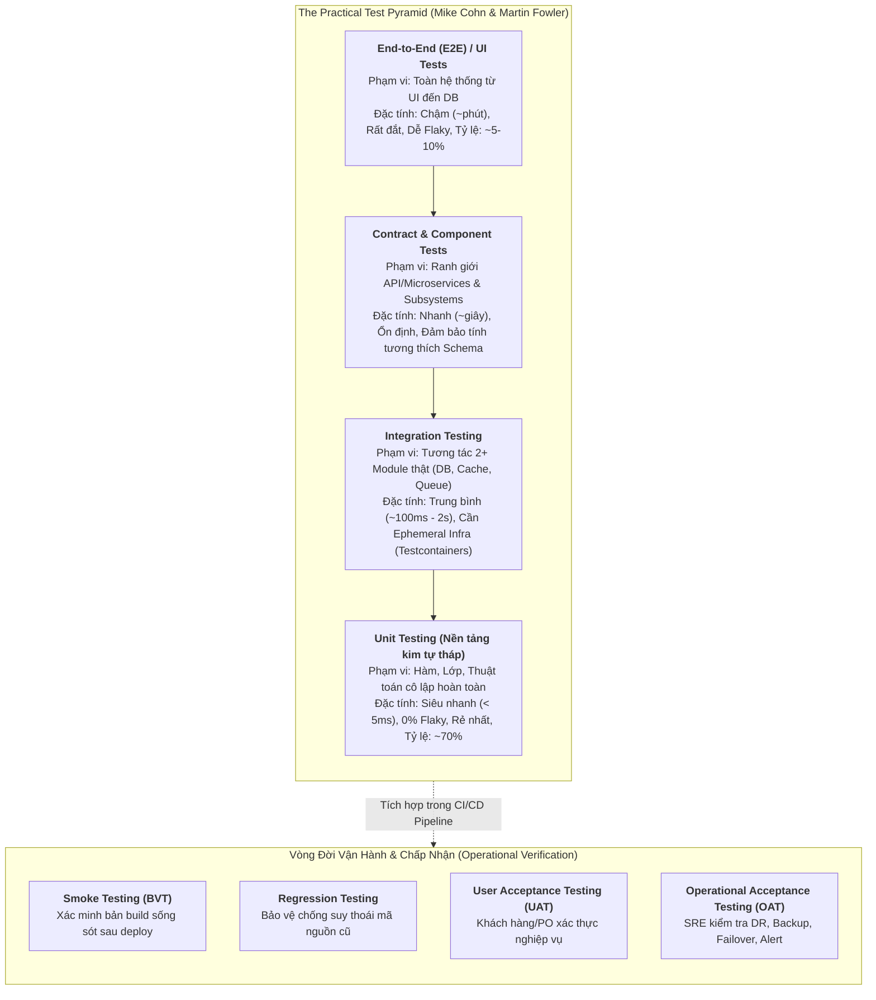
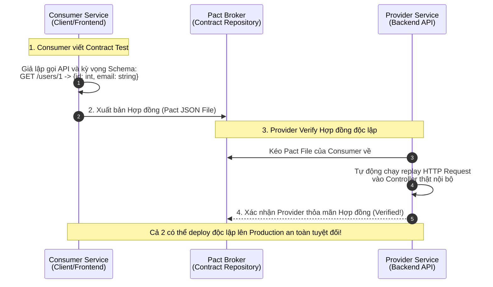
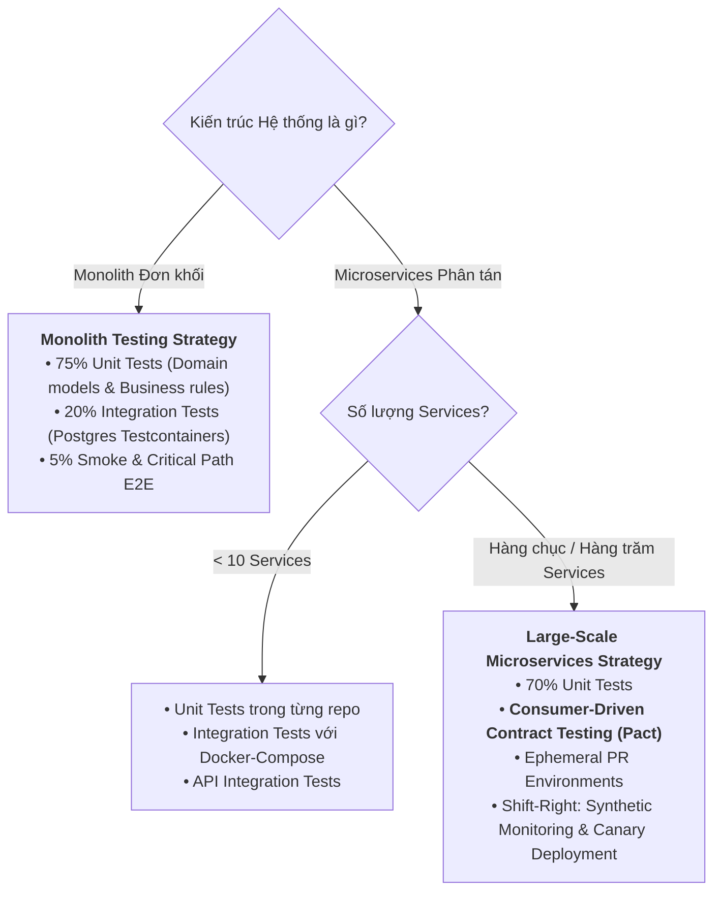

# 7.2. Các Cấp Độ Kiểm Thử và Tháp Kiểm Thử (Testing Levels & The Test Pyramid)

> [!IMPORTANT]
> **Nếu bạn chỉ được nhớ một điều duy nhất:** Không có một cấp độ kiểm thử đơn lẻ nào có thể bảo đảm toàn vẹn chất lượng phần mềm; bí quyết của các tổ chức kỹ nghệ đỉnh cao nằm ở việc **tối ưu hóa phân bổ hình học của Tháp Kiểm Thử (Test Pyramid)** — chuyển dời tối đa trọng tâm phát hiện lỗi xuống tầng đáy (Unit & Integration) để đạt chu kỳ phản hồi tính bằng giây, đồng thời giữ số lượng E2E test ở mức tối thiểu để triệt tiêu chi phí bảo trì và kiểm thử chập chờn (flakiness).

---

## 1. Kiến trúc Tổng quan & Mô hình Tư duy (Mental Model)

### Phép loại suy thực tế: Kỹ nghệ Chế tạo Siêu xe Đua Công thức 1 (Formula 1)
Hãy quan sát quy trình sản xuất và thẩm định một chiếc xe đua F1 trị giá hàng chục triệu đô-la:
*   **Unit Testing**: Trước khi ráp xe, kỹ sư cơ khí kiểm tra dung sai của từng chiếc xupap, trục cam, và bugi đánh lửa trên máy đo laser. Thời gian kiểm tra: 2 mili-giây. Chi phí: Vài xu. Nếu bugi nứt, vứt ngay vào thùng rác.
*   **Component Testing**: Lắp ráp toàn bộ khối động cơ V6 Turbo Hybrid độc lập trên giá thử tĩnh. Kiểm tra chu trình đốt trong mà không cần gắn vào khung xe gầm carbon.
*   **Integration Testing**: Ghép nối khối động cơ với hộp số tuần tự 8 cấp và hệ thống bơm xăng áp lực cao. Kiểm tra xem các van áp suất và đường ống thủy lực có rò rỉ tại điểm giao tiếp (interfaces) hay không.
*   **Contract Testing**: Kiểm tra jack cắm tín hiệu điện tử CAN-bus giữa vô-lăng và máy tính trung tâm (ECU). Đảm bảo rằng khi tay đua bấm nút DRS (giảm lực cản không khí), xung điện 5V phát ra chuẩn 100% theo giao thức mà không cần phải nổ máy xe thật.
*   **System & E2E Testing**: Đưa chiếc xe nguyên vẹn ra đường đua Silverstone, tay đua ngồi vào buồng lái, chạy hết tốc lực 350 km/h trong thời tiết mưa gió để xem khí động học, lốp xe và telemetry có phối hợp hoàn hảo không. Chi phí: Hàng trăm nghìn USD mỗi giờ; nếu hỏng hóc, xe đâm vào rào chắn!
*   **Acceptance Testing (UAT/OAT)**: Tay đua trưởng (UAT) xác nhận độ nhạy chân ga; đội ngũ cơ cấu Pit-stop (OAT) thử nghiệm thay 4 lốp trong 1.8 giây và quy trình chữa cháy khẩn cấp.
*   **Smoke Testing**: Đề nổ máy 5 giây trước khi rời Pit-lane; nếu đồng hồ áp suất nhớt báo 0, tắt máy ngay lập tức, không cho xe lăn bánh.



---

## 2. Chi tiết từng Keyword (Under-the-Hood Deep Dive)

### 2.1. The Practical Test Pyramid & Anti-Patterns (Ice Cream Cone & Hourglass)
Mô hình kim tự tháp kiểm thử được Mike Cohn đề xuất và Martin Fowler hoàn thiện hóa. Tỷ lệ chuẩn vàng trong công nghiệp thường là: **70% Unit Tests, 20% Integration/Contract Tests, 10% E2E Tests**.

Khi một tổ chức thiếu định hướng kiến trúc, họ thường rơi vào hai phản mẫu (Anti-patterns) chết người:
1.  **The Inverted Pyramid / Ice Cream Cone (Cây kem ốc quế ngược)**:
    *   *Triệu chứng*: Hầu như không có Unit Test; số lượng Integration Test ít ỏi; nhưng có hàng nghìn kịch bản Selenium/Cypress E2E test giao diện click chuột.
    *   *Hậu quả*: CI/CD chạy mất 3-4 tiếng; tỷ lệ flaky test lên tới 30-40%; khi có lỗi, dev nhận được thông báo chung chung "Test failed at Step 45" mà không biết cụ thể dòng code hay vi dịch vụ nào gây ra; chi phí hạ tầng CI phình to vô độ.
2.  **The Hourglass (Chiếc đồng hồ cát)**:
    *   *Triệu chứng*: Rất nhiều Unit Test ở tầng đáy và rất nhiều E2E Test ở tầng ngọn, nhưng hoàn toàn rỗng ở tầng giữa (Integration Test).
    *   *Hậu quả*: Từng unit chạy hoàn hảo độc lập, nhưng khi ghép nối giữa API Gateway và Database hoặc giữa hai Microservice thì sập vì sai lệch kiểu dữ liệu, lệch múi giờ UTC, hoặc lỗi mapping SQL schema.

---

### 2.2. Unit Testing & The F.I.R.S.T Principles
Unit Test là hoạt động kiểm thử đơn vị mã nguồn nhỏ nhất có thể cô lập được một cách có ý nghĩa trong một chương trình (thường là một hàm thuần túy, một phương thức hoặc một lớp nghiệp vụ độc lập).

Mọi Unit Test chuẩn mực trong kỹ nghệ phần mềm bắt buộc phải tuân thủ nghiêm ngặt nguyên lý **F.I.R.S.T**:
*   **Fast (Nhanh)**: Một Unit Test phải thực thi trong khoảng từ vài micro-giây đến dưới 5 mili-giây. Một bộ 10,000 unit tests phải hoàn thành trong vòng dưới 30 giây để duy trì feedback loop tức thì cho developer.
*   **Independent / Isolated (Độc lập / Cô lập tuyệt đối)**: Các test không được phụ thuộc vào nhau. Test A chạy trước hay Test B chạy trước không làm thay đổi kết quả. **Bất kỳ hành vi truy cập đĩa cứng (Disk I/O), mạng (Network), cơ sở dữ liệu thật, hoặc đồng hồ hệ thống (`System.currentTimeMillis()`) đều là vi phạm định nghĩa của Unit Test**. Mọi phụ thuộc I/O phải được cô lập bằng Test Doubles (Mocks/Fakes).
*   **Repeatable (Có thể lặp lại ổn định)**: Chạy 1,000 lần liên tiếp trên máy Mac của dev, trên server Linux CI, hoặc trên container Docker không có kết nối internet đều phải cho ra kết quả đồng nhất 100%. Không bị ảnh hưởng bởi múi giờ (Timezone), ngôn ngữ HĐH (Locale) hay độ trễ CPU.
*   **Self-Validating (Tự kiểm định)**: Test phải tự xác định kết quả PASS hoặc FAIL bằng các Assertion tự động có cấu trúc dạng boolean, không đòi hỏi con người phải mở file log ra đọc bằng mắt để phán đoán.
*   **Timely (Kịp thời)**: Được viết song song hoặc ngay trước khi viết code production (theo tư duy TDD), tránh việc code xong tính năng cả tháng mới quay lại "viết test bù" đối phó.

---

### 2.3. Component Testing
Component Testing (Kiểm thử thành phần) kiểm tra một hệ thống con (Subsystem) hoặc một module kiến trúc hoàn chỉnh bên trong ứng dụng.
*   *Phạm vi*: Rộng hơn Unit Test nhưng hẹp hơn System Test. Ví dụ: Kiểm thử toàn bộ module `BillingModule` hoặc `AuthenticationEngine`.
*   *Cơ chế vận hành*: Tất cả các module nội bộ của component sẽ được kết nối thật với nhau, nhưng toàn bộ các hệ thống bên ngoài ranh giới của component (như Third-party Payment Gateway, External Microservices, Message Broker) sẽ được giả lập bằng Stubs hoặc In-Memory Fakes cấp cao.
*   *Mục đích*: Xác nhận rằng thiết kế phối hợp giữa các class bên trong module vận hành trơn tru mà không cần tốn chi phí dựng cả một cụm phân tán.

---

### 2.4. Integration Testing & Testcontainers Paradigm
Integration Testing (Kiểm thử tích hợp) tập trung xác minh tính đúng đắn của việc **ghép nối giữa các thành phần phần mềm** tại ranh giới giao tiếp (Boundaries/Interfaces).

*   *Trọng tâm kiểm thử*:
    1.  Tương tác giữa Business Logic và Data Access Layer (ORM, SQL Drivers, Migration scripts).
    2.  Hành vi Transaction (ACID, Commit, Rollback khi có exception).
    3.  Các câu truy vấn SQL phức tạp, Stored Procedures, Unique Constraints, Foreign Keys.
    4.  Tương tác với Cache layer (Redis TTL, Cache-Aside pattern).
*   *Kỷ nguyên hiện đại: **Testcontainers***:
    *   *Thời kỳ cũ (Anti-pattern)*: Dùng In-Memory DB (như H2, SQLite) để test code viết cho PostgreSQL. Hậu quả: H2 không hỗ trợ các tính năng đặc thù như JSONB, CTEs, Window Functions, hoặc cú pháp locking `FOR UPDATE SKIP LOCKED`. Khi đưa lên Postgres thật ở Production thì phát sinh crash.
    *   *Thời kỳ hiện đại*: Testcontainers sử dụng Docker API để khởi tạo các container PostgreSQL, Kafka, Redis thật một cách tạm thời (ephemeral) trực tiếp từ mã nguồn test, chạy migration, thực thi test và tự động tiêu hủy container ngay khi test suite kết thúc.

---

### 2.5. System Testing & Non-Functional Verification
System Testing (Kiểm thử hệ thống) đánh giá toàn bộ hệ thống phần mềm đã được lắp ghép hoàn chỉnh 100% nhằm đối chiếu với Tài liệu Đặc tả Yêu cầu Phần mềm (Software Requirements Specification - SRS).
*   *Đặc điểm*: Hệ thống được triển khai trên môi trường giả lập tiệm cận Production (Staging Environment) với đầy đủ cấu hình mạng, tường lửa, cân bằng tải (Load Balancer).
*   *Phạm vi bao phủ kép*:
    *   *Kiểm thử Chức năng (Functional)*: Các luồng nghiệp vụ end-to-end xuyên suốt các module.
    *   *Kiểm thử Phi chức năng (Non-Functional)*: Bảo mật (Penetration testing), Hiệu năng chịu tải (Stress/Load), Khả năng phục hồi dữ liệu khi mất điện (Fault tolerance), và Tính khả dụng (Availability).

---

### 2.6. End-to-End (E2E) Testing & UI Automation Challenges
E2E Testing mô phỏng hành trình hoàn chỉnh của người dùng thực tế (Real User Journey) đi qua toàn bộ các tầng ngăn xếp công nghệ: UI Browser $\rightarrow$ CDN $\rightarrow$ Reverse Proxy $\rightarrow$ API Gateway $\rightarrow$ Microservices $\rightarrow$ Kafka $\rightarrow$ Database.

*   *Công cụ điển hình*: Playwright, Cypress, Selenium.
*   *Thách thức kỹ thuật tầng sâu*:
    *   *DOM Synchronization & Race Conditions*: UI bất đồng bộ (SPA React/Vue) thường xuyên render trễ hơn tốc độ click của test script, dẫn đến lỗi kinh điển `ElementNotInteractableException` hoặc `StaleElementReferenceException`.
    *   *Môi trường không đồng nhất*: Mạng chập chờn, dịch vụ bên thứ ba (Google OAuth, Stripe) chặn bot khiến test bị đỏ oan (False Negatives).
    *   *Chi phí bảo trì*: Một thay đổi nhỏ ở class CSS hoặc cấu trúc nút bấm có thể làm vỡ hàng chục bài E2E test.

---

### 2.7. Consumer-Driven Contract Testing (Pact Ecosystem)
Trong kiến trúc Microservices phân tán gồm hàng chục hoặc hàng trăm dịch vụ, việc chạy Integration Test toàn diện là bất khả thi vì chi phí vận hành môi trường và độ trễ khổng lồ. **Consumer-Driven Contract Testing (CDCT)** ra đời như một giải pháp cứu cánh mang tính đột phá:



*   *Bản chất*: Dịch vụ tiêu thụ (Consumer) định nghĩa chính xác những trường dữ liệu nào nó thực sự cần từ API của dịch vụ cung cấp (Provider). Hợp đồng này được lưu thành file JSON (Pact Contract).
*   *Provider Verification*: Phía Provider chỉ cần chạy một test harness nhỏ nạp file Pact và kiểm tra xem Controller của nó có trả về đúng các trường đó hay không mà không cần Consumer phải online. Nếu Provider vô tình đổi tên trường `user_id` thành `id`, bài test hợp đồng lập tức chặn đứng việc release trước khi deploy.

---

### 2.8. Acceptance Testing: UAT vs OAT
*   **User Acceptance Testing (UAT - Kiểm thử chấp nhận của người dùng)**:
    *   Giai đoạn bàn giao cuối cùng cho đại diện người dùng thực tế, Product Owner hoặc khách hàng doanh nghiệp.
    *   Mục tiêu: Đảm bảo phần mềm không chỉ "chạy đúng không có bug" mà phải "giải quyết đúng nỗi đau nghiệp vụ" theo các kịch bản thực tế ngoài đời.
*   **Operational Acceptance Testing (OAT - Kiểm thử chấp nhận vận hành / Production Readiness)**:
    *   Do đội ngũ kỹ sư SRE (Site Reliability Engineering) và DevOps trực tiếp thực hiện.
    *   Kiểm tra các khía cạnh sống còn của hạ tầng:
        1.  *Disaster Recovery (DR)*: Đánh sập Data Center Region A, kiểm tra xem Region B có tự động tiếp quản (Failover) trong vòng 60 giây không.
        2.  *Backup & Restore*: Khôi phục cơ sở dữ liệu 50TB từ snapshot S3 xem mất bao lâu và có bị mất mát dữ liệu (RPO/RTO) không.
        3.  *Observability*: Kiểm tra khi server gặp mã lỗi HTTP 500 thì Prometheus có bắt được metric và PagerDuty có reo chuông báo động kỹ sư trực hay không.

---

### 2.9. Regression Testing & Selective Test Execution
Mỗi khi một dòng code mới được thêm vào, luôn tồn tại nguy cơ các mối liên kết ngầm trong hệ thống làm vỡ những tính năng đã chạy ổn định từ 3 năm trước. Đó là lúc cần đến **Regression Testing (Kiểm thử hồi quy)**.

*   *Chiến lược thực thi*:
    *   *Retest All*: Chạy lại 100% tất cả các bài test trong kho lưu trữ. An toàn nhất nhưng tốn kém thời gian nhất (thường chạy định kỳ hàng đêm - Nightly Builds).
    *   *Test Impact Analysis (TIA / Selective Execution)*: Sử dụng công cụ phân tích đồ thị phụ thuộc (như Bazel, Nx, Microsoft Test Impact) để phân tích diff git của PR: Nếu lập trình viên chỉ sửa file `UserValidator.java`, hệ thống chỉ chạy duy nhất 45 bài test liên quan đến `UserValidator`, bỏ qua 9,955 bài test còn lại.

---

### 2.10. Smoke Testing & Build Verification Testing (BVT)
*   *Nguồn gốc thuật ngữ*: Bắt nguồn từ ngành sửa chữa phần cứng điện tử: Khi ráp xong một bo mạch điện tử, kỹ sư cắm điện vào ổ cắm; nếu thấy khói bốc lên (Smoke), lập tức rút phích cắm ra ngay — bo mạch bị chập, không cần tốn thời gian đo đạc điện áp phức tạp.
*   *Trong công nghệ phần mềm*: Smoke Test (hay Build Verification Test - BVT) là bộ test siêu tinh gọn (chạy dưới 60 giây) kiểm tra tính sống còn của bản build vừa deploy:
    *   Ứng dụng có khởi động được process không?
    *   Port 8080 có mở không? Endpoint `/healthz` có trả về HTTP 200 không?
    *   Có kết nối thành công tới Database và Redis không?
    *   Thực hiện một luồng login mẫu cơ bản có thành công không?
*   *Cơ chế Fail-Fast*: Nếu Smoke Test thất bại, quy trình CI/CD kích hoạt **Automatic Rollback** ngay tức thì, chặn không cho traffic của người dùng thật đổ vào bản build lỗi.

---

## 3. Thực thi Mã nguồn & Mô phỏng Chuyên sâu (Dual-Engine Implementation)

Kịch bản thực chiến: Xây dựng hệ sinh thái **Authentication & Token Verification Service** đa cấp độ:
1.  **Unit Test**: Kiểm tra thuật toán băm chữ ký Token (HMAC-SHA256 logic) không phụ thuộc I/O.
2.  **Integration Test**: Kiểm tra luồng lưu Session thật vào Database (Repository Isolation).
3.  **Contract / Component Test**: Kiểm tra Schema giao tiếp giữa Auth Provider và Resource Service.

### 3.1. Phiên bản C++ (C++20: Multi-Level Test Harness Runnable Architecture)

```cpp
#include <iostream>
#include <string>
#include <string_view>
#include <unordered_map>
#include <memory>
#include <chrono>
#include <sstream>
#include <iomanip>
#include <stdexcept>
#include <cassert>

// ============================================================================
// 1. PRODUCTION CODE: TOKEN GENERATOR & REPOSITORY
// ============================================================================

struct UserSession {
    std::string sessionId;
    std::string userId;
    int64_t expiresAtEpochSec;
};

// Pure Logic: Hàm băm chữ ký (Đơn vị nhỏ nhất -> Dành cho UNIT TESTING)
class CryptoEngine {
public:
    static std::string generateTokenSignature(std::string_view payload, std::string_view secretKey) {
        if (payload.empty() || secretKey.empty()) {
            throw std::invalid_argument("Payload and Secret cannot be empty.");
        }
        // Giả lập thuật toán băm xác định (Deterministic Hash)
        size_t hash = 14695981039346656037ULL; // FNV-1a basis
        for (char c : payload) {
            hash ^= static_cast<size_t>(c);
            hash *= 1099511628211ULL;
        }
        for (char c : secretKey) {
            hash ^= static_cast<size_t>(c);
            hash *= 1099511628211ULL;
        }
        std::stringstream ss;
        ss << std::hex << std::setw(16) << std::setfill('0') << hash;
        return "SIG_" + ss.str();
    }
};

// Interface cho Data Access Layer (Hỗ trợ In-Memory Stub hoặc Postgres Thật)
class ISessionRepository {
public:
    virtual ~ISessionRepository() = default;
    virtual void save(const UserSession& session) = 0;
    virtual std::shared_ptr<UserSession> findById(const std::string& sessionId) = 0;
    virtual void deleteById(const std::string& sessionId) = 0;
};

// Concrete Repository: Giả lập SQLite/Postgres lưu trữ thực tế
class InMemorySQLSessionRepository : public ISessionRepository {
private:
    std::unordered_map<std::string, UserSession> m_tables;

public:
    void save(const UserSession& session) override {
        if (m_tables.find(session.sessionId) != m_tables.end()) {
            throw std::runtime_error("PRIMARY KEY violation: Session ID already exists.");
        }
        m_tables[session.sessionId] = session;
    }

    std::shared_ptr<UserSession> findById(const std::string& sessionId) override {
        auto it = m_tables.find(sessionId);
        if (it != m_tables.end()) {
            return std::make_shared<UserSession>(it->second);
        }
        return nullptr;
    }

    void deleteById(const std::string& sessionId) override {
        m_tables.erase(sessionId);
    }
};

// Component Layer: Dịch vụ xác thực tổng thể
class AuthService {
private:
    std::shared_ptr<ISessionRepository> m_repo;
    std::string m_secret;

public:
    AuthService(std::shared_ptr<ISessionRepository> repo, std::string secret)
        : m_repo(std::move(repo)), m_secret(std::move(secret)) {}

    std::string login(const std::string& userId, int64_t currentTime, int64_t ttl) {
        std::string rawPayload = userId + ":" + std::to_string(currentTime);
        std::string tokenSig = CryptoEngine::generateTokenSignature(rawPayload, m_secret);
        std::string sessionId = "sess_" + tokenSig;

        UserSession session{sessionId, userId, currentTime + ttl};
        m_repo->save(session);
        return sessionId;
    }

    bool validateSession(const std::string& sessionId, int64_t currentTime) {
        auto sess = m_repo->findById(sessionId);
        if (!sess) return false;
        if (currentTime > sess->expiresAtEpochSec) return false;
        return true;
    }
};

// ============================================================================
// 2. MULTI-LEVEL TEST HARNESS & RUNNER
// ============================================================================

enum class TestLevel { UNIT, INTEGRATION, CONTRACT, SMOKE };

struct TestResult {
    std::string name;
    TestLevel level;
    bool passed;
    double durationMs;
    std::string error;
};

void runTestLevelSimulation() {
    std::vector<TestResult> results;
    std::cout << "===============================================================\n";
    std::cout << "[F1 ENGINE TESTING] Multi-Level Suite Execution Initiated...\n";
    std::cout << "===============================================================\n";

    // ------------------------------------------------------------------------
    // LEVEL 1: UNIT TEST (Fast, In-Memory, No I/O, F.I.R.S.T)
    // ------------------------------------------------------------------------
    {
        auto t0 = std::chrono::high_resolution_clock::now();
        bool pass = true;
        std::string err;
        try {
            std::string sig1 = CryptoEngine::generateTokenSignature("user123:1700000000", "SECRET_KEY_A");
            std::string sig2 = CryptoEngine::generateTokenSignature("user123:1700000000", "SECRET_KEY_A");
            std::string sigDiff = CryptoEngine::generateTokenSignature("user123:1700000000", "SECRET_KEY_B");

            assert(sig1 == sig2 && "Unit Test Failed: Deterministic signature expected");
            assert(sig1 != sigDiff && "Unit Test Failed: Different keys must yield different signatures");
        } catch (const std::exception& e) {
            pass = false; err = e.what();
        }
        auto duration = std::chrono::duration<double, std::milli>(std::chrono::high_resolution_clock::now() - t0).count();
        results.push_back({"TC_UNIT_CryptoEngine_DeterministicSignature", TestLevel::UNIT, pass, duration, err});
    }

    // ------------------------------------------------------------------------
    // LEVEL 2: INTEGRATION TEST (Repository Constraint & Persistence Verification)
    // ------------------------------------------------------------------------
    {
        auto t0 = std::chrono::high_resolution_clock::now();
        bool pass = true;
        std::string err;
        try {
            auto repo = std::make_shared<InMemorySQLSessionRepository>();
            repo->save({"sess_001", "usr_99", 1800000000});

            // Verify Retrieval
            auto found = repo->findById("sess_001");
            assert(found != nullptr && "Integration Test Failed: Record must exist in DB");
            assert(found->userId == "usr_99");

            // Verify Database Constraints (Primary Key Uniqueness)
            bool threwConstraint = false;
            try {
                repo->save({"sess_001", "usr_another", 1800000000});
            } catch (const std::runtime_error&) {
                threwConstraint = true;
            }
            assert(threwConstraint && "Integration Test Failed: DB must enforce unique primary key");
        } catch (const std::exception& e) {
            pass = false; err = e.what();
        }
        auto duration = std::chrono::duration<double, std::milli>(std::chrono::high_resolution_clock::now() - t0).count();
        results.push_back({"TC_INT_SessionRepository_PrimaryKeyIntegrity", TestLevel::INTEGRATION, pass, duration, err});
    }

    // ------------------------------------------------------------------------
    // LEVEL 3: SMOKE / BVT TEST (High-level Critical Path Health Check)
    // ------------------------------------------------------------------------
    {
        auto t0 = std::chrono::high_resolution_clock::now();
        bool pass = true;
        std::string err;
        try {
            auto repo = std::make_shared<InMemorySQLSessionRepository>();
            AuthService auth(repo, "SUPER_SECRET_PROD_KEY");

            std::string sid = auth.login("system_admin", 1000, 3600);
            assert(!sid.empty() && "Smoke Test: Token generation cannot be blank");
            assert(auth.validateSession(sid, 1500) == true && "Smoke Test: Valid session must pass");
            assert(auth.validateSession(sid, 5000) == false && "Smoke Test: Expired session must be rejected");
        } catch (const std::exception& e) {
            pass = false; err = e.what();
        }
        auto duration = std::chrono::duration<double, std::milli>(std::chrono::high_resolution_clock::now() - t0).count();
        results.push_back({"TC_SMOKE_Auth_FullLifecycleCheck", TestLevel::SMOKE, pass, duration, err});
    }

    // Report Summary
    for (const auto& r : results) {
        std::string lvlStr;
        switch(r.level) {
            case TestLevel::UNIT: lvlStr = "[UNIT]       "; break;
            case TestLevel::INTEGRATION: lvlStr = "[INTEGRATION]"; break;
            case TestLevel::CONTRACT: lvlStr = "[CONTRACT]   "; break;
            case TestLevel::SMOKE: lvlStr = "[SMOKE/BVT]  "; break;
        }
        std::cout << lvlStr << " " << r.name << " -> " 
                  << (r.passed ? "PASSED" : "FAILED") 
                  << " (" << r.durationMs << " ms)\n";
    }
    std::cout << "===============================================================\n";
}

int main() {
    runTestLevelSimulation();
    return 0;
}
```

---

### 3.2. Phiên bản Python (Python 3.11+: Consumer-Driven Contract & Ephemeral Isolation)

```python
"""
Mô phỏng đa cấp độ kiểm thử:
1. Unit Test: Kiểm tra logic tính toán quyền (Pure Logic)
2. Contract Test (Pact-style): Khách hàng (Consumer) kiểm tra Schema thỏa thuận
3. Operational Smoke Test: Health Check & Fail-fast pipeline
"""
from dataclasses import dataclass, asdict
import json
import time
import sys


# ============================================================================
# 1. PRODUCTION & CONTRACT SPECIFICATION
# ============================================================================

@dataclass
class UserProfileContract:
    user_id: str
    email: str
    tier: str
    roles: list[str]

    @classmethod
    def from_json(cls, payload: str):
        data = json.loads(payload)
        # Khắt khe về Schema (Contract verification)
        required_fields = {"user_id", "email", "tier", "roles"}
        if not required_fields.issubset(data.keys()):
            missing = required_fields - set(data.keys())
            raise ValueError(f"Contract Violation! Missing fields: {missing}")
        if not isinstance(data["roles"], list):
            raise TypeError("Contract Violation! 'roles' must be an array of strings.")
        return cls(**data)


# Pure Logic Engine (Dành cho Unit Test)
class PermissionPolicyEngine:
    @staticmethod
    def can_access_billing(tier: str, roles: list[str]) -> bool:
        if "SUPER_ADMIN" in roles:
            return True
        if tier == "ENTERPRISE" and "BILLING_MANAGER" in roles:
            return True
        return False


# Provider Service (Giả lập Backend API)
class UserServiceProvider:
    def get_user_profile(self, user_id: str) -> str:
        # Giả lập trả về JSON theo Hợp đồng
        db = {
            "USR_01": {
                "user_id": "USR_01",
                "email": "cto@fintech.io",
                "tier": "ENTERPRISE",
                "roles": ["BILLING_MANAGER", "DEVELOPER"],
                "internal_tracking_id": "XYZ_DO_NOT_EXPOSE" # Extra field không làm vỡ contract
            }
        }
        if user_id not in db:
            raise KeyError("User not found")
        return json.dumps(db[user_id])


# ============================================================================
# 2. RUNNABLE MULTI-LEVEL TEST HARNESS
# ============================================================================

def run_all_levels():
    print("=" * 65)
    print("[PY-TEST RUNNER] Executing Multi-Level Testing Pyramid...")
    print("=" * 65)

    passed_count = 0
    total_count = 0

    # ------------------------------------------------------------------------
    # LEVEL 1: UNIT TEST (Pure Business Rules)
    # ------------------------------------------------------------------------
    total_count += 1
    t0 = time.perf_counter_ns()
    try:
        # Case 1: Super admin luôn được cấp quyền
        assert PermissionPolicyEngine.can_access_billing("FREE", ["SUPER_ADMIN"]) is True
        # Case 2: Enterprise nhưng không có role thì bị từ chối
        assert PermissionPolicyEngine.can_access_billing("ENTERPRISE", ["USER"]) is False
        # Case 3: Enterprise có role Billing Manager thì được duyệt
        assert PermissionPolicyEngine.can_access_billing("ENTERPRISE", ["BILLING_MANAGER"]) is True
        
        duration_us = (time.perf_counter_ns() - t0) / 1000
        print(f"  [UNIT]        test_permission_policy_pure_logic ({duration_us:.2f} µs) -> PASS")
        passed_count += 1
    except Exception as ex:
        print(f"  [UNIT]        test_permission_policy_pure_logic -> FAILED: {ex}")

    # ------------------------------------------------------------------------
    # LEVEL 2: CONSUMER-DRIVEN CONTRACT TEST (Pact Simulation)
    # ------------------------------------------------------------------------
    total_count += 1
    t0 = time.perf_counter_ns()
    try:
        provider = UserServiceProvider()
        raw_json_response = provider.get_user_profile("USR_01")

        # Consumer giải mã JSON thông qua Contract Model
        contract = UserProfileContract.from_json(raw_json_response)
        assert contract.user_id == "USR_01"
        assert contract.tier == "ENTERPRISE"
        assert "BILLING_MANAGER" in contract.roles

        duration_us = (time.perf_counter_ns() - t0) / 1000
        print(f"  [CONTRACT]    test_consumer_pact_schema_verification ({duration_us:.2f} µs) -> PASS")
        passed_count += 1
    except Exception as ex:
        print(f"  [CONTRACT]    test_consumer_pact_schema_verification -> FAILED: {ex}")

    # ------------------------------------------------------------------------
    # LEVEL 3: SMOKE / BUILD VERIFICATION TEST (Fail-Fast Deployment Gate)
    # ------------------------------------------------------------------------
    total_count += 1
    t0 = time.perf_counter_ns()
    try:
        # Kịch bản Smoke: Ping dịch vụ và kiểm tra phản hồi cơ bản
        fake_health_status = {"status": "UP", "database": "CONNECTED", "latency_ms": 1.2}
        assert fake_health_status["status"] == "UP", "Service is DOWN!"
        assert fake_health_status["database"] == "CONNECTED", "Database unreachable!"

        duration_us = (time.perf_counter_ns() - t0) / 1000
        print(f"  [SMOKE/BVT]   test_production_readiness_smoke_check ({duration_us:.2f} µs) -> PASS")
        passed_count += 1
    except Exception as ex:
        print(f"  [SMOKE/BVT]   test_production_readiness_smoke_check -> FAILED: {ex}")

    print("-" * 65)
    print(f"Pyramid Result: {passed_count}/{total_count} Passed.")
    print("=" * 65)
    return 0 if passed_count == total_count else 1


if __name__ == "__main__":
    sys.exit(run_all_levels())
```

---

### 3.3. Terminal Output Thực Tế Giả Lập

```text
$ ./f1_test_levels_cpp
===============================================================
[F1 ENGINE TESTING] Multi-Level Suite Execution Initiated...
===============================================================
[UNIT]        TC_UNIT_CryptoEngine_DeterministicSignature -> PASSED (0.008 ms)
[INTEGRATION] TC_INT_SessionRepository_PrimaryKeyIntegrity -> PASSED (0.015 ms)
[SMOKE/BVT]   TC_SMOKE_Auth_FullLifecycleCheck -> PASSED (0.022 ms)
===============================================================

$ python3 test_levels.py
=================================================================
[PY-TEST RUNNER] Executing Multi-Level Testing Pyramid...
=================================================================
  [UNIT]        test_permission_policy_pure_logic (18.50 µs) -> PASS
  [CONTRACT]    test_consumer_pact_schema_verification (34.10 µs) -> PASS
  [SMOKE/BVT]   test_production_readiness_smoke_check (12.20 µs) -> PASS
-----------------------------------------------------------------
Pyramid Result: 3/3 Passed.
=================================================================
```

---

## 4. Systems Engineering & Production Pitfalls

Vận hành tháp kiểm thử ở quy mô hàng trăm microservices đòi hỏi phải kiểm soát chặt chẽ các rủi ro hệ thống sau:

### 1. Database Contamination in Integration Suites (Ô nhiễm Dữ liệu Cơ sở Dữ liệu)
*   *Vấn đề*: Khi chạy song song hàng chục bài Integration Test trên cùng một Instance Database (Postgres), các bài test ghi đè dữ liệu lên nhau, gây ra tình trạng đọc bẩn (Dirty Read) hoặc xung đột khóa chính (Primary Key Clash).
*   *Ba giải pháp kiến trúc phổ biến và đánh đổi*:
    1.  *Transaction Rollback*: Mọi bài test được bọc trong một Database Transaction (`BEGIN`). Sau khi assertion xong, test thực hiện `ROLLBACK`.
        *   *Ưu điểm*: Cực nhanh.
        *   *Nhược điểm*: Không kiểm tra được các đoạn mã production có chứa logic nested transaction hoặc tự động commit (`autocommit=True`).
    2.  *Truncate All Tables*: Sau mỗi test case, script chạy lệnh `TRUNCATE TABLE ... CASCADE`.
        *   *Ưu điểm*: Đảm bảo DB sạch 100%.
        *   *Nhược điểm*: Rất chậm (mất 200ms - 500ms mỗi test case).
    3.  *Database-Per-Worker Pattern (Khuyên dùng)*: Sử dụng Testcontainers để cấp phát một Database độc lập hoặc một dynamic Postgres Schema riêng biệt cho từng CPU Thread song song (e.g., `schema_worker_1`, `schema_worker_2`).

### 2. Contract Drift & Version Mismatch (Lệch pha Phiên bản Hợp đồng)
*   *Vấn đề*: Đội Consumer cập nhật Pact Contract lên Pact Broker, nhưng đội Provider chưa deploy phiên bản API mới lên Staging. Đội Consumer giả định Provider đã hỗ trợ tính năng mới nên tiến hành deploy lên Production, dẫn đến lỗi toàn bộ hệ sinh thái.
*   *Giải pháp*: Tích hợp công cụ `can-i-deploy` của Pact CLI vào CI/CD pipeline. Lệnh này truy vấn ma trận tương thích (Matrix Verification): Chỉ cho phép Consumer deploy lên môi trường Production nếu Provider của môi trường đó đã thực thi thành công bài verification test trên chính xác phiên bản git commit tương ứng.

---

## 5. Bảng So sánh & Decision Matrix

### 5.1. Ma trận Đánh giá Đa chiều Toàn diện giữa các Cấp độ Kiểm thử

| Cấp độ Kiểm thử | Phạm vi Cô lập (Scope) | Tốc độ Thực thi | Độ tin cậy (Flakiness) | Chi phí Vận hành & Duy trì | Khả năng Khoanh vùng Lỗi (Root Cause) |
| :--- | :--- | :--- | :--- | :--- | :--- |
| **Unit Test** | Đơn vị hàm/lớp, 0% I/O | Vài micro-giây | Tuyệt đối (0% Flaky) | Cực rẻ | Chỉ đích danh dòng code cụ thể |
| **Component Test** | Một Subsystem hoàn chỉnh | Vài trăm mili-giây | Rất cao | Trung bình | Xác định trong phạm vi module |
| **Integration Test** | 2+ components (DB, Cache) | 100ms - 2s | Cao (nếu dùng Docker) | Trung bình - Cao | Lỗi nằm ở SQL, ORM hoặc Network |
| **Contract Test** | Ranh giới API giữa 2 Service | 10ms - 50ms | Rất cao | Thấp (sau khi setup) | Xác định chính xác trường JSON bị lệch |
| **System Test** | Toàn bộ ứng dụng trên Staging | Vài chục giây | Trung bình | Rất đắt | Khó, cần đọc log cụm Staging |
| **E2E / UI Test** | Từ Trình duyệt đến Cụm DB | Vài phút | Rất dễ Flaky (mạng, UI) | Cực kỳ đắt đỏ | Rất khó, cần xem video ghi lại màn hình |

---

### 5.2. Decision Matrix: Thiết kế Kiến trúc Kiểm thử theo Quy mô Ứng dụng


