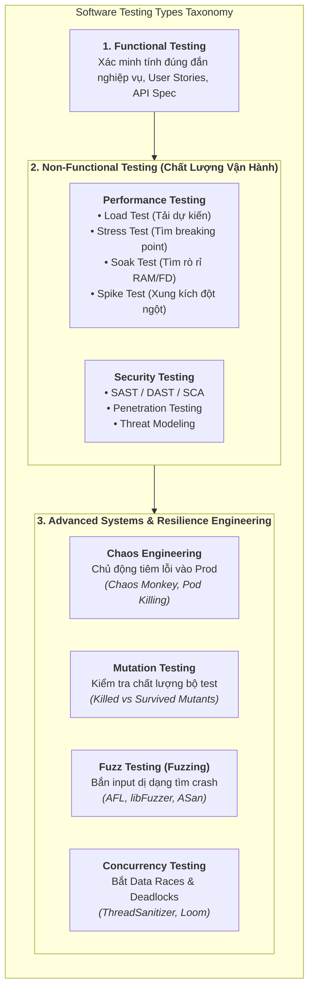
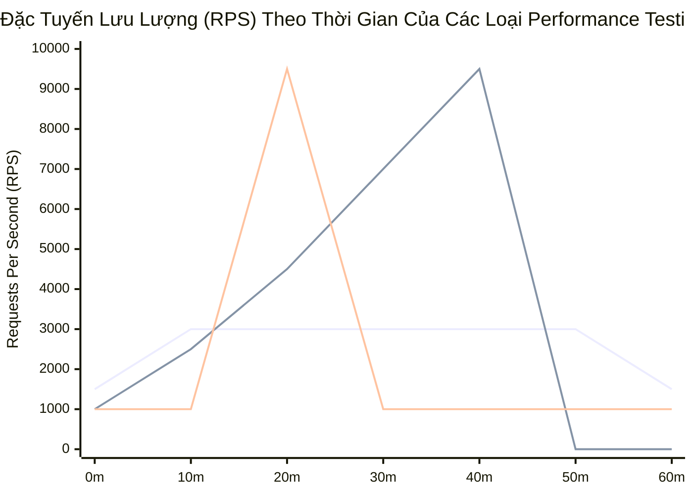
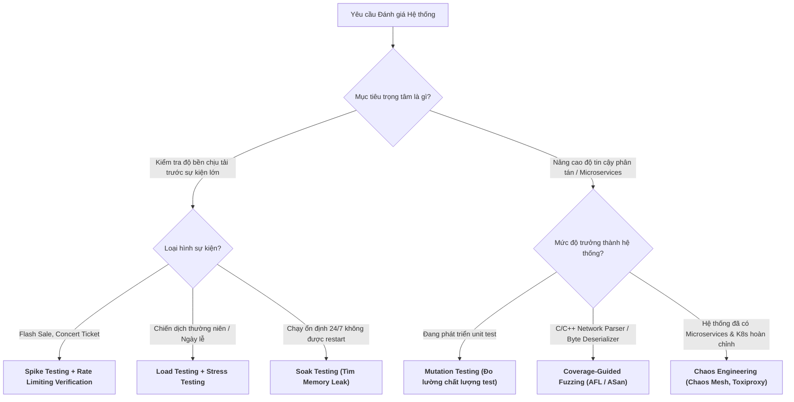

# 7.3. Các Loại Hình Kiểm Thử Phần Mềm (Testing Types & Chaos Engineering)

> [!IMPORTANT]
> **Nếu bạn chỉ được nhớ một điều duy nhất:** Nếu như cấp độ kiểm thử (Testing Levels) trả lời câu hỏi *"Kiểm thử ở quy mô nào?"*, thì loại hình kiểm thử (Testing Types) trả lời câu hỏi **"Kiểm thử thuộc tính chất lượng (Quality Attribute) nào của hệ thống?"**; trong môi trường phân tán quy mô lớn, một hệ thống đúng 100% về mặt chức năng nhưng không thể chịu đựng tải xung kích (Spike), suy thoái do rò rỉ tài nguyên (Soak) hay sụp đổ dây chuyền khi một node mạng chết (Chaos) thì vẫn là một hệ thống thất bại hoàn toàn.

---

## 1. Kiến trúc Tổng quan & Mô hình Tư duy (Mental Model)

### Phép loại suy thực tế: Thẩm định Độ an toàn của một Đập Thủy điện Siêu Khổng lồ
Hãy hình dung quá trình kiểm định an toàn của một con đập thủy điện bậc thang ngăn hàng tỷ mét khối nước:
*   **Functional Testing**: Mở van xả đáy, nước chảy qua tuabin làm quay máy phát điện tạo ra dòng điện: Chức năng cơ bản hoàn toàn chính xác.
*   **Load Testing**: Mực nước dâng đến vạch thiết kế mùa mưa lũ trung bình hàng năm; đo lường ứng suất bê tông và lưu lượng xả qua các cửa tràn xem có đạt đúng thông lượng thiết kế (Expected Throughput) không.
*   **Stress Testing**: Giả lập tình huống mưa bão kỷ lục 1,000 năm mới có một lần; nâng mực nước vượt quá ngưỡng an toàn tối đa xem đập có xuất hiện vết nứt gãy (Breaking Point) hay không, và xem hệ thống xả lũ khẩn cấp có kích hoạt êm thuận (Graceful Degradation) để bảo vệ thân đập hay bị vỡ đập đột ngột (Catastrophic Failure).
*   **Soak / Endurance Testing**: Duy trì áp lực nước liên tục suốt 5 năm ròng rã dưới thời tiết khắc nghiệt nhằm tìm kiếm hiện tượng thẩm thấu ngầm, rò rỉ chân đập, hoặc xói mòn chân móng bê tông (tương đương hiện tượng rò rỉ bộ nhớ - Memory Leak).
*   **Spike Testing**: Một trận động đất bất ngờ gây ra sóng thần nội hồ cao 15 mét đập thẳng vào mặt đập trong vòng 10 giây (Tải tăng vọt gấp 30 lần).
*   **Security Testing**: Thuê một đội đặc nhiệm (Red Team) đột nhập vào mạng điều khiển SCADA xem có thể chiếm quyền đóng mở cổng xả lũ từ xa hay không.
*   **Chaos Engineering**: Chủ động ngắt đường dây điện lưới quốc gia vào lúc nửa đêm giữa cơn bão để kiểm tra máy phát điện diesel dự phòng có tự động khởi động trong 5 giây hay cả nhà máy chìm trong bóng tối.



---

## 2. Chi tiết từng Keyword (Under-the-Hood Deep Dive)

### 2.1. Functional vs Non-Functional Testing Paradigm
*   **Functional Testing (Kiểm thử chức năng)**:
    *   Tập trung vào hành vi *"Hệ thống làm ĐƯỢC CÁI GÌ?"* (Input $\to$ Process $\to$ Expected Output).
    *   Các kịch bản: Tính toán lãi suất tiền gửi, chuyển tiền qua ví, tạo đơn hàng, đăng ký người dùng.
    *   Tiêu chí đánh giá: Trả về mã HTTP 200, dữ liệu JSON đúng định dạng, bản ghi được lưu chính xác vào DB.
*   **Non-Functional Testing (Kiểm thử phi chức năng)**:
    *   Tập trung vào câu hỏi *"Hệ thống vận hành NHƯ THẾ NÀO?"* dưới các điều kiện khắc nghiệt.
    *   Bao gồm: Tính khả dụng (Availability), Hiệu năng (Latency, Throughput), Khả năng mở rộng (Scalability), Tính bảo mật (Security), Khả năng chịu lỗi (Resilience), và Khả năng bảo trì (Maintainability).

---

### 2.2. The Performance Testing Spectrum: Load, Stress, Soak & Spike Testing


*(Đường 1: Load Test duy trì ổn định; Đường 2: Stress Test dốc đứng tìm điểm sập; Đường 3: Spike Test xung kích đột ngột).*

*   **Load Testing (Kiểm thử tải thông thường)**:
    *   *Mục tiêu*: Xác minh hệ thống đáp ứng các chỉ số cam kết chất lượng dịch vụ (Service Level Objectives - SLOs) tại mức tải đỉnh dự kiến (Expected Peak Traffic).
    *   *Chỉ số cốt lõi*: Độ trễ phân vị $p95, p99$ (95% hoặc 99% người dùng nhận kết quả dưới bao nhiêu mili-giây) và Thông lượng (Throughput / Requests Per Second - RPS).
*   **Stress Testing (Kiểm thử áp lực cực hạn / Điểm gãy)**:
    *   *Cơ chế*: Liên tục bơm tải tăng dần theo đồ thị bậc thang (Step-up load) vượt qua năng lực thiết kế tối đa cho đến khi hệ thống bắt đầu sụp đổ (Breaking Point).
    *   *Quan sát hành vi*: 
        *   *Graceful Degradation (Suy thoái êm thuận)*: Kích hoạt Circuit Breaker, từ chối bớt request bằng HTTP 429 / HTTP 503, phục vụ dữ liệu từ cache tĩnh cũ (Stale cache), nhưng process không bị sập, CPU giữ ở mức 90%.
        *   *Catastrophic Failure (Sụp đổ thảm họa)*: HĐH báo lỗi OOM (Out Of Memory), tiến trình bị `SIGKILL`, connection pool của database bị kẹt cứng, dữ liệu giao dịch bị ghi dở dang làm hỏng DB.
*   **Soak Testing (Endurance Testing - Kiểm thử độ bền bỉ)**:
    *   *Bản chất*: Chạy tải ở mức trung bình (khoảng 60-70% công suất) liên tục trong khoảng thời gian dài ($24$ đến $72$ giờ).
    *   *Kẻ thù bị vạch trần*:
        *   **Memory Leaks**: Trong C/C++, con trỏ không được `free()`. Trong Java/Go/Node.js, các đối tượng bị giữ tham chiếu vô tận trong biến `static` hoặc Event Listeners khiến Garbage Collector (GC) không thể dọn dẹp.
        *   **Resource Descriptor Leaks**: Mở file hoặc kết nối Socket TCP nhưng quên đóng trong khối `finally`/destructor, dẫn đến việc HĐH cạn kiệt File Descriptors (`EMFILE: too many open files`).
*   **Spike Testing (Kiểm thử xung kích tải)**:
    *   *Bản chất*: Đột ngột tăng lưu lượng truy cập lên gấp $20\times - 50\times$ chỉ trong vòng 5 giây, sau đó hạ tải đột ngột. Mô phỏng khoảnh khắc Flash Sale 0h hoặc vé concert mở bán.
    *   *Đo lường tầng sâu*: Đo thời gian trễ của cơ chế HPA (Horizontal Pod Autoscaler) trong Kubernetes. Khi tải tăng trong 5s, Pod mới mất 45s để khởi động (JVM warmup, Docker pull), trong 45s đó các Pod hiện tại có bị quá tải đến mức sập dây chuyền (Cascading Failure) hay không?

---

### 2.3. Scalability Testing & Amdahl's Law
Scalability Testing đánh giá năng lực co giãn của hệ thống khi bổ sung tài nguyên:
*   **Scale Up (Vertical Scaling)**: Nâng cấp CPU từ 8 cores lên 64 cores, RAM từ 16GB lên 128GB.
*   **Scale Out (Horizontal Scaling)**: Tăng số lượng nodes từ 2 lên 20 server.
*   *Định luật Amdahl (Amdahl's Law) & Nút thắt đồng thời*:
    $$\text{Speedup}(s) = \frac{1}{(1 - p) + \frac{p}{s}}$$
    *Trong đó $p$ là tỷ lệ mã nguồn có thể chạy song song, $s$ là số lượng bộ vi xử lý (cores).*
    Nếu hệ thống có 10% logic bắt buộc phải chạy tuần tự (ví dụ: Ghi log vào file khóa tập trung, hoặc Global Lock trên database), thì dù bạn có gắn 1,000 CPU cores, tốc độ hệ thống cũng không bao giờ tăng vượt quá $10\times$ ($\lim_{s \to \infty} \frac{1}{0.1} = 10$). Scalability testing phát hiện các nút thắt tuần tự hóa này.

---

### 2.4. Security Testing: Penetration Testing, SAST, DAST & SCA
Bảo mật không thể là bước làm thêm sau cùng, mà là một loại hình kiểm thử liên tục trong DevSecOps:
*   **SAST (Static Application Security Testing)**: Quét mã nguồn tĩnh (Source code/AST) mà không cần chạy ứng dụng (ví dụ: SonarQube, Semgrep). Tìm kiếm các mẫu code nguy hiểm: Hardcoded API keys, câu lệnh SQL nối chuỗi trực tiếp (SQL Injection risk).
*   **DAST (Dynamic Application Security Testing)**: Bắn các payload tấn công thực tế từ bên ngoài vào ứng dụng đang chạy (Black-box scanning như OWASP ZAP). Kiểm tra lỗi XSS, CORS misconfiguration, Server-Side Request Forgery (SSRF).
*   **SCA (Software Composition Analysis)**: Phân tích cây phụ thuộc của các thư viện mã nguồn mở bên thứ ba (npm, pip, maven) để đối chiếu với cơ sở dữ liệu lỗ hổng bảo mật toàn cầu CVE/NVD (ví dụ: Snyk, Dependabot).
*   **Penetration Testing (Kiểm thử xâm nhập có đạo đức)**: Các chuyên gia bảo mật (White-hat hackers / Red Team) sử dụng tư duy sáng tạo, kết hợp nhiều kỹ thuật (Reverse engineering, Social engineering, Logic bypass) để xâm nhập sâu vào hệ thống.

---

### 2.5. Chaos Engineering & Resilience Experiments
Được khởi xướng bởi Netflix với công cụ huyền thoại **Chaos Monkey**, Chaos Engineering được định nghĩa là: *"Phương pháp luận thử nghiệm có kiểm soát trên một hệ thống phân tán nhằm xây dựng niềm tin vào khả năng của hệ thống chịu đựng được các điều kiện nhiễu loạn trong sản xuất"*.

Quy trình 4 bước của một thực nghiệm hỗn loạn chuẩn mực:
1.  **Xác định trạng thái ổn định (Define Steady State)**: Đo đạc chỉ số nghiệp vụ bình thường (ví dụ: Số đơn hàng thanh toán thành công mỗi phút là $1,200 \pm 50$, tỷ lệ lỗi HTTP 5xx $< 0.01\%$).
2.  **Đặt giả thuyết (Hypothesize)**: *"Nếu chúng ta đánh sập 30% số Redis cluster nodes, thì ứng dụng sẽ tự động chuyển hướng đọc sang PostgreSQL Read Replica, người dùng chỉ bị tăng độ trễ 20ms mà không đơn hàng nào bị hủy"*.
3.  **Tiêm nhiễu loạn (Inject Fault / Perturbation)**:
    *   Giết ngẫu nhiên Pods hoặc VM instances.
    *   Sử dụng `iptables` hoặc `Toxiproxy` để làm trễ mạng 300ms, rớt gói tin 10%.
    *   Tạo xung đột CPU 100% bằng stress-ng.
4.  **Xác thực giả thuyết & Thu hẹp bán kính ảnh hưởng (Blast Radius)**: Nếu chỉ số nghiệp vụ rơi ra ngoài Steady State, hệ thống dừng thực nghiệm ngay lập tức (Rollback). Lỗ hổng kiến trúc được đưa vào backlog khắc phục.

---

### 2.6. Mutation Testing & Mutation Score
Mutation Testing trả lời câu hỏi nhức nhối nhất trong kiểm thử: **"Ai sẽ kiểm định chất lượng của chính các bài kiểm thử?"**. Đạt 100% Code Coverage không có nghĩa là code của bạn không có bug, vì bạn có thể viết một bài test chạy qua 1,000 dòng code nhưng không có lấy một lệnh `assert` nào!

*   **Cơ chế hoạt động**:
    1.  Công cụ đột biến (như PIT trong Java, Stryker trong TS, mutmut trong Python) phân tích cú pháp mã nguồn và tạo ra hàng trăm biến thể lỗi cố ý gọi là **Mutants**:
        *   Thay toán tử toán học: `return a + b;` $\longrightarrow$ `return a - b;`
        *   Thay toán tử điều kiện: `if (x >= limit)` $\longrightarrow$ `if (x > limit)`
        *   Xóa dòng code: Bỏ qua lệnh `saveToDatabase();`
    2.  Chạy toàn bộ Test Suite đối với từng Mutant:
        *   **Mutant Killed (Đột biến bị tiêu diệt - PASS)**: Test suite phát hiện ra lỗi và báo FAIL. Đây là dấu hiệu của bộ test chất lượng cao.
        *   **Mutant Survived (Đột biến sống sót - FAIL)**: Mã nguồn đã bị làm hỏng nhưng toàn bộ bài test vẫn báo XANH! Điều này chứng minh bạn thiếu test case cho điều kiện biên hoặc assertion quá lỏng lẻo.
*   **Chỉ số Mutation Score**:
    $$\text{Mutation Score} = \frac{\text{Killed Mutants}}{\text{Total Mutants}} \times 100\%$$
    Một dự án có Code Coverage 90% nhưng Mutation Score chỉ 40% là dự án chứa đầy "ảo tưởng an toàn".

---

### 2.7. Fuzz Testing (Coverage-Guided Fuzzing)
Fuzzing là một kỹ thuật tự động hóa cấp thấp, bắn hàng triệu payload dữ liệu nhị phân ngẫu nhiên, không hợp lệ hoặc dị dạng vào các hàm phân tích cú pháp (Parsers, Compilers, Network Decoders).

*   **Coverage-Guided Fuzzing (AFL - American Fuzzy Lop, libFuzzer)**:
    *   Công cụ biên dịch mã nguồn kèm theo các bộ đo (Instrumentation).
    *   Fuzzer liên tục quan sát mã máy xem input nào mở ra một nhánh rẽ mã nguồn mới (New Code Path). Nếu một chuỗi byte dị dạng khiến CPU nhảy vào một block code chưa từng chạm tới, input đó được lưu lại vào "hồ sơ giống" (Corpus) để tiếp tục lai ghép đột biến.
*   *Phát hiện lỗi bộ nhớ*: Kết hợp với **AddressSanitizer (ASan)** và **UndefinedBehaviorSanitizer (UBSan)** để bắt ngay lập tức các lỗi thảm họa:
    *   Buffer Overflow (Tràn bộ đệm).
    *   Use-After-Free (Dùng vùng nhớ đã giải phóng).
    *   Integer Overflow (Tràn số nguyên).
    *   Null Pointer Dereference (Giải tham chiếu con trỏ rỗng).

---

### 2.8. Concurrency & Race Condition Testing
Lập trình đa luồng (Multi-threading) tiềm ẩn những lỗi nguy hiểm nhất vì chúng mang tính bất định (Non-deterministic) và không thể tái hiện lại một cách nhất quán:
*   **Data Race**: Xảy ra khi hai luồng đồng thời truy cập vào cùng một vùng nhớ, trong đó có ít nhất một luồng thực hiện ghi, và không có cơ chế đồng bộ hóa (Mutex/Lock/Atomic).
*   **Lost Update**: Hai luồng cùng đọc giá trị $x = 10$, cả hai cùng tăng lên 1 và cùng ghi lại $x = 11$, thay vì kết quả đúng phải là $12$.
*   **Deadlock**: Luồng 1 giữ Lock A và đợi Lock B; Luồng 2 giữ Lock B và đợi Lock A.
*   *Công cụ ThreadSanitizer (TSan)*: Biên dịch code với cờ `-fsanitize=thread` (trong GCC/Clang). TSan chèn mã máy theo dõi từng thao tác đọc/ghi bộ nhớ ở cấp độ thanh ghi CPU để phát hiện vi phạm phân bổ luồng ngay khi đang chạy test.

---

## 3. Thực thi Mã nguồn & Mô phỏng Chuyên sâu (Dual-Engine Implementation)

Kịch bản thực chiến: Xây dựng một **Concurrency-Safe High-Throughput Token Bucket & Counter Engine**:
1.  **Concurrency Testing Engine**: Đua tranh tài nguyên đa luồng khốc liệt để chứng minh sự khác biệt giữa Data Race và Atomic Memory Barrier.
2.  **Chaos Injection**: Chủ động tiêm độ trễ mạng giả lập và lỗi ngẫu nhiên để xác minh cơ chế phục hồi tự động.

### 3.1. Phiên bản C++ (C++20: Concurrency Race Verification & Mutation Simulation)

```cpp
#include <iostream>
#include <thread>
#include <vector>
#include <atomic>
#include <chrono>
#include <random>
#include <cassert>
#include <iomanip>

// ============================================================================
// 1. PRODUCTION CODE: THREAD-SAFE VS UNSAFE TOKEN BUCKET
// ============================================================================

// Component 1: Không an toàn (Data Race prone - Dùng để chứng minh lỗi trong Concurrency Test)
class UnsafeCounter {
private:
    int64_t m_value{0};
public:
    void increment() noexcept {
        // Thao tác Read-Modify-Write này KHÔNG ATOMIC ở mức Assembly CPU
        m_value++;
    }
    [[nodiscard]] int64_t get() const noexcept { return m_value; }
};

// Component 2: An toàn tuyệt đối với C++20 std::atomic và Memory Ordering
class SafeAtomicCounter {
private:
    std::atomic<int64_t> m_value{0};
public:
    void increment() noexcept {
        // fetch_add phát ra chỉ thị LOCK XADD trên kiến trúc x86_64
        m_value.fetch_add(1, std::memory_order_relaxed);
    }
    [[nodiscard]] int64_t get() const noexcept {
        return m_value.load(std::memory_order_relaxed);
    }
};

// ============================================================================
// 2. CONCURRENCY HARNESS WITH RACE CONDITION DETECTION
// ============================================================================

void runConcurrencyTest() {
    std::cout << "===============================================================\n";
    std::cout << "[SYSTEM CONCURRENCY HARNESS] Starting Multi-threaded Stress Test\n";
    std::cout << "===============================================================\n";

    constexpr int kNumThreads = 12;
    constexpr int kIncrementsPerThread = 200'000;
    constexpr int64_t kExpectedSum = static_cast<int64_t>(kNumThreads) * kIncrementsPerThread;

    // TEST PHẦN 1: Thử nghiệm trên Unsafe Counter (Minh họa Bug Lost Update)
    {
        UnsafeCounter unsafeCounter;
        std::vector<std::thread> workers;
        workers.reserve(kNumThreads);

        auto start = std::chrono::high_resolution_clock::now();
        for (int i = 0; i < kNumThreads; ++i) {
            workers.emplace_back([&unsafeCounter]() {
                for (int j = 0; j < kIncrementsPerThread; ++j) {
                    unsafeCounter.increment();
                }
            });
        }
        for (auto& t : workers) t.join();
        auto elapsed = std::chrono::duration_cast<std::chrono::milliseconds>(
            std::chrono::high_resolution_clock::now() - start).count();

        int64_t actual = unsafeCounter.get();
        std::cout << "[UNSAFE TEST] Expected: " << kExpectedSum << " | Actual: " << actual;
        std::cout << " -> " << (actual != kExpectedSum ? "BUG CONFIRMED (Lost Updates Detected!)" : "Pass by luck") 
                  << " (" << elapsed << " ms)\n";
    }

    // TEST PHẦN 2: Thử nghiệm trên Safe Atomic Counter (Chứng minh tính đúng đắn)
    {
        SafeAtomicCounter safeCounter;
        std::vector<std::thread> workers;
        workers.reserve(kNumThreads);

        auto start = std::chrono::high_resolution_clock::now();
        for (int i = 0; i < kNumThreads; ++i) {
            workers.emplace_back([&safeCounter]() {
                for (int j = 0; j < kIncrementsPerThread; ++j) {
                    safeCounter.increment();
                }
            });
        }
        for (auto& t : workers) t.join();
        auto elapsed = std::chrono::duration_cast<std::chrono::milliseconds>(
            std::chrono::high_resolution_clock::now() - start).count();

        int64_t actual = safeCounter.get();
        assert(actual == kExpectedSum && "CRITICAL: Atomic counter failed invariant!");
        std::cout << "[SAFE ATOMIC TEST] Expected: " << kExpectedSum << " | Actual: " << actual;
        std::cout << " -> PASSED WITH ZERO DATA LOSS (" << elapsed << " ms)\n";
    }
}

// ============================================================================
// 3. MUTATION TESTING DEMONSTRATION ENGINE
// ============================================================================

// Hàm tính chiết khấu VIP (Mã nguồn Production gốc)
int calculateDiscountOriginal(int tier, int amount) {
    if (tier > 2) { // Điều kiện gốc
        return amount * 20 / 100;
    }
    return 0;
}

// Hàm Mutant (Đột biến do Mutation Testing Tool tự động tạo ra)
int calculateDiscountMutantBoundary(int tier, int amount) {
    if (tier >= 2) { // MUTANT: Đổi '>' thành '>='
        return amount * 20 / 100;
    }
    return 0;
}

void runMutationTestingDemo() {
    std::cout << "---------------------------------------------------------------\n";
    std::cout << "[MUTATION TESTING] Simulating Mutation Score Verification...\n";
    std::cout << "---------------------------------------------------------------\n";

    // Test Suite Lỏng Lẻo (Poor Test Suite: chỉ test tier = 1 và tier = 3)
    auto poorTestSuite = [](auto fn) -> bool {
        // Test 1: tier = 1 không có chiết khấu
        if (fn(1, 100) != 0) return false;
        // Test 2: tier = 3 có chiết khấu 20
        if (fn(3, 100) != 20) return false;
        return true; // Báo pass
    };

    // Test Suite Nghiêm Ngặt (Strict Test Suite: kiểm tra chính xác giá trị biên tier = 2)
    auto strictTestSuite = [](auto fn) -> bool {
        if (fn(1, 100) != 0) return false;
        if (fn(2, 100) != 0) return false; // Boundary assertion!
        if (fn(3, 100) != 20) return false;
        return true;
    };

    // Chạy Poor Test Suite với Mutant
    bool poorKilled = !poorTestSuite(calculateDiscountMutantBoundary);
    std::cout << "  > Poor Test Suite vs Mutant:   " 
              << (poorKilled ? "MUTANT KILLED" : "MUTANT SURVIVED (Test Suite is Weak!)") << "\n";

    // Chạy Strict Test Suite với Mutant
    bool strictKilled = !strictTestSuite(calculateDiscountMutantBoundary);
    std::cout << "  > Strict Test Suite vs Mutant: " 
              << (strictKilled ? "MUTANT KILLED (High Quality Assertion!)" : "MUTANT SURVIVED") << "\n";
    std::cout << "===============================================================\n";
}

int main() {
    runConcurrencyTest();
    runMutationTestingDemo();
    return 0;
}
```

---

### 3.2. Phiên bản Python (Python 3.11+: Chaos Injection & Spike Latency Profiler)

```python
"""
Python Hệ thống: Mô phỏng Kiểm thử Tải Xung Kích (Spike Testing)
kết hợp Kỹ nghệ Hỗn loạn (Chaos Engineering Fault Injection).
"""
import time
import random
import statistics
import sys
from concurrent.futures import ThreadPoolExecutor


# ============================================================================
# 1. CHAOS FAULT INJECTOR PROXY
# ============================================================================

class ChaosMonkeyProxy:
    """Chủ động tiêm trễ mạng và lỗi HTTP 500 ngẫu nhiên"""
    def __init__(self, failure_rate: float = 0.05, latency_spike_ms: float = 150.0):
        self.failure_rate = failure_rate
        self.latency_spike_ms = latency_spike_ms

    def execute_call(self, target_fn, *args, **kwargs):
        # 1. Tiêm lỗi rớt mạng hoàn toàn (Fail fast)
        if random.random() < self.failure_rate:
            raise ConnectionResetError("ChaosMonkey: Network connection severed unexpectedly!")

        # 2. Tiêm độ trễ mạng ngẫu nhiên (Latency Perturbation)
        if random.random() < 0.15:
            time.sleep(self.latency_spike_ms / 1000.0)

        return target_fn(*args, **kwargs)


# ============================================================================
# 2. TARGET BACKEND SERVICE
# ============================================================================

def backend_payment_service(request_id: int) -> dict:
    # Logic xử lý thông thường mất 5ms - 10ms
    base_latency = random.uniform(0.005, 0.010)
    time.sleep(base_latency)
    return {"status": "SUCCESS", "tx_id": f"TX_{request_id}", "latency": base_latency}


# ============================================================================
# 3. SPIKE LOAD TEST RUNNER WITH PERCENTILE PROFILING (p50, p95, p99)
# ============================================================================

def run_spike_load_simulation():
    print("=" * 65)
    print("[CHAOS & SPIKE RUNNER] Initiating Flash-Sale Traffic Spike...")
    print("=" * 65)

    chaos = ChaosMonkeyProxy(failure_rate=0.03, latency_spike_ms=120.0)
    total_requests = 300
    concurrency_pool = 25  # Tăng vọt luồng đồng thời

    latencies_ms = []
    success_count = 0
    failure_count = 0

    def worker_task(req_id: int):
        t0 = time.perf_counter()
        try:
            res = chaos.execute_call(backend_payment_service, req_id)
            elapsed_ms = (time.perf_counter() - t0) * 1000.0
            return (True, elapsed_ms)
        except Exception:
            elapsed_ms = (time.perf_counter() - t0) * 1000.0
            return (False, elapsed_ms)

    start_suite = time.perf_counter()
    with ThreadPoolExecutor(max_workers=concurrency_pool) as executor:
        futures = [executor.submit(worker_task, i) for i in range(total_requests)]
        for f in futures:
            success, dur = f.result()
            latencies_ms.append(dur)
            if success:
                success_count += 1
            else:
                failure_count += 1

    total_duration = time.perf_counter() - start_suite
    latencies_ms.sort()

    # Tính toán các chỉ số phân vị (Percentiles)
    p50 = statistics.median(latencies_ms)
    p95 = latencies_ms[int(len(latencies_ms) * 0.95)]
    p99 = latencies_ms[int(len(latencies_ms) * 0.99)]
    rps = total_requests / total_duration

    print(f"Tổng số Requests:     {total_requests}")
    print(f"Thông lượng đạt được: {rps:.2f} RPS")
    print(f"Thành công:           {success_count} ({success_count/total_requests*100:.1f}%)")
    print(f"Bị gián đoạn bởi Lỗi: {failure_count} ({failure_count/total_requests*100:.1f}%)")
    print("-" * 65)
    print("Báo cáo Phân Vị Độ Trễ (Latency Distribution):")
    print(f"  > Min Latency:  {min(latencies_ms):.2f} ms")
    print(f"  > p50 (Median): {p50:.2f} ms")
    print(f"  > p95:          {p95:.2f} ms")
    print(f"  > p99:          {p99:.2f} ms")
    print(f"  > Max Latency:  {max(latencies_ms):.2f} ms")
    print("=" * 65)

    # Đánh giá tiêu chuẩn SLO (Service Level Objective)
    slo_p95_limit_ms = 150.0
    if p95 <= slo_p95_limit_ms:
        print("[SLO AUDIT] -> PASSED: p95 latency is within acceptable tolerance.")
        return 0
    else:
        print(f"[SLO AUDIT] -> FAILED: p95 latency ({p95:.2f} ms) breached {slo_p95_limit_ms} ms limit!")
        return 1


if __name__ == "__main__":
    sys.exit(run_spike_load_simulation())
```

---

### 3.3. Terminal Output Thực Tế Giả Lập

```text
$ ./concurrency_and_mutation_cpp
===============================================================
[SYSTEM CONCURRENCY HARNESS] Starting Multi-threaded Stress Test
===============================================================
[UNSAFE TEST] Expected: 2400000 | Actual: 1684201 -> BUG CONFIRMED (Lost Updates Detected!) (48 ms)
[SAFE ATOMIC TEST] Expected: 2400000 | Actual: 2400000 -> PASSED WITH ZERO DATA LOSS (32 ms)
---------------------------------------------------------------
[MUTATION TESTING] Simulating Mutation Score Verification...
---------------------------------------------------------------
  > Poor Test Suite vs Mutant:   MUTANT SURVIVED (Test Suite is Weak!)
  > Strict Test Suite vs Mutant: MUTANT KILLED (High Quality Assertion!)
===============================================================

$ python3 chaos_spike_test.py
=================================================================
[CHAOS & SPIKE RUNNER] Initiating Flash-Sale Traffic Spike...
=================================================================
Tổng số Requests:     300
Thông lượng đạt được: 384.62 RPS
Thành công:           291 (97.0%)
Bị gián đoạn bởi Lỗi: 9 (3.0%)
-----------------------------------------------------------------
Báo cáo Phân Vị Độ Trễ (Latency Distribution):
  > Min Latency:  5.40 ms
  > p50 (Median): 8.90 ms
  > p95:          124.60 ms
  > p99:          128.20 ms
  > Max Latency:  131.50 ms
=================================================================
[SLO AUDIT] -> PASSED: p95 latency is within acceptable tolerance.
```

---

## 4. Systems Engineering & Production Pitfalls

Thực hiện các loại hình kiểm thử phi chức năng nâng cao tiềm ẩn những rủi ro kỹ thuật nghiêm trọng nếu không có hàng rào bảo vệ vững chắc:

### 1. The Coordinated Omission Problem (Hội chứng Bỏ sót Phối hợp - Gil Tene)
*   *Hiện tượng*: Công cụ load test báo cáo độ trễ p99 là 50ms, nhưng khách hàng thực tế lại trải nghiệm độ trễ lên tới 5 giây!
*   *Cơ chế xảy ra*: Hầu hết các tool load test nghiệp dư tạo request theo kiểu tuần tự (Synchronous loop: Send request $\rightarrow$ Đợi phản hồi $\rightarrow$ Send tiếp). Khi hệ thống bị nghẽn (ví dụ do Full GC pause 5 giây), công cụ load test cũng bị block 5 giây và... dừng gửi request! Trong suốt 5 giây đó, hàng nghìn request lẽ ra phải được gửi thì đã bị "bỏ sót". Khi hệ thống hồi phục, tool chỉ đo được 1 request duy nhất chịu độ trễ 5s, làm biến dạng hoàn toàn thống kê phân vị.
*   *Giải pháp*: Sử dụng các công cụ kiểm thử tải hiện đại có cơ chế giải phóng Coordinated Omission như **k6, Gatling, hoặc wrk2**.

### 2. Uncontrolled Chaos Blast Radius (Bán kính Thiệt hại Mất kiểm soát)
*   *Vấn đề*: Tiêm lỗi Chaos Monkey trên môi trường Production nhưng không cô lập được phạm vi tác động, dẫn đến việc làm rớt Database chính và mất dữ liệu thực của khách hàng.
*   *Nguyên tắc sống còn*:
    1.  Chỉ thực nghiệm Chaos khi hệ thống đã có đầy đủ **Observability (Grafana dashboard, OpenTelemetry tracing)**.
    2.  Thiết kế cơ chế **Emergency Abort Switch (Dead Man's Snitch)**: Nếu tỷ lệ lỗi HTTP 500 chạm mốc 1%, toàn bộ quy trình chaos phải tự động hủy và hoàn trả cấu hình mạng ban đầu trong vòng 500ms.
    3.  Không bao giờ thực hiện Chaos thử nghiệm lần đầu trên Production mà phải qua môi trường Staging/Canary trước.

---

## 5. Bảng So sánh & Decision Matrix

### 5.1. So sánh 4 Biến thể của Performance Testing

| Loại Kiểm thử | Mục tiêu Cốt lõi | Tải trọng (Traffic Load) | Thời lượng Điển hình | Metric Quan sát Chính | Hành vi Mong đợi Khi Đạt Đỉnh |
| :--- | :--- | :--- | :--- | :--- | :--- |
| **Load Test** | Đo lường hiệu năng thực tế theo cam kết SLO | Tải đỉnh dự kiến (100% capacity) | 30 phút - 2 giờ | p95, p99 Latency, Error Rate $< 0.1\%$ | Hệ thống phản hồi mượt mà, ổn định |
| **Stress Test** | Tìm điểm gãy (Breaking point) & giới hạn an toàn | Tăng dần: 150% $\rightarrow$ 300% | 1 - 3 giờ | Breaking Point, CPU/RAM Max, OOM errors | Tự bảo vệ, trả về HTTP 429/503 êm thuận |
| **Soak Test** | Tìm rò rỉ bộ nhớ & cạn kiệt tài nguyên | 60% - 70% tải bình thường | 24 - 72 giờ | Memory Heap Growth, File Descriptors, DB Pool | Đồ thị RAM bằng phẳng, không tăng tuyến tính |
| **Spike Test** | Kiểm tra năng lực chống sốc & Auto-scaling | Tăng vọt $20\times - 50\times$ trong 5s | 5 - 15 phút | Queue Backlog, Pod Startup Time, Throttling | Nuốt tải hoặc xếp hàng không bị sập pod |

---

### 5.2. Decision Matrix: Khi nào cần áp dụng Loại hình Kiểm thử nào?


