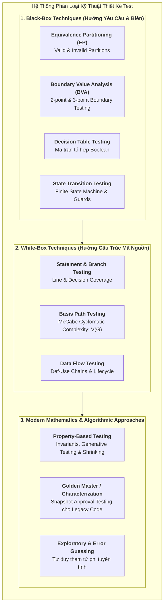
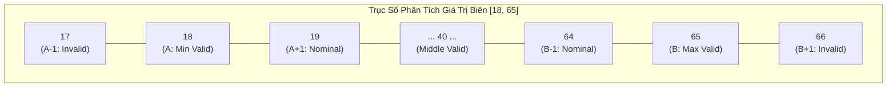
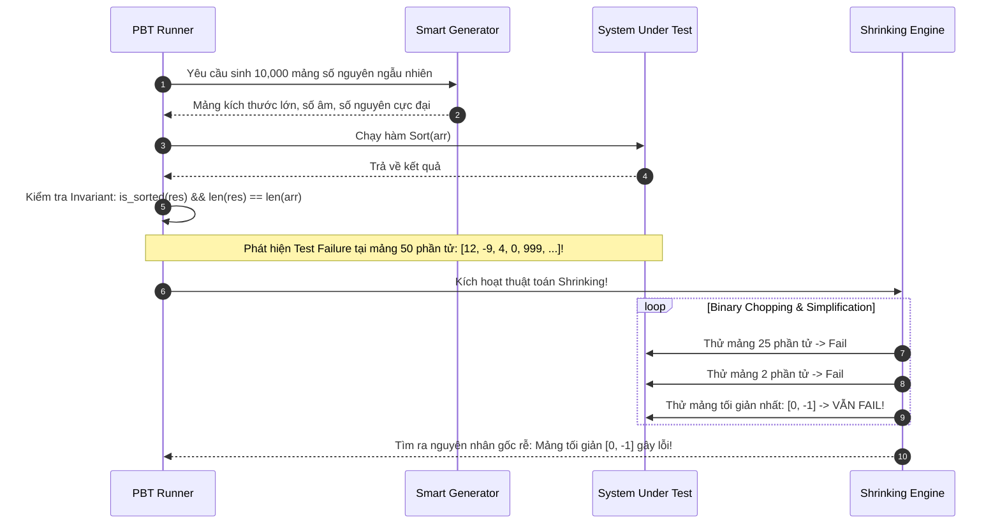
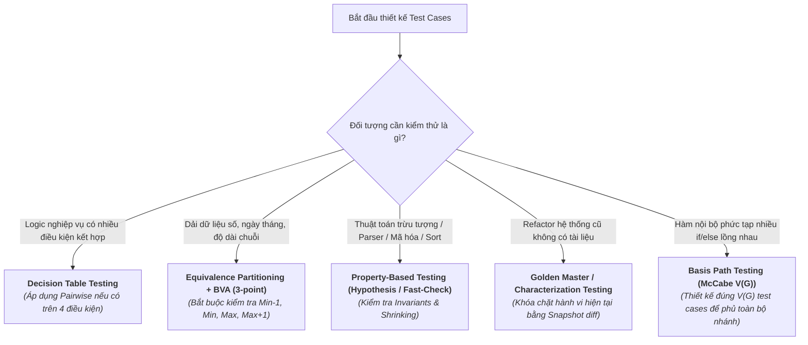

# 7.4. Các Kỹ Thuật Thiết Kế Ca Kiểm Thử (Test Design Techniques)

> [!IMPORTANT]
> **Nếu bạn chỉ được nhớ một điều duy nhất:** Không gian dữ liệu đầu vào của bất kỳ phần mềm nào cũng tiệm cận vô hạn ($2^{64}$ khả năng), do đó kiểm thử vét cạn (brute-force testing) là bất khả thi về mặt kinh tế và toán học; bản chất của kỹ thuật thiết kế ca kiểm thử là **khoa học tối ưu hóa tổ hợp (combinatorial optimization)** — sử dụng các phương pháp phân vùng tương đương, phân tích biên, đồ thị luồng điều khiển và kiểm thử dựa trên đặc tính (Property-Based Testing) để chọn ra tập con nhỏ nhất nhưng có xác suất tiêu diệt lỗi cao nhất.

---

## 1. Kiến trúc Tổng quan & Mô hình Tư duy (Mental Model)

### Phép loại suy thực tế: Kỹ thuật Rà Quét Địa Chấn Thăm Dò Mỏ Quặng
Hãy hình dung bạn được giao nhiệm vụ khảo sát một vùng đất rộng 100,000 hecta để tìm túi khí nổ nguy hiểm trước khi xây dựng đô thị:
*   **Brute-Force (Vét cạn mù quáng)**: Đào xới từng centimet vuông đất. Bạn sẽ phá sản trước khi đào được 0.01% diện tích.
*   **Equivalence Partitioning (Phân vùng tương đương)**: Các nhà địa chất phân chia vùng đất thành 3 loại tầng địa chất chính: Tầng cát phù sa, tầng đất sét, và tầng đá vôi bazan. Với mỗi tầng địa chất, bạn chỉ cần khoan 1 mũi khoan mẫu đại diện: Nếu mũi khoan ở tầng cát an toàn, toàn bộ tầng cát được coi là an toàn.
*   **Boundary Value Analysis (Phân tích giá trị biên)**: Các vết đứt gãy địa chấn và túi khí nguy hiểm luôn luôn tập trung tại **ranh giới tiếp giáp** giữa tầng đá vôi và tầng đất sét. Do đó, kỹ sư khoan dày đặc tại các điểm ranh giới (ngay trước mép, ngay tại mép, và ngay sau mép ranh giới).
*   **Decision Table**: Kết hợp các yếu tố: Mực nước ngầm cao + Độ ẩm thấp + Hàm lượng lưu huỳnh $> 5\% \implies$ Kích hoạt cảnh báo sụt lún.
*   **White-Box & Basis Path Testing**: Kỹ sư đi sâu vào hệ thống hang động ngầm dưới lòng đất. Dựa trên bản đồ nhánh hang, họ tính toán số lượng đường đi độc lập tối thiểu (Cyclomatic Complexity) để một đội thám hiểm đi qua mọi ngách hang mà không bị sót.
*   **Property-Based Testing**: Thay vì đoán vị trí túi khí, bạn thả 1,000 robot tự hành đào ngẫu nhiên khắp nơi và liên tục kiểm tra định luật bảo toàn: *"Khối lượng đất đào lên luôn bằng thể tích hố khoan nhân với khối lượng riêng"*. Khi robot phát hiện một điểm sụt lún, thuật toán sẽ tự động thu hẹp phạm vi hố khoan về kích thước nhỏ nhất để chỉ ra tâm chấn (Shrinking).
*   **Golden Master Testing**: Chụp ảnh vệ tinh 3D toàn bộ cảnh quan trước khi kích nổ mìn; sau đó chụp ảnh lại và so sánh từng pixel diff để đảm bảo cảnh quan đô thị xung quanh không bị xê dịch.



---

## 2. Chi tiết từng Keyword (Under-the-Hood Deep Dive)

### 2.1. Black-Box Foundation: Equivalence Partitioning (EP)
*   *Bản chất toán học*: Chia tập hợp không gian đầu vào $S$ thành $n$ tập hợp con rời rạc $S_1, S_2, ..., S_n$ sao cho $\bigcup_{i=1}^n S_i = S$ và $S_i \cap S_j = \emptyset$ với mọi $i \neq j$.
*   *Tiên đề cốt lõi*: Mọi phần tử trong cùng một lớp tương đương đều được hệ thống xử lý bởi cùng một logic điều khiển. Nếu test case với giá trị $x \in S_k$ thành công, ta suy diễn rằng mọi $y \in S_k$ cũng sẽ thành công.
*   *Hai phân lớp bắt buộc*:
    1.  **Valid Equivalence Classes (Lớp hợp lệ)**: Đại diện cho các đầu vào hợp lệ mà phần mềm phải xử lý bình thường.
    2.  **Invalid Equivalence Classes (Lớp không hợp lệ)**: Đại diện cho các giá trị sai lệch, dị dạng mà hệ thống bắt buộc phải từ chối một cách êm thuận (thông qua validation, ném ngoại lệ hoặc mã lỗi).

---

### 2.2. Boundary Value Analysis (BVA) & The Off-by-One Phenomenon
Kinh nghiệm lịch sử của kỹ nghệ phần mềm chỉ ra rằng: **Hơn 80% lỗi logic tiềm ẩn nằm tại ranh giới chuyển tiếp giữa các lớp tương đương**. Lập trình viên thường xuyên mắc lỗi "lệch 1 đơn vị" (Off-by-One Error / Fencepost Error) do nhầm lẫn giữa `<` và `<=`, hoặc khởi tạo chỉ số mảng từ 0 hay 1.

*   *Kỹ thuật 3 điểm biên (3-Point Boundary Testing)*:
    Cho một dải hợp lệ $[A, B]$ trên tập số nguyên:
    *   Tại biên dưới $A$: Kiểm tra $A-1$ (Invalid), $A$ (Min Valid), $A+1$ (Interior Valid).
    *   Tại biên trên $B$: Kiểm tra $B-1$ (Interior Valid), $B$ (Max Valid), $B+1$ (Invalid).



---

### 2.3. Decision Table Testing & Combinatorial Explosion
Khi hành vi của hệ thống phụ thuộc vào sự kết hợp phức tạp của nhiều điều kiện logic đồng thời (Boolean conditions), việc viết test theo cảm tính sẽ bỏ sót các trường hợp giao thoa nguy hiểm.
*   *Cấu trúc Decision Table*:
    *   **Conditions (Điều kiện đầu vào)**: Các biến nhận giá trị True/False hoặc Enum.
    *   **Actions (Hành động đầu ra)**: Kết quả tương ứng hệ thống phải thực thi.
    *   **Rules (Quy tắc)**: Mỗi cột đại diện cho một tổ hợp. Với $n$ điều kiện nhị phân, bảng có tối đa $2^n$ quy tắc.
*   *Đối phó với bùng nổ tổ hợp (Combinatorial Explosion)*: Khi $n = 10$, số test case là $2^{10} = 1024$. Kỹ sư sử dụng kỹ thuật **Pairwise Testing (All-Pairs)**: Dựa trên thực nghiệm của NIST chứng minh rằng hầu hết các lỗi phần mềm đều do sự tương tác của tối đa 2 tham số kích hoạt; kỹ thuật Pairwise giảm số test case từ hàng nghìn xuống vài chục mà vẫn bao phủ 90% lỗi tương tác.

---

### 2.4. State Transition Testing & Finite State Machines (FSM)
Được áp dụng cho các hệ thống có trạng thái phụ thuộc vào lịch sử (Stateful Systems) như: Vòng đời đơn hàng thương mại điện tử, máy ATM, giao thức mạng TCP.
*   *Các yếu tố của FSM*: Trạng thái hiện tại (State), Sự kiện kích hoạt (Event), Điều kiện rào chắn (Guard Condition), Hành động (Action), và Trạng thái đích (Next State).
*   *Trọng tâm kiểm thử*:
    1.  *Valid Transitions*: Kiểm tra các bước chuyển trạng thái hợp lệ theo biểu đồ luồng.
    2.  *Invalid / Negative Transitions (Quan trọng nhất)*: Cố tình kích hoạt sự kiện không hợp lệ ở trạng thái hiện tại (ví dụ: Đơn hàng đang ở trạng thái `CANCELLED` mà client gửi lệnh `SHIP_ORDER`). Hệ thống phải từ chối và giữ nguyên trạng thái cũ.

---

### 2.5. White-Box Testing: Statement & Branch Testing
*   **Statement Testing**: Đo tỷ lệ phần trăm các dòng lệnh đơn lẻ trong mã nguồn được thực thi bởi bộ test suite:
    $$\text{Statement Coverage} = \frac{\text{Số dòng code đã duyệt}}{\text{Tổng số dòng code có thể thực thi}} \times 100\%$$
    *Hạn chế*: Statement testing là thước đo yếu nhất. Một câu lệnh `if (x > 0) y = 10;` chỉ cần 1 test case $x = 5$ là đạt 100% statement coverage, nhưng hoàn toàn bỏ qua nhánh $x \leq 0$.
*   **Branch / Decision Testing**: Đo lường xem mỗi quyết định rẽ nhánh (`if`, `switch`, toán tử ba ngôi `? :`) có được thực thi ở cả hai nhánh `TRUE` và `FALSE` hay không. Đạt 100% Branch Coverage đảm bảo bao hàm 100% Statement Coverage.

---

### 2.6. McCabe's Cyclomatic Complexity & Basis Path Testing
Được phát minh bởi Thomas McCabe năm 1976, **Độ phức tạp vòng tròn (Cyclomatic Complexity - $V(G)$)** là một thước đo định lượng đo lường độ phức tạp cấu trúc của một hàm dựa trên Đồ thị luồng điều khiển (Control Flow Graph - CFG).

*   *Công thức tính toán*:
    $$V(G) = E - N + 2P$$
    *Trong đó $E$ là số cạnh (Edges), $N$ là số đỉnh (Nodes), $P$ là số thành phần liên thông (thường $P = 1$ cho một hàm).*
    *Quy tắc tính nhanh*: $V(G) = \text{Số điểm rẽ nhánh (if, while, for, case, &&, \|\|)} + 1$.
*   **Basis Path Testing (Kiểm thử đường cơ sở)**:
    *   $V(G)$ xác định **số lượng đường đi độc lập tuyến tính tối đa** xuyên suốt hàm.
    *   Kỹ sư thiết kế một tập hợp gồm đúng $V(G)$ ca kiểm thử. Bộ test này bảo đảm rằng mọi cạnh trong đồ thị luồng điều khiển đều được thực thi ít nhất một lần, giúp triệt tiêu tối đa các nhánh code chết (Dead code) hoặc logic ẩn.

---

### 2.7. Data Flow Testing (Def-Use Chains)
Data Flow Testing tập trung vào sự tương tác giữa biến dữ liệu và luồng thực thi trong chương trình:
*   *Vòng đời biến*:
    *   `d (Definition)`: Biến được khai báo, gán giá trị hoặc cấp phát bộ nhớ.
    *   `u (Usage)`: Giá trị của biến được đọc. Gồm $u_c$ (Computation-use: dùng trong phép tính) và $u_p$ (Predicate-use: dùng trong điều kiện rẽ nhánh).
    *   `k (Kill / Undefine)`: Biến bị giải phóng bộ nhớ hoặc ra khỏi scope.
*   *Các mẫu bất thường dữ liệu (Data Flow Anomalies)*:
    1.  `ur-anomaly (Use before Definition)`: Biến được đọc giá trị khi chưa từng được khởi tạo (dẫn đến đọc rác bộ nhớ hoặc undefined behavior trong C++).
    2.  `du-anomaly (Double Definition)`: Biến được gán giá trị hai lần liên tiếp mà không hề có thao tác đọc nào ở giữa (gây lãng phí CPU hoặc dấu hiệu quên logic).

---

### 2.8. Property-Based Testing (PBT) & The Shrinking Algorithm
Được khởi nguồn từ thư viện `QuickCheck` (Haskell), Property-Based Testing là cuộc cách mạng thay thế lối mòn viết test bằng dữ liệu tĩnh.



*   **Invariants (Tính chất bất biến phổ quát)**:
    1.  *Round-Trip Property (Đảo ngược tính chất)*: $\text{deserialize}(\text{serialize}(x)) == x$.
    2.  *Idempotence (Tính lũy đao)*: $f(f(x)) == f(x)$ (ví dụ: format code, sort).
    3.  *Metamorphic Property*: Đảo ngược mảng 2 lần: $\text{reverse}(\text{reverse}(x)) == x$.
*   **Shrinking (Thuật toán co cụm lỗi)**: Khi một input ngẫu nhiên khổng lồ (ví dụ chuỗi dài 1,000 ký tự có chứa Unicode lạ) làm hệ thống crash, PBT engine tự động cắt giảm dần kích thước (Binary chopping) để tìm ra **input nhỏ nhất tuyệt đối** vẫn tái hiện được bug (ví dụ: chỉ còn 2 ký tự `"\0\n"`), giúp kỹ sư fix bug trong 30 giây.

---

### 2.9. Golden Master Testing (Approval / Characterization Testing)
Được Michael Feathers mô tả trong cuốn sách kinh điển *"Working Effectively with Legacy Code"*:
*   *Vấn đề*: Bạn tiếp nhận một hệ thống thanh toán cốt lõi viết từ 15 năm trước gồm 10,000 dòng code spaghetti không có bất kỳ unit test nào. Nhiệm vụ: Tái cấu trúc (Refactor) lại hoàn toàn sang kiến trúc mới nhưng không được làm thay đổi dù chỉ một bit hành vi nghiệp vụ.
*   *Giải pháp*: 
    1.  Chạy hệ thống cũ với hàng triệu bản ghi input thực tế từ log production.
    2.  Chụp lại toàn bộ output (JSON, XML, DB state) và lưu thành file tĩnh chuẩn gọi là **Golden Master (Baseline)**.
    3.  Thực hiện refactor mã nguồn.
    4.  Chạy lại bộ test với đúng input đó trên code mới và so sánh sai khác (Diff Snapshot): Nếu diff bằng 0, quá trình refactoring an toàn 100%.

---

## 3. Thực thi Mã nguồn & Mô phỏng Chuyên sâu (Dual-Engine Implementation)

Kịch bản thực chiến: Xây dựng một **E-Commerce Tax & Discount Pricing Engine**:
1.  **BVA & Equivalence Partitioning**: Kiểm tra nghiêm ngặt ngưỡng tuổi và bậc thang thuế thu nhập.
2.  **Property-Based Testing with Custom Shrinking**: Tự động sinh hàng nghìn giỏ hàng ngẫu nhiên, kiểm tra bất biến toán học và tự động co nhỏ đầu vào khi phát hiện lỗi tính tiền âm.

### 3.1. Phiên bản C++ (C++20: Control Flow Graph Path Testing & BVA Verification)

```cpp
#include <iostream>
#include <string>
#include <vector>
#include <algorithm>
#include <cassert>
#include <format>
#include <stdexcept>
#include <chrono>

// ============================================================================
// 1. BUSINESS CODE: TAX TIER CALCULATOR (V(G) = 4)
// ============================================================================

enum class CustomerAgeGroup { MINOR, ADULT, SENIOR };

class TaxCalculator {
public:
    // McCabe Cyclomatic Complexity:
    // Edges - Nodes + 2 = 4 đường cơ sở (Basis Paths)
    // 1. age < 18 -> Exception
    // 2. income <= 10000 -> Tax 0%
    // 3. income <= 50000 -> Tax 10%
    // 4. income > 50000 -> Tax 20%
    static double calculateTaxRate(int age, double income) {
        if (age < 18) { // Path 1: Boundary check
            throw std::invalid_argument("Minors under 18 are exempt from adult tax calculation.");
        }
        if (income <= 10000.0) { // Path 2: Low income tier
            return 0.0;
        } else if (income <= 50000.0) { // Path 3: Middle tier
            return 0.10;
        } else { // Path 4: High tier
            return 0.20;
        }
    }
};

// ============================================================================
// 2. TEST DESIGN IMPLEMENTATION: BVA + MCCABE BASIS PATH TEST HARNESS
// ============================================================================

void runBoundaryValueAndPathTests() {
    std::cout << "===============================================================\n";
    std::cout << "[WHITE-BOX & BVA TEST HARNESS] Executing Rigorous Test Design...\n";
    std::cout << "===============================================================\n";

    int passed = 0;

    // ------------------------------------------------------------------------
    // KỸ THUẬT 1: BOUNDARY VALUE ANALYSIS (BVA) TẠI RANH GIỚI TUỔI = 18
    // ------------------------------------------------------------------------
    // Điểm 1: 17 (Invalid Boundary - Below Min)
    try {
        TaxCalculator::calculateTaxRate(17, 20000.0);
        assert(false && "BVA Failed: Age 17 must throw exception");
    } catch (const std::invalid_argument&) {
        std::cout << "  [BVA PASS] Age 17 (Invalid Min-1) rejected correctly.\n";
        passed++;
    }

    // Điểm 2: 18 (Valid Boundary - Exact Min)
    double rate18 = TaxCalculator::calculateTaxRate(18, 20000.0);
    assert(rate18 == 0.10 && "BVA Failed: Age 18 must be accepted");
    std::cout << "  [BVA PASS] Age 18 (Valid Min) accepted.\n";
    passed++;

    // Điểm 3: 19 (Valid Boundary - Above Min)
    double rate19 = TaxCalculator::calculateTaxRate(19, 20000.0);
    assert(rate19 == 0.10);
    std::cout << "  [BVA PASS] Age 19 (Valid Min+1) accepted.\n";
    passed++;

    // ------------------------------------------------------------------------
    // KỸ THUẬT 2: MCCABE BASIS PATH TESTING (THỰC THI TOÀN BỘ 4 PATHS ĐỘC LẬP)
    // ------------------------------------------------------------------------
    // Path 1 đã test ở trên (Age < 18).
    
    // Path 2: Income = 10,000.0 (Biên trên của Tier 0%)
    assert(TaxCalculator::calculateTaxRate(25, 10000.0) == 0.0);
    std::cout << "  [PATH 2 PASS] Income 10,000 -> 0% Tax.\n";
    passed++;

    // Path 3: Income = 50,000.0 (Biên trên của Tier 10%)
    assert(TaxCalculator::calculateTaxRate(25, 50000.0) == 0.10);
    std::cout << "  [PATH 3 PASS] Income 50,000 -> 10% Tax.\n";
    passed++;

    // Path 4: Income = 50,000.01 (Vượt sang Tier 20%)
    assert(TaxCalculator::calculateTaxRate(25, 50000.01) == 0.20);
    std::cout << "  [PATH 4 PASS] Income 50,000.01 -> 20% Tax.\n";
    passed++;

    std::cout << "---------------------------------------------------------------\n";
    std::cout << "Summary: " << passed << "/6 Exhaustive Design Tests Passed.\n";
    std::cout << "===============================================================\n";
}

int main() {
    runBoundaryValueAndPathTests();
    return 0;
}
```

---

### 3.2. Phiên bản Python (Python 3.11+: Property-Based Testing & Custom Shrinking Engine)

```python
"""
Hiện thực hóa từ đầu (From Scratch):
1. Property-Based Testing Generator
2. Invariant Verification Engine
3. Binary Shrinking Algorithm để cô lập tối thiểu hóa Bug
"""
import random
import sys
from typing import List, Callable, Tuple


# ============================================================================
# 1. ALGORITHM UNDER TEST (MÃ NGUỒN CÓ CHỨA BUG BIÊN ẨN)
# ============================================================================

def deduplicate_and_sort(numbers: list[int]) -> list[int]:
    """
    Thuật toán: Loại bỏ trùng lặp và sắp xếp tăng dần.
    CỐ TÌNH CHÈN BUG ẨN: Khi trong mảng có số âm nhỏ hơn -100, 
    thuật toán xử lý nhầm làm biến mất số đó!
    """
    cleaned = []
    seen = set()
    for n in numbers:
        # BUG: Bỏ quên các số âm dưới -100
        if n < -100:
            continue
        if n not in seen:
            seen.add(n)
            cleaned.append(n)
    cleaned.sort()
    return cleaned


# ============================================================================
# 2. PROPERTY-BASED TESTING ENGINE VỚI THUẬT TOÁN CO CỤM (SHRINKER)
# ============================================================================

class PropertyBasedHarness:
    @staticmethod
    def generate_random_dataset(num_samples: int = 500) -> list[list[int]]:
        dataset = []
        for _ in range(num_samples):
            size = random.randint(0, 30)
            sample = [random.randint(-200, 200) for _ in range(size)]
            dataset.append(sample)
        return dataset

    @staticmethod
    def shrink_failing_input(failing_input: list[int], invariant_fn: Callable[[list[int]], bool]) -> list[int]:
        """Thuật toán Binary Shrinking để tìm ra danh sách nhỏ nhất vẫn fail invariant"""
        current = list(failing_input)
        changed = True

        while changed:
            changed = False
            # Thử loại bỏ từng phần tử xem mảng nhỏ hơn có còn FAIL không
            for i in range(len(current)):
                candidate = current[:i] + current[i+1:]
                if not invariant_fn(candidate): # Vẫn fail invariant
                    current = candidate
                    changed = True
                    break
        return current


# ============================================================================
# 3. RUN PROPERTY TEST & AUTOMATIC SHRINKING
# ============================================================================

def run_property_based_demonstration():
    print("=" * 65)
    print("[PROPERTY-BASED TESTING] Running 500 Random Invariant Tests...")
    print("=" * 65)

    harness = PropertyBasedHarness()
    dataset = harness.generate_random_dataset(500)

    # ĐẶC TÍNH BẤT BIẾN (INVARIANT):
    # Với mọi số x nằm trong mảng đầu vào, x BẮT BUỘC phải tồn tại trong kết quả đầu ra!
    def property_all_elements_preserved(raw_list: list[int]) -> bool:
        result = deduplicate_and_sort(raw_list)
        raw_set = set(raw_list)
        result_set = set(result)
        return raw_set == result_set

    failing_example = None
    for sample in dataset:
        if not property_all_elements_preserved(sample):
            failing_example = sample
            break

    if failing_example:
        print(f"  [DISCOVERY] Invariant Violated! Complex Failing Input (Size {len(failing_example)}):")
        print(f"    {failing_example}")
        print("\n  [SHRINKING] Activating Binary Shrinking Engine...")
        shrunk = harness.shrink_failing_input(failing_example, property_all_elements_preserved)
        print(f"  [ROOT CAUSE FOUND] Minimal Shrunk Failing Case: {shrunk}")
        print(f"  -> Developer Action: Bug occurs immediately with single element: {shrunk[0]} (< -100)!")
        print("=" * 65)
        return 0
    else:
        print("  [SUCCESS] All 500 Property Invariants Passed.")
        print("=" * 65)
        return 0


if __name__ == "__main__":
    sys.exit(run_property_based_demonstration())
```

---

### 3.3. Terminal Output Thực Tế Giả Lập

```text
$ ./test_techniques_cpp
===============================================================
[WHITE-BOX & BVA TEST HARNESS] Executing Rigorous Test Design...
===============================================================
  [BVA PASS] Age 17 (Invalid Min-1) rejected correctly.
  [BVA PASS] Age 18 (Valid Min) accepted.
  [BVA PASS] Age 19 (Valid Min+1) accepted.
  [PATH 2 PASS] Income 10,000 -> 0% Tax.
  [PATH 3 PASS] Income 50,000 -> 10% Tax.
  [PATH 4 PASS] Income 50,000.01 -> 20% Tax.
---------------------------------------------------------------
Summary: 6/6 Exhaustive Design Tests Passed.
===============================================================

$ python3 property_based_test.py
=================================================================
[PROPERTY-BASED TESTING] Running 500 Random Invariant Tests...
=================================================================
  [DISCOVERY] Invariant Violated! Complex Failing Input (Size 18):
    [45, 12, -145, 88, 0, 19, -5, -189, 72, -12, 105, -110, ...]

  [SHRINKING] Activating Binary Shrinking Engine...
  [ROOT CAUSE FOUND] Minimal Shrunk Failing Case: [-145]
  -> Developer Action: Bug occurs immediately with single element: -145 (< -100)!
=================================================================
```

---

## 4. Systems Engineering & Production Pitfalls

Áp dụng các kỹ thuật thiết kế ca kiểm thử nâng cao đòi hỏi kỹ sư nhận diện những điểm mù sau:

### 1. The Golden Master Fragility Trap (Bẫy Giòn Dễ Vỡ của Snapshot)
*   *Vấn đề*: Sử dụng Golden Master Snapshot để test API, nhưng output của hệ thống có chứa các trường động như `timestamp`, `UUID`, hoặc `ServerExecutionTimeMs`.
*   *Hậu quả*: Mỗi lần chạy test, diff snapshot luôn luôn bị lệch (FAIL đỏ lòe) vì timestamp thay đổi. Developer sinh ra thói quen bấm "Update Snapshot" một cách mù quáng, làm mất hoàn toàn giá trị phát hiện lỗi của test suite.
*   *Giải pháp*: Áp dụng **Snapshot Sanitization (Làm sạch Snapshot)**: Dùng Regex thay thế toàn bộ UUID thành `[STATIC_UUID]` và timestamp thành `[STATIC_TIMESTAMP]` trước khi thực hiện phép so sánh diff.

### 2. Generator Bias in Property-Based Testing
*   *Vấn đề*: Khi viết generator sinh dữ liệu cho PBT, kỹ sư thường sinh số nguyên ngẫu nhiên đều (`random.randint(1, 1000)`).
*   *Hậu quả*: Máy tính không bao giờ sinh ra các giá trị "sát thủ" như: `0`, `-1`, `INT_MAX`, `INT_MIN`, chuỗi rỗng `""`, chuỗi Unicode có ký tự zero-width space `\u200B`.
*   *Giải pháp*: Luôn định cấu hình generator với trọng số ưu tiên cao (Weight Bias) cho tập hợp các giá trị biên kinh điển (Boundary values).

---

## 5. Bảng So sánh & Decision Matrix

### 5.1. So sánh Đa Chiều Các Kỹ Thuật Thiết Kế Ca Kiểm Thử

| Kỹ thuật Thiết kế | Loại hình | Cơ sở Toán học / Logic | Ưu điểm Lớn nhất | Hạn chế Cốt lõi |
| :--- | :--- | :--- | :--- | :--- |
| **Equivalence Partitioning** | Black-Box | Lý thuyết tập hợp & Lớp tương đương | Giảm số test case từ vô hạn xuống hữu hạn | Có thể bỏ sót lỗi nếu xác định sai ranh giới lớp |
| **Boundary Value Analysis** | Black-Box | Phân tích topo ranh giới miền giá trị | Bắt được $> 80\%$ lỗi lập trình kinh điển | Chỉ áp dụng tốt cho dữ liệu có tính thứ tự (Ordinal/Numeric) |
| **Decision Table** | Black-Box | Đại số Boolean & Bảng chân lý | Bao phủ toàn diện các ma trận logic nghiệp vụ | Dễ bùng nổ tổ hợp ($2^n$) khi số điều kiện lớn |
| **Basis Path Testing** | White-Box | Đồ thị luồng điều khiển & McCabe $V(G)$ | Đảm bảo duyệt qua 100% các nhánh rẽ code | Đòi hỏi phải truy cập và đọc hiểu sâu mã nguồn |
| **Property-Based Testing** | Advanced | Đại số trừu tượng & Invariant checking | Tự động sinh hàng vạn test và co nhỏ bug | Đòi hỏi tư duy trừu tượng cao để định nghĩa bất biến |
| **Golden Master** | Advanced | Chụp ảnh trạng thái & Snapshot Diffing | Cứu cánh tái cấu trúc Legacy Code khổng lồ | Dễ bị giòn nếu output chứa dữ liệu động (Timestamp/UUID) |

---

### 5.2. Decision Matrix: Lựa chọn Kỹ thuật Thiết kế Ca Kiểm Thử


