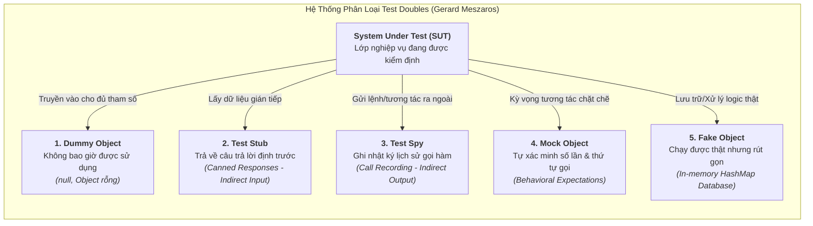
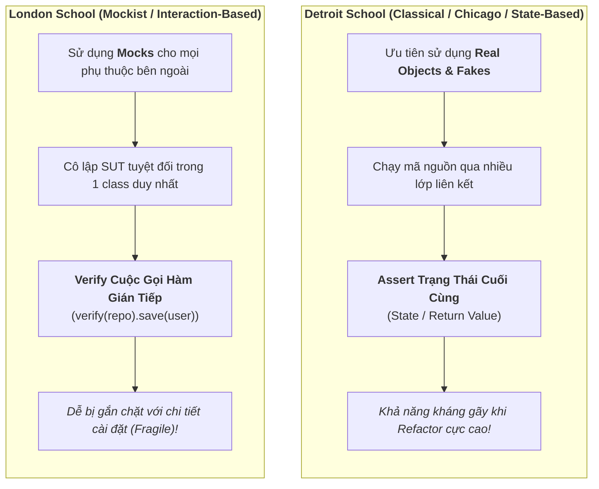
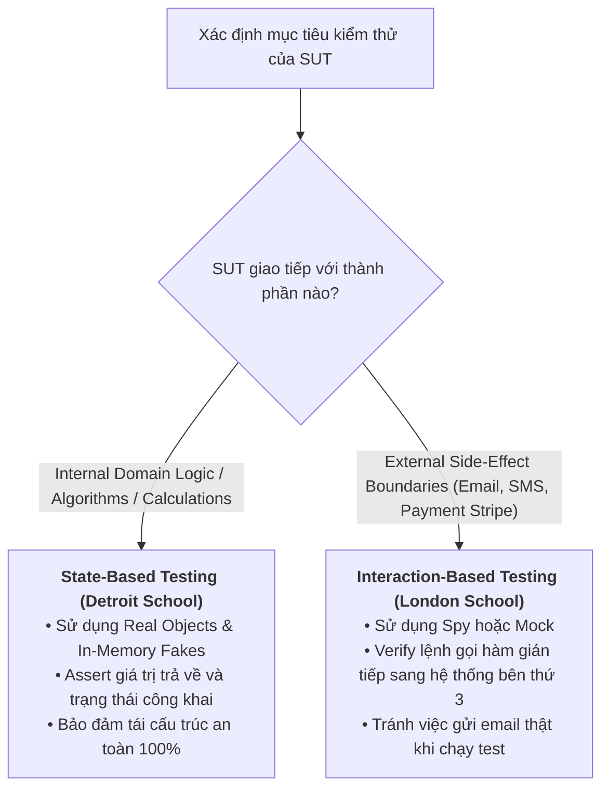

# 7.5. Thiết Kế Mã Kiểm Thử và Phân Loại Test Doubles (Test Code Design & Test Doubles Taxonomy)

> [!IMPORTANT]
> **Nếu bạn chỉ được nhớ một điều duy nhất:** Mã kiểm thử (Test Code) cũng là mã nguồn sản phẩm (Production Code) và phải được áp dụng cùng những tiêu chuẩn thiết kế khắt khe nhất; việc phân biệt rõ ràng **5 loại Test Doubles (Dummy, Stub, Spy, Mock, Fake)** và ưu tiên **State-Based Testing** thay vì lạm dụng **Interaction-Based Testing (Over-Mocking)** là ranh giới sống còn giữa một bộ test suite trường tồn với thời gian và một bãi rác mã nguồn giòn gãy cản trở tái cấu trúc.

---

## 1. Kiến trúc Tổng quan & Mô hình Tư duy (Mental Model)

### Phép loại suy thực tế: Phim trường Điện ảnh Hollywood
Hãy hình dung bạn là một đạo diễn Hollywood đang quay một cảnh hành động phức tạp. Diễn viên chính của bạn là **System Under Test (SUT)**. Bạn không thể mang cả một đội quân thật, vũ khí hạt nhân thật hay tòa nhà chọc trời thật vào phim trường để quay phim:
*   **Dummy (Hình nhân rơm / Ma-nơ-canh)**: Một hình nhân mặc áo vest ngồi ở hàng ghế sau xe hơi chỉ để cho đủ số lượng hành khách trong khung hình camera. Hình nhân này không cử động, không có thoại, không ai quan tâm đến nó.
*   **Stub (Băng phát thanh ghi âm sẵn)**: Một chiếc máy cassette đặt trong phòng khách sạn. Khi diễn viên chính gõ cửa và hỏi: *"Có ai ở nhà không?"*, chiếc máy cassette tự động phát ra một câu trả lời duy nhất: *"Đang bận, đừng làm phiền!"*. Chiếc máy không ghi nhận ai hỏi, không quan tâm thời gian, chỉ trả về một câu trả lời định trước (Canned Response).
*   **Spy (Thám tử chìm ghi nhật ký)**: Một trợ lý đạo diễn cầm sổ tay đứng ngoài cánh gà. Mỗi lần diễn viên chính tung một cú đấm, trợ lý ghi lại chính xác: *"Đấm tay phải, góc 45 độ, lực 60kg, vào lúc 10h15"*. Sau cảnh quay, đạo diễn sẽ đọc sổ ghi chép này để đối chiếu xem diễn viên có làm đúng kịch bản không (Verification).
*   **Mock (Giám sát kịch bản cực kỳ khó tính)**: Một giám sát trường quay đứng đối diện diễn viên và đặt ra kỳ vọng nghiêm ngặt trước khi bấm máy: *"Cậu BẮT BUỘC phải nói chính xác 3 câu thoại này theo đúng thứ tự, và phải rút súng bắn đúng 2 phát. Nếu bắn 3 phát hoặc không bắn phát nào, tôi hô CẮT và hủy cảnh quay ngay lập tức!"*. Mock tự động xác thực kỳ vọng và làm bài test thất bại nếu tương tác sai.
*   **Fake (Súng đạo cụ bằng nhựa nhưng bắn được đạn pháo sáng)**: Một khẩu súng giả được chế tạo tinh vi bằng nhựa. Nó có cò súng, có hộp tiếp đạn, có thể bắn ra tia lửa và tạo tiếng nổ "bùm" rất thật trên màn ảnh. Tuy nhiên, nó không thể bắn ra đầu đạn chì giết người thật, vì vậy không thể mang ra chiến trường thực tế (tương tự như một Database In-Memory lưu bằng Hash Map).



---

## 2. Chi tiết từng Keyword (Under-the-Hood Deep Dive)

### 2.1. Test Structuring Patterns: AAA (Arrange - Act - Assert) & Given-When-Then
Mọi bài kiểm thử tự động chuyên nghiệp đều tuân thủ cấu trúc phân đoạn rõ ràng nhằm tối ưu hóa tính dễ đọc (Readability) và khả năng bảo trì:

*   **AAA Pattern (Bill Wake)**:
    1.  **Arrange (Sắp đặt)**: Thiết lập toàn bộ tiền điều kiện, khởi tạo đối tượng SUT, nạp dữ liệu đầu vào, cấu hình các Test Doubles (Stub/Mock). Đoạn mã này thường chiếm 60% chiều dài bài test.
    2.  **Act (Hành động)**: Kích hoạt **duy nhất một hành vi nghiệp vụ** cần kiểm tra (gọi một hàm công khai). Lý tưởng nhất là một dòng code duy nhất: `var result = sut.withdraw(money);`. Nếu phần Act có nhiều hơn 2 dòng gọi hàm nghiệp vụ khác nhau, bài test đang vi phạm nguyên lý Single Responsibility.
    3.  **Assert (Khẳng định)**: Thẩm định xem kết quả trả về hoặc trạng thái của hệ thống có khớp 100% với mong đợi hay không.
*   **Given - When - Then (Dan North - BDD Style)**:
    *   Tương đương hoàn toàn về mặt ngữ nghĩa với AAA: `Given` $\equiv$ Arrange, `When` $\equiv$ Act, `Then` $\equiv$ Assert.
    *   Thường được áp dụng trong các framework BDD như Cucumber, Behave, SpecFlow để tạo cầu nối ngôn ngữ tự nhiên với Product Owner.

---

### 2.2. Test Fixtures & The Execution Lifecycle (Setup, Teardown & Sandboxing)
*   **Test Fixture**: Đại diện cho trạng thái môi trường cơ sở (Baseline environment state) cần thiết để một hoặc nhiều bài test có thể thực thi thành công. Ví dụ: Dữ liệu mẫu cài sẵn trong bảng DB, cấu hình thư mục tạm, socket server giả lập.
*   **Execution Lifecycle Tầng Sâu (XUnit Lifecycle)**:
    *   Hầu hết các test runner hiện đại (JUnit 5, Pytest, Catch2) thực thi một vòng đời 4 bước nghiêm ngặt cho **MỖI** test case đơn lẻ:
        1.  `Fresh Instance Creation`: Tạo một đối tượng Test Class hoàn toàn mới để tránh rò rỉ biến thực thể giữa các test.
        2.  `setUp() / beforeEach()`: Cấp phát tài nguyên sạch.
        3.  `testMethodExecution()`: Chạy thân bài test bên trong khối bọc bắt ngoại lệ (Sandboxed try-catch & timer).
        4.  `tearDown() / afterEach()`: Giải phóng tài nguyên ngay cả khi test bị crash (khối `finally`), xóa thư mục tạm, đóng kết nối mạng, rollback database.
    *   `beforeAll() / afterAll()`: Chạy 1 lần duy nhất cho toàn bộ Test Suite (thường dùng để khởi động cụm Docker Testcontainers đắt đỏ).

---

### 2.3. The 5 Test Doubles of Gerard Meszaros: Dummy, Stub, Spy, Mock & Fake
Được hệ thống hóa trong cuốn sách kinh điển *"xUnit Test Patterns: Refactoring Test Code"*, sự khác biệt giữa 5 loại đối tượng này nằm ở **mục đích sử dụng** và **hướng đi của luồng thông tin**:

| Loại Test Double | Chiều luồng dữ liệu | Có chức năng thực thi (Logic)? | Có kiểm tra kỳ vọng (Assertion)? | Trường hợp sử dụng điển hình |
| :--- | :--- | :--- | :--- | :--- |
| **Dummy** | Không có dữ liệu luân chuyển | Không (thường trả về null) | Không bao giờ | Truyền vào hàm chỉ để thỏa mãn chữ ký danh sách tham số (Parameter filler). |
| **Stub** | Cung cấp đầu vào gián tiếp (Indirect Input) | Không (Trả về dữ liệu cố định) | Không | Giả lập tỷ giá hối đoái, đọc cấu hình cố định, ép API bên ngoài trả về mã lỗi HTTP 500. |
| **Spy** | Thu thập đầu ra gián tiếp (Indirect Output) | Có thể ủy quyền cho lớp thật | Kiểm tra ở bước Assert cuối cùng | Ghi lại xem email đã được gửi mấy lần, tham số gửi đi là gì để kiểm tra sau khi gọi Act. |
| **Mock** | Kiểm soát tương tác (Interaction Control) | Không | **Tự Assert ngay trong quá trình thực thi** | Kỳ vọng hàm `chargeCreditCard()` bắt buộc phải được gọi đúng 1 lần với số tiền 100 USD. |
| **Fake** | Hai chiều (Input & Output đầy đủ) | **Có logic thật nhưng đơn giản hóa** | Không (kiểm tra trạng thái qua API của Fake) | Thay thế PostgreSQL bằng In-Memory Hash Map; thay thế Cloud S3 bằng Thư mục RAM cục bộ. |

---

### 2.4. State-Based Testing vs Interaction-Based Testing (Detroit vs London TDD Schools)
Đây là cuộc tranh luận kiến trúc vĩ đại nhất trong cộng đồng lập trình:



*   **State-Based Testing (Trường phái Detroit / Cổ điển - Khuyên dùng cho hầu hết Domain Logic)**:
    *   *Triết lý*: Chúng ta chỉ quan tâm đến **kết quả cuối cùng** (Hàm trả về cái gì? Trạng thái của đối tượng thay đổi ra sao trong bộ nhớ?). Không quan tâm bên trong hàm có gọi hàm phụ nào hay không.
    *   *Ưu điểm*: Cực kỳ bền vững khi tái cấu trúc (Refactoring-resilient). Bạn có thể đổi tên biến private, gộp 3 hàm private thành 1 hàm, đổi thuật toán từ QuickSort sang MergeSort... miễn là output đúng, bài test vẫn xanh mướt!
*   **Interaction-Based Testing (Trường phái London / Mockist)**:
    *   *Triết lý*: Chúng ta quan tâm đến **cách thức SUT giao tiếp với các cộng sự** (Collaborators). Xác minh rằng `sut.process()` bắt buộc phải gọi `collaborator.doSomething()` đúng $N$ lần.
    *   *Nguy cơ Overspecification (Kiểm thử quá chi tiết)*: Khiến test suite bị "hóa đá" mã nguồn. Bạn không thể thay đổi một chi tiết kỹ thuật nhỏ bên trong mà không làm vỡ bài test, biến test thành sợi xích kìm hãm sự phát triển của hệ thống.

---

### 2.5. Database Test Isolation: Transaction Rollback vs Ephemeral Testcontainers
Kiểm thử tầng tương tác dữ liệu (Persistence/Repository) đòi hỏi tính cô lập tuyệt đối:
*   **Chiến lược 1: Transaction Rollback**:
    *   Bắt đầu transaction ở `setUp()`, thực hiện các thao tác `INSERT`, `UPDATE`, chạy câu lệnh `SELECT` để assert, và gọi `ROLLBACK` ở `tearDown()`.
    *   *Ưu điểm*: Tốc độ thực thi cực nhanh (vài chục mili-giây).
    *   *Cạm bẫy*: Không kiểm tra được hành vi commit thật; không kiểm tra được trigger cơ sở dữ liệu hoặc các luồng chạy ngầm bất đồng bộ (Background Workers) vì chúng nằm ngoài transaction của test runner.
*   **Chiến lược 2: Ephemeral Docker Testcontainers**:
    *   Khởi chạy container PostgreSQL thật trong Docker bằng RAM disk (`tmpfs`), chạy Flyway/Liquibase migration từ đầu.
    *   *Ưu điểm*: Độ tin cậy tuyệt đối 100%, kiểm tra chính xác các cú pháp đặc thù (JSONB, PostgreSQL Extensions, Triggers).

---

### 2.6. Test Code Smells: Fragile Tests, Overspecification & Mystery Guest
*   **The Fragile Test (Bài test giòn dễ vỡ)**: Một bài test thất bại khi mã nguồn production được thay đổi nhưng hành vi bên ngoài của hệ thống hoàn toàn không đổi. Nguyên nhân phổ biến nhất là do lạm dụng Mockito để verify các phương thức private hoặc cấu trúc nội bộ.
*   **The Mystery Guest (Vị khách bí ẩn)**: Bài test đọc dữ liệu từ một file bí ẩn nằm ngoài ổ cứng (`test_data.csv`) hoặc một bản ghi có sẵn trong DB từ trước mà không được khởi tạo tường minh trong khối `Arrange`. Người đọc nhìn vào test không thể hiểu tại sao assertion lại mong đợi con số `42`.
*   **The Flaky Test (Kiểm thử chập chờn)**: Test lúc xanh lúc đỏ dù không có dòng code nào thay đổi. Nguyên nhân: Sử dụng hàm `sleep()`, phụ thuộc vào múi giờ hoặc thứ tự chạy của Test Runner.

---

## 3. Thực thi Mã nguồn & Mô phỏng Chuyên sâu (Dual-Engine Implementation)

Kịch bản thực chiến: Xây dựng một **User Registration & Notification System** với đầy đủ các loại Test Doubles và so sánh trực tiếp giữa State-based Testing và Interaction-based Testing.

### 3.1. Phiên bản C++ (C++20: Pure Modern C++ Implementations of all 5 Test Doubles)

```cpp
#include <iostream>
#include <string>
#include <vector>
#include <unordered_map>
#include <memory>
#include <cassert>
#include <stdexcept>

// ============================================================================
// 1. DOMAIN INTERFACES & PRODUCTION ENTITIES
// ============================================================================

struct User {
    std::string id;
    std::string email;
    int points;
};

// Interface Secondary Port 1: Gửi thông báo
class IEmailSender {
public:
    virtual ~IEmailSender() = default;
    virtual void sendEmail(const std::string& to, const std::string& subject, const std::string& body) = 0;
};

// Interface Secondary Port 2: Lưu trữ dữ liệu
class IUserRepository {
public:
    virtual ~IUserRepository() = default;
    virtual void save(const User& user) = 0;
    virtual std::shared_ptr<User> findById(const std::string& id) = 0;
};

// ============================================================================
// 2. THE 5 TEST DOUBLES TAXONOMY (MESZAROS COMPLIANT)
// ============================================================================

// DOUBLE 1: DUMMY OBJECT (Không làm gì, chỉ thỏa mãn chữ ký hàm)
class DummyEmailSender : public IEmailSender {
public:
    void sendEmail(const std::string&, const std::string&, const std::string&) override {
        // Rỗng hoàn toàn, không bao giờ kỳ vọng được gọi
    }
};

// DOUBLE 2: STUB (Cung cấp Indirect Input định trước)
class StubUserRepository : public IUserRepository {
public:
    void save(const User&) override {}
    std::shared_ptr<User> findById(const std::string& id) override {
        // Canned Response: Luôn trả về một User cố định
        return std::make_shared<User>(User{id, "stubbed@enterprise.com", 500});
    }
};

// DOUBLE 3: SPY (Ghi nhận Indirect Output / Lịch sử cuộc gọi)
class SpyEmailSender : public IEmailSender {
public:
    struct EmailRecord {
        std::string to;
        std::string subject;
    };
    std::vector<EmailRecord> sentRecords;

    void sendEmail(const std::string& to, const std::string& subject, const std::string&) override {
        sentRecords.push_back({to, subject});
    }
};

// DOUBLE 4: MOCK (Tự kiểm tra tương tác và số lần gọi - Behavioral Verification)
class MockEmailSender : public IEmailSender {
private:
    std::string m_expectedRecipient;
    int m_expectedCalls{0};
    int m_actualCalls{0};

public:
    void expectSendCall(std::string recipient, int callCount) {
        m_expectedRecipient = std::move(recipient);
        m_expectedCalls = callCount;
    }

    void sendEmail(const std::string& to, const std::string&, const std::string&) override {
        m_actualCalls++;
        if (to != m_expectedRecipient) {
            throw std::runtime_error("Mock Assertion Failed: Unexpected recipient " + to);
        }
    }

    void verify() const {
        if (m_actualCalls != m_expectedCalls) {
            throw std::runtime_error("Mock Assertion Failed: Expected " + 
                std::to_string(m_expectedCalls) + " calls, but got " + std::to_string(m_actualCalls));
        }
    }
};

// DOUBLE 5: FAKE (Có logic hoạt động thật nhưng rút gọn - In Memory HashMap)
class FakeUserRepository : public IUserRepository {
private:
    std::unordered_map<std::string, User> m_storage;
public:
    void save(const User& user) override {
        m_storage[user.id] = user;
    }
    std::shared_ptr<User> findById(const std::string& id) override {
        auto it = m_storage.find(id);
        if (it != m_storage.end()) {
            return std::make_shared<User>(it->second);
        }
        return nullptr;
    }
};

// ============================================================================
// 3. SYSTEM UNDER TEST (SUT)
// ============================================================================

class UserRegistrationService {
private:
    std::shared_ptr<IUserRepository> m_repo;
    std::shared_ptr<IEmailSender> m_mailer;

public:
    UserRegistrationService(std::shared_ptr<IUserRepository> repo, std::shared_ptr<IEmailSender> mailer)
        : m_repo(std::move(repo)), m_mailer(std::move(mailer)) {}

    void registerNewUser(const std::string& id, const std::string& email) {
        User user{id, email, 100}; // Tặng 100 điểm thưởng ban đầu
        m_repo->save(user);
        m_mailer->sendEmail(email, "Welcome!", "Your account is activated with 100 pts.");
    }
};

// ============================================================================
// 4. TEST SUITE DEMONSTRATING AAA & TEST DOUBLES
// ============================================================================

void runTestDoublesShowcase() {
    std::cout << "===============================================================\n";
    std::cout << "[TEST DESIGN] Executing Gerard Meszaros Test Doubles Showcase...\n";
    std::cout << "===============================================================\n";

    // TEST 1: Dùng FAKE + SPY (Phong cách AAA & State-based + Spy observation)
    {
        // 1. Arrange
        auto fakeRepo = std::make_shared<FakeUserRepository>();
        auto spyMailer = std::make_shared<SpyEmailSender>();
        UserRegistrationService sut(fakeRepo, spyMailer);

        // 2. Act
        sut.registerNewUser("usr_001", "dev@kernel.org");

        // 3. Assert (State-Based: Kiểm tra DB Fake)
        auto savedUser = fakeRepo->findById("usr_001");
        assert(savedUser != nullptr && "Fake Repo must store the user");
        assert(savedUser->points == 100 && "User points must be 100");

        // Assert (Spy: Kiểm tra Email gửi đi)
        assert(spyMailer->sentRecords.size() == 1);
        assert(spyMailer->sentRecords[0].to == "dev@kernel.org");
        std::cout << "  [PASS] Test_Registration_With_Fake_And_Spy (State-Based Assertion)\n";
    }

    // TEST 2: Dùng MOCK OBJECT (Phong cách London School - Behavioral Expectation)
    {
        // 1. Arrange
        auto dummyRepo = std::make_shared<FakeUserRepository>();
        auto mockMailer = std::make_shared<MockEmailSender>();
        // Thiết lập kỳ vọng trước khi chạy
        mockMailer->expectSendCall("alice@crypto.com", 1);
        UserRegistrationService sut(dummyRepo, mockMailer);

        // 2. Act
        sut.registerNewUser("usr_002", "alice@crypto.com");

        // 3. Assert (Mock tự verify hành vi)
        mockMailer->verify();
        std::cout << "  [PASS] Test_Registration_With_Strict_Mock (Interaction Verification)\n";
    }

    std::cout << "===============================================================\n";
}

int main() {
    runTestDoublesShowcase();
    return 0;
}
```

---

### 3.2. Phiên bản Python (Python 3.11+: Detroit vs London TDD Refactoring Resilience)

```python
"""
Chứng minh thực nghiệm: State-Based Testing (Detroit) bền bỉ khi Refactor
so với Interaction-Based Testing (London) bị gãy vụn khi thay đổi cài đặt nội bộ.
"""
from dataclasses import dataclass
from unittest.mock import Mock
import sys


@dataclass
class Order:
    order_id: str
    items: list[str]
    total_amount: float
    status: str = "PENDING"


# ============================================================================
# GIAI ĐOẠN 1: MÃ NGUỒN BAN ĐẦU (Gọi phương thức send_legacy_sms)
# ============================================================================

class NotificationGateway:
    def send_legacy_sms(self, phone: str, msg: str):
        pass # Production external call


class OrderService:
    def __init__(self, notifier: NotificationGateway):
        self.notifier = notifier
        self.orders: dict[str, Order] = {}

    def complete_order(self, order_id: str, phone: str, amount: float):
        order = Order(order_id=order_id, items=["itemA"], total_amount=amount, status="COMPLETED")
        self.orders[order_id] = order
        # GỌI HÀM NỘI BỘ BAN ĐẦU
        self.notifier.send_legacy_sms(phone, f"Order {order_id} Completed!")

    def get_order(self, order_id: str) -> Order | None:
        return self.orders.get(order_id)


# ============================================================================
# TEST SUITE CỦA 2 TRƯỜNG PHÁI
# ============================================================================

def test_detroit_school_state_based(service: OrderService):
    """Detroit School: Chỉ assert trạng thái nghiệp vụ Order"""
    service.complete_order("ORD_101", "+84999999", 250.0)
    order = service.get_order("ORD_101")
    assert order is not None
    assert order.status == "COMPLETED"
    assert order.total_amount == 250.0
    return True


def test_london_school_interaction_based(service: OrderService, mock_notifier: Mock):
    """London School: Mock và Assert tên phương thức send_legacy_sms"""
    service.complete_order("ORD_102", "+84999999", 500.0)
    # RÀNG BUỘC CỨNG VỚI CHI TIẾT CÀI ĐẶT
    mock_notifier.send_legacy_sms.assert_called_once_with("+84999999", "Order ORD_102 Completed!")
    return True


# ============================================================================
# GIAI ĐOẠN 2: REFACTORING! 
# Kỹ sư hiện đại hóa Notification: Đổi hàm send_legacy_sms thành notify_omnichannel
# Nghiệp vụ đơn hàng không đổi, nhưng chi tiết tương tác bên trong đã thay đổi!
# ============================================================================

class ModernNotificationGateway:
    def notify_omnichannel(self, phone: str, msg: str):
        pass


class ModernOrderService:
    def __init__(self, notifier):
        self.notifier = notifier
        self.orders: dict[str, Order] = {}

    def complete_order(self, order_id: str, phone: str, amount: float):
        order = Order(order_id=order_id, items=["itemA"], total_amount=amount, status="COMPLETED")
        self.orders[order_id] = order
        # ĐÃ THAY ĐỔI CHI TIẾT CÀI ĐẶT:
        if hasattr(self.notifier, "notify_omnichannel"):
            self.notifier.notify_omnichannel(phone, f"Order {order_id} Completed!")
        else:
            self.notifier.send_legacy_sms(phone, f"Order {order_id} Completed!")

    def get_order(self, order_id: str) -> Order | None:
        return self.orders.get(order_id)


def run_experiment():
    print("=" * 65)
    print("[TDD SCHOOLS DUEL] Testing Refactoring Resilience...")
    print("=" * 65)

    # 1. Trước khi Refactor: Cả 2 bài test đều PASS
    mock_notif_1 = Mock()
    svc1 = OrderService(mock_notif_1)
    test_detroit_school_state_based(svc1)
    test_london_school_interaction_based(svc1, mock_notif_1)
    print("  [PRE-REFACTOR] Both Detroit & London tests PASS.")

    # 2. Sau khi Refactor sang ModernOrderService (dùng notify_omnichannel)
    mock_notif_2 = Mock(spec=ModernNotificationGateway)
    svc2 = ModernOrderService(mock_notif_2)

    # Detroit test kiểm tra:
    detroit_passed = False
    try:
        test_detroit_school_state_based(svc2)
        detroit_passed = True
        print("  [POST-REFACTOR] Detroit School Test: -> SURVIVED & PASSED! (Resilient!)")
    except Exception as e:
        print(f"  [POST-REFACTOR] Detroit School Test: -> FAILED: {e}")

    # London test kiểm tra:
    london_passed = False
    try:
        test_london_school_interaction_based(svc2, mock_notif_2)
        london_passed = True
        print("  [POST-REFACTOR] London School Test:  -> PASSED!")
    except Exception as e:
        print(f"  [POST-REFACTOR] London School Test:  -> BROKEN AS PREDICTED! (Fragile Mock)")
        print(f"                 Reason: {type(e).__name__}: {e}")

    print("=" * 65)
    return 0 if detroit_passed else 1


if __name__ == "__main__":
    sys.exit(run_experiment())
```

---

### 3.3. Terminal Output Thực Tế Giả Lập

```text
$ ./test_doubles_cpp
===============================================================
[TEST DESIGN] Executing Gerard Meszaros Test Doubles Showcase...
===============================================================
  [PASS] Test_Registration_With_Fake_And_Spy (State-Based Assertion)
  [PASS] Test_Registration_With_Strict_Mock (Interaction Verification)
===============================================================

$ python3 tdd_duel_refactoring.py
=================================================================
[TDD SCHOOLS DUEL] Testing Refactoring Resilience...
=================================================================
  [PRE-REFACTOR] Both Detroit & London tests PASS.
  [POST-REFACTOR] Detroit School Test: -> SURVIVED & PASSED! (Resilient!)
  [POST-REFACTOR] London School Test:  -> BROKEN AS PREDICTED! (Fragile Mock)
                 Reason: AttributeError: Mock object has no attribute 'send_legacy_sms'
=================================================================
```

---

## 4. Systems Engineering & Production Pitfalls

Thiết kế mã kiểm thử sai lầm sẽ tạo ra các khoản nợ kỹ thuật (Technical Debt) khổng lồ:

### 1. The Over-Mocking Epidemic (Dịch Bệnh Lạm Dụng Mock)
*   *Hiện tượng*: Lập trình viên mock tất cả mọi thứ: Mock `ArrayList`, mock `String`, mock `UserRepository`, mock cả `Date`.
*   *Hậu quả*: Mã kiểm thử dài gấp 5 lần mã sản phẩm, 80% số dòng code trong bài test là các lệnh cấu hình `when(...).thenReturn(...)`. Khi chạy, test thực chất chỉ đang kiểm chứng xem "Thư viện Mockito có hoạt động không", chứ hoàn toàn không kiểm tra nghiệp vụ thực tế.
*   *Quy tắc kỹ nghệ*: **Không bao giờ Mock Value Objects hoặc Entities**. Chỉ xem xét mock các ranh giới ngoại vi thuần túy (I/O, Third-party Network, SMS Gateways).

### 2. The Shared Mutable Fixture Trap (Bẫy Chia Sẻ Biến Toàn Cục Giữa Các Test)
*   *Hiện tượng*: Khởi tạo một đối tượng Database hoặc Cache dạng biến `static` ở đầu file test để dùng chung cho 50 test case nhằm tiết kiệm thời gian khởi tạo.
*   *Hậu quả*: Test case số 12 xóa bớt 1 bản ghi trong DB, khiến Test case số 37 bị fail bất ngờ. Thứ tự chạy test bị xáo trộn sẽ dẫn đến "bão lỗi giả".
*   *Giải pháp*: Thực thi nghiêm ngặt triết lý **Fresh Fixture per Test**: Mỗi test case bắt buộc phải có một fixture độc lập hoàn toàn.

---

## 5. Bảng So sánh & Decision Matrix

### 5.1. Ma trận So sánh Toàn diện 5 Loại Test Doubles

| Tiêu chí | Dummy | Stub | Spy | Mock | Fake |
| :--- | :--- | :--- | :--- | :--- | :--- |
| **Bản chất kỹ thuật** | Giá trị rỗng / Null | Hardcoded Canned Data | Proxy ghi log nhật ký | Đối tượng kiểm tra tương tác | Triển khai thật nhưng rút gọn |
| **Có logic nội bộ không?** | Không | Không | Rất ít (chỉ append array) | Cấu hình kỳ vọng hành vi | **Có đầy đủ logic thuật toán** |
| **Mục đích chính** | Điền đủ tham số hàm | Cung cấp Indirect Input | Quan sát Indirect Output | Xác minh hành vi giao tiếp | Thay thế phụ thuộc nặng (DB/RAM) |
| **Tác động khi Refactor** | Không ảnh hưởng | Ít ảnh hưởng | Trung bình | **Rất dễ làm vỡ test (Fragile)** | Cực kỳ bền bỉ (Resilient) |
| **Độ khó khi triển khai** | Siêu dễ | Dễ | Dễ - Trung bình | Dùng thư viện (Mockito) | Tốn công lập trình lúc đầu |

---

### 5.2. Decision Matrix: Khi nào chọn State-Based vs Interaction-Based Testing?


