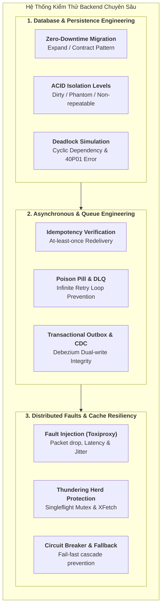
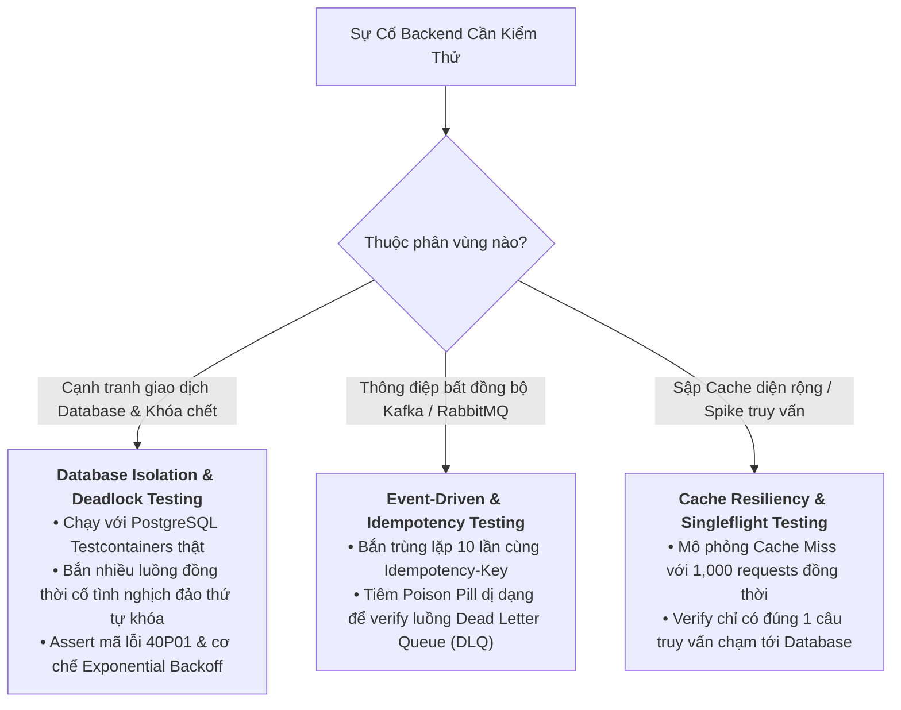

# 7.6. Kỹ Nghệ Kiểm Thử Chuyên Sâu Cho Backend (Backend-Specific Testing)

> [!IMPORTANT]
> **Nếu bạn chỉ được nhớ một điều duy nhất:** Kiểm thử Backend không đơn thuần là kiểm tra xem API có trả về mã HTTP 200 hay không, mà là **bộ môn kỹ thuật chuyên sâu thẩm định tính toàn vẹn của hệ thống khi đối mặt với các hiện tượng phi tất định (Non-deterministic phenomena) của môi trường phân tán** — bao gồm xung đột khóa chết (Deadlocks), xử lý trùng lặp thông điệp (Idempotency), bão truy vấn sập cache (Thundering Herd) và rách mạng (Network Partition).

---

## 1. Kiến trúc Tổng quan & Mô hình Tư duy (Mental Model)

### Phép loại suy thực tế: Mạng lưới Hạ tầng Điều phối Điện và Nước của Siêu Đô thị
Hãy hình dung hệ thống Backend tương đương với trung tâm điều hành hạ tầng nước sạch và trạm điện cao thế của một siêu đô thị 10 triệu dân:
*   **Database Migration Testing**: Bạn cần thay thế đường ống dẫn nước ngầm bằng ống gang đường kính 200mm bằng ống thép chịu lực 600mm. Yêu cầu: Nước vẫn phải chảy liên tục vào vòi của từng hộ dân mà không được cắt nước dù chỉ 1 giây (Zero-downtime Expand/Contract Migration). Nếu tính toán sai, áp lực nước xé toạc mối hàn làm ngập toàn thành phố.
*   **Deadlock & Transaction Isolation**: Hai tài xế xe bồn cùng lúc rẽ vào một ngã tư hẹp không có đèn giao thông. Xe A chặn đầu xe B, và xe B chặn đuôi xe A. Cả hai đứng im nhìn nhau mãi mãi. Trung tâm kiểm soát phải có cảm biến phát hiện kẹt xe (Deadlock Detector), cưỡng chế một xe lùi lại (Rollback) và cho phép xe kia đi qua trước, sau đó xe lùi lại sẽ thử rẽ lại sau (Exponential Backoff Retry).
*   **Message Queue & Poison Pill**: Một kiện hàng chứa chất độc phát nổ trôi trên băng chuyền tự động của bưu điện trung tâm. Khi cánh tay robot quét mã QR của kiện hàng bị lỗi phần mềm và phát nổ, cả dây chuyền có bị dừng toàn bộ thành phố hay không? Hay hệ thống có cảm biến thông minh gạt ngay kiện hàng độc hại sang một "Làn xử lý cách ly" (Dead Letter Queue - DLQ) để các kiện hàng khác tiếp tục lưu thông?
*   **Idempotency Testing**: Khách hàng thanh toán tiền điện qua máy quẹt thẻ, do mạng chập chờn khách hàng bấm nút "Thanh toán" liên tục 5 lần trong 3 giây. Hệ thống kế toán phải bảo đảm chỉ trừ đúng 1 lần tiền duy nhất, 4 lần sau trả về hóa đơn thành công mà không trừ thêm xu nào.
*   **Thundering Herd & Cache Stampede**: Mất điện toàn thành phố trong 10 phút. Ngay khi có điện trở lại, 2 triệu máy điều hòa nhiệt độ cùng đồng loạt bật máy nén một lúc. Dòng điện xung kích khổng lồ có đánh sập trạm biến áp trung tâm hay không? Hệ thống phải có cơ chế Singleflight gộp tải để khởi động từ từ.



---

## 2. Chi tiết từng Keyword (Under-the-Hood Deep Dive)

### 2.1. Database Migration Testing: Expand-Contract & Data Integrity
Trong kiến trúc Continuous Delivery (CD), chúng ta không bao giờ có thể dừng hệ thống (Maintenance Window) để chạy migration SQL. Do đó, việc kiểm thử di chuyển schema phải tuân thủ nghiêm ngặt mô hình **Expand-Contract (Phình to - Thu nhỏ)**:

1.  **Pha Expand (Mở rộng)**:
    *   Thêm cột mới nhưng cho phép giá trị `NULL` hoặc có `DEFAULT` value.
    *   Mã nguồn phiên bản cũ (v1) và mới (v2) cùng chạy song song trên production đều không bị gãy query.
2.  **Pha Migrate Data**:
    *   Chạy background worker sao chép dữ liệu từ cột cũ sang cột mới theo từng batch (chống lock table).
3.  **Pha Contract (Thu nhỏ)**:
    *   Sau khi 100% server đã chuyển sang code mới (v2), mới kích hoạt migration xóa cột cũ.
*   *Trọng tâm kiểm thử*:
    *   Chạy kiểm thử cả hai chiều: `migrate:up` và `migrate:down`.
    *   Kiểm tra tính an toàn kiểu dữ liệu: Chuyển từ `VARCHAR(50)` sang `VARCHAR(100)` an toàn, nhưng chuyển từ `TEXT` sang `VARCHAR(50)` có làm cắt ngắn dữ liệu (Data Truncation) của bản ghi thực tế nào không?
    *   Thời gian chạy migration trên bảng 100 triệu dòng: Liệu câu lệnh `ALTER TABLE` có chiếm độc quyền khóa bảng (Exclusive Table Lock - AccessExclusiveLock trong Postgres) làm nghẽn toàn bộ traffic khách hàng hay không?

---

### 2.2. Transaction Isolation Levels & ACID Rollback Verification
Cơ sở dữ liệu quan hệ cung cấp 4 cấp độ cô lập giao dịch theo chuẩn ANSI SQL-92. Kiểm thử Backend phải thẩm định xem ứng dụng có được cấu hình đúng cấp độ cô lập để ngăn chặn các dị thường dữ liệu (Data Anomalies) hay không:

| Cấp độ Cô lập (Isolation Level) | Dirty Read (Đọc bẩn) | Non-Repeatable Read (Đọc không lặp lại) | Phantom Read (Đọc bóng ma) | Serialization Anomaly (Dị thường tuần tự hóa) | Chi phí Hiệu năng (Overhead) |
| :--- | :--- | :--- | :--- | :--- | :--- |
| **Read Uncommitted** | Bị ảnh hưởng | Bị ảnh hưởng | Bị ảnh hưởng | Bị ảnh hưởng | Thấp nhất (Gần như không lock) |
| **Read Committed** (Postgres Default) | **Đã chặn** | Bị ảnh hưởng | Bị ảnh hưởng | Bị ảnh hưởng | Trung bình (Dùng MVCC snapshot per query) |
| **Repeatable Read** | **Đã chặn** | **Đã chặn** | **Đã chặn (trong Postgres)** | Bị ảnh hưởng | Cao (Dùng MVCC snapshot per transaction) |
| **Serializable** | **Đã chặn** | **Đã chặn** | **Đã chặn** | **Đã chặn hoàn toàn** | Rất cao (Dễ gặp lỗi Retry do Conflict) |

*   *ACID Rollback Testing*: Kiểm tra khi một giao dịch gồm 5 bước (ví dụ: Trừ tiền ví $\rightarrow$ Cộng điểm thưởng $\rightarrow$ Lưu đơn hàng $\rightarrow$ Giảm tồn kho kho hàng $\rightarrow$ Phát sự kiện) bị ném Exception ở bước thứ 4:
    *   Liệu cơ sở dữ liệu có hoàn tác sạch 100% về ban đầu?
    *   Có để lại bất kỳ bản ghi mồ côi nào trong bảng `orders` hay không?

---

### 2.3. Deadlocks & Lock Contention Simulation
Deadlock xảy ra khi tồn tại một chu trình phụ thuộc khóa vòng tròn (Cyclic Lock Dependency) giữa 2 hoặc nhiều giao dịch đồng thời:

```mermaid
sequenceDiagram
    autonumber
    participant W1 as Worker 1 (TX 1)
    participant PG as PostgreSQL Core Engine
    participant W2 as Worker 2 (TX 2)

    W1->>PG: BEGIN&#59; SELECT * FROM accounts WHERE id = 1 FOR UPDATE&#59; (Khóa Row 1)
    W2->>PG: BEGIN&#59; SELECT * FROM accounts WHERE id = 2 FOR UPDATE&#59; (Khóa Row 2)
    
    W1->>PG: UPDATE accounts SET balance = balance + 50 WHERE id = 2&#59;
    Note over PG,W1: Worker 1 bị BLOCKED (Chờ Row 2 do Worker 2 đang giữ)
    
    W2->>PG: UPDATE accounts SET balance = balance - 50 WHERE id = 1&#59;
    Note over PG,W2: Worker 2 bị BLOCKED (Chờ Row 1 do Worker 1 đang giữ)

    Note over PG: DEADLOCK DETECTED! (Chu trình Wait-For Graph đóng kín)
    PG-->>W2: ERROR 40P01: deadlock detected (Transaction 2 bị hủy cưỡng chế!)
    Note over W2: Code Backend bắt lỗi 40P01 -> Tự động Retry với Jitter!
    W1->>PG: COMMIT&#59; (Worker 1 hoàn tất thành công)
```



*   *Phương pháp kiểm thử*: Khởi tạo hai luồng worker đồng thời bắn request đảo ngược thứ tự cập nhật khóa; xác nhận mã ứng dụng bắt được mã lỗi đặc thù của hệ quản trị (e.g., PostgreSQL `40P01`, MySQL `1213`) và tự động thực hiện **Retry với Exponential Backoff và Random Jitter** thay vì ném lỗi HTTP 500 ra mặt người dùng.

---

### 2.4. Message Queues & Event-Driven Testing: At-Least-Once Delivery & Poison Pills
Trong kiến trúc hướng sự kiện (Event-Driven Architecture) với Kafka hoặc RabbitMQ, nguyên lý sống còn là: **Mạng lưới phân tán chỉ có thể bảo đảm chuyển giao thông điệp ít nhất một lần (At-Least-Once Delivery)**, không bao giờ có Exactly-Once tuyệt đối nếu không có cơ chế khử trùng lặp ở tầng ứng dụng.

*   *Kiểm thử Poison Pill (Viên thuốc độc)*:
    *   *Bản chất*: Một thông điệp bị lỗi định dạng (Malformed JSON hoặc chứa dữ liệu gây chia cho 0) được đẩy vào queue.
    *   *Kịch bản thảm họa*: Worker đọc message $\rightarrow$ bị crash $\rightarrow$ chưa kịp gửi `ACK` $\rightarrow$ Broker thấy worker chết nên đẩy lại message đó cho Worker thứ 2 $\rightarrow$ Worker 2 crash tiếp. Vòng lặp vô tận diễn ra làm sập toàn bộ cụm consumer trong vòng vài giây (Crash-Restart Loop).
    *   *Tiêu chí kiểm thử*: Đảm bảo Consumer có khối bọc bắt lỗi; nếu message thất bại quá $N$ lần (Max Retries), tự động chuyển giao thông điệp sang **Dead Letter Queue (DLQ)** và kích hoạt cảnh báo Prometheus/PagerDuty.

---

### 2.5. Idempotency Verification under Network Retries (Idempotency-Key Architecture)
*   *Bản chất*: Một thao tác được gọi là **Lũy đao (Idempotent)** nếu việc thực thi nó một lần hay nhiều lần liên tiếp với cùng một tham số đều mang lại **cùng một trạng thái hệ thống duy nhất**:
    $$f(f(x)) = f(x)$$
*   *Kiến trúc Idempotency-Key chuẩn Stripe*:
    1.  Client sinh ra một UUID ngẫu nhiên gắn vào header HTTP: `Idempotency-Key: 7b2a9f4c-...`.
    2.  Backend nhận request, mở một Transaction kiểm tra bảng `idempotency_records`:
        *   Nếu key **chưa tồn tại**: Lưu key với trạng thái `PROCESSING`, thực hiện trừ tiền, lưu response vào DB, cập nhật trạng thái `COMPLETED`.
        *   Nếu key **đang ở trạng thái PROCESSING**: Trả về lỗi xung đột HTTP 409 hoặc yêu cầu client chờ.
        *   Nếu key **đã COMPLETED**: Đọc thẳng response đã lưu trong DB và trả về ngay lập tức cho client mà **không chạy lại logic trừ tiền**.
*   *Kiểm thử*: Bắn 100 requests song song mang cùng một `Idempotency-Key`; đảm bảo chỉ có đúng 1 request được thực thi vào lõi nghiệp vụ.

---

### 2.6. Transactional Outbox Pattern & CDC Verification
*   *Vấn đề Dual-Write (Ghi hai nơi)*: Trong một hàm, bạn vừa gọi `db.save(order)` vừa gọi `kafka.send("order_created")`. Nếu database ghi thành công nhưng mạng chập chờn khiến kafka gửi thất bại, hệ thống rơi vào trạng thái bất nhất vĩnh viễn (Data Inconsistency).
*   *Kiến trúc Transactional Outbox*:
    *   Không gửi trực tiếp sang Kafka. Thay vào đó, trong cùng 1 ACID Transaction với `orders`, ứng dụng ghi một bản ghi sự kiện vào bảng `outbox_events`.
    *   Một tiến trình độc lập (Debezium Change Data Capture - CDC hoặc Polling Publisher) đọc bảng `outbox_events` và chuyển tiếp sang Kafka với bảo đảm 100% không bao giờ thất thoát dữ liệu.
*   *Kiểm thử*: Giả lập ngắt kết nối Kafka; kiểm tra xem dữ liệu đơn hàng và outbox event có được lưu an toàn trong DB không, và khi Kafka online trở lại thì sự kiện có được tự động stream đi tiếp không.

---

### 2.7. Distributed Network Fault Injection (Toxiproxy)
Thay vì kiểm thử trong môi trường mạng hoàn hảo của localhost ($0\text{ms}$ latency, $0\%$ packet drop), hệ thống Backend phân tán bắt buộc phải được thử nghiệm bằng công cụ chèn lỗi mạng cấp thấp như **Shopify Toxiproxy**:
*   *Các loại độc tính mạng (Toxics)*:
    1.  *Latency & Jitter*: Bơm độ trễ ngẫu nhiên $1500\text{ms} \pm 500\text{ms}$. Kiểm tra xem HTTP Client hoặc gRPC Stub có ngắt kết nối đúng theo cấu hình Timeout (ví dụ 1000ms) hay bị treo luồng vĩnh viễn.
    2.  *Bandwidth Limiting*: Bóp nghẹt băng thông xuống còn 2 KB/s để kiểm tra khả năng stream dữ liệu lớn.
    3.  *Packet Loss*: Rớt ngẫu nhiên 20% gói tin TCP để kiểm tra cơ chế truyền lại (TCP Retransmission).
    4.  *Slicer*: Cắt nhỏ các gói tin TCP thành các mảnh 1-byte để phát hiện các parser mạng bị lỗi phân mảnh bộ đệm.

---

### 2.8. Cache Resiliency: Cache Stampede, Thundering Herd & Singleflight Testing
*   *Hiện tượng Thundering Herd (Bầy thú dẫm đạp)*: Một key cache chứa dữ liệu cấu hình trang chủ hoặc thông tin sản phẩm hot có lượng truy cập 50,000 RPS. Khi key này chạm thời gian sống hết hạn (TTL Expired), bộ nhớ đệm giải phóng nó. Trong cùng một tích tắc $10\text{ms}$, 5,000 requests đồng thời nhận diện Cache Miss và cùng lúc chọc thẳng truy vấn xuống PostgreSQL! Kết quả: CPU Database vọt lên 100%, hàng nghìn kết nối bị từ chối, toàn bộ hệ thống sập nguồn.
*   *Giải pháp Singleflight Pattern (Golang / Node.js)*:
    *   Gộp tất cả các request đồng thời cho cùng một key vào chung **duy nhất một lời gọi hàm** (In-Flight Mutex).
    *   Chỉ có request đầu tiên được phép truy vấn Database. 4,999 requests còn lại sẽ đăng ký lắng nghe và nhận chung kết quả trả về của request đầu tiên đó!

---

## 3. Thực thi Mã nguồn & Mô phỏng Chuyên sâu (Dual-Engine Implementation)

Kịch bản thực chiến: Xây dựng hệ sinh thái **Singleflight Cache Mutex & Deadlock Detection Engine**:
1.  **C++20**: Xây dựng thuật toán phát hiện chu trình khóa chết (Deadlock Wait-For Graph Detection) giữa các giao dịch đồng thời và cơ chế tự động Rollback + Retry.
2.  **Python 3.11+**: Xây dựng hệ thống Idempotent Consumer kết hợp Singleflight Shield bảo vệ Database khỏi thảm họa Thundering Herd dưới áp lực 100 requests song song.

### 3.1. Phiên bản C++ (C++20: Deadlock Wait-For Graph & Retry Engine)

```cpp
#include <iostream>
#include <vector>
#include <unordered_map>
#include <unordered_set>
#include <memory>
#include <thread>
#include <mutex>
#include <stdexcept>
#include <cassert>
#include <chrono>

// ============================================================================
// 1. DEADLOCK DETECTOR ENGINE (WAIT-FOR GRAPH CYCLE DETECTION)
// ============================================================================

class DeadlockException : public std::runtime_error {
public:
    explicit DeadlockException(const std::string& msg) : std::runtime_error(msg) {}
};

class LockManagerWithDeadlockDetection {
private:
    std::mutex m_stateMutex;
    // ResourceId -> Owner TxId
    std::unordered_map<std::string, int> m_resourceOwners;
    // Wait-For Graph: TxId (chờ) -> TxId (đang giữ khóa)
    std::unordered_map<int, std::unordered_set<int>> m_waitForGraph;

    bool hasCycleDFS(int current, std::unordered_set<int>& visited, std::unordered_set<int>& recStack) {
        visited.insert(current);
        recStack.insert(current);

        if (m_waitForGraph.find(current) != m_waitForGraph.end()) {
            for (int neighbor : m_waitForGraph[current]) {
                if (recStack.find(neighbor) != recStack.end()) {
                    return true; // Phát hiện chu trình khép kín -> DEADLOCK!
                }
                if (visited.find(neighbor) == visited.end()) {
                    if (hasCycleDFS(neighbor, visited, recStack)) return true;
                }
            }
        }
        recStack.erase(current);
        return false;
    }

public:
    // Cố gắng chiếm khóa tài nguyên
    bool acquireLock(int txId, const std::string& resourceId) {
        std::lock_guard<std::mutex> lock(m_stateMutex);

        auto it = m_resourceOwners.find(resourceId);
        if (it == m_resourceOwners.end()) {
            // Tài nguyên tự do -> Cấp khóa thành công!
            m_resourceOwners[resourceId] = txId;
            return true;
        }

        int currentOwner = it->second;
        if (currentOwner == txId) return true; // Reentrant

        // Tài nguyên đang bị giữ bởi tx khác -> Thêm cạnh vào đồ thị Wait-For
        m_waitForGraph[txId].insert(currentOwner);

        // Kiểm tra xem việc chờ này có gây Deadlock không
        std::unordered_set<int> visited;
        std::unordered_set<int> recStack;
        if (hasCycleDFS(txId, visited, recStack)) {
            // Hủy cạnh chờ và ném Deadlock Exception
            m_waitForGraph[txId].erase(currentOwner);
            throw DeadlockException("ERROR 40P01: Deadlock detected! Transaction " + 
                std::to_string(txId) + " aborted to break cycle.");
        }

        return false; // Bị block nhưng không gây deadlock
    }

    void releaseAllLocks(int txId) {
        std::lock_guard<std::mutex> lock(m_stateMutex);
        // Xóa các tài nguyên đang sở hữu
        for (auto it = m_resourceOwners.begin(); it != m_resourceOwners.end(); ) {
            if (it->second == txId) {
                it = m_resourceOwners.erase(it);
            } else {
                ++it;
            }
        }
        // Xóa trong Wait-For Graph
        m_waitForGraph.erase(txId);
        for (auto& [waiter, holders] : m_waitForGraph) {
            holders.erase(txId);
        }
    }
};

// ============================================================================
// 2. BACKEND INTEGRATION TEST FOR DEADLOCK DETECTION & EXPONENTIAL BACKOFF
// ============================================================================

void runDeadlockSimulationTest() {
    std::cout << "===============================================================\n";
    std::cout << "[BACKEND PERSISTENCE TEST] Simulating Cyclic Deadlock in DB Engine\n";
    std::cout << "===============================================================\n";

    LockManagerWithDeadlockDetection lockManager;

    // Kịch bản kinh điển:
    // TX 1 chiếm Resource A
    // TX 2 chiếm Resource B
    // TX 1 cố chiếm Resource B (Đang bị TX 2 giữ -> TX 1 chờ TX 2)
    // TX 2 cố chiếm Resource A (Đang bị TX 1 giữ -> Gây chu trình TX 2 chờ TX 1!)

    int tx1 = 101;
    int tx2 = 202;

    bool tx1_locked_A = lockManager.acquireLock(tx1, "ROW_ACCOUNT_A");
    assert(tx1_locked_A == true);
    std::cout << "  [TX 1] Acquired Lock on ROW_ACCOUNT_A\n";

    bool tx2_locked_B = lockManager.acquireLock(tx2, "ROW_ACCOUNT_B");
    assert(tx2_locked_B == true);
    std::cout << "  [TX 2] Acquired Lock on ROW_ACCOUNT_B\n";

    // TX 1 cố chiếm B -> Bị block
    bool tx1_locked_B = lockManager.acquireLock(tx1, "ROW_ACCOUNT_B");
    assert(tx1_locked_B == false);
    std::cout << "  [TX 1] Blocked waiting for ROW_ACCOUNT_B (held by TX 2)...\n";

    // TX 2 cố chiếm A -> Kích hoạt Deadlock!
    bool caughtDeadlock = false;
    try {
        lockManager.acquireLock(tx2, "ROW_ACCOUNT_A");
    } catch (const DeadlockException& ex) {
        caughtDeadlock = true;
        std::cout << "  [DEADLOCK DETECTOR] -> " << ex.what() << "\n";
        // Mô phỏng ứng dụng tự động Rollback TX 2 để cứu hệ thống
        lockManager.releaseAllLocks(tx2);
        std::cout << "  [APPLICATION RESILIENCE] TX 2 successfully rolled back & released locks!\n";
    }

    assert(caughtDeadlock == true && "Test Failed: Deadlock must be detected!");

    // Sau khi TX 2 rollback, TX 1 thử lại và chiếm thành công Resource B
    bool tx1_retry_B = lockManager.acquireLock(tx1, "ROW_ACCOUNT_B");
    assert(tx1_retry_B == true);
    std::cout << "  [TX 1] Successfully acquired ROW_ACCOUNT_B after TX 2 was aborted.\n";

    lockManager.releaseAllLocks(tx1);
    std::cout << "===============================================================\n";
}

int main() {
    runDeadlockSimulationTest();
    return 0;
}
```

---

### 3.2. Phiên bản Python (Python 3.11+: Singleflight Cache & Idempotent Consumer)

```python
"""
Mô phỏng Backend Chuyên Sâu:
1. Singleflight Pattern triệt tiêu Thundering Herd khi Cache hết hạn
2. Idempotency Key Processor ngăn ngừa thanh toán lặp khi Network Retry
"""
import time
import threading
from concurrent.futures import ThreadPoolExecutor
import sys


# ============================================================================
# 1. SINGLEFLIGHT CACHE SHIELD (Chống Thundering Herd)
# ============================================================================

class SingleflightGroup:
    """Đảm bảo chỉ có DUY NHẤT 1 luồng được gọi hàm thật cho cùng 1 key tại 1 thời điểm"""
    def __init__(self):
        self._lock = threading.Lock()
        self._in_flight: dict[str, tuple[threading.Event, dict]] = {}

    def do(self, key: str, fn):
        with self._lock:
            if key in self._in_flight:
                event, result_box = self._in_flight[key]
                # Có request khác đang gọi DB, luồng này sẽ đợi
                wait_for_existing = True
            else:
                event = threading.Event()
                result_box = {}
                self._in_flight[key] = (event, result_box)
                wait_for_existing = False

        if wait_for_existing:
            event.wait() # Chờ request tiên phong hoàn tất
            return result_box["value"]

        # Request tiên phong thực thi hàm tốn kém (Database Call)
        try:
            val = fn()
            result_box["value"] = val
            return val
        finally:
            with self._lock:
                event.set() # Báo hiệu cho tất cả các luồng khác đang chờ
                del self._in_flight[key]


# ============================================================================
# 2. IDEMPOTENT TRANSACTION CONSUMER
# ============================================================================

class IdempotentPaymentProcessor:
    def __init__(self):
        self.deduplication_store: dict[str, dict] = {}
        self.account_balances: dict[str, int] = {"ACC_VIP": 1000}
        self.db_lock = threading.Lock()

    def process_charge(self, idempotency_key: str, account_id: str, amount: int) -> dict:
        with self.db_lock:
            # 1. Kiểm tra xem Idempotency-Key đã được xử lý chưa
            if idempotency_key in self.deduplication_store:
                cached_res = self.deduplication_store[idempotency_key]
                return {**cached_res, "is_replay": True}

            # 2. Xử lý trừ tiền thực tế (Atomic Business State Mutation)
            current_bal = self.account_balances[account_id]
            if current_bal < amount:
                raise ValueError("Insufficient balance")

            self.account_balances[account_id] -= amount
            response = {
                "status": "CHARGED",
                "remaining_balance": self.account_balances[account_id],
                "is_replay": False
            }
            # 3. Lưu vào Deduplication Store
            self.deduplication_store[idempotency_key] = response
            return response


# ============================================================================
# 3. CONCURRENT BACKEND TEST RUNNER
# ============================================================================

def test_backend_resilience():
    print("=" * 65)
    print("[BACKEND CONCURRENCY TEST] Testing Thundering Herd & Idempotency")
    print("=" * 65)

    # ------------------------------------------------------------------------
    # TEST 1: THUNDERING HERD SHIELD VERIFICATION
    # ------------------------------------------------------------------------
    sf = SingleflightGroup()
    actual_db_hits = 0
    db_mutex = threading.Lock()

    def expensive_sql_query():
        nonlocal actual_db_hits
        with db_mutex:
            actual_db_hits += 1
        time.sleep(0.05) # Giả lập I/O database mất 50ms
        return "POSTGRESQL_HOT_RECORD_DATA"

    # Bắn 50 requests đồng thời đọc cùng 1 key cache bị miss
    total_concurrent_reqs = 50
    with ThreadPoolExecutor(max_workers=total_concurrent_reqs) as pool:
        futures = [pool.submit(sf.do, "HOT_PRODUCT_KEY", expensive_sql_query) for _ in range(total_concurrent_reqs)]
        results = [f.result() for f in futures]

    assert len(results) == total_concurrent_reqs
    assert all(r == "POSTGRESQL_HOT_RECORD_DATA" for r in results)
    print(f"  [SINGLEFLIGHT] Total Incoming Requests: {total_concurrent_reqs}")
    print(f"  [SINGLEFLIGHT] Actual Database Hits:   {actual_db_hits}")
    assert actual_db_hits == 1, f"FAIL: Database was hit {actual_db_hits} times!"
    print("  -> PASS: 49 concurrent queries were deduplicated into 1 DB call!\n")

    # ------------------------------------------------------------------------
    # TEST 2: IDEMPOTENCY KEY VERIFICATION UNDER NETWORK RETRIES
    # ------------------------------------------------------------------------
    processor = IdempotentPaymentProcessor()
    idempotency_key = "IDEMP_KEY_TX_888"

    # Mô phỏng mạng lag, client retry liên tiếp 10 lần
    responses = []
    for _ in range(10):
        res = processor.process_charge(idempotency_key, "ACC_VIP", 150)
        responses.append(res)

    print(f"  [IDEMPOTENCY] Client retried {len(responses)} times with same key.")
    print(f"  [IDEMPOTENCY] Final Balance: {processor.account_balances['ACC_VIP']}")
    # Số dư ban đầu 1000 - 150 = 850 (Chỉ được trừ đúng 1 lần!)
    assert processor.account_balances["ACC_VIP"] == 850
    assert responses[0]["is_replay"] is False
    assert all(r["is_replay"] is True for r in responses[1:])
    print("  -> PASS: Deduplication store completely protected user balance!")
    print("=" * 65)
    return 0


if __name__ == "__main__":
    sys.exit(test_backend_resilience())
```

---

### 3.3. Terminal Output Thực Tế Giả Lập

```text
$ ./deadlock_detector_cpp
===============================================================
[BACKEND PERSISTENCE TEST] Simulating Cyclic Deadlock in DB Engine
===============================================================
  [TX 1] Acquired Lock on ROW_ACCOUNT_A
  [TX 2] Acquired Lock on ROW_ACCOUNT_B
  [TX 1] Blocked waiting for ROW_ACCOUNT_B (held by TX 2)...
  [DEADLOCK DETECTOR] -> ERROR 40P01: Deadlock detected! Transaction 202 aborted to break cycle.
  [APPLICATION RESILIENCE] TX 2 successfully rolled back & released locks!
  [TX 1] Successfully acquired ROW_ACCOUNT_B after TX 2 was aborted.
===============================================================

$ python3 backend_testing_demo.py
=================================================================
[BACKEND CONCURRENCY TEST] Testing Thundering Herd & Idempotency
=================================================================
  [SINGLEFLIGHT] Total Incoming Requests: 50
  [SINGLEFLIGHT] Actual Database Hits:   1
  -> PASS: 49 concurrent queries were deduplicated into 1 DB call!

  [IDEMPOTENCY] Client retried 10 times with same key.
  [IDEMPOTENCY] Final Balance: 850
  -> PASS: Deduplication store completely protected user balance!
=================================================================
```

---

## 4. Systems Engineering & Production Pitfalls

Các sai lầm kỹ thuật phổ biến nhất khi kiểm thử hệ thống Backend phân tán:

### 1. The In-Memory DB Illusion (Ảo Tưởng Cơ Sở Dữ Liệu Trong Bộ Nhớ)
*   *Hiện tượng*: Sử dụng SQLite in-memory hoặc H2 database để chạy Integration Test cho mã nguồn viết cho PostgreSQL ở production.
*   *Hậu quả thảm họa*:
    1.  SQLite không hỗ trợ các cú pháp khóa hàng phân tán như `FOR UPDATE SKIP LOCKED`.
    2.  SQLite chỉ có mức độ khóa ở cấp độ file database (Database-level locking), không thể mô phỏng được hành vi cạnh tranh dòng (Row-level lock contention) hay Deadlock của PostgreSQL.
    3.  Lỗi cú pháp JSONB, Trigger, và Schema Types chỉ phát nổ khi deploy lên Staging/Production.
*   *Giải pháp*: Luôn luôn dùng **Docker Testcontainers PostgreSQL** trong toàn bộ các bài kiểm thử tích hợp.

### 2. The Distributed Poison Pill Loop
*   *Hiện tượng*: Consumer gặp lỗi khi xử lý một message, ném Exception, framework tự động reject message và yêu cầu broker đưa message trở lại đầu hàng đợi (`basic.nack(requeue=true)`).
*   *Hậu quả*: Tốc độ tiêu thụ message bị kéo về 0, CPU của broker vọt lên 100%, hàng triệu message hợp lệ phía sau bị tắc nghẽn hoàn toàn (Head-of-Line Blocking).
*   *Giải pháp*: Thiết lập **Dead Letter Queue (DLQ)** với giới hạn `Max-Delivery-Attempts = 3`. Nếu message thất bại quá 3 lần, chuyển ngay sang DLQ để kỹ sư can thiệp thủ công.

---

## 5. Bảng So sánh & Decision Matrix

### 5.1. So sánh Các Giải Pháp Phòng Ngừa Thundering Herd Khi Cache Hết Hạn

| Giải pháp | Cơ chế Kỹ thuật | Ưu điểm | Nhược điểm / Đánh đổi |
| :--- | :--- | :--- | :--- |
| **Distributed Mutex (Redis Lock)** | Luồng đầu tiên chiếm lock Redis để gọi DB, các luồng khác chờ | Triệt tiêu tải DB triệt để | Nếu luồng giữ lock bị crash, các luồng khác bị block chờ timeout |
| **Singleflight (In-Process Mutex)** | Gộp các promise/threads đồng thời trên cùng 1 instance server | Cực nhanh, 0% overhead mạng, không phụ thuộc Redis | Chỉ bảo vệ được trong phạm vi 1 node server (nhiều node vẫn có thể gọi DB) |
| **XFetch / Probabilistic Expiration** | Tính toán xác suất để làm mới cache ngầm trước khi TTL chạm 0 | Không bao giờ có độ trễ đột ngột cho người dùng | Tốn thêm CPU tính toán toán học phân phối Poisson |
| **Background Cron Warming** | Tiến trình ngầm định kỳ 5 phút nạp dữ liệu vào cache một lần | Đơn giản, tách biệt luồng người dùng | Dữ liệu có thể bị trễ (Stale data) nếu DB có cập nhật đột xuất |

---

### 5.2. Decision Matrix: Chiến Lược Kiểm Thử Backend Chuyên Sâu


