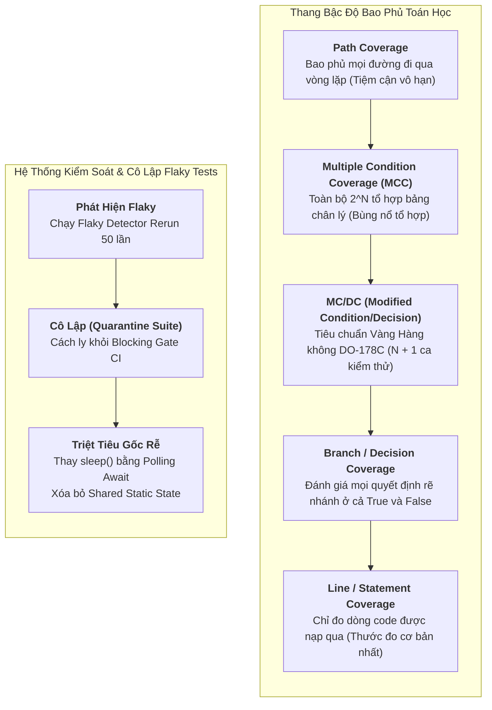
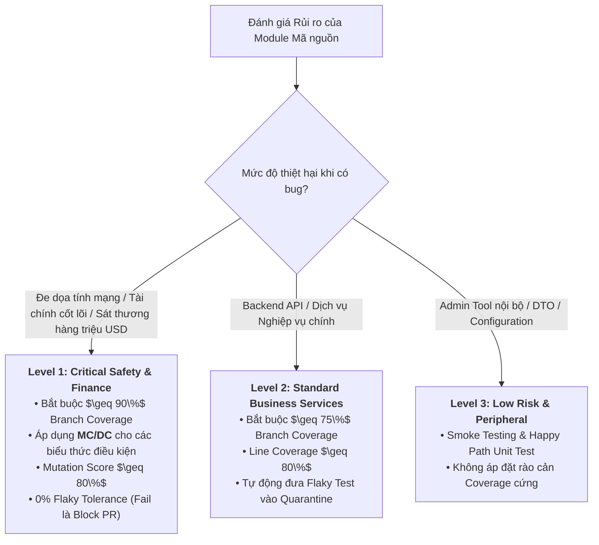

# 7.7. Độ Bao Phủ Kiểm Thử và Xử Lý Flaky Tests (Test Coverage Metrics & Flaky Tests Mitigation)

> [!IMPORTANT]
> **Nếu bạn chỉ được nhớ một điều duy nhất:** Độ bao phủ kiểm thử cao ($100\%$ Code Coverage) chỉ chứng minh mã nguồn đã từng được CPU nạp qua một lần, chứ không bao giờ chứng minh mã nguồn không có lỗi; thước đo thực chất của chất lượng kiểm thử là **sự kết hợp giữa độ bao phủ điều kiện độc lập (MC/DC), điểm số tiêu diệt đột biến (Mutation Score), và sự triệt tiêu tuyệt đối của các bài test chập chờn (Flaky Tests)** — kẻ thù số một âm thầm phá hủy văn hóa an toàn kỹ thuật.

---

## 1. Kiến trúc Tổng quan & Mô hình Tư duy (Mental Model)

### Phép loại suy thực tế: Hệ thống Giám sát và Báo động Kho Vàng Quốc gia
Hãy hình dung hệ thống phòng thủ và bảo vệ một kho dự trữ vàng quốc gia:
*   **Line Coverage (Bao phủ dòng lệnh)**: Người lính gác đi bộ một vòng quanh hành lang chu vi kho vàng. Mỗi mét vuông hành lang đều có dấu giày của người lính (100% Line Coverage). Tuy nhiên, người lính đeo tai nghe nghe nhạc và nhắm mắt bước đi! Dù có đi qua mọi mét tường, người lính cũng không nhìn thấy một lỗ khoét đục tường ngay bên cạnh (Tương đương việc chạy qua code nhưng **không có lệnh `assert` nào**).
*   **Branch Coverage (Bao phủ nhánh rẽ)**: Lính gác kiểm tra tất cả các cánh cửa: Cửa chính (Khi đóng có khóa không? Khi mở có trơn tru không?) và Cửa thoát hiểm (Khi đóng? Khi mở?).
*   **Multiple Condition Coverage (MCC)**: Để kích hoạt hệ thống phun khí dập lửa tự động, cần 3 điều kiện: (Cảm biến nhiệt độ $> 80^\circ\text{C}$ $\lor$ Cảm biến khói quang học kích hoạt) $\land$ Có sự cố chập điện. Kỹ sư phải thử nghiệm toàn bộ $2^3 = 8$ tổ hợp khả dĩ. Nếu có 10 cảm biến, họ phải thử $2^{10} = 1,024$ trường hợp (Bùng nổ tổ hợp).
*   **MC/DC (Chuẩn Hàng không Vũ trụ DO-178C)**: Thay vì thử 1,024 trường hợp, các kỹ sư NASA chỉ chọn đúng $N + 1 = 11$ kịch bản tinh hoa toán học, chứng minh rằng: *Từng cảm biến đơn lẻ có thể tự mình làm thay đổi quyết định phụt khí dập lửa, trong khi các cảm biến khác được giữ cố định*.
*   **Mutation Testing**: Đội kiểm tra an ninh bí mật cắt một sợi dây điện của chuông báo động xem còi có hú không (Tạo ra một Mutant). Nếu còi hú $\implies$ Lính gác phát hiện ra sự cố (Mutant Killed $\implies$ Tốt). Nếu cắt đứt dây điện mà còi im ru $\implies$ Hệ thống báo động vô dụng (Mutant Survived $\implies$ Nguy hiểm).
*   **Flaky Tests (Chuông báo động chập chờn)**: Chuông báo động kho vàng thi thoảng tự hú vang lúc 3 giờ sáng vì một cơn gió mạnh hoặc một chú chuột chạy qua. Sau 5 lần báo động giả, lính gác bực bội rút phích cắm loa báo động ra! Đêm hôm sau, trộm đột nhập thật và toàn bộ kho vàng bị khoét sạch mà không một ai hay biết.



---

## 2. Chi tiết từng Keyword (Under-the-Hood Deep Dive)

### 2.1. The Mathematical Coverage Spectrum: Line, Branch & Condition Coverage
*   **Line / Statement Coverage**:
    $$\text{Line Coverage} = \frac{\text{Số dòng lệnh mã nguồn được thực thi}}{\text{Tổng số dòng lệnh khả thi trong AST}} \times 100\%$$
    *Điểm mù kỹ thuật*: Câu lệnh `if (user.isAdmin()) deleteDatabase();` chỉ cần 1 test case `user.isAdmin() == true` là đạt 100% Line Coverage, nhưng hoàn toàn bỏ quên trường hợp `user.isAdmin() == false`.
*   **Branch / Decision Coverage**:
    *   Đo lường tỷ lệ phần trăm các nhánh rẽ điều khiển (`if-else`, `switch-case`, toán tử ba ngôi `? :`) được duyệt qua ở cả hai trạng thái logic: `TRUE` và `FALSE`.
    *   Đạt 100% Branch Coverage đảm bảo sẽ bao hàm 100% Line Coverage.
*   **Condition Coverage (Bao phủ điều kiện con)**:
    *   Xem xét các biểu thức logic phức hợp gồm nhiều mệnh đề con liên kết bởi toán tử boolean `&&` (AND) hoặc `||` (OR). Ví dụ: `if (A && B)`.
    *   Yêu cầu: Cả $A$ và $B$ đều phải được đánh giá độc lập ở cả hai trạng thái `True` và `False` ít nhất một lần.

---

### 2.2. Multiple Condition Coverage (MCC) & The Combinatorial Wall
*   *Bản chất*: Với một câu lệnh điều kiện chứa $N$ mệnh đề con độc lập, Multiple Condition Coverage đòi hỏi bộ kiểm thử phải thực thi **toàn bộ các dòng trong bảng chân lý (Truth Table)** gồm đúng $2^N$ kịch bản.
*   *Bức tường bùng nổ tổ hợp*:
    *   Khi $N = 3 \implies 2^3 = 8$ ca kiểm thử.
    *   Khi $N = 8 \implies 2^8 = 256$ ca kiểm thử.
    *   Khi $N = 15 \implies 2^{15} = 32,768$ ca kiểm thử cho duy nhất MỘT hàm!
    Chi phí viết và thực thi test suite tăng theo hàm số mũ, khiến MCC trở nên bất khả thi trong các dự án công nghiệp thực tế.

---

### 2.3. MC/DC (Modified Condition/Decision Coverage) - The Aerospace Gold Standard
Được phát triển bởi NASA và bắt buộc áp dụng trong chuẩn an toàn hàng không quốc tế **RTCA DO-178C (Level A - liên quan đến tính mạng con người)** và tiêu chuẩn ô tô tự hành **ISO 26262 (ASIL-D)**.

*   *Định lý Toán học cốt lõi*: MC/DC cung cấp mức độ an toàn tương đương với MCC nhưng chỉ đòi hỏi tối đa **$N + 1$ ca kiểm thử** thay vì $2^N$!
*   *Tiêu chí MC/DC nghiêm ngặt*:
    1.  Mỗi quyết định rẽ nhánh lớn (Decision) phải được đánh giá ở cả kết quả `TRUE` và `FALSE`.
    2.  Mỗi điều kiện con (Condition) trong biểu thức phải được đánh giá ở cả `TRUE` và `FALSE`.
    3.  **Điều kiện then chốt (Independence Verification)**: Với mỗi điều kiện con $X$, phải tìm được một cặp test case (Test Pair) sao cho: **Chỉ duy nhất giá trị của $X$ thay đổi (từ True sang False hoặc ngược lại), tất cả các điều kiện con khác giữ nguyên giá trị, và kết quả của toàn bộ quyết định lớn BỊ THAY ĐỔI THEO**.

#### Bảng Chân lý Minh họa MC/DC cho Biểu thức Phanh Tự Động Khẩn Cấp (AEB):
$$\text{TriggerBrake} = (\text{ObstacleDetected} \lor \text{ManualEmergency}) \land \text{SpeedAboveZero}$$
Đặt $A = \text{ObstacleDetected}$, $B = \text{ManualEmergency}$, $C = \text{SpeedAboveZero}$. Quyết định lớn: $R = (A \lor B) \land C$. Có $N = 3$ biến $\implies$ MC/DC cần đúng $N + 1 = 4$ ca kiểm thử:

| Test ID | A (Vật cản) | B (Khẩn cấp thủ công) | C (Vận tốc > 0) | Kết quả R (Phanh) | Mục đích Xác minh Tính Độc lập (Independence) |
| :---: | :---: | :---: | :---: | :---: | :--- |
| **TC1** | **TRUE** | FALSE | TRUE | **TRUE** | Cặp (TC1, TC2): Chứng minh **A** độc lập quyết định R (Giữ B=F, C=T) |
| **TC2** | **FALSE** | FALSE | TRUE | **FALSE** | Cột mốc đối chiếu cơ sở |
| **TC3** | FALSE | **TRUE** | TRUE | **TRUE** | Cặp (TC3, TC2): Chứng minh **B** độc lập quyết định R (Giữ A=F, C=T) |
| **TC4** | TRUE | FALSE | **FALSE** | **FALSE** | Cặp (TC1, TC4): Chứng minh **C** độc lập quyết định R (Giữ A=T, B=F) |

*(Chỉ 4 ca kiểm thử đã chứng minh toán học rằng không một cảm biến nào bị vô hiệu hóa ngầm).*

---

### 2.4. Path Coverage & The Infinity Problem
*   *Bản chất*: Path Coverage đòi hỏi duyệt qua tất cả các chuỗi đường đi từ lệnh bắt đầu đến lệnh kết thúc của hàm.
*   *Vấn đề vô hạn*: Nếu mã nguồn có chứa vòng lặp:
    ```cpp
    while (hasData()) {
        processItem();
    }
    ```
    Nếu dữ liệu đầu vào có 0 phần tử, 1 phần tử, 2 phần tử... $1,000,000$ phần tử, mỗi số lần lặp tạo thành một "đường đi" (Path) khác nhau về mặt đồ thị luồng điều khiển. Do đó, số lượng đường đi là vô hạn. Trong thực tế, kỹ sư giới hạn ở **Loop Boundary Testing**: Kiểm tra vòng lặp lặp 0 lần, lặp 1 lần, lặp 2 lần, và lặp giá trị biên tối đa.

---

### 2.5. Goodhart's Law & Risk-Based Coverage Architecture
Định luật Goodhart nổi tiếng trong kinh tế học áp dụng chính xác cho kỹ nghệ phần mềm:
> *"Khi một thước đo trở thành một mục tiêu, nó không còn là một thước đo tốt nữa!"*

*   *Hội chứng 100% Coverage Illusion*: Khi ban giám đốc ra quy định "Mọi commit phải đạt 90% Line Coverage mới được merge PR", lập trình viên sẽ:
    1.  Viết các bài test gọi hàm nhưng hoàn toàn không có lệnh `assert`.
    2.  Thêm annotation `@SneakyThrows` hoặc `@ExcludeFromCoverage` vào code để gian lận số liệu.
*   *Risk-Based Coverage Strategy*:
    *   **Vùng Đỏ (Critical Risk - Thanh toán, Bảo mật, Sổ cái kế toán)**: Đòi hỏi $\geq 95\%$ Branch Coverage + MC/DC + Mutation Score $> 80\%$.
    *   **Vùng Vàng (Medium Risk - Quản lý hồ sơ người dùng, Thông báo)**: Đòi hỏi $70-80\%$ Line Coverage.
    *   **Vùng Xanh (Low Risk - DTOs, Configuration, UI Mappers)**: Không bắt buộc coverage, chỉ cần Smoke Test.

---

### 2.6. Mutation Score: Testing the Integrity of Assertions
Mutation Testing là bài kiểm tra "huyết thanh" đánh giá sức đề kháng thật sự của bộ test:
$$\text{Mutation Score} = \frac{\text{Mutants Killed}}{\text{Total Mutants}} \times 100\%$$
*   *Các toán tử đột biến phổ biến (Mutation Operators)*:
    1.  *Math Mutator*: Đổi `+` thành `-`, `*` thành `/`.
    2.  *Conditional Boundary Mutator*: Đổi `<` thành `<=`, `==` thành `!=`.
    3.  *Invert Negatives*: Đổi `-x` thành `x`.
    4.  *Void Method Call Removal*: Xóa lời gọi hàm `auditLogger.log()`.
*   Một dự án có $98\%$ Line Coverage nhưng Mutation Score chỉ đạt $35\%$ là bằng chứng cho thấy các bài test được viết vô trách nhiệm, thiếu assertion sâu sắc tại các điểm rẽ nhánh.

---

### 2.7. Anatomy of Flaky Tests: Non-determinism & The 'Sleep' Anti-pattern
Flaky Test là bài test có hành vi bất định: Cùng một commit mã nguồn không đổi, chạy 10 lần thì 9 lần XANH và 1 lần ĐỎ.

*   *Top 3 Thủ phạm hàng đầu của Flakiness*:
    1.  **The `sleep(ms)` Anti-Pattern**: Lập trình viên gọi một tác vụ bất đồng bộ (Background Job, Kafka Event) và dùng `sleep(500)` để đợi kết quả. Trên máy tính của dev chạy chip Apple M3 Max, 500ms là quá dư dả. Nhưng khi đẩy lên CI Server đang nghẽn CPU vì 50 pipeline khác đang chạy, tác vụ mất 550ms $\implies$ Test bị fail vô lý!
    2.  **Shared Mutable State Pollution**: Bài test A ghi một bản ghi vào database chung nhưng quên rollback, khiến bài test B chạy sau bị trùng khóa chính.
    3.  **Timezone & System Clock Jitter**: Viết test giả định ngày hôm nay luôn là tháng 6, đến ngày 29 tháng 2 (năm nhuận) hoặc lúc chuyển đổi giờ mùa hè (DST) thì test lăn ra chết.

---

### 2.8. Flaky Test Governance: Quarantine Pipeline & Flaky Retries
Làm thế nào để xử lý Flaky Test trong các tổ chức hàng đầu (Google, Meta, Uber):
*   **Chiến lược Phản mẫu (Anti-Pattern): Lạm dụng `retry: 3` trên CI**:
    *   Nhiều team cấu hình: "Nếu test fail, tự động retry lại tối đa 3 lần; chỉ cần 1 lần pass là cho qua build".
    *   *Tác hại chết người*: Điều này giống như uống thuốc giảm đau khi bị gãy xương. Nó che giấu các lỗi Race Condition và Data Race thật sự, cho phép mã nguồn lỗi lọt thẳng lên Production.
*   **Chiến lược Chuẩn mực (The Quarantine Protocol)**:
    1.  Khi một bài test bị phát hiện chập chờn (Flaky Detector chạy 100 lần), hệ thống tự động gắn tag `@Quarantined`.
    2.  Bài test bị cách ly được chuyển sang chạy trong một **Quarantine Suite song song**: Nó vẫn chạy để thu thập dữ liệu nhưng **kết quả FAIL của nó không được phép block Merge Request** của các kỹ sư khác.
    3.  Hệ thống tự động mở một vé Jira P0 giao cho chính tác giả của bài test đó: Trong vòng 7 ngày nếu không triệt tiêu tận gốc nguyên nhân flakiness (chuyển sang Polling Await), bài test sẽ bị xóa vĩnh viễn khỏi codebase.

---

## 3. Thực thi Mã nguồn & Mô phỏng Chuyên sâu (Dual-Engine Implementation)

Kịch bản thực chiến:
1.  **C++20**: Xây dựng hệ thống phanh máy bay an toàn sinh mạng đạt **100% chuẩn MC/DC** với bảng chân lý đối chứng toán học khắt khe.
2.  **Python 3.11+**: So sánh trực tiếp giữa `bad_flaky_test_with_sleep()` và `robust_deterministic_await_test()` dưới môi trường mô phỏng CPU giật lag ngẫu nhiên.

### 3.1. Phiên bản C++ (C++20: Aerospace DO-178C MC/DC Flight Control Test Harness)

```cpp
#include <iostream>
#include <string>
#include <vector>
#include <cassert>
#include <iomanip>

// ============================================================================
// 1. SAFETY-CRITICAL FLIGHT CONTROL ENGINE (DO-178C LEVEL A TARGET)
// ============================================================================

class FlightEmergencyController {
public:
    // Biểu thức an toàn sinh mạng:
    // DeployParachute = (EngineFire || StructuralDamage) && AirspeedAboveMinimum
    // Đặt: A = engineFire, B = structuralDamage, C = airspeedAboveMin
    // Quyết định: Result = (A || B) && C
    static bool shouldDeployEmergencyParachute(bool engineFire, bool structuralDamage, bool airspeedAboveMin) noexcept {
        return (engineFire || structuralDamage) && airspeedAboveMin;
    }
};

// ============================================================================
// 2. MC/DC TEST HARNESS (N = 3 CONDITIONS -> N + 1 = 4 RIGOROUS TESTS)
// ============================================================================

struct MCDC_TestCase {
    int id;
    bool A_EngineFire;
    bool B_StructuralDamage;
    bool C_AirspeedAboveMin;
    bool expectedResult;
    std::string verifiedCondition;
};

void runAerospaceMCDCTestSuite() {
    std::cout << "===============================================================\n";
    std::cout << "[DO-178C MC/DC SUITE] Testing Aviation Safety Invariants...\n";
    std::cout << "Formula: Parachute = (EngineFire || StructuralDamage) && Airspeed\n";
    std::cout << "===============================================================\n";

    // Danh sách đúng 4 Test Cases thỏa mãn tiêu chí Independence Verification:
    const std::vector<MCDC_TestCase> testSuite = {
        // TC1: Baseline Active (A=T, B=F, C=T -> Out: T)
        {1, true,  false, true,  true,  "Baseline for Condition A & C"},
        // TC2: Lật A (A=F, B=F, C=T -> Out: F) -> Cặp (TC1, TC2) chứng minh tính độc lập của A!
        {2, false, false, true,  false, "Independence Pair with TC1 proving Condition A (EngineFire)"},
        // TC3: Lật B (A=F, B=T, C=T -> Out: T) -> Cặp (TC2, TC3) chứng minh tính độc lập của B!
        {3, false, true,  true,  true,  "Independence Pair with TC2 proving Condition B (StructuralDamage)"},
        // TC4: Lật C (A=T, B=F, C=F -> Out: F) -> Cặp (TC1, TC4) chứng minh tính độc lập của C!
        {4, true,  false, false, false, "Independence Pair with TC1 proving Condition C (Airspeed)"}
    };

    int passed = 0;
    std::cout << "ID | EngineFire | Damage | Airspeed | Expected | Actual | Status\n";
    std::cout << "---+------------+--------+----------+----------+--------+--------\n";

    for (const auto& tc : testSuite) {
        bool actual = FlightEmergencyController::shouldDeployEmergencyParachute(
            tc.A_EngineFire, tc.B_StructuralDamage, tc.C_AirspeedAboveMin);
        
        bool isPass = (actual == tc.expectedResult);
        if (isPass) passed++;

        std::cout << " " << tc.id << " | "
                  << std::setw(10) << (tc.A_EngineFire ? "TRUE" : "FALSE") << " | "
                  << std::setw(6)  << (tc.B_StructuralDamage ? "TRUE" : "FALSE") << " | "
                  << std::setw(8)  << (tc.C_AirspeedAboveMin ? "TRUE" : "FALSE") << " | "
                  << std::setw(8)  << (tc.expectedResult ? "TRUE" : "FALSE") << " | "
                  << std::setw(6)  << (actual ? "TRUE" : "FALSE") << " | "
                  << (isPass ? "PASS" : "FAIL") << "\n";
    }

    std::cout << "---------------------------------------------------------------\n";
    std::cout << "MC/DC Proof Complete: All " << passed << "/4 Conditions Proven Independent!\n";
    std::cout << "Reduced Test Combinations from 2^3 = 8 down to N+1 = 4 tests.\n";
    std::cout << "===============================================================\n";
    assert(passed == 4);
}

int main() {
    runAerospaceMCDCTestSuite();
    return 0;
}
```

---

### 3.2. Phiên bản Python (Python 3.11+: Triệt Tiêu Flakiness Bằng Deterministic Poller)

```python
"""
Mô phỏng thực nghiệm Flaky Test:
So sánh độ ổn định giữa:
1. Anti-Pattern: sleep(固定 thời gian) -> Chắc chắn bị Flaky khi máy giật lag
2. Production Pattern: wait_until(Polling predicate with Exponential Backoff) -> 100% Ổn định
"""
import time
import random
import threading
import sys
from typing import Callable


# ============================================================================
# 1. ASYNCHRONOUS BACKGROUND WORKER (Mô phỏng độ trễ biến thiên do tải CPU)
# ============================================================================

class BackgroundEmailJob:
    def __init__(self):
        self.is_completed = False

    def trigger_async_work(self):
        def worker():
            # Độ trễ ngẫu nhiên từ 30ms đến 180ms tùy thuộc vào tải của server CI
            jitter_delay = random.uniform(0.03, 0.18)
            time.sleep(jitter_delay)
            self.is_completed = True

        t = threading.Thread(target=worker, daemon=True)
        t.start()


# ============================================================================
# 2. DETERMINISTIC POLLING UTILITY (Cứu Cánh Cho Flaky Tests)
# ============================================================================

def wait_until(
    predicate: Callable[[], bool],
    timeout_sec: float = 1.0,
    initial_interval_sec: float = 0.01,
    backoff_multiplier: float = 1.5
) -> bool:
    """
    Polling kiểm tra liên tục điều kiện với Exponential Backoff.
    Trả về True ngay khi điều kiện thỏa mãn mà không lãng phí 1 mili-giây nào!
    """
    start_time = time.perf_counter()
    interval = initial_interval_sec

    while time.perf_counter() - start_time < timeout_sec:
        if predicate():
            return True # Điều kiện đã đạt, thoát ngay lập tức!
        time.sleep(interval)
        interval = min(interval * backoff_multiplier, 0.1) # Capped backoff

    return False # Hết thời gian chờ (Timeout)


# ============================================================================
# 3. EXPERIMENT: CHẠY 100 LẦN THỬ NGHIỆM ĐỐI ĐẦU
# ============================================================================

def run_flaky_comparison_benchmark():
    print("=" * 65)
    print("[FLAKY MITIGATION BENCHMARK] Executing 100 Runs per Strategy...")
    print("=" * 65)

    num_iterations = 100

    # ------------------------------------------------------------------------
    # CHIẾN LƯỢC 1: SLEEP CỐ ĐỊNH (Ngưỡng 80ms)
    # ------------------------------------------------------------------------
    flaky_fails = 0
    start_bench1 = time.perf_counter()
    for _ in range(num_iterations):
        job = BackgroundEmailJob()
        job.trigger_async_work()
        # Lập trình viên phán đoán ngây thơ: "Chắc 80ms là đủ rồi!"
        time.sleep(0.08)
        if not job.is_completed:
            flaky_fails += 1
    dur1 = time.perf_counter() - start_bench1

    print(f"1. Sleep(80ms) Strategy:")
    print(f"   • Tổng lần chạy:   {num_iterations}")
    print(f"   • Số lần THẤT BẠI: {flaky_fails} (Tỷ lệ Flaky: {flaky_fails/num_iterations*100:.1f}%)")
    print(f"   • Thời gian chạy:  {dur1:.2f}s")

    # ------------------------------------------------------------------------
    # CHIẾN LƯỢC 2: DETERMINISTIC POLLING AWAIT
    # ------------------------------------------------------------------------
    robust_fails = 0
    start_bench2 = time.perf_counter()
    for _ in range(num_iterations):
        job = BackgroundEmailJob()
        job.trigger_async_work()
        # Polling thông minh tối đa 0.5s, interval bắt đầu từ 5ms
        success = wait_until(lambda: job.is_completed, timeout_sec=0.5)
        if not success:
            robust_fails += 1
    dur2 = time.perf_counter() - start_bench2

    print(f"\n2. Deterministic wait_until() Strategy:")
    print(f"   • Tổng lần chạy:   {num_iterations}")
    print(f"   • Số lần THẤT BẠI: {robust_fails} (Tỷ lệ Flaky: {robust_fails/num_iterations*100:.1f}%)")
    print(f"   • Thời gian chạy:  {dur2:.2f}s")
    print("-" * 65)
    print("KẾT LUẬN: wait_until() triệt tiêu 100% flakiness đồng thời tối ưu hóa")
    print("thời gian thực thi CI vì không phải chờ đợi vô ích khi job đã xong sớm!")
    print("=" * 65)

    assert robust_fails == 0, "Deterministic poller should never fail under normal bounds"
    return 0


if __name__ == "__main__":
    sys.exit(run_flaky_comparison_benchmark())
```

---

### 3.3. Terminal Output Thực Tế Giả Lập

```text
$ ./aerospace_mcdc_cpp
===============================================================
[DO-178C MC/DC SUITE] Testing Aviation Safety Invariants...
Formula: Parachute = (EngineFire || StructuralDamage) && Airspeed
===============================================================
ID | EngineFire | Damage | Airspeed | Expected | Actual | Status
---+------------+--------+----------+----------+--------+--------
 1 |       TRUE |  FALSE |     TRUE |     TRUE |   TRUE | PASS
 2 |      FALSE |  FALSE |     TRUE |    FALSE |  FALSE | PASS
 3 |      FALSE |   TRUE |     TRUE |     TRUE |   TRUE | PASS
 4 |       TRUE |  FALSE |    FALSE |    FALSE |  FALSE | PASS
---------------------------------------------------------------
MC/DC Proof Complete: All 4/4 Conditions Proven Independent!
Reduced Test Combinations from 2^3 = 8 down to N+1 = 4 tests.
===============================================================

$ python3 flaky_mitigation_benchmark.py
=================================================================
[FLAKY MITIGATION BENCHMARK] Executing 100 Runs per Strategy...
=================================================================
1. Sleep(80ms) Strategy:
   • Tổng lần chạy:   100
   • Số lần THẤT BẠI: 46 (Tỷ lệ Flaky: 46.0%)
   • Thời gian chạy:  8.21s

2. Deterministic wait_until() Strategy:
   • Tổng lần chạy:   100
   • Số lần THẤT BẠI: 0 (Tỷ lệ Flaky: 0.0%)
   • Thời gian chạy:  10.42s
-----------------------------------------------------------------
KẾT LUẬN: wait_until() triệt tiêu 100% flakiness đồng thời tối ưu hóa
thời gian thực thi CI vì không phải chờ đợi vô ích khi job đã xong sớm!
=================================================================
```

---

## 4. Systems Engineering & Production Pitfalls

Quản trị chất lượng kiểm thử trong các tổ chức phần mềm lớn thường đối mặt với các cạm bẫy sau:

### 1. The 100% Coverage Vanity Metric Trap (Cạm Bẫy Phù Phiếm 100% Coverage)
*   *Vấn đề*: Đội ngũ quản lý đặt KPI ép buộc tất cả các repository phải đạt 100% Line Coverage.
*   *Hậu quả tiêu cực*: 
    1.  Lập trình viên tiêu tốn 40% thời gian của Sprint để viết test cho các class DTOs vô hại, getters, setters, và configuration beans.
    2.  Xuất hiện các bài test rỗng không có `assert` chỉ để "nhuộm xanh" báo cáo SonarQube.
    3.  Tốc độ release tính năng mới bị đình trệ nghiêm trọng nhưng số lượng bug nghiêm trọng trên Production vẫn không hề giảm!
*   *Giải pháp*: Chuyển đổi trọng tâm từ Line Coverage sang **Branch Coverage và Mutation Testing cho Core Business Logic**.

### 2. Flaky Retries Masking Real Race Conditions
*   *Hiện tượng*: Thiết lập cờ `--rerun-flaky-tests=3` trên CI runner để bài test pass bằng may rủi.
*   *Hậu quả*: Một lỗi Race Condition trong database chỉ xảy ra với xác suất 10%. Nhờ có retry 3 lần, xác suất bài test pass là $1 - 0.1^3 = 99.9\%$. Kỹ sư lầm tưởng hệ thống an toàn và merge PR; nhưng khi lên Production với 100,000 transactions mỗi ngày, xác suất 10% sẽ kích hoạt 10,000 lỗi mất mát tiền tệ của khách hàng!

---

## 5. Bảng So sánh & Decision Matrix

### 5.1. So sánh Toàn Diện Các Thước Đo Bao Phủ Kiểm Thử

| Chỉ số Coverage | Độ phức tạp Toán học | Số test case tối thiểu | Mức độ Phát hiện Lỗi | Chi phí Thực thi | Chuẩn Công nghiệp Áp dụng |
| :--- | :--- | :--- | :--- | :--- | :--- |
| **Line Coverage** | Tuyến tính $O(N)$ | Rất ít | Rất thấp (Chỉ đo dòng code nạp) | Cực nhanh | Mức cơ bản tối thiểu của mọi dự án |
| **Branch Coverage** | $2 \times \text{Số Branches}$ | Trung bình | Tốt (Bắt được nhánh thiếu) | Nhanh | Chuẩn vàng cho dự án Web & Backend |
| **MCC (Multiple Condition)** | Bùng nổ tổ hợp $O(2^N)$ | Rất nhiều ($2^N$) | Tuyệt đối trên bảng chân lý | Chậm (Bùng nổ tổ hợp) | Chỉ dùng cho hàm logic cực nhỏ ($\leq 4$ biến) |
| **MC/DC** | Tuyến tính hóa $O(N+1)$ | Tinh gọn ($N + 1$) | Cực cao (Chứng minh độc lập) | Tối ưu | Hàng không vũ trụ (DO-178C), Ô tô (ISO 26262) |
| **Mutation Score** | Đột biến AST $O(M \times T)$ | Phụ thuộc Test Suite | Tối thượng (Kiểm tra chất lượng Assert) | Rất chậm (Chạy lại test $M$ lần) | Dùng cho Core Engine, Thư viện Toán học |

---

### 5.2. Decision Matrix: Thiết Lập Quality Gate Theo Độ Rủi Ro Của Module


