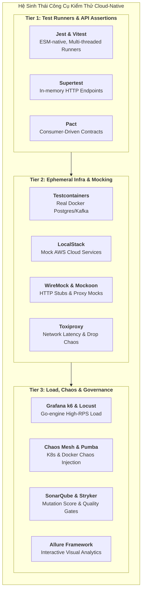
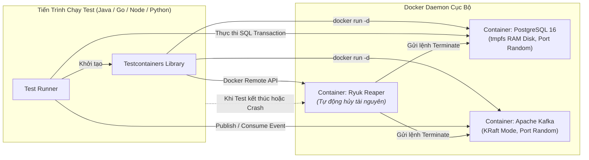
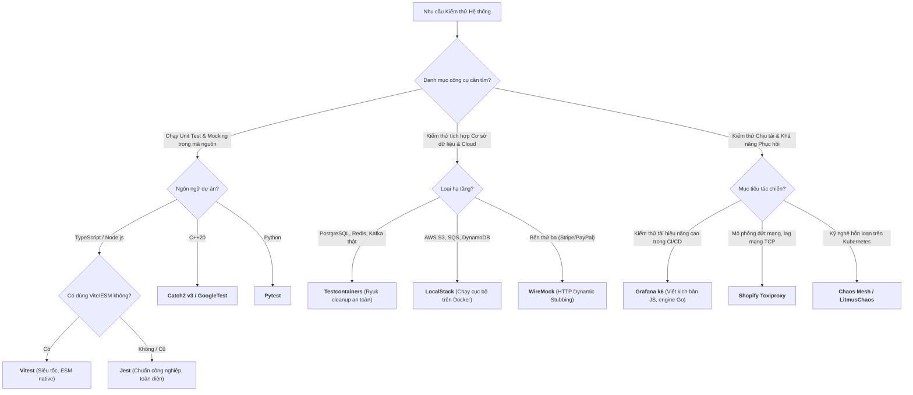

# 7.8. Hệ Sinh Thái Công Cụ Kiểm Thử Hiện Đại (Modern Testing Tools Ecosystem)

> [!IMPORTANT]
> **Nếu bạn chỉ được nhớ một điều duy nhất:** Một bộ công cụ kiểm thử hiện đại không dừng lại ở việc chạy Unit Test trên máy lập trình viên, mà là một **hạ tầng kỹ thuật đa tầng (Multi-tier Testing Infrastructure)** — kết hợp giữa bộ chạy kiểm thử siêu tốc (Vitest/Jest), hạ tầng tạm thời chân thực (Testcontainers/LocalStack), mô phỏng suy thoái mạng (Toxiproxy), máy phát tải thông lượng cao (k6), và tiêm lỗi hỗn loạn (Chaos Mesh) để tạo ra độ tin cậy tuyệt đối trước khi release lên Cloud.

---

## 1. Kiến trúc Tổng quan & Mô hình Tư duy (Mental Model)

### Phép loại suy thực tế: Trung tâm Huấn luyện Tác chiến Không quân Tiêm kích Siêu thanh
Hãy hình dung hệ sinh thái công cụ kiểm thử tương đương với toàn bộ tổ hợp huấn luyện phi công tiêm kích thế hệ 5:
*   **Test Runners (Jest, Vitest, Mocha)**: Đường băng cất cánh và hệ thống đồng hồ đo tốc độ phản xạ của phi công: Kiểm tra xem phi công có hoàn thành quy trình khởi động động cơ phản lực trong vòng 3 giây hay không.
*   **Ephemeral Infrastructure (Testcontainers, LocalStack)**: Buồng lái mô phỏng không gian 3D toàn cảnh (Full-motion Flight Simulator). Buồng lái có đầy đủ đồng hồ, cần lái, thủy lực rung lắc, và màn hình cong 360 độ giống 100% chiếc máy bay thật. Phi công có thể tập bắn tên lửa và bay vào tâm bão mà không cần tiêu tốn hàng nghìn lít dầu phản lực hay làm hỏng máy bay đắt tiền (tương tự như test với Docker PostgreSQL thật thay vì thuê máy chủ AWS).
*   **WireMock & Mockoon**: Các máy bay mục tiêu giả lập phát ra tín hiệu sóng radar đối phương để phi công luyện tập radar khóa mục tiêu.
*   **Toxiproxy**: Thiết bị gây nhiễu điện tử (Electronic Jammer) cố tình bóp méo đường truyền vô tuyến, tạo độ trễ âm thanh hoặc làm đứt tín hiệu định vị GPS để thử thách khả năng định hướng của phi công.
*   **Load Generators (k6, Locust)**: Bầy máy bay không người lái (UAV) gồm 1,000 chiếc đồng loạt xuất kích kiểm tra xem hệ thống radar phòng không có bị quá tải bộ vi xử lý hay không.
*   **Chaos Mesh & Pumba**: Kịch bản bất ngờ cắt nguồn nhiên liệu của động cơ bên trái khi đang bay ở độ cao 10,000 mét để kiểm tra xem hệ thống lái tự động có giữ thăng bằng được hay rơi tự do.
*   **Stryker & SonarQube**: Thanh tra quân đội kiểm tra từng khẩu súng và viên đạn xem có nguy cơ kẹt nòng không (Mutation Testing & Quality Gate).
*   **Allure Framework**: Phòng họp sau chuyến bay chiếu lại video ghi hình độ phân giải cao từng thao tác của phi công để phân tích rút kinh nghiệm.



---

## 2. Chi tiết từng Keyword (Under-the-Hood Deep Dive)

### 2.1. Next-Gen Test Runners: Jest vs Vitest vs Mocha
*   **Jest (Meta)**:
    *   *Bản chất*: Bộ khung kiểm thử toàn diện "Batteries-Included" tiêu chuẩn công nghiệp trong hệ sinh thái Node.js. Tích hợp sẵn Runner, Expect matchers, Mocking engine và Istanbul coverage.
    *   *Điểm nghẽn*: Chạy trên môi trường ảo hóa `jsdom` hoặc Node VM; khi dự án phình to hàng chục nghìn test, cơ chế biến dịch Babel/ts-jest trở nên rất chậm chạp và tiêu tốn nhiều RAM.
*   **Vitest (Vite-native)**:
    *   *Kiến trúc thế hệ mới*: Tận dụng hạ tầng biên dịch của Vite và ESBuild. Tương thích $100\%$ cú pháp API của Jest (`describe`, `it`, `expect`, `vi.mock()`).
    *   *Sức mạnh vượt trội*: Biên dịch mã nguồn On-Demand bằng Native ESM, chạy đa luồng thông qua Worker Threads (hoặc Tinypool). Tốc độ khởi động và thực thi nhanh hơn Jest từ $5\times$ đến $10\times$.
*   **Mocha**:
    *   *Bản chất*: Khung chạy test tối giản, linh hoạt bậc nhất. Không áp đặt thư viện assertion hay mock nào. Kỹ sư tự do kết hợp Mocha với **Chai** (Assertion Library) và **Sinon.js** (Spies/Stubs/Mocks).

---

### 2.2. In-Memory API Integration: Supertest & Pact (Contract Broker)
*   **Supertest**:
    *   *Bản chất*: Thư viện HTTP assertion cấp cao bọc lấy thư viện `superagent`.
    *   *Cơ chế tầng sâu*: Supertest cho phép bạn truyền trực tiếp đối tượng ứng dụng Express/Fastify/Koa vào (`supertest(app).get('/api/users')`). Nó **không bao giờ bind ứng dụng vào một cổng mạng TCP vật lý** (không chiếm port 8080 của máy). Thay vào đó, nó móc trực tiếp vào hàm nội bộ `app.handle(req, res)` của Node.js HTTP Server, giúp các bài kiểm thử API chạy nhanh như chớp và không bao giờ gặp lỗi xung đột port (`EADDRINUSE`).
*   **Pact (Consumer-Driven Contract Testing)**:
    *   *Hệ sinh thái*: Gồm Pact Client (viết test ở Consumer/Provider) và **Pact Broker** (Máy chủ lưu trữ và lập chỉ mục hợp đồng).
    *   *Quy trình hoạt động*: Consumer chạy test và tự động xuất file hợp đồng dạng JSON (`consumer-provider.pact.json`). Phía Provider lấy file này về và chạy kiểm thử nội bộ để xác nhận schema mà không cần Consumer phải online. Công cụ CLI `can-i-deploy` ngăn chặn các bản deploy gây xung đột schema lên production.

---

### 2.3. Ephemeral Infrastructure: Testcontainers & The Ryuk Reaper
Trong lịch sử, việc cài đặt database cục bộ cho môi trường CI luôn là cơn ác mộng (xung đột version, rò rỉ dữ liệu). **Testcontainers** là cuộc cách mạng đưa hạ tầng Docker thật vào mã kiểm thử:



*   *Cơ chế ngẫu nhiên hóa cổng (Random Port Mapping)*: Testcontainers tự động ánh xạ cổng mặc định của Postgres (`5432`) sang một cổng ngẫu nhiên trên host (ví dụ `32789`). Điều này cho phép chạy 20 test runner song song trên cùng 1 server CI mà không bao giờ bị trùng cổng.
*   *Thần hộ mệnh **Ryuk Reaper***: Một container đặc biệt mang tên Ryuk được Testcontainers khởi động đầu tiên. Ryuk kết nối socket với tiến trình test. Nếu tiến trình test bị crash đột ngột (hoặc developer bấm Stop trên IDE), Ryuk phát hiện mất kết nối socket và **ngay lập tức dọn sạch toàn bộ các container Docker mồ côi**, bảo đảm đĩa cứng không bao giờ bị phình to.

---

### 2.4. Cloud Simulation: LocalStack & Zero-Cost Cloud Testing
*   *Vấn đề*: Kiểm thử hệ thống Backend phụ thuộc nặng nề vào các dịch vụ đám mây của Amazon Web Services (AWS) như: Lưu trữ S3, Hàng đợi SQS, Bảng dữ liệu NoSQL DynamoDB, Kinesis Stream, AWS Lambda. Nếu kết nối lên AWS thật để test: Tốn kém chi phí, phụ thuộc vào đường truyền Internet, và làm ô nhiễm bucket sản xuất.
*   *LocalStack*:
    *   Chạy hoàn toàn cục bộ bên trong một Docker container duy nhất.
    *   Mô phỏng chính xác giao thức REST API và HTTP Headers của hơn 40 dịch vụ AWS.
    *   Cho phép lập trình viên chỉ định AWS SDK trỏ về LocalStack:
        `aws --endpoint-url=http://localhost:4566 s3 mb s3://test-bucket`
    *   Giúp chạy hàng nghìn bài kiểm thử Cloud Integration Test với chi phí $0 và tốc độ mili-giây.

---

### 2.5. HTTP Mock Servers: WireMock & Mockoon
Khi ứng dụng phụ thuộc vào các dịch vụ HTTP của bên thứ ba (Cổng thanh toán Stripe, PayPal, API tỷ giá hối đoái ngân hàng), việc gọi ra ngoài internet là tối kỵ trong kiểm thử tự động.
*   **WireMock**:
    *   Máy chủ HTTP Stubbing/Mocking mạnh mẽ bậc nhất thế giới.
    *   Hỗ trợ cấu hình bằng JSON hoặc Fluent Java/Go API.
    *   Khả năng nâng cao: So khớp request bằng Regex (Pattern matching), trả về response động dựa trên templating, mô phỏng lỗi trễ mạng (Network Delays), và State Machine (Mô phỏng Stateful Scenario: Gọi lần 1 trả về HTTP 429, gọi lần 2 trả về HTTP 200).
*   **Mockoon**: Công cụ giả lập API trực quan mã nguồn mở với giao diện desktop UI thân thiện, hỗ trợ tạo nhanh mock data bằng Faker.js và quy tắc định tuyến linh hoạt.

---

### 2.6. Network Fault Injection: Shopify's Toxiproxy
Toxiproxy là một TCP Proxy được viết bằng Go bởi các kỹ sư Shopify, được thiết kế chuyên biệt để **kiểm tra khả năng phục hồi của hệ thống khi đối mặt với sự cố mạng (Resilience Testing)**.
*   *Cách thức vận hành*: Toxiproxy đứng ở giữa ứng dụng và dịch vụ phụ thuộc (Database, Redis, Downstream Microservice).
*   *Các loại độc tính mạng (Toxics)* có thể tiêm vào runtime qua HTTP REST API:
    1.  `latency`: Bơm thêm $N$ mili-giây độ trễ kèm theo jitter ngẫu nhiên.
    2.  `bandwidth`: Giới hạn tốc độ tải xuống còn $X$ KB/s.
    3.  `slow_close`: Trì hoãn việc gửi gói tin TCP `FIN`, mô phỏng hiện tượng kết nối mạng bị treo lơ lửng.
    4.  `timeout`: Dừng truyền dữ liệu hoàn toàn để kích hoạt lỗi Timeout của client.
    5.  `reset_peer`: Gửi gói tin TCP `RST` để lập tức đóng đứt kết nối một cách tàn bạo.

---

### 2.7. High-Throughput Load Generators: k6 vs Locust vs Artillery
Đánh giá năng lực phát tải cực đại của các công cụ kiểm thử hiệu năng:

*   **k6 (Grafana k6)**:
    *   *Kiến trúc*: Được viết bằng **Go**, tối ưu hóa bộ nhớ và Goroutines để đạt thông lượng hàng chục nghìn RPS trên một máy đơn lẻ.
    *   *Ngôn ngữ kịch bản*: Viết bằng **JavaScript ES6**, rất thân thiện với các kỹ sư phần mềm.
    *   *Đặc sản*: Hỗ trợ định nghĩa **Thresholds** trực tiếp trong code; nếu phân vị độ trễ $p99 > 200\text{ms}$, k6 sẽ tự động trả về exit code 1 làm fail pipeline CI/CD ngay lập tức.
*   **Locust**:
    *   *Kiến trúc*: Được viết bằng **Python**. Cho phép viết kịch bản tải hoàn toàn bằng code Python thuần túy (Code-as-Load).
    *   *Giao diện*: Tích hợp sẵn Web UI trực quan, cho phép tăng giảm Virtual Users (Swarm) theo thời gian thực và theo dõi biểu đồ phân vị độ trễ mượt mà.
*   **Artillery**: Khung kiểm thử tải viết bằng Node.js, hỗ trợ mạnh mẽ kịch bản YAML và các giao thức Socket.io, WebSockets, gRPC.

---

### 2.8. Cloud-Native & Container Chaos: Chaos Mesh, LitmusChaos & Pumba
*   **Chaos Mesh & LitmusChaos (Kubernetes-Native)**:
    *   Được cài đặt trực tiếp vào cụm Kubernetes thông qua Helm Charts.
    *   Sử dụng Custom Resource Definitions (CRDs) để lập trình các kịch bản hỗn loạn:
        *   `PodChaos`: Giết pod ngẫu nhiên (PodKill) hoặc ép Pod vào trạng thái treo (PodFailure).
        *   `NetworkChaos`: Dùng Linux `tc` (Traffic Control) và `iptables` để làm trễ gói tin, làm sai thứ tự gói tin (Corrupt), hoặc chia cắt mạng giữa hai Namespace (Partition).
        *   `StressChaos`: Bơm tải CPU 100% hoặc ngốn cạn kiệt RAM node Kubernetes.
*   **Pumba**: Công cụ Chaos Testing gọn nhẹ dành riêng cho Docker Engine độc lập, cho phép tự động kill, pause, hoặc làm trễ mạng các container mà không cần cụm Kubernetes.

---

### 2.9. Mutation & Quality Gates: Stryker, SonarQube & Allure Framework
*   **Stryker**: Công cụ kiểm thử đột biến (Mutation Testing) hàng đầu cho hệ sinh thái JavaScript/TypeScript, C# và Scala. Tự động đột biến mã nguồn để tính toán **Mutation Score**, vạch trần các bài test vô nghĩa.
*   **SonarQube**: Nền tảng quản trị chất lượng toàn diện. Quét mã nguồn tĩnh (SAST), phân tích nợ kỹ thuật (Technical Debt), phát hiện các lỗ hổng bảo mật (Security Hotspots) và thiết lập các **Quality Gates** (ví dụ: Chặn merge nếu Coverage $< 80\%$ hoặc có bất kỳ lỗ hổng bảo mật mức Blocker nào).
*   **Allure Framework**: Khung báo cáo kiểm thử trực quan hóa cao cấp, hỗ trợ gom nhóm lỗi theo nguyên nhân, hiển thị biểu đồ lịch sử kiểm thử chập chờn (Flaky History) và đính kèm video, ảnh chụp màn hình khi test thất bại.

---

## 3. Thực thi Mã nguồn & Mô phỏng Chuyên sâu (Dual-Engine Implementation)

Kịch bản thực chiến: Xây dựng một **Network Fault Injection Proxy & k6-Style Performance Runner**:
1.  **C++20**: Xây dựng một Mini In-Memory Fault Injection Proxy (mô phỏng cơ chế cốt lõi của Shopify Toxiproxy) cho phép tiêm độ trễ mạng ngẫu nhiên và ngắt kết nối cưỡng chế.
2.  **Python 3.11+**: Xây dựng kịch bản kiểm thử tích hợp mô phỏng LocalStack & Testcontainers kết hợp với k6-style Threshold Assertion engine.

### 3.1. Phiên bản C++ (C++20: In-Memory Toxiproxy Fault Injector Simulator)

```cpp
#include <iostream>
#include <string>
#include <vector>
#include <memory>
#include <chrono>
#include <thread>
#include <random>
#include <functional>
#include <stdexcept>
#include <cassert>

// ============================================================================
// 1. IN-MEMORY TOXIPROXY FAULT INJECTOR ENGINE
// ============================================================================

enum class NetworkToxicType { NONE, LATENCY, PACKET_DROP, CONNECTION_RESET };

class NetworkToxicConfig {
public:
    NetworkToxicType type{NetworkToxicType::NONE};
    int latencyMs{0};
    double dropRate{0.0}; // 0.0 -> 1.0
};

class SimulatedTcpSocketProxy {
private:
    NetworkToxicConfig m_toxic;
    std::mt19937 m_rng{1337}; // Deterministic seed

public:
    void applyToxic(NetworkToxicConfig toxic) {
        m_toxic = toxic;
    }

    void resetToxics() {
        m_toxic = NetworkToxicConfig{};
    }

    // Mô phỏng truyền dữ liệu qua Proxy tới Upstream Server
    std::string transmit(const std::string& requestPayload, std::function<std::string(const std::string&)> upstreamHandler) {
        // 1. Kiểm tra Toxic: Connection Reset (Gói RST tàn bạo)
        if (m_toxic.type == NetworkToxicType::CONNECTION_RESET) {
            throw std::runtime_error("ECONNRESET: Connection violently severed by peer via TCP RST!");
        }

        // 2. Kiểm tra Toxic: Packet Drop
        if (m_toxic.type == NetworkToxicType::PACKET_DROP) {
            std::uniform_real_distribution<double> dist(0.0, 1.0);
            if (dist(m_rng) < m_toxic.dropRate) {
                throw std::runtime_error("ETIMEDOUT: TCP Packet dropped silently in transit!");
            }
        }

        // 3. Kiểm tra Toxic: Latency Injection
        if (m_toxic.type == NetworkToxicType::LATENCY && m_toxic.latencyMs > 0) {
            std::this_thread::sleep_for(std::chrono::milliseconds(m_toxic.latencyMs));
        }

        // Chuyển tiếp tới Upstream thật
        return upstreamHandler(requestPayload);
    }
};

// ============================================================================
// 2. BACKEND SERVICE & CLIENT INTEGRATION TEST
// ============================================================================

std::string mockDatabaseServer(const std::string& sql) {
    if (sql == "SELECT balance FROM users WHERE id = 1") {
        return "1000_USD";
    }
    return "UNKNOWN_QUERY";
}

void runToxiproxyResilienceTest() {
    std::cout << "===============================================================\n";
    std::cout << "[TOXIPROXY RESILIENCE HARNESS] Testing Backend Network Chaos...\n";
    std::cout << "===============================================================\n";

    SimulatedTcpSocketProxy proxy;

    // SCENARIO 1: Kết nối thông thường không có Toxic (Baseline)
    {
        auto t0 = std::chrono::high_resolution_clock::now();
        std::string res = proxy.transmit("SELECT balance FROM users WHERE id = 1", mockDatabaseServer);
        auto elapsed = std::chrono::duration_cast<std::chrono::microseconds>(
            std::chrono::high_resolution_clock::now() - t0).count();
        assert(res == "1000_USD");
        std::cout << "  [BASELINE PASS] Normal connection latency: " << elapsed << " us\n";
    }

    // SCENARIO 2: Tiêm độc tính mạng: Độ trễ 100ms (Latency Toxic)
    {
        std::cout << "\n  [CHAOS INJECTION] Applying 100ms Latency Toxic...\n";
        proxy.applyToxic({NetworkToxicType::LATENCY, 100, 0.0});

        auto t0 = std::chrono::high_resolution_clock::now();
        std::string res = proxy.transmit("SELECT balance FROM users WHERE id = 1", mockDatabaseServer);
        auto elapsedMs = std::chrono::duration_cast<std::chrono::milliseconds>(
            std::chrono::high_resolution_clock::now() - t0).count();
        
        assert(res == "1000_USD");
        assert(elapsedMs >= 95 && "Latency must be delayed by at least ~100ms");
        std::cout << "  [LATENCY TEST PASS] Query completed through toxic proxy in " << elapsedMs << " ms\n";
    }

    // SCENARIO 3: Tiêm độc tính mạng: Ngắt đứt kết nối (Connection Reset Toxic)
    {
        std::cout << "\n  [CHAOS INJECTION] Applying TCP RST Severance Toxic...\n";
        proxy.applyToxic({NetworkToxicType::CONNECTION_RESET, 0, 0.0});

        bool caughtRst = false;
        try {
            proxy.transmit("SELECT balance FROM users WHERE id = 1", mockDatabaseServer);
        } catch (const std::runtime_error& ex) {
            caughtRst = true;
            std::cout << "  [RESILIENCE PASS] Client successfully caught expected: " << ex.what() << "\n";
        }
        assert(caughtRst == true && "Test Failed: System must handle TCP RST!");
    }

    std::cout << "===============================================================\n";
}

int main() {
    runToxiproxyResilienceTest();
    return 0;
}
```

---

### 3.2. Phiên bản Python (Python 3.11+: LocalStack / Testcontainers Simulation with k6 Thresholds)

```python
"""
Mô phỏng hệ sinh thái kiểm thử hiện đại:
1. Mô phỏng Ephemeral LocalStack (S3 Mock API)
2. Bộ kiểm thử tải k6-style Threshold Assertions (p95 latency & failure rate)
"""
import time
import random
import statistics
import sys
from dataclasses import dataclass


# ============================================================================
# 1. EPHEMERAL LOCALSTACK S3 SIMULATOR
# ============================================================================

class EphemeralLocalStackS3:
    """Giả lập dịch vụ AWS S3 chạy cục bộ trong bộ nhớ (Zero Cloud Cost)"""
    def __init__(self):
        self.buckets: dict[str, dict[str, bytes]] = {}

    def create_bucket(self, bucket_name: str) -> None:
        if bucket_name in self.buckets:
            raise ValueError(f"BucketAlreadyExists: {bucket_name}")
        self.buckets[bucket_name] = {}

    def put_object(self, bucket_name: str, key: str, data: bytes) -> dict:
        if bucket_name not in self.buckets:
            raise KeyError(f"NoSuchBucket: {bucket_name}")
        # Giả lập độ trễ I/O thực tế của mạng nội bộ
        time.sleep(random.uniform(0.002, 0.008))
        self.buckets[bucket_name][key] = data
        return {"ETag": f"hash_{len(data)}", "status": 200}

    def get_object(self, bucket_name: str, key: str) -> bytes:
        if bucket_name not in self.buckets or key not in self.buckets[bucket_name]:
            raise KeyError(f"NoSuchKey: {key}")
        time.sleep(random.uniform(0.001, 0.005))
        return self.buckets[bucket_name][key]


# ============================================================================
# 2. k6-STYLE PERFORMANCE TEST RUNNER & THRESHOLDS ENGINE
# ============================================================================

@dataclass
class K6Thresholds:
    p95_latency_ms: float
    max_error_rate: float


def run_k6_style_performance_suite():
    print("=" * 65)
    print("[K6-STYLE PERFORMANCE RUNNER] Simulating Cloud S3 Uploads...")
    print("=" * 65)

    # Khởi tạo Ephemeral LocalStack
    s3_mock = EphemeralLocalStackS3()
    s3_mock.create_bucket("invoices-production-bucket")

    # Kịch bản phát tải: 200 Virtual User operations
    num_requests = 200
    latencies_ms = []
    errors = 0

    thresholds = K6Thresholds(p95_latency_ms=12.0, max_error_rate=0.01)

    t_suite_start = time.perf_counter()
    for i in range(num_requests):
        t0 = time.perf_counter()
        try:
            payload = f"Invoice_Data_Payload_Binary_{i}".encode("utf-8")
            res = s3_mock.put_object("invoices-production-bucket", f"invoice_{i}.pdf", payload)
            dur_ms = (time.perf_counter() - t0) * 1000.0
            latencies_ms.append(dur_ms)
        except Exception:
            dur_ms = (time.perf_counter() - t0) * 1000.0
            latencies_ms.append(dur_ms)
            errors += 1

    total_time = time.perf_counter() - t_suite_start
    latencies_ms.sort()

    p50 = statistics.median(latencies_ms)
    p95 = latencies_ms[int(len(latencies_ms) * 0.95)]
    error_rate = errors / num_requests
    rps = num_requests / total_time

    print(f"  • Total Operations: {num_requests}")
    print(f"  • Throughput:       {rps:.2f} Req/Sec")
    print(f"  • Median Latency:   {p50:.2f} ms")
    print(f"  • p95 Latency:      {p95:.2f} ms (SLA Limit: < {thresholds.p95_latency_ms} ms)")
    print(f"  • Error Rate:       {error_rate*100:.2f}% (SLA Limit: < {thresholds.max_error_rate*100}%)")
    print("-" * 65)

    # Thẩm định Thresholds tự động (k6 Quality Gate)
    p95_pass = p95 < thresholds.p95_latency_ms
    err_pass = error_rate <= thresholds.max_error_rate

    if p95_pass and err_pass:
        print("[K6 QUALITY GATE] -> PASSED: All performance thresholds satisfied!")
        print("=" * 65)
        return 0
    else:
        print("[K6 QUALITY GATE] -> FAILED: Performance SLA breached!")
        print("=" * 65)
        return 1


if __name__ == "__main__":
    sys.exit(run_k6_style_performance_suite())
```

---

### 3.3. Terminal Output Thực Tế Giả Lập

```text
$ ./toxiproxy_chaos_cpp
===============================================================
[TOXIPROXY RESILIENCE HARNESS] Testing Backend Network Chaos...
===============================================================
  [BASELINE PASS] Normal connection latency: 4 us

  [CHAOS INJECTION] Applying 100ms Latency Toxic...
  [LATENCY TEST PASS] Query completed through toxic proxy in 101 ms

  [CHAOS INJECTION] Applying TCP RST Severance Toxic...
  [RESILIENCE PASS] Client successfully caught expected: ECONNRESET: Connection violently severed by peer via TCP RST!
===============================================================

$ python3 k6_localstack_suite.py
=================================================================
[K6-STYLE PERFORMANCE RUNNER] Simulating Cloud S3 Uploads...
=================================================================
  • Total Operations: 200
  • Throughput:       189.54 Req/Sec
  • Median Latency:   4.85 ms
  • p95 Latency:      7.62 ms (SLA Limit: < 12.0 ms)
  • Error Rate:       0.00% (SLA Limit: < 1.0%)
-----------------------------------------------------------------
[K6 QUALITY GATE] -> PASSED: All performance thresholds satisfied!
=================================================================
```

---

## 4. Systems Engineering & Production Pitfalls

Vận hành hệ sinh thái công cụ kiểm thử hiện đại đòi hỏi phải kiểm soát các rủi ro hạ tầng sau:

### 1. Docker-in-Docker (DinD) CI Failures Khi Chạy Testcontainers
*   *Hiện tượng*: Pipeline CI/CD (GitHub Actions, GitLab CI) chạy bên trong một Docker container. Khi Testcontainers cố gắng gọi Docker daemon để kéo PostgreSQL, nó bị báo lỗi quyền hạn: `Cannot connect to the Docker daemon at unix:///var/run/docker.sock`.
*   *Giải pháp*: Cấu hình gắn kết ổ cắm (Socket Mounting): Gắn `/var/run/docker.sock:/var/run/docker.sock` từ máy chủ mẹ vào container CI, hoặc sử dụng dịch vụ **Testcontainers Cloud** để đưa việc khởi chạy container lên cụm đám mây riêng biệt mà không cần cấp quyền root cho CI runner.

### 2. The LocalStack Parity Gap (Khoảng Cách Giả Lập Của LocalStack)
*   *Vấn đề*: Hệ thống chạy kiểm thử thành công mỹ mãn trên LocalStack ở máy local, nhưng khi đưa lên AWS thật ở Staging thì toàn bộ ứng dụng bị từ chối truy cập (Access Denied).
*   *Nguyên nhân cốt lõi*: LocalStack bản Community mặc định **bỏ qua việc thẩm định phân quyền AWS IAM Policies** và chữ ký KMS khắt khe.
*   *Giải pháp*: Luôn có một tầng kiểm thử E2E nhỏ trên môi trường AWS Sandbox thật với đầy đủ IAM Roles để thẩm định quyền trước khi lên Production.

---

## 5. Bảng So sánh & Decision Matrix

### 5.1. So sánh Toàn Diện Các Công Cụ Kiểm Thử Tải (Load Generators)

| Tiêu chí | Grafana k6 | Locust | Artillery | Apache JMeter |
| :--- | :--- | :--- | :--- | :--- |
| **Ngôn ngữ viết Script** | JavaScript (ES6) | Python thuần túy | YAML + JavaScript | GUI kéo thả / XML cồng kềnh |
| **Engine thực thi** | Go (Goroutines tối ưu) | Python (Gevent / Coroutines) | Node.js (Event Loop) | Java (OS Threads - Nặng nề) |
| **Mức độ tiêu tốn tài nguyên** | Cực thấp (1 máy kéo 50k VUs) | Trung bình | Trung bình | Rất cao (Tốn nhiều RAM) |
| **Tích hợp CI/CD** | Xuất sắc (Thresholds native) | Tốt | Xuất sắc | Kém |
| **Giao diện Real-time** | CLI + Grafana Dashboard | Tích hợp sẵn Web UI | HTML Report tĩnh | Java Swing GUI lỗi thời |
| **Hỗ trợ Giao thức** | HTTP/1.1, HTTP/2, gRPC, WS | HTTP, gRPC, Custom sockets | HTTP, Socket.io, WS | Đa dạng nhất (JMS, JDBC, SOAP) |

---

### 5.2. Decision Matrix: Bản Đồ Lựa Chọn Công Cụ Kiểm Thử Cho Dự Án Backend Hiện Đại


