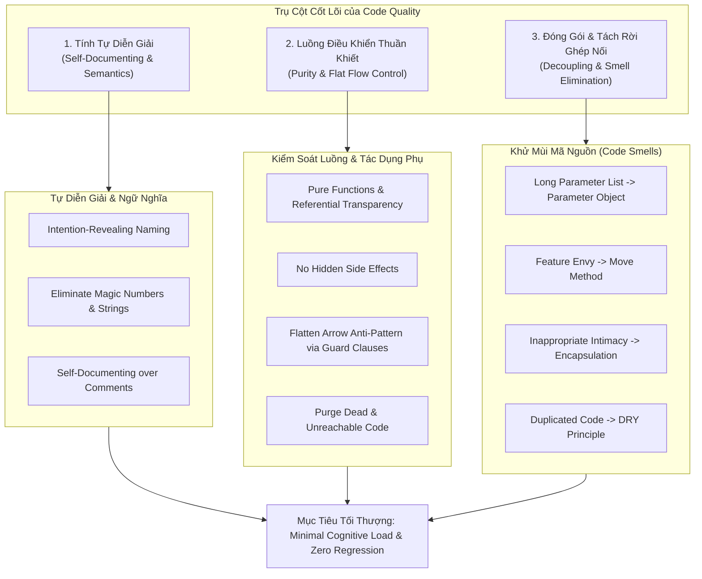
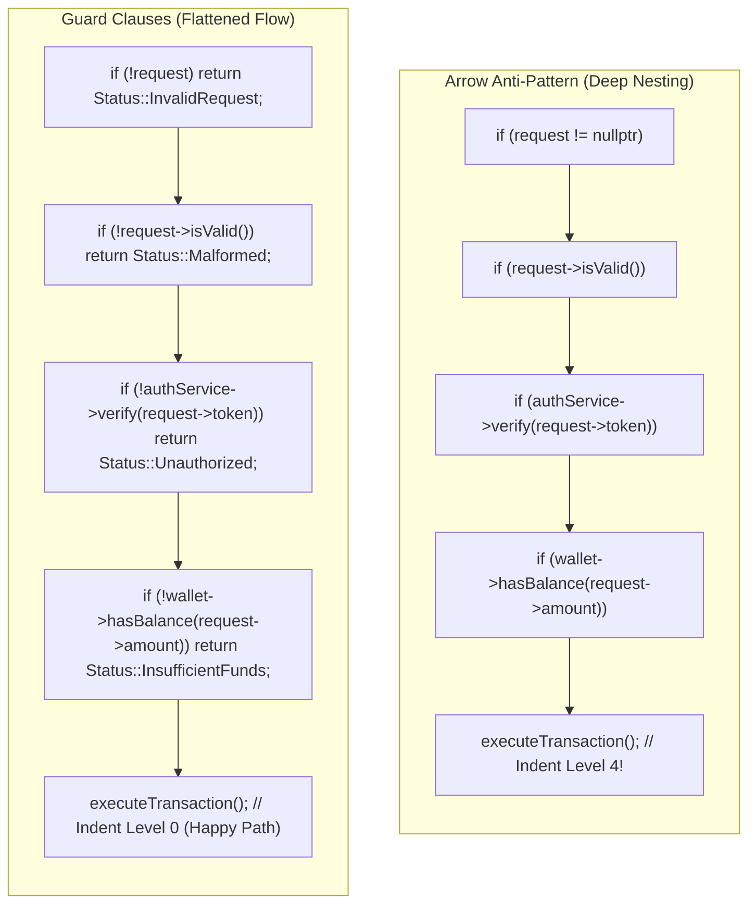

# 8.1. Chất Lượng Mã Nguồn và Tính Dễ Bảo Trì (Code Quality & Maintainability)

> [!IMPORTANT]
> **Nếu bạn chỉ được nhớ một điều duy nhất:** Mã nguồn được viết cho con người đọc nhiều gấp 10 lần máy tính thực thi; chất lượng mã nguồn không phải là sự phô diễn cú pháp hóc búa, mà là nghệ thuật triệt tiêu tải trọng nhận thức (Cognitive Load Reduction) thông qua định danh tường minh, hàm thuần túy không tác dụng phụ ngầm, và cấu trúc luồng phẳng bằng Guard Clauses.

---

## 1. Kiến trúc Tổng quan & Mô hình Tư duy (Mental Model)

### Phép loại suy kỹ thuật: Bản vẽ Hàng không vs Bản nháp Viết tay
Hãy tưởng tượng mã nguồn của một hệ thống phần mềm giống như tài liệu hướng dẫn vận hành buồng lái máy bay phản lực thương mại:
- **Mã nguồn chất lượng kém**: Giống như một tập ghi chép nguệch ngoạc bằng mực nhòe, các nút bấm chỉ được dán nhãn `btn1`, `temp_val`, công tắc áp suất dầu ghi số thô `104` mà không có đơn vị đo, và phi công phải lật qua 6 trang phụ chú lồng nhau chỉ để tìm cách kích hoạt phanh khẩn cấp. Khi có biến cố động cơ giữa không trung, thời gian đọc hiểu tài liệu tăng vọt khiến tai nạn xảy ra.
- **Mã nguồn chất lượng cao (High Quality & Maintainable)**: Giống như buồng lái chuẩn hóa của Boeing hay Airbus. Mỗi nút bấm đều mang tên tự giải thích (`deployEmergencyLandingGear()`), các giá trị giới hạn đều là hằng số định danh rõ ràng (`MAX_HYDRAULIC_PRESSURE_PSI = 3000`), hệ thống kiểm tra an toàn chạy theo các bước phẳng độc lập (Guard Clauses), và việc bảo dưỡng chỉ đòi hỏi kiểm tra từng module độc lập không làm rò rỉ điện sang hệ thống radar (No Side Effects).

Theo Robert C. Martin (*Clean Code*), tỷ lệ thời gian giữa việc đọc mã cũ và viết mã mới thực tế vượt ngưỡng **$10:1$**. Bất kỳ sự cẩu thả nào khi viết mã ban đầu sẽ bị nhân lên gấp 10 lần chi phí bảo trì, gỡ lỗi và chuyển giao trong tương lai.



---

## 2. Chi tiết từng Keyword (Under-the-Hood Deep Dive)

### 2.1. Code Readability vs Code Clarity & Cognitive Load
- **Bản chất kỹ thuật**:
  - **Readability (Tính dễ đọc bề mặt)**: Khả năng hệ thống thị giác và vỏ não xử lý văn bản (Scanning speed) có thể đọc lướt qua cú pháp, thụt lề, định dạng mã nguồn một cách trơn tru mà không bị vấp.
  - **Clarity (Tính minh bạch ngữ nghĩa)**: Mức độ không nhập nhằng (Absence of Ambiguity) về mặt ý định nghiệp vụ (Intent). Mã có thể rất dễ đọc về mặt cú pháp (ví dụ: `a = b + c;`) nhưng hoàn toàn mù mờ về ngữ nghĩa (`a, b, c` là gì?).
  - **Cognitive Load (Tải trọng nhận thức)**: Não người chỉ có thể duy trì trung bình $4 \pm 1$ mẩu thông tin trong bộ nhớ ngắn hạn (Working Memory) tại một thời điểm. Mã nguồn chất lượng cao là mã giảm thiểu số lượng biến trạng thái tạm thời mà lập trình viên phải "nhớ trong đầu" khi duyệt qua một hàm.
- **Ưu & Nhược điểm / Cạm bẫy**:
  - *Sai lầm phổ biến*: Đánh đồng "ngắn gọn" (One-liner, Clever code) với "chất lượng". Việc lạm dụng các toán tử ternary lồng nhau (`a ? b : c ? d : e`) hay macro phức tạp trong C++ có thể giảm số dòng code nhưng làm bùng nổ tải trọng nhận thức.

### 2.2. Intention-Revealing & Meaningful Names & Self-Documenting Code
- **Bản chất kỹ thuật**:
  - Mỗi định danh (biến, hàm, lớp, module) phải trả lời được 3 câu hỏi cốt lõi mà không cần tài liệu đi kèm: **Nó đại diện cho cái gì? Nó làm gì? Và nó được sử dụng trong ngữ cảnh nào?**
  - Tránh các ký tự đơn vô nghĩa (`d`, `x`, `tmp`, `val`, `data`, `item`). Ví dụ: thay vì `int d; // elapsed time in days`, bắt buộc đặt là `int elapsedTimeInDays;` hoặc `std::chrono::days elapsedDays;`.
  - **Self-Documenting Code**: Mã nguồn thể hiện trực tiếp tư duy thiết kế thông qua tên hàm nhỏ mang tính hành động (`canUserAccessResource()`, `calculateMonthlyDepreciation()`).
  - *Bản chất của Comments*: *"Comments are often lies waiting to happen"* (Robert C. Martin). Mã nguồn biến đổi liên tục qua các commit, nhưng các chú thích hiếm khi được cập nhật đồng bộ, nhanh chóng thoái hóa thành "thông tin giả" làm sai lạc phán đoán của kỹ sư bảo trì. Chỉ sử dụng comment để giải thích **TẠI SAO** (Why - quyết định nghiệp vụ kỳ lạ, workaround phần cứng, link tới CVE/RFC) chứ không bao giờ giải thích **CÁI GÌ** (What - việc mà bản thân code phải tự nói lên).

### 2.3. Magic Numbers & Magic Strings (Anti-Patterns)
- **Bản chất kỹ thuật**:
  - **Magic Numbers / Strings**: Sự xuất hiện của các con số hoặc chuỗi ký tự thô (Hardcoded literals) nằm rải rác trong các biểu thức điều kiện hoặc tính toán mà không có tên định danh giải thích ngữ nghĩa (ví dụ: `if (userRole == 4)`, `bufferSize = 8192;`, `timeout = 86400;`).
  - *Cơ chế giải quyết*: Định nghĩa các hằng số bất biến (`constexpr`, `const`, `final`) hoặc `enum class` có phạm vi rõ ràng. Trình biên dịch hiện đại sẽ thay thế trực tiếp các hằng số này trong quá trình tối ưu hóa (Constant Folding / Inlining) mà không gây tốn thêm một byte bộ nhớ hay chu kỳ CPU nào trong runtime.
- **Tác hại thực tế**: Khi tỷ lệ thuế suất `0.08` hoặc mã trạng thái `4` xuất hiện ở 20 vị trí trong mã nguồn, việc sửa đổi yêu cầu kinh doanh đòi hỏi tìm kiếm thủ công toàn codebase, chắc chắn gây ra lỗi sót (Omission Bug) dẫn đến thảm họa dữ liệu.

### 2.4. Pure Functions, Referential Transparency & Side Effects
- **Bản chất kỹ thuật**:
  - **Pure Function (Hàm thuần túy)**: Một hàm toán học thỏa mãn hai tiêu chuẩn bất biến:
    1. **Referential Transparency (Tính minh bạch tham chiếu)**: Với cùng một bộ tham số đầu vào, hàm luôn trả về cùng một kết quả duy nhất ở mọi thời điểm, cho phép thay thế lời gọi hàm bằng giá trị trả về của nó mà không làm đổi tính đúng đắn của chương trình.
    2. **No Side Effects (Không có tác dụng phụ ngầm)**: Hàm không đột biến (mutate) bất kỳ trạng thái nào bên ngoài phạm vi cục bộ của nó: không sửa biến toàn cục, không ghi đè tham số truyền vào qua con trỏ/reference, không thực hiện I/O (ghi disk, gọi mạng, log console, lấy thời gian thực từ clock hệ thống).
  - **Side Effects (Tác dụng phụ ngầm)**: Việc một hàm làm thay đổi ngầm trạng thái của chương trình (ví dụ hàm `bool isValidUser(User& u)` nhưng bên trong lại cập nhật `u.lastChecked = now()`).
- **Lợi ích kiến trúc**: Hàm thuần túy cực kỳ dễ viết Unit Test (không cần mock/stub DB hay Network), an toàn tuyệt đối trước Race Condition trong lập trình đa luồng (Thread-safe by design), và dễ dàng áp dụng cơ chế Caching (Memoization).

### 2.5. Deep Nesting & Arrow Anti-Pattern vs Guard Clauses
- **Bản chất kỹ thuật**:
  - **Arrow Anti-Pattern (Hiện tượng mũi tên rẽ nhánh)**: Xảy ra khi các cấu trúc rẽ nhánh (`if-else`), vòng lặp (`for`, `while`), và bắt lỗi (`try-catch`) bị lồng sâu vào nhau từ 4 đến 7 tầng. Mã nguồn thụt lề dồn dập về phía bên phải tạo thành hình mũi tên (`>`).
  - **Cognitive Complexity**: Khi thụt lề sâu, não bộ lập trình viên phải duy trì một "Call Stack ảo" trong đầu để ghi nhớ: *"Nếu user không null VÀ user active VÀ user có quyền VÀ tài khoản đủ tiền..."*.
  - **Guard Clauses (Mệnh đề bảo vệ / Early Exit)**: Kỹ thuật đảo ngược điều kiện kiểm tra (Invert Conditions). Ngay đầu hàm, kiểm tra ngay các trường hợp biên, giá trị bất hợp lệ hoặc lỗi tiềm ẩn để `return` hoặc `throw` ngay lập tức. Luồng xử lý chính (Happy Path) được giữ phẳng hoàn toàn ở mức thụt lề thấp nhất (Indent Level 0 hoặc 1).



### 2.6. Dead Code & Unreachable Code
- **Bản chất kỹ thuật**:
  - **Unreachable Code**: Các khối lệnh không bao giờ có luồng điều khiển nào chạm tới được (ví dụ code nằm sau lệnh `return`, `throw`, hoặc nằm trong nhánh `if (false)`). Trình biên dịch hiện đại (`gcc -Wunreachable-code`, `clang`) có thể phát hiện và loại bỏ khối này qua phân tích Control Flow Graph (Dead Code Elimination - DCE).
  - **Dead Code (Zombie Code)**: Các biến, hàm, tham số hoặc lớp vẫn được biên dịch hợp lệ nhưng không còn bất kỳ nơi nào trong toàn bộ dự án triệu gọi tới nó. Nó tồn tại như một di tích lịch sử gây hiểu lầm rằng tính năng đó vẫn đang vận hành.
- **Nguy cơ hệ thống**: Tạo ra ảo tưởng bảo mật hoặc logic, làm chậm tốc độ build, và khiến các công cụ refactoring tốn chi phí phân tích vô ích.

### 2.7. Coupling Smells: Long Parameter List & Introduce Parameter Object
- **Bản chất kỹ thuật**:
  - **Long Parameter List**: Một hàm nhận từ 5 đến 10 tham số rời rạc. Vấn đề trở nên cực kỳ nghiêm trọng khi các tham số có cùng kiểu dữ liệu (ví dụ: `createUser(string firstName, string lastName, string email, string address, string city, string zip)`). Chỉ cần đổi chỗ nhầm hai chuỗi, trình biên dịch hoàn toàn bất lực trong việc cảnh báo.
  - **Introduce Parameter Object**: Gom nhóm các tham số có quan hệ mật thiết về mặt ngữ nghĩa thành một đối tượng bất biến hoặc DTO (`UserRegistrationRequest`, `GeoCoordinate`, `DateRange`).
- **Lợi ích**: Giảm số lượng tham số xuống còn 1 đối tượng duy nhất, tạo tiền đề để thêm các phương thức validation ngay trong đối tượng đó, và giúp API dễ mở rộng mà không làm vỡ chữ ký hàm (Backward Compatibility).

### 2.8. Feature Envy & Inappropriate Intimacy
- **Bản chất kỹ thuật**:
  - **Feature Envy (Ghen tị tính năng)**: Một phương thức thuộc lớp A nhưng liên tục gọi hàng loạt getters của lớp B để lấy dữ liệu tính toán. Điều này chứng minh rằng phương thức đó đang đặt nhầm chỗ và "ghen tị" với dữ liệu của lớp B. *Giải pháp*: Dùng kỹ thuật `Move Method` để chuyển toàn bộ hoặc một phần logic sang lớp B (Tuân thủ nguyên lý *Information Expert*).
  - **Inappropriate Intimacy (Thân mật thái quá)**: Lớp A biết quá sâu và phụ thuộc trực tiếp vào các trường riêng tư, chi tiết triển khai nội tại của lớp B (vi phạm nghiêm trọng Law of Demeter - *"Chỉ nói chuyện với bạn bè gần nhất"*). Khi lớp B thay đổi cấu trúc bên trong, lớp A vỡ vụn. *Giải pháp*: Thiết lập các giao diện đóng gói (Encapsulation Interfaces), áp dụng Mediator hoặc Delegation.

### 2.9. Duplicated Code (DRY Principle) & Small Functions / Single Responsibility
- **Bản chất kỹ thuật**:
  - **Duplicated Code (Mã trùng lặp)**: Được Martin Fowler xếp là "ông tổ của mọi Code Smell". Trùng lặp có thể ở mức bề mặt (copy-paste nguyên khối lệnh) hoặc trùng lặp ngữ nghĩa (nhiều thuật toán khác nhau cùng giải quyết một quy tắc nghiệp vụ theo những cách phân tán).
  - **DRY (Don't Repeat Yourself)**: Không chỉ là việc tránh copy-paste mã nguồn, mà là: *"Every piece of knowledge must have a single, unambiguous, authoritative representation within a system"*.
  - **Small Functions & Single Responsibility Principle (SRP)**: Mỗi hàm chỉ nên làm một việc duy nhất và làm nó thật xuất sắc (Functions should do one thing. They should do it well. They should do it only). Chiều dài lý tưởng của một hàm trong các hệ thống hiện đại thường dưới 20-30 dòng, giúp toàn bộ nội dung hàm nằm trọn vẹn trong màn hình của lập trình viên mà không cần cuộn trang.

---

## 3. Thực thi Mã nguồn & Mô phỏng Chuyên sâu (Dual-Engine Implementation)

### 3.1. Engine C++20: Clean Refactoring, Guard Clauses & Parameter Objects
Chương trình minh họa việc biến đổi mã nguồn từ vi phạm Arrow Anti-Pattern, Long Parameter List và Side Effects sang chuẩn mực C++20 hiện đại (sử dụng `std::optional`, `std::string_view`, Struct Packing, và Guard Clauses).

```cpp
#include <iostream>
#include <string>
#include <string_view>
#include <optional>
#include <vector>
#include <chrono>

// ============================================================================
// 1. DOMAIN MODELS & PARAMETER OBJECTS (Khử Long Parameter List & Magic Types)
// ============================================================================

enum class FlightClass : uint8_t {
    Economy,
    PremiumEconomy,
    Business,
    FirstClass
};

struct FlightDate {
    uint16_t year;
    uint8_t month;
    uint8_t day;

    [[nodiscard]] constexpr bool isValid() const noexcept {
        return (year >= 2026 && month >= 1 && month <= 12 && day >= 1 && day <= 31);
    }
};

// Parameter Object thay thế cho danh sách tham số rời rạc 7 phần tử
struct BookingRequest {
    std::string originAirport;
    std::string destinationAirport;
    FlightDate departureDate;
    uint8_t requestedSeats{1};
    FlightClass seatClass{FlightClass::Economy};
    bool isVipMember{false};
};

struct BookingConfirmation {
    std::string bookingReference;
    double finalPriceUsd;
    bool isConfirmed;
};

// ============================================================================
// 2. PRODUCTION ENGINE: REFACTORED FLIGHT BOOKING SERVICE (Guard Clauses)
// ============================================================================

class FlightBookingService {
private:
    static constexpr uint8_t kMaxSeatsPerBooking = 9;
    static constexpr double kBasePriceUsd = 250.0;
    static constexpr double kVipDiscountRate = 0.15; // 15% discount for VIP

    // Pure helper: Tính toán giá vé hoàn toàn không có side effects
    [[nodiscard]] static double calculatePrice(uint8_t seats, FlightClass seatClass, bool isVip) noexcept {
        double multiplier = 1.0;
        switch (seatClass) {
            case FlightClass::Economy: multiplier = 1.0; break;
            case FlightClass::PremiumEconomy: multiplier = 1.4; break;
            case FlightClass::Business: multiplier = 2.5; break;
            case FlightClass::FirstClass: multiplier = 4.0; break;
        }

        double total = kBasePriceUsd * multiplier * seats;
        if (isVip) {
            total *= (1.0 - kVipDiscountRate);
        }
        return total;
    }

public:
    // Áp dụng Guard Clauses: Làm phẳng hoàn toàn luồng rẽ nhánh, return sớm khi gặp lỗi
    [[nodiscard]] std::optional<BookingConfirmation> processBooking(const BookingRequest& req) const {
        // Guard 1: Kiểm tra tính hợp lệ của sân bay
        if (req.originAirport.empty() || req.destinationAirport.empty()) {
            std::cerr << "[Guard Fail] Mã sân bay xuất phát hoặc hạ cánh không được để trống.\n";
            return std::nullopt;
        }

        // Guard 2: Kiểm tra sân bay trùng lặp
        if (req.originAirport == req.destinationAirport) {
            std::cerr << "[Guard Fail] Điểm khởi hành và điểm đến không được trùng nhau (" 
                      << req.originAirport << ").\n";
            return std::nullopt;
        }

        // Guard 3: Kiểm tra ngày bay hợp lệ
        if (!req.departureDate.isValid()) {
            std::cerr << "[Guard Fail] Ngày bay không hợp lệ hoặc nằm trong quá khứ.\n";
            return std::nullopt;
        }

        // Guard 4: Kiểm tra giới hạn số ghế đặt
        if (req.requestedSeats == 0 || req.requestedSeats > kMaxSeatsPerBooking) {
            std::cerr << "[Guard Fail] Số ghế đặt (" << static_cast<int>(req.requestedSeats) 
                      << ") vượt quá phạm vi cho phép (1 - " << static_cast<int>(kMaxSeatsPerBooking) << ").\n";
            return std::nullopt;
        }

        // HAPPY PATH: Nằm ở cấp thụt lề thấp nhất (Indent Level 0)
        double price = calculatePrice(req.requestedSeats, req.seatClass, req.isVipMember);
        std::string refCode = "VN-" + req.originAirport + req.destinationAirport + "-9928";

        std::cout << "[Booking Success] Vé được xuất thành công cho " << static_cast<int>(req.requestedSeats)
                  << " hành khách. Mã đặt vé: " << refCode << " | Tổng tiền: $" << price << "\n";

        return BookingConfirmation{
            .bookingReference = std::move(refCode),
            .finalPriceUsd = price,
            .isConfirmed = true
        };
    }
};

// ============================================================================
// 3. MAIN DRIVER TEST
// ============================================================================
int main() {
    std::cout << "=== C++20 CODE QUALITY & REFACTORING DEMONSTRATION ===\n\n";

    FlightBookingService bookingService;

    // Kịch bản 1: Thất bại ở Guard Clause do cùng sân bay
    std::cout << "--- Test 1: Cố tình vi phạm điều kiện Guard Clause ---\n";
    BookingRequest invalidReq{
        .originAirport = "HAN",
        .destinationAirport = "HAN",
        .departureDate = {2026, 12, 1},
        .requestedSeats = 2,
        .seatClass = FlightClass::Economy,
        .isVipMember = false
    };
    auto res1 = bookingService.processBooking(invalidReq);
    std::cout << "Result: " << (res1.has_value() ? "Approved" : "Rejected") << "\n\n";

    // Kịch bản 2: Thành công với Happy Path phẳng và sạch sẽ
    std::cout << "--- Test 2: Đặt vé hợp lệ với Parameter Object ---\n";
    BookingRequest validReq{
        .originAirport = "SGN",
        .destinationAirport = "NRT",
        .departureDate = {2026, 12, 15},
        .requestedSeats = 2,
        .seatClass = FlightClass::Business,
        .isVipMember = true
    };
    auto res2 = bookingService.processBooking(validReq);
    std::cout << "Result: " << (res2.has_value() ? "Approved" : "Rejected") << "\n";

    return 0;
}
```

---

### 3.2. Engine Python 3.11+: Pure Functions vs Side Effects & Anti-Pattern Detection
Mô phỏng cơ chế phát hiện side effects ngầm, phân biệt giữa hàm thuần túy và hàm đột biến trạng thái, kết hợp kỹ thuật Dataclasses và Guard Clauses.

```python
"""
Python 3.11+ Code Quality & Architecture Enforcement Demo
Minh họa triệt tiêu Side Effects, Refactoring Arrow Anti-Pattern và Tự Diễn Giải Mã Nguồn.
"""
from dataclasses import dataclass, field
from enum import Enum, auto
from typing import Optional, Final
import copy

class AccountTier(Enum):
    STANDARD = auto()
    GOLD = auto()
    PLATINUM = auto()

@dataclass(frozen=True)
class TransactionContext:
    """Parameter Object bất biến (Immutable) chống đột biến tham số ngoài ý muốn."""
    transaction_id: str
    account_id: str
    amount_cents: int
    account_tier: AccountTier
    is_active: bool
    is_fraud_flagged: bool

@dataclass
class TransactionResult:
    success: bool
    fee_cents: int
    message: str

# ============================================================================
# 1. BAD IMPLEMENTATION: ARROW PATTERN & IMPURE SIDE EFFECTS (Anti-pattern)
# ============================================================================
class BadTransactionProcessor:
    def __init__(self) -> None:
        self.audit_log: list[str] = []

    def execute_bad(self, ctx: TransactionContext, global_state_dict: dict) -> bool:
        # Arrow Anti-pattern: Thụt lề 4 tầng lồng nhau
        if ctx.is_active:
            if not ctx.is_fraud_flagged:
                if ctx.amount_cents > 0:
                    if ctx.amount_cents <= 1_000_000:
                        # HIDDEN SIDE EFFECT: Đột biến dictionary toàn cục truyền từ ngoài vào!
                        global_state_dict["last_processed_account"] = ctx.account_id
                        self.audit_log.append(f"Processed {ctx.transaction_id}")
                        return True
                    else:
                        return False
                else:
                    return False
            else:
                return False
        else:
            return False

# ============================================================================
# 2. CLEAN IMPLEMENTATION: PURE LOGIC & GUARD CLAUSES (Production Grade)
# ============================================================================
class CleanTransactionProcessor:
    MAX_TRANSACTION_CENTS: Final[int] = 1_000_000 # Hằng số định danh thay cho Magic Number

    @staticmethod
    def calculate_fee_pure(amount_cents: int, tier: AccountTier) -> int:
        """
        Pure Function: Hoàn toàn không phụ thuộc trạng thái ngoài, không có Side Effect.
        Referential Transparency: Luôn trả về cùng kết quả với cùng đối số.
        """
        fee_multipliers = {
            AccountTier.STANDARD: 0.02, # 2.0%
            AccountTier.GOLD: 0.01,     # 1.0%
            AccountTier.PLATINUM: 0.005 # 0.5%
        }
        return int(amount_cents * fee_multipliers[tier])

    def process_transaction(self, ctx: TransactionContext) -> TransactionResult:
        """
        Xử lý giao dịch phẳng bằng Guard Clauses (Early Exit).
        Happy Path duy trì ở mức Indent 0.
        """
        # Guard 1: Trạng thái tài khoản
        if not ctx.is_active:
            return TransactionResult(success=False, fee_cents=0, message="Account is suspended or inactive")

        # Guard 2: Cảnh báo gian lận
        if ctx.is_fraud_flagged:
            return TransactionResult(success=False, fee_cents=0, message="Transaction blocked by Fraud Detection Engine")

        # Guard 3: Giá trị thanh toán bất hợp lệ
        if ctx.amount_cents <= 0:
            return TransactionResult(success=False, fee_cents=0, message="Amount must be strictly positive")

        # Guard 4: Vượt trần giao dịch
        if ctx.amount_cents > self.MAX_TRANSACTION_CENTS:
            return TransactionResult(
                success=False, 
                fee_cents=0, 
                message=f"Amount exceeds maximum single transfer limit ({self.MAX_TRANSACTION_CENTS} cents)"
            )

        # HAPPY PATH (Flattened, không còn bất kỳ tầng lồng nhau nào)
        fee = self.calculate_fee_pure(ctx.amount_cents, ctx.account_tier)
        return TransactionResult(
            success=True, 
            fee_cents=fee, 
            message=f"Transaction {ctx.transaction_id} approved. Fee applied: {fee} cents."
        )

# ============================================================================
# 3. VERIFICATION & TEST HARNESS
# ============================================================================
if __name__ == "__main__":
    print("=== PYTHON 3.11+ CODE QUALITY & PURITY BENCHMARK ===\n")
    
    clean_engine = CleanTransactionProcessor()

    # Kịch bản 1: Vi phạm gian lận (Kích hoạt Guard Clause 2)
    fraud_tx = TransactionContext(
        transaction_id="TX-FAIL-01",
        account_id="ACC-883",
        amount_cents=50_000,
        account_tier=AccountTier.GOLD,
        is_active=True,
        is_fraud_flagged=True
    )
    result1 = clean_engine.process_transaction(fraud_tx)
    print(f"[Test 1 Guard Test] Success: {result1.success} | Msg: {result1.message}")

    # Kịch bản 2: Giao dịch thành công (Happy Path)
    valid_tx = TransactionContext(
        transaction_id="TX-OK-99",
        account_id="ACC-104",
        amount_cents=200_000,
        account_tier=AccountTier.PLATINUM,
        is_active=True,
        is_fraud_flagged=False
    )
    result2 = clean_engine.process_transaction(valid_tx)
    print(f"[Test 2 Happy Path] Success: {result2.success} | Fee: {result2.fee_cents} cents | Msg: {result2.message}")
```

### 3.3. Giả lập Terminal Output
```text
=== C++20 CODE QUALITY & REFACTORING DEMONSTRATION ===

--- Test 1: Cố tình vi phạm điều kiện Guard Clause ---
[Guard Fail] Điểm khởi hành và điểm đến không được trùng nhau (HAN).
Result: Rejected

--- Test 2: Đặt vé hợp lệ với Parameter Object ---
[Booking Success] Vé được xuất thành công cho 2 hành khách. Mã đặt vé: VN-SGNNRT-9928 | Tổng tiền: $1062.5
Result: Approved

=== PYTHON 3.11+ CODE QUALITY & PURITY BENCHMARK ===

[Test 1 Guard Test] Success: False | Msg: Transaction blocked by Fraud Detection Engine
[Test 2 Happy Path] Success: True | Fee: 1000 cents | Msg: Transaction TX-OK-99 approved. Fee applied: 1000 cents.
```

---

## 4. Systems Engineering & Production Pitfalls

### 4.1. Production Failure Modes
1. **Lỗi Rò Rỉ Trạng Thái do Side Effects ngầm (Hidden State Mutation)**:
   - *Kịch bản*: Trong hệ thống Backend xử lý đồng thời (Concurrent Requests), việc một hàm nghiệp vụ sửa đổi trực tiếp các thuộc tính của một object được dùng chung hoặc biến toàn cục mà không có cơ chế khóa (Lock) sẽ dẫn đến Race Condition, gây sai lệch dữ liệu tài khoản người dùng nghiêm trọng.
2. **"Tê liệt Nhận thức" trong Incident Response do Arrow Anti-Pattern**:
   - *Kịch bản*: Khi xảy ra sự cố production vào 3 giờ sáng, kỹ sư On-call phải đọc hiểu một hàm dài 400 dòng với 6 tầng lồng `if-else` lắt léo. Do không thể nắm bắt được biến số ở tầng rẽ nhánh thứ 5, kỹ sư đưa ra bản vá sai sót, biến lỗi cục bộ thành thảm họa sập toàn hệ thống.
3. **Lỗi Sót Khi Sửa Magic Numbers / Strings (The Omission Defect)**:
   - *Kịch bản*: Khi cổng thanh toán cập nhật phí giao dịch từ `2.5%` lên `3.0%`, lập trình viên tìm và thay thế `0.025` ở 10 vị trí, nhưng bỏ sót 2 vị trí khác được viết dưới dạng `amount * 25 / 1000`. Doanh nghiệp bị thất thoát doanh thu hàng tháng trời trước khi bị kiểm toán phát hiện.

### 4.2. Diagnostic Recipes & Tooling Suite
- **Kiểm soát Cognitive Complexity tự động**: Tích hợp quy tắc SonarQube `csharpsquid:S3776` hoặc `cpp:S3776` với ngưỡng giới hạn Cognitive Complexity $\le 15$ cho mỗi phương thức trong CI pipeline. Bất kỳ PR nào vi phạm đều bị chặn merge tự động.
- **Clang-Tidy (C++)**:
  ```bash
  # Quét mã nguồn C++ phát hiện các vấn đề về Magic Numbers và Readability
  clang-tidy src/FlightBooking.cpp -checks='readability-*,bugprone-*,modernize-*' -- -std=c++20
  ```
- **Flake8 & Bugbear (Python)**:
  ```bash
  # Phát hiện các lỗi lồng nhau sâu, biến mutable làm mặc định và code smell
  flake8 --max-complexity=10 --select=C,E,F,W,B src/
  ```

---

## 5. Bảng So sánh & Decision Matrix

| Chiều Kỹ Thuật | Arrow Anti-Pattern (Lồng Sâu) | Guard Clauses (Return Sớm) | Parameter Object Pattern | Micro-functions (Single Responsibility) |
| :--- | :--- | :--- | :--- | :--- |
| **Cognitive Load** | Cực kỳ cao (Thang điểm não bộ: 9/10) | Cực kỳ thấp (Thang điểm não bộ: 2/10) | Thấp (Gom nhóm thông tin liền mạch) | Rất thấp (Hiểu logic trong 5 giây) |
| **Độ Khó Kiểm Thử** | Khó viết Unit Test (Tổ hợp nhánh bùng nổ) | Rất dễ (Mỗi Guard Clause tương ứng 1 test case) | Dễ dàng tạo fixture giả lập dữ liệu | Dễ dàng viết Unit Test độc lập hoàn toàn |
| **Chi Phí Bảo Trì** | Rủi ro hồi quy (Regression) rất cao | Dễ bảo trì và bổ sung điều kiện mới | Dễ mở rộng trường dữ liệu không vỡ API | Chi phí bảo trì thấp, tái sử dụng cao |
| **Hiệu Năng Runtime** | Tương đương (Trình biên dịch tối ưu) | Tương đương (Có thể hỗ trợ Branch Prediction tốt hơn) | Không đáng kể (Trình biên dịch tối ưu hóa pass-by-reference) | Tối ưu hóa inlining bởi compiler |
| **Khuyến Nghị Sử Dụng** | ❌ **Tuyệt đối cấm trong Production** | ✅ **Bắt buộc áp dụng cho mọi hàm xác thực** | ✅ **Áp dụng khi hàm có $\ge 4$ tham số** | ✅ **Áp dụng cho mọi khối lệnh nghiệp vụ** |
