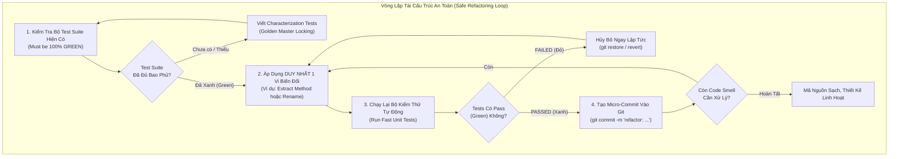
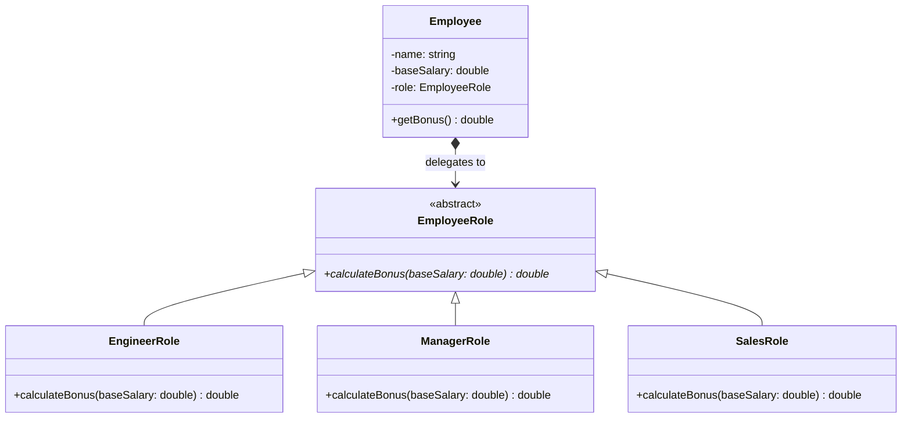

# 8.2. Kỹ Nghệ Tái Cấu Trúc Mã Nguồn (Refactoring Engineering & Catalog)

> [!IMPORTANT]
> **Nếu bạn chỉ được nhớ một điều duy nhất:** Tái cấu trúc mã nguồn (Refactoring) là quá trình thay đổi cấu trúc bên trong của phần mềm nhằm làm sạch thiết kế và giảm chi phí bảo trì mà **TUYỆT ĐỐI KHÔNG** làm thay đổi hành vi quan sát được từ bên ngoài; điều kiện tiên quyết không thể thương lượng là phải có một lưới an toàn kiểm thử tự động (Characterization Tests) bao phủ trước khi chạm vào mã nguồn.

---

## 1. Kiến trúc Tổng quan & Mô hình Tư duy (Mental Model)

### Phép loại suy kỹ thuật: Bảo dưỡng Động cơ Phản lực vs Đập đi Xây lại
Hãy hình dung hệ thống phần mềm giống như một cỗ động cơ phản lực thương mại:
- **Viết lại từ đầu (Rewriting / Big Bang Rebuild)**: Giống như việc bạn vứt bỏ toàn bộ cỗ máy động cơ đã bay an toàn 10 năm qua để thiết kế một động cơ mới toanh từ con số không. Kết quả là chi phí bùng nổ, thời gian trễ hạn hàng năm trời, và toàn bộ những bài học kinh nghiệm xử lý rung lắc, nhiệt độ cao trong quá khứ bị xóa sạch.
- **Sửa lỗi (Bug Fixing) & Thêm tính năng (Feature Development)**: Thay đổi lực đẩy của động cơ hoặc gắn thêm cảm biến mới. Hành vi bên ngoài của hệ thống bị biến đổi.
- **Tái cấu trúc mã nguồn (Refactoring)**: Là công tác kỹ thuật đỉnh cao trong xưởng bảo dưỡng định kỳ. Các kỹ sư sắp xếp lại các bó dây điện cho gọn gàng, thay thế các van thủy lực rườm rà bằng các module tiêu chuẩn, làm sạch cặn dầu ở các ống dẫn (khử Code Smells) nhằm giúp việc kiểm tra lần sau nhanh hơn gấp 5 lần. Tuy nhiên, khi đưa lên bệ thử tải, **công suất lực đẩy, mức tiêu hao nhiên liệu và phản hồi buồng lái hoàn toàn không đổi dù chỉ một mili-giây**.

Martin Fowler (*Refactoring: Improving the Design of Existing Code*) nhấn mạnh: Refactoring là một chuỗi các **vi biến đổi (Micro-transformations)** có kỷ luật, mỗi bước nhỏ đều được bảo vệ bởi bộ kiểm thử tự động.



---

## 2. Chi tiết từng Keyword (Under-the-Hood Deep Dive)

### 2.1. Bản chất của Refactoring & Sự khác biệt với Rewriting/Bug Fixing
- **Bản chất kỹ thuật**:
  - **Refactoring (Tái cấu trúc)**: $f_{internal}(S_{n}) \rightarrow S_{n+1}$ sao cho $Behavior(S_{n+1}) \equiv Behavior(S_{n})$. Hệ thống giữ nguyên tính tương đương ngữ nghĩa (Semantic Equivalence). Không sửa bug, không thêm tính năng mới, không thay đổi API hợp đồng công khai.
  - **Rewriting (Viết lại)**: Đập bỏ codebase cũ để viết lại từ đầu. Thường dẫn đến "Second-System Effect" do đánh giá thấp độ phức tạp của hàng nghìn trường hợp biên (Edge Cases) ẩn sâu trong code cũ.
  - **Bug Fixing (Vá lỗi)**: Thay đổi hành vi quan sát được từ sai sang đúng.

### 2.2. Composing Methods: Extract Method, Inline Method, Extract Variable & Inline Variable
- **Bản chất kỹ thuật**:
  - **Extract Method / Function**: Nhận diện một khối lệnh thực thi một nhiệm vụ con mạch lạc bên trong một hàm dài, đưa khối lệnh đó ra thành một hàm mới độc lập và đặt tên theo ý định nghiệp vụ (Intention-Revealing Name). Trình biên dịch hiện đại sẽ tự động inline ngược lại hàm này nếu cần tối ưu hiệu năng CPU, do đó chi phí runtime bằng 0.
  - **Inline Method**: Biến đổi ngược chiều của Extract Method. Khi thân hàm quá ngắn, quá hiển nhiên (ví dụ chỉ gọi 1 hàm khác không biến đổi gì) hoặc việc chia nhỏ hàm bị lạm dụng dẫn đến hiện tượng phân mảnh mã nguồn quá mức (Over-fragmentation).
  - **Extract Variable (Introduce Explaining Variable)**: Tách các biểu thức điều kiện boolean phức tạp hoặc các phép tính toán lồng nhau thành các biến bất biến cục bộ có tên mang tính giải thích. Ví dụ:
    ```cpp
    // Trước: if (platform.contains("MAC") && browser.contains("SAFARI") && resizeCount > 0)
    // Sau:
    const bool isMacSafari = platform.contains("MAC") && browser.contains("SAFARI");
    const bool isWindowResized = resizeCount > 0;
    if (isMacSafari && isWindowResized) { ... }
    ```
  - **Inline Variable**: Loại bỏ các biến tạm trung gian vô bổ chỉ được dùng một lần duy nhất ngay dòng tiếp theo mà không bổ sung thêm giá trị ngữ nghĩa nào.

### 2.3. The Power of Renaming (Symbol Table & AST-Aware Renaming)
- **Bản chất kỹ thuật**:
  - Kỹ thuật đơn giản nhất nhưng có sức mạnh tái thiết nhận thức cao nhất. Đổi tên biến, hàm, tham số, lớp để phản ánh chính xác mô hình miền (Ubiquitous Language trong Domain-Driven Design).
  - *Cơ chế tầng sâu*: Không bao giờ sử dụng "Find and Replace" văn bản thô hoặc Regex, vì nó sẽ thay thế nhầm các chuỗi trùng tên trong comment, file cấu hình hoặc biến của scope khác. Các công cụ Refactoring hiện đại phân tích Cây cú pháp trừu tượng (AST) và Bảng ký hiệu (Symbol Table) của Compiler/Language Server để chỉ thay thế các Node tham chiếu chính xác đến ký hiệu đó.

### 2.4. Moving Features: Move Method & Move Field
- **Bản chất kỹ thuật**:
  - **Move Method / Move Field**: Giải pháp trực tiếp để triệt tiêu Code Smell **Feature Envy**. Khi Class $A$ chứa một phương thức hoặc thuộc tính nhưng Class $B$ lại truy cập nó với tần suất gấp nhiều lần Class $A$.
  - Kỹ thuật viên sẽ sao chép phương thức sang Class $B$, điều chỉnh tham chiếu, biến phương thức ở Class $A$ thành một hàm ủy quyền (Delegating Method) để duy trì khả năng tương thích ngược, sau đó dần dần deprecate nó.

### 2.5. OOP Hierarchy Refactoring: Pull Up Method & Push Down Method
- **Bản chất kỹ thuật**:
  - **Pull Up Method (Đẩy phương thức lên lớp cha)**: Khi phát hiện hai hoặc nhiều lớp con kế thừa cùng sở hữu các phương thức có logic xử lý giống hệt nhau hoặc tương đương. Kỹ sư đẩy phương thức này lên lớp cha chung (Superclass) để tập trung hóa tri thức, tuân thủ nguyên lý DRY.
  - **Push Down Method (Đẩy phương thức xuống lớp con)**: Ngược lại, khi một phương thức nằm trên lớp cha nhưng chỉ có một hoặc hai lớp con sử dụng, trong khi các lớp con khác phải để trống hoặc ném `NotSupportedException`. Đẩy phương thức đó xuống chính xác các lớp con có nhu cầu sử dụng nhằm làm sạch giao diện lớp cha.

### 2.6. Simplifying Conditionals: Decompose Conditional
- **Bản chất kỹ thuật**:
  - Các cấu trúc `if-then-else` phức tạp thường chứa đựng 3 vấn đề: Điều kiện kiểm tra khó hiểu, khối lệnh `then` quá dài, và khối lệnh `else` chứa nhiều chi tiết tầng thấp.
  - Kỹ thuật **Decompose Conditional** tách toàn bộ biểu thức điều kiện thành một hàm boolean riêng, tách khối `then` thành một hàm hành động riêng, và tách khối `else` thành một hàm hành động khác. Khi đọc lại, hàm chính sẽ giống như một câu văn xuôi:
    ```cpp
    if (isSummerSeason(date)) {
        chargeSummerRate(quantity);
    } else {
        chargeWinterRate(quantity);
    }
    ```

### 2.7. Replace Conditional with Polymorphism (Khử Switch-Case vi phạm OCP)
- **Bản chất kỹ thuật**:
  - Khi một đoạn mã xuất hiện cấu trúc `switch-case` hoặc chuỗi `if-else if` dài dằng dặc dựa trên các mã kiểu loại (Type Codes / Enums), mỗi khi doanh nghiệp sinh ra một loại hình mới, kỹ sư buộc phải tìm tất cả các lệnh `switch` khắp hệ thống để thêm `case`. Điều này vi phạm nghiêm trọng nguyên lý Open/Closed Principle (OCP).
  - *Cơ chế giải quyết*: Định nghĩa một Interface/Abstract Class chứa phương thức hành vi chung. Mỗi `case` trong `switch` được biến thành một lớp con cụ thể cài đặt (implement/override) phương thức đó. Lời gọi hàm phân nhánh được thay thế bằng một lời gọi đa hình động (Dynamic Dispatch qua vtable trong C++ hoặc Virtual Call trong Java/Python). Khi cần thêm loại mới, chỉ cần tạo lớp con mới mà không cần sửa bất kỳ dòng code cũ nào.



### 2.8. Refactoring to Patterns (Joshua Kerievsky)
- **Bản chất kỹ thuật**:
  - Thay vì áp đặt các Design Patterns phức tạp (Over-engineering) ngay từ ngày đầu khi bài toán còn chưa rõ ràng, kỹ sư áp dụng tư duy **Refactoring to Patterns**: Bắt đầu bằng đoạn code đơn giản nhất chạy được. Khi hệ thống tiến hóa và bộc lộ các áp lực thiết kế (Design Pressures), ta tái cấu trúc từng bước nhỏ hướng tới các Pattern chuẩn mực (như Strategy, State, Composite, Factory Method).

### 2.9. Safe Refactoring Workflow, Characterization Tests (Golden Master) & Test Guardrails
- **Bản chất kỹ thuật**:
  - **Characterization Tests (Golden Master)**: Khi phải tái cấu trúc một hệ thống mã nguồn cũ (Legacy Code) hoàn toàn không có Unit Tests và tài liệu nghiệp vụ đã thất lạc. Kỹ sư không thể đoán trước hệ thống "nên" chạy như thế nào.
  - *Giải pháp*: Viết một chương trình cấp nạp hàng nghìn bộ dữ liệu đầu vào khác nhau vào hệ thống cũ, ghi lại toàn bộ kết quả đầu ra (Snapshot / Golden Master). Bộ kết quả này trở thành "bản tuyên ngôn hành vi" hiện tại. Sau khi tái cấu trúc, bộ test Golden Master này sẽ kiểm tra xem đầu ra có khớp 100% từng bit với kết quả cũ hay không.
  - **Micro-commits**: Mỗi bước tái cấu trúc chỉ thực hiện từ 1 đến 5 phút và commit ngay vào Git. Nếu làm vỡ code, chỉ cần 1 phím tắt để hoàn tác mà không tốn công gỡ lỗi.

---

## 3. Thực thi Mã nguồn & Mô phỏng Chuyên sâu (Dual-Engine Implementation)

### 3.1. Engine C++20: Replace Conditional with Polymorphic Hierarchy
Minh họa việc triệt tiêu `switch-case` vi phạm OCP bằng cấu trúc Đa hình hiện đại với `std::unique_ptr`, `constexpr`, và cơ chế kiểm thử tích hợp.

```cpp
#include <iostream>
#include <memory>
#include <string>
#include <string_view>
#include <vector>
#include <cassert>

// ============================================================================
// GIAI ĐOẠN 1: MÃ NGUỒN CŨ (CHƯA REFACTOR - CODE SMELL SWITCH-CASE)
// ============================================================================
enum class LegacyEmployeeType {
    ENGINEER,
    SALES,
    MANAGER
};

// Vi phạm Open/Closed Principle: Mỗi khi thêm loại nhân viên mới, phải sửa hàm này!
[[nodiscard]] double legacyCalculateBonus(LegacyEmployeeType type, double baseSalary) noexcept {
    switch (type) {
        case LegacyEmployeeType::ENGINEER: return baseSalary * 0.15;
        case LegacyEmployeeType::SALES:    return baseSalary * 0.20;
        case LegacyEmployeeType::MANAGER:  return baseSalary * 0.25;
        default: return 0.0;
    }
}

// ============================================================================
// GIAI ĐOẠN 2: MÃ NGUỒN ĐÃ REFACTOR BẰNG ĐA HÌNH (REPLACE CONDITIONAL WITH POLYMORPHISM)
// ============================================================================

// Interface chiến lược trừu tượng cho vai trò nhân viên
class EmployeeRole {
public:
    virtual ~EmployeeRole() = default;
    [[nodiscard]] virtual double calculateBonus(double baseSalary) const noexcept = 0;
    [[nodiscard]] virtual std::string_view getRoleTitle() const noexcept = 0;
};

class EngineerRole final : public EmployeeRole {
public:
    [[nodiscard]] double calculateBonus(double baseSalary) const noexcept override {
        return baseSalary * 0.15; // 15% thưởng kỹ sư
    }
    [[nodiscard]] std::string_view getRoleTitle() const noexcept override {
        return "Software Engineer";
    }
};

class SalesRole final : public EmployeeRole {
private:
    double commissionRate_{0.20};
public:
    explicit SalesRole(double commission = 0.20) noexcept : commissionRate_(commission) {}

    [[nodiscard]] double calculateBonus(double baseSalary) const noexcept override {
        return baseSalary * commissionRate_;
    }
    [[nodiscard]] std::string_view getRoleTitle() const noexcept override {
        return "Sales Specialist";
    }
};

class ManagerRole final : public EmployeeRole {
public:
    [[nodiscard]] double calculateBonus(double baseSalary) const noexcept override {
        return baseSalary * 0.25; // 25% thưởng quản lý
    }
    [[nodiscard]] std::string_view getRoleTitle() const noexcept override {
        return "Engineering Manager";
    }
};

// Context Class: Ủy quyền tính toán thưởng cho Interface đa hình
class Employee {
private:
    std::string name_;
    double baseSalary_;
    std::unique_ptr<EmployeeRole> role_;

public:
    Employee(std::string name, double baseSalary, std::unique_ptr<EmployeeRole> role)
        : name_(std::move(name)), baseSalary_(baseSalary), role_(std::move(role)) {
        assert(role_ != nullptr && "EmployeeRole must not be null");
    }

    // Cho phép thay đổi vai trò động ở Runtime mà không cần tạo object mới (State/Strategy Pattern)
    void changeRole(std::unique_ptr<EmployeeRole> newRole) noexcept {
        assert(newRole != nullptr);
        role_ = std::move(newRole);
    }

    [[nodiscard]] double getBonus() const noexcept {
        return role_->calculateBonus(baseSalary_);
    }

    [[nodiscard]] std::string_view getRoleTitle() const noexcept {
        return role_->getRoleTitle();
    }

    [[nodiscard]] const std::string& getName() const noexcept {
        return name_;
    }
};

// ============================================================================
// MAIN TEST DRIVER: XÁC THỰC TÍNH TƯƠNG ĐƯƠNG NGỮ NGHĨA (BEHAVIOR PRESERVATION)
// ============================================================================
int main() {
    std::cout << "=== C++20 REFACTORING TO POLYMORPHISM BENCHMARK ===\n\n";

    constexpr double kBaseSalary = 100'000.0;

    // 1. Kiểm tra tính tương đương ngữ nghĩa giữa hàm cũ và đối tượng đa hình mới
    double oldEngBonus = legacyCalculateBonus(LegacyEmployeeType::ENGINEER, kBaseSalary);
    Employee engineer("Alice", kBaseSalary, std::make_unique<EngineerRole>());
    double newEngBonus = engineer.getBonus();

    std::cout << "[Test 1: Verification] Old Bonus: $" << oldEngBonus 
              << " | Refactored Bonus: $" << newEngBonus << "\n";
    assert(oldEngBonus == newEngBonus && "Refactoring broken: Behavior changed!");
    std::cout << "-> Verification Passed: Behavior is 100% Identical.\n\n";

    // 2. Minh họa khả năng mở rộng tuân thủ Open/Closed Principle
    std::cout << "[Test 2: Dynamic Role Promotion]\n";
    std::cout << "Employee " << engineer.getName() << " is currently a " 
              << engineer.getRoleTitle() << " with Bonus: $" << engineer.getBonus() << "\n";

    std::cout << "Promoting " << engineer.getName() << " to Manager...\n";
    engineer.changeRole(std::make_unique<ManagerRole>());
    std::cout << "Employee " << engineer.getName() << " is now an " 
              << engineer.getRoleTitle() << " with Bonus: $" << engineer.getBonus() << "\n";

    return 0;
}
```

---

### 3.2. Engine Python 3.11+: Characterization Test Harness (Golden Master)
Mô phỏng quy trình tạo Golden Master snapshot để tái cấu trúc an toàn mã nguồn legacy chưa hề có tài liệu.

```python
"""
Python 3.11+ Characterization Test (Golden Master) Harness
Mô phỏng việc khóa chặt hành vi legacy trước khi tiến hành tái cấu trúc an toàn.
"""
from typing import NamedTuple, Protocol
import hashlib
import json

# ============================================================================
# 1. LEGACY SYSTEM (MÃ NGUỒN CŨ RỐI RẮM, CHƯA RÕ QUY TẮC NGHIỆP VỤ)
# ============================================================================
def legacy_tax_calculator(gross_income: float, dependents: int, is_resident: bool) -> float:
    """Mã nguồn cũ chứa đựng hàng loạt logic lồng nhau và magic numbers."""
    if not is_resident:
        return round(gross_income * 0.25, 2)
    
    taxable = gross_income - (dependents * 4400.0)
    if taxable <= 0:
        return 0.0
    
    if taxable <= 50_000.0:
        res = taxable * 0.10
    elif taxable <= 100_000.0:
        res = 5000.0 + (taxable - 50_000.0) * 0.20
    else:
        res = 15000.0 + (taxable - 100_000.0) * 0.30
        
    return round(res, 2)

# ============================================================================
# 2. REFACTORED SYSTEM (MÃ NGUỒN ĐÃ QUA EXTRACT METHOD & GUARD CLAUSES)
# ============================================================================
class TaxBracket(NamedTuple):
    lower_bound: float
    upper_bound: float
    base_tax: float
    rate: float

class ModernTaxCalculator:
    NON_RESIDENT_FLAT_RATE: float = 0.25
    DEPENDENT_DEDUCTION_AMOUNT: float = 4400.0

    BRACKETS: tuple[TaxBracket, ...] = (
        TaxBracket(0.0, 50_000.0, 0.0, 0.10),
        TaxBracket(50_000.0, 100_000.0, 5000.0, 0.20),
        TaxBracket(100_000.0, float("inf"), 15000.0, 0.30),
    )

    @classmethod
    def calculate_tax(cls, gross_income: float, dependents: int, is_resident: bool) -> float:
        # Guard clause: Người không cư trú áp dụng thuế suất cố định
        if not is_resident:
            return round(gross_income * cls.NON_RESIDENT_FLAT_RATE, 2)

        taxable_income = gross_income - (dependents * cls.DEPENDENT_DEDUCTION_AMOUNT)
        if taxable_income <= 0:
            return 0.0

        for bracket in cls.BRACKETS:
            if taxable_income <= bracket.upper_bound:
                marginal = taxable_income - bracket.lower_bound
                total_tax = bracket.base_tax + (marginal * bracket.rate)
                return round(total_tax, 2)

        return 0.0

# ============================================================================
# 3. GOLDEN MASTER TEST HARNESS (BẢO ĐẢM KHÔNG LÀM VỠ HÀNH VI CŨ)
# ============================================================================
def generate_test_inputs() -> list[tuple[float, int, bool]]:
    """Tạo không gian mẫu dữ liệu đa chiều bao phủ các trường hợp biên."""
    incomes = [0.0, 20_000.0, 50_000.0, 75_000.0, 100_000.0, 250_000.0]
    dependents = [0, 1, 2, 5]
    residencies = [True, False]
    return [(inc, dep, res) for inc in incomes for dep in dependents for res in residencies]

def run_golden_master_verification() -> None:
    print("=== RUNNING GOLDEN MASTER REFACTORING VERIFICATION ===")
    test_cases = generate_test_inputs()
    print(f"Executing {len(test_cases)} automated test vectors...")

    mismatches = 0
    for gross, dep, res in test_cases:
        expected = legacy_tax_calculator(gross, dep, res)
        actual = ModernTaxCalculator.calculate_tax(gross, dep, res)

        if expected != actual:
            print(f"[REGRESSION DETECTED] Input: ({gross}, {dep}, {res}) | Expected: {expected} | Actual: {actual}")
            mismatches += 1

    if mismatches == 0:
        print(f"[SUCCESS] 100% of {len(test_cases)} test vectors matched bit-for-bit.")
        print("Refactoring safety confirmed: Zero behavioral alterations.")
    else:
        print(f"[FAILURE] {mismatches} regressions discovered. Rollback immediately!")

if __name__ == "__main__":
    run_golden_master_verification()
```

### 3.3. Giả lập Terminal Output
```text
=== C++20 REFACTORING TO POLYMORPHISM BENCHMARK ===

[Test 1: Verification] Old Bonus: $15000 | Refactored Bonus: $15000
-> Verification Passed: Behavior is 100% Identical.

[Test 2: Dynamic Role Promotion]
Employee Alice is currently a Software Engineer with Bonus: $15000
Promoting Alice to Manager...
Employee Alice is now an Engineering Manager with Bonus: $25000

=== RUNNING GOLDEN MASTER REFACTORING VERIFICATION ===
Executing 48 automated test vectors...
[SUCCESS] 100% of 48 test vectors matched bit-for-bit.
Refactoring safety confirmed: Zero behavioral alterations.
```

---

## 4. Systems Engineering & Production Pitfalls

### 4.1. Production Failure Modes
1. **The "Big Bang" Refactoring Merge Disaster**:
   - *Kịch bản*: Một lập trình viên tạo nhánh riêng `refactor-entire-core` và làm việc liên tục trong 3 tuần mà không merge code vào nhánh chính. Trong thời gian này, các đồng nghiệp đã đẩy thêm 50 tính năng mới. Khi merge, xảy ra hàng trăm Git Conflicts semantic phức tạp không thể giải quyết nổi, buộc toàn bộ công sức refactor phải vứt bỏ.
   - *Biện pháp*: Refactor theo từng vi bước nhỏ (Micro-commits), mỗi PR chỉ giải quyết 1 hoặc 2 file và merge vào Main ngay trong ngày.
2. **Refactoring Without Characterization Tests (The Blind Walk)**:
   - *Kịch bản*: Kỹ sư tự tin dọn dẹp một hàm 1000 dòng trong hệ thống tính tiền giỏ hàng vì thấy code quá rối. Vô tình, một điều kiện kiểm tra biên (Edge Case) xử lý mã giảm giá cho khách hàng VIP bị xóa nhầm. Khi lên production, toàn bộ khách VIP bị tính giá gốc, gây khủng hoảng truyền thông.
3. **Class Explosion do Lạm Dụng Pattern**:
   - *Kịch bản*: Áp dụng Replace Conditional with Polymorphism cho một cấu trúc `switch` chỉ có 2 nhánh và vĩnh viễn không bao giờ mở rộng thêm nhánh thứ 3. Kết quả là tạo thêm 5 files interface và class mới, làm tăng độ phức tạp kiến trúc một cách vô ích.

### 4.2. Diagnostic Recipes & Tooling Suite
- **IDE Semantic Refactoring (Clangd / Clang-Tidy)**:
  - Tận dụng `clang-tidy -fix` để tự động hóa việc inline hoặc modernize code:
    ```bash
    clang-tidy src/LegacyEngine.cpp -checks='modernize-use-override,readability-redundant-smartptr-get' -fix -- -std=c++20
    ```
- **Rope & Bowler (Python Semantic Refactoring)**:
  - Sử dụng thư viện `rope` hoặc `bowler` để thực hiện Rename, Move Method thông qua phân tích AST cây cú pháp, an toàn hơn 100% so với Regex Find-and-Replace.

---

## 5. Bảng So sánh & Decision Matrix

| Kỹ Thuật Refactoring | Mục Tiêu Chính | Rủi Ro Hồi Quy | Đòi Hỏi Kiểm Thử | Khi Nào Nên Áp Dụng? |
| :--- | :--- | :--- | :--- | :--- |
| **Extract Method** | Tách hàm nhỏ, tự diễn giải ngữ nghĩa | Thấp | Unit Test của hàm gọi | Khi một khối lệnh có thể tóm tắt bằng một cái tên |
| **Inline Method** | Xóa phân mảnh, gom logic trực quan | Rất thấp | Unit Test hiện hữu | Khi tên hàm không cung cấp thêm giá trị nào |
| **Replace Conditional with Polymorphism** | Triệt tiêu `switch-case`, tuân thủ OCP | Trung bình | Comprehensive Test Suite | Khi các nhánh `switch` có xu hướng liên tục phát sinh mới |
| **Decompose Conditional** | Làm phẳng logic phức tạp trong `if-else` | Thấp | Test case cho từng nhánh | Khi biểu thức điều kiện quá dài và khó hiểu |
| **Move Method / Field** | Khử Feature Envy, gắn kết logic đúng chỗ | Trung bình | Cần kiểm tra coupling các module | Khi một hàm sử dụng dữ liệu của class khác nhiều hơn |
| **Golden Master Harness** | Khóa chặt hành vi của Legacy Code | Cực thấp (Bảo vệ an toàn) | Tự sinh không gian mẫu | Bắt buộc thực hiện trước khi đụng vào code cũ không có test |
