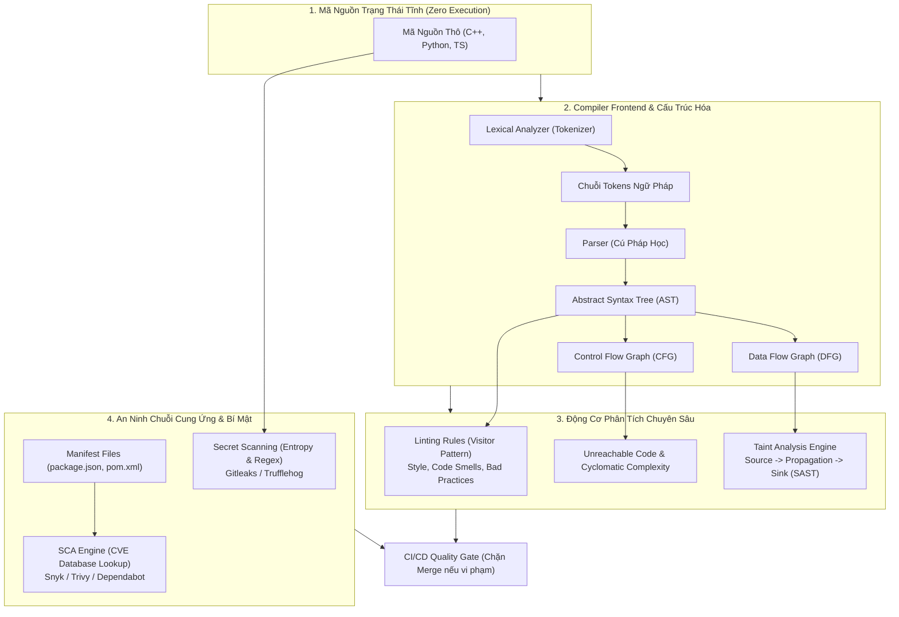
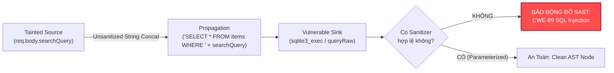

# 8.3. Phân Tích Mã Tĩnh và Bảo Mật Ứng Dụng (Static Analysis & Security Scanning)

> [!IMPORTANT]
> **Nếu bạn chỉ được nhớ một điều duy nhất:** Phân tích mã tĩnh là nghệ thuật thẩm định mã nguồn ở trạng thái "ngủ" (Zero-execution) thông qua Cây Cú pháp Trừu tượng (AST) và Phân tích Dòng Ô nhiễm (Taint Analysis) để phát hiện và triệt tiêu lỗi logic, vi phạm chuẩn mực và các lỗ hổng bảo mật chí mạng ngay trên máy trạm của lập trình viên trước khi code kịp chạm vào môi trường kiểm thử.

---

## 1. Kiến trúc Tổng quan & Mô hình Tư duy (Mental Model)

### Phép loại suy kỹ thuật: Máy Chụp Cắt Lớp X-Quang / MRI Y Khoa
Hãy hình dung quá trình kiểm tra phần mềm giống như việc chẩn đoán y khoa hiện đại:
- **Kiểm thử động (Dynamic Testing / DAST / Unit Testing)**: Giống như bài kiểm tra chạy gắng sức trên máy chạy bộ. Bác sĩ cho bệnh nhân vận động cật lực (thực thi phần mềm với tải thật) để đo nhịp tim và huyết áp. Nhược điểm là bạn chỉ phát hiện được vấn đề nếu cho bệnh nhân chạy đúng bài tập kích hoạt cơn đau, và không thể nhìn thấy các khối u đang âm thầm hình thành trong nội tạng.
- **Phân tích mã tĩnh (Static Code Analysis / SAST / SCA)**: Hoạt động giống như máy quét cắt lớp vi tính (CT Scanner) hoặc chụp cộng hưởng từ (MRI). Cơ thể bệnh nhân nằm bất động tuyệt đối (Zero-execution — chương trình không hề chạy). Tia X xuyên thấu qua từng lớp mô, dựng lại toàn bộ bản đồ 3D cấu trúc xương và mạch máu (Abstract Syntax Tree & Control Flow Graph). Bác sĩ có thể chỉ ra chính xác điểm tắc nghẽn mạch máu hoặc vết rạn xương siêu nhỏ (SQL Injection, rò rỉ bộ nhớ, biến chưa khởi tạo) mà không cần phải chờ đến khi bệnh nhân đột quỵ.



---

## 2. Chi tiết từng Keyword (Under-the-Hood Deep Dive)

### 2.1. Kiến trúc Phân tích Tầng Thấp: Lexer, Parser & Abstract Syntax Tree (AST)
- **Bản chất kỹ thuật**:
  - **Lexical Analysis (Tokenizer)**: Bộ tách từ vựng quét qua từng byte ký tự trong file mã nguồn, gom nhóm chúng thành các đơn vị từ vựng mang ý nghĩa gọi là **Tokens** (Keyword: `if`, `while`; Identifier: `userAge`; Operator: `+`, `==`; Literal: `42`, `"admin"`). Toàn bộ khoảng trắng (whitespace) và chú thích không quan trọng bị loại bỏ.
  - **Syntactic Analysis (Parsing)**: Parser tiếp nhận chuỗi Tokens và áp dụng ngữ pháp phi ngữ cảnh (Context-Free Grammar - CFG) của ngôn ngữ để dựng nên **Abstract Syntax Tree (AST)**.
  - **AST (Cây cú pháp trừu tượng)**: Là một cấu trúc dữ liệu dạng cây n-phân, trong đó mỗi nút (Node) đại diện cho một cấu trúc ngữ pháp cụ thể (như `IfStatement`, `BinaryExpression`, `FunctionDeclaration`). Mọi công cụ phân tích tĩnh tiên tiến (ESLint, Clang-Tidy, Babel) đều vận hành bằng cách duyệt cây AST bằng mẫu thiết kế **Visitor Pattern**.

### 2.2. Control Flow Graph (CFG) & Data Flow Analysis (DFA)
- **Bản chất kỹ thuật**:
  - **Control Flow Graph (CFG)**: Một đồ thị có hướng trong đó mỗi nút là một khối lệnh cơ bản (Basic Block - chuỗi lệnh không có rẽ nhánh), và mỗi cạnh biểu diễn sự chuyển đổi luồng thực thi (Jumps, Branches, Loops). CFG cho phép phát hiện mã không bao giờ chạm tới (Unreachable Code) và vòng lặp vô tận.
  - **Data Flow Analysis (Phân tích luồng dữ liệu)**: Theo dõi giá trị của các biến khi chúng di chuyển qua các nhánh của CFG. Giúp phát hiện lỗi sử dụng biến chưa khởi tạo (Use of uninitialized variable) hoặc giải phóng bộ nhớ hai lần (Double Free).

### 2.3. Taint Analysis (Source, Sanitizer, Sink, CWE-89, CWE-78)
- **Bản chất kỹ thuật**:
  - Là công nghệ cốt lõi của các hệ thống SAST chuyên nghiệp nhằm phát hiện các lỗ hổng Injection nguy hiểm nhất (OWASP Top 10):
    1. **Tainted Source (Nguồn ô nhiễm)**: Điểm dữ liệu đầu vào không đáng tin cậy từ bên ngoài hệ thống (HTTP Request Header/Body, query string `req.getParameter()`, file upload, stdin).
    2. **Propagation (Lan truyền)**: Quá trình dữ liệu ô nhiễm được gán qua các biến tạm thời, nối chuỗi (String Concatenation), hoặc truyền qua tham số của các hàm trung gian.
    3. **Sanitizer (Bộ lọc làm sạch)**: Hàm kiểm tra hoặc mã hóa dữ liệu an toàn (ví dụ: Prepared Statement Parameter, HTML Entity Encoder, Regex Whitelist). Nếu dữ liệu đi qua Sanitizer, cờ "ô nhiễm" được xóa bỏ.
    4. **Vulnerable Sink (Điểm tiếp nhận nhạy cảm)**: Nơi dữ liệu được thực thi hoặc ghi trực tiếp vào tầng tài nguyên nguy hiểm (ví dụ: `db.executeRawSql()`, `eval()`, `system()`, `child_process.exec()`).
  - *Cảnh báo*: Nếu một đường dẫn dữ liệu đi từ **Source $\rightarrow$ Sink** mà không vượt qua bất kỳ **Sanitizer** nào, SAST sẽ kích hoạt cảnh báo đỏ mức P0 (ví dụ CWE-89: SQL Injection, CWE-78: OS Command Injection).



### 2.4. Linters & Rules Engine (Visitor Pattern, Clang-Tidy, ESLint)
- **Bản chất kỹ thuật**:
  - **Linters**: Các chương trình tự động phân tích AST và bảng ký hiệu để phát hiện lỗi logic, code smells, và vi phạm quy ước lập trình.
  - *Visitor Pattern Mechanism*: Linter đăng ký các hàm callback lắng nghe các loại Node cụ thể trên AST. Ví dụ, rule `no-floating-promises` trong TypeScript ESLint sẽ lắng nghe các node `CallExpression`, kiểm tra xem hàm đó có trả về `Promise` hay không; nếu có mà không nằm dưới `await` hoặc `.then()`, linter sẽ báo lỗi ngay lập tức.
  - Các linter tiêu chuẩn công nghiệp: **Clang-Tidy** cho C/C++, **ESLint / Biome** cho JavaScript/TypeScript, **Ruff / Flake8** cho Python, **Golangci-lint** cho Go.

### 2.5. Code Formatters & Triệt tiêu Tranh cãi Phong cách (Clang-Format, Prettier)
- **Bản chất kỹ thuật**:
  - Khác với Linter (tập trung vào tính đúng đắn và logic), **Formatter** chỉ quan tâm đến hình thức trình bày văn bản (Indentation, Newlines, Quoting, Trailing Commas, Line Length).
  - **Zero Debate (Anti-Bikeshedding Philosophy)**: Trong kỹ nghệ phần mềm, hàng trăm giờ họp và hàng nghìn bình luận review vô nghĩa đã bị lãng phí chỉ để tranh cãi xem dấu mở ngoặc nhọn `{` nên nằm cùng dòng hay xuống dòng. Các công cụ định dạng tự động không khoan nhượng (Opinionated Formatters như Prettier, Clang-Format, `gofmt`, Black) áp đặt một quy chuẩn duy nhất cho toàn công ty, tự động format mã nguồn khi lưu file (Save Hook) hoặc trước khi commit (Pre-commit Hook).

### 2.6. Code Metrics: Cyclomatic Complexity (McCabe) & Maintainability Index
- **Bản chất kỹ thuật**:
  - **Cyclomatic Complexity (Độ phức tạp lặp - Thomas McCabe, 1976)**: Đo lường số lượng đường dẫn độc lập tuyến tính qua mã nguồn của một chương trình.
    $$\mathcal{M} = E - N + 2P$$
    Trong đó: $E$ là số cạnh (edges) trong CFG, $N$ là số nút (nodes), và $P$ là số thành phần liên thông (thường $P=1$).
    *Quy tắc ngón tay cái*: Một hàm có $\mathcal{M} \le 10$ được coi là tốt; $11 - 20$ là phức tạp vừa phải; $>20$ là có độ rủi ro rất cao và cực kỳ khó viết đủ Unit Test để đạt 100% Branch Coverage.
  - **Maintainability Index (MI)**: Chỉ số tổng hợp từ $0$ đến $100$ dựa trên độ phức tạp McCabe, số dòng code (LOC) và số đo Halstead Volume. Điểm số $>85$ thể hiện mã nguồn rất dễ bảo trì.

### 2.7. Static Application Security Testing (SAST): White-box Security (SonarQube, Semgrep)
- **Bản chất kỹ thuật**:
  - Kiểm thử an ninh ứng dụng tĩnh (White-box Testing): Công cụ có toàn quyền truy cập mã nguồn gốc. SAST tìm kiếm các pattern sai lầm phổ biến: Khởi tạo mật mã yếu (Weak Cryptography - MD5, DES), giải mã đối tượng không an toàn (Insecure Deserialization), lỗ hổng tràn bộ đệm (Buffer Overflow), và kiểm tra quyền truy cập bị thiếu (Broken Object Level Authorization).
  - Các công cụ hàng đầu: **Semgrep** (dựa trên mẫu tìm kiếm ngữ nghĩa AST siêu nhanh), **SonarQube** (toàn diện với bộ Quality Gates chặt chẽ), **Checkmarx**, **Fortify**.

### 2.8. Secret Scanning & Shannon Entropy Detection (Gitleaks, Trufflehog)
- **Bản chất kỹ thuật**:
  - Quét toàn bộ cây thư mục và lịch sử Git Commits để phát hiện các thông tin định danh nhạy cảm (API Keys, Private Keys, Database Connection Strings, JWT Secrets) bị commit nhầm.
  - *Cơ chế phát hiện*:
    1. **Regex Pattern Matching**: Nhận diện tiền tố chuẩn của các nhà cung cấp (ví dụ: `AKIA[0-9A-Z]{16}` của AWS Access Key, `ghp_[0-9a-zA-Z]{36}` của GitHub Personal Access Token).
    2. **Shannon Entropy (Độ hỗn loạn thông tin)**: Đo lường mức độ ngẫu nhiên của chuỗi ký tự theo công thức:
       $$H(X) = -\sum_{i=1}^{n} P(x_i) \log_2 P(x_i)$$
       Các chuỗi ngẫu nhiên sinh bằng mã hóa mật mã học (như Private Key hoặc Secret Password Base64) có độ hỗn loạn rất cao ($H > 4.5$), khác biệt rõ rệt so với từ ngữ tiếng Anh thông thường.

### 2.9. Software Composition Analysis (SCA) & CVE Vulnerability Management (Snyk, Trivy)
- **Bản chất kỹ thuật**:
  - Hơn $80\%$ mã nguồn trong các ứng dụng đám mây thực chất là thư viện mã nguồn mở. **SCA** phân tích cây phụ thuộc (Dependency Tree - cả phụ thuộc trực tiếp lẫn truyền dẫn Transitive Dependencies).
  - Đối chiếu mã hash SHA và phiên bản của thư viện với cơ sở dữ liệu lỗ hổng bảo mật toàn cầu (NVD - National Vulnerability Database / GitHub Advisory Database) để liệt kê các mã **CVE (Common Vulnerabilities and Exposures)** cùng điểm số nguy hiểm **CVSS**.
  - Kiểm soát vi phạm bản quyền phần mềm (License Compliance): Ngăn chặn việc đưa thư viện mang giấy phép GPLv3 có tính "lây nhiễm" vào một phần mềm nguồn đóng thương mại.

### 2.10. C++ Memory & Format Vulnerabilities (Buffer Overflow CWE-120, Format String CWE-134, C++20 std::format)
- **Bản chất kỹ thuật**:
  - **Buffer Overflow (CWE-120)**: Sử dụng các hàm C cổ điển nguy hiểm (`strcpy`, `gets`, `sprintf`) ghi dữ liệu vượt quá kích thước mảng tĩnh trên Stack, cho phép kẻ tấn công đè lên con trỏ địa chỉ trả về (`Return Address`) để chiếm quyền điều khiển con trỏ lệnh (`Instruction Pointer - RIP/EIP`).
  - **Format String Vulnerability (CWE-134)**: Truyền chuỗi đầu vào do người dùng kiểm soát trực tiếp vào vị trí format string của `printf(userInput)`. Kẻ tấn công có thể truyền các format specifiers như `%x` để trích xuất dữ liệu trên Stack (Information Disclosure) hoặc `%n` để ghi đè giá trị vào bộ nhớ tùy ý (Arbitrary Memory Write).
  - *Chuẩn mực hiện đại*: Bắt buộc chuyển đổi sang **C++20 `std::format`** hoặc `std::print` (C++23), với khả năng kiểm tra type-safety của chuỗi định dạng ngay ở thời điểm biên dịch (Compile-time Format String Checking).

---

## 3. Thực thi Mã nguồn & Mô phỏng Chuyên sâu (Dual-Engine Implementation)

### 3.1. Engine C++20: Mô phỏng AST Tokenizer & Compile-Time Format Safety
Chương trình minh họa hai nội dung:
1. Xây dựng một Lexer/Tokenizer đơn giản bóc tách Tokens mã nguồn để linter kiểm tra lỗi so sánh bằng số thực (`float == float`).
2. Trình diễn kỹ thuật triệt tiêu lỗ hổng Format String bằng `std::format`.

```cpp
#include <iostream>
#include <string>
#include <string_view>
#include <vector>
#include <format>
#include <variant>
#include <cstdint>

// ============================================================================
// 1. MINI COMPILER FRONTEND: TOKENIZER & STATIC AST LINTER DEMO
// ============================================================================

enum class TokenType {
    Identifier,
    FloatLiteral,
    DoubleEquals, // ==
    Assignment,   // =
    SemiColon
};

struct Token {
    TokenType type;
    std::string text;
    size_t line;
};

// Đơn giản hóa Lexer: Quét mã nguồn và nhận diện token nguy hiểm
class SimpleLexer {
public:
    static std::vector<Token> tokenize(std::string_view source) {
        std::vector<Token> tokens;
        size_t currentLine = 1;

        for (size_t i = 0; i < source.length(); ++i) {
            char c = source[i];
            if (c == '\n') {
                currentLine++;
            } else if (std::isspace(c)) {
                continue;
            } else if (c == '=' && i + 1 < source.length() && source[i + 1] == '=') {
                tokens.push_back({TokenType::DoubleEquals, "==", currentLine});
                i++; // Bỏ qua ký tự '=' thứ hai
            } else if (c == '=') {
                tokens.push_back({TokenType::Assignment, "=", currentLine});
            } else if (std::isdigit(c)) {
                size_t start = i;
                bool hasDot = false;
                while (i < source.length() && (std::isdigit(source[i]) || source[i] == '.')) {
                    if (source[i] == '.') hasDot = true;
                    i++;
                }
                tokens.push_back({TokenType::FloatLiteral, std::string(source.substr(start, i - start)), currentLine});
                i--; // Lùi lại 1 bước do vòng for sẽ tăng
            } else if (std::isalpha(c)) {
                size_t start = i;
                while (i < source.length() && std::isalnum(source[i])) {
                    i++;
                }
                tokens.push_back({TokenType::Identifier, std::string(source.substr(start, i - start)), currentLine});
                i--;
            }
        }
        return tokens;
    }
};

// Linter Rule: Cấm so sánh chính xác số thực (CWE-1077 / Floating-point Exact Comparison)
class FloatComparisonLintRule {
public:
    static void check(const std::vector<Token>& tokens) {
        std::cout << "[Linter Execution] Scanning AST tokens for Bugprone Patterns...\n";
        for (size_t i = 0; i + 2 < tokens.size(); ++i) {
            if (tokens[i + 1].type == TokenType::DoubleEquals) {
                if (tokens[i].type == TokenType::FloatLiteral || tokens[i + 2].type == TokenType::FloatLiteral) {
                    std::cerr << std::format("  -> [LINTER WARNING at Line {}] Dangerous exact floating-point comparison: '{} == {}'. Use epsilon threshold instead!\n",
                        tokens[i + 1].line, tokens[i].text, tokens[i + 2].text);
                }
            }
        }
    }
};

// ============================================================================
// 2. MEMORY SAFETY & CWE-134 FORMAT STRING VULNERABILITY MITIGATION
// ============================================================================

void demonstrateSafeLogging(std::string_view untrustedUserInput) {
    std::cout << "\n--- Mitigating CWE-134 (Format String Attack) with std::format ---\n";
    
    // NGUY HIỂM TRONG C CỔ ĐIỂN: printf(untrustedUserInput.data()); 
    // Nếu attacker truyền "%x %x %x %n", sẽ làm leak stack hoặc ghi đè memory!

    // AN TOÀN TRONG C++20: std::format luôn coi chuỗi format là bất biến và parse kiểu an toàn
    std::string safeLogMessage = std::format("[AUDIT SECURE LOG] Payload: {}\n", untrustedUserInput);
    std::cout << safeLogMessage;
}

int main() {
    std::cout << "=== C++20 STATIC ANALYSIS & COMPILER AST SIMULATION ===\n\n";

    // 1. Chạy linter phát hiện so sánh sai số thực
    std::string sampleCode = "double sensorVal = 0.3;\nif (sensorVal == 0.3) {\n    triggerAlarm();\n}";
    std::cout << "Source Code to Analyze:\n" << sampleCode << "\n\n";

    auto tokens = SimpleLexer::tokenize(sampleCode);
    FloatComparisonLintRule::check(tokens);

    // 2. Chạy thử chuỗi tấn công Format String
    std::string maliciousPayload = "Alice%20Secret%x%x%n_Malicious_Memory_Dump";
    demonstrateSafeLogging(maliciousPayload);

    return 0;
}
```

---

### 3.2. Engine Python 3.11+: Taint Analysis Simulation Engine
Mô phỏng cơ chế Taint Engine của một công cụ SAST: Phát hiện đường truyền dữ liệu ô nhiễm từ HTTP Source đến SQL Sink khi không đi qua Sanitizer.

```python
"""
Python 3.11+ SAST Taint Analysis Engine Simulation
Minh họa cơ chế truy vết Taint Source -> Propagation -> Sanitizer -> Vulnerable Sink.
"""
from dataclasses import dataclass, field
from enum import Enum, auto
from typing import Optional

class TaintStatus(Enum):
    CLEAN = auto()
    TAINTED = auto()

@dataclass
class VariableSymbol:
    name: str
    status: TaintStatus
    origin_source: Optional[str] = None

class MiniTaintEngine:
    def __init__(self) -> None:
        self.symbol_table: dict[str, VariableSymbol] = {}
        self.security_violations: list[str] = []

    def register_tainted_source(self, var_name: str, source_description: str) -> None:
        """Khai báo một biến nhận dữ liệu ô nhiễm từ thế giới bên ngoài."""
        self.symbol_table[var_name] = VariableSymbol(
            name=var_name,
            status=TaintStatus.TAINTED,
            origin_source=source_description
        )
        print(f"[Source Detected] Variable '{var_name}' tainted by external input: {source_description}")

    def propagate_assignment(self, target_var: str, expression_operands: list[str]) -> None:
        """Theo dõi sự lan truyền dữ liệu (Data Propagation)."""
        is_contaminated = False
        original_source = None

        for op in expression_operands:
            if op in self.symbol_table and self.symbol_table[op].status == TaintStatus.TAINTED:
                is_contaminated = True
                original_source = self.symbol_table[op].origin_source
                break

        status = TaintStatus.TAINTED if is_contaminated else TaintStatus.CLEAN
        self.symbol_table[target_var] = VariableSymbol(
            name=target_var,
            status=status,
            origin_source=original_source
        )
        print(f"[Data Flow] '{target_var}' assigned from operands {expression_operands} -> Status: {status.name}")

    def apply_sanitizer(self, var_name: str, sanitizer_name: str) -> None:
        """Khử ô nhiễm (Sanitizing): Dữ liệu đi qua hàm mã hóa hoặc ràng buộc kiểu an toàn."""
        if var_name in self.symbol_table:
            self.symbol_table[var_name].status = TaintStatus.CLEAN
            print(f"[Sanitized] Variable '{var_name}' purified by '{sanitizer_name}'. Status -> CLEAN")

    def inspect_sink(self, sink_name: str, variable_used: str, cwe_id: str) -> bool:
        """Kiểm tra tại điểm thực thi nhạy cảm (Vulnerable Sink)."""
        var_info = self.symbol_table.get(variable_used)
        if var_info and var_info.status == TaintStatus.TAINTED:
            violation = (
                f"🚨 SAST ALERT: {cwe_id} at sink '{sink_name}'! "
                f"Variable '{variable_used}' carries unsanitized payload from '{var_info.origin_source}'."
            )
            self.security_violations.append(violation)
            print(violation)
            return False
        
        print(f"✅ Sink '{sink_name}' passed audit: Variable '{variable_used}' is safe.")
        return True

# ============================================================================
# AUDIT SIMULATION EXECUTION
# ============================================================================
if __name__ == "__main__":
    print("=== SAST TAINT ANALYSIS SECURITY SCANNER ENGINE ===\n")
    scanner = MiniTaintEngine()

    print("--- Scenario 1: Unsanitized SQL Query (Vulnerable Path) ---")
    scanner.register_tainted_source("http_username", "HTTP GET /api/v1/user?name=")
    # Lập trình viên nối chuỗi thô: sql_query = "SELECT * FROM users WHERE name = " + http_username
    scanner.propagate_assignment("sql_query", ["raw_string_const", "http_username"])
    # Truyền vào hàm thực thi SQL trực tiếp
    scanner.inspect_sink("sqlite3_exec(sql_query)", "sql_query", "CWE-89: SQL Injection")

    print("\n--- Scenario 2: Sanitized Input (Secure Path) ---")
    scanner.register_tainted_source("http_product_id", "HTTP GET /api/v1/product?id=")
    # Dữ liệu đi qua hàm ép kiểu số nguyên an toàn (Sanitizer)
    scanner.apply_sanitizer("http_product_id", "int_type_cast_sanitizer()")
    scanner.propagate_assignment("clean_query", ["http_product_id"])
    scanner.inspect_sink("db_query(clean_query)", "clean_query", "CWE-89: SQL Injection")
```

### 3.3. Giả lập Terminal Output
```text
=== C++20 STATIC ANALYSIS & COMPILER AST SIMULATION ===

Source Code to Analyze:
double sensorVal = 0.3;
if (sensorVal == 0.3) {
    triggerAlarm();
}

[Linter Execution] Scanning AST tokens for Bugprone Patterns...
  -> [LINTER WARNING at Line 2] Dangerous exact floating-point comparison: 'sensorVal == 0.3'. Use epsilon threshold instead!

--- Mitigating CWE-134 (Format String Attack) with std::format ---
[AUDIT SECURE LOG] Payload: Alice%20Secret%x%x%n_Malicious_Memory_Dump

=== SAST TAINT ANALYSIS SECURITY SCANNER ENGINE ===

--- Scenario 1: Unsanitized SQL Query (Vulnerable Path) ---
[Source Detected] Variable 'http_username' tainted by external input: HTTP GET /api/v1/user?name=
[Data Flow] 'sql_query' assigned from operands ['raw_string_const', 'http_username'] -> Status: TAINTED
🚨 SAST ALERT: CWE-89: SQL Injection at sink 'sqlite3_exec(sql_query)'! Variable 'sql_query' carries unsanitized payload from 'HTTP GET /api/v1/user?name='.

--- Scenario 2: Sanitized Input (Secure Path) ---
[Source Detected] Variable 'http_product_id' tainted by external input: HTTP GET /api/v1/product?id=
[Sanitized] Variable 'http_product_id' purified by 'int_type_cast_sanitizer()'. Status -> CLEAN
[Data Flow] 'clean_query' assigned from operands ['http_product_id'] -> Status: CLEAN
✅ Sink 'db_query(clean_query)' passed audit: Variable 'clean_query' is safe.
```

---

## 4. Systems Engineering & Production Pitfalls

### 4.1. Production Failure Modes
1. **Hội Chứng Mệt Mỏi vì Báo Động Giả (False Positive Fatigue)**:
   - *Kịch bản*: Khi đội ngũ bảo mật bật toàn bộ hàng nghìn quy tắc SAST mặc định ở mức cao nhất, công cụ báo 500 lỗi mỗi ngày, trong đó $90\%$ là báo động giả (False Positives). Lập trình viên bị quá tải, bắt đầu gắn comment `// nolint` hoặc `# noqa` bừa bãi khắp codebase, vô tình che giấu một lỗ hổng bảo mật thực sự nguy hiểm.
   - *Giải pháp*: Xây dựng bộ quy tắc (Ruleset) tùy biến có chọn lọc, chỉ chặn CI đối với các lỗi có độ tin cậy cao (High Confidence) và mức độ nguy hiểm nghiêm trọng (P0/P1).
2. **"Bịt Miệng" Git History Khi Secret Bị Rò Rỉ**:
   - *Kịch bản*: Một kỹ sư lỡ commit file `aws_secret.json` chứa Private Key lên repository công khai. Kỹ sư vội vàng tạo một commit mới để xóa file đó (`git rm`). Tuy nhiên, file và khóa bí mật vẫn nằm vĩnh viễn trong các commit trước đó trong lịch sử Git. Hacker dùng bot tự động quét và rút sạch tài nguyên đám mây chỉ sau 5 phút.
   - *Giải pháp*: Phải chạy **Gitleaks / Trufflehog** ngay ở cấp độ Pre-commit Hook (chặn đứng trước khi commit được tạo ra). Nếu đã lỡ đẩy lên remote, bắt buộc phải thu hồi (Revoke/Rotate) ngay lập tức khóa bí mật đó trên AWS Console.

### 4.2. Tooling & Pipeline Integration Recipes
- **Gitleaks trong Pre-commit Hook**:
  ```bash
  # Cài đặt và chạy quét toàn bộ lịch sử git cục bộ
  gitleaks detect --source . --verbose --redact
  ```
- **Semgrep SAST Scanning**:
  ```bash
  # Quét mã nguồn với bộ quy tắc bảo mật chuẩn OWASP Top 10
  semgrep --config=auto --error --severity=ERROR src/
  ```
- **Trivy File System & Dependency Scanning (SCA)**:
  ```bash
  # Quét toàn bộ lỗ hổng bảo mật thư viện trong thư mục hiện tại
  trivy fs --security-checks vuln,config,secret .
  ```

---

## 5. Bảng So sánh & Decision Matrix

| Chiều Kỹ Thuật | SAST (Static App Sec Testing) | DAST (Dynamic App Sec Testing) | SCA (Software Composition Analysis) | Secret Scanning |
| :--- | :--- | :--- | :--- | :--- |
| **Mục Tiêu Quét** | Mã nguồn tự viết (First-party code) | Ứng dụng đang chạy (HTTP Endpoints) | Thư viện mã nguồn mở (Third-party) | Tokens, API Keys, Credentials |
| **Thời Điểm Kiểm Tra** | Trong IDE & khi Commit/Pull Request | Môi trường Staging / Pre-prod | Quá trình Build & Package Manifests | Pre-commit Hook & Git Commits |
| **Bản Chất Kiểm Tra** | White-box (Thấy toàn bộ AST & Code) | Black-box (Chỉ thấy HTTP Input/Output) | So sánh đối chiếu cơ sở dữ liệu CVE | Biểu thức Regex & Shannon Entropy |
| **Độ Chính Xác / False Positives** | Trung bình (Nhiều báo động giả nếu rules lỏng) | Thấp (Phụ thuộc vào Test Coverage) | Rất cao (Khớp chính xác version hash) | Rất cao (Đặc biệt với Provider Regex) |
| **Công Cụ Tiêu Biểu** | SonarQube, Semgrep, Checkmarx | OWASP ZAP, Burp Suite | Snyk, Trivy, Dependabot | Gitleaks, Trufflehog, GitGuardian |
| **Khuyến Nghị Áp Dụng** | Bắt buộc trong CI Pipeline | Chạy định kỳ hàng đêm trên Staging | Bắt buộc kiểm soát mọi dependency mới | Bắt buộc cài đặt cho 100% lập trình viên |
