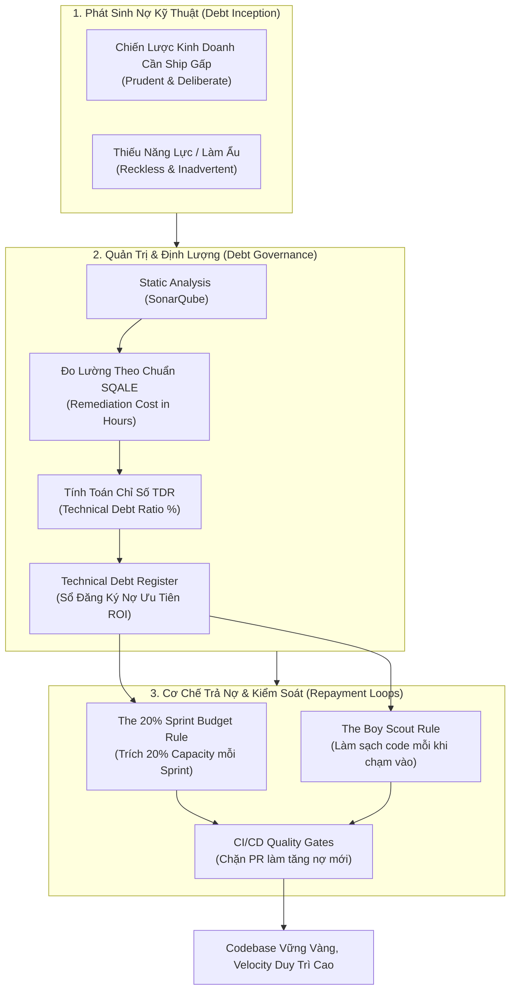
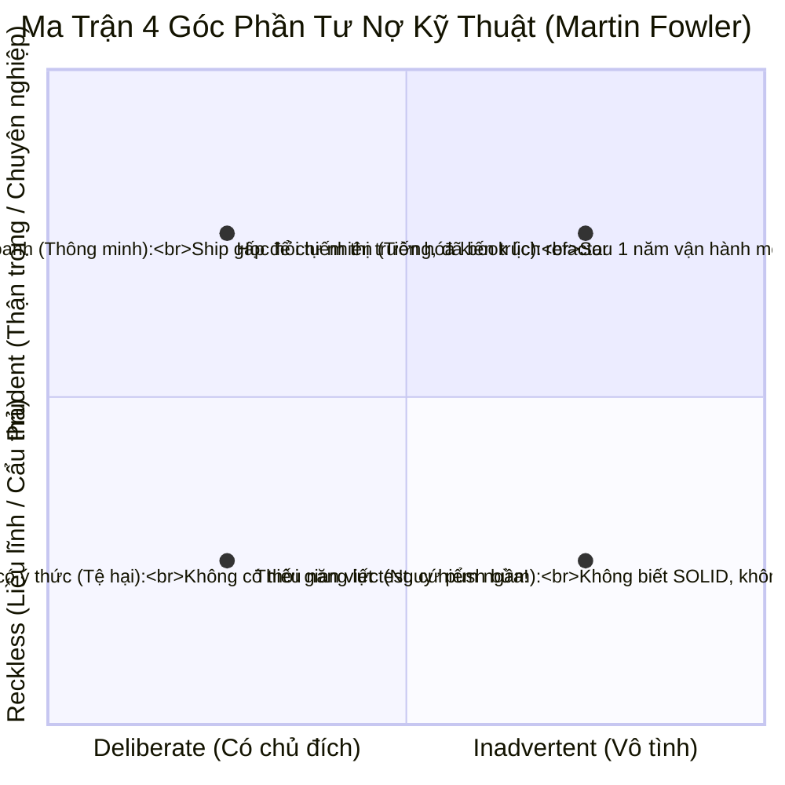

# 8.4. Quản Trị và Triệt Tiêu Nợ Kỹ Thuật (Technical Debt Management & Governance)

> [!IMPORTANT]
> **Nếu bạn chỉ được nhớ một điều duy nhất:** Nợ kỹ thuật không phải là tội lỗi cần triệt tiêu $100\%$, mà là một đòn bẩy tài chính rủi ro cao; việc vay nợ chỉ hợp lý khi nó là một quyết định thận trọng và có chủ đích (Prudent & Deliberate) đi kèm kế hoạch hoàn vốn nghiêm ngặt (20% Sprint Capacity & CI/CD Quality Gates) nhằm ngăn chặn hiện tượng lãi kép dẫn tới phá sản kỹ thuật (Technical Bankruptcy).

---

## 1. Kiến trúc Tổng quan & Mô hình Tư duy (Mental Model)

### Phép loại suy tài chính: Thẻ Tín Dụng vs Vay Thế Chấp Đầu Tư
Hãy tưởng tượng hệ thống phần mềm giống như một doanh nghiệp đang vận hành tài chính:
- **Nợ cẩu thả, bừa bãi (Reckless Debt - Vay nóng / Tín dụng đen)**: Bạn quẹt thẻ tín dụng lãi suất $35\%$/năm để mua sắm xa xỉ và liên hoan phung phí (bỏ qua viết unit test, hardcode thông tin kết nối DB, copy-paste mã nguồn lung tung chỉ để kịp demo một tính năng chưa rõ thị trường). Ban đầu cảm thấy rất hào nhoáng và nhanh chóng, nhưng chỉ sau vài tháng, tiền lãi hàng tháng (thời gian sửa lỗi, hệ thống sập ban đêm, nhân sự chán nản nghỉ việc) vượt quá thu nhập của bạn. Toàn bộ đội ngũ rơi vào **Phá sản kỹ thuật (Technical Bankruptcy)**: Không thể phát triển thêm bất kỳ tính năng mới nào vì $100\%$ thời gian phải đi dập lửa.
- **Nợ chiến lược, có tính toán (Prudent Debt - Vay thế chấp mua xưởng sản xuất)**: Công ty quyết định vay nợ có chủ đích để chớp lấy cơ hội vàng chiếm lĩnh thị trường trước đối thủ 3 tháng. Đội ngũ ghi chép lại chính xác từng khoản nợ vào sổ nợ (Technical Debt Register) và lập tức trích **$20\%$ dòng tiền (Sprint Capacity)** mỗi tháng để trả góp nợ gốc (Refactoring, thiết lập CI/CD, chuẩn hóa API). Sau khi mở rộng thành công, khoản nợ được tất toán hoàn toàn và hệ thống vận hành vững chắc.



---

## 2. Chi tiết từng Keyword (Under-the-Hood Deep Dive)

### 2.1. Phép Ẩn dụ Tài chính của Ward Cunningham: Nợ Gốc, Lãi Suất & Phá Sản Kỹ Thuật
- **Bản chất kỹ thuật**:
  - Năm 1992, Ward Cunningham đưa ra thuật ngữ **Technical Debt**:
    - **Nợ gốc (Principal)**: Phần công việc kỹ thuật đáng lẽ phải làm nhưng bị trì hoãn (viết test bao phủ các nhánh biên, thiết kế cấu trúc database ở dạng chuẩn hóa 3NF, tách biệt các tầng kiến trúc).
    - **Lãi suất (Interest)**: Chi phí phụ trội phát sinh liên tục trong tương lai mỗi khi lập trình viên làm việc trên codebase đó. Lãi suất biểu hiện dưới dạng: Thời gian đọc hiểu code tăng vọt (Cognitive Load), tốc độ ship tính năng mới giảm từ 2 ngày xuống 3 tuần, và mỗi khi sửa một module thì ba module khác ở xa bị gãy vỡ (Regression Bugs).
    - **Phá sản kỹ thuật (Technical Bankruptcy)**: Điểm tới hạn khi lãi suất nợ tích lũy vượt quá $100\%$ năng lực của đội ngũ kỹ sư. Chi phí để sửa một lỗi nhỏ đắt hơn cả việc đập bỏ toàn bộ hệ thống để viết lại.

### 2.2. Martin Fowler's Technical Debt Quadrant (Phân Tích 4 Góc Phần Tư)
Martin Fowler phân loại nợ kỹ thuật dựa trên hai chiều không gian: **Thái độ kỹ thuật (Prudent vs Reckless)** và **Mức độ nhận thức (Deliberate vs Inadvertent)**:



1. **Prudent & Deliberate (Thận trọng & Có chủ đích)**:
   - *"Chúng ta phải ra mắt tính năng thanh toán này trước ngày Black Friday 1 tuần để bắt kịp đối thủ. Chúng ta chấp nhận bỏ qua phần caching phân tán, nhưng chúng ta đã lập Issue trên Jira để refactor vào Sprint ngay sau sự kiện"*. Đây là quyết định kinh doanh đỉnh cao, sử dụng nợ như đòn bẩy.
2. **Reckless & Deliberate (Liều lĩnh & Cẩu thả)**:
   - *"Viết unit test làm gì cho tốn thời gian, khách hàng chỉ nhìn thấy giao diện thôi! Cứ hardcode đi cho xong việc"*. Loại nợ độc hại này sinh ra do áp lực tiến độ mù quáng hoặc văn hóa kỹ thuật yếu kém.
3. **Prudent & Inadvertent (Thận trọng & Vô tình)**:
   - *"Sau 2 năm phục vụ 1 triệu người dùng, chúng ta nhận ra rằng mô hình dữ liệu quan hệ nguyên khối này không còn phù hợp với bài toán read-heavy nữa, kiến trúc cần chuyển sang Event Sourcing"*. Không ai có lỗi trong trường hợp này; đây là sự tiến hóa tất yếu của tri thức khi quy mô hệ thống tăng trưởng.
4. **Reckless & Inadvertent (Liều lĩnh & Thiếu hiểu biết)**:
   - Đội ngũ hoàn toàn không có kiến thức cơ bản về thiết kế hướng đối tượng, không hiểu về transaction isolation levels, viết code spaghetti nhưng vẫn nghĩ mình đang làm đúng.

### 2.3. Đo lường Nợ theo Phương pháp SQALE & Công thức TDR (Technical Debt Ratio)
- **Phương pháp SQALE (Software Quality Assessment based on Lifecycle Expectations)**:
  - Chuẩn hóa quốc tế được các công cụ như SonarQube ứng dụng để lượng hóa nợ kỹ thuật thành thời gian thực tế: Số phút/giờ công mà một kỹ sư phần mềm cần để sửa chữa toàn bộ các vi phạm quy tắc (Code Smells, Bugs, Security Hotspots).
- **Công thức Technical Debt Ratio (TDR)**:
  $$\text{TDR} = \frac{\text{Remediation Cost (Chi phí sửa nợ)}}{\text{Development Cost (Chi phí phát triển lại từ đầu)}} \times 100\%$$
  - Trong đó: $\text{Development Cost} = \text{Số dòng code (LOC)} \times \text{Chi phí ước tính để viết 1 dòng code chuẩn (ví dụ 0.06 giờ công/dòng)}$.
  - **Phân loại ngưỡng sức khỏe của hệ thống**:
    - $\text{TDR} \le 5\%$: **Hạng A (Green)** — Codebase cực kỳ khỏe mạnh, nợ ở mức tối thiểu.
    - $5\% < \text{TDR} \le 10\%$: **Hạng B** — Nợ chấp nhận được, cần duy trì kiểm soát.
    - $10\% < \text{TDR} \le 20\%$: **Hạng C** — Nợ bắt đầu ảnh hưởng rõ rệt đến velocity của Sprint.
    - $\text{TDR} > 20\%$: **Hạng D/E (Danger)** — Báo động đỏ; hệ thống có nguy cơ sụp đổ nếu không dành thời gian tái cấu trúc khẩn cấp.

### 2.4. Technical Debt Register (Sổ Đăng Ký Nợ Kỹ Thuật & Kiến Trúc Quản Trị)
- **Bản chất kỹ thuật**:
  - Nợ kỹ thuật không được ghi chép lại sẽ trở thành "nợ vô hình" (Invisible Debt). Lập trình viên phàn nàn nhưng Product Manager không thể nhìn thấy rủi ro tài chính để phê duyệt thời gian dọn dẹp.
  - **Technical Debt Register**: Một tài liệu sống hoặc một Dashboard Epic trên Jira / Linear ghi nhận từng khoản nợ kiến trúc với 4 trường thông tin bắt buộc:
    1. *Vị trí và Triệu chứng kỹ thuật*: Module nào đang bị nghẽn (ví dụ: `PaymentGateway.cpp` có độ phức tạp McCabe = 45).
    2. *Hậu quả kinh doanh (Business Impact)*: Mỗi lần deploy có $30\%$ nguy cơ sập module thanh toán, làm thất thoát doanh thu.
    3. *Kế hoạch khắc phục (Remediation Plan)*: Áp dụng Strategy Pattern và chia nhỏ thành 3 micro-services.
    4. *Ước lượng công sức & ROI*: Tốn 5 Story Points nhưng sẽ tiết kiệm 12 giờ bảo trì mỗi tháng.

### 2.5. Chiến lược Trả Nợ: Quy tắc Ngân sách 20% (The 20% Capacity Rule)
- **Bản chất kỹ thuật**:
  - Đừng bao giờ tổ chức một "Refactoring Sprint" riêng kéo dài 1 tháng mà không phát hành bất kỳ tính năng kinh doanh nào, vì Product Owner và Ban Giám Đốc sẽ từ chối do áp lực thị trường.
  - **Quy tắc ngân sách 20% (The 20% Capacity Rule - Google / Spotify Standard)**:
    - Trong mỗi Sprint 2 tuần (10 ngày làm việc), đội ngũ kỹ sư luôn trích cố định **$20\%$ tổng dung lượng (Story Points)** dành riêng cho việc trả nợ kỹ thuật:
      - $70\%$ cho các tính năng kinh doanh mới (Product Backlog).
      - $10\%$ cho việc fix bugs khẩn cấp.
      - **$20\%$ cho Technical Debt**: Nâng cấp version Node/Go/C++ runtime, refactor các hàm có độ phức tạp cao, tối ưu câu truy vấn SQL chậm, cập nhật thư viện bảo mật.

### 2.6. Quy tắc Hướng Đạo Sinh (The Boy Scout Rule trong Vi Xử Lý Mã Nguồn)
- **Bản chất kỹ thuật**:
  - *"Always leave the campground cleaner than you found it"* (Robert C. Martin).
  - Không cần phải chờ đợi những dự án refactor quy mô lớn. Mỗi khi một lập trình viên được giao nhiệm vụ sửa một con bug nhỏ trong file `OrderService.ts`, kỹ sư đó có nghĩa vụ đạo đức nghề nghiệp:
    - Đổi lại một tên biến khó hiểu thành tên tường minh.
    - Tách một hàm 80 dòng thành hai hàm 40 dòng.
    - Xóa bỏ một comment lỗi thời hoặc dead code.
  - Quá trình "vi trả nợ" liên tục này ngăn chặn hiện tượng **Broken Windows Theory (Thuyết cửa sổ vỡ)**: Khi một căn nhà có một ô cửa sổ bị vỡ không ai sửa, những người xung quanh sẽ cho rằng không ai quan tâm và sẽ tiếp tục đập vỡ những ô cửa còn lại.

### 2.7. Cơ chế Quality Gates trong CI/CD (SonarQube Gatekeeping)
- **Bản chất kỹ thuật**:
  - Cổng kiểm soát chất lượng (Quality Gate) là "người gác cổng" tự động chặn đứng mọi Pull Request vi phạm tiêu chuẩn nợ kỹ thuật trước khi code được phép hòa nhập vào nhánh `main`.
  - **Chính sách Clean as You Code (CaYC)**: Không đánh giá toàn bộ codebase 1 triệu dòng trong quá khứ (vì sẽ làm nản lòng kỹ sư), mà chỉ đánh giá khắt khe trên **mã nguồn mới (New Code / PR Diff)**:
    1. Coverage trên code mới phải $\ge 80\%$.
    2. Duplicated lines trên code mới phải $\le 3\%$.
    3. Technical Debt Ratio phát sinh thêm phải $\le 5\%$.
    4. 0 Bugs mới, 0 Lỗ hổng bảo mật mới (Zero new Vulnerabilities).

---

## 3. Thực thi Mã nguồn & Mô phỏng Chuyên sâu (Dual-Engine Implementation)

### 3.1. Engine C++20: SQALE Metric Engine & Technical Debt Ratio Calculator
Chương trình mô phỏng hệ thống phân tích mã nguồn tầng thấp, tính toán chi phí trả nợ kỹ thuật (Remediation Cost) dựa trên phương pháp SQALE và phân loại xếp hạng TDR.

```cpp
#include <iostream>
#include <string>
#include <string_view>
#include <vector>
#include <format>
#include <numeric>
#include <cstdint>

// ============================================================================
// 1. SQALE MODEL & TECHNICAL DEBT METRIC DEFINITIONS
// ============================================================================

enum class DebtCategory : uint8_t {
    CodeSmell,
    BugProne,
    SecurityVulnerability,
    Duplication
};

struct DebtIssue {
    std::string ruleId;
    std::string filePath;
    size_t lineNumber;
    DebtCategory category;
    uint32_t remediationCostMinutes; // Thời gian ước tính để sửa (SQALE)
};

enum class HealthRating : char {
    A = 'A', // TDR <= 5%
    B = 'B', // 5% < TDR <= 10%
    C = 'C', // 10% < TDR <= 20%
    D = 'D', // 20% < TDR <= 50%
    E = 'E'  // TDR > 50% (Phá sản kỹ thuật)
};

// ============================================================================
// 2. TECHNICAL DEBT GOVERNANCE ENGINE
// ============================================================================

class TechnicalDebtAnalyzer {
private:
    static constexpr double kHoursPerLineOfCode = 0.06; // Ước lượng chuẩn 0.06 giờ (3.6 phút) để viết 1 LOC
    static constexpr uint32_t kMinutesPerHour = 60;

public:
    struct Report {
        size_t totalLinesOfCode;
        uint32_t totalRemediationMinutes;
        double totalRemediationHours;
        double estimatedDevelopmentHours;
        double technicalDebtRatioPercent;
        HealthRating rating;
    };

    [[nodiscard]] static Report evaluateCodebase(size_t totalLoc, const std::vector<DebtIssue>& issues) noexcept {
        uint32_t totalRemediationMinutes = 0;
        for (const auto& issue : issues) {
            totalRemediationMinutes += issue.remediationCostMinutes;
        }

        double totalRemediationHours = static_cast<double>(totalRemediationMinutes) / kMinutesPerHour;
        double developmentHours = static_cast<double>(totalLoc) * kHoursPerLineOfCode;

        double tdr = (developmentHours > 0.0) 
            ? (totalRemediationHours / developmentHours) * 100.0 
            : 0.0;

        HealthRating rating = HealthRating::A;
        if (tdr > 50.0) rating = HealthRating::E;
        else if (tdr > 20.0) rating = HealthRating::D;
        else if (tdr > 10.0) rating = HealthRating::C;
        else if (tdr > 5.0)  rating = HealthRating::B;
        else                 rating = HealthRating::A;

        return Report{
            .totalLinesOfCode = totalLoc,
            .totalRemediationMinutes = totalRemediationMinutes,
            .totalRemediationHours = totalRemediationHours,
            .estimatedDevelopmentHours = developmentHours,
            .technicalDebtRatioPercent = tdr,
            .rating = rating
        };
    }
};

// ============================================================================
// MAIN TEST DRIVER
// ============================================================================
int main() {
    std::cout << "=== C++20 SQALE TECHNICAL DEBT MEASUREMENT ENGINE ===\n\n";

    // Giả lập một dự án Backend có 50,000 dòng code C++
    constexpr size_t kProjectLoc = 50'000;

    std::vector<DebtIssue> issues = {
        {"CPP-S3776", "src/OrderRouter.cpp", 142, DebtCategory::CodeSmell, 120}, // Cognitive complexity high
        {"CPP-S134",  "src/AuditLogger.cpp", 45,  DebtCategory::SecurityVulnerability, 180}, // Format string issue
        {"CPP-S1144", "src/LegacyAuth.cpp",  88,  DebtCategory::CodeSmell, 30},  // Dead private method
        {"CPP-S100",  "src/Payment.cpp",     210, DebtCategory::CodeSmell, 15},  // Naming convention
        {"CPP-S2095", "src/DbConnection.cpp", 99, DebtCategory::BugProne, 90}   // Resource leak risk
    };

    auto report = TechnicalDebtAnalyzer::evaluateCodebase(kProjectLoc, issues);

    std::cout << std::format("Project Size: {} Lines of Code\n", report.totalLinesOfCode);
    std::cout << std::format("Total Identified Issues: {}\n", issues.size());
    std::cout << std::format("Total Remediation Effort: {} minutes ({:.2f} hours)\n", 
        report.totalRemediationMinutes, report.totalRemediationHours);
    std::cout << std::format("Estimated Full Rebuild Cost: {:.2f} hours\n", report.estimatedDevelopmentHours);
    std::cout << std::format("Technical Debt Ratio (TDR): {:.3f}%\n", report.technicalDebtRatioPercent);
    std::cout << std::format("Software Health Grade: [ {} ]\n", static_cast<char>(report.rating));

    if (report.rating == HealthRating::A) {
        std::cout << "-> Status: EXCELLENT. Codebase is in pristine maintainable state.\n";
    } else {
        std::cout << "-> Status: ATTENTION REQUIRED. Allocate Sprint capacity to remediate debt.\n";
    }

    return 0;
}
```

---

### 3.2. Engine Python 3.11+: Quality Gate Policy Evaluator (CI/CD Automated Guardrail)
Mô phỏng cơ chế kiểm định Quality Gate tự động của hệ thống CI/CD để ngăn chặn việc merge các PR mang nợ kỹ thuật vượt trần.

```python
"""
Python 3.11+ Automated Quality Gate & Debt Governance Pipeline
Kiểm soát nợ kỹ thuật trên mã nguồn mới (Clean as You Code) trước khi hòa nhập Git.
"""
from dataclasses import dataclass
from typing import Final

@dataclass(frozen=True)
class QualityGateConfig:
    min_new_code_coverage_pct: float = 80.0
    max_new_debt_minutes: int = 60
    max_cyclomatic_complexity: int = 15
    allow_security_vulnerabilities: bool = False
    max_duplicated_lines_pct: float = 3.0

@dataclass(frozen=True)
class PullRequestMetrics:
    pr_id: int
    author: str
    new_lines_of_code: int
    new_code_coverage_pct: float
    new_technical_debt_minutes: int
    peak_cyclomatic_complexity: int
    new_vulnerabilities_count: int
    new_duplicated_pct: float

class QualityGateEngine:
    def __init__(self, config: QualityGateConfig = QualityGateConfig()) -> None:
        self.config: Final[QualityGateConfig] = config

    def evaluate_pr(self, metrics: PullRequestMetrics) -> tuple[bool, list[str]]:
        violations: list[str] = []

        # Gate 1: Độ bao phủ kiểm thử trên mã mới
        if metrics.new_code_coverage_pct < self.config.min_new_code_coverage_pct:
            violations.append(
                f"[GATE FAILED] Code Coverage trên mã mới ({metrics.new_code_coverage_pct:.1f}%) "
                f"thấp hơn ngưỡng tối thiểu ({self.config.min_new_code_coverage_pct:.1f}%)."
            )

        # Gate 2: Nợ kỹ thuật phát sinh mới
        if metrics.new_technical_debt_minutes > self.config.max_new_debt_minutes:
            violations.append(
                f"[GATE FAILED] Nợ kỹ thuật phát sinh ({metrics.new_technical_debt_minutes} phút) "
                f"vượt quá ngưỡng cho phép ({self.config.max_new_debt_minutes} phút)."
            )

        # Gate 3: Độ phức tạp hàm đơn
        if metrics.peak_cyclomatic_complexity > self.config.max_cyclomatic_complexity:
            violations.append(
                f"[GATE FAILED] Hàm có độ phức tạp McCabe ({metrics.peak_cyclomatic_complexity}) "
                f"vượt trần giới hạn ({self.config.max_cyclomatic_complexity}). Cần decompose logic!"
            )

        # Gate 4: Không khoan nhượng với lỗ hổng bảo mật
        if metrics.new_vulnerabilities_count > 0 and not self.config.allow_security_vulnerabilities:
            violations.append(
                f"[CRITICAL BLOCK] Phát hiện {metrics.new_vulnerabilities_count} lỗ hổng bảo mật mới! "
                "Tuyệt đối cấm merge vào Main branch."
            )

        # Gate 5: Trùng lặp mã nguồn mới
        if metrics.new_duplicated_pct > self.config.max_duplicated_lines_pct:
            violations.append(
                f"[GATE FAILED] Tỷ lệ trùng lặp mã ({metrics.new_duplicated_pct:.1f}%) "
                f"vượt ngưỡng {self.config.max_duplicated_lines_pct:.1f}%."
            )

        passed = len(violations) == 0
        return passed, violations

# ============================================================================
# VERIFICATION HARNESS
# ============================================================================
if __name__ == "__main__":
    print("=== CI/CD QUALITY GATE EVALUATION BENCHMARK ===\n")
    engine = QualityGateEngine()

    # Kịch bản 1: PR vi phạm nghiêm trọng (Bị chặn đứng)
    toxic_pr = PullRequestMetrics(
        pr_id=104,
        author="JuniorDev",
        new_lines_of_code=450,
        new_code_coverage_pct=42.0,           # Vi phạm coverage
        new_technical_debt_minutes=150,        # Vi phạm nợ kỹ thuật
        peak_cyclomatic_complexity=28,        # Vi phạm complexity
        new_vulnerabilities_count=1,          # Vi phạm bảo mật chí mạng
        new_duplicated_pct=6.5
    )
    passed1, errors1 = engine.evaluate_pr(toxic_pr)
    print(f"PR #{toxic_pr.pr_id} by {toxic_pr.author} -> Result: {'PASSED' if passed1 else 'REJECTED'}")
    for err in errors1:
        print(f"  ❌ {err}")

    print("\n" + "="*50 + "\n")

    # Kịch bản 2: PR sạch chuẩn Boy Scout Rule (Được phép Merge)
    clean_pr = PullRequestMetrics(
        pr_id=105,
        author="SeniorArchitect",
        new_lines_of_code=120,
        new_code_coverage_pct=92.5,
        new_technical_debt_minutes=10,
        peak_cyclomatic_complexity=6,
        new_vulnerabilities_count=0,
        new_duplicated_pct=0.0
    )
    passed2, errors2 = engine.evaluate_pr(clean_pr)
    print(f"PR #{clean_pr.pr_id} by {clean_pr.author} -> Result: {'PASSED' if passed2 else 'REJECTED'}")
    if passed2:
        print("  ✅ All Quality Gates satisfied! Code approved for automated merge into 'main'.")
```

### 3.3. Giả lập Terminal Output
```text
=== C++20 SQALE TECHNICAL DEBT MEASUREMENT ENGINE ===

Project Size: 50000 Lines of Code
Total Identified Issues: 5
Total Remediation Effort: 435 minutes (7.25 hours)
Estimated Full Rebuild Cost: 3000.00 hours
Technical Debt Ratio (TDR): 0.242%
Software Health Grade: [ A ]
-> Status: EXCELLENT. Codebase is in pristine maintainable state.

=== CI/CD QUALITY GATE EVALUATION BENCHMARK ===

PR #104 by JuniorDev -> Result: REJECTED
  ❌ [GATE FAILED] Code Coverage trên mã mới (42.0%) thấp hơn ngưỡng tối thiểu (80.0%).
  ❌ [GATE FAILED] Nợ kỹ thuật phát sinh (150 phút) vượt quá ngưỡng cho phép (60 phút).
  ❌ [GATE FAILED] Hàm có độ phức tạp McCabe (28) vượt trần giới hạn (15). Cần decompose logic!
  ❌ [CRITICAL BLOCK] Phát hiện 1 lỗ hổng bảo mật mới! Tuyệt đối cấm merge vào Main branch.
  ❌ [GATE FAILED] Tỷ lệ trùng lặp mã (6.5%) vượt ngưỡng 3.0%.

==================================================

PR #105 by SeniorArchitect -> Result: PASSED
  ✅ All Quality Gates satisfied! Code approved for automated merge into 'main'.
```

---

## 4. Systems Engineering & Production Pitfalls

### 4.1. Production Failure Modes
1. **The Technical Debt Death Spiral (Vòng Xoáy Tử Thần Kỹ Thuật)**:
   - *Kịch bản*: Khi nợ kỹ thuật bị phớt lờ trong 2 năm, áp lực ra mắt tính năng mới khiến các kỹ sư tiếp tục cắt giảm kiểm thử và làm ẩu. Nợ sinh ra nợ. Hậu quả là thời gian để release một thay đổi nhỏ tăng gấp 10 lần, nhân sự chủ chốt kiệt sức (Burnout) và đồng loạt nghỉ việc, để lại một hệ thống "di sản đen" mà không ai dám đụng vào.
2. **The "Grand Rewrite" Fallacy (Ảo tưởng Đập đi Xây lại Toàn diện)**:
   - *Kịch bản*: Đội ngũ thuyết phục ban lãnh đạo đóng băng mọi tính năng trong 9 tháng để viết lại toàn bộ hệ thống từ đầu (v2.0). Tuy nhiên, hệ thống mới gặp phải hiệu ứng *Second-System Syndrome*: Cố gắng nhồi nhét quá nhiều công nghệ mới chưa kiểm chứng và bỏ qua hàng trăm góc khuất nghiệp vụ (Edge Cases) mà hệ thống cũ đã âm thầm giải quyết. Kết quả: Dự án v2.0 trễ hạn 1 năm và tiếp tục tạo ra một núi nợ mới.
   - *Giải pháp*: Áp dụng **Strangler Fig Pattern** (Mô hình cây sung bóp nghẹt): Thay thế từng module nhỏ độc lập song song với hệ thống cũ thay vì đập bỏ một lần.

### 4.2. Governance Recipes & Team Operating Model
- **Thỏa thuận mức chất lượng dịch vụ (Quality SLA)**:
  - Mọi lỗi phát hiện bởi SAST/SCA có mức độ Severity = Blocker phải được sửa trong vòng **48 giờ**.
  - Các Code Smells tích lũy trong Sprint phải được đưa vào Jira Debt Register và xử lý trong vòng 2 Sprints kế tiếp.
- **SonarQube Quality Gate Pipeline Integration**:
  ```yaml
  # Ví dụ cấu hình bước SonarQube Quality Gate trong GitHub Actions
  - name: SonarQube Quality Gate Check
    uses: sonarsource/sonarqube-quality-gate-action@master
    timeout-minutes: 5
    env:
      SONAR_TOKEN: ${{ secrets.SONAR_TOKEN }}
  ```

---

## 5. Bảng So sánh & Decision Matrix

| Góc Phần Tư Nợ | Thái Độ / Bản Chất | Rủi Ro Hệ Thống | Chiến Lược Quản Trị Của Engineering Leader |
| :--- | :--- | :--- | :--- |
| **Prudent & Deliberate** | Vay nợ có tính toán chiến lược | Thấp (Nếu kiểm soát được) | Đưa ngay vào Technical Debt Register; trích 20% Sprint tới để trả góp. |
| **Reckless & Deliberate** | Làm ẩu, bỏ qua test vì lười biếng | Cực kỳ cao | Chặn đứng bằng CI/CD Quality Gates; đào tạo lại văn hóa kỹ nghệ. |
| **Prudent & Inadvertent** | Tri thức tiến hóa theo thời gian | Trung bình | Tái thiết kế kiến trúc thông qua Strangler Fig Pattern từng bước nhỏ. |
| **Reckless & Inadvertent** | Thiếu năng lực, không biết mình sai | Chí mạng | Huấn luyện kiến trúc (Pair Programming, Code Review nghiêm ngặt). |
