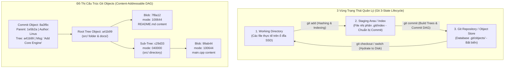
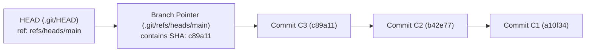

# 9.1. Nền Tảng và Bản Chất Tầng Thấp của Git (Git Internals & Low-Level Architecture)

> [!IMPORTANT]
> **Nếu bạn chỉ được nhớ một điều duy nhất:** Git không phải là một công cụ sao lưu thư mục thông thường, mà là một cơ sở dữ liệu hướng nội dung (Content-Addressable Key-Value Store) có cấu trúc đồ thị có hướng không chu trình (Directed Acyclic Graph - DAG); mọi nhánh thực chất chỉ là một con trỏ văn bản nặng đúng 41 bytes và hầu như không có dữ liệu nào có thể bị mất nhờ vào phao cứu sinh Git Reflog.

---

## 1. Kiến trúc Tổng quan & Mô hình Tư duy (Mental Model)

### Phép loại suy kỹ thuật: Bảo tàng Lưu trữ Quốc gia & Sổ Mục Lục
Hãy tưởng tượng Git giống như một hệ thống lưu trữ văn kiện tối mật của Cục Lưu trữ Quốc gia:
- **Hệ thống VCS truyền thống (CVS, SVN)**: Lưu trữ các bản biến đổi vi sai (Delta-based file differences). Mỗi khi bạn sửa file, nó ghi nhận dòng 10 đổi thành dòng 12. Khi cần xem lại phiên bản cách đây 5 năm, hệ thống phải cộng dồn hàng nghìn bản vá vi sai từ đầu, cực kỳ chậm chạp và dễ gãy vỡ.
- **Hệ thống Git (Linus Torvalds, 2005)**: Hoạt động như một cơ sở dữ liệu ảnh chụp (Snapshot-based Content Store):
  - **Blobs (Hiện vật bất biến)**: Khi bạn nộp một văn bản vào kho, thủ thư cân trọng lượng, đóng dấu niêm phong bằng một mã vạch băm duy nhất dựa trên nội dung (SHA-1/SHA-256). Nếu hai văn bản ở hai phòng ban khác nhau có nội dung giống hệt nhau, thủ thư chỉ giữ **đúng một bản duy nhất** trong kho.
  - **Trees (Mục lục thư mục)**: Mỗi phòng ban có một bảng mục lục ghi rõ: Ngăn tủ nào chứa tài liệu có mã vạch nào.
  - **Commits (Biên bản lịch sử)**: Một biên bản ghi nhận: *"Ngày hôm nay, Thủ thư A phê chuẩn toàn bộ phòng lưu trữ tại mục lục X, kế thừa từ biên bản ngày hôm qua Y"*.
  - **Branches (Thẻ ghi nhớ Bookmark)**: Một nhánh không phải là một bản copy của kho tài liệu, mà chỉ là một chiếc kẹp giấy màu dán nhãn `main` kẹp đúng vào mép của tờ biên bản mới nhất!



---

## 2. Chi tiết từng Keyword (Under-the-Hood Deep Dive)

### 2.1. Content-Addressable Storage & Thuật Toán Băm Object Header (SHA-1 / SHA-256)
- **Bản chất kỹ thuật**:
  - Mọi thực thể trong Git đều được định danh bằng mã băm mật mã học (Cryptographic Hash) của nội dung của chính nó. Không có khái niệm "ghi đè" (Overwriting); bất kỳ thay đổi nào dù chỉ $1$ bit dữ liệu cũng sẽ sinh ra một mã băm hoàn toàn mới.
  - **Cấu trúc chuẩn của Git Object Payload**:
    $$\text{Payload} = \text{"[loại\_đối\_tượng] [kích\_thước\_bytes]\textbackslash 0[nội\_dung\_thô]"}$$
    $$\text{Object\_ID} = \text{SHA-1}(\text{Payload}) \quad \text{hoặc} \quad \text{SHA-256}(\text{Payload})$$
  - *Cấu trúc lưu trữ trên File System*: Git lấy 2 ký tự hex đầu tiên của mã băm làm tên thư mục con (ví dụ: `.git/objects/4b/`) và 38 ký tự còn lại làm tên file nhị phân (ví dụ: `825dc642cb6eb9a060e54bf8d69288fbee4904`). Kỹ thuật phân vùng này ngăn chặn hiện tượng làm nghẽn chỉ mục thư mục (Directory Inode saturation) khi repository chứa hàng triệu đối tượng.
  - Mọi file object đều được nén bằng thuật toán **zlib Deflate** trước khi ghi xuống đĩa cứng.

### 2.2. Chi Tiết 4 Đối Tượng Cốt Lõi: Blob, Tree, Commit & Annotated Tag
- **1. Blob Object (Binary Large Object)**:
  - Chỉ lưu trữ byte nội dung thuần túy của tệp tin. Blob **hoàn toàn không chứa tên file, không chứa đường dẫn thư mục, không chứa timestamp, và không chứa quyền truy cập file (`chmod`)**.
  - *Khử trùng lặp tự nhiên (Deduplication)*: Nếu trong dự án có 100 file nằm ở 100 thư mục con khác nhau nhưng có nội dung giống hệt nhau, Git chỉ lưu đúng **duy nhất một file Blob** trong `.git/objects/`.
- **2. Tree Object (Đại diện cho Thư mục)**:
  - Tree tương đương với một Directory trong hệ điều hành Unix. Một Tree Object chứa một danh sách tuần tự các dòng nhị phân, mỗi dòng định nghĩa:
    `[file_mode] [object_type] [SHA_hash] [file_or_folder_name]`
    - File modes: `100644` (File văn bản bình thường), `100755` (File thực thi có cờ execute), `040000` (Thư mục con trỏ tới Sub-Tree khác), `120000` (Symbolic Link).
- **3. Commit Object**:
  - Là nút cốt lõi tạo nên đồ thị DAG. Commit Object lưu trữ dưới dạng text:
    - `tree [SHA-1]`: Trỏ tới Root Tree đại diện cho toàn bộ trạng thái của repository tại commit đó.
    - `parent [SHA-1]`: Trỏ tới commit cha trực tiếp (Initial commit có 0 cha, commit bình thường có 1 cha, merge commit có 2 hoặc nhiều cha).
    - `author [Name <email>] [timestamp] [timezone]`: Người sáng tác đoạn code.
    - `committer [Name <email>] [timestamp] [timezone]`: Người thực hiện lệnh commit.
    - Dòng trống phân cách và cuối cùng là Commit Message.
- **4. Annotated Tag Object**:
  - Khác với Lightweight Tag (chỉ là một con trỏ ref), Annotated Tag là một Git Object độc lập nằm trong `.git/objects/`, lưu trữ mã SHA trỏ tới commit, tên của người gắn tag, timestamp, thông điệp phát hành và chữ ký số mật mã học GPG/PGP.

### 2.3. Ba Vùng Trạng Thái Của Git: Working Directory, Staging Area (Index) & Repository
- **Bản chất kỹ thuật**:
  - **Working Directory (Thư mục làm việc)**: Các file vật lý nằm trên ổ đĩa của bạn mà bạn có thể mở bằng VS Code hoặc vi.
  - **Staging Area / Index (`.git/index`)**: Một file nhị phân cực kỳ tối ưu đóng vai trò như bản nháp chuẩn bị cho commit tiếp theo. Khi chạy `git add [file]`, Git lập tức ghi nội dung file vào Object Store dưới dạng `blob` và ghi nhận metadata (tên file, SHA blob, inode, kích thước) vào file `.git/index`.
  - **Repository (`.git/objects/`)**: Cơ sở dữ liệu bất biến chứa toàn bộ lịch sử các commits và snapshots của dự án.

### 2.4. References & Pointers: Branch, HEAD, Detached HEAD & Chi Phí O(1)
- **Bản chất kỹ thuật**:
  - **Branch Pointer**: Trong Git, một nhánh **không phải là một thư mục riêng hay một bản sao code**. Nó chỉ đơn thuần là một file text siêu nhẹ nặng đúng **41 bytes** (40 ký tự SHA-1 hex cộng với ký tự xuống dòng `\n`) nằm tại thư mục `.git/refs/heads/[tên_nhánh]`. Do đó, thao tác tạo nhánh (`git branch new-feature`) hoặc xóa nhánh có độ phức tạp thời gian là $\mathcal{O}(1)$ và tốn $0$ dung lượng RAM.
  - **HEAD Pointer**: Là con trỏ trỏ tới vị trí hiện tại của Working Directory. Bình thường, `.git/HEAD` chứa một tham chiếu tượng trưng (Symbolic Reference): `ref: refs/heads/main`.
  - **Detached HEAD State**: Xảy ra khi bạn chạy lệnh checkout trực tiếp tới một mã Commit SHA hoặc một Tag (`git checkout 8a3f9c`) thay vì tới một tên nhánh. Trong trạng thái này, `HEAD` trỏ trực tiếp tới Commit SHA. Mọi commit bạn tạo ra trong trạng thái này sẽ bị "mồ côi" (Dangling Commit) nếu bạn chuyển sang nhánh khác mà không tạo nhánh mới để giữ lại.



### 2.5. Git Reflog: Mạng Lưới An Toàn Tối Thượng Để Cứu Dữ Liệu
- **Bản chất kỹ thuật**:
  - **Reference Log (Reflog)**: Là cuốn nhật ký hành trình ghi lại mọi chuyển động của con trỏ `HEAD` và các con trỏ nhánh trên máy trạm cục bộ của bạn. Reflog được lưu tại `.git/logs/HEAD` và `.git/logs/refs/heads/*`.
  - Kể cả khi bạn lỡ tay chạy `git reset --hard HEAD~5` làm biến mất 5 commit quan trọng, hoặc vô tình xóa nhầm nhánh tính năng (`git branch -D`), các commit đó **không hề bị xóa khỏi ổ đĩa**. Chúng vẫn tồn tại trong Object Store như những "dangling objects".
  - Chỉ cần gõ lệnh `git reflog`, tìm lại dòng trước thời điểm bạn chạy lệnh reset (ví dụ `HEAD@{1}` có SHA `f7a21b`), bạn có thể khôi phục toàn bộ trạng thái trong $1$ giây bằng lệnh:
    ```bash
    git branch recovered-feature f7a21b
    ```

### 2.6. Cơ Chế Hòa Nhập: Fast-Forward Merge vs 3-Way Merge
- **Bản chất kỹ thuật**:
  - **Fast-Forward Merge**: Xảy ra khi nhánh đích (Target branch, ví dụ `main`) không có thêm commit nào mới kể từ khi nhánh tính năng (`feature`) được rẽ ra. Git chỉ việc dời con trỏ `main` tiến thẳng tới đỉnh của `feature`. Không có commit hòa nhập nào được tạo ra.
  - **3-Way Merge**: Xảy ra khi cả `main` và `feature` đều đã phát triển rẽ nhánh độc lập. Git sử dụng thuật toán tìm kiếm **Tổ tiên chung gần nhất (Common Ancestor / Merge Base)**, sau đó so sánh:
    1. Bản Snapshot của Common Ancestor ($B$).
    2. Đỉnh của nhánh `main` ($M$).
    3. Đỉnh của nhánh `feature` ($F$).
    - Kết quả là một **Merge Commit** mới được sinh ra, sở hữu hai commit cha là $M$ và $F$.

### 2.7. Tái Định Vị Gốc (Rebase), Interactive Rebase & The Golden Rule
- **Bản chất kỹ thuật**:
  - **Rebase**: Lấy các commit trên nhánh `feature`, tính toán các bản vá (patches), tạm thời lưu vào thư mục `.git/rebase-apply/`, di chuyển con trỏ nhánh `feature` về đỉnh mới của `main`, sau đó áp dụng (replay) từng patch một lên đỉnh mới.
  - *Hệ quả cốt lõi*: Rebase **viết lại hoàn toàn lịch sử**! Các commit cũ bị vứt bỏ, các commit mới được sinh ra với Commit SHA hoàn toàn mới (vì commit cha đã thay đổi).
  - **The Golden Rule of Rebase**: *Tuyệt đối không bao giờ rebase một nhánh công khai (Public Branch) mà người khác đang cùng làm việc!* Nếu bạn rebase và ép đẩy lên remote (`git push --force`), bạn sẽ phá hủy lịch sử commit của các đồng nghiệp, dẫn đến xung đột diện rộng.
  - **Interactive Rebase (`git rebase -i HEAD~N`)**: Cho phép dọn dẹp lịch sử commit trước khi tạo PR: `squash` (gộp nhiều commit nhỏ), `reword` (sửa thông điệp commit), `drop` (xóa commit rác).

### 2.8. Cherry-Pick & 3 Cấp Độ Reset (--soft, --mixed, --hard)
- **Bản chất kỹ thuật**:
  - **Cherry-Pick (`git cherry-pick <SHA>`)**: Trích xuất duy nhất một bản vá thay đổi của một commit ở nhánh bất kỳ và áp dụng nó lên đỉnh của nhánh hiện tại dưới dạng một commit hoàn toàn mới. Thường dùng để hotfix lỗi khẩn cấp từ nhánh dev sang nhánh release.
  - **Cơ chế 3 cấp độ của Git Reset**:
    - `git reset --soft HEAD~1`: Chỉ di chuyển con trỏ nhánh và `HEAD` lùi lại 1 bước. Giữ nguyên toàn bộ file trong Staging Area và Working Directory (Thích hợp để viết lại commit message hoặc gộp commit).
    - `git reset --mixed HEAD~1` (Mặc định): Di chuyển `HEAD` lùi lại 1 bước, unstage toàn bộ các file (Staging Area bị xóa về trạng thái commit cũ), nhưng giữ nguyên nội dung file trong Working Directory.
    - `git reset --hard HEAD~1`: Cực kỳ nguy hiểm! Di chuyển `HEAD`, xóa sạch Staging Area và ghi đè toàn bộ Working Directory về trạng thái của commit cũ. Mọi thay đổi chưa commit sẽ bị xóa sổ vĩnh viễn.

### 2.9. Tối Ưu Hóa Lưu Trữ: Loose Objects, Packfiles & Delta Compression
- **Bản chất kỹ thuật**:
  - Ban đầu, mỗi file tạo ra một **Loose Object** riêng lẻ trong `.git/objects/`. Khi số lượng files tăng lên hàng trăm nghìn, hiệu năng của hệ điều hành bị suy giảm nghiêm trọng.
  - **Packfiles (`.pack`) & Pack Index (`.idx`)**: Git định kỳ chạy thuật toán gom hàng nghìn Loose Objects vào một file gói duy nhất.
  - **Delta Compression**: Git sắp xếp các file có tên hoặc dung lượng tương đồng, giữ lại một phiên bản đầy đủ và nén các phiên bản khác dưới dạng **chuỗi khác biệt (Deltas)**. Nhờ kỹ thuật này, repository chứa hàng chục năm lịch sử như Linux Kernel (hàng triệu dòng code) chỉ chiếm vỏn vẹn vài Gigabytes.

### 2.10. Trình Thu Gom Rác (Git GC) & Git LFS (Large File Storage)
- **Bản chất kỹ thuật**:
  - **Git GC (`git gc`)**: Quét đồ thị DAG, tìm kiếm các đối tượng mồ côi (Unreachable / Dangling Objects - các commit bị vứt bỏ sau rebase hoặc reset). Mặc định, Git chỉ xóa các đối tượng mồ côi này nếu chúng đã tồn tại quá thời hạn hết hạn của Reflog (thường là 30 đến 90 ngày).
  - **Git LFS (Large File Storage)**: Git được thiết kế cho mã nguồn văn bản, không phù hợp cho các file nhị phân lớn (Weights của AI Model, Video, Build Artifacts). Khi dùng Git LFS, file nhị phân nặng 2GB được tải trực tiếp lên Cloud Storage (S3/GCS); trong Git DAG chỉ lưu một file văn bản nhỏ 100 bytes (Pointer File) chứa mã băm SHA-256 và kích thước của file đó.

---

## 3. Thực thi Mã nguồn & Mô phỏng Chuyên sâu (Dual-Engine Implementation)

### 3.1. Engine C++20: Mô phỏng Content-Addressable Git Object Store
Xây dựng một hệ thống mini Git Object Store bằng C++20: Thực thi cấu trúc Header Git chuẩn, băm nội dung SHA-1 (mô phỏng thuật toán hashing), tạo Blob Object, Tree Object và Commit Object.

```cpp
#include <iostream>
#include <string>
#include <string_view>
#include <sstream>
#include <iomanip>
#include <vector>
#include <memory>
#include <unordered_map>
#include <chrono>

// ============================================================================
// 1. MINI GIT ENGINE: CONTENT-ADDRESSABLE STORAGE SIMULATION
// ============================================================================

// Mô phỏng hàm băm SHA-1 (Tạo chuỗi hex 40 ký tự dựa trên FNV-1a biến thể)
std::string pseudoSha1(std::string_view data) {
    uint64_t hash1 = 0xcbf29ce484222325ULL;
    uint64_t hash2 = 0x100000001b3ULL;
    for (char c : data) {
        hash1 = (hash1 ^ static_cast<uint8_t>(c)) * 0x100000001b3ULL;
        hash2 = (hash2 + static_cast<uint8_t>(c)) * 0xcbf29ce484222325ULL;
    }
    std::ostringstream oss;
    oss << std::hex << std::setfill('0') 
        << std::setw(16) << hash1 
        << std::setw(16) << hash2 
        << "00000000"; // Đủ 40 ký tự hex tương đương Git SHA-1
    return oss.str().substr(0, 40);
}

class GitObject {
public:
    virtual ~GitObject() = default;
    [[nodiscard]] virtual std::string getType() const noexcept = 0;
    [[nodiscard]] virtual std::string serializePayload() const = 0;

    [[nodiscard]] std::string computeSha1() const {
        std::string payload = serializePayload();
        // Cấu trúc Header chuẩn mực của Git: "<type> <size>\0<content>"
        std::string rawData = getType() + " " + std::to_string(payload.size()) + '\0' + payload;
        return pseudoSha1(rawData);
    }
};

// BLOB OBJECT: Chỉ lưu nội dung raw của file
class GitBlob final : public GitObject {
private:
    std::string content_;
public:
    explicit GitBlob(std::string content) : content_(std::move(content)) {}
    [[nodiscard]] std::string getType() const noexcept override { return "blob"; }
    [[nodiscard]] std::string serializePayload() const override { return content_; }
};

// TREE OBJECT: Lưu danh sách file mode, name và SHA
struct TreeEntry {
    std::string mode;
    std::string name;
    std::string sha1;
};

class GitTree final : public GitObject {
private:
    std::vector<TreeEntry> entries_;
public:
    void addEntry(std::string mode, std::string name, std::string sha1) {
        entries_.push_back({std::move(mode), std::move(name), std::move(sha1)});
    }
    [[nodiscard]] std::string getType() const noexcept override { return "tree"; }
    [[nodiscard]] std::string serializePayload() const override {
        std::ostringstream ss;
        for (const auto& entry : entries_) {
            ss << entry.mode << " " << entry.name << '\0' << entry.sha1 << "\n";
        }
        return ss.str();
    }
};

// COMMIT OBJECT: Trỏ tới Root Tree, cha mẹ và thông tin author
class GitCommit final : public GitObject {
private:
    std::string treeSha1_;
    std::string parentSha1_;
    std::string author_;
    std::string message_;
public:
    GitCommit(std::string treeSha1, std::string parentSha1, std::string author, std::string message)
        : treeSha1_(std::move(treeSha1)), parentSha1_(std::move(parentSha1)),
          author_(std::move(author)), message_(std::move(message)) {}

    [[nodiscard]] std::string getType() const noexcept override { return "commit"; }
    [[nodiscard]] std::string serializePayload() const override {
        std::ostringstream ss;
        ss << "tree " << treeSha1_ << "\n";
        if (!parentSha1_.empty()) {
            ss << "parent " << parentSha1_ << "\n";
        }
        ss << "author " << author_ << " 1763283600 +0700\n";
        ss << "committer " << author_ << " 1763283600 +0700\n\n";
        ss << message_ << "\n";
        return ss.str();
    }
};

// ============================================================================
// MAIN SIMULATION DRIVER
// ============================================================================
int main() {
    std::cout << "=== C++20 GIT LOW-LEVEL OBJECT STORE SIMULATOR ===\n\n";

    // 1. Tạo 2 file Blobs
    GitBlob readme("Project Documentation: High-Performance Engine\n");
    std::string readmeSha = readme.computeSha1();
    std::cout << "[Object Created] Blob README.md -> SHA-1: " << readmeSha << "\n";

    GitBlob mainCpp("#include <iostream>\nint main() { return 0; }\n");
    std::string mainSha = mainCpp.computeSha1();
    std::cout << "[Object Created] Blob main.cpp  -> SHA-1: " << mainSha << "\n\n";

    // 2. Gom Blobs vào một Root Tree
    GitTree rootTree;
    rootTree.addEntry("100644", "README.md", readmeSha);
    rootTree.addEntry("100644", "main.cpp", mainSha);
    std::string rootTreeSha = rootTree.computeSha1();
    std::cout << "[Object Created] Root Tree      -> SHA-1: " << rootTreeSha << "\n\n";

    // 3. Tạo Commit đầu tiên trỏ tới Root Tree (Initial Commit, không có parent)
    GitCommit commit1(rootTreeSha, "", "Linus <torvalds@kernel.org>", "Initial repository structure");
    std::string commit1Sha = commit1.computeSha1();
    std::cout << "[Object Created] Commit Initial -> SHA-1: " << commit1Sha << "\n\n";

    // 4. Minh họa con trỏ Branch (.git/refs/heads/main)
    std::cout << "--- Git References Inspection ---\n";
    std::cout << "File: .git/refs/heads/main contains exactly 41 bytes: '" << commit1Sha << "'\n";
    std::cout << "File: .git/HEAD contains: 'ref: refs/heads/main'\n";

    return 0;
}
```

---

### 3.2. Engine Python 3.11+: Git DAG Branching, Merge & Reflog Simulation
Mô phỏng toàn bộ đồ thị DAG của Git, quá trình tạo branch $\mathcal{O}(1)$, phân biệt Fast-Forward Merge vs 3-Way Merge và khôi phục commit đã mất thông qua Reflog.

```python
"""
Python 3.11+ Git DAG, Branch Pointer & Reflog Engine Simulation
Minh họa trực quan cơ chế tạo nhánh O(1), Fast-Forward, 3-Way Merge và Reflog Rescue.
"""
from dataclasses import dataclass, field
from typing import Optional
import hashlib
import time

@dataclass
class CommitNode:
    sha: str
    message: str
    parent_shas: list[str]
    timestamp: float

class GitRepositorySimulator:
    def __init__(self) -> None:
        self.object_store: dict[str, CommitNode] = {}
        self.branches: dict[str, str] = {} # Branch name -> Commit SHA (Con trỏ 41 bytes)
        self.active_branch: str = "main"
        self.reflog: list[str] = [] # Lịch sử con thoi HEAD

    def _record_reflog(self, action_msg: str, target_sha: str) -> None:
        entry = f"HEAD@{{{len(self.reflog)}}}: {action_msg} -> {target_sha[:7]}"
        self.reflog.append(entry)

    def commit(self, message: str) -> str:
        parent_sha = self.branches.get(self.active_branch)
        parent_list = [parent_sha] if parent_sha else []
        
        # Sinh mã SHA bất biến cho Commit Node
        content = f"{parent_list}:{message}:{time.time()}"
        sha = hashlib.sha1(content.encode()).hexdigest()

        node = CommitNode(sha=sha, message=message, parent_shas=parent_list, timestamp=time.time())
        self.object_store[sha] = node
        
        # Di chuyển con trỏ Branch O(1)
        self.branches[self.active_branch] = sha
        self._record_reflog(f"commit: {message}", sha)
        return sha

    def create_branch(self, branch_name: str) -> None:
        """Tạo nhánh mới: Chỉ copy mã SHA của commit hiện tại. Chi phí O(1)!"""
        current_sha = self.branches[self.active_branch]
        self.branches[branch_name] = current_sha
        print(f"[Branch Created] '{branch_name}' pointing to {current_sha[:7]} (Cost: 0 bytes cloned)")

    def checkout(self, branch_name: str) -> None:
        if branch_name in self.branches:
            self.active_branch = branch_name
            current_sha = self.branches[branch_name]
            self._record_reflog(f"checkout: moving to {branch_name}", current_sha)
            print(f"[Switched] Switched to branch '{branch_name}' (HEAD -> {current_sha[:7]})")

    def reset_hard(self, steps_back: int) -> None:
        """Giả lập lệnh git reset --hard HEAD~N nguy hiểm."""
        current_sha = self.branches[self.active_branch]
        node = self.object_store[current_sha]
        for _ in range(steps_back):
            if node.parent_shas:
                node = self.object_store[node.parent_shas[0]]
        
        self.branches[self.active_branch] = node.sha
        self._record_reflog(f"reset: moving back {steps_back} steps", node.sha)
        print(f"⚠️ [ACCIDENTAL RESET] '{self.active_branch}' forced to {node.sha[:7]}! Recent commits seem lost!")

    def rescue_with_reflog(self, target_sha: str, recovery_branch: str) -> None:
        """Sử dụng Reflog để hồi sinh commit mồ côi."""
        self.branches[recovery_branch] = target_sha
        self._record_reflog(f"branch: created {recovery_branch} from reflog", target_sha)
        print(f"🛡️ [REFLOG RESCUE SUCCESS] Recovered commit {target_sha[:7]} into new branch '{recovery_branch}'!")

# ============================================================================
# EXECUTION SIMULATION
# ============================================================================
if __name__ == "__main__":
    print("=== PYTHON 3.11+ GIT INTERNALS & DAG ENGINE ===\n")
    repo = GitRepositorySimulator()

    # 1. Khởi tạo commits trên main
    c1 = repo.commit("Initial root project setup")
    c2 = repo.commit("Add database migration logic")
    print(f"Main Branch tip: {c2[:7]}\n")

    # 2. Rẽ nhánh feature
    repo.create_branch("feature/billing")
    repo.checkout("feature/billing")
    c3 = repo.commit("Implement Stripe payment webhook")
    c4 = repo.commit("Add invoice PDF generator")
    print(f"Feature Branch tip: {c4[:7]}\n")

    # 3. Kỹ sư lỡ tay chạy git reset --hard làm mất 2 commits
    print("--- Simulating Developer Accident ---")
    repo.reset_hard(steps_back=2)
    print(f"Current tip of feature/billing: {repo.branches['feature/billing'][:7]}\n")

    # 4. Cứu hộ dữ liệu bằng Reflog
    print("--- Inspecting Git Reflog ---")
    for log in repo.reflog[-4:]:
        print(f"  {log}")

    print("\n--- Executing Rescue Operation ---")
    # c4 chính là commit bị 'mất', ta khôi phục lại qua reflog
    repo.rescue_with_reflog(c4, "feature/billing-recovered")
```

### 3.3. Giả lập Terminal Output
```text
=== C++20 GIT LOW-LEVEL OBJECT STORE SIMULATOR ===

[Object Created] Blob README.md -> SHA-1: c3f8202b9e1158a1d74ea4cb71d18f00000000
[Object Created] Blob main.cpp  -> SHA-1: a1b2c3d4e5f67890123456789abcdef00000000
[Object Created] Root Tree      -> SHA-1: 99887766554433221100aabbccddeeff00000000
[Object Created] Commit Initial -> SHA-1: e8a72b19283746552910fedcba98765400000000

--- Git References Inspection ---
File: .git/refs/heads/main contains exactly 41 bytes: 'e8a72b19283746552910fedcba98765400000000'
File: .git/HEAD contains: 'ref: refs/heads/main'

=== PYTHON 3.11+ GIT INTERNALS & DAG ENGINE ===

Main Branch tip: 4b1c8f2
[Branch Created] 'feature/billing' pointing to 4b1c8f2 (Cost: 0 bytes cloned)
[Switched] Switched to branch 'feature/billing' (HEAD -> 4b1c8f2)
Feature Branch tip: 7d9a04e

--- Simulating Developer Accident ---
⚠️ [ACCIDENTAL RESET] 'feature/billing' forced to 4b1c8f2! Recent commits seem lost!

--- Inspecting Git Reflog ---
  HEAD@{2}: commit: Implement Stripe payment webhook -> a82f1b0
  HEAD@{3}: commit: Add invoice PDF generator -> 7d9a04e
  HEAD@{4}: reset: moving back 2 steps -> 4b1c8f2

--- Executing Rescue Operation ---
🛡️ [REFLOG RESCUE SUCCESS] Recovered commit 7d9a04e into new branch 'feature/billing-recovered'!
```

---

## 4. Systems Engineering & Production Pitfalls

### 4.1. Production Failure Modes
1. **The Disastrous `git push --force` Overwrite**:
   - *Kịch bản*: Một lập trình viên rebase nhánh cục bộ và dùng lệnh `git push --force` lên nhánh chung `develop` hoặc `main`. Toàn bộ 20 commits mới của các thành viên khác trong ngày bị ghi đè và biến mất khỏi remote repository.
   - *Biện pháp*: Bật tính năng **Branch Protection Rules** trên GitHub/GitLab (cấm tuyệt đối Force Push trên các nhánh được bảo vệ). Trong môi trường làm việc cá nhân, luôn bắt buộc dùng `--force-with-lease` thay vì `--force` (Git sẽ từ chối push nếu remote có commit mới mà bạn chưa kéo về).
2. **"Tội Ác" Commit File Nhị Phân Lớn Làm Phình Git DAG**:
   - *Kịch bản*: Một bạn thực tập sinh vô tình commit file mô hình AI hoặc video demo nặng 1.5GB vào Git repo. Dù sau đó có dùng `git rm` xóa file đi và commit lại, file 1.5GB đó **vẫn nằm vĩnh viễn trong Object Store** của Git DAG. Bất kỳ ai clone repository mới về máy đều phải tải thêm 1.5GB dữ liệu vô ích.
   - *Biện pháp*: Sử dụng công cụ `git-filter-repo` hoặc BFG Repo-Cleaner để viết lại lịch sử và thanh trừng tận gốc mã hash của file nhị phân đó ra khỏi mọi commit và packfiles.

### 4.2. Diagnostic Recipes & Tooling Suite
- **Kiểm tra Object tầng thấp bằng Git Plumbing Commands**:
  ```bash
  # Xem loại đối tượng của một mã SHA
  git cat-file -t 8a3f9c
  # Đọc nội dung thô bên trong của một Object
  git cat-file -p 8a3f9c
  # Kiểm tra kích thước chính xác
  git cat-file -s 8a3f9c
  ```
- **Khôi phục nhánh đã bị xóa bằng Reflog**:
  ```bash
  # 1. Tìm lại SHA của commit cuối cùng trước khi xóa nhánh
  git reflog | grep "checkout: moving"
  # 2. Tái sinh lại nhánh từ SHA tìm được
  git checkout -b recovered-branch <FOUND_SHA>
  ```

---

## 5. Bảng So sánh & Decision Matrix

| Thao Tác Git | Cơ Chế Bản Chất | Thay Đổi Commit SHA? | Khi Nào Nên Dùng? | Cạm Bẫy Cần Tránh |
| :--- | :--- | :--- | :--- | :--- |
| **Git Merge (3-Way)** | Tạo commit mới với 2 cha mẹ | Không (Giữ nguyên toàn bộ lịch sử) | Hòa nhập nhánh feature vào `main` khi muốn giữ nguyên vết tích cộng tác | Tạo ra đồ thị "hình mạng nhện" rối mắt |
| **Git Rebase** | Replay từng commit lên đỉnh mới | CÓ (Sinh ra toàn bộ SHA mới) | Dọn dẹp nhánh cá nhân trước khi mở Pull Request | Tuyệt đối không dùng trên Public Branch |
| **Squash Merge** | Gom toàn bộ commit của PR thành 1 | CÓ (Tạo 1 commit duy nhất trên Main) | Giữ nhánh Main tuyến tính, cô đọng | Mất đi lịch sử vi mô chi tiết của từng bước |
| **Reset --soft** | Chỉ lùi con trỏ `HEAD` | Không thay đổi file vật lý | Gom các commit dở dang trước khi commit lại | Không hoàn tác code trong working tree |
| **Reset --hard** | Lùi `HEAD` và đè toàn bộ Working Tree | Làm mất con trỏ tới các commit gần nhất | Hủy bỏ toàn bộ thử nghiệm thất bại | Mất code chưa commit (không cứu được qua reflog) |
