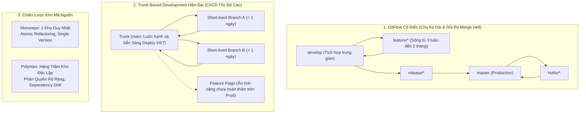

# 9.2. Các Luồng Làm Việc Cộng Tác Trong Git (Git Collaboration Workflows & Repository Strategies)

> [!IMPORTANT]
> **Nếu bạn chỉ được nhớ một điều duy nhất:** Trunk-Based Development kết hợp với Feature Flags là tiêu chuẩn vàng của kỹ nghệ phần mềm hiện đại nhằm triệt tiêu hoàn toàn thảm họa "Merge Hell" của GitFlow cổ điển; trong khi đó, xung đột ngữ nghĩa ngầm (Semantic Conflict) nguy hiểm gấp bội xung đột cú pháp vì Git hoàn toàn "mù" trước các lỗi logic vỡ API liên file nếu không có mạng lưới CI Automated Integration Tests bảo vệ.

---

## 1. Kiến trúc Tổng quan & Mô hình Tư duy (Mental Model)

### Phép loại suy kỹ thuật: Tuyến Đường Sắt Cao Tốc vs Lắp Ráp Xe Hơi Rời Rạc
Hãy hình dung quy trình phát triển phần mềm cộng tác giống như việc điều phối giao thông đường sắt quốc gia:
- **GitFlow truyền thống**: Giống như việc bạn xây dựng 5 tuyến đường ray song song (`master`, `develop`, `release`, `hotfix`, `feature`). Một đoàn tàu chở toa xe mới rời ga `develop` và chạy trên một nhánh rẽ riêng biệt trong suốt 3 tháng. Khi quay trở lại để nhập vào tuyến ray chính `master`, các công nhân phát hiện kích thước khổ ray chính đã thay đổi, các rào chắn đã đổi chỗ, tạo ra một vụ tai nạn dồn toa kinh hoàng (**Merge Hell**). Mọi chuyến tàu đều phải dừng lại trong 2 tuần chỉ để cưa cắt, hàn nối đường ray.
- **Trunk-Based Development (TBD)**: Giống như tuyến tàu siêu tốc Shinkansen chạy trên một trục ray đơn nhất (**Trunk / `main`**). Mỗi toa xe mới chỉ được chế tạo và kiểm tra ở xưởng phụ trong vòng vài giờ, sau đó lập tức ghép nối vào đoàn tàu chính nhiều lần trong ngày. 
- **Feature Flags (Công tắc chuyển làn)**: Tính năng mới được đưa thẳng lên tàu đang chạy trên tuyến chính, nhưng công tắc đèn bên trong toa xe vẫn đang tắt (Disabled). Hành khách không hề biết đến sự hiện diện của nó cho đến khi đội ngũ vận hành gạt công tắc bật sáng từ trung tâm điều khiển mà không cần dừng đoàn tàu lại (**Tách rời Deployment khỏi Release**).



---

## 2. Chi tiết từng Keyword (Under-the-Hood Deep Dive)

### 2.1. GitFlow: Nguồn Gốc Lịch Sử, Cấu Trúc Đa Nhánh & Hội Chứng Merge Hell
- **Bản chất kỹ thuật**:
  - Do Vincent Driessen đề xuất năm 2010 khi phần mềm còn được phân phối qua đĩa CD-ROM hoặc các bản release định kỳ hàng quý.
  - Cấu trúc gồm 2 nhánh vĩnh cửu:
    - `master`: Phản ánh mã nguồn đang chạy trên môi trường Production.
    - `develop`: Nhánh tích hợp trung gian, nơi chứa mã nguồn của bản release tiếp theo.
  - Các nhánh tạm thời:
    - `feature/*`: Rẽ nhánh từ `develop`, sống nhiều tuần để phát triển tính năng.
    - `release/*`: Rẽ từ `develop` khi chuẩn bị release để sửa lỗi nhỏ, sau đó merge vào cả `master` lẫn `develop`.
    - `hotfix/*`: Rẽ trực tiếp từ `master` để vá lỗi khẩn cấp, sau đó merge ngược vào `master` và `develop`.
- **Hội chứng Merge Hell**: Khi một nhánh feature sống độc lập quá lâu (Long-lived branch > 2 tuần), hàng trăm commit mới đã được merge vào `develop`. Khi feature merge ngược lại, độ lệch phân kỳ (Branch Divergence) quá lớn, sinh ra hàng trăm xung đột mã nguồn phức tạp khiến lập trình viên mất hàng tuần chỉ để gỡ conflict, triệt tiêu tính liên tục của DevOps.

### 2.2. GitHub Flow & GitLab Flow (Environment Branches vs Release Tracking)
- **Bản chất kỹ thuật**:
  - **GitHub Flow (Tối giản triệt để)**: Chỉ có duy nhất một nhánh chính là `main`. Mọi công việc đều bắt đầu bằng một nhánh ngắn hạn rẽ từ `main`, mở Pull Request, thảo luận, chạy CI tự động, và merge trực tiếp vào `main` để deploy ngay lập tức.
  - **GitLab Flow**: Kết hợp tính đơn giản của GitHub Flow với các yêu cầu môi trường thực tế:
    - *Environment Branches*: Nhánh `main` trỏ tới môi trường Staging. Nhánh `pre-production` trỏ tới UAT. Nhánh `production` trỏ tới môi trường thật. Code chảy một chiều: `main` $\rightarrow$ `pre-production` $\rightarrow$ `production`.
    - *Release Branches*: Dành cho các sản phẩm thương mại cần duy trì nhiều phiên bản song song (ví dụ: `v1.2-stable`, `v2.0-stable`).

### 2.3. Trunk-Based Development (TBD): Trụ Cột Cốt Lõi Của Văn Hóa DevOps & DORA Metrics
- **Bản chất kỹ thuật**:
  - Tất cả các kỹ sư tích hợp mã nguồn trực tiếp vào nhánh chính duy nhất (**Trunk**, thường là `main`) **nhiều lần mỗi ngày** (tối thiểu 1 lần/ngày).
  - Các nhánh tính năng (Feature branches) nếu có chỉ được phép tồn tại ngắn hạn (Short-lived branches: tối đa từ vài giờ đến 1-2 ngày) và chứa dưới 300-400 dòng thay đổi.
  - **Tối ưu hóa các chỉ số DORA (DevOps Research and Assessment)**:
    - *Lead Time for Changes* (Thời gian từ khi commit đầu tiên được viết đến khi chạy trên production) giảm từ vài tuần xuống dưới 1 giờ.
    - *Deployment Frequency* tăng từ 1 lần/tháng lên hàng chục lần/ngày.
    - *Change Failure Rate* giảm mạnh nhờ các thay đổi vi mô dễ cô lập lỗi.

### 2.4. Feature Flags / Feature Toggles: Tách Rời Tuyệt Đối Giữa Deployment và Release
- **Bản chất kỹ thuật**:
  - Khi áp dụng Trunk-Based Development, làm sao để commit một tính năng lớn cần 2 tuần phát triển vào `main` mỗi ngày mà không làm vỡ hệ thống production?
  - **Feature Flags**: Là các khối điều khiển logic runtime (thông qua Database, Redis hoặc dịch vụ như LaunchDarkly) bọc quanh mã nguồn mới:
    ```cpp
    if (featureFlags.isEnabled("NEW_STRIPE_CHECKOUT", currentUser)) {
        return executeStripeCheckout(cart);
    } else {
        return executeLegacyCheckout(cart);
    }
    ```
  - **Tách rời khái niệm**:
    - **Deployment (Triển khai kỹ thuật)**: Đẩy mã nhị phân/container mới lên máy chủ Production. Mã mới đã nằm trên máy chủ nhưng đang ở trạng thái ngủ (Flag OFF).
    - **Release (Phát hành kinh doanh)**: Bật cờ (Flag ON) từ giao diện điều khiển để người dùng trải nghiệm tính năng mà không cần deploy lại một dòng code nào. Cho phép Canary Testing và Dark Launching an toàn.

### 2.5. Chiến Lược Kho Mã Nguồn: Monorepo vs Polyrepo (Kiến Trúc & Trade-offs)
- **Monorepo (Kho mã nguồn đơn nhất)**:
  - Một Git repository duy nhất chứa toàn bộ mã nguồn của toàn công ty (Google, Meta, Uber, ByteDance sở hữu monorepo hàng chục Terabytes).
  - *Lợi ích vô song*:
    - **Atomic Cross-Service Refactoring**: Khi thay đổi chữ ký một hàm trong thư viện Core, bạn có thể cập nhật tất cả 50 microservices phụ thuộc trong duy nhất 1 Git commit!
    - **Single Source of Truth**: Không bao giờ xảy ra tình trạng Service A dùng thư viện Auth v1 còn Service B dùng Auth v2.
  - *Thách thức*: Đòi hỏi hệ thống build đồ thị DAG phân tán chuyên dụng (Google Bazel, Nx, Turborepo) và kỹ thuật phân tán tệp tin (Virtual File System for Git - VFS for Git / Scalar, Sparse Checkout).
- **Polyrepo / Multi-repo (Nhiều kho độc lập)**:
  - Mỗi Microservice, frontend app, hoặc thư viện dùng chung nằm trong một Git repository riêng biệt.
  - *Lợi ích*: Phân quyền truy cập rõ ràng, kích thước repo nhỏ gọn, CI pipeline đơn giản.
  - *Nhược điểm chí mạng*: **Dependency Hell**. Khi phát hiện một lỗ hổng bảo mật nghiêm trọng trong thư viện Logger chung, kỹ sư phải mở 80 Pull Requests trên 80 repositories khác nhau, build và bump version thủ công từng repo một.

### 2.6. Merge Strategies: Fast-Forward, 3-Way Merge, Squash & Merge, Rebase & Merge
- **Bản chất kỹ thuật**:
  - **Fast-Forward Merge**: Di chuyển con trỏ nhánh `main` tiến thẳng tới commit cuối của feature. Chỉ xảy ra khi `main` không có commit nào mới.
  - **3-Way Merge**: Tạo ra một commit hòa nhập mới có 2 commit cha. Giữ lại toàn bộ lịch sử nguyên bản nhưng làm đồ thị Git DAG trở nên ngoằn ngoèo phức tạp.
  - **Squash and Merge**: Gom toàn bộ 25 commits lặt vặt ("fix typo", "re-test", "wip") trên feature branch thành **đúng 1 commit duy nhất** trên nhánh `main`. Nhánh `main` giữ được đồ thị tuyến tính hoàn hảo, mỗi commit tương ứng với một tính năng hoàn chỉnh, cực kỳ dễ dàng khi cần `git revert`.
  - **Rebase and Merge**: Replay các commit của feature branch lên đỉnh của `main` mà không tạo merge commit. Lịch sử chi tiết từng commit được bảo toàn dưới dạng một đường thẳng.

### 2.7. Xung Đột Cú Pháp (Syntactic Conflicts) & Kỹ Thuật Rebase Shift-Left
- **Bản chất kỹ thuật**:
  - **Syntactic Conflict (Xung đột cú pháp)**: Xảy ra khi hai lập trình viên cùng sửa đổi cùng một dòng code hoặc các dòng liền kề trong cùng một file. Git không thể tự quyết định nên giữ lại phiên bản nào và sẽ chèn các thẻ xung đột vào file:
    ```text
    <<<<<<< HEAD (Nhánh hiện tại của bạn)
    const double TAX_RATE = 0.08;
    =======
    const double TAX_RATE = 0.10;
    >>>>>>> feature/new-tax-policy
    ```
  - **Chiến lược Rebase Shift-Left**: Thay vì đợi đến ngày cuối cùng khi chuẩn bị merge vào `main` mới đối mặt với xung đột, kỹ sư chủ động kéo code mới của `main` về và chạy `git rebase main` trên nhánh feature của mình **mỗi buổi sáng**. Bằng cách này, mọi xung đột nhỏ được giải quyết ngay lập tức khi ngữ cảnh kỹ thuật vẫn còn mới trong đầu.

### 2.8. Xung Đột Ngữ Nghĩa (Semantic Conflicts): Mối Đe Dọa Vô Hình Sau Merge
- **Bản chất kỹ thuật**:
  - Đây là loại lỗi nguy hiểm nhất trong kỹ nghệ cộng tác vì **Git hoàn toàn không phát hiện được bất kỳ xung đột nào (Zero Syntactic Conflict)**:
    - *Lập trình viên A*: Đổi tên phương thức trong file `src/PaymentGateway.h` từ `pay(double amount)` thành `executeTransaction(double amount, Currency currency)`.
    - *Lập trình viên B* (trên nhánh feature khác): Viết một file mới `src/SubscriptionService.cpp` và gọi hàm `pay(100.0)`.
    - Khi merge cả hai nhánh vào `main`: Vì hai người sửa hai file hoàn toàn khác nhau, Git tự động báo **"Merge successful"**!
  - Nhưng khi hệ thống biên dịch hoặc chạy trên Production, toàn bộ chương trình vỡ vụn do phương thức `pay()` không còn tồn tại.
  - *Phương thuốc duy nhất*: Xây dựng **CI Automated Integration Test Pipeline** bắt buộc chạy compile và test trên một "merge commit ảo" (GitHub PR Test Merge Ref) trước khi cho phép nút Merge được mở khóa.

### 2.9. An Toàn Đẩy Nhánh Từ Xa: --force-with-lease vs --force
- **Bản chất kỹ thuật**:
  - Khi rebase một nhánh cá nhân, bạn buộc phải dùng force push vì commit SHA đã bị thay đổi.
  - Nếu bạn dùng `git push --force`, Git sẽ ghi đè mù quáng bất chấp mọi commit trên remote. Nếu một đồng nghiệp đã đẩy thêm một commit sửa lỗi lên nhánh đó mà bạn chưa kịp pull về, commit của đồng nghiệp sẽ bị xóa sổ vĩnh viễn!
  - **`git push --force-with-lease`**: Là cơ chế kiểm tra nguyên tử (Atomic Check-and-Set). Git sẽ kiểm tra xem tham chiếu trên remote (Remote-tracking branch `origin/feature`) có khớp với giá trị mà bạn đã fetch về gần nhất hay không. Nếu có ai đó vừa đẩy thêm commit mới lên remote, Git sẽ **từ chối push** và bảo vệ an toàn cho công sức của đồng nghiệp!

---

## 3. Thực thi Mã nguồn & Mô phỏng Chuyên sâu (Dual-Engine Implementation)

### 3.1. Engine C++20: Dynamic Feature Flag Manager (Trunk-Based Decoupling Engine)
Chương trình mô phỏng hệ thống quản trị Feature Flags hiệu năng cao bằng C++20, hỗ trợ cơ chế rollout theo phần trăm người dùng và ghi đè quyền truy cập động.

```cpp
#include <iostream>
#include <string>
#include <string_view>
#include <unordered_map>
#include <vector>
#include <memory>
#include <format>
#include <functional>
#include <cstdint>

// ============================================================================
// 1. FEATURE FLAG ENGINE DEFINITIONS (DECOUPLING DEPLOYMENT FROM RELEASE)
// ============================================================================

struct UserContext {
    std::string userId;
    std::string email;
    uint32_t hashingKey; // Giá trị để tính toán phân bổ phần trăm (Percentage Rollout)
    bool isBetaTester;
};

class FeatureFlagManager {
private:
    struct FlagRule {
        std::string flagKey;
        bool isGloballyEnabled{false};
        uint8_t rolloutPercentage{0}; // 0% đến 100%
        std::vector<std::string> whitelistedUserIds;
    };

    std::unordered_map<std::string, FlagRule> flags_;

public:
    void registerFlag(std::string key, bool globalEnabled, uint8_t percentage = 0) {
        flags_[key] = FlagRule{
            .flagKey = std::move(key),
            .isGloballyEnabled = globalEnabled,
            .rolloutPercentage = percentage,
            .whitelistedUserIds = {}
        };
    }

    void whitelistUser(const std::string& flagKey, std::string userId) {
        if (flags_.contains(flagKey)) {
            flags_[flagKey].whitelistedUserIds.push_back(std::move(userId));
        }
    }

    [[nodiscard]] bool isEnabled(std::string_view flagKey, const UserContext& user) const noexcept {
        auto it = flags_.find(std::string(flagKey));
        if (it == flags_.end()) {
            return false; // Mặc định tắt nếu cờ không tồn tại
        }

        const auto& rule = it->second;

        // 1. Kiểm tra whitelist đặc biệt (Beta Testers)
        for (const auto& allowedId : rule.whitelistedUserIds) {
            if (allowedId == user.userId) {
                return true;
            }
        }

        // 2. Nếu đã bật toàn cầu
        if (rule.isGloballyEnabled) {
            return true;
        }

        // 3. Phân bổ theo phần trăm (Canary Rollout)
        if (rule.rolloutPercentage > 0) {
            uint32_t bucket = user.hashingKey % 100;
            return bucket < rule.rolloutPercentage;
        }

        return false;
    }
};

// ============================================================================
// 2. BUSINESS SERVICE APPLIED FEATURE TOGGLES
// ============================================================================

class CheckoutService {
private:
    const FeatureFlagManager& flagManager_;

    void executeLegacyCheckout(const UserContext& user, double amount) const {
        std::cout << std::format("  [Legacy Engine] Processing Standard Payment for User '{}' - Amount: ${:.2f}\n",
            user.userId, amount);
    }

    void executeNextGenStripeCheckout(const UserContext& user, double amount) const {
        std::cout << std::format("  🚀 [Next-Gen Stripe Engine] One-Click Payment for User '{}' - Amount: ${:.2f} (Instant Confirmation!)\n",
            user.userId, amount);
    }

public:
    explicit CheckoutService(const FeatureFlagManager& flags) : flagManager_(flags) {}

    void processOrder(const UserContext& user, double amount) const {
        // Tách rời tuyệt đối giữa Deploy mã nguồn và Bật tính năng
        if (flagManager_.isEnabled("NEW_CHECKOUT_PIPELINE", user)) {
            executeNextGenStripeCheckout(user, amount);
        } else {
            executeLegacyCheckout(user, amount);
        }
    }
};

// ============================================================================
// MAIN DRIVER BENCHMARK
// ============================================================================
int main() {
    std::cout << "=== C++20 TRUNK-BASED FEATURE TOGGLE ORCHESTRATION ===\n\n";

    FeatureFlagManager flagManager;
    // Bật cờ cho 20% người dùng Canary, nhưng Whitelist trực tiếp cho Beta Tester
    flagManager.registerFlag("NEW_CHECKOUT_PIPELINE", false, 20);
    flagManager.whitelistUser("NEW_CHECKOUT_PIPELINE", "user_beta_vip");

    CheckoutService checkout(flagManager);

    UserContext user1{"user_normal_01", "normal1@example.com", 85, false}; // Bucket 85 >= 20 -> Legacy
    UserContext user2{"user_lucky_02",  "lucky@example.com",   12, false}; // Bucket 12 < 20  -> Next-Gen
    UserContext user3{"user_beta_vip",  "vip@example.com",     99, true};  // Bucket 99 nhưng nằm trong Whitelist -> Next-Gen

    std::cout << "Running Checkout Simulation:\n";
    checkout.processOrder(user1, 150.0);
    checkout.processOrder(user2, 299.5);
    checkout.processOrder(user3, 999.0);

    return 0;
}
```

---

### 3.2. Engine Python 3.11+: Semantic Conflict Simulator (The Invisible Threat)
Mô phỏng chính xác kịch bản xung đột ngữ nghĩa ngầm (Semantic Conflict): Git merge 100% tự động thành công không có syntax conflict, nhưng CI Integration Test phát hiện lỗi gãy đổ giao diện API.

```python
"""
Python 3.11+ Semantic Conflict & CI Integration Guard Simulator
Minh họa trực quan mối nguy của Semantic Conflicts mà Git merge thông thường bất lực không thể phát hiện.
"""
from dataclasses import dataclass
from typing import Callable, Any
import sys

# ============================================================================
# 1. SIMULATING CODE BASE ACROSS BRANCHES
# ============================================================================

# Trạng thái gốc tại Main Branch
class BasePaymentGateway:
    def charge(self, amount_usd: float) -> str:
        return f"Charged ${amount_usd:.2f} successfully."

# Branch A của Dev A: Refactor đổi tên hàm để hỗ trợ đa tiền tệ
# Dev A sửa file: PaymentGateway.py
class DevA_RefactoredGateway:
    def charge_with_currency(self, amount: float, currency_code: str) -> str:
        return f"Charged {amount:.2f} {currency_code} successfully."

# Branch B của Dev B: Viết một tính năng mới trong file hoàn toàn mới: SubscriptionOrder.py
# Dev B vẫn gọi tên hàm cũ charge() vì rẽ nhánh từ Main trước đó
class DevB_NewSubscriptionFeature:
    def __init__(self, gateway: Any) -> None:
        self.gateway = gateway

    def renew_annual_pass(self, user_id: str) -> str:
        # Dev B gọi phương thức cũ: self.gateway.charge(120.0)
        return self.gateway.charge(120.0)

# ============================================================================
# 2. GIT MERGE ENGINE & CI PIPELINE AUDIT
# ============================================================================

class GitMergeEngine:
    @staticmethod
    def attempt_syntactic_merge(file_modified_by_a: str, file_modified_by_b: str) -> bool:
        """Git kiểm tra xung đột cú pháp trên các file."""
        # Vì Dev A sửa file 'PaymentGateway.py' và Dev B tạo file 'SubscriptionOrder.py'
        # Hai file khác nhau hoàn toàn -> Git tự động báo NO CONFLICT!
        has_syntactic_conflict = (file_modified_by_a == file_modified_by_b)
        return not has_syntactic_conflict

class ContinuousIntegrationPipeline:
    @staticmethod
    def run_integration_test_suite(merged_gateway_cls: Any, subscription_feature_cls: Any) -> bool:
        print("\n[CI Integration Pipeline] Compiling and Executing End-to-End Tests on Merged Result...")
        try:
            gateway_instance = merged_gateway_cls()
            subscription_service = subscription_feature_cls(gateway_instance)
            # Thử thực thi kịch bản liên module
            result = subscription_service.renew_annual_pass("USR-992")
            print(f"  ✅ Test Passed: {result}")
            return True
        except AttributeError as e:
            print(f"  🚨 FATAL SEMANTIC ERROR: {e}")
            print("  [ROOT CAUSE ANALYSIS] Method signature changed in Service A without updating Caller B!")
            return False

# ============================================================================
# VERIFICATION HARNESS
# ============================================================================
if __name__ == "__main__":
    print("=== GIT MERGE VS SEMANTIC CONFLICT DEMONSTRATION ===\n")
    
    file_a = "src/PaymentGateway.py"
    file_b = "src/SubscriptionOrder.py"

    print(f"Dev A modified: {file_a}")
    print(f"Dev B modified: {file_b}")

    # Bước 1: Git thực hiện Merge cú pháp
    git_success = GitMergeEngine.attempt_syntactic_merge(file_a, file_b)
    print(f"\nGit Automatic Merge Status: {'SUCCESS (0 Conflicts)' if git_success else 'CONFLICT'}")
    print("Git Output: 'Auto-merging src/PaymentGateway.py, Merge made by the 'ort' strategy.'")

    # Bước 2: CI Pipeline chạy trên kết quả sau merge
    ci_passed = ContinuousIntegrationPipeline.run_integration_test_suite(
        merged_gateway_cls=DevA_RefactoredGateway,
        subscription_feature_cls=DevB_NewSubscriptionFeature
    )

    if not ci_passed:
        print("\n🛡️ CI GATE RESULT: PULL REQUEST MERGE BLOCKED!")
        print("Tránh được thảm họa sập production nhờ hệ thống kiểm thử tự động.")
```

### 3.3. Giả lập Terminal Output
```text
=== C++20 TRUNK-BASED FEATURE TOGGLE ORCHESTRATION ===

Running Checkout Simulation:
  [Legacy Engine] Processing Standard Payment for User 'user_normal_01' - Amount: $150.00
  🚀 [Next-Gen Stripe Engine] One-Click Payment for User 'user_lucky_02' - Amount: $299.50 (Instant Confirmation!)
  🚀 [Next-Gen Stripe Engine] One-Click Payment for User 'user_beta_vip' - Amount: $999.00 (Instant Confirmation!)

=== GIT MERGE VS SEMANTIC CONFLICT DEMONSTRATION ===

Dev A modified: src/PaymentGateway.py
Dev B modified: src/SubscriptionOrder.py

Git Automatic Merge Status: SUCCESS (0 Conflicts)
Git Output: 'Auto-merging src/PaymentGateway.py, Merge made by the 'ort' strategy.'

[CI Integration Pipeline] Compiling and Executing End-to-End Tests on Merged Result...
  🚨 FATAL SEMANTIC ERROR: 'DevA_RefactoredGateway' object has no attribute 'charge'
  [ROOT CAUSE ANALYSIS] Method signature changed in Service A without updating Caller B!

🛡️ CI GATE RESULT: PULL REQUEST MERGE BLOCKED!
Tránh được thảm họa sập production nhờ hệ thống kiểm thử tự động.
```

---

## 4. Systems Engineering & Production Pitfalls

### 4.1. Production Failure Modes
1. **The Feature Flag Debt Trap (Cạm Bẫy Nợ Cờ Tính Năng)**:
   - *Kịch bản*: Sau khi một tính năng đã được release thành công cho $100\%$ người dùng trong 6 tháng, đội ngũ kỹ sư quên dọn dẹp các câu lệnh `if-else` kiểm tra Feature Flag trong mã nguồn. Sau 2 năm, hệ thống tích lũy 300 Feature Flags đan xen nhau, tạo ra $2^{300}$ tổ hợp đường dẫn thực thi không thể kiểm thử nổi, biến mã nguồn thành một mê cung không ai dám đụng vào.
   - *Biện pháp*: Mọi Feature Flag phải có một thuộc tính **Expiration Date (Ngày hết hạn)** và người sở hữu (Owner). CI pipeline sẽ tự động cảnh báo nếu cờ tồn tại quá 30 ngày kể từ khi đạt 100% rollout.
2. **"Tê Liệt" Monorepo vì Không Có Sparse Checkout**:
   - *Kịch bản*: Một công ty chuyển đổi sang Monorepo chứa 200 microservices. Mỗi lập trình viên khi gõ `git clone` phải tải về 40GB dữ liệu và mất 45 phút để index file trên VS Code.
   - *Biện pháp*: Áp dụng kỹ thuật **Sparse Checkout** và **Shallow Clone (`--depth 1`)**, kết hợp công cụ quản trị workspace như Nx hoặc Bazel để chỉ tải về và theo dõi đúng thư mục microservice mà kỹ sư đó chịu trách nhiệm.

### 4.2. Diagnostic Recipes & Conflict Resolution
- **Sử dụng Git Rerere (Reuse Recorded Resolution)**:
  - Khi bạn phải rebase liên tục trên một nhánh dài và phải giải quyết đi giải quyết lại cùng một xung đột nhiều lần:
    ```bash
    # Kích hoạt tính năng tự ghi nhớ cách giải quyết xung đột của Git
    git config --global rerere.enabled true
    ```
  - Git sẽ tự động ghi nhớ cách bạn đã sửa các dòng conflict lần trước và tự động áp dụng lại cho các lần rebase sau.
- **Quy trình giải quyết xung đột chuẩn mực (Shift-Left Rebase)**:
  ```bash
  # 1. Kéo mã nguồn mới nhất của Trunk
  git checkout main && git pull origin main
  # 2. Rebase nhánh tính năng trên đỉnh của Main
  git checkout feature/order-api && git rebase main
  # 3. Khi có conflict, sửa file và add
  git add src/OrderController.cpp
  # 4. Tiếp tục rebase cho tới khi hoàn tất
  git rebase --continue
  # 5. Đẩy code an toàn bằng force-with-lease
  git push origin feature/order-api --force-with-lease
  ```

---

## 5. Bảng So sánh & Decision Matrix

| Tiêu Chí Đánh Giá | GitFlow (Cổ Điển) | Trunk-Based Development (TBD) | Monorepo Architecture | Polyrepo Architecture |
| :--- | :--- | :--- | :--- | :--- |
| **Tốc Độ Bàn Giao (Velocity)** | Chậm (Phát hành theo đợt hàng tháng) | Siêu nhanh (Deploy liên tục nhiều lần/ngày) | Nhanh đồng bộ toàn hệ sinh thái | Nhanh ở cấp độ từng service riêng lẻ |
| **Rủi Ro Xung Đột (Merge Conflicts)** | Cực kỳ cao (Hội chứng Merge Hell) | Rất thấp (Nhánh sống dưới 24 giờ) | Phát hiện xung đột tức thì khi build | Xung đột phiên bản ngầm (Dependency Drift) |
| **Độ Phức Tạp Vận Hành** | Quá nhiều nhánh cần quản lý | Đòi hỏi văn hóa CI/CD và Feature Flags cao | Cần công cụ build thông minh (Bazel, Nx) | CI/CD đơn giản cho từng repo độc lập |
| **Khả Năng Refactoring** | Rất khó khi đụng chạm nhiều module | Dễ dàng nhờ tích hợp vi mô | Tuyệt vời (Atomic commit xuyên services) | Cực kỳ đau đớn khi đổi API dùng chung |
| **Khuyến Nghị Sử Dụng** | ❌ Chỉ dùng cho phần mềm đóng gói cũ | ✅ **Tiêu chuẩn bắt buộc cho mọi Cloud Native Team** | ✅ Phù hợp khi các services gắn kết chặt chẽ | ✅ Phù hợp khi các teams hoàn toàn độc lập |
