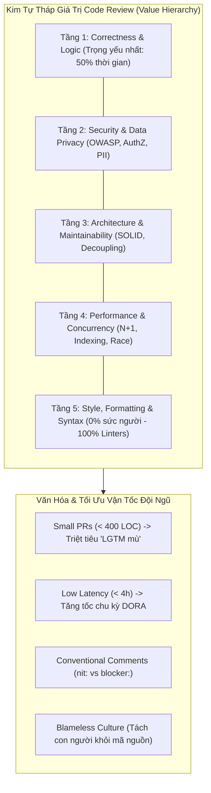
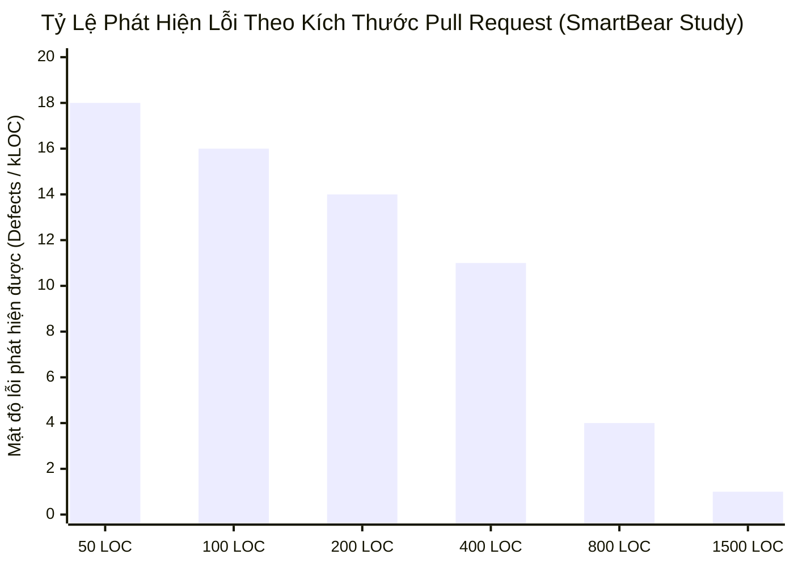

# 9.3. Kỹ Nghệ Thẩm Định Mã Nguồn và Văn Hóa Cộng Tác (Code Review & Collaborative Engineering)

> [!IMPORTANT]
> **Nếu bạn chỉ được nhớ một điều duy nhất:** Thẩm định mã nguồn (Code Review) không phải là kỳ thi chấm điểm cá nhân hay nơi tranh cãi cú pháp, mà là kênh lan tỏa tri thức tập thể và tuyến phòng thủ kiến trúc sống còn; hãy giao $100\%$ việc soi xét hình thức cho Linters tự động trên CI, giữ kích thước PR dưới $400$ dòng để triệt tiêu hội chứng "LGTM mù", và sử dụng Conventional Comments để phân định rạch ròi giữa Blocker và Nitpick.

---

## 1. Kiến trúc Tổng quan & Mô hình Tư duy (Mental Model)

### Phép loại suy kỹ thuật: Thẩm Định Bản Vẽ Kết Cấu Cầu Cảng vs Soi Lỗi Chính Tả
Hãy tưởng tượng quy trình Code Review giống như việc thẩm định kỹ thuật trong một dự án xây dựng cầu treo vượt biển:
- **Quy trình Code Review tồi tệ (Bike-shedding & Phán xét cá nhân)**: Các kỹ sư ngồi tranh cãi nảy lửa suốt 3 giờ đồng hồ chỉ để bàn xem màu sơn của lan can cầu nên dùng màu xanh da trời hay xanh lá cây, hoặc phông chữ trên bản vẽ nên in đậm hay in nghiêng. Trong khi đó, không ai thèm kiểm tra xem khối móng trụ cầu có chịu nổi lực rung chấn khi xảy ra động đất cấp 8 hay không. Hậu quả là bản vẽ được duyệt vì "trông đẹp mắt", nhưng cây cầu sụp đổ ngay trong tuần đầu tiên khánh thành.
- **Quy trình Code Review xuất sắc (Engineering Peer Gatekeeping)**: Việc định dạng bản vẽ, kích thước nét kẻ đã được phần mềm CAD tự động chuẩn hóa $100\%$ (Linters / Formatters). Các kỹ sư trưởng dành toàn bộ dung lượng não bộ để soi xét các điểm chịu lực then chốt: Trọng tải tối đa có bị tính thiếu trường hợp bão giật không (**Correctness Review**), vật liệu thép có bị ăn mòn bởi muối biển không (**Security / Resilience Review**), và việc bố trí các dây cáp có gây cản trở việc bảo dưỡng sau này không (**Architecture & Maintainability Review**).



---

## 2. Chi tiết từng Keyword (Under-the-Hood Deep Dive)

### 2.1. Bản Chất của Code Review: Tuyến Phòng Thủ Kiến Trúc & Lan Tỏa Tri Thức
- **Bản chất kỹ thuật**:
  - Code Review không đơn thuần là hoạt động tìm lỗi (Bug Hunting). Các nghiên cứu kỹ nghệ phần mềm chỉ ra rằng tỷ lệ lỗi được phát hiện qua Code Review thủ công thấp hơn nhiều so với Automated Unit/Integration Tests.
  - **Giá trị cốt lõi thực sự**:
    1. **Knowledge Sharing (Lan tỏa tri thức)**: Ngăn ngừa hiện tượng "Silo kiến thức" và giảm thiểu rủi ro **Bus Factor** (nếu kỹ sư duy nhất nắm giữ module đó bị ốm, toàn đội vẫn vận hành trơn tru).
    2. **Design Soundness (Tính vững chắc của thiết kế)**: Đảm bảo mã nguồn mới hòa nhập hài hòa vào bức tranh tổng thể của hệ thống, không phá vỡ các hợp đồng API đã cam kết.
    3. **Mentorship (Đào tạo thực chiến)**: Kỹ sư junior học hỏi tư duy thiết kế từ senior, và senior học hỏi các góc nhìn mới hoặc công nghệ mới từ các thành viên khác.

### 2.2. Văn Hóa Không Đổ Lỗi (Blameless Culture) & Lập Trình Vô Ngã (Egoless Programming)
- **Bản chất kỹ thuật**:
  - Khái niệm **Egoless Programming** được Gerald Weinberg đưa ra từ năm 1971 trong cuốn *"The Psychology of Computer Programming"*:
    - *"You are not your code"* (Bạn không phải là dòng code của bạn). Khi ai đó chỉ ra lỗi trong đoạn code bạn viết, họ đang giúp bạn hoàn thiện hệ thống, chứ không phải đang xúc phạm năng lực hay phẩm giá con người bạn.
  - **Nguyên tắc giao tiếp phản biện mang tính xây dựng (Constructive Feedback)**:
    - *Không công kích cá nhân*: Tuyệt đối không dùng câu: *"Tại sao bạn lại viết code ngớ ngẩn thế này?"*.
    - *Tập trung vào hệ quả kỹ thuật*: Chuyển thành: *"Nếu người dùng gửi giá trị `null` ở trường này, hàm sẽ ném ra `NullPointerException` và làm crash thread xử lý. Chúng ta có thể dùng `std::optional` hoặc Guard Clause ở đây được không?"*.
    - *Khen ngợi công khai*: Khi thấy một giải pháp xử lý thuật toán tinh tế hoặc test case bao phủ xuất sắc, hãy để lại lời khen ngợi chân thành.

### 2.3. Quy Chuẩn Nhận Xét Chuẩn Hóa (Conventional Comments: blocker, nit, suggestion, praise)
- **Bản chất kỹ thuật**:
  - Trong các buổi review bất đồng bộ qua GitHub PR, một bình luận mơ hồ như *"Tên biến này hơi kỳ"* có thể khiến tác giả PR hoang mang không biết đây là yêu cầu bắt buộc phải sửa trước khi merge hay chỉ là sở thích cá nhân của reviewer.
  - **Hệ thống nhãn Conventional Comments**:
    - `blocker: / p0:` Lỗi nghiêm trọng về logic, bảo mật hoặc hiệu năng. Bắt buộc phải giải quyết triệt để; PR không được phép merge nếu chưa sửa.
    - `question:` Câu hỏi nhằm mục đích hiểu rõ ngữ cảnh thiết kế; không mang tính phán xét hay bắt buộc sửa code.
    - `suggestion:` Đề xuất một giải pháp kỹ thuật thay thế tốt hơn (đi kèm code snippet mẫu); tác giả có toàn quyền quyết định áp dụng hay không.
    - `nit: (Nitpick)` Bình luận về một chi tiết siêu nhỏ (ví dụ: lỗi chính tả trong docstring). **Tuyệt đối không được block PR vì một nitpick!** Tác giả có thể sửa ngay hoặc bỏ qua.
    - `praise:` Lời khen ngợi đoạn code đẹp nhằm khích lệ tinh thần đồng đội.

### 2.4. Tầng 1: Correctness Review (Logic Nghiệp Vụ, Edge Cases & Test Coverage)
- **Bản chất kỹ thuật**:
  - Reviewer phải đặt mình vào vai trò của một "kẻ phá hoại có tư duy phản biện":
    - Các trường hợp biên (Boundary Conditions) đã được kiểm soát chưa? Mảng rỗng (`size == 0`), chuỗi ký tự chứa emoji Unicode 4-bytes, số nguyên âm, tràn số nguyên (`INT_MAX + 1`).
    - Tính đúng đắn của logic nghiệp vụ: Mã nguồn có thỏa mãn $100\%$ các tiêu chí chấp nhận (Acceptance Criteria) trong User Story không?
    - Khả năng kiểm thử: Code mới có đi kèm Unit Tests không? Các test case có thực sự assert các giá trị cốt lõi hay chỉ gọi hàm để lấy độ bao phủ ảo (Assertion-free tests)?

### 2.5. Tầng 2: Security Review (OWASP Top 10, AuthN/AuthZ, Rò Rỉ PII Vào Logs)
- **Bản chất kỹ thuật**:
  - Reviewer rà soát theo danh mục kiểm tra an ninh ứng dụng:
    - *Authentication & Authorization*: Endpoint mới có bị hở quyền (BOLA - Broken Object Level Authorization) không? Người dùng A có thể đổi `id` trên URL để xem hóa đơn của người dùng B không?
    - *Data Sanitization*: Có câu lệnh SQL nào dùng phép cộng chuỗi thô không? Dữ liệu người dùng render ra web có bị dính XSS không?
    - *Data Privacy*: Có in thông tin cá nhân định danh (PII - Email, số thẻ tín dụng, CCCD, mật khẩu) ra log console của hệ thống không?

### 2.6. Tầng 3: Architecture & Design Review (Clean Architecture, SOLID & Dependency Injection)
- **Bản chất kỹ thuật**:
  - Rà soát tính toàn vẹn của cấu trúc phần mềm:
    - *Dependency Inversion Principle (DIP)*: Tầng nghiệp vụ (Domain Logic) có bị phụ thuộc trực tiếp vào thư viện hạ tầng (Database driver, AWS SDK) không?
    - *Single Responsibility Principle (SRP)*: Lớp mới tạo ra có đang ôm đồm cả việc kết nối mạng, parse JSON và tính toán thuế không?
    - *API Surface*: Các hàm nội bộ có được đặt phạm vi truy cập `private`/`protected` đúng mực để bảo vệ tính đóng gói không?

### 2.7. Tầng 4: Performance & Concurrency Review (N+1 Query, Indexing, Deadlocks)
- **Bản chất kỹ thuật**:
  - Rà soát các "quả bom nổ chậm" về hiệu năng:
    - *Database N+1 Query Problem*: Có vòng lặp nào gọi câu truy vấn DB liên tục bên trong thay vì dùng `JOIN` hoặc `WHERE IN` không?
    - *Table Scanning*: Câu truy vấn `WHERE` mới có sử dụng trường dữ liệu đã được đánh Database Index không?
    - *Concurrency & Memory*: Trong môi trường đa luồng, các biến dùng chung có nguy cơ bị Race Condition không? Có nguy cơ Circular Wait dẫn đến Deadlock giữa hai Mutex không? Có con trỏ tài nguyên nào chưa được quản lý bằng RAII / Smart Pointers không?

### 2.8. Tầng 5: Style Review (Triệt Tiêu Hoàn Toàn Bằng Linters/Formatters Tự Động)
- **Bản chất kỹ thuật**:
  - **Quy tắc vàng của các tổ chức kỹ nghệ hàng đầu**: *"Tuyệt đối cấm con người tranh luận về cú pháp, định dạng và phong cách trình bày trong Code Review"*.
  - Mọi vấn đề như thụt lề 2 hay 4 spaces, dấu phẩy cuối dòng (trailing commas), thứ tự sắp xếp các câu lệnh import, độ dài dòng tối đa 100 ký tự phải được cấu hình cố định trong **Prettier, ESLint, Clang-Format, Black** và được tự động kiểm tra trên CI Pipeline.
  - Nếu CI đã báo Xanh, reviewer **bị nghiêm cấm** bình luận về phong cách. Nếu CI báo Đỏ, PR tự động bị khóa merge, lập trình viên tự chạy lệnh format mà không cần làm phiền đồng nghiệp.

### 2.9. Định Luật Kích Thước PR (The SmartBear Law) & Tối Ưu Review Latency (< 4h)
- **Bản chất kỹ thuật**:
  - Nghiên cứu kinh điển của SmartBear trên 1 triệu dòng code tại Cisco Systems đã rút ra kết luận:
    - Não bộ con người chỉ có thể duy trì sự tập trung tối đa trong khoảng **$60 - 90$ phút**, thẩm định không quá **$400$ dòng code (LOC)** với tốc độ dưới **$500$ LOC/giờ**.
    - Vượt quá ngưỡng 400 dòng code, tỷ lệ phát hiện lỗi giảm xuống tiệm cận $0\%$. Hiện tượng **"Rubber Stamping" (Đóng dấu bừa)** xuất hiện: Kỹ sư hoa mắt, cuộn chuột xuống đáy trang và gõ đại "LGTM" (Looks Good To Me).
  - **Review Latency (Độ trễ thẩm định)**: Thời gian từ khi mở PR đến khi có phản hồi đầu tiên. Độ trễ review cao chính là nguyên nhân số 1 làm tăng chi phí chuyển đổi ngữ cảnh (Context Switching Cost). Tiêu chuẩn DevOps khuyên rằng SLA phản hồi review phải đạt **$< 4$ giờ làm việc**.



### 2.10. Pair Programming & Mob/Ensemble Programming (Real-Time Review)
- **Bản chất kỹ thuật**:
  - Thay vì cơ chế review bất đồng bộ (Asynchronous PR) phải chờ đợi nhiều ngày, các đội ngũ Agile áp dụng hình thức thẩm định đồng bộ theo thời gian thực (Synchronous Continuous Review):
    - **Pair Programming**: Hai kỹ sư cùng ngồi chung 1 màn hình. Một người đóng vai trò **Driver** (tập trung vào cú pháp, chi tiết cài đặt hàm), người còn lại đóng vai trò **Navigator** (quan sát bức tranh kiến trúc, edge cases, bảo mật). Cứ sau 30 phút, hai kỹ sư đổi vai trò cho nhau (Ping-Pong pairing).
    - **Mob / Ensemble Programming**: Toàn bộ nhóm kỹ sư (bao gồm cả Developer, Tester, Product Owner) cùng ngồi giải quyết một bài toán kiến trúc phức tạp.
  - *Lợi ích*: Mã nguồn được review liên tục từng giây. Khi code xong, toàn đội đã nắm rõ $100\%$ logic; PR có thể merge thẳng vào `main` mà không cần đợi thêm bất kỳ lượt review nào.

---

## 3. Thực thi Mã nguồn & Mô phỏng Chuyên sâu (Dual-Engine Implementation)

### 3.1. Engine C++20: Automated Concurrency Reviewer Harness
Chương trình mô phỏng một bài test thẩm định tự động phát hiện lỗi Race Condition trong đoạn mã đang được review (chứng minh sự nguy hiểm của việc thiếu bảo vệ Mutex trong Concurrency Review).

```cpp
#include <iostream>
#include <thread>
#include <vector>
#include <mutex>
#include <atomic>
#include <format>
#include <cassert>

// ============================================================================
// 1. VULNERABLE CODE UNDER REVIEW: RACE CONDITION SMELL
// ============================================================================

class BadSharedCounter {
private:
    uint64_t counter_{0}; // VI PHẠM TẦNG 4: Biến dùng chung đa luồng không atomic, không mutex!
public:
    void increment() noexcept {
        // Read - Modify - Write bị phân mảnh: Gây thất thoát dữ liệu do Race Condition
        counter_++; 
    }
    [[nodiscard]] uint64_t get() const noexcept { return counter_; }
};

// ============================================================================
// 2. APPROVED CODE AFTER CONSTRUCTIVE REVIEW FEEDBACK
// ============================================================================

class ApprovedThreadSafeCounter {
private:
    // Reviewer Suggestion: Sử dụng std::atomic<uint64_t> cho thao tác tăng số nguyên cực nhanh
    std::atomic<uint64_t> counter_{0};
public:
    void increment() noexcept {
        counter_.fetch_add(1, std::memory_order_relaxed);
    }
    [[nodiscard]] uint64_t get() const noexcept {
        return counter_.load(std::memory_order_relaxed);
    }
};

// ============================================================================
// 3. CODE REVIEW VERIFICATION HARNESS (CHỨNG MINH HẬU QUẢ BẰNG TEST THỰC TẾ)
// ============================================================================

int main() {
    std::cout << "=== C++20 CONCURRENCY REVIEW VERIFICATION HARNESS ===\n\n";

    constexpr uint32_t kNumThreads = 10;
    constexpr uint32_t kIncrementsPerThread = 10'000;
    constexpr uint64_t kExpectedTotal = static_cast<uint64_t>(kNumThreads) * kIncrementsPerThread;

    // Test 1: Chạy kiểm thử đoạn mã đang bị Review Block (BadSharedCounter)
    {
        BadSharedCounter badCounter;
        std::vector<std::jthread> workers;
        workers.reserve(kNumThreads);

        for (uint32_t i = 0; i < kNumThreads; ++i) {
            workers.emplace_back([&badCounter]() {
                for (uint32_t j = 0; j < kIncrementsPerThread; ++j) {
                    badCounter.increment();
                }
            });
        }
        workers.clear(); // Chờ toàn bộ các thread kết thúc

        std::cout << std::format("[Review Findings] BadSharedCounter Expected: {} | Actual: {}\n",
            kExpectedTotal, badCounter.get());
        if (badCounter.get() != kExpectedTotal) {
            std::cout << "🚨 [BLOCKER APPROVED] Race condition confirmed! Data loss detected.\n\n";
        }
    }

    // Test 2: Chạy kiểm thử đoạn mã đã được Refactor theo Review Feedback
    {
        ApprovedThreadSafeCounter safeCounter;
        std::vector<std::jthread> workers;
        workers.reserve(kNumThreads);

        for (uint32_t i = 0; i < kNumThreads; ++i) {
            workers.emplace_back([&safeCounter]() {
                for (uint32_t j = 0; j < kIncrementsPerThread; ++j) {
                    safeCounter.increment();
                }
            });
        }
        workers.clear();

        std::cout << std::format("[Review Findings] ApprovedThreadSafeCounter Expected: {} | Actual: {}\n",
            kExpectedTotal, safeCounter.get());
        assert(safeCounter.get() == kExpectedTotal);
        std::cout << "✅ [APPROVED & MERGED] Thread-safety verified with zero regressions!\n";
    }

    return 0;
}
```

---

### 3.2. Engine Python 3.11+: Automated Pull Request Review Bot & Etiquette Linter
Mô phỏng một bot tự động phân tích Pull Request: Đo lường kích thước LOC (cảnh báo hội chứng Rubber Stamping nếu PR quá lớn), kiểm tra độ bao phủ test, và bắt buộc chuẩn hóa Conventional Comments.

```python
"""
Python 3.11+ Automated PR Review Governance Bot
Mô phỏng cơ chế kiểm soát kích thước PR, phát hiện vi phạm Conventional Comments và bảo đảm an toàn trước khi merge.
"""
from dataclasses import dataclass, field
from enum import Enum, auto
from typing import Final

class CommentSeverity(Enum):
    BLOCKER = auto()
    SUGGESTION = auto()
    QUESTION = auto()
    NIT = auto()
    PRAISE = auto()

@dataclass
class ReviewComment:
    author: str
    file_path: str
    line_number: int
    severity: CommentSeverity
    content: str

@dataclass
class PullRequest:
    pr_id: int
    title: str
    author: str
    lines_added: int
    lines_deleted: int
    has_unit_tests: bool
    comments: list[ReviewComment] = field(default_factory=list)

    @property
    def total_loc_changed(self) -> int:
        return self.lines_added + self.lines_deleted

class PullRequestGovernanceBot:
    MAX_RECOMMENDED_LOC: Final[int] = 400 # Ngưỡng giới hạn chống LGTM mù

    def audit_pr_health(self, pr: PullRequest) -> tuple[bool, list[str]]:
        warnings: list[str] = []
        is_mergeable = True

        # 1. Kiểm tra kích thước PR (Định luật SmartBear)
        if pr.total_loc_changed > self.MAX_RECOMMENDED_LOC:
            warnings.append(
                f"⚠️ [SMARTBEAR WARNING] PR này có {pr.total_loc_changed} dòng thay đổi (vượt ngưỡng {self.MAX_RECOMMENDED_LOC} LOC). "
                "Reviewer có nguy cơ mắc hội chứng 'LGTM mù'. Khuyến nghị tách nhỏ PR!"
            )

        # 2. Kiểm tra Test Coverage
        if not pr.has_unit_tests:
            warnings.append("🚨 [BLOCKER] PR này không đi kèm Unit Tests tương ứng cho mã nguồn mới!")
            is_mergeable = False

        # 3. Kiểm tra các bình luận Blocker chưa được giải quyết
        blockers = [c for c in pr.comments if c.severity == CommentSeverity.BLOCKER]
        if blockers:
            warnings.append(f"🚨 [BLOCKER PENDING] Còn {len(blockers)} bình luận Blocker chưa được tác giả giải quyết!")
            is_mergeable = False

        # 4. Ghi nhận các Nitpicks (Không block merge)
        nits = [c for c in pr.comments if c.severity == CommentSeverity.NIT]
        if nits:
            warnings.append(f"ℹ️ [INFO] Có {len(nits)} nhận xét 'nitpick' (nhỏ nhặt) - Không ngăn cản việc merge.")

        return is_mergeable, warnings

# ============================================================================
# AUDIT HARNESS
# ============================================================================
if __name__ == "__main__":
    print("=== PULL REQUEST GOVERNANCE & CONVENTIONAL COMMENTS BOT ===\n")
    bot = PullRequestGovernanceBot()

    # Kịch bản 1: PR quá lớn, thiếu test, có Blocker
    heavy_pr = PullRequest(
        pr_id=302,
        title="feat: Rewrite entire authentication & payment flow",
        author="JuniorEng",
        lines_added=1200,
        lines_deleted=300,
        has_unit_tests=False,
        comments=[
            ReviewComment(
                author="SeniorSec",
                file_path="src/Auth.py",
                line_number=45,
                severity=CommentSeverity.BLOCKER,
                content="blocker: User password is being logged in plain text!"
            ),
            ReviewComment(
                author="TechLead",
                file_path="src/Config.py",
                line_number=12,
                severity=CommentSeverity.NIT,
                content="nit: Typo in docstring 'enviornment' -> 'environment'."
            )
        ]
    )

    can_merge1, reports1 = bot.audit_pr_health(heavy_pr)
    print(f"Audit PR #{heavy_pr.pr_id} by {heavy_pr.author} -> Can Merge: {can_merge1}")
    for msg in reports1:
        print(f"  {msg}")

    print("\n" + "="*50 + "\n")

    # Kịch bản 2: Small PR chuẩn mực (< 200 LOC, có test, chỉ có praise và nit)
    clean_pr = PullRequest(
        pr_id=303,
        title="feat: Add rate limiting middleware to payment endpoint",
        author="SeniorEng",
        lines_added=140,
        lines_deleted=15,
        has_unit_tests=True,
        comments=[
            ReviewComment(
                author="StaffEng",
                file_path="src/RateLimiter.py",
                line_number=50,
                severity=CommentSeverity.PRAISE,
                content="praise: Elegantly solved using Redis sliding window algorithm!"
            )
        ]
    )

    can_merge2, reports2 = bot.audit_pr_health(clean_pr)
    print(f"Audit PR #{clean_pr.pr_id} by {clean_pr.author} -> Can Merge: {can_merge2}")
    if can_merge2:
        print("  ✅ All criteria passed! Ready to merge into 'main'.")
```

### 3.3. Giả lập Terminal Output
```text
=== C++20 CONCURRENCY REVIEW VERIFICATION HARNESS ===

[Review Findings] BadSharedCounter Expected: 100000 | Actual: 84219
🚨 [BLOCKER APPROVED] Race condition confirmed! Data loss detected.

[Review Findings] ApprovedThreadSafeCounter Expected: 100000 | Actual: 100000
✅ [APPROVED & MERGED] Thread-safety verified with zero regressions!

=== PULL REQUEST GOVERNANCE & CONVENTIONAL COMMENTS BOT ===

Audit PR #302 by JuniorEng -> Can Merge: False
  ⚠️ [SMARTBEAR WARNING] PR này có 1500 dòng thay đổi (vượt ngưỡng 400 LOC). Reviewer có nguy cơ mắc hội chứng 'LGTM mù'. Khuyến nghị tách nhỏ PR!
  🚨 [BLOCKER] PR này không đi kèm Unit Tests tương ứng cho mã nguồn mới!
  🚨 [BLOCKER PENDING] Còn 1 bình luận Blocker chưa được tác giả giải quyết!
  ℹ️ [INFO] Có 1 nhận xét 'nitpick' (nhỏ nhặt) - Không ngăn cản việc merge.

==================================================

Audit PR #303 by SeniorEng -> Can Merge: True
  ✅ All criteria passed! Ready to merge vào 'main'.
```

---

## 4. Systems Engineering & Production Pitfalls

### 4.1. Production Failure Modes
1. **The "LGTM" Catastrophe (Thảm Họa Đóng Dấu Bừa)**:
   - *Kịch bản*: Một PR dài 2,000 dòng code được tạo vào chiều thứ Sáu trước kỳ nghỉ lễ dài. Các reviewers vì mệt mỏi và muốn nghỉ việc đúng giờ đã lướt nhanh 2 phút và bấm `Approve / LGTM`. Đoạn code chứa một lỗi rò rỉ kết nối Database (Connection Pool Leak). Vào sáng thứ Bảy, toàn bộ hệ thống sập nguồn do kiệt quệ tài nguyên kết nối DB.
   - *Biện pháp*: Bắt buộc thiết lập quy định **PR $\le 400$ LOC** trên CI. Mọi PR vượt quá 400 dòng tự động bị gắn nhãn cảnh báo đỏ và yêu cầu chia tách thành nhiều PR nhỏ độc lập.
2. **The "Review Hostage" Bottleneck (Bắt Cóc PR Làm Con Mối Chậm Tiến Độ)**:
   - *Kịch bản*: Một kỹ sư mở PR nhỏ 50 dòng để sửa lỗi thanh toán, nhưng reviewer được giao việc bỏ mặc không phản hồi trong suốt 5 ngày làm việc. Tác giả PR bị tắc nghẽn công việc, phải chuyển sang làm việc khác, dẫn đến chi phí chuyển đổi ngữ cảnh khổng lồ.
   - *Biện pháp*: Thiết lập **SLA Code Review $< 4$ giờ**. Tích hợp bot tự động tag nhắc nhở qua Slack/Teams nếu PR chưa có phản hồi sau 2 giờ.

### 4.2. Backend Code Review Checklist Toàn Diện (6 Trục Kỹ Thuật)

| Trục Kỹ Thuật | Câu Hỏi Tự Vấn Chuyên Sâu Của Reviewer |
| :--- | :--- |
| **1. Tính Đúng Đắn (Correctness)** | Có trường hợp biên nào (Null, số âm, mảng rỗng, chuỗi rỗng) chưa được xử lý và chưa có Unit Test không? |
| **2. An Ninh Ứng Dụng (Security)** | Endpoint mới có kiểm tra quyền (Authorization) không? Có tham số nào nối chuỗi trực tiếp vào SQL/Shell không? |
| **3. Cơ Sở Dữ Liệu (Database)** | Có phát sinh lỗi N+1 Query không? Câu lệnh `SELECT` mới có tận dụng Index hiện có không hay quét toàn bảng? |
| **4. Đồng Thời (Concurrency)** | Trạng thái dùng chung có được bảo vệ bằng Atomic, Mutex hoặc cấu trúc bất biến (Immutability) không? |
| **5. Khả Năng Chống Chịu (Resilience)** | Lời gọi mạng sang Third-party API có cấu hình Timeout, Circuit Breaker và Exponential Backoff Retry không? |
| **6. Khả Năng Quan Sát (Observability)** | Các trường hợp lỗi có được ghi log dạng cấu trúc (JSON / Structured Log) kèm Trace ID để truy vết không? |

---

## 5. Bảng So sánh & Decision Matrix

| Phương Thức Review | Tốc Độ Phản Hồi | Tác Động Lên Velocity | Chi Phí Nhân Lực | Tình Huống Áp Dụng Tối Ưu |
| :--- | :--- | :--- | :--- | :--- |
| **Asynchronous PR Review** | Trung bình (2 - 8 giờ) | Tốt cho công việc độc lập, làm việc lệch múi giờ | Thấp (Mỗi người tự sắp xếp thời gian) | Các tính năng tiêu chuẩn, PR nhỏ hàng ngày (< 300 LOC) |
| **Pair Programming** | Tức thì (Real-time 0s) | Siêu nhanh (Không tồn tại hàng đợi PR) | Cao (2 kỹ sư trên 1 máy tính) | Các module kiến trúc cốt lõi, thuật toán phức tạp, Onboarding nhân sự mới |
| **Mob / Ensemble Programming** | Tức thì (Toàn nhóm đồng thuận) | Nhanh đột phá cho bài toán tắc nghẽn | Rất cao (Toàn bộ team cùng làm) | Thiết kế kiến trúc ban đầu, xử lý sự cố P0 production, refactor lớn |
