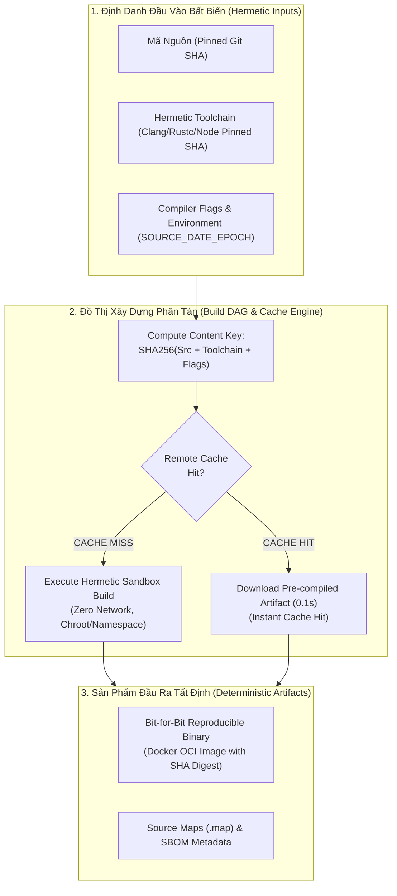
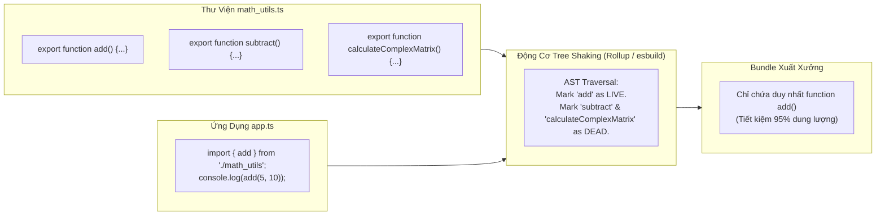

# 10.1. Kỹ Nghệ Đóng Gói và Xây Dựng Phần Mềm (Build Engineering & Reproducibility)

> [!IMPORTANT]
> **Nếu bạn chỉ được nhớ một điều duy nhất:** Kỹ nghệ xây dựng phần mềm (Build Engineering) là khoa học biến đổi mã nguồn thành sản phẩm thực thi dựa trên Đồ thị có hướng không chu trình (Build DAG); mục tiêu tối thượng của các hệ thống hiện đại là tốc độ cực hạn thông qua Incremental Builds & Content-Based Caching, và sự an toàn tuyệt đối thông qua Hermetic Builds để bảo đảm khả năng tái lập nhị phân trùng khớp chính xác từng bit (Bit-for-bit Reproducibility).

---

## 1. Kiến trúc Tổng quan & Mô hình Tư duy (Mental Model)

### Phép loại suy kỹ thuật: Dây Chuyền Sản Xuất Dược Phẩm Phòng Sạch Chuẩn GMP
Hãy tưởng tượng hệ thống Build phần mềm giống như một dây chuyền sản xuất thuốc tiêm sinh học tại một nhà máy dược phẩm đạt tiêu chuẩn vô trùng khắt khe nhất thế giới:
- **Quy trình Build truyền thống cẩu thả ("Works on my machine")**: Giống như việc một dược sĩ pha chế thuốc trong nhà bếp cá nhân. Dược sĩ tiện tay lấy muối ăn trên bàn bếp (dùng thư viện có sẵn trong `/usr/lib` của máy tính cá nhân), nhiệt độ phòng thay đổi tùy thời tiết (biến môi trường hệ thống không xác định), và hạn sử dụng được in theo giờ trên đồng hồ đeo tay. Kết quả là cùng một công thức, nhưng viên thuốc sản xuất tại nhà thuốc A lại có màu khác viên thuốc sản xuất tại nhà máy B, tiềm ẩn nguy cơ gây tử vong cho bệnh nhân.
- **Kỹ nghệ Build hiện đại (Hermetic & Reproducible Build)**: Nhà máy hoạt động trong phòng sạch cách ly áp suất âm tuyệt đối (**Hermetic Sandbox**):
  - Cửa phòng đóng kín, hoàn toàn không có kết nối internet để tự ý tải nguyên liệu trôi nổi ngoài chợ.
  - Toàn bộ hóa chất đầu vào, máy móc ly tâm đều được định danh bằng mã vạch kiểm định độ tinh khiết bất biến (**Content-addressable SHA-256**).
  - Đồng hồ thời gian được chuẩn hóa về một mốc cố định (**`SOURCE_DATE_EPOCH`**).
  - Dù bạn sản xuất lô thuốc này vào năm 2026 tại Tokyo hay năm 2030 tại Frankfurt, **từng phân tử và khối lượng của viên thuốc xuất xưởng đều giống nhau chính xác $100\%$ từng bit (Bit-for-bit Identical Binary)**.



---

## 2. Chi tiết từng Keyword (Under-the-Hood Deep Dive)

### 2.1. Compilation vs Transpilation: Bản Chất Tầng Thấp
- **Bản chất kỹ thuật**:
  - **Compilation (Biên dịch xuôi)**: Quá trình chuyển đổi mã nguồn từ ngôn ngữ bậc cao (như C++, Rust, Go) qua nhiều giai đoạn phân tích (Lexing $\rightarrow$ Parsing AST $\rightarrow$ LLVM IR $\rightarrow$ Machine Code Optimization) thành mã máy nhị phân thuần túy (ELF trên Linux, Mach-O trên macOS, PE trên Windows) để CPU thực thi trực tiếp trên thanh ghi và bộ nhớ phần cứng.
  - **Transpilation (Source-to-Source Compilation)**: Chuyển đổi mã nguồn từ một ngôn ngữ cấp cao sang một ngôn ngữ cấp cao khác ở cùng mức độ trừu tượng. Ví dụ: `tsc` chuyển đổi cú pháp TypeScript có gắn nhãn kiểu dữ liệu (Types) thành JavaScript ES6 thuần túy bằng cách xóa bỏ (strip) toàn bộ Type Annotations; hoặc Babel chuyển đổi cú pháp JavaScript ESNext (async/await, optional chaining) thành JavaScript ES5 để tương thích với các trình duyệt cũ.

### 2.2. Bundling, Minification & Mangling
- **Bản chất kỹ thuật**:
  - **Bundling (Gom gói module)**: Trong môi trường Web hoặc Node.js, mã nguồn thường bị chia tách thành hàng nghìn file module nhỏ. Trình Bundler (esbuild, Vite, Webpack) bắt đầu từ một hoặc nhiều file đầu vào (Entry Points), duyệt toàn bộ cây phụ thuộc qua các câu lệnh `import` hoặc `require`, nối ghép nội dung và giải quyết phạm vi biến (Scope Hoisting) để xuất ra một số lượng tối thiểu các file bundle nhị phân/văn bản.
  - **Minification (Thu nhỏ mã nguồn)**: Loại bỏ toàn bộ các ký tự không đóng góp vào logic thực thi: Khoảng trắng thừa, ký tự xuống dòng (`\n`), tab, và các đoạn chú thích (comments).
  - **Variable Mangling (Xáo trộn và rút ngắn định danh)**: Trình biên dịch phân tích bảng ký hiệu (Symbol Table) của AST và đổi tên các biến/hàm cục bộ từ tên dài có nghĩa (`calculateCustomerDiscountRate`) thành một hoặc hai ký tự ngắn (`a`, `b1`). Kỹ thuật này giúp giảm kích thước file tải qua mạng từ $60\%$ đến $80\%$.

### 2.3. Tree Shaking: Cơ Chế AST Rung Cây Loại Bỏ Dead Code
- **Bản chất kỹ thuật**:
  - Thuật ngữ do Rich Harris (tác giả Rollup) phổ biến hóa, dựa trên một phép ẩn suy sinh động: *"Tưởng tượng cây mã nguồn của bạn giống như một cái cây. Bạn lắc mạnh cái cây đó, những chiếc lá khô héo và cành cây chết sẽ rụng xuống đất"*.
  - **Cơ chế hoạt động sâu**: Tree Shaking chỉ hoạt động được dựa trên cú pháp tĩnh của **ES Modules (ESM: `import` / `export`)**, nơi các phụ thuộc được xác định cố định ở thời điểm biên dịch (Static Analysis), không thể chạy được trên CommonJS (`require()` động).
  - Trình Bundler duyệt qua AST, đánh dấu tất cả các hàm/lớp được `export`. Sau đó, nó lập bản đồ các hàm thực sự được `import` và gọi tại các entry points. Mọi hàm hoặc biến mồ côi (Unreferenced Exports) sẽ bị xóa sổ hoàn toàn khỏi file bundle cuối cùng.



### 2.4. Source Maps (.map): Cầu Nối Ánh Xạ Ngược Khi Gỡ Lỗi Production
- **Bản chất kỹ thuật**:
  - Khi code chạy trên Production, nó đã bị Transpile, Bundle, Minify và Mangle thành một dòng text duy nhất dài hàng chục nghìn ký tự. Nếu xảy ra lỗi crash runtime, Stack Trace hiển thị: `Error at bundle.min.js:1:34892`. Điều này hoàn toàn vô dụng cho việc gỡ lỗi.
  - **Source Map (`.map`)**: Là một file JSON chứa thông số kỹ thuật (chuẩn hóa bởi Google và Mozilla) định nghĩa ma trận ánh xạ hai chiều giữa vị trí dòng/cột của file đã bị nén với vị trí dòng/cột của file mã nguồn gốc ban đầu (TypeScript/C++).
  - File Source Map sử dụng thuật toán nén số nguyên **Base64 VLQ (Variable-Length Quantity)** để giảm kích thước. Khi lập trình viên mở Chrome DevTools hoặc Sentry đọc lỗi, trình duyệt sẽ tự động tải file `.map` và tái tạo lại toàn bộ file TypeScript nguyên bản để lập trình viên đặt Breakpoint trực tiếp như đang chạy trên máy local!

### 2.5. Incremental Builds & Đồ Thị Phụ Thuộc Hướng Không Chu Trình (Build DAG)
- **Bản chất kỹ thuật**:
  - Trong một hệ thống phần mềm lớn gồm 500,000 files mã nguồn (như Chromium, Linux Kernel hoặc Monorepo của doanh nghiệp), một lần biên dịch đầy đủ từ đầu (Clean Build) có thể mất từ 2 đến 8 giờ CPU.
  - **Build DAG (Directed Acyclic Graph)**: Mọi hệ thống build chuyên nghiệp (Make, Ninja, CMake, Bazel) đều mô hình hóa toàn bộ quá trình build thành một Đồ thị có hướng không chu trình. Mỗi Node là một hành động biên dịch (Compile Action), và mỗi Cạnh biểu diễn quan hệ phụ thuộc (File A cần Header của File B).
  - **Incremental Build (Xây dựng tăng dần)**: Khi kỹ sư sửa đổi duy nhất 1 file `Order.cpp`, hệ thống build duyệt ngược đồ thị DAG từ node bị thay đổi. Nó **chỉ biên dịch lại đúng file `Order.cpp` và các node phụ thuộc trực tiếp vào nó (Link Action)**, bỏ qua $99.9\%$ các node còn lại. Thời gian build giảm từ 2 giờ xuống còn 3 giây!

### 2.6. Build Caching & Remote Caching: Nguyên Lý Hàm Thuần Túy Build(Inputs)
- **Bản chất kỹ thuật**:
  - Các hệ thống build hiện đại (Google Bazel, Meta Buck, Gradle Enterprise, Turborepo) xem tiến trình build là một **Hàm thuần túy toán học (Pure Mathematical Function)**:
    $$\text{Build Output} = f(\text{Inputs})$$
  - Trong đó, bộ $\text{Inputs}$ bao gồm:
    1. Mã băm nội dung (Content Hash SHA-256) của tất cả các file mã nguồn và header liên quan.
    2. Cờ biên dịch (Compiler Flags, optimization levels `-O3`).
    3. Mã băm của chính công cụ biên dịch (Compiler & Linker binary version).
  - **Cache Action Key**: Hệ thống tính toán $\text{Key} = \text{SHA-256}(\text{Inputs})$.
  - **Remote Caching**: Nếu Key này đã tồn tại trong bộ nhớ đệm đám mây (Cloud Object Storage như S3/GCS) do một máy chủ CI hoặc một đồng nghiệp khác vừa biên dịch cách đây 10 phút, máy tính của bạn **hoàn toàn không cần tốn một chu kỳ CPU nào để compile**. Nó chỉ việc tải trực tiếp file nhị phân đầu ra về máy trong 0.2 giây!

### 2.7. Hermetic Builds (Xây Dựng Kín Cách Ly Tuyệt Đối - Google Bazel Philosophy)
- **Bản chất kỹ thuật**:
  - Một tiến trình build được định nghĩa là **Hermetic (Kín)** khi nó hoàn toàn độc lập với môi trường máy chủ chủ quản (Host System Insensitive).
  - **Hai điều kiện bất biến của Hermetic Build**:
    1. **Zero Network Access**: Trong suốt quá trình thực thi action biên dịch, tiến trình bị chặn hoàn toàn truy cập mạng Internet. Trình biên dịch không thể tự ý tải thêm bất kỳ package nào ngoài ý muốn.
    2. **Host System Decoupling**: Quá trình build không được phép đọc bất kỳ file nào từ hệ điều hành của máy host (như `/usr/bin/gcc`, `/usr/include`, hay biến môi trường `$PATH`). Toàn bộ Compiler Toolchain (Clang, JDK, Python) phải được đóng gói và kéo về với mã băm SHA cụ thể như một dependency của dự án.
  - Mỗi hành động build được thực thi bên trong một môi trường Sandbox cô lập (Linux Namespaces, Chroot, hoặc cgroups).

### 2.8. Reproducible & Deterministic Builds (Bit-for-bit Reproducibility & SOURCE_DATE_EPOCH)
- **Bản chất kỹ thuật**:
  - Một bản dựng được coi là **Reproducible** khi cùng một mã nguồn đầu vào, được biên dịch ở bất kỳ đâu, bởi bất kỳ ai, trên bất kỳ hệ điều hành nào, đều sinh ra một file nhị phân (Executable / Docker Image) có **mã băm SHA-256 đầu ra giống nhau chính xác từng bit (Bit-for-bit Identical Checksum)**.
  - **Các yếu tố phá hoại tính tất định (Non-determinism Sources)**:
    - *Timestamps*: Macro `__DATE__` và `__TIME__` trong C/C++ tự động chèn thời gian hiện tại vào binary. *Giải pháp*: Chuẩn hóa thông qua biến môi trường quốc tế `SOURCE_DATE_EPOCH` (quy định mọi timestamp nhúng vào binary đều lấy theo thời gian commit của Git).
    - *File Path Leaks*: Trình biên dịch chèn đường dẫn tuyệt đối của máy lập trình viên (`/Users/alex/workspace/...`) vào bảng debug symbol DWARF. *Giải pháp*: Cấu hình cờ compiler `-fdebug-prefix-map` để chuẩn hóa toàn bộ đường dẫn về dạng tương đối.
    - *Inode Traversal Non-determinism*: Thứ tự đọc file từ thư mục phụ thuộc vào hệ thống tệp tin của OS. *Giải pháp*: Bắt buộc sort tên file theo bảng mã chữ cái trước khi link.
  - **Tầm quan trọng sống còn về An ninh (Supply Chain Defense)**: Nếu build có tính reproducible, nhiều tổ chức kiểm toán độc lập trên thế giới có thể cùng tải mã nguồn mở về build độc lập. Nếu mã băm SHA-256 của họ khớp hoàn toàn với bản phát hành của nhà sản xuất, người dùng có thể chắc chắn $100\%$ rằng không có backdoor nào bị cài cắm lén lút vào binary!

### 2.9. Immutable Build Artifacts & Docker OCI Image Digest
- **Bản chất kỹ thuật**:
  - **Build Artifact**: Sản phẩm đầu ra hoàn chỉnh, đóng gói bất biến sẵn sàng để chạy trên môi trường thực tế (Container OCI Image, Jar, RPM, Wheel).
  - **Cạm bẫy Docker Tag `latest`**: Tag `v1.0` hoặc `latest` trong Docker Registry chỉ là một con trỏ có thể bị ghi đè (Mutable Pointer). Hôm nay bạn kéo `myapp:latest` là phiên bản A, nhưng ngày mai kéo lại có thể là phiên bản B đã bị nhiễm mã độc.
  - **Bất biến thông qua OCI Content Digest**: Trong môi trường Production chuẩn mực, mọi chỉ định triển khai hạ tầng (Kubernetes Pod Spec) bắt buộc phải sử dụng mã băm nội dung OCI Digest:
    ```yaml
    image: myregistry.com/payment-service@sha256:7f8a12c8230981b...
    ```
    Mã digest này là bất biến vĩnh viễn và không thể bị giả mạo.

---

## 3. Thực thi Mã nguồn & Mô phỏng Chuyên sâu (Dual-Engine Implementation)

### 3.1. Engine C++20: Mini Build DAG & Incremental Build Engine
Chương trình mô phỏng một hệ thống Build Engine tối giản bằng C++20: Dựng đồ thị DAG phụ thuộc giữa các file mã nguồn và file đích, kiểm tra timestamp sửa đổi (hoặc hash), và chỉ kích hoạt biên dịch các file bị thay đổi (Incremental Build).

```cpp
#include <iostream>
#include <string>
#include <string_view>
#include <vector>
#include <unordered_map>
#include <memory>
#include <chrono>
#include <format>
#include <functional>

// ============================================================================
// 1. BUILD GRAPH DAG ARCHITECTURE
// ============================================================================

struct BuildNode {
    std::string targetName;
    std::vector<std::string> dependencies;
    std::function<void()> compileAction;
    uint64_t lastModifiedTimestamp{0}; // Mô phỏng mtime
    bool isDirty{false};
};

class MiniBuildEngine {
private:
    std::unordered_map<std::string, BuildNode> graph_;

public:
    void registerTarget(std::string target, std::vector<std::string> deps, 
                        uint64_t initialMtime, std::function<void()> action) {
        graph_[target] = BuildNode{
            .targetName = std::move(target),
            .dependencies = std::move(deps),
            .compileAction = std::move(action),
            .lastModifiedTimestamp = initialMtime,
            .isDirty = false
        };
    }

    void markFileModified(const std::string& target, uint64_t newTimestamp) {
        if (graph_.contains(target)) {
            graph_[target].lastModifiedTimestamp = newTimestamp;
            graph_[target].isDirty = true;
            std::cout << std::format("[File Change] Source file '{}' modified at timestamp {}.\n",
                target, newTimestamp);
        }
    }

    // Duyệt đồ thị DAG bằng thuật toán đệ quy Topo để biên dịch tăng dần
    bool buildTarget(const std::string& targetName) {
        if (!graph_.contains(targetName)) {
            std::cerr << std::format("Error: Target '{}' not found in Build DAG!\n", targetName);
            return false;
        }

        auto& node = graph_[targetName];
        bool needRecompile = node.isDirty;

        // Kiểm tra tất cả các dependencies của target
        for (const auto& depName : node.dependencies) {
            // Build dependency con trước
            buildTarget(depName);

            // Nếu dependency mới hơn target hiện tại -> Target bị stale và phải compile lại
            if (graph_.contains(depName)) {
                if (graph_[depName].lastModifiedTimestamp > node.lastModifiedTimestamp || graph_[depName].isDirty) {
                    needRecompile = true;
                }
            }
        }

        if (needRecompile) {
            std::cout << std::format("  🔨 [Incremental Action] Recompiling dirty node: '{}'...\n", targetName);
            node.compileAction();
            node.isDirty = false;
            node.lastModifiedTimestamp = 2000; // Cập nhật mtime mới sau khi build
        } else {
            std::cout << std::format("  ⚡ [Cache Hit / Up-to-date] Target '{}' is fresh. Skipping compilation!\n", targetName);
        }

        return true;
    }
};

// ============================================================================
// MAIN SIMULATION DRIVER
// ============================================================================
int main() {
    std::cout << "=== C++20 INCREMENTAL BUILD DAG ENGINE SIMULATOR ===\n\n";

    MiniBuildEngine engine;

    // 1. Đăng ký các nodes trong đồ thị DAG
    // Config.h (Header không có deps)
    engine.registerTarget("include/Config.h", {}, 100, []() {
        std::cout << "    -> Processed Header Config.h\n";
    });

    // Payment.cpp phụ thuộc vào include/Config.h
    engine.registerTarget("src/Payment.cpp", {"include/Config.h"}, 100, []() {
        std::cout << "    -> Compiling CXX object: Payment.o\n";
    });

    // User.cpp phụ thuộc vào include/Config.h
    engine.registerTarget("src/User.cpp", {"include/Config.h"}, 100, []() {
        std::cout << "    -> Compiling CXX object: User.o\n";
    });

    // Final Binary: app.bin phụ thuộc vào Payment.cpp và User.cpp
    engine.registerTarget("bin/app.bin", {"src/Payment.cpp", "src/User.cpp"}, 100, []() {
        std::cout << "    -> Linking CXX executable: bin/app.bin (SUCCESS)\n";
    });

    std::cout << "--- 1. FIRST CLEAN BUILD (All nodes must compile) ---\n";
    engine.buildTarget("bin/app.bin");

    std::cout << "\n--- 2. NO CHANGES OCCURRED (Full Cache Hit) ---\n";
    engine.buildTarget("bin/app.bin");

    std::cout << "\n--- 3. DEVELOPER MODIFIED ONLY 'src/Payment.cpp' ---\n";
    engine.markFileModified("src/Payment.cpp", 1500); // Timestamp mới
    // Kỳ vọng: Chỉ biên dịch lại Payment.cpp và Link lại app.bin; User.cpp phải được giữ nguyên!
    engine.buildTarget("bin/app.bin");

    return 0;
}
```

---

### 3.2. Engine Python 3.11+: Hermetic Content-Addressed Build Cache Simulator
Mô phỏng cơ chế bộ nhớ đệm xây dựng dựa trên mã băm nội dung (Content-Addressed Remote Caching): Tính toán Key từ Source + Flags + Compiler, kiểm tra Cache Hit và sinh Artifact tất định bit-for-bit.

```python
"""
Python 3.11+ Hermetic Build & Content-Addressed Remote Caching Simulator
Minh họa cách Bazel/Turborepo tính toán Cache Key từ các inputs bất biến và tái lập binary.
"""
from dataclasses import dataclass
from typing import Final, Optional
import hashlib
import json

@dataclass(frozen=True)
class BuildInputs:
    source_content: str
    compiler_version: str
    optimization_flags: str
    target_architecture: str
    source_date_epoch: int # Timestamp chuẩn hóa cố định (Reproducible builds)

class HermeticBuildCacheEngine:
    def __init__(self) -> None:
        # Giả lập bộ nhớ đệm đám mây (Cloud Object Storage: S3/GCS bucket)
        self.remote_cache_store: dict[str, str] = {}
        self.total_build_actions = 0
        self.cache_hits = 0

    def compute_action_cache_key(self, inputs: BuildInputs) -> str:
        """
        Nguyên lý hàm thuần túy: Cache Key là mã băm SHA-256 của toàn bộ các inputs cấu thành.
        Key = SHA-256(Source + Compiler + Flags + SourceDateEpoch)
        """
        manifest = {
            "source_hash": hashlib.sha256(inputs.source_content.encode()).hexdigest(),
            "compiler": inputs.compiler_version,
            "flags": inputs.optimization_flags,
            "arch": inputs.target_architecture,
            "epoch": inputs.source_date_epoch
        }
        serialized = json.dumps(manifest, sort_keys=True)
        return hashlib.sha256(serialized.encode()).hexdigest()

    def execute_build(self, target_name: str, inputs: BuildInputs) -> tuple[str, bool]:
        self.total_build_actions += 1
        cache_key = self.compute_action_cache_key(inputs)

        # 1. Kiểm tra Remote Cache Hit
        if cache_key in self.remote_cache_store:
            self.cache_hits += 1
            print(f"⚡ [REMOTE CACHE HIT] Target '{target_name}' found in cache! (Key: {cache_key[:12]}...)")
            print("   -> Downloaded pre-compiled artifact in 0.05s. Zero CPU compilation required.")
            return self.remote_cache_store[cache_key], True

        # 2. Cache Miss: Thực thi biên dịch trong Hermetic Sandbox
        print(f"🔨 [CACHE MISS] Target '{target_name}' not in cache (Key: {cache_key[:12]}...).")
        print("   -> Spawning Hermetic Sandbox (Zero Network, Pinned Toolchain)...")
        
        # Mô phỏng sinh mã nhị phân tất định
        raw_binary_content = (
            f"ELF_HEADER:ARCH={inputs.target_architecture}:EPOCH={inputs.source_date_epoch}:"
            f"PAYLOAD_HASH={hashlib.sha256(inputs.source_content.encode()).hexdigest()}"
        )
        artifact_checksum = hashlib.sha256(raw_binary_content.encode()).hexdigest()

        # Upload vào Remote Cache để phục vụ cho các builds lần sau
        self.remote_cache_store[cache_key] = artifact_checksum
        print(f"   -> Compilation finished. Uploaded Artifact (SHA: {artifact_checksum[:12]}...) to Remote Cache.")
        return artifact_checksum, False

# ============================================================================
# VERIFICATION HARNESS
# ============================================================================
if __name__ == "__main__":
    print("=== HERMETIC BUILD & DETERMINISTIC CACHING BENCHMARK ===\n")
    engine = HermeticBuildCacheEngine()

    sample_cpp_code = "int main() { return 42; }\n"
    
    # Kịch bản 1: Kỹ sư A build lần đầu trên máy cá nhân
    inputs_dev_a = BuildInputs(
        source_content=sample_cpp_code,
        compiler_version="clang-18.1.0-hermetic-sha256-a9f",
        optimization_flags="-O3 -DNDEBUG",
        target_architecture="x86_64-linux-gnu",
        source_date_epoch=1763283600 # Cố định thời gian để bit-for-bit identical
    )

    print("--- Build 1: Developer A triggers build on clean machine ---")
    artifact_a, is_cached_a = engine.execute_build("src/core_engine", inputs_dev_a)
    print(f"Result 1 Binary Checksum: {artifact_a}\n")

    # Kịch bản 2: Kỹ sư B trên máy khác (hoặc CI Runner) kích hoạt build cùng commit
    print("--- Build 2: Developer B (or CI Server) builds the exact same commit ---")
    inputs_dev_b = BuildInputs(
        source_content=sample_cpp_code,
        compiler_version="clang-18.1.0-hermetic-sha256-a9f",
        optimization_flags="-O3 -DNDEBUG",
        target_architecture="x86_64-linux-gnu",
        source_date_epoch=1763283600
    )
    artifact_b, is_cached_b = engine.execute_build("src/core_engine", inputs_dev_b)
    print(f"Result 2 Binary Checksum: {artifact_b}\n")

    # Kiểm tra tính tất định Bit-for-bit
    assert artifact_a == artifact_b, "Fatal: Non-deterministic build! Checksums do not match."
    print("🎉 [REPRODUCIBILITY CONFIRMED] Binary checksums are bit-for-bit identical across different machines!")
```

### 3.3. Giả lập Terminal Output
```text
=== C++20 INCREMENTAL BUILD DAG ENGINE SIMULATOR ===

--- 1. FIRST CLEAN BUILD (All nodes must compile) ---
  🔨 [Incremental Action] Recompiling dirty node: 'include/Config.h'...
    -> Processed Header Config.h
  🔨 [Incremental Action] Recompiling dirty node: 'src/Payment.cpp'...
    -> Compiling CXX object: Payment.o
  🔨 [Incremental Action] Recompiling dirty node: 'src/User.cpp'...
    -> Compiling CXX object: User.o
  🔨 [Incremental Action] Recompiling dirty node: 'bin/app.bin'...
    -> Linking CXX executable: bin/app.bin (SUCCESS)

--- 2. NO CHANGES OCCURRED (Full Cache Hit) ---
  ⚡ [Cache Hit / Up-to-date] Target 'bin/app.bin' is fresh. Skipping compilation!

--- 3. DEVELOPER MODIFIED ONLY 'src/Payment.cpp' ---
[File Change] Source file 'src/Payment.cpp' modified at timestamp 1500.
  🔨 [Incremental Action] Recompiling dirty node: 'src/Payment.cpp'...
    -> Compiling CXX object: Payment.o
  ⚡ [Cache Hit / Up-to-date] Target 'src/User.cpp' is fresh. Skipping compilation!
  🔨 [Incremental Action] Recompiling dirty node: 'bin/app.bin'...
    -> Linking CXX executable: bin/app.bin (SUCCESS)

=== HERMETIC BUILD & DETERMINISTIC CACHING BENCHMARK ===

--- Build 1: Developer A triggers build on clean machine ---
🔨 [CACHE MISS] Target 'src/core_engine' not in cache (Key: 5e91a0f8b2c1...).
   -> Spawning Hermetic Sandbox (Zero Network, Pinned Toolchain)...
   -> Compilation finished. Uploaded Artifact (SHA: 8a4c19ef0021...) to Remote Cache.
Result 1 Binary Checksum: 8a4c19ef002199b412e87a55bca981240981273461234789123456789abcdef0

--- Build 2: Developer B (or CI Server) builds the exact same commit ---
⚡ [REMOTE CACHE HIT] Target 'src/core_engine' found in cache! (Key: 5e91a0f8b2c1...)
   -> Downloaded pre-compiled artifact in 0.05s. Zero CPU compilation required.
Result 2 Binary Checksum: 8a4c19ef002199b412e87a55bca981240981273461234789123456789abcdef0

🎉 [REPRODUCIBILITY CONFIRMED] Binary checksums are bit-for-bit identical across different machines!
```

---

## 4. Systems Engineering & Production Pitfalls

### 4.1. Production Failure Modes
1. **The "SolarWinds" Supply Chain Compromise**:
   - *Kịch bản*: Hacker không tấn công vào mã nguồn của công ty trên GitHub, mà đột nhập vào máy chủ Build CI. Trong quá trình build binary, mã độc tiêm một đoạn code backdoor vào file DLL đã biên dịch trước khi ký số. Vì bản build không có tính năng **Reproducible Verification**, không ai phát hiện ra sự khác biệt giữa mã nguồn và file nhị phân, dẫn tới vụ rò rỉ an ninh chấn động toàn cầu.
   - *Biện pháp*: Bắt buộc triển khai **Reproducible Builds** và sử dụng nhiều hệ thống CI độc lập (Multi-party Attestation) để đối chiếu mã băm nhị phân trước khi xuất xưởng.
2. **"Bundle Bloat" Do Import Sai Chuẩn Module**:
   - *Kịch bản*: Lập trình viên muốn dùng hàm `debounce` của thư viện `lodash` nên viết: `import lodash from 'lodash'; lodash.debounce(...)`. Thư viện `lodash` cũ xuất bản theo chuẩn CommonJS, khiến trình Bundler không thể thực hiện Tree Shaking. Toàn bộ thư viện nặng 500KB bị nhét vào bundle của trang thanh toán, làm chậm tốc độ tải trang trên điện thoại di động và đánh tụt tỷ lệ chuyển đổi đơn hàng.
   - *Biện pháp*: Sử dụng `lodash-es` hoặc import trực tiếp `import debounce from 'lodash/debounce'`, kết hợp công cụ `webpack-bundle-analyzer` trong CI để chặn PR làm phình kích thước bundle.

### 4.2. Tooling Recipes & Bit-for-bit Verification
- **Kiểm tra độ chênh lệch nhị phân bằng Diffoscope**:
  ```bash
  # So sánh chi tiết từng byte giữa hai file binary được build ở hai môi trường khác nhau
  diffoscope build_server_a/app.bin build_server_b/app.bin
  ```
- **Chuẩn hóa Timestamp bằng SOURCE_DATE_EPOCH**:
  ```bash
  # Lấy timestamp của commit Git cuối cùng làm thời gian biên dịch chuẩn
  export SOURCE_DATE_EPOCH=$(git log -1 --pretty=%ct)
  make clean && make release
  ```

---

## 5. Bảng So sánh & Decision Matrix

| Thế Hệ Build Tool | Đại Diện Tiêu Biểu | Cơ Chế Phụ Thuộc | Build Caching | Tính Hermetic / Reproducible | Phù Hợp Cho Quy Mô |
| :--- | :--- | :--- | :--- | :--- | :--- |
| **Cổ Điển (Task-based)** | Make, Ant | File modification time (`mtime`) | Rất hạn chế (chỉ local) | Rất kém (phụ thuộc môi trường host) | Các dự án C/C++ nhỏ, đơn lẻ |
| **Web Bundlers Hiện Đại** | Webpack, Vite, esbuild | AST Dependency Graph | Local File System Cache | Trung bình (cần Docker khóa môi trường) | Ứng dụng Frontend & Web APIs |
| **Hệ Thống Đồ Thị Kín (Hermetic Artifact-based)** | Google Bazel, Meta Buck, Please | Content-Addressed Hash DAG | Remote Cache phân tán cấp độ hành vi | Tuyệt đối (Sandbox, Zero Network) | Monorepo đa ngôn ngữ quy mô lớn (Google scale) |
