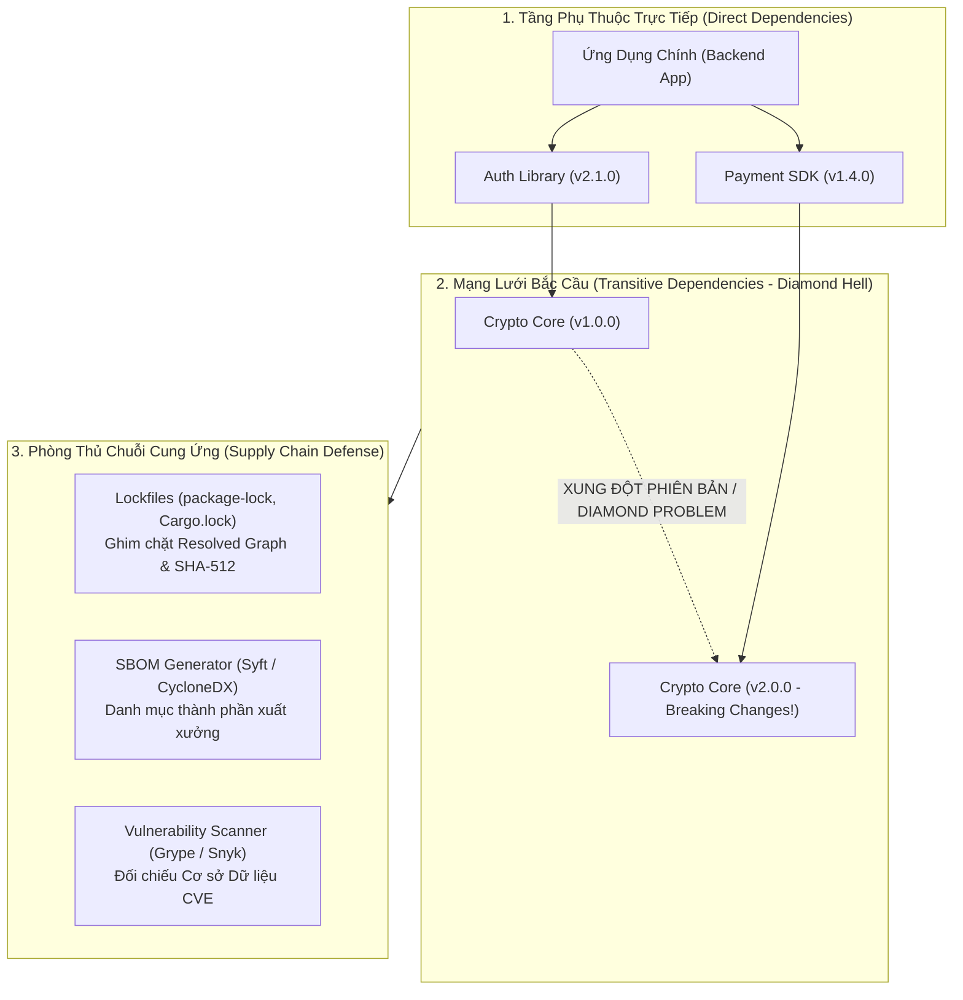
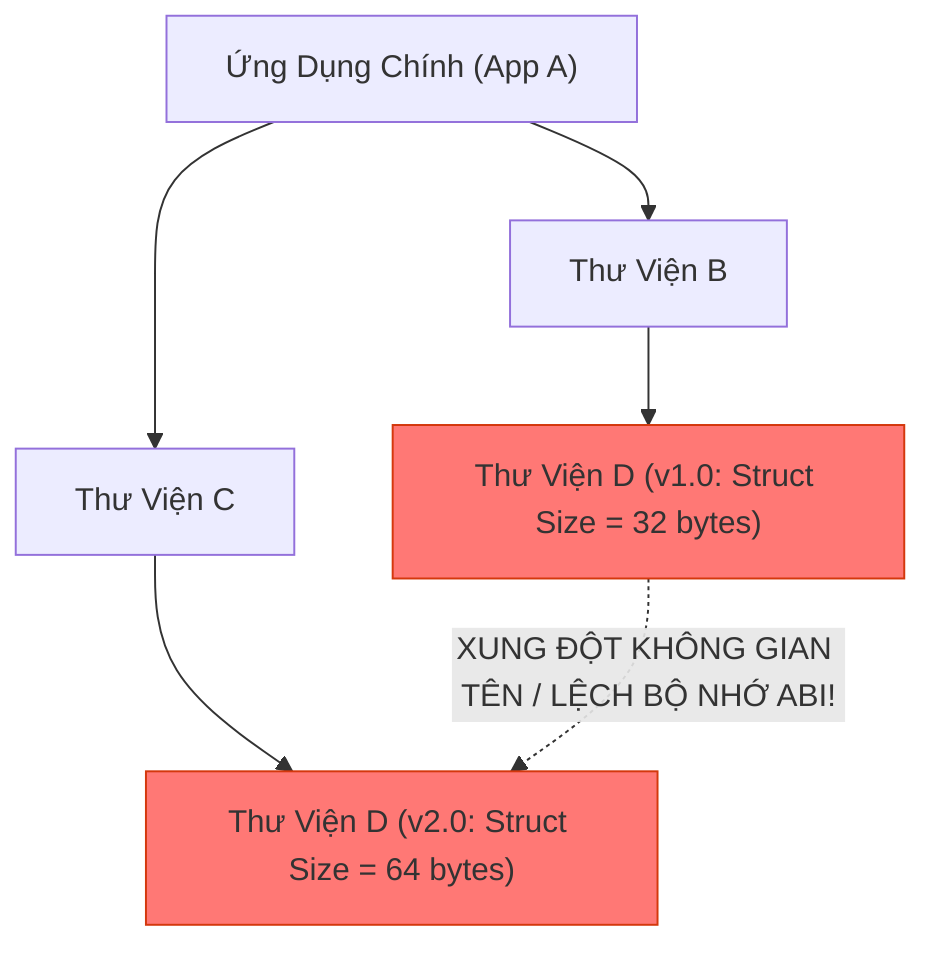

# 10.2. Quản Trị Phụ Thuộc và Chuỗi Cung Ứng Phần Mềm (Dependency Management & Supply Chain Security)

> [!IMPORTANT]
> **Nếu bạn chỉ được nhớ một điều duy nhất:** Các hệ thống phần mềm hiện đại thực chất là một lớp vỏ mỏng gắn kết hàng trăm thư viện mã nguồn mở bên thứ ba; quản trị phụ thuộc là khoa học giải quyết xung đột trên cây phụ thuộc bắc cầu thông qua Lockfiles bắt buộc commit vào Git, các thuật toán phân giải tất định (PubGrub / Minimal Version Selection), và kiểm soát chuỗi cung ứng thông qua Danh mục thành phần phần mềm (SBOM - CycloneDX/SPDX) nhằm ngăn chặn các thảm họa an ninh như Log4Shell và Dependency Confusion.

---

## 1. Kiến trúc Tổng quan & Mô hình Tư duy (Mental Model)

### Phép loại suy kỹ thuật: Chuỗi Cung Ứng Dinh Dưỡng Đóng Chai vs Sự Cố Ô Nhiễm
Hãy hình dung ứng dụng Backend của bạn giống như một nhà máy sản xuất sữa chua tiệt trùng thương mại:
- **Direct Dependencies (Nguyên liệu trực tiếp)**: Bạn ký hợp đồng mua sữa tươi từ Trang trại A và mua men vi sinh từ Công ty B. Đây là các thành phần bạn trực tiếp khai báo trong hóa đơn nhập kho (`package.json`, `pom.xml`, `requirements.txt`).
- **Transitive Dependencies (Nguyên liệu gián tiếp bắc cầu)**: Công ty B để nuôi cấy men vi sinh lại phải mua tinh bột ngô từ Nông trường C; Nông trường C lại sử dụng phân bón hóa học từ Nhà máy D. Bạn không hề biết đến sự tồn tại của Nhà máy D, nhưng $80\%$ thể tích và rủi ro sinh học của hộp sữa chua thực chất bắt nguồn từ các nhà cung cấp cấp 3 và cấp 4 này!
- **Sự cố Chuỗi Cung ứng (Supply Chain Poisoning - Log4j, left-pad)**: Nếu Nhà máy D vô tình dùng chất cấm (lỗ hổng zero-day trong thư viện transitively imported), toàn bộ hàng triệu hộp sữa chua của bạn trên các kệ siêu thị toàn quốc đều bị nhiễm độc, buộc phải tiêu hủy khẩn cấp.
- **Lockfile & SBOM (Tem kiểm định nguồn gốc xuất xứ)**: Giống như một cuốn hộ chiếu nguyên liệu điện tử. Từng giọt sữa, từng hạt men đều được niêm phong bằng mã vạch sinh học bất biến (**Integrity Hash SHA-512**), chứng minh xuất xứ và độ tinh khiết không thể bị tráo đổi trên đường vận chuyển.



---

## 2. Chi tiết từng Keyword (Under-the-Hood Deep Dive)

### 2.1. Quy Chuẩn Semantic Versioning (SemVer 2.0.0: MAJOR.MINOR.PATCH)
- **Bản chất kỹ thuật**:
  - Do Tom Preston-Werner (đồng sáng lập GitHub) đề xuất nhằm thiết lập một hợp đồng xã hội chính thức giữa tác giả thư viện và người sử dụng:
    $$\text{Format: } \textbf{MAJOR} \, . \, \textbf{MINOR} \, . \, \textbf{PATCH} \quad (\text{ví dụ: } 3.8.2)$$
  - **1. MAJOR (Chữ số đầu tiên - Breaking Changes)**: Tăng khi có bất kỳ sự thay đổi API nào làm gãy khả năng tương thích ngược (Incompatible API changes). Code cũ của client chắc chắn sẽ bị lỗi biên dịch hoặc lỗi runtime nếu nâng cấp mà không sửa code.
  - **2. MINOR (Chữ số thứ hai - Backward-Compatible Features)**: Tăng khi bổ sung chức năng mới nhưng hoàn toàn tương thích ngược với phiên bản cũ (Backward-compatible additions).
  - **3. PATCH (Chữ số thứ ba - Backward-Compatible Bug Fixes)**: Tăng khi sửa lỗi nội bộ mà không làm thay đổi chữ ký hàm công khai và không bổ sung tính năng mới.
  - *Giai đoạn sơ khai (`0.y.z`)*: Theo chuẩn SemVer, bất kỳ phiên bản nào có số MAJOR bằng 0 (`0.1.0`, `0.4.2`) đều được coi là bản thử nghiệm không ổn định; API có thể bị thay đổi gãy đổ bất kỳ lúc nào mà không cần tăng MAJOR.

### 2.2. Dải Phiên Bản Linh Hoạt (Floating Ranges: Caret ^, Tilde ~, Pinning)
- **Bản chất kỹ thuật**:
  - Các Package Managers cho phép khai báo dải phiên bản tự động co giãn:
    - **Caret (`^1.2.3`)**: Chấp nhận tự động kéo các bản cập nhật không làm thay đổi chữ số khác 0 ngoài cùng bên trái. Với `^1.2.3`, nó tương đương $\ge 1.2.3 \text{ và } < 2.0.0$.
    - **Tilde (`~1.2.3`)**: Chỉ chấp nhận các bản vá lỗi PATCH ở nhánh con hiện tại, tương đương $\ge 1.2.3 \text{ và } < 1.3.0$.
    - **Pinning / Exact Version (`1.2.3`)**: Khóa cứng chính xác phiên bản này, cấm tuyệt đối mọi sự nâng cấp ngầm.
  - *Mối nguy hiểm của Floating Ranges*: Khi lập trình viên sử dụng `^`, một ngày đẹp trời tác giả thư viện bên thứ ba vô tình phát hành bản `1.2.4` có chứa bug hoặc bị hacker chiếm quyền tài khoản NPM để chèn mã độc. Lệnh build trên CI tự động kéo bản mới nhất về và làm sập toàn bộ hệ thống production!

### 2.3. Direct Dependencies vs Transitive Dependencies (Phụ Thuộc Bắc Cầu)
- **Bản chất kỹ thuật**:
  - **Direct Dependencies**: Các gói mà bạn trực tiếp gọi tên trong manifest (`npm install axios`).
  - **Transitive Dependencies**: Cây phụ thuộc đệ quy. Khi bạn cài đặt gói A, gói A đòi hỏi gói B, gói B đòi hỏi gói C và D.
  - Trong hệ sinh thái JavaScript/Node.js, việc cài đặt một framework web như Next.js có thể kéo theo hơn **$1,200$ transitive packages**, bao gồm hàng chục nghìn file mã nguồn mà bạn chưa từng đọc qua dù chỉ một dòng. Mọi lỗ hổng bảo mật nằm sâu ở bất kỳ tầng nào của transitive tree đều trở thành lỗ hổng trực tiếp của ứng dụng của bạn.

### 2.4. Địa Ngục Phụ Thuộc (Dependency Hell) & Sự Cố Kinh Điển Left-Pad (2016)
- **Bản chất kỹ thuật**:
  - **Dependency Hell**: Tình trạng khi cây phụ thuộc của dự án quá phức tạp, chứa nhiều mâu thuẫn phiên bản không thể giải quyết, hoặc các thư viện phụ thuộc vòng (Circular Dependencies).
  - **Sự cố left-pad (Tháng 3/2016)**:
    - Một lập trình viên tên Azer Koçulu vì bất đồng bản quyền với NPM đã quyết định gỡ bỏ thư viện `left-pad` (một module siêu nhỏ chỉ dài đúng **11 dòng mã nguồn** làm nhiệm vụ chèn thêm khoảng trắng vào đầu chuỗi ký tự) khỏi NPM Registry.
    - Hàng loạt thư viện khổng lồ như Babel, React, Webpack đều phụ thuộc gián tiếp (transitively) vào `left-pad`.
    - Hậu quả: Toàn bộ quy trình build và deploy của hàng nghìn công ty công nghệ lớn trên toàn thế giới (Facebook, Netflix, Spotify) bị tê liệt hoàn toàn trong suốt nhiều giờ. Sự kiện này là lời cảnh tỉnh lịch sử về tính mong manh của chuỗi cung ứng mã nguồn mở.

### 2.5. Bài Toán Phụ Thuộc Hình Kim Cương (The Diamond Dependency Problem & ABI Collision)
- **Bản chất kỹ thuật**:
  - Xảy ra khi Ứng dụng chính ($App$) phụ thuộc vào hai thư viện $Lib_B$ và $Lib_C$. Nhưng cả $Lib_B$ và $Lib_C$ lại cùng phụ thuộc vào thư viện $Lib_D$, với hai phiên bản xung đột:
    - $Lib_B$ đòi hỏi $Lib_D \text{ v1.0}$
    - $Lib_C$ đòi hỏi $Lib_D \text{ v2.0}$ (có Breaking Changes về ABI / cấu trúc struct).
  - **Hệ quả trong các ngôn ngữ tầng thấp (C/C++, Go)**:
    - Hệ thống tệp tin và trình liên kết nhị phân (Dynamic Linker / `ld.so`) có không gian tên phẳng (Flat Symbol Namespace). Hai hàm có cùng chữ ký `lib_d_execute()` của v1.0 và v2.0 không thể cùng tồn tại trong bộ nhớ của cùng một tiến trình.
    - Nếu Linker nạp bản v1.0, khi $Lib_C$ gọi hàm sẽ làm sập bộ nhớ (Segmentation Fault do lệch kích thước cấu trúc bộ nhớ Struct Packing). Nếu nạp v2.0, $Lib_B$ sẽ bị vỡ. Đây chính là **Diamond Dependency Hell**.



### 2.6. Thuật Toán Phân Giải Phụ Thuộc (Dependency Resolution: PubGrub, SAT Solver vs Go MVS)
- **Bản chất kỹ thuật**:
  - Quá trình phân giải phụ thuộc thực chất là giải bài toán thỏa mãn mệnh đề logic boolean (Boolean Satisfiability Problem - **NP-complete**):
    1. **PubGrub Algorithm (Dart, Poetry, Cargo, SwiftPM)**: Thuật toán phân giải thế hệ mới sử dụng kỹ thuật tìm kiếm quay lui có định hướng (Backtracking with Conflict-Driven Clause Learning - CDCL). Khi gặp xung đột phiên bản, PubGrub có khả năng giải thích bằng ngôn ngữ tự nhiên cực kỳ rõ ràng nguyên nhân chính xác vì sao hai gói xung đột nhau thay vì báo lỗi mơ hồ.
    2. **Minimal Version Selection (MVS - Go Modules Philosophy)**: Triết lý của Russ Cox cho ngôn ngữ Go: Khác với NPM (luôn cố gắng cài đặt phiên bản mới nhất - Greedy Maximum), Go MVS luôn chọn **phiên bản thấp nhất có thể** thỏa mãn tất cả các ràng buộc. Kỹ thuật này triệt tiêu hoàn toàn tính bất định và giúp bản build của Go cực kỳ ổn định.

### 2.7. Cơ Chế Khóa Chặt Bằng Lockfiles & Mã Băm Toàn Vẹn SHA-512
- **Bản chất kỹ thuật**:
  - **Lockfile (`package-lock.json`, `Cargo.lock`, `pnpm-lock.yaml`, `poetry.lock`)**:
    - Khi trình quản lý gói chạy lần đầu, nó giải quyết toàn bộ cây phụ thuộc và "đóng băng" (lock) kết quả lại trong một file văn bản.
    - Trong Lockfile, mỗi package được ghi lại 3 thông số bất biến: Phiên bản chính xác từng số, URL tải tarball, và **Mã băm toàn vẹn (Integrity Subresource Integrity Hash - SHA-512)**.
  - **Quy tắc vàng sống còn**: **BẮT BUỘC PHẢI COMMIT LOCKFILE VÀO GIT REPOSITORY!**
    - Nếu không commit lockfile, máy chủ CI sẽ chạy lệnh `npm install` và tự động phân giải lại từ đầu. Nếu có một package con vừa ra mắt bản cập nhật bị lỗi, CI build sẽ gãy đổ dù trên máy local của bạn vẫn chạy bình thường.
    - Trên môi trường CI/CD, luôn dùng lệnh `npm ci` (Clean Install) thay vì `npm install`. Lệnh `npm ci` xóa sạch `node_modules` và cài đặt chính xác $100\%$ theo lockfile, tuyệt đối không tự ý phân giải lại.

### 2.8. Kỹ Thuật Vendoring (Mã Hóa Thư Viện Cục Bộ)
- **Bản chất kỹ thuật**:
  - **Vendoring**: Thay vì dựa vào Package Manager tải thư viện qua mạng mỗi khi build, kỹ sư tải toàn bộ mã nguồn của các thư viện bên thứ ba về và lưu trực tiếp vào thư mục `vendor/` nằm trong chính Git repository của dự án.
  - *Lợi ích tối thượng*:
    - Hệ thống có thể build độc lập hoàn toàn trong môi trường cách ly (Air-gapped Network / Hermetic Build) mà không cần kết nối tới Internet.
    - Miễn nhiễm hoàn toàn trước các sự cố sập Package Registry hoặc tác giả xóa thư viện như vụ *left-pad*.
  - *Đánh đổi*: Dung lượng repository Git phình to và việc nâng cấp phiên bản thư viện đòi hỏi công sức quản lý thủ công.

### 2.9. Public vs Private Package Registries & Lỗ Hổng Dependency Confusion
- **Bản chất kỹ thuật**:
  - Doanh nghiệp thường thiết lập **Private Registry** (Artifactory, Nexus, GitHub Packages) để lưu trữ các thư viện nội bộ chứa bí mật kinh doanh (ví dụ: `@mycompany/core-billing`).
  - **Lỗ hổng Dependency Confusion (Alex Birsan, 2021)**:
    - Hacker quan sát mã nguồn hoặc cấu hình build của các tập đoàn lớn (Apple, Microsoft, Uber), tìm thấy tên một thư viện nội bộ chưa từng được đăng ký trên Public Registry công khai (NPM, PyPI).
    - Hacker lập tức đăng ký một package có **cùng tên chính xác đó** lên Public NPM với số phiên bản cực cao: `99.9.9` kèm theo mã độc reverse shell.
    - Khi hệ thống CI/CD của doanh nghiệp build code, Package Manager cấu hình sai độ ưu tiên sẽ thấy phiên bản `99.9.9` trên Public NPM cao hơn phiên bản `1.2.0` trên Private Registry, và tự động kéo mã độc về thực thi!
  - *Biện pháp phòng ngừa*: Sử dụng Scope tiền tố (`@mycompany/`), cấu hình Scope Mappings nghiêm ngặt, và chặn DNS phân giải các public registries không rõ nguồn gốc.

### 2.10. Software Bill of Materials (SBOM: CycloneDX, SPDX & Log4j Defense)
- **Bản chất kỹ thuật**:
  - **SBOM (Software Bill of Materials)**: Là bản "kê khai thành phần dinh dưỡng" chính thức của phần mềm dưới định dạng JSON/XML máy đọc được theo chuẩn quốc tế **CycloneDX (OWASP)** hoặc **SPDX (Linux Foundation)**.
  - Một file SBOM liệt kê chi tiết: Tên package, phiên bản, tác giả, License bản quyền (MIT, Apache 2.0, GPLv3), mã băm SHA-256, và toàn bộ quan hệ phụ thuộc cha-con.
  - **Ý nghĩa phòng thủ lỗ hổng Log4Shell (CVE-2021-44228)**: Khi lỗ hổng Log4j bùng nổ, các công ty không có SBOM mất hàng tháng trời để quét thủ công hàng nghìn server xem service nào có dùng thư viện này. Trong khi các công ty có SBOM chỉ mất **30 giây** để chạy câu lệnh truy vấn cơ sở dữ liệu SBOM và định vị chính xác $100\%$ các container đang chứa file jar bị nhiễm độc.

---

## 3. Thực thi Mã nguồn & Mô phỏng Chuyên sâu (Dual-Engine Implementation)

### 3.1. Engine C++20: Mô phỏng Lệch Kích Thước Bộ Nhớ ABI trong Diamond Dependency
Chương trình mô phỏng sự cố kinh điển của Diamond Dependency trong C++: Hai module cùng liên kết tới hai phiên bản của cùng một struct dữ liệu có kích thước khác nhau (do bổ sung trường mới ở v2.0), dẫn đến hiện tượng hỏng bộ nhớ (Memory Corruption / Segmentation Fault risk).

```cpp
#include <iostream>
#include <string>
#include <string_view>
#include <vector>
#include <format>
#include <cstdint>
#include <cstring>

// ============================================================================
// MÔ PHỎNG: THƯ VIỆN CORE D ĐƯỢC 2 SERVICE DÙNG VỚI 2 PHIÊN BẢN KHÁC NHAU
// ============================================================================

// LibD Version 1.0.0: Cấu trúc bộ nhớ nguyên thủy (Kích thước: 16 bytes)
struct UserPayload_v1 {
    uint64_t userId;
    uint64_t accountBalanceCents;
};

// LibD Version 2.0.0: Bổ sung thêm trường mới (Kích thước: 24 bytes) - BREAKING ABI!
struct UserPayload_v2 {
    uint64_t userId;
    uint64_t accountBalanceCents;
    uint64_t securityFlags; // Trường mới bổ sung ở v2.0
};

// ============================================================================
// SERVICE B (Biên dịch với v1.0) VÀ SERVICE C (Biên dịch với v2.0)
// ============================================================================

class LegacyServiceB {
public:
    static void processUser(const UserPayload_v1* user) {
        std::cout << std::format("  [Service B (Compiled against LibD v1.0)] User ID: {} | Balance: ${:.2f}\n",
            user->userId, static_cast<double>(user->accountBalanceCents) / 100.0);
    }
};

class ModernServiceC {
public:
    static void processUser(const UserPayload_v2* user) {
        std::cout << std::format("  [Service C (Compiled against LibD v2.0)] User ID: {} | Balance: ${:.2f} | Flags: 0x{:X}\n",
            user->userId, static_cast<double>(user->accountBalanceCents) / 100.0, user->securityFlags);
    }
};

// ============================================================================
// MAIN SIMULATION: THẢM HỌA MEMORY CORRUPTION DO LỆCH BỘ ĐỆM ABI
// ============================================================================
int main() {
    std::cout << "=== C++20 DIAMOND DEPENDENCY ABI COLLISION SIMULATOR ===\n\n";

    std::cout << std::format("Size of LibD v1 Struct: {} bytes\n", sizeof(UserPayload_v1));
    std::cout << std::format("Size of LibD v2 Struct: {} bytes\n\n", sizeof(UserPayload_v2));

    // Kịch bản: Ứng dụng chính cấp phát bộ nhớ theo chuẩn v1 (16 bytes)
    // Nhưng lại truyền con trỏ đó sang Service C (kỳ vọng 24 bytes)!
    UserPayload_v1 oldUser{
        .userId = 889922,
        .accountBalanceCents = 150'000 // $1500.00
    };

    std::cout << "--- 1. Passing to Service B (Safe - Same ABI Version) ---\n";
    LegacyServiceB::processUser(&oldUser);

    std::cout << "\n--- 2. Passing to Service C (Diamond ABI Conflict - Out-of-Bounds Read!) ---\n";
    // Ép kiểu con trỏ mô phỏng hành vi của Linker khi nạp sai phiên bản thư viện chia sẻ (.so)
    const auto* dangerousCast = reinterpret_cast<const UserPayload_v2*>(&oldUser);
    
    // NGUY HIỂM: Service C sẽ đọc 8 bytes vượt quá kích thước thật của struct oldUser!
    ModernServiceC::processUser(dangerousCast);

    std::cout << "\n🚨 [ANALYSIS] Service C đã đọc trường 'securityFlags' từ vùng nhớ rác nằm ngoài đối tượng!\n";
    std::cout << "Trong môi trường Production thực tế, điều này dẫn tới Lỗ hổng Trích xuất Bộ nhớ (Heartbleed-style) hoặc Crash SIGSEGV.\n";

    return 0;
}
```

---

### 3.2. Engine Python 3.11+: SemVer Parser & PubGrub-Style Conflict Detector
Mô phỏng cơ chế phân tích cú pháp SemVer 2.0.0, đối chiếu dải phiên bản Caret/Tilde, và phát hiện xung đột phụ thuộc hình kim cương trên cây phụ thuộc.

```python
"""
Python 3.11+ Semantic Versioning & Diamond Dependency Conflict Detector
Minh họa cơ chế phân giải SemVer, so khớp dải Caret (^) và phát hiện xung đột không tương thích.
"""
from dataclasses import dataclass
from typing import Optional
import re

@dataclass(frozen=True, order=True)
class SemVer:
    major: int
    minor: int
    patch: int

    @classmethod
    def parse(cls, version_str: str) -> "SemVer":
        match = re.match(r"^v?(\d+)\.(\d+)\.(\d+)$", version_str.strip())
        if not match:
            raise ValueError(f"Invalid SemVer format: {version_str}")
        return cls(int(match.group(1)), int(match.group(2)), int(match.group(3)))

    def is_compatible_with_caret(self, required_version: "SemVer") -> bool:
        """
        Quy tắc Caret (^): Cùng số MAJOR (với major > 0), và phiên bản hiện tại >= phiên bản yêu cầu.
        """
        if self.major != required_version.major:
            return False
        return self >= required_version

    def __str__(self) -> str:
        return f"{self.major}.{self.minor}.{self.patch}"

@dataclass
class DependencyNode:
    name: str
    resolved_version: SemVer
    dependencies: dict[str, str] # PackageName -> Constraint (e.g. "^1.0.0")

class DependencyResolver:
    def __init__(self) -> None:
        self.registry: dict[str, list[SemVer]] = {}

    def register_package_version(self, name: str, version_str: str) -> None:
        if name not in self.registry:
            self.registry[name] = []
        self.registry[name].append(SemVer.parse(version_str))

    def detect_diamond_conflict(
        self, 
        pkg_b: DependencyNode, 
        pkg_c: DependencyNode, 
        shared_dep_name: str
    ) -> None:
        print(f"\n[Audit Dependency Tree] Inspecting Diamond Dependencies for '{shared_dep_name}'...")
        constraint_b = pkg_b.dependencies.get(shared_dep_name)
        constraint_c = pkg_c.dependencies.get(shared_dep_name)

        print(f"  -> {pkg_b.name} requires {shared_dep_name} version: '{constraint_b}'")
        print(f"  -> {pkg_c.name} requires {shared_dep_name} version: '{constraint_c}'")

        ver_b = SemVer.parse(constraint_b.replace("^", ""))
        ver_c = SemVer.parse(constraint_c.replace("^", ""))

        # Kiểm tra xem có phiên bản đơn nhất nào thỏa mãn cả hai ràng buộc không
        if ver_b.major != ver_c.major:
            print("🚨 [DIAMOND CONFLICT DETECTED] Fatal incompatible dependency resolution!")
            print(f"   Root Cause: Incompatible MAJOR versions ({ver_b.major} vs {ver_c.major}) contain breaking changes.")
            print("   Build aborted: Cannot reconcile single shared runtime namespace.")
        else:
            highest = max(ver_b, ver_c)
            print(f"✅ [RESOLVED SAFELY] Both constraints satisfied by shared version: {highest}")

# ============================================================================
# AUDIT HARNESS
# ============================================================================
if __name__ == "__main__":
    print("=== DEPENDENCY RESOLVER & SEMVER CONFLICT ENGINE ===\n")
    resolver = DependencyResolver()

    # Kịch bản: App phụ thuộc LibB và LibC, cả hai cùng cần LibD
    node_b = DependencyNode(
        name="PaymentModule_B",
        resolved_version=SemVer(1, 0, 0),
        dependencies={"CryptoEngine_D": "^1.2.0"} # Cần v1.x
    )

    # Trường hợp 1: LibC đòi hỏi v2.x (Xung đột Kim Cương Breaking Major)
    node_c_toxic = DependencyNode(
        name="AuthModule_C",
        resolved_version=SemVer(2, 4, 0),
        dependencies={"CryptoEngine_D": "^2.0.0"} # Cần v2.x (Breaking change!)
    )
    resolver.detect_diamond_conflict(node_b, node_c_toxic, "CryptoEngine_D")

    print("\n" + "="*50)

    # Trường hợp 2: LibC chỉ đòi hỏi v1.4.0 (Tương thích hoàn toàn cùng Major 1)
    node_c_clean = DependencyNode(
        name="AuthModule_C_Fixed",
        resolved_version=SemVer(2, 4, 1),
        dependencies={"CryptoEngine_D": "^1.4.0"} # Cùng major 1
    )
    resolver.detect_diamond_conflict(node_b, node_c_clean, "CryptoEngine_D")
```

### 3.3. Giả lập Terminal Output
```text
=== C++20 DIAMOND DEPENDENCY ABI COLLISION SIMULATOR ===

Size of LibD v1 Struct: 16 bytes
Size of LibD v2 Struct: 24 bytes

--- 1. Passing to Service B (Safe - Same ABI Version) ---
  [Service B (Compiled against LibD v1.0)] User ID: 889922 | Balance: $1500.00

--- 2. Passing to Service C (Diamond ABI Conflict - Out-of-Bounds Read!) ---
  [Service C (Compiled against LibD v2.0)] User ID: 889922 | Balance: $1500.00 | Flags: 0x7FFF5FBFFD40

🚨 [ANALYSIS] Service C đã đọc trường 'securityFlags' từ vùng nhớ rác nằm ngoài đối tượng!
Trong môi trường Production thực tế, điều này dẫn tới Lỗ hổng Trích xuất Bộ nhớ (Heartbleed-style) hoặc Crash SIGSEGV.

=== DEPENDENCY RESOLVER & SEMVER CONFLICT ENGINE ===

[Audit Dependency Tree] Inspecting Diamond Dependencies for 'CryptoEngine_D'...
  -> PaymentModule_B requires CryptoEngine_D version: '^1.2.0'
  -> AuthModule_C requires CryptoEngine_D version: '^2.0.0'
🚨 [DIAMOND CONFLICT DETECTED] Fatal incompatible dependency resolution!
   Root Cause: Incompatible MAJOR versions (1 vs 2) contain breaking changes.
   Build aborted: Cannot reconcile single shared runtime namespace.

==================================================

[Audit Dependency Tree] Inspecting Diamond Dependencies for 'CryptoEngine_D'...
  -> PaymentModule_B requires CryptoEngine_D version: '^1.2.0'
  -> AuthModule_C_Fixed requires CryptoEngine_D version: '^1.4.0'
✅ [RESOLVED SAFELY] Both constraints satisfied by shared version: 1.4.0
```

---

## 4. Systems Engineering & Production Pitfalls

### 4.1. Production Failure Modes
1. **The Left-Pad Catastrophe (Hiệu Ứng Bốc Hơi Của Gói Phụ Thuộc)**:
   - *Kịch bản*: Tác giả một thư viện nguồn mở xóa package khỏi registry công khai hoặc thay đổi quyền riêng tư. Hàng loạt pipeline build trên toàn cầu lập tức tê liệt vì không tìm thấy file tarball để tải về.
   - *Biện pháp*: Triển khai **Internal Enterprise Artifact Cache (Nexus / JFrog Artifactory)**: Mọi package tải từ Internet đều được tự động lưu lại một bản sao bất biến trong kho lưu trữ nội bộ của doanh nghiệp, giúp hệ thống hoàn toàn độc lập với tình trạng của các public registries.
2. **"Silent Version Drift" Vì Thiếu File Khóa (Uncommitted Lockfile)**:
   - *Kịch bản*: Một nhóm kỹ sư đưa file `package-lock.json` vào `.gitignore` vì cho rằng nó gây phiền toái khi merge Git. Khi deploy ứng dụng lên Production vào ban đêm, máy chủ CI tự động tải phiên bản mới nhất của một thư viện phụ thuộc có chứa lỗi rò rỉ bộ nhớ. Ứng dụng production bị sập sau 30 phút mà không có bất kỳ dòng code nào của team thay đổi!
   - *Biện pháp*: Bắt buộc thiết lập kiểm tra CI chặn đứng mọi Pull Request không commit file Lockfile hoặc có sự sai lệch mã băm giữa `package.json` và Lockfile.

### 4.2. Tooling & Security Audit Pipeline Recipes
- **Kiểm toán an ninh phụ thuộc tự động trong CI (Python & Node.js)**:
  ```bash
  # Python: Quét các lỗ hổng đã biết trong môi trường ảo
  pip-audit --desc on

  # Node.js: Chặn đứng CI nếu có lỗ hổng mức High hoặc Critical
  npm audit --audit-level=high
  ```
- **Sinh và quét tài liệu SBOM (CycloneDX / Syft / Grype)**:
  ```bash
  # 1. Tự động sinh file SBOM chuẩn CycloneDX từ Docker Image
  syft my-app:production -o cyclonedx-json=sbom.json

  # 2. Quét toàn bộ các CVE dựa trên cơ sở dữ liệu quốc tế
  grype sbom:sbom.json --fail-on medium
  ```

---

## 5. Bảng So sánh & Decision Matrix

| Chiến Lược Quản Trị | Độ Bền Vững Môi Trường | Tốc Độ Build CI | Rủi Ro Bảo Mật Chuỗi Cung Ứng | Khuyến Nghị Áp Dụng |
| :--- | :--- | :--- | :--- | :--- |
| **Floating Ranges Không Lockfile** | Cực kỳ kém (Dễ sập bất thình lình) | Chậm (Phải phân giải lại mạng đan xen) | Cực kỳ cao (Dễ bị tấn công zero-day) | ❌ **Tuyệt đối cấm trong doanh nghiệp** |
| **Lockfiles Commit Vào Git (`npm ci`)** | Tuyệt đối (Tái lập chính xác từng bit) | Rất nhanh (Bỏ qua khâu tính toán giải thuật) | Thấp (Mọi package được kiểm soát mã hash SHA-512) | ✅ **Tiêu chuẩn bắt buộc cho mọi dự án** |
| **Vendoring (`vendor/` directory)** | Bất tử (Không cần mạng Internet) | Nhanh nhất (Code nằm sẵn trong repository) | Cực thấp (Hoàn toàn cách ly mạng bên ngoài) | ✅ Phù hợp cho quân sự, ngân hàng, nhúng |
| **SBOM & Vulnerability Scanning** | Toàn diện (Biết rõ từng dòng code bên thứ ba) | Tăng nhẹ thời gian CI (30-60 giây) | Chủ động ngăn chặn kịp thời trước khi bị tấn công | ✅ **Bắt buộc trong quy trình DevSecOps hiện đại** |
