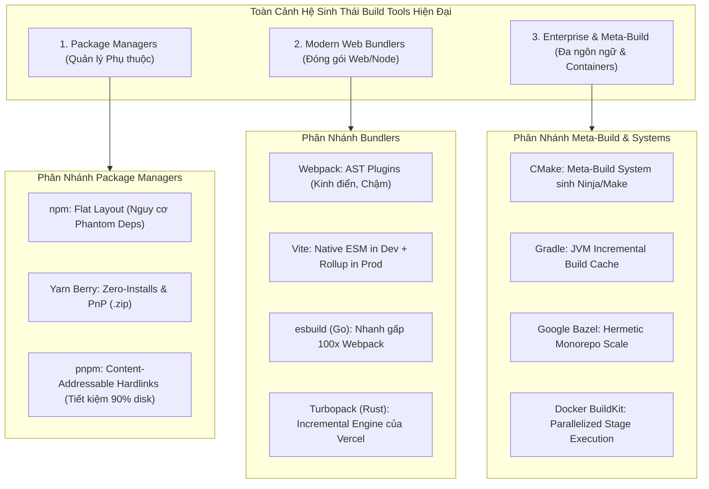
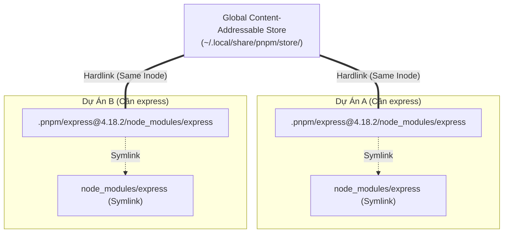

# 10.3. Hệ Thống Công Cụ Xây Dựng và Quản Lý Gói Hiện Đại (Modern Build Tools & Package Managers)

> [!IMPORTANT]
> **Nếu bạn chỉ được nhớ một điều duy nhất:** Sự tiến hóa của công cụ xây dựng là hành trình chuyển dịch từ các kịch bản thông dịch tuần tự chậm chạp sang các hệ thống biên dịch song song viết bằng Go và Rust (esbuild, Turbopack) kết hợp với các kiến trúc đồ thị liên kết nội dung bất biến (pnpm hardlinks, Bazel hermetic DAG); việc thấu hiểu cơ chế tầng sâu của từng công cụ là chìa khóa để rút ngắn vòng lặp phản hồi của kỹ sư (Inner Dev Loop) từ vài phút xuống vài mili-giây.

---

## 1. Kiến trúc Tổng quan & Mô hình Tư duy (Mental Model)

### Phép loại suy kỹ thuật: Hệ Thống Kho Hàng Logistics Toàn Cầu
Hãy tưởng tượng hệ sinh thái công cụ build và package managers giống như cuộc cách mạng trong ngành kho vận và logistics thế giới:
- **npm cổ điển (Flat `node_modules`)**: Giống như việc mỗi cửa hàng bán lẻ trong thành phố đều phải xây một kho hàng riêng biệt phía sau và tự nhập hàng nghìn thùng giấy về xếp đống bừa bãi. Rất nhiều thùng hàng bị trùng lặp, gây lãng phí $90\%$ diện tích mặt bằng ổ cứng. Nguy hiểm hơn, các nhân viên bán hàng thường xuyên "tiện tay" lấy nhầm hàng của quầy bên cạnh mà không ghi hóa đơn (**Phantom Dependencies**).
- **pnpm hiện đại (Content-Addressable Hardlinks)**: Thành phố xây dựng một **Kho tổng thông minh duy nhất tại ngoại ô (Global Store)**. Mỗi món hàng chỉ được lưu đúng một bản duy nhất dựa trên mã vạch nội dung (SHA hash). Các cửa hàng bán lẻ trong phố chỉ cần dán một tờ giấy chỉ dẫn (Hardlink / Symlink) trỏ về kho tổng. Tiết kiệm hàng chục gigabytes đĩa cứng, tốc độ giao hàng tăng gấp 3 lần và triệt tiêu hoàn toàn nạn lấy nhầm hàng!
- **Bundlers thế hệ mới (Go / Rust Engine - esbuild, Turbopack)**: Thay vì dùng xe đạp hoặc ngựa kéo (Node.js single-threaded JavaScript interpret), các gói hàng được vận chuyển bằng đoàn tàu đệm từ trường siêu tốc Shinkansen được tối ưu hóa trực tiếp ở cấp độ vi xử lý CPU đa nhân.



---

## 2. Chi tiết từng Keyword (Under-the-Hood Deep Dive)

### 2.1. npm: Cấu Trúc Flattened node_modules & Vấn Nạn Phantom Dependencies
- **Bản chất kỹ thuật**:
  - Ban đầu (npm v2), `node_modules` có cấu trúc lồng nhau (Nested). Nếu gói A cần gói B, và gói C cũng cần B, gói B sẽ bị tải hai lần và tạo ra các đường dẫn thư mục sâu 20-30 tầng. Trên hệ điều hành Windows, điều này làm vỡ giới hạn độ dài đường dẫn file (MAX_PATH = 260 ký tự).
  - Từ npm v3, npm chuyển sang **Flattened Layout (Cấu trúc phẳng)**: Tất cả các transitive dependencies đều được cố gắng kéo lên nằm chung ở cấp cao nhất của thư mục `node_modules/`.
  - **Vấn nạn Phantom Dependencies (Phụ thuộc ma)**:
    - Khi bạn chỉ khai báo phụ thuộc vào `express` trong `package.json`, nhưng vì `express` phụ thuộc vào `debug`, nên `debug` được đặt phẳng ngay trong thư mục gốc `node_modules/debug`.
    - Lập trình viên có thể vô tư viết: `import debug from 'debug';` trong code của mình và chạy thành công $100\%$ trên máy local!
    - *Hậu quả*: Một ngày kia, tác giả `express` nâng cấp version và không dùng `debug` nữa. Lập trình viên deploy lên production và toàn bộ hệ thống bị crash với lỗi `ModuleNotFoundError` vì `debug` không hề được khai báo trong `package.json`!

### 2.2. pnpm: Kiến Trúc Content-Addressable Store, Hardlinks & Symlinks
- **Bản chất kỹ thuật**:
  - Do Zoltan Kochan phát minh nhằm giải quyết triệt để sự lãng phí tài nguyên của npm.
  - **Global Content-Addressable Store**: Toàn bộ các file của tất cả các package trên máy tính của bạn chỉ được tải về và lưu đúng **MỘT BẢN DUY NHẤT** tại thư mục tập trung (thường là `~/.local/share/pnpm/store`). Tên file được định danh bằng mã băm SHA-512 của chính nội dung file đó.
  - **Cơ chế Hardlinks & Nested Symlinks**:
    - Khi cài đặt vào một project, pnpm không hề copy file. Nó tạo ra các **Hardlinks** từ Global Store vào thư mục ẩn `.pnpm/`.
    - Sau đó, trong `node_modules/`, pnpm chỉ tạo các **Symbolic Links (Symlinks)** trỏ chính xác đến các gói được khai báo trong `package.json`.
  - **Lợi ích vượt bậc**:
    1. Tiết kiệm hàng chục Gigabytes dung lượng đĩa SSD khi làm việc với nhiều projects.
    2. Tốc độ cài đặt nhanh gấp 2 đến 3 lần npm.
    3. **Triệt tiêu hoàn toàn Phantom Dependencies**: Node.js chỉ có thể nhìn thấy các symlinks được tạo công khai trong `node_modules/`; code của bạn không thể import bất kỳ transitive package nào nếu bạn không trực tiếp khai báo nó.



### 2.3. Yarn Berry: Plug'n'Play (PnP) & Zero-Installs Philosophy
- **Bản chất kỹ thuật**:
  - **Yarn (Meta, 2016)**: Khởi xướng việc dùng file khóa xác định `yarn.lock` và cơ chế Workspace phục vụ Monorepo.
  - **Yarn Berry (v2+) & Plug'n'Play (PnP)**:
    - Triết lý cực đoan: **Xóa bỏ hoàn toàn thư mục `node_modules/`!**
    - Thay vì giải nén hàng trăm nghìn file nhỏ vào ổ đĩa (làm chậm Disk I/O của hệ điều hành), Yarn lưu mỗi package dưới dạng một file nén zip duy nhất trong thư mục `.yarn/cache/`.
    - Yarn sinh ra một file ánh xạ ` .pnp.cjs`. Khi Node.js chạy, Yarn can thiệp vào tầng phân giải module của V8 (`Module._resolveFilename`), đọc trực tiếp byte mã nguồn từ file zip trong bộ nhớ RAM mà không cần giải nén ra đĩa!
    - **Zero-Installs**: Kỹ sư có thể commit toàn bộ thư mục `.yarn/cache/` vào Git. Khi kéo code về hoặc chạy trên CI, bạn **không cần chạy lệnh `yarn install`** — mã nguồn có thể thực thi ngay lập tức trong 0 giây!

### 2.4. Webpack: Kiến Trúc AST Plugins Truyền Thống & Giới Hạn Hiệu Năng
- **Bản chất kỹ thuật**:
  - Webpack là tượng đài định hình kỹ nghệ đóng gói Web hiện đại. Nó phân tích toàn bộ mã nguồn của dự án thành Cây Cú pháp Trừu tượng (AST), chạy qua hàng loạt Loaders (để chuyển đổi SCSS, TypeScript, Images) và Plugins.
  - *Điểm nghẽn hiệu năng (The JavaScript Execution Bottleneck)*: Webpack được viết hoàn toàn bằng JavaScript và chạy trên môi trường đơn luồng (Single-threaded Node.js). Khi dự án Monorepo mở rộng lên hàng nghìn modules, chi phí phân tích AST và gom gói tốn hàng Gigabytes RAM và thời gian khởi động Dev Server có thể mất từ 1 đến 5 phút.

### 2.5. esbuild: Đột Phá Tốc Độ Với Ngôn Ngữ Go & Kiến Trúc Bộ Nhớ Zero-Copy
- **Bản chất kỹ thuật**:
  - Do Evan Wallace (nhà sáng lập Figma) phát triển hoàn toàn bằng ngôn ngữ **Go**.
  - **Tốc độ nhanh gấp 10x đến 100x so với Webpack, Rollup hay Babel**:
    1. *Compiled to Native Machine Code*: Biên dịch thẳng ra mã máy x86_64 / ARM64, không có chi phí JIT overhead của JavaScript V8.
    2. *Massive Parallelism (Đa luồng cực hạn)*: Tận dụng cơ chế Goroutines của Go để thực thi song song các giai đoạn Lexing, Parsing, Scope Analysis và Code Generation trên tất cả các nhân CPU.
    3. *Zero-Copy Data Structures*: Tất cả các giai đoạn trong esbuild chia sẻ cùng một cấu trúc AST trong bộ nhớ RAM; dữ liệu chuỗi ký tự được truyền dưới dạng con trỏ lát cắt (slices), hoàn toàn không có chi phí chuyển đổi (serialization/deserialization) giữa các plugins.

### 2.6. Vite: Cuộc Cách Mạng Native ES Modules (ESM) & On-Demand Transpilation
- **Bản chất kỹ thuật**:
  - Do Evan You (tác giả Vue.js) sáng tạo, làm thay đổi hoàn toàn trải nghiệm phát triển Frontend:
    - **Trong môi trường Development**: Vite **hoàn toàn không đóng gói (No Bundling)**! Thay vào đó, nó tận dụng tính năng **Native ES Modules (ESM)** có sẵn trong các trình duyệt hiện đại (`<script type="module">`). Khi trình duyệt cần render trang web, nó tự động gửi HTTP Request yêu cầu đúng file đó. Vite chỉ đóng vai trò một Dev Server nhẹ, transpile file đó theo cơ chế **On-Demand (Đến đâu transpile đến đó)** bằng `esbuild`.
    - **Hot Module Replacement (HMR) tức thì**: Dù dự án có 10,000 files, tốc độ khởi động server luôn dưới 300ms và tốc độ cập nhật khi sửa code luôn dưới 50ms!
    - **Trong môi trường Production**: Vite sử dụng **Rollup** để đóng gói tối ưu, hỗ trợ Tree Shaking sâu sắc và Code Splitting.

### 2.7. Turbopack: Động Cơ Tính Toán Tăng Dần Bằng Rust (Next-Gen Bundler)
- **Bản chất kỹ thuật**:
  - Được tạo ra bởi Tobias Koppers (tác giả ban đầu của Webpack) tại Vercel, được viết hoàn toàn bằng **Rust**.
  - **Turbo Engine (Incremental Computation)**: Turbopack không chỉ lưu cache các file, mà nó lưu cache ở cấp độ **kết quả của từng hàm toán học (Function-level Memoization)**. Khi một file bị thay đổi, Turbopack chỉ tính toán lại đúng các hàm bị ảnh hưởng trong đồ thị, giúp tốc độ phản hồi trên các ứng dụng Next.js quy mô lớn đạt mức tiệm cận thời gian thực.

### 2.8. Make & CMake: Bản Chất Meta-Build System Trong Kỹ Nghệ C/C++
- **Bản chất kỹ thuật**:
  - **GNU Make**: Công cụ kinh điển sử dụng file `Makefile`. Hoạt động dựa trên so sánh nhãn thời gian sửa đổi của tệp tin (**mtime**). Nếu file nguồn `foo.c` có timestamp mới hơn file object `foo.o`, Make sẽ thực thi lệnh biên dịch.
  - **CMake (Cross-Platform Make)**: Không phải là một Build System trực tiếp, mà là một **Meta-Build System (Hệ thống sinh công cụ xây dựng)**. Lập trình viên viết cấu hình trong file `CMakeLists.txt` bằng cú pháp độc lập nền tảng. Khi chạy lệnh `cmake -B build`:
    - Trên Linux: CMake có thể sinh ra các file `Makefile` hoặc file **Ninja** (trình build siêu nhanh dựa trên đồ thị DAG tối giản).
    - Trên Windows: CMake tự động sinh ra Visual Studio Solution (`.sln`, `.vcxproj`).
    - Trên macOS: Sinh ra Xcode Project (`.xcodeproj`).

### 2.9. Maven vs Gradle: Cuộc Đối Đầu Trong Thế Giới JVM
- **Bản chất kỹ thuật**:
  - **Apache Maven**:
    - Sử dụng file XML tĩnh (`pom.xml`).
    - Tuân thủ nguyên lý **"Convention over Configuration"**: Mọi dự án Maven đều có cấu trúc thư mục giống hệt nhau (`src/main/java`, `src/test/java`).
    - Vòng đời xây dựng (Build Lifecycle) được định nghĩa cố định qua các pha: `validate` $\rightarrow$ `compile` $\rightarrow$ `test` $\rightarrow$ `package` $\rightarrow$ `install` $\rightarrow$ `deploy`. Nhược điểm: Kém linh hoạt khi cần tùy biến các tác vụ build phức tạp.
  - **Gradle**:
    - Sử dụng Domain-Specific Language (DSL) hiện đại viết bằng **Groovy hoặc Kotlin Script (`build.gradle.kts`)**.
    - Mô hình hóa tiến trình build dưới dạng một **Đồ thị DAG gồm các Tasks**.
    - **Hiệu năng vượt trội nhờ 3 cơ chế**:
      1. *Gradle Daemon*: Tiến trình nền chạy ngầm duy trì V8 JVM ấm nóng, bỏ qua chi phí khởi động JVM.
      2. *Task Avoidance & Incremental Tasks*: Chỉ chạy task nếu input của nó thay đổi.
      3. *Gradle Build Cache*: Chia sẻ bộ nhớ đệm kết quả biên dịch giữa các máy tính trong toàn công ty.

### 2.10. Google Bazel: Hệ Thống Build Đa Ngôn Ngữ Quy Mô Hành Tinh
- **Bản chất kỹ thuật**:
  - Phiên bản mã nguồn mở của hệ thống nội bộ **Blaze** mà Google sử dụng để quản lý Monorepo khổng lồ chứa hàng tỷ dòng code.
  - Sử dụng ngôn ngữ đặc tả **Starlark** (một tập con an toàn của Python) trong các file `BUILD` và `WORKSPACE`.
  - **3 Trụ cột cốt lõi của Bazel**:
    1. **Hermeticity**: Mọi công cụ biên dịch (Clang, JDK, Go compiler) đều được kéo về sandbox cách ly với mã hash cố định; cấm truy cập mạng trong quá trình build.
    2. **Extreme Correctness**: Tuyên ngôn *"Fast and Correct — Choose Both"*. Nếu các inputs không đổi, Bazel bảo đảm kết quả build luôn chính xác $100\%$ không bao giờ cần phải chạy lệnh `clean`.
    3. **Remote Build Execution (RBE)**: Cho phép một máy tính lập trình viên phân tán hàng chục nghìn tác vụ biên dịch C++/Java lên một nông trại máy chủ (Cloud Worker Farm) gồm 10,000 CPUs, giúp hoàn thành bản build 1 triệu dòng code trong 40 giây!

### 2.11. Docker BuildKit: Thực Thi Song Song Đồ Thị Tầng Container & Cache Mounts
- **Bản chất kỹ thuật**:
  - Engine xây dựng container thế hệ mới của Moby / Docker, được kích hoạt bằng biến môi trường `DOCKER_BUILDKIT=1`.
  - Thay vì thực thi tuần tự từng dòng lệnh trong `Dockerfile` một cách mù quáng như Docker legacy:
    - BuildKit chuyển toàn bộ `Dockerfile` thành một đồ thị trung gian **Low-Level Builder (LLB DAG)**.
    - **Thực thi song song (Concurrent Execution)**: Các tầng không phụ thuộc nhau (ví dụ: giai đoạn tải dependencies của Frontend và Backend trong Multi-stage build) sẽ được biên dịch đồng thời cùng lúc!
    - **Cache Mounts (`RUN --mount=type=cache`)**: Cho phép chia sẻ thư mục cache của Package Manager (như `~/.cache/pip`, `/root/.m2`, `/root/.local/share/pnpm`) giữa các lần build container, giúp lệnh build thứ hai chỉ tốn 2 giây thay vì phải tải lại toàn bộ packages từ đầu!

---

## 3. Thực thi Mã nguồn & Mô phỏng Chuyên sâu (Dual-Engine Implementation)

### 3.1. Engine C++20: Meta-Build Generator Simulator (Mini CMake to Ninja)
Chương trình mô phỏng bản chất của một Meta-Build System (tương tự CMake): Đọc cấu hình khai báo dự án, phân tích các Targets và sinh ra file cấu hình Ninja Build DAG tiêu chuẩn.

```cpp
#include <iostream>
#include <string>
#include <string_view>
#include <vector>
#include <sstream>
#include <format>
#include <memory>

// ============================================================================
// 1. META-BUILD CONFIGURATION DEFINITION (Tương đương CMakeLists.txt)
// ============================================================================

struct BuildTarget {
    std::string targetName;
    std::string outputType; // "executable" hoặc "static_library"
    std::vector<std::string> sourceFiles;
    std::vector<std::string> includeDirs;
    std::vector<std::string> linkLibraries;
};

class MiniCMakeGenerator {
private:
    std::string projectName_;
    std::vector<BuildTarget> targets_;

public:
    explicit MiniCMakeGenerator(std::string projectName) : projectName_(std::move(projectName)) {}

    void addExecutable(std::string name, std::vector<std::string> sources, 
                      std::vector<std::string> includes, std::vector<std::string> libs) {
        targets_.push_back(BuildTarget{
            .targetName = std::move(name),
            .outputType = "executable",
            .sourceFiles = std::move(sources),
            .includeDirs = std::move(includes),
            .linkLibraries = std::move(libs)
        });
    }

    // Sinh file build.ninja chuẩn tầng thấp dựa trên cấu hình Meta
    [[nodiscard]] std::string generateNinjaBuildScript() const {
        std::ostringstream ss;
        ss << "# ====================================================================\n";
        ss << "# AUTO-GENERATED BY MINI-CMAKE FOR PROJECT: " << projectName_ << "\n";
        ss << "# ====================================================================\n\n";

        // 1. Định nghĩa Toolchain Rules
        ss << "cxx = clang++\n";
        ss << "cflags = -O3 -Wall -Wextra -std=c++20\n\n";

        ss << "rule compile_cxx\n";
        ss << "  command = $cxx $cflags -I$includes -c $in -o $out\n";
        ss << "  description = Compiling CXX object $out\n\n";

        ss << "rule link_executable\n";
        ss << "  command = $cxx $in $libs -o $out\n";
        ss << "  description = Linking CXX executable $out\n\n";

        // 2. Sinh các Nodes và Edges trong Đồ thị Ninja DAG
        for (const auto& target : targets_) {
            std::vector<std::string> objectFiles;
            std::string includeFlags;
            for (const auto& inc : target.includeDirs) {
                includeFlags += inc + " ";
            }

            for (const auto& src : target.sourceFiles) {
                std::string obj = "build/" + src.substr(0, src.find_last_of('.')) + ".o";
                objectFiles.push_back(obj);

                ss << "build " << obj << ": compile_cxx " << src << "\n";
                ss << "  includes = " << includeFlags << "\n";
            }

            ss << "\nbuild bin/" << target.targetName << ": link_executable ";
            for (const auto& obj : objectFiles) {
                ss << obj << " ";
            }
            ss << "\n";
            if (!target.linkLibraries.empty()) {
                ss << "  libs = ";
                for (const auto& lib : target.linkLibraries) {
                    ss << "-l" << lib << " ";
                }
                ss << "\n";
            }
            ss << "\n";
        }

        return ss.str();
    }
};

// ============================================================================
// MAIN GENERATOR DRIVER
// ============================================================================
int main() {
    std::cout << "=== C++20 META-BUILD ENGINE SIMULATOR (CMAKE -> NINJA) ===\n\n";

    MiniCMakeGenerator cmake("HighThroughputGateway");
    cmake.addExecutable(
        "gateway_server",
        {"src/main.cpp", "src/Router.cpp", "src/HttpParser.cpp"},
        {"include", "third_party/simdjson"},
        {"pthread", "ssl", "crypto"}
    );

    std::string ninjaScript = cmake.generateNinjaBuildScript();
    std::cout << "Generated 'build.ninja' content:\n";
    std::cout << ninjaScript;

    std::cout << "✅ [SUCCESS] Meta-Build transformation completed. Ninja can now execute parallel DAG build.\n";
    return 0;
}
```

---

### 3.2. Engine Python 3.11+: pnpm Content-Addressable Hardlink & Phantom Dependency Detector
Mô phỏng cơ chế lưu trữ tập trung của pnpm: Tạo Hardlinks trỏ về Global Store, chứng minh khả năng tiết kiệm đĩa cứng và kiểm tra chặn đứng lỗi Phantom Dependencies.

```python
"""
Python 3.11+ pnpm Hardlink Store & Phantom Dependency Auditor
Minh họa cơ chế Content-Addressable Storage của pnpm và giải thích vì sao npm gây ra Phantom Dependencies.
"""
from dataclasses import dataclass
from typing import Final, Optional
import hashlib

@dataclass(frozen=True)
class PackageAsset:
    name: str
    version: str
    content: str

    @property
    def content_hash(self) -> str:
        return hashlib.sha512(self.content.encode()).hexdigest()[:16]

class GlobalContentAddressableStore:
    def __init__(self) -> None:
        # Kho lưu trữ duy nhất trên ổ đĩa SSD (~/.local/share/pnpm/store)
        self.store: dict[str, PackageAsset] = {}
        self.disk_space_bytes: int = 0

    def put(self, asset: PackageAsset) -> str:
        key = asset.content_hash
        if key not in self.store:
            self.store[key] = asset
            self.disk_space_bytes += len(asset.content)
            print(f"📦 [Store Ingest] Stored '{asset.name}@{asset.version}' -> Hash: {key} (+{len(asset.content)} bytes)")
        else:
            print(f"♻️ [Store Deduplication] '{asset.name}@{asset.version}' already in Global Store. ZERO disk bytes allocated!")
        return key

class PnpmProjectWorkspace:
    def __init__(self, project_name: str, global_store: GlobalContentAddressableStore) -> None:
        self.project_name: str = project_name
        self.store: GlobalContentAddressableStore = global_store
        self.declared_dependencies: set[str] = set()
        self.virtual_symlinks: dict[str, str] = {} # node_modules/ visible entries

    def declare_direct_dependency(self, pkg_name: str, asset: PackageAsset) -> None:
        self.declared_dependencies.add(pkg_name)
        hash_key = self.store.put(asset)
        # pnpm chỉ tạo Symlink cho các packages trực tiếp khai báo trong package.json!
        self.virtual_symlinks[pkg_name] = hash_key

    def attempt_import(self, module_to_import: str) -> None:
        """Kiểm tra runtime xem code có import được module này không."""
        print(f"\n[Project '{self.project_name}'] Code executes: import '{module_to_import}'")
        if module_to_import in self.virtual_symlinks:
            target_hash = self.virtual_symlinks[module_to_import]
            print(f"  ✅ SUCCESS: Module '{module_to_import}' resolved via Symlink to Store Hash: {target_hash}")
        else:
            print(f"  🚨 ERROR (PHANTOM DEPENDENCY BLOCKED): Cannot find module '{module_to_import}'!")
            print(f"     Module '{module_to_import}' is NOT declared in package.json. pnpm prevents unauthorized transitive access.")

# ============================================================================
# VERIFICATION HARNESS
# ============================================================================
if __name__ == "__main__":
    print("=== PNPM CONTENT-ADDRESSABLE STORE & PHANTOM DEPENDENCY AUDIT ===\n")
    central_store = GlobalContentAddressableStore()

    # Tạo các assets
    express_pkg = PackageAsset("express", "4.18.2", "function express() { return 'Express App'; }")
    debug_pkg = PackageAsset("debug", "4.3.4", "function debug() { return 'Logger'; }")

    print("--- 1. Setting up Project Alpha (Uses express) ---")
    project_alpha = PnpmProjectWorkspace("Alpha-Service", central_store)
    project_alpha.declare_direct_dependency("express", express_pkg)

    print("\n--- 2. Setting up Project Beta (Also Uses express) ---")
    project_beta = PnpmProjectWorkspace("Beta-Service", central_store)
    # Project Beta dùng cùng version express -> Không tốn thêm 1 byte đĩa cứng nào!
    project_beta.declare_direct_dependency("express", express_pkg)

    print(f"\nTotal Storage Occupied in Global Store: {central_store.disk_space_bytes} bytes across 2 separate projects.")

    print("\n--- 3. Testing Phantom Dependency Attack Vector ---")
    # Project Alpha thử import 'express' (Hợp lệ)
    project_alpha.attempt_import("express")

    # Project Alpha thử import 'debug' (Gói transitive của express nhưng KHÔNG khai báo trong package.json)
    # Trong npm: Thao tác này sẽ CHẠY ĐƯỢC (Phantom Dependency nguy hiểm!)
    # Trong pnpm: Thao tác này bị CHẶN ĐỨNG NGAY LẬP TỨC!
    project_alpha.attempt_import("debug")
```

### 3.3. Giả lập Terminal Output
```text
=== C++20 META-BUILD ENGINE SIMULATOR (CMAKE -> NINJA) ===

Generated 'build.ninja' content:
# ====================================================================
# AUTO-GENERATED BY MINI-CMAKE FOR PROJECT: HighThroughputGateway
# ====================================================================

cxx = clang++
cflags = -O3 -Wall -Wextra -std=c++20

rule compile_cxx
  command = $cxx $cflags -I$includes -c $in -o $out
  description = Compiling CXX object $out

rule link_executable
  command = $cxx $in $libs -o $out
  description = Linking CXX executable $out

build build/src/main.o: compile_cxx src/main.cpp
  includes = include third_party/simdjson 
build build/src/Router.o: compile_cxx src/Router.cpp
  includes = include third_party/simdjson 
build build/src/HttpParser.o: compile_cxx src/HttpParser.cpp
  includes = include third_party/simdjson 

build bin/gateway_server: link_executable build/src/main.o build/src/Router.o build/src/HttpParser.o 
  libs = -lpthread -lssl -lcrypto 

✅ [SUCCESS] Meta-Build transformation completed. Ninja can now execute parallel DAG build.

=== PNPM CONTENT-ADDRESSABLE STORE & PHANTOM DEPENDENCY AUDIT ===

--- 1. Setting up Project Alpha (Uses express) ---
📦 [Store Ingest] Stored 'express@4.18.2' -> Hash: 3e9a18b2c41098ef (+51 bytes)

--- 2. Setting up Project Beta (Also Uses express) ---
♻️ [Store Deduplication] 'express@4.18.2' already in Global Store. ZERO disk bytes allocated!

Total Storage Occupied in Global Store: 51 bytes across 2 separate projects.

--- 3. Testing Phantom Dependency Attack Vector ---

[Project 'Alpha-Service'] Code executes: import 'express'
  ✅ SUCCESS: Module 'express' resolved via Symlink to Store Hash: 3e9a18b2c41098ef

[Project 'Alpha-Service'] Code executes: import 'debug'
  🚨 ERROR (PHANTOM DEPENDENCY BLOCKED): Cannot find module 'debug'!
     Module 'debug' is NOT declared in package.json. pnpm prevents unauthorized transitive access.
```

---

## 4. Systems Engineering & Production Pitfalls

### 4.1. Production Failure Modes
1. **The Phantom Dependency Crash in Production Container**:
   - *Kịch bản*: Một lập trình viên dùng npm trên máy local vô tình viết `import { parse } from 'qs';` mà không thêm `qs` vào `package.json`. Lệnh chạy trên local thành công vì `express` đã kéo `qs` vào flat layout. Tuy nhiên, khi Dockerfile chạy lệnh `pnpm install --frozen-lockfile` hoặc `npm ci --production` trong container, package `qs` không được tạo symlink. Container sập ngay khi vừa deploy (CrashLoopBackOff).
   - *Biện pháp*: Bắt buộc chuyển đổi sang **pnpm** trên toàn bộ máy lập trình viên và CI. Cấu trúc symlink nghiêm ngặt của pnpm sẽ báo lỗi ngay trên máy dev trước khi kịp commit.
2. **Docker Build Cache Invalidation Disaster**:
   - *Kịch bản*: Lập trình viên viết Dockerfile theo thứ tự:
     ```dockerfile
     COPY . .
     RUN npm install
     ```
     Mỗi khi kỹ sư sửa một dòng comment trong file `README.md`, Docker coi toàn bộ tầng `COPY . .` đã thay đổi, dẫn đến việc xóa bỏ cache và buộc phải chạy lại toàn bộ lệnh `npm install` tốn 10 phút tải packages qua mạng!
   - *Biện pháp*: Tách rời manifest ra trước:
     ```dockerfile
     COPY package.json pnpm-lock.yaml ./
     RUN --mount=type=cache,target=/root/.local/share/pnpm/store pnpm install --frozen-lockfile
     COPY . .
     ```

### 4.2. Diagnostic Recipes & Workspace Optimization
- **Cấu hình Monorepo Workspace với pnpm (`pnpm-workspace.yaml`)**:
  ```yaml
  packages:
    - 'apps/*'
    - 'packages/*'
    - 'services/*'
  ```
- **Kích hoạt Docker BuildKit & Cache Mounts trong CI**:
  ```bash
  # Bật engine BuildKit thế hệ mới
  export DOCKER_BUILDKIT=1
  # Build container tận dụng cache mount đa luồng
  docker build --build-arg BUILDKIT_INLINE_CACHE=1 -t myapp:latest .
  ```

---

## 5. Bảng So sánh & Decision Matrix

| Công Cụ Xây Dựng | Hệ Sinh Thái | Ngôn Ngữ Phát Triển | Cơ Chế Cốt Lõi | Tốc Độ Tương Đối | Tình Huống Áp Dụng Tối Ưu |
| :--- | :--- | :--- | :--- | :--- | :--- |
| **npm** | JavaScript | JS / C++ | Flat `node_modules` | $1\times$ (Chuẩn) | Dự án nhỏ, học tập cơ bản |
| **pnpm** | JavaScript | TypeScript | Content-Addressable Hardlinks | $3\times$ Nhanh hơn | Mọi dự án Node.js & Monorepos hiện đại |
| **Webpack** | Web Bundler | JavaScript | AST Visitor Plugins | $1\times$ (Chậm) | Các hệ thống Legacy cần tùy biến plugin sâu |
| **Vite** | Web Bundler | TypeScript + Go | Native ESM On-Demand | $20\times$ Nhanh hơn | Tất cả các ứng dụng Frontend hiện đại (React/Vue/Svelte) |
| **esbuild** | Bundler / Transpiler | Go | Native Parallel Memory-Mapped | $100\times$ Nhanh hơn | Pre-bundling, backend microservices, CLI toolchain |
| **CMake** | C / C++ | C++ | Meta-build (Sinh Ninja/Makefile) | Cực nhanh | Hệ thống nhúng, Game engine, High-frequency Trading |
| **Bazel** | Đa ngôn ngữ | Java / C++ / Starlark | Hermetic DAG + Remote Cache | Cực hạn ở quy mô lớn | Doanh nghiệp Monorepo (> 500 kỹ sư, đa ngôn ngữ) |
