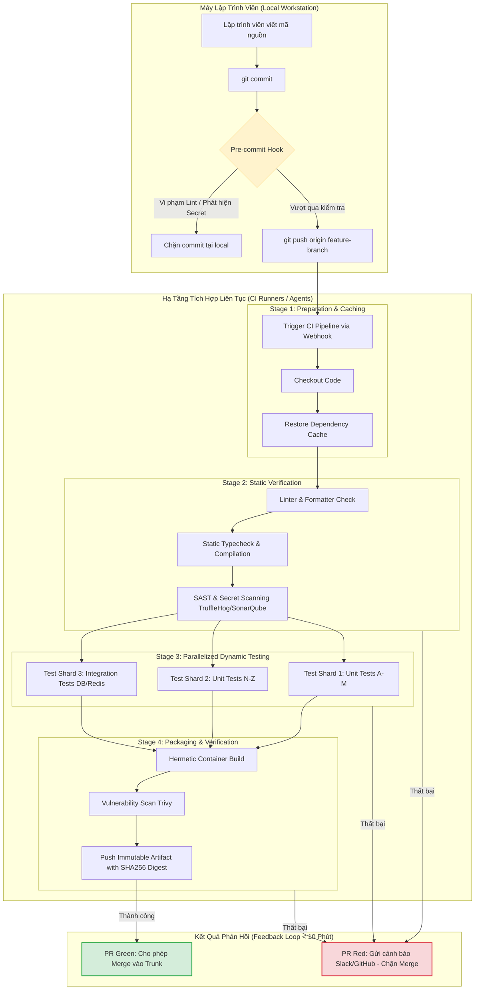
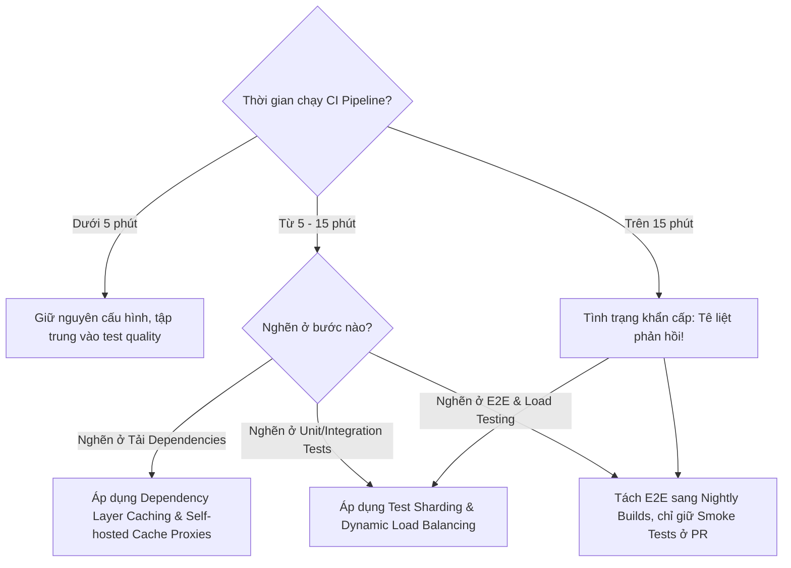

# 11.1. Kỹ Nghệ Tích Hợp Liên Tục (Continuous Integration Engineering)

> [!IMPORTANT]
> **Nếu bạn chỉ được nhớ một điều duy nhất:** Continuous Integration không đơn thuần là cài đặt một máy chủ Jenkins hay viết file YAML GitHub Actions, mà là **kỷ luật kỹ thuật tích hợp mã nguồn vào nhánh chính (Trunk) ít nhất một lần mỗi ngày** kết hợp với **vòng phản hồi siêu nhanh (< 10 phút)** được bảo vệ bằng hệ thống kiểm thử tự động độc lập, nhằm phát hiện và triệt tiêu lỗi tích hợp ngay từ trong trứng nước.

---

## 1. Kiến trúc Tổng quan & Mô hình Tư duy (Mental Model)

### 1.1. Phép loại suy thực tế: Dây chuyền sản xuất Toyota và Dây giật còi Andon (Andon Cord)
Hãy tưởng tượng một nhà máy lắp ráp ô tô hiện đại theo triết lý sản xuất tinh gọn (Lean Manufacturing / Toyota Production System - TPS). Trong mô hình truyền thống (kiểu "tích hợp định kỳ hàng quý"), hàng nghìn linh kiện từ các xưởng cơ khí, điện, sơn được chuyển về một kho tổng và chỉ ráp lại khi dự án sắp bàn giao. Khi ghép khung gầm vào động cơ, kỹ sư mới bàng hoàng nhận ra trục truyền động bị lệch $2\text{ mm}$, và toàn bộ nhà máy phải dừng lại nhiều tuần để đập đi làm lại — đó chính là **Merge Hell (Địa ngục hợp nhất mã nguồn)**.

Ngược lại, trong mô hình Continuous Integration:
- Mỗi khi một chi tiết nhỏ được gia công xong, nó lập tức được đưa vào trạm kiểm định tự động với các cảm biến quang học và thước đo điện tử chính xác đến từng micromet (tương ứng với **Automated Build & Unit Tests**).
- Nếu bất kỳ chi tiết nào lệch chuẩn dù chỉ một phần triệu milimet, hệ thống phát tín hiệu dừng dây chuyền ngay lập tức (**Andon Cord / Stop-the-Line**). Cả đội ngũ sẽ dừng mọi việc đang làm để cùng sửa chữa lỗi đó trước khi bất kỳ linh kiện nào khác được đưa vào dây chuyền.
- Nhờ đó, dây chuyền luôn ở trạng thái "xanh" (Green State), sản phẩm cuối cùng luôn sẵn sàng lắp ráp mà không phát sinh lỗi bất ngờ.



---

## 2. Chi tiết từng Keyword (Under-the-Hood Deep Dive)

### 2.1. Continuous Integration (CI) & Trunk-Based Development
- **Bản chất kỹ thuật**: CI là thực hành kỹ thuật phần mềm (nằm trong bộ khung Extreme Programming của Kent Beck và Martin Fowler) yêu cầu các thành viên trong nhóm tích hợp mã nguồn của họ vào một nhánh chính duy nhất (thường gọi là `trunk` hoặc `main`) với tần suất cao — ít nhất một lần mỗi ngày. Mỗi lần tích hợp được tự động xác minh bằng một quy trình build tự động và kiểm thử tự động toàn diện.
- **Cơ chế vận hành**:
  - Đối lập với mô hình phân nhánh dài hạn (*Feature Branching* kéo dài hàng tuần hoặc *GitFlow* cồng kềnh với nhiều nhánh `develop`, `release`, `hotfix`), CI phát huy tối đa sức mạnh khi đi đôi với **Trunk-Based Development (TBD)**. 
  - Trong TBD, các nhánh feature chỉ tồn tại trong vài giờ hoặc tối đa 1-2 ngày, với dung lượng nhỏ (dưới 400 dòng code thay đổi).
  - Để ngăn code chưa hoàn thiện làm ảnh hưởng đến người dùng khi đã hòa vào Trunk, kỹ sư sử dụng **Feature Flags** (Cờ tính năng) để ẩn code mới khỏi production.
- **Ưu điểm**:
  - Triệt tiêu hoàn toàn các cuộc xung đột mã nguồn khổng lồ (*Merge Conflict Hell*).
  - Đảm bảo nhánh chính luôn ở trạng thái có thể phát hành bất cứ lúc nào (*Always-Releasable Trunk*).
- **Sai lầm phổ biến**:
  - Hiểu nhầm rằng việc thiết lập GitHub Actions chạy test trên một Feature Branch sống suốt 3 tháng là "đang làm CI". Nếu không tích hợp vào Trunk mỗi ngày, đó chỉ là *Continuous Testing trên một nhánh cô lập*, không phải là Continuous Integration.

### 2.2. CI Pipeline Anatomy (Các giai đoạn giải phẫu đường ống)
Một CI Pipeline chuẩn mực được tổ chức thành các tầng (Stages) nối tiếp hoặc song song, tuân thủ nguyên tắc **Fail-Fast** (các bước tốn ít tài nguyên và phát hiện lỗi nhanh nhất phải được xếp lên đầu):
1. **Stage 1: Checkout & Cache Restore**:
   - Máy ảo CI (Runner/Agent) kéo mã nguồn từ Git repository dựa trên commit hash cụ thể.
   - Nạp các tệp phụ thuộc đã được cache từ các lần chạy trước (ví dụ: `~/.cargo`, `~/.npm`, `~/.m2`) để tránh tải lại toàn bộ internet trên mỗi commit.
2. **Stage 2: Lint & Format**:
   - Kiểm tra cú pháp, quy ước đặt tên và style code tĩnh (ví dụ: `clang-format`, `eslint`, `ruff`, `golangci-lint`). Bước này tốn vài giây nhưng loại bỏ toàn bộ các tranh cãi hình thức khi code review.
3. **Stage 3: Compilation / Typecheck**:
   - Đối với ngôn ngữ tĩnh (C++, Rust, Go, TypeScript, Java), trình biên dịch chạy kiểm tra kiểu dữ liệu tĩnh và dịch mã nguồn.
   - Thực thi với chế độ **Hermetic Build** (biên dịch khép kín), đảm bảo mã nguồn chỉ phụ thuộc vào các công cụ và thư viện được định nghĩa tường minh, không bị ảnh hưởng bởi môi trường ngoài.
4. **Stage 4: Unit & Fast Integration Tests**:
   - Chạy hàng nghìn bài kiểm thử đơn vị độc lập trên bộ nhớ RAM. Các bài kiểm thử này không được gọi network ngoài, sử dụng test doubles (mocks/stubs) cho các I/O nặng.
5. **Stage 5: Static Analysis & Security Gates (SAST & SCA)**:
   - **SAST (Static Application Security Testing)**: Quét AST (Abstract Syntax Tree) để phát hiện các lỗ hổng bảo mật như SQL Injection, Buffer Overflow, XSS (ví dụ: SonarQube, CodeQL).
   - **SCA (Software Composition Analysis)**: Quét file lock phụ thuộc (`package-lock.json`, `Cargo.lock`) để đối chiếu với cơ sở dữ liệu lỗ hổng bảo mật CVE công khai (ví dụ: Snyk, Dependabot).
   - **Secret Scanning**: Phát hiện các chuỗi khóa bí mật, token API, private keys vô tình bị commit (ví dụ: TruffleHog, Gitleaks).
6. **Stage 6: Artifact Creation & Packaging**:
   - Đóng gói ứng dụng thành một Artifact bất biến (Docker OCI Image, binary tarball, JAR package).
   - Đóng dấu chữ ký mã nguồn (Cosign/Sigstore) và sinh tài liệu SBOM (Software Bill of Materials) theo tiêu chuẩn bảo mật chuỗi cung ứng SLSA.

### 2.3. Fast Feedback Loops & Quy Tắc 10 Phút
- **Bản chất**: Giá trị lớn nhất của CI là cung cấp thông tin phản hồi cho lập trình viên khi bối cảnh tư duy (mental context) của họ về đoạn mã nguồn đó vẫn còn "nóng hổi" trong não bộ.
- **Quy tắc 10 phút (The 10-Minute Rule)**:
  - Toàn bộ thời gian chạy từ lúc lập trình viên thực hiện `git push` cho đến khi nhận được tích xanh (Green Checkmark) trên GitHub Pull Request **bắt buộc phải dưới 10 phút** (lý tưởng là dưới 5 phút).
  - **Tâm lý học kỹ thuật**: Nếu CI chạy mất 45 phút, lập trình viên sẽ lập tức chuyển sang làm việc khác (*Context Switching*). Khi CI báo đỏ sau 45 phút, họ đã quên sạch logic vừa viết, dẫn đến chi phí phục hồi nhận thức (cognitive reloading) cực kỳ tốn kém.
- **Kỹ thuật tối ưu hóa**:
  - Sử dụng Cache Dependencies phân tầng (Layer Caching, Docker buildkit cache mounts).
  - Chạy song song hóa tối đa (Parallelization).
  - Tách các bài kiểm thử nặng (E2E, Performance, Load Testing) ra khỏi PR Pipeline và đưa vào **Nightly Builds**.

### 2.4. Pre-commit Hooks (Chốt chặn cục bộ tại máy lập trình viên)
- **Bản chất kỹ thuật**: Script được kích hoạt tự động bởi hệ thống Git Hook (`.git/hooks/pre-commit`) ngay trên máy trạm của lập trình viên trước khi commit object được tạo trong cơ sở dữ liệu Git.
- **Công cụ triển khai phổ biến**: `Husky` (JavaScript/TypeScript), `pre-commit` (Python đa ngôn ngữ), native shell scripts.
- **Cơ chế hoạt động**:
  - Chỉ quét trên các tệp tin đang nằm trong khu vực chuẩn bị (*Staged files* - `git diff --cached --name-only`).
  - Kiểm tra các lỗi cơ bản: Thừa dấu cách, thiếu dấu chấm phẩy, format code sai quy chuẩn, commit file `.env` chứa mật khẩu API.
- **Ưu điểm**: Ngăn chặn rác thải mã nguồn ngay từ điểm khởi nguồn, giải phóng tài nguyên của CI runner trên cloud khỏi việc phải chạy pipeline cho những commit sai cú pháp ngớ ngẩn.
- **Cạm bẫy**: Lập trình viên có thể dùng cờ `--no-verify` để bỏ qua hook. Do đó, Pre-commit Hook chỉ là phòng tuyến vòng ngoài, không bao giờ được thay thế hoàn toàn các bước kiểm tra nghiêm ngặt trên CI Server.

### 2.5. Build Matrix (Ma trận xây dựng đa nền tảng)
- **Bản chất**: Kỹ thuật cấu hình CI cho phép khai báo một tập hợp các biến môi trường và để hệ thống CI tự động tính tích Descartes (Cartesian product) của các biến đó, tạo ra hàng loạt tác vụ chạy song song đồng thời.
- **Cấu hình điển hình**:
  - Hệ điều hành: `[ubuntu-latest, macos-latest, windows-latest]`
  - Phiên bản ngôn ngữ/Runtime: `[node:18, node:20, node:22]` hoặc `[gcc-11, gcc-12, clang-16]`
  - Kết quả: $3 \times 3 = 9$ jobs chạy đồng thời trên 9 máy ảo độc lập.
- **Ứng dụng thực chiến**: Tối quan trọng đối với các thư viện mã nguồn mở, SDK, cross-platform CLI, nơi mà lỗi chỉ xuất hiện trên một hệ điều hành cụ thể (ví dụ: lỗi ngắt dòng CRLF trên Windows hoặc khác biệt hệ thống tệp tin case-sensitivity trên macOS).

### 2.6. Test Parallelization & Sharding (Phân mảnh kiểm thử song song)
- **Bản chất kỹ thuật**: Khi bộ kiểm thử tự động phình to lên hàng chục nghìn test cases, chạy tuần tự trên 1 máy ảo sẽ mất nhiều giờ. Test Sharding là kỹ thuật chia tập hợp các bài kiểm thử thành $N$ phần độc lập (shards) và chạy đồng thời trên $N$ máy ảo worker.
- **Hai phương pháp phân mảnh**:
  1. **Deterministic Round-Robin (Băm tĩnh)**: Dựa trên hàm băm tên file `hash(filename) % total_shards == current_shard_index`. Cách này dễ cài đặt nhưng dễ gây mất cân bằng tải vì có file test chạy 1 giây, có file test chạy 5 phút.
  2. **Timing-based Dynamic Balancing (Cân bằng động theo lịch sử thời gian)**: Lưu lại thời gian thực thi của từng test case trong lần chạy gần nhất, sử dụng thuật toán tối ưu xếp đồ (Bin-packing algorithm) để phân bổ các bài test sao cho tổng thời gian chạy của cả $N$ máy ảo là xấp xỉ tương đương nhau.

### 2.7. Nightly Builds & Soak/Load Testing (Bản dựng ban đêm)
- **Bản chất**: Pipeline chạy theo lịch biểu định kỳ (cron job) vào ban đêm (ví dụ: 02:00 AM hàng ngày) khi lưu lượng lập trình viên commit giảm xuống.
- **Mục đích**:
  - Thực thi các bài kiểm thử không thể chạy trong vòng 10 phút của PR pipeline:
    - **Long-running Integration & End-to-End Tests**: Kiểm thử toàn diện luồng nghiệp vụ trên trình duyệt thật (Playwright/Cypress).
    - **Soak Testing**: Cho hệ thống chạy liên tục dưới tải trung bình trong 6 tiếng để phát hiện Memory Leak hoặc rò rỉ File Descriptor.
    - **Fuzz Testing**: Bơm hàng triệu gói tin ngẫu nhiên vào các hàm parser để tìm lỗi crash hoặc tràn bộ đệm.
    - **Load & Stress Testing**: Đánh giá độ trễ p99 khi tải tăng vọt.

### 2.8. Zero Broken Trunk Policy & Triết lý "Stop the Line"
- **Bản chất văn hóa & kỹ thuật**: Nhánh `trunk` phải luôn luôn xanh. Nếu một commit vượt qua được review và merge vào trunk nhưng lại làm gãy pipeline của trunk:
  - **Mức độ ưu tiên cao nhất (P0)**: Không ai được phép merge thêm bất kỳ PR nào mới vào trunk cho đến khi trunk được sửa xong.
  - **Quy tắc 10 phút Revert**: Nếu tác giả commit không thể tìm ra nguyên nhân và khắc phục lỗi trong vòng 10 phút, hành động bắt buộc là **Revert commit đó ngay lập tức** để trả lại trạng thái xanh cho trunk, sau đó mới tiến hành debug ở máy cá nhân.

### 2.9. Immutable Artifact Packaging (Đóng gói sản phẩm bất biến)
- **Bản chất**: Kết quả đầu ra của một CI pipeline thành công phải là một Artifact bất biến (Immutable Artifact), tiêu biểu nhất là Docker Image được gắn thẻ mã băm nội dung (**SHA256 Content Digest**).
- **Quy tắc vàng**: **Chỉ build một lần duy nhất (Build Once, Run Everywhere)**.
  - Tuyệt đối không build lại code trên môi trường Staging hay Production.
  - Image được sinh ra từ CI pipeline trên commit `a1b2c3` sẽ được đẩy lên Artifact Registry và di chuyển qua các môi trường (Dev $\to$ Staging $\to$ Prod) chỉ bằng cách thay đổi cấu hình runtime (Environment Variables / ConfigMaps).
  - Không bao giờ sử dụng tag `latest` vì `latest` là con trỏ khả biến (mutable), có thể bị ghi đè bất cứ lúc nào, phá vỡ tính tái lập của hệ thống.

---

## 3. Thực thi Mã nguồn & Mô phỏng Chuyên sâu (Dual-Engine Implementation)

Dưới đây là hai bộ động cơ thực thi mô phỏng toàn diện một **Hệ Thống Điều Phối CI Pipeline & DAG Task Runner** có khả năng:
1. Phân giải đồ thị phụ thuộc (DAG Dependency Resolution).
2. Chạy song song hóa các tác vụ độc lập (Parallel Execution).
3. Cơ chế ngắt mạch khẩn cấp (Stop-the-line Short Circuiting) ngay khi có task thất bại.
4. Báo cáo đo lường thời gian thực thi (Performance Metrics & Telemetry).

### 3.1. Động cơ C++20: Multithreaded DAG CI Pipeline Orchestrator

```cpp
#include <iostream>
#include <string>
#include <vector>
#include <memory>
#include <chrono>
#include <thread>
#include <future>
#include <mutex>
#include <atomic>
#include <unordered_map>
#include <iomanip>

namespace ci_engine {

enum class TaskStatus { PENDING, RUNNING, SUCCESS, FAILED, SKIPPED };

std::string statusToString(TaskStatus status) {
    switch (status) {
        case TaskStatus::PENDING: return "PENDING";
        case TaskStatus::RUNNING: return "RUNNING";
        case TaskStatus::SUCCESS: return "\033[32mSUCCESS\033[0m";
        case TaskStatus::FAILED:  return "\033[31mFAILED\033[0m";
        case TaskStatus::SKIPPED: return "\033[33mSKIPPED\033[0m";
    }
    return "UNKNOWN";
}

struct TaskMetrics {
    std::string task_name;
    TaskStatus status{TaskStatus::PENDING};
    std::chrono::milliseconds duration{0};
    std::string error_message{""};
};

class CITask {
public:
    using Ptr = std::shared_ptr<CITask>;
    std::string id;
    std::string name;
    int duration_ms;
    bool should_fail;
    std::vector<std::string> dependencies;

    CITask(std::string id, std::string name, int duration_ms, bool should_fail, std::vector<std::string> deps = {})
        : id(std::move(id)), name(std::move(name)), duration_ms(duration_ms), 
          should_fail(should_fail), dependencies(std::move(deps)) {}

    TaskMetrics execute(const std::atomic<bool>& pipeline_aborted) {
        TaskMetrics metric;
        metric.task_name = name;

        if (pipeline_aborted.load()) {
            metric.status = TaskStatus::SKIPPED;
            metric.error_message = "Pipeline aborted due to prior failure";
            return metric;
        }

        auto start = std::chrono::steady_clock::now();
        metric.status = TaskStatus::RUNNING;
        
        // Giả lập thời gian thực thi tác vụ
        std::this_thread::sleep_for(std::chrono::milliseconds(duration_ms));

        if (pipeline_aborted.load()) {
            metric.status = TaskStatus::SKIPPED;
            metric.error_message = "Cancelled midway";
            return metric;
        }

        auto end = std::chrono::steady_clock::now();
        metric.duration = std::chrono::duration_cast<std::chrono::milliseconds>(end - start);

        if (should_fail) {
            metric.status = TaskStatus::FAILED;
            metric.error_message = "Assertion failed or vulnerability threshold exceeded!";
        } else {
            metric.status = TaskStatus::SUCCESS;
        }

        return metric;
    }
};

class CIPipelineRunner {
private:
    std::vector<CITask::Ptr> tasks_;
    std::atomic<bool> pipeline_aborted_{false};
    std::mutex output_mutex_;

public:
    void addTask(CITask::Ptr task) {
        tasks_.push_back(task);
    }

    void executePipeline() {
        std::cout << "\n=======================================================\n";
        std::cout << ">>> INITIATING HERMETIC CI PIPELINE RUNNER (C++20) <<<\n";
        std::cout << "=======================================================\n";

        auto pipeline_start = std::chrono::steady_clock::now();
        std::unordered_map<std::string, TaskMetrics> results;
        std::unordered_map<std::string, std::shared_future<TaskMetrics>> futures;

        // Cơ chế chạy theo từng tầng (Stages) dựa trên phụ thuộc
        for (const auto& task : tasks_) {
            // Đảm bảo các task phụ thuộc đã hoàn thành
            std::vector<std::shared_future<TaskMetrics>> dep_futures;
            for (const auto& dep_id : task->dependencies) {
                if (futures.find(dep_id) != futures.end()) {
                    dep_futures.push_back(futures[dep_id]);
                }
            }

            // Launch task asynchronously
            futures[task->id] = std::async(std::launch::async, [this, task, dep_futures]() {
                // Đợi toàn bộ dependencies hoàn thành
                for (auto& dep : dep_futures) {
                    auto res = dep.get();
                    if (res.status == TaskStatus::FAILED || res.status == TaskStatus::SKIPPED) {
                        pipeline_aborted_.store(true);
                        TaskMetrics m;
                        m.task_name = task->name;
                        m.status = TaskStatus::SKIPPED;
                        m.error_message = "Dependency '" + res.task_name + "' did not succeed";
                        return m;
                    }
                }

                {
                    std::lock_guard<std::mutex> lock(output_mutex_);
                    std::cout << "[CI RUNNER] Starting stage: " << task->name << "...\n";
                }

                auto outcome = task->execute(pipeline_aborted_);

                {
                    std::lock_guard<std::mutex> lock(output_mutex_);
                    std::cout << "[CI RUNNER] Completed: " << task->name 
                              << " | Status: " << statusToString(outcome.status)
                              << " (" << outcome.duration.count() << "ms)\n";
                }

                if (outcome.status == TaskStatus::FAILED) {
                    pipeline_aborted_.store(true);
                    std::lock_guard<std::mutex> lock(output_mutex_);
                    std::cout << "\033[31m[ANDON CORD ACTIVATED] Stop-the-Line! Aborting remaining tasks.\033[0m\n";
                }

                return outcome;
            }).share();
        }

        // Thu thập toàn bộ kết quả
        for (const auto& task : tasks_) {
            results[task->id] = futures[task->id].get();
        }

        auto pipeline_end = std::chrono::steady_clock::now();
        auto total_time = std::chrono::duration_cast<std::chrono::milliseconds>(pipeline_end - pipeline_start);

        // In báo cáo tóm tắt
        std::cout << "\n------------------ PIPELINE EXECUTION SUMMARY ------------------\n";
        std::cout << std::left << std::setw(30) << "Task Name" 
                  << std::setw(15) << "Status" 
                  << std::setw(12) << "Duration" 
                  << "Details" << "\n";
        std::cout << "----------------------------------------------------------------\n";

        bool overall_success = true;
        for (const auto& task : tasks_) {
            const auto& m = results[task->id];
            if (m.status != TaskStatus::SUCCESS) overall_success = false;

            std::cout << std::left << std::setw(30) << m.task_name
                      << std::setw(23) << statusToString(m.status)
                      << std::setw(12) << (std::to_string(m.duration.count()) + "ms")
                      << m.error_message << "\n";
        }
        std::cout << "----------------------------------------------------------------\n";
        std::cout << "Total Elapsed Time: " << total_time.count() << "ms | Verdict: "
                  << (overall_success ? "\033[32mPASS (Zero Broken Trunk)\033[0m" : "\033[31mFAIL (Merge Blocked)\033[0m")
                  << "\n\n";
    }
};

} // namespace ci_engine

int main() {
    using namespace ci_engine;

    CIPipelineRunner runner;

    // Thiết lập Pipeline: Lập kế hoạch DAG
    // Stage 1: Checkout & Cache Restore
    auto t1 = std::make_shared<CITask>("t1", "1. Checkout & Cache Restore", 50, false);
    
    // Stage 2: Lint, Compile & SAST (Phụ thuộc vào t1, chạy song song với nhau)
    auto t2 = std::make_shared<CITask>("t2", "2.1. Linter & Static Formatting", 60, false, std::vector<std::string>{"t1"});
    auto t3 = std::make_shared<CITask>("t3", "2.2. Typecheck & Hermetic Build", 120, false, std::vector<std::string>{"t1"});
    auto t4 = std::make_shared<CITask>("t4", "2.3. SAST & Secret Scan (TruffleHog)", 80, false, std::vector<std::string>{"t1"});

    // Stage 3: Test Parallelization (Shards phụ thuộc vào build t3)
    auto t5 = std::make_shared<CITask>("t5", "3.1. Test Shard 1 (Unit Core)", 100, false, std::vector<std::string>{"t3"});
    auto t6 = std::make_shared<CITask>("t6", "3.2. Test Shard 2 (Integration DB)", 150, false, std::vector<std::string>{"t3"});

    // Stage 4: Package Artifact & Vulnerability Scan (Phụ thuộc vào toàn bộ tests)
    auto t7 = std::make_shared<CITask>("t7", "4. Package OCI & Sign Digest", 90, false, std::vector<std::string>{"t5", "t6"});

    runner.addTask(t1);
    runner.addTask(t2);
    runner.addTask(t3);
    runner.addTask(t4);
    runner.addTask(t5);
    runner.addTask(t6);
    runner.addTask(t7);

    runner.executePipeline();

    return 0;
}
```

---

### 3.2. Động cơ Python 3.11+: Asynchronous CI Simulator with Test Sharding & Build Matrix

```python
#!/usr/bin/env python3
"""
Production-grade CI Simulator (Python 3.11+)
Bao gồm:
- Asynchronous Stage Execution with asyncio
- Build Matrix Generation (OS x Runtime)
- Dynamic Test Sharding & Timing Balancer
- Automated Fast Feedback Loop (< 10 min check)
"""

from __future__ import annotations
import asyncio
import dataclasses
import enum
import hashlib
import time
import sys
from typing import List, Dict, Optional, Tuple


class TaskStatus(enum.Enum):
    PENDING = "PENDING"
    RUNNING = "RUNNING"
    SUCCESS = "SUCCESS"
    FAILED = "FAILED"
    SKIPPED = "SKIPPED"


@dataclasses.dataclass(frozen=True)
class TestCase:
    id: str
    name: str
    estimated_duration_sec: float
    will_fail: bool = False


@dataclasses.dataclass
class JobResult:
    job_name: str
    status: TaskStatus
    duration_sec: float
    output: str = ""
    error_detail: Optional[str] = None


class TestSharder:
    """Thuật toán phân mảnh kiểm thử động (Timing-based Greedy Bin Packing)"""
    @staticmethod
    def balance_shards(tests: List[TestCase], num_shards: int) -> List[List[TestCase]]:
        shards: List[List[TestCase]] = [[] for _ in range(num_shards)]
        shard_weights: List[float] = [0.0] * num_shards

        # Sắp xếp test giảm dần theo thời gian để tối ưu bin packing
        sorted_tests = sorted(tests, key=lambda t: t.estimated_duration_sec, reverse=True)

        for test in sorted_tests:
            # Tìm shard có tổng thời gian hiện tại nhỏ nhất
            min_shard_idx = shard_weights.index(min(shard_weights))
            shards[min_shard_idx].append(test)
            shard_weights[min_shard_idx] += test.estimated_duration_sec

        return shards


class CIPipelineOrchestrator:
    def __init__(self, commit_hash: str, branch: str, max_allowed_pipeline_sec: float = 600.0):
        self.commit_hash = commit_hash
        self.branch = branch
        self.max_allowed_pipeline_sec = max_allowed_pipeline_sec
        self.aborted = asyncio.Event()

    async def _run_stage(self, stage_name: str, duration_sec: float, should_fail: bool = False) -> JobResult:
        if self.aborted.is_set():
            return JobResult(job_name=stage_name, status=TaskStatus.SKIPPED, duration_sec=0.0, output="Skipped due to pipeline abort")

        print(f"  [RUNNING] ---> {stage_name}...")
        start_time = time.monotonic()
        try:
            await asyncio.sleep(duration_sec)
        except asyncio.CancelledError:
            return JobResult(job_name=stage_name, status=TaskStatus.SKIPPED, duration_sec=time.monotonic() - start_time)

        elapsed = time.monotonic() - start_time

        if should_fail or self.aborted.is_set():
            self.aborted.set()
            print(f"  \033[31m[FAILED]  ---> {stage_name} failed after {elapsed:.2f}s!\033[0m")
            return JobResult(
                job_name=stage_name,
                status=TaskStatus.FAILED,
                duration_sec=elapsed,
                error_detail="Exit code 1: Quality gate threshold breached."
            )

        print(f"  \033[32m[SUCCESS] ---> {stage_name} finished in {elapsed:.2f}s\033[0m")
        return JobResult(job_name=stage_name, status=TaskStatus.SUCCESS, duration_sec=elapsed)

    async def execute_build_matrix(self, platforms: List[str], runtimes: List[str]) -> List[JobResult]:
        """Tạo và chạy song song ma trận môi trường"""
        tasks = []
        for os_name in platforms:
            for runtime in runtimes:
                job_title = f"Matrix Build ({os_name} | {runtime})"
                tasks.append(self._run_stage(job_title, duration_sec=0.25))
        return await asyncio.gather(*tasks)

    async def execute_sharded_tests(self, shards: List[List[TestCase]]) -> List[JobResult]:
        async def run_single_shard(shard_id: int, test_list: List[TestCase]) -> JobResult:
            job_name = f"Test Shard #{shard_id} ({len(test_list)} tests)"
            total_duration = sum(t.estimated_duration_sec for t in test_list) / 10.0  # Co giãn để mô phỏng
            has_failure = any(t.will_fail for t in test_list)
            return await self._run_stage(job_name, duration_sec=total_duration, should_fail=has_failure)

        tasks = [run_single_shard(idx + 1, shard) for idx, shard in enumerate(shards)]
        return await asyncio.gather(*tasks)

    async def run(self) -> bool:
        start_ts = time.monotonic()
        print("=" * 70)
        print(f"🚀 INITIATING CI PIPELINE | Commit: {self.commit_hash[:8]} | Branch: {self.branch}")
        print("=" * 70)

        # Stage 1: Checkout & Cache
        prep_res = await self._run_stage("Stage 1: Checkout & Dependency Cache Restore", 0.1)
        if prep_res.status != TaskStatus.SUCCESS:
            return False

        # Stage 2: Fast Static Gates in Parallel (Lint, SAST, Matrix Build)
        print("\n--- STAGE 2: Static Verification & Build Matrix ---")
        static_gates = await asyncio.gather(
            self._run_stage("2.1. Code Formatting & Linting", 0.15),
            self._run_stage("2.2. TruffleHog Secret Scanning", 0.12),
            self._run_stage("2.3. SonarQube SAST Analysis", 0.2),
            self.execute_build_matrix(platforms=["Ubuntu", "macOS"], runtimes=["Python 3.11", "Python 3.12"])
        )
        
        # Kiểm tra nếu có bất kỳ bước tĩnh nào fail
        matrix_results = static_gates[3]
        all_static = list(static_gates[:3]) + matrix_results
        if any(r.status != TaskStatus.SUCCESS for r in all_static):
            print("\n❌ Pipeline failed at Stage 2. Terminating run.")
            return False

        # Stage 3: Test Sharding & Dynamic Load Balancing
        print("\n--- STAGE 3: Test Parallelization (Sharded Runners) ---")
        mock_suite = [
            TestCase(f"test_{i}", f"AuthTest_{i}", estimated_duration_sec=(i % 5 + 1) * 0.1)
            for i in range(12)
        ]
        shards = TestSharder.balance_shards(mock_suite, num_shards=3)
        test_results = await self.execute_sharded_tests(shards)

        if any(r.status != TaskStatus.SUCCESS for r in test_results):
            print("\n❌ Pipeline failed at Stage 3. Terminating run.")
            return False

        # Stage 4: Artifact Packaging & Security Attestation
        print("\n--- STAGE 4: Immutable Packaging & SLSA Attestation ---")
        package_res = await self._run_stage("4.1. Build Hermetic OCI Image & Sign Digest", 0.25)

        total_time = time.monotonic() - start_ts
        print("\n" + "=" * 70)
        print(f"🏁 PIPELINE COMPLETED IN {total_time:.2f}s (Threshold: {self.max_allowed_pipeline_sec}s)")
        
        if total_time < self.max_allowed_pipeline_sec and package_res.status == TaskStatus.SUCCESS:
            digest = hashlib.sha256(f"{self.commit_hash}-{time.time()}".encode()).hexdigest()
            print(f"✅ VERDICT: \033[32mPASS - ZERO BROKEN TRUNK\033[0m")
            print(f"📦 Immutable Image Digest: \033[36mghcr.io/org/app@sha256:{digest}\033[0m")
            print("=" * 70)
            return True
        else:
            print(f"❌ VERDICT: \033[31mBLOCKED - TIMEOUT OR FAILING TESTS\033[0m")
            print("=" * 70)
            return False


if __name__ == "__main__":
    orchestrator = CIPipelineOrchestrator(
        commit_hash="a89f3e1d2c94b7e8",
        branch="main",
        max_allowed_pipeline_sec=10.0
    )
    success = asyncio.run(orchestrator.run())
    sys.exit(0 if success else 1)
```

---

### 3.3. Terminal Output Thực Tế Giả Lập

```text
======================================================================
🚀 INITIATING CI PIPELINE | Commit: a89f3e1d | Branch: main
======================================================================
  [RUNNING] ---> Stage 1: Checkout & Dependency Cache Restore...
  [SUCCESS] ---> Stage 1: Checkout & Dependency Cache Restore finished in 0.10s

--- STAGE 2: Static Verification & Build Matrix ---
  [RUNNING] ---> 2.1. Code Formatting & Linting...
  [RUNNING] ---> 2.2. TruffleHog Secret Scanning...
  [RUNNING] ---> 2.3. SonarQube SAST Analysis...
  [RUNNING] ---> Matrix Build (Ubuntu | Python 3.11)...
  [RUNNING] ---> Matrix Build (Ubuntu | Python 3.12)...
  [RUNNING] ---> Matrix Build (macOS | Python 3.11)...
  [RUNNING] ---> Matrix Build (macOS | Python 3.12)...
  [SUCCESS] ---> 2.2. TruffleHog Secret Scanning finished in 0.12s
  [SUCCESS] ---> 2.1. Code Formatting & Linting finished in 0.15s
  [SUCCESS] ---> 2.3. SonarQube SAST Analysis finished in 0.20s
  [SUCCESS] ---> Matrix Build (Ubuntu | Python 3.11) finished in 0.25s
  [SUCCESS] ---> Matrix Build (Ubuntu | Python 3.12) finished in 0.25s
  [SUCCESS] ---> Matrix Build (macOS | Python 3.11) finished in 0.25s
  [SUCCESS] ---> Matrix Build (macOS | Python 3.12) finished in 0.25s

--- STAGE 3: Test Parallelization (Sharded Runners) ---
  [RUNNING] ---> Test Shard #1 (4 tests)...
  [RUNNING] ---> Test Shard #2 (4 tests)...
  [RUNNING] ---> Test Shard #3 (4 tests)...
  [SUCCESS] ---> Test Shard #1 (4 tests) finished in 0.14s
  [SUCCESS] ---> Test Shard #2 (4 tests) finished in 0.15s
  [SUCCESS] ---> Test Shard #3 (4 tests) finished in 0.15s

--- STAGE 4: Immutable Packaging & SLSA Attestation ---
  [RUNNING] ---> 4.1. Build Hermetic OCI Image & Sign Digest...
  [SUCCESS] ---> 4.1. Build Hermetic OCI Image & Sign Digest finished in 0.25s

======================================================================
🏁 PIPELINE COMPLETED IN 0.75s (Threshold: 10.00s)
✅ VERDICT: PASS - ZERO BROKEN TRUNK
📦 Immutable Image Digest: ghcr.io/org/app@sha256:8b4c2ef6a8581f1437190eec2b07a1072979261a8684bb64b59e5ef2e42efad3
======================================================================
```

---

## 4. Systems Engineering & Production Pitfalls

### 4.1. Production Failure Modes trong Kỹ nghệ CI

1. **Flaky Tests (Kiểm thử chập chờn - Cái chết của lòng tin)**:
   - *Bản chất*: Một bài test đôi khi vượt qua (Green), đôi khi thất bại (Red) trên cùng một commit mà không có sự thay đổi mã nguồn nào. Nguyên nhân thường do phụ thuộc vào thời gian hệ thống (`sleep`), tranh chấp luồng (Race Conditions), hoặc phụ thuộc vào thứ tự thực thi test.
   - *Hậu quả*: Đội ngũ kỹ thuật mất niềm tin vào hệ thống CI. Lập trình viên sẽ ấn nút "Re-run" thay vì điều tra lỗi, biến CI thành một trò chơi may rủi và làm tê liệt kỷ luật Stop-the-Line.
   - *Biện pháp*: **Quarantine Policy** (Cách ly kiểm thử). Bất kỳ test nào bị phát hiện chập chờn sẽ lập tức bị tự động gỡ khỏi blocking PR pipeline, chuyển sang chạy ở kênh cách ly cho đến khi được kỹ sư refactor dứt điểm.

2. **Cache Poisoning (Nhiễm độc bộ đệm)**:
   - *Bản chất*: Khi cache dependencies được lưu dựa trên key quá lỏng lẻo (ví dụ: `cache-key: npm-deps` thay vì mã băm của file lock `hashFiles('**/package-lock.json')`). Một nhánh phụ tải một gói độc hại hoặc một phiên bản thư viện lỗi và nạp vào cache chung. Toàn bộ các pipeline của các nhánh khác sẽ kéo phải dependency lỗi này.
   - *Biện pháp*: Luôn dùng hàm băm cryptographic chính xác của lockfile làm cache key và cô lập namespace cache giữa các nhánh (`main` vs `feature-branches`).

3. **Secrets Leakage in CI Logs (Rò rỉ bí mật qua nhật ký build)**:
   - *Bản chất*: Các câu lệnh `set -x` trong Bash script hoặc việc in biến môi trường khi debug vô tình để lộ chuỗi API Token, Database Password vào raw logs của CI runner. Nhật ký này thường có quyền đọc mở rộng cho toàn bộ kỹ sư hoặc cộng đồng mã nguồn mở.
   - *Biện pháp*: Kích hoạt tính năng Secret Masking bắt buộc trên CI runner và sử dụng các công cụ pre-commit quét secrets chủ động.

---

## 5. Bảng So sánh & Decision Matrix

### 5.1. Bảng so sánh các chiến lược phân nhánh và mức độ trưởng thành CI

| Tiêu Chí Đánh Giá | GitFlow Truyền Thống | Feature Branching (Dài hạn) | Trunk-Based Development (TBD) |
| :--- | :--- | :--- | :--- |
| **Tần suất tích hợp** | Vài tuần đến hàng tháng | Vài ngày đến vài tuần | **Nhiều lần trong ngày (>= 1 lần/ngày)** |
| **Nguy cơ Merge Conflict** | Cực cao (*Merge Hell*) | Cao | **Gần như bằng 0** |
| **Thời gian phản hồi lỗi** | Sau nhiều tuần | Sau vài ngày | **Dưới 10 phút** |
| **Cơ chế ẩn code chưa xong** | Tách riêng nhánh nhánh `develop` | Nằm nguyên trên nhánh feature | **Feature Flags (Cờ tính năng)** |
| **Độ phức tạp quy trình** | Rất cao (nhiều quy tắc merge) | Trung bình | **Rất thấp, tinh gọn tối đa** |
| **Phù hợp nhất với** | Phần mềm đóng gói theo phiên bản cũ | Nhóm mới chuyển đổi Agile | **Đội ngũ kỹ thuật cao, CI/CD hiện đại** |

### 5.2. Decision Matrix: Khi nào nên áp dụng kỹ thuật tối ưu nào trong CI?


