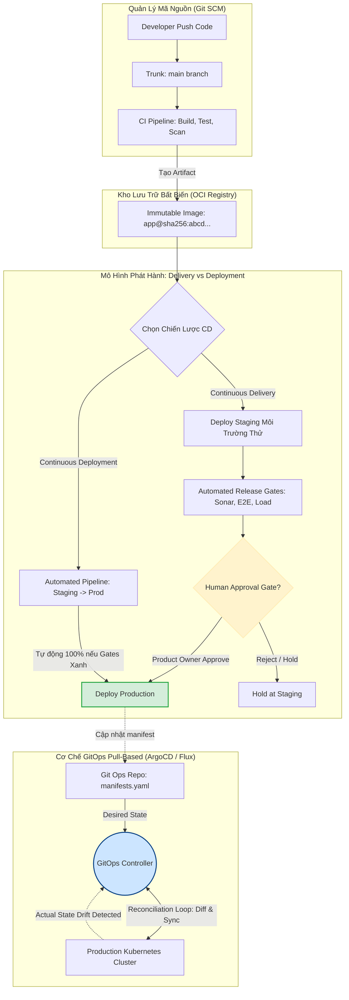
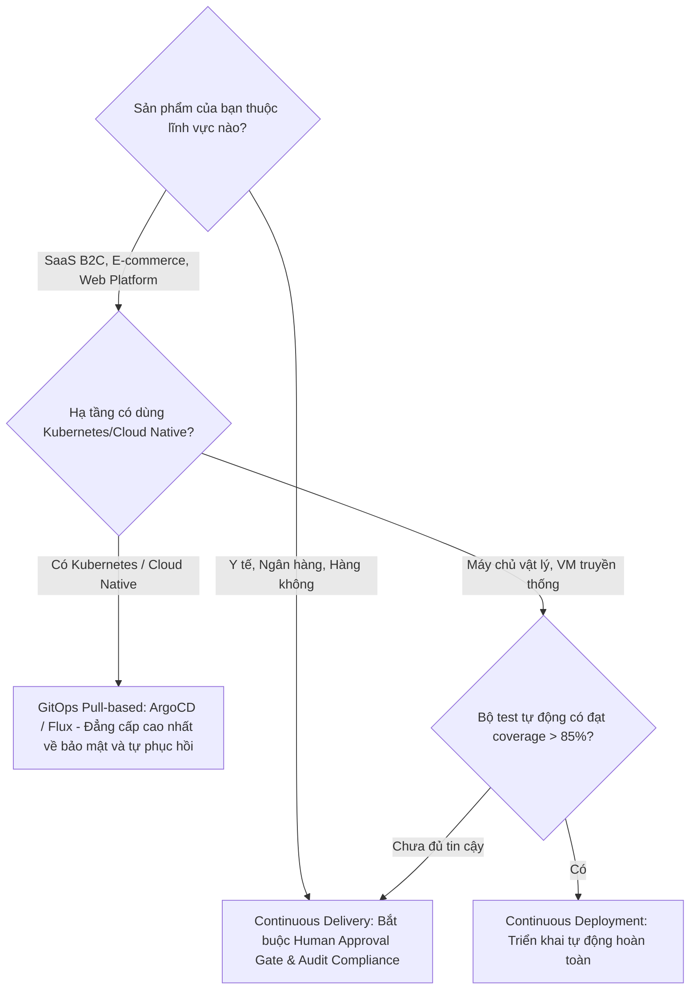

# 11.2. Kỹ Nghệ Chuyển Giao và Triển Khai Liên Tục (Continuous Delivery, Deployment & GitOps)

> [!IMPORTANT]
> **Nếu bạn chỉ được nhớ một điều duy nhất:** Sự khác biệt sinh tử giữa Continuous Delivery và Continuous Deployment nằm ở **Nút bấm của Con người (Human Decision Gate)**: Continuous Delivery bảo đảm phần mềm luôn *sẵn sàng phát hành* bất cứ lúc nào, trong khi Continuous Deployment tự động đưa mọi thay đổi vượt qua kiểm thử *thẳng lên Production*; và **GitOps** nâng tầm triết lý này bằng cách biến Git thành **Nguồn Chân Lý Duy Nhất (Single Source of Truth)** thông qua cơ chế Vòng lặp Đối soát Tự động (**Reconciliation Loop**) kéo thay vì đẩy.

---

## 1. Kiến trúc Tổng quan & Mô hình Tư duy (Mental Model)

### 1.1. Phép loại suy thực tế: Đoàn tàu chở hàng và Hệ thống Điều hòa Thông minh (Thermostat)
Để hiểu trọn vẹn Continuous Delivery (CDel), Continuous Deployment (CDep) và GitOps, hãy quan sát hai hình ảnh thực tế:

1. **Đoàn tàu siêu tốc chở hàng (Delivery vs Deployment)**:
   - **Continuous Integration (CI)**: Là khâu sản xuất và đóng thùng hàng hóa, dùng máy quét X-quang để kiểm tra từng thùng hàng ngay tại nhà máy.
   - **Continuous Delivery (CDel)**: Hàng hóa được xếp lên các toa tàu siêu tốc, tàu chạy qua các trạm trung chuyển (Dev, Staging), kiểm định chất lượng nghiêm ngặt và đỗ ngay trước cổng ga Trung tâm (Production). Tàu đã nổ máy sẵn sàng, nhưng cần **Trưởng ga (Product Owner / Release Manager)** bấm nút gạt cần bẻ ghi thì hàng mới chính thức vào ga đón khách.
   - **Continuous Deployment (CDep)**: Đoàn tàu hoàn toàn tự hành (Autonomous Train). Khi các cảm biến xác nhận hàng hóa đạt chuẩn 100%, cần gạt tự động mở và tàu phóng thẳng vào ga đón khách mà không cần bất kỳ sự can thiệp thủ công nào của con người.

2. **Hệ thống Điều hòa Nhiệt độ (GitOps Mental Model)**:
   - Trong mô hình truyền thống (Push-based), bạn đứng ngoài trời cầm điều khiển bấm tăng giảm nhiệt độ: nếu mạng chập chờn hoặc máy chủ bị ai đó vặn tay, trạng thái sẽ bị lệch.
   - Trong **GitOps (Pull-based)**: Bạn chỉ ghi con số mong muốn `$22^\circ\text{C}$` vào một cuốn sổ nhật ký (Git Repository). Trong phòng có một con robot cảm biến thông minh (**GitOps Agent / Controller**). Cứ mỗi 5 giây, robot nhìn vào nhiệt kế phòng (Actual State) và nhìn vào cuốn sổ (Desired State). Nếu phòng đang là `$28^\circ\text{C}$`, robot tự động bật lốc lạnh để ép nhiệt độ về đúng `$22^\circ\text{C}$`. Hành động liên tục so sánh và kéo về trạng thái mong muốn đó chính là **Reconciliation Loop**.



---

## 2. Chi tiết từng Keyword (Under-the-Hood Deep Dive)

### 2.1. Continuous Delivery (CDel) vs Continuous Deployment (CDep)
- **Continuous Delivery (Chuyển giao liên tục)**:
  - Bản chất kỹ thuật: Là khả năng triển khai phiên bản mới của phần mềm lên bất kỳ môi trường nào (kể cả Production) bất cứ lúc nào chỉ bằng một cú nhấp chuột (One-Click Deployment).
  - Điểm chốt chặn: Mọi giai đoạn kiểm thử, build, quét bảo mật đều được tự động hóa 100%, nhưng việc đưa lên Production được kiểm soát bởi một quyết định kinh doanh (**Business Decision / Approval Gate**). Ví dụ: Bản build đã sẵn sàng lúc 2 giờ chiều, nhưng công ty chọn 10 giờ đêm mới bấm nút deploy để tránh giờ cao điểm.
- **Continuous Deployment (Triển khai liên tục)**:
  - Bản chất kỹ thuật: Là cấp độ tự động hóa tối cao, trong đó **mọi commit hợp lệ vượt qua toàn bộ các bài kiểm thử tự động trong pipeline sẽ được tự động triển khai thẳng lên Production** mà không cần sự phê duyệt thủ công của con người.
  - Điều kiện tiên quyết: Đòi hỏi bộ kiểm thử tự động cực kỳ tinh vi (Unit, Integration, Contract, Performance, Chaos), hệ thống giám sát thời gian thực (Observability) và cơ chế tự động hoàn tác (**Automated Rollback**) trong vài giây nếu phát hiện lỗi.
- **DORA Metric - Lead Time for Changes**:
  - Thời gian tính từ lúc lập trình viên commit dòng code đầu tiên cho đến khi dòng code đó chạy và phục vụ người dùng thật trên Production. Đội ngũ đạt đẳng cấp Elite thường có Lead Time dưới 1 giờ.

### 2.2. Deployment Pipeline (Đường ống triển khai nhiều tầng)
- **Bản chất**: Mô hình hóa tự động toàn bộ quy trình biến mã nguồn thành giá trị vận hành.
- **Cấu trúc phân tầng chuẩn mực**:
  1. *Commit Stage*: Tích hợp và kiểm thử đơn vị, tạo artifact (thuộc phạm vi CI).
  2. *Automated Acceptance / Integration Stage*: Triển khai lên môi trường thử nghiệm tạm thời (Ephemeral Environment), chạy kiểm thử chấp nhận tự động.
  3. *UAT / Staging Stage*: Triển khai lên môi trường giống Production $99\%$, chạy kiểm thử hiệu năng và bảo mật chuyên sâu.
  4. *Production Release Stage*: Kích hoạt chiến lược phát hành không gián đoạn (Canary, Blue-Green).

### 2.3. Immutable Artifact Repository (Kho lưu trữ sản phẩm bất biến)
- **Bản chất kỹ thuật**: Nơi lưu trữ tập trung các bản dựng nhị phân (Docker OCI images, Helm Charts, Debian packages, JAR files) sau khi CI hoàn tất. Các công cụ tiêu chuẩn ngành gồm: *Harbor, JFrog Artifactory, Sonatype Nexus, AWS ECR*.
- **Nguyên tắc vàng: Tính Bất Biến (Immutability)**:
  - Một khi Artifact đã được đẩy lên kho lưu trữ và đóng dấu mã băm nội dung (**SHA256 Content Digest**), nội dung của nó **vĩnh viễn không bao giờ được phép thay đổi**.
  - **Mối nguy hại của Tag Mutation**: Nếu sử dụng tag như `app:v1.0.0` và sau đó build lại ghi đè lên tag này, môi trường Staging có thể đang chạy một đoạn mã hoàn toàn khác với Production dù cùng tên tag `v1.0.0`. Do đó, Production phải luôn kéo image bằng Digest chính xác: `app@sha256:7f83b165...`

### 2.4. Environment Promotion (Thăng cấp môi trường)
- **Bản chất**: Quá trình chuyển giao một Artifact duy nhất qua chuỗi các môi trường: $\text{Dev} \longrightarrow \text{Staging} \longrightarrow \text{Production}$.
- **Cơ chế**:
  - Không bao giờ build lại source code cho từng môi trường! Bản dựng đã được kiểm thử ở Dev chính là bản dựng sẽ chạy ở Production.
  - Sự khác biệt duy nhất giữa các môi trường là **Configuration** (biến môi trường, chuỗi kết nối database, secret keys), được nạp độc lập lúc runtime.

### 2.5. Infrastructure as Code (IaC - Terraform, Pulumi)
- **Bản chất**: Định nghĩa toàn bộ tài nguyên hạ tầng (mạng VPC, Kubernetes Cluster, Cloud SQL, IAM Roles) dưới dạng mã nguồn khai báo (Declarative Code).
- **Lợi ích**:
  - Loại bỏ hoàn toàn thao tác cấu hình bằng tay trên Web Console (ClickOps) — nguồn cơn chính gây ra sai lệch cấu hình.
  - Toàn bộ hạ tầng có thể tái lập (Reproducible), phiên bản hóa trong Git và review thông qua Pull Request trước khi áp dụng (`terraform plan` $\to$ `terraform apply`).

### 2.6. GitOps & Declarative Delivery (Alexis Richardson - Weaveworks)
- **Bản chất triết lý**: GitOps là mô hình vận hành trong đó **toàn bộ trạng thái mong muốn của hệ thống (Desired State) được khai báo bằng văn bản (Declarative YAML) và lưu trữ trong Git Repository**.
- **So sánh 2 mô hình vận hành CD**:
  1. **Push-based CD (Mô hình truyền thống - Jenkins / GitHub Actions)**:
     - CI Runner giữ quyền quản trị tối cao (Admin Credentials / Kubeconfig) của Production Cluster.
     - CI Runner thực thi lệnh `kubectl apply -f manifest.yaml` từ bên ngoài đẩy vào cluster.
     - *Rủi ro bảo mật*: Lỗ hổng bảo mật trên CI runner có thể làm rò rỉ toàn bộ quyền truy cập cluster Production.
  2. **Pull-based CD (Mô hình GitOps - ArgoCD / Flux)**:
     - Không có hệ thống bên ngoài nào được cấp quyền truy cập vào Cluster.
     - Một agent nội bộ (**GitOps Operator**) chạy ngay bên trong Cluster. Agent này định kỳ kéo (Pull) thông tin từ Git repo.
     - *An toàn tuyệt đối*: Không cần mở cổng firewall vào Cluster, không cần lưu trữ `kubeconfig` trên CI server.

### 2.7. Reconciliation Loop & State Drift Detection
- **Reconciliation Loop (Vòng lặp đối soát)**:
  - Trái tim của các hệ thống GitOps và Kubernetes Controllers:
    $$\Delta = \text{Diff}(\text{Desired State in Git}, \text{Actual State in Cluster})$$
  - Nếu $\Delta \neq 0$: Hệ thống ghi nhận trạng thái **OutOfSync** (hoặc **Configuration Drift**).
- **Tự động phục hồi (Self-Healing)**:
  - Nếu một kỹ sư vô tình dùng lệnh `kubectl edit` để sửa trực tiếp số lượng Pod trên Production từ 3 lên 10, GitOps Controller sẽ phát hiện Actual State bị sai lệch so với Git (trong Git vẫn ghi `replicas: 3`). Controller lập tức tự động đảo ngược thay đổi trên cluster về đúng 3 Pod.
  - Git luôn là **Nguồn Chân Lý Duy Nhất**. Muốn đổi số Pod lên 10, bắt buộc phải tạo Pull Request sửa file YAML trong Git.

### 2.8. Release Governance & Automated Release Gates
- **Bản chất**: Hệ thống các tiêu chí kiểm soát chất lượng tự động chặn trước các cổng phát hành (Quality Gates / Security Gates).
- **Các loại cổng kiểm soát tự động phổ biến**:
  - *SonarQube Quality Gate*: Chặn phát hành nếu độ phủ kiểm thử (Test Coverage) mới dưới $80\%$ hoặc có Security Vulnerabilities mức Critical.
  - *Vulnerability Gate (Trivy / Snyk)*: Chặn deploy nếu image chứa CVE mức CRITICAL với bản vá đã khả dụng.
  - *Performance Gate*: Chặn nếu bài kiểm tra tải ghi nhận độ trễ p99 tăng quá $15\%$ so với phiên bản trước.
  - *Error Budget Gate (SRE)*: Nếu hệ thống đã cạn kiệt ngân sách lỗi (Error Budget) trong tháng, mọi đợt deploy tính năng mới đều bị phong tỏa, chỉ cho phép deploy các bản vá lỗi ổn định hệ thống.

### 2.9. Release Freeze (Đóng băng phát hành)
- **Bản chất**: Khoảng thời gian quy định nghiêm ngặt không được phép triển khai các bản phát hành tính năng mới lên Production.
- **Bối cảnh áp dụng**:
  - Các sự kiện kinh doanh trọng đại (Black Friday, Cyber Monday, Giáng sinh, Tết Nguyên Đán). Trong thời gian này, lưu lượng truy cập đạt đỉnh, việc phát hành mang lại rủi ro quá lớn cho doanh thu doanh nghiệp.
- **Ngoại lệ (Emergency Hotfix)**:
  - Quy trình khẩn cấp vượt rào (Emergency Bypass) với chữ ký phê duyệt bắt buộc của ít nhất 2 cấp lãnh đạo kỹ thuật (Two-Person Integrity) chỉ dành riêng cho các bản vá lỗi an ninh cấp bách hoặc khắc phục thảm họa ngừng trệ hệ thống.

---

## 3. Thực thi Mã nguồn & Mô phỏng Chuyên sâu (Dual-Engine Implementation)

### 3.1. Động cơ C++20: GitOps Reconciliation & Self-Healing Engine

Chương trình C++20 dưới đây mô phỏng một **GitOps Controller** độc lập:
- Quản lý trạng thái mong muốn từ Git (Desired State) và trạng thái sống trong Cluster (Actual State).
- Thực thi vòng lặp đối soát (Reconciliation Loop).
- Tự động phát hiện sai lệch (Drift Detection) và kích hoạt Self-Healing kéo trạng thái cụm về chuẩn mực.

```cpp
#include <iostream>
#include <string>
#include <vector>
#include <unordered_map>
#include <memory>
#include <chrono>
#include <thread>
#include <mutex>
#include <iomanip>

namespace gitops {

struct DeploymentManifest {
    std::string app_name;
    std::string image_digest;
    int replicas;
    std::string env;

    bool operator==(const DeploymentManifest& other) const {
        return app_name == other.app_name &&
               image_digest == other.image_digest &&
               replicas == other.replicas &&
               env == other.env;
    }

    bool operator!=(const DeploymentManifest& other) const {
        return !(*this == other);
    }
};

enum class SyncStatus { SYNCED, OUT_OF_SYNC, ERROR };

class K8sCluster {
private:
    std::unordered_map<std::string, DeploymentManifest> live_resources_;
    mutable std::mutex cluster_mtx_;

public:
    void applyResource(const DeploymentManifest& manifest) {
        std::lock_guard<std::mutex> lock(cluster_mtx_);
        live_resources_[manifest.app_name] = manifest;
    }

    // Giả lập kỹ sư can thiệp trực tiếp bằng lệnh tay (Manual Drift)
    void injectManualDrift(const std::string& app_name, int drifted_replicas) {
        std::lock_guard<std::mutex> lock(cluster_mtx_);
        if (live_resources_.find(app_name) != live_resources_.end()) {
            live_resources_[app_name].replicas = drifted_replicas;
            std::cout << "\n\033[33m[UNAUTHORIZED DRIFT DETECTED]\033[0m Engineer ran 'kubectl scale' on " 
                      << app_name << " to " << drifted_replicas << " replicas!\n";
        }
    }

    DeploymentManifest getResource(const std::string& app_name) const {
        std::lock_guard<std::mutex> lock(cluster_mtx_);
        auto it = live_resources_.find(app_name);
        if (it != live_resources_.end()) {
            return it->second;
        }
        return {"", "", 0, ""};
    }

    bool exists(const std::string& app_name) const {
        std::lock_guard<std::mutex> lock(cluster_mtx_);
        return live_resources_.find(app_name) != live_resources_.end();
    }
};

class GitOpsReconciler {
private:
    std::unordered_map<std::string, DeploymentManifest> git_repository_;
    std::shared_ptr<K8sCluster> cluster_;
    bool self_healing_enabled_{true};

public:
    GitOpsReconciler(std::shared_ptr<K8sCluster> cluster, bool self_healing = true)
        : cluster_(std::move(cluster)), self_healing_enabled_(self_healing) {}

    void commitManifestToGit(const DeploymentManifest& manifest) {
        git_repository_[manifest.app_name] = manifest;
        std::cout << "\033[32m[GIT COMMIT]\033[0m Pushed to main: " << manifest.app_name 
                  << " | Image: " << manifest.image_digest.substr(0, 19) << "..." 
                  << " | Replicas: " << manifest.replicas << "\n";
    }

    void reconcile() {
        std::cout << "\n>>> EXECUTING GITOPS RECONCILIATION LOOP <<<\n";
        
        for (const auto& [app_name, desired] : git_repository_) {
            DeploymentManifest actual = cluster_->getResource(app_name);
            
            std::cout << "Checking App: \033[1m" << app_name << "\033[0m\n";
            std::cout << "  - Desired State (Git):    [Image: " << desired.image_digest.substr(0, 15) 
                      << "..., Replicas: " << desired.replicas << "]\n";
            std::cout << "  - Actual State  (Cluster): [Image: " << (actual.image_digest.empty() ? "NONE" : actual.image_digest.substr(0, 15))
                      << "..., Replicas: " << actual.replicas << "]\n";

            if (desired != actual) {
                std::cout << "  Status: \033[31m[OUT_OF_SYNC] Configuration Drift Detected!\033[0m\n";
                if (self_healing_enabled_) {
                    std::cout << "  Action: \033[36m[SELF-HEALING]\033[0m Overwriting cluster state with Git truth...\n";
                    cluster_->applyResource(desired);
                    std::cout << "  Verdict: \033[32m[SYNCED] Cluster successfully healed.\033[0m\n";
                } else {
                    std::cout << "  Verdict: \033[33m[ALERT] Self-healing disabled. Manual intervention required.\033[0m\n";
                }
            } else {
                std::cout << "  Status: \033[32m[IN_SYNC] No drift detected.\033[0m\n";
            }
        }
    }
};

} // namespace gitops

int main() {
    using namespace gitops;

    auto cluster = std::make_shared<K8sCluster>();
    GitOpsReconciler operator_agent(cluster, /*self_healing=*/true);

    // Bước 1: Khởi tạo manifest trong Git
    DeploymentManifest payment_service{
        "payment-service",
        "sha256:7f83b1657ff1fc53b92dc18148a1d65dfc2d4b1fa3d677284addd200126d9069",
        3,
        "production"
    };

    operator_agent.commitManifestToGit(payment_service);

    // Lần lặp 1: Cluster ban đầu trống rỗng -> Sync lần đầu
    operator_agent.reconcile();

    // Bước 2: Kỹ sư vô tình gõ lệnh tay trên cluster làm sai lệch (Drift)
    cluster->injectManualDrift("payment-service", 10);

    // Lần lặp 2: GitOps Controller phát hiện Drift và tự động Reconcile
    operator_agent.reconcile();

    // Bước 3: Cập nhật phiên bản mới hợp lệ thông qua Git commit
    DeploymentManifest updated_service = payment_service;
    updated_service.image_digest = "sha256:e3b0c44298fc1c149afbf4c8996fb92427ae41e4649b934ca495991b7852b855";
    updated_service.replicas = 5;

    std::cout << "\n--- PROMOTING NEW RELEASE VIA PULL REQUEST ---\n";
    operator_agent.commitManifestToGit(updated_service);
    operator_agent.reconcile();

    return 0;
}
```

---

### 3.2. Động cơ Python 3.11+: Release Gate & Environment Promotion Pipeline

Hệ thống Python 3.11+ dưới đây mô phỏng một **Pipeline Thăng cấp Môi trường (Environment Promotion Engine)** với các chốt chặn phát hành (**Release Gates**) tự động đánh giá:
1. SonarQube Quality Gate Score.
2. Trữ lượng ngân sách lỗi (Error Budget Remaining).
3. Quét lỗ hổng bảo mật nghiêm trọng (Critical CVE Count).

```python
#!/usr/bin/env python3
"""
Automated Environment Promotion Pipeline with Release Gates (Python 3.11+)
Tuân thủ tiêu chuẩn Enterprise Delivery & SRE Governance.
"""

from __future__ import annotations
import dataclasses
import enum
import sys
import time
from typing import Dict, List, Optional


class Environment(enum.Enum):
    DEV = "DEV"
    STAGING = "STAGING"
    PRODUCTION = "PRODUCTION"


@dataclasses.dataclass(frozen=True)
class QualityMetrics:
    unit_test_coverage: float       # Tỷ lệ bao phủ kiểm thử (%)
    critical_cve_count: int         # Số lượng lỗ hổng bảo mật nghiêm trọng
    p99_latency_ms: float           # Độ trễ p99 từ Load Test
    error_budget_percent: float     # Ngân sách lỗi còn lại trong tháng (%)
    sonarqube_passed: bool          # Đạt chuẩn chất lượng SonarQube


@dataclasses.dataclass(frozen=True)
class ArtifactPackage:
    app_name: str
    version_tag: str
    sha256_digest: str
    created_at: float


class ReleaseGateEvaluator:
    """Chốt kiểm soát tự động đánh giá điều kiện thăng cấp môi trường"""

    @staticmethod
    def evaluate_for_staging(metrics: QualityMetrics) -> tuple[bool, List[str]]:
        reasons = []
        if metrics.unit_test_coverage < 80.0:
            reasons.append(f"Coverage {metrics.unit_test_coverage:.1f}% < 80.0% threshold")
        if metrics.critical_cve_count > 0:
            reasons.append(f"Contains {metrics.critical_cve_count} CRITICAL security vulnerabilities")
        if not metrics.sonarqube_passed:
            reasons.append("SonarQube static analysis quality gate FAILED")

        passed = len(reasons) == 0
        return passed, reasons

    @staticmethod
    def evaluate_for_production(metrics: QualityMetrics) -> tuple[bool, List[str]]:
        passed_staging, reasons = ReleaseGateEvaluator.evaluate_for_staging(metrics)
        
        # Tiêu chuẩn khắt khe bổ sung riêng cho Production
        if metrics.p99_latency_ms > 250.0:
            reasons.append(f"Latency p99 {metrics.p99_latency_ms:.1f}ms exceeds 250.0ms SLA")
        if metrics.error_budget_percent <= 0.0:
            reasons.append(f"SRE Error Budget exhausted ({metrics.error_budget_percent:.1f}%). Release Freeze active!")

        passed = len(reasons) == 0
        return passed, reasons


class DeploymentPromotionPipeline:
    def __init__(self, artifact: ArtifactPackage):
        self.artifact = artifact
        self.current_env = Environment.DEV
        self.audit_log: List[str] = []

    def _log(self, message: str) -> None:
        entry = f"[{time.strftime('%Y-%m-%d %H:%M:%S')}] {message}"
        self.audit_log.append(entry)
        print(entry)

    def promote_to_staging(self, metrics: QualityMetrics) -> bool:
        self._log(f"Initiating promotion check to STAGING for {self.artifact.app_name}:{self.artifact.version_tag}")
        passed, reasons = ReleaseGateEvaluator.evaluate_for_staging(metrics)

        if not passed:
            self._log(f"\033[31m[GATE REJECTED]\033[0m Promotion to STAGING blocked:")
            for r in reasons:
                self._log(f"  ❌ {r}")
            return False

        self.current_env = Environment.STAGING
        self._log(f"\033[32m[PROMOTED]\033[0m Artifact successfully deployed to STAGING environment.")
        return True

    def promote_to_production(self, metrics: QualityMetrics, human_approval: Optional[str] = None) -> bool:
        if self.current_env != Environment.STAGING:
            self._log(f"\033[31m[ERROR]\033[0m Cannot promote to PRODUCTION directly from {self.current_env.value}. Must pass STAGING first.")
            return False

        self._log(f"Evaluating PRODUCTION Release Gates for {self.artifact.sha256_digest[:16]}...")
        passed, reasons = ReleaseGateEvaluator.evaluate_for_production(metrics)

        if not passed:
            self._log(f"\033[31m[GATE REJECTED]\033[0m Production deployment rejected:")
            for r in reasons:
                self._log(f"  ❌ {r}")
            return False

        # Kiểm tra Human Approval Gate (Đối với Continuous Delivery)
        if human_approval is None:
            self._log("\033[33m[HOLD]\033[0m All automated gates passed! Holding at Staging waiting for Human Approval.")
            return False

        self.current_env = Environment.PRODUCTION
        self._log(f"\033[32m[PRODUCTION LIVE]\033[0m Approved by '{human_approval}'. Version is now serving live traffic!")
        return True


if __name__ == "__main__":
    pkg = ArtifactPackage(
        app_name="checkout-service",
        version_tag="v2.4.0",
        sha256_digest="sha256:d41d8cd98f00b204e9800998ecf8427e",
        created_at=time.time()
    )

    pipeline = DeploymentPromotionPipeline(pkg)

    # Ca 1: Bản build kém chất lượng bị chặn ngay từ cổng Staging
    print("=================== TEST SCENARIO 1: DEFECTIVE BUILD ===================")
    bad_metrics = QualityMetrics(
        unit_test_coverage=65.0,
        critical_cve_count=2,
        p99_latency_ms=180.0,
        error_budget_percent=80.0,
        sonarqube_passed=False
    )
    pipeline.promote_to_staging(bad_metrics)

    # Ca 2: Bản build chuẩn mực vượt qua Staging và Production
    print("\n=================== TEST SCENARIO 2: GOLDEN BUILD ===================")
    golden_metrics = QualityMetrics(
        unit_test_coverage=92.5,
        critical_cve_count=0,
        p99_latency_ms=145.0,
        error_budget_percent=45.0,
        sonarqube_passed=True
    )
    if pipeline.promote_to_staging(golden_metrics):
        # Kích hoạt duyệt thủ công (Continuous Delivery)
        pipeline.promote_to_production(golden_metrics, human_approval="Release-Lead: Alice Nguyen")
```

---

### 3.3. Terminal Output Thực Tế Giả Lập

```text
=================== TEST SCENARIO 1: DEFECTIVE BUILD ===================
[2026-11-16 09:20:01] Initiating promotion check to STAGING for checkout-service:v2.4.0
[2026-11-16 09:20:01] [GATE REJECTED] Promotion to STAGING blocked:
[2026-11-16 09:20:01]   ❌ Coverage 65.0% < 80.0% threshold
[2026-11-16 09:20:01]   ❌ Contains 2 CRITICAL security vulnerabilities
[2026-11-16 09:20:01]   ❌ SonarQube static analysis quality gate FAILED

=================== TEST SCENARIO 2: GOLDEN BUILD ===================
[2026-11-16 09:20:02] Initiating promotion check to STAGING for checkout-service:v2.4.0
[2026-11-16 09:20:02] [PROMOTED] Artifact successfully deployed to STAGING environment.
[2026-11-16 09:20:02] Evaluating PRODUCTION Release Gates for sha256:d41d8cd9...
[2026-11-16 09:20:02] [PRODUCTION LIVE] Approved by 'Release-Lead: Alice Nguyen'. Version is now serving live traffic!
```

---

## 4. Systems Engineering & Production Pitfalls

### 4.1. Production Failure Modes trong Kỹ nghệ CD & GitOps

1. **GitOps Infinite Sync Loop (Vòng lặp đồng bộ vô tận)**:
   - *Bản chất*: Xảy ra khi Kubernetes Cluster có cài đặt một **Mutating Admission Webhook** (ví dụ: Istio Sidecar Injector hoặc Linkerd) tự động sửa đổi Pod manifest sau khi nó được nộp vào cluster.
   - *Hậu quả*: ArgoCD thấy Cluster có thêm trường `sidecar.istio.io` mà trong Git không có $\to$ ArgoCD đánh dấu `OutOfSync` và ghi đè trạng thái từ Git $\to$ Webhook lại sửa lại $\to$ Vòng lặp kéo dài liên tục, làm quá tải API Server của Kubernetes và CPU của máy chủ.
   - *Khắc phục*: Cấu hình `ignoreDifferences` trong ArgoCD Application để bỏ qua các metadata động do Webhooks sinh ra.

2. **Out-of-Order Promotion (Nhảy cóc môi trường)**:
   - *Bản chất*: Kỹ sư vội vã đưa một hotfix thẳng lên Production mà quên không cherry-pick hoặc merge ngược về Staging và Trunk.
   - *Hậu quả*: Đợt release tiếp theo từ Staging lên Production sẽ vô tình ghi đè và làm mất sạch bản hotfix đó, tái diễn sự cố cũ.
   - *Khắc phục*: Khóa toàn bộ quyền deploy trực tiếp lên Production, bắt buộc mọi thay đổi phải thăng cấp tuần tự qua GitOps pipeline.

3. **Secrets Stored Unencrypted in Git (Lộ thông tin mật trong GitOps Manifest)**:
   - *Bản chất*: Vì GitOps yêu cầu mọi thứ phải nằm trong Git, các lập trình viên thiếu kinh nghiệm commit các file YAML Kubernetes chứa `Secret` đã mã hóa dạng base64 (vốn chỉ là obfuscation, không phải encryption).
   - *Khắc phục*: Sử dụng công nghệ **Mozilla SOPS**, **Bitnami Sealed Secrets**, hoặc **External Secrets Operator** kết nối trực tiếp với HashiCorp Vault / AWS Secrets Manager. Git chỉ lưu trữ bản mã hóa bất đối xứng hoặc con trỏ tham chiếu secret.

---

## 5. Bảng So sánh & Decision Matrix

### 5.1. Bảng so sánh 3 mô hình chuyển giao phần mềm

| Tiêu Chí So Sánh | Continuous Delivery (CDel) | Continuous Deployment (CDep) | GitOps-driven Delivery |
| :--- | :--- | :--- | :--- |
| **Quyết định lên Prod** | Con người bấm nút phê duyệt | Tự động hóa 100% | Tự động đồng bộ từ Git Merge |
| **Hướng lưu lượng điều khiển** | Push (CI Runner gọi API cluster) | Push (CI Runner gọi API cluster) | **Pull (Agent trong cluster kéo)** |
| **Bảo mật Kubeconfig** | Kubeconfig nằm trên CI Server | Kubeconfig nằm trên CI Server | **Kubeconfig không bao giờ rời cluster** |
| **Xử lý Sai lệch (Drift)** | Bị động (chỉ biết khi deploy lại) | Bị động (chỉ biết khi deploy lại) | **Chủ động tự chữa lành (Self-healing)** |
| **Khả năng Rollback** | Chạy lại pipeline deploy bản cũ | Chạy lại pipeline deploy bản cũ | **`git revert` commit trong 5 giây** |
| **Rủi ro vận hành** | Thấp (có chốt chặn kiểm duyệt) | Cao nếu thiếu test suite tốt | **Rất thấp, minh bạch lịch sử audit** |

### 5.2. Decision Matrix: Khi nào nên áp dụng mô hình nào?


