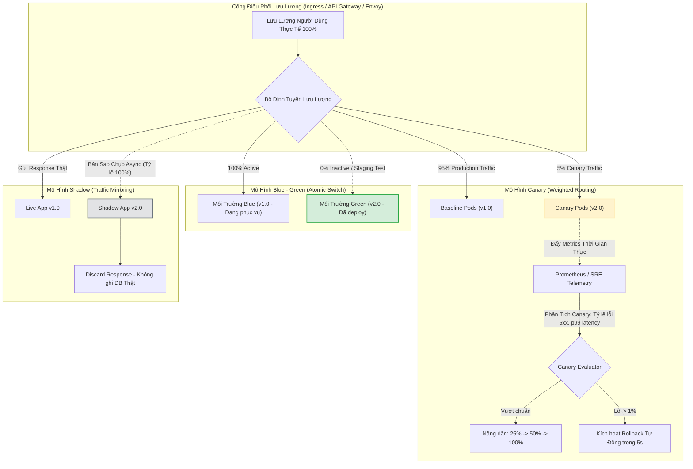
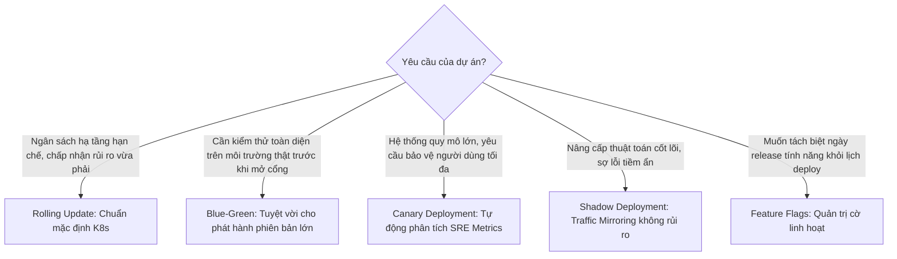

# 11.3. Các Chiến Lược Triển Khai Không Gián Đoạn (Zero-Downtime Deployment Strategies)

> [!IMPORTANT]
> **Nếu bạn chỉ được nhớ một điều duy nhất:** Không bao giờ thay thế một hệ thống đang phục vụ hàng triệu người dùng trong một bước duy nhất; bản chất của triển khai không gián đoạn là **phân tách hoàn toàn giữa Triển Khai (Deployment - nạp mã nguồn vào hạ tầng) và Phát Hành (Release - mở lưu lượng cho người dùng thật)** thông qua kỹ thuật định tuyến lưu lượng thông minh và các cờ tính năng (Feature Flags).

---

## 1. Kiến trúc Tổng quan & Mô hình Tư duy (Mental Model)

### 1.1. Phép loại suy thực tế: Đổi ray xe lửa và Chim hoàng yến trong mỏ than
Hãy tưởng tượng hệ thống phần mềm của bạn là một tuyến đường sắt cao tốc Bắc - Nam đang đón các đoàn tàu khách chạy qua liên tục $24/7$:

1. **Blue-Green Deployment (Đường ray song song và Cần bẻ ghi)**:
   - Thay vì cấm tàu chạy để sửa ray, ban quản lý xây dựng một đoạn đường ray mới tinh song song (Môi trường Green), trong khi tàu vẫn chạy trên ray cũ (Môi trường Blue).
   - Khi ray mới hoàn thành và được kiểm định độ an toàn tuyệt đối, người gác ghi chỉ cần **gạt cần bẻ ghi (Load Balancer / Ingress Router)** trong $100\text{ ms}$. Mọi đoàn tàu lập tức chuyển bánh sang đường ray mới êm ái mà hành khách không hề cảm nhận thấy sự rung lắc nào. Nếu có sự cố nứt ray, người gác ghi chỉ việc gạt ngược cần trở lại đường ray cũ.

2. **Canary Deployment (Chú chim hoàng yến trong hầm mỏ)**:
   - Vào thế kỷ 19, các thợ mỏ than Anh quốc luôn mang theo một chiếc lồng nhốt chú chim hoàng yến xuống lòng đất sâu. Chim hoàng yến cực kỳ nhạy cảm với khí độc Carbon Monoxide ($CO$). Nếu hầm có khí độc rò rỉ, chim hoàng yến sẽ ngất xỉu trước, báo động cho hàng trăm thợ mỏ kịp thời sơ tán trước khi khí độc tích tụ đủ để làm chết người.
   - Trong phần mềm, thay vì bung bản cập nhật cho $100\%$ khách hàng, ta chỉ định tuyến $1\%$ lưu lượng của người dùng thử nghiệm vào phiên bản mới (Canary Pods). Nếu tỷ lệ lỗi HTTP 5xx tăng vọt, hệ thống tự động tiêu hủy Canary Pods và giữ an toàn tuyệt đối cho $99\%$ người dùng còn lại.



---

## 2. Chi tiết từng Keyword (Under-the-Hood Deep Dive)

### 2.1. Rolling Deployment (Triển khai cuốn chiếu)
- **Bản chất kỹ thuật**: Chiến lược triển khai mặc định của Kubernetes (thông qua `RollingUpdate` strategy của Deployment). Hệ thống thay thế dần dần các Pod phiên bản cũ ($V1$) bằng các Pod phiên bản mới ($V2$) cho đến khi toàn bộ cụm được cập nhật hoàn toàn.
- **Hai tham số cốt lõi trong Kubernetes**:
  1. `maxUnavailable`: Số lượng Pod tối đa được phép ngừng hoạt động trong quá trình cập nhật (ví dụ: `25%` hoặc `1`). Đảm bảo hệ thống luôn duy trì đủ năng lực tính toán tối thiểu để phục vụ tải.
  2. `maxSurge`: Số lượng Pod tối đa được phép tạo vượt quá số lượng `replicas` quy định (ví dụ: `25%`). Cho phép hệ thống tạm thời mở rộng tài nguyên để dựng Pod mới trước khi xóa Pod cũ.
- **Connection Draining (Thoát kết nối êm dịu)**:
  - Khi một Pod $V1$ bị đánh dấu xóa, Kubernetes gỡ bỏ IP của nó khỏi `Endpoints` của Service để ngừng nhận kết nối mới, đồng thời gửi tín hiệu `SIGTERM`.
  - Pod $V1$ phải duy trì chạy trong thời gian `terminationGracePeriodSeconds` (ví dụ: 30 giây) để hoàn tất các HTTP request đang xử lý dở dang trước khi bị tắt hoàn toàn.
- **Ưu điểm**: Tiết kiệm tài nguyên tối đa vì không cần dựng một môi trường song song kích thước gấp đôi.
- **Nhược điểm & Nguy cơ**: Trong suốt quá trình Rolling kéo dài vài phút, **cả hai phiên bản $V1$ và $V2$ cùng chạy song song và cùng truy cập vào một cơ sở dữ liệu**. Điều này đòi hỏi Schema Database bắt buộc phải tương thích cả ngược lẫn xuôi (*Forward & Backward Compatibility*).

### 2.2. Blue-Green Deployment (Triển khai Xanh - Đỏ)
- **Bản chất**: Dựng lên hai môi trường hạ tầng độc lập hoàn toàn giống hệt nhau:
  - **Môi trường Blue**: Đang chạy phiên bản hiện tại ($V1$) và đang tiếp nhận $100\%$ lưu lượng truy cập của người dùng.
  - **Môi trường Green**: Nơi triển khai phiên bản mới ($V2$). Môi trường này hoàn toàn cách ly khỏi người dùng ngoài, cho phép đội ngũ QA chạy các bài kiểm thử Smoke Test cuối cùng trực tiếp trên hạ tầng thật.
- **Cơ chế chuyển đổi (Traffic Cutover)**:
  - Khi phiên bản Green được xác nhận hoàn hảo, kỹ sư thực hiện chuyển đổi tại tầng Load Balancer, Router Ingress hoặc DNS. Toàn bộ $100\%$ lưu lượng được chuyển từ Blue sang Green chỉ trong tích tắc (Atomic Switch).
- **Instant Rollback**: Nếu phát hiện sự cố nghiêm trọng sau khi switch, chỉ cần gạt router ngược lại Blue trong vài giây.
- **Cạm bẫy kỹ thuật**:
  - Tốn kém gấp đôi chi phí hạ tầng (Double Resource Footprint).
  - Vấn đề đồng bộ dữ liệu (Shared Database Problem): Môi trường Green khi nhận traffic sẽ bắt đầu ghi vào DB. Nếu phải rollback về Blue, các dữ liệu được ghi trong thời gian Green hoạt động có thể bị mâu thuẫn với logic của Blue.

### 2.3. Canary Deployment (Triển khai chim hoàng yến)
- **Bản chất**: Kỹ thuật phân phối lưu lượng theo tỷ trọng phần trăm (Weighted Routing) giữa phiên bản cũ (Baseline) và phiên bản mới (Canary).
- **Quy trình thăng cấp lũy tiến (Progressive Delivery)**:
  - Bước 1: Điều hướng $1\%$ hoặc $5\%$ lưu lượng vào Canary Pods.
  - Bước 2: **Canary Analysis** - Hệ thống phân tích tự động (như *Argo Rollouts, Flagger*) liên tục truy vấn Prometheus để so sánh các chỉ số SRE giữa Baseline và Canary:
    $$\text{Error Rate}_{5xx} \le 0.5\% \quad \text{và} \quad P99(\text{Latency}) \le 200\text{ms}$$
  - Bước 3: Nếu các chỉ số vượt qua kiểm định sau 15 phút, tỷ trọng tăng lên $20\% \to 50\% \to 100\%$.
  - Bước 4: Nếu bất kỳ chỉ số nào vượt ngưỡng báo động, hệ thống **tự động cắt toàn bộ lưu lượng về Baseline ngay lập tức**.
- **Bán kính ảnh hưởng (Blast Radius)**: Rất nhỏ. Lỗi nghiêm trọng chỉ tác động tới một nhóm thiểu số người dùng trong một khoảng thời gian cực ngắn.

### 2.4. Dark Launch (Phát hành trong bóng tối)
- **Bản chất**: Triển khai một tính năng hoặc dịch vụ backend mới lên môi trường Production nhưng **hoàn toàn không hiển thị giao diện người dùng (UI)**.
- **Mục đích**:
  - Kiểm thử khả năng chịu tải và độ ổn định của các thuật toán xử lý backend phức tạp dưới dữ liệu thật mà không gây rủi ro trải nghiệm người dùng.
  - Ví dụ: Một hệ thống gợi ý sản phẩm mới bằng AI được Dark Launch bằng cách âm thầm gửi request tính toán ở background mỗi khi người dùng xem sản phẩm, ghi lại thời gian phản hồi và mức tiêu hao RAM/CPU vào nhật ký nhưng không hiển thị kết quả gợi ý lên màn hình người dùng.

### 2.5. Shadow Deployment (Triển khai bóng ma / Traffic Mirroring)
- **Bản chất kỹ thuật**: Kỹ thuật nhân bản (Mirroring / Forking) gói tin HTTP/gRPC ở tầng mạng (Service Mesh như Istio, Envoy hoặc NGINX).
- **Cơ chế hoạt động**:
  - Khi một request từ người dùng đến Gateway, Gateway gửi request tới phiên bản chính thức ($V1$) để trả kết quả về cho người dùng.
  - Đồng thời, Gateway tạo một bản sao bất đồng bộ (Asynchronous Clone) của request đó và bắn vào phiên bản thử nghiệm ($V2$ - Shadow Service).
  - Phản hồi từ Shadow Service sẽ bị hủy bỏ (Discarded) tại Gateway, hoàn toàn không được trả về cho người dùng.
- **Lợi thế tuyệt đối**: Rủi ro đối với người dùng là $0\%$, vì họ không bao giờ nhìn thấy response hay chịu ảnh hưởng bởi độ trễ hay lỗi crash của Shadow Service.
- **Cạm bẫy chí mạng**: **Hiệu ứng phụ ngoài ý muốn (Unintended Side Effects)**! Nếu Shadow Service thực hiện các thao tác ghi dữ liệu vào cơ sở dữ liệu thật, gửi email thanh toán cho khách hàng, hoặc bắn event lên Kafka, nó sẽ gây ô nhiễm dữ liệu nghiêm trọng. Khi chạy Shadow Deployment, Shadow Service **bắt buộc phải được cấu hình mock toàn bộ các I/O sinks ghi**.

### 2.6. Feature Flags / Feature Toggles (Cờ tính năng)
- **Bản chất**: Khối mã nguồn logic điều kiện (`if/else`) cho phép bật hoặc tắt một tính năng lúc runtime mà **không cần phải biên dịch lại hoặc deploy lại phần mềm**.
- **Phân loại Feature Flags (Martin Fowler)**:
  1. *Release Toggles*: Dùng để ẩn code chưa hoàn thiện trong Trunk-Based Development.
  2. *Experiment Toggles*: Dùng cho thử nghiệm $A/B$ Testing (so sánh tỷ lệ chuyển đổi giữa 2 thuật toán).
  3. *Ops Toggles (Kill Switch)*: Cần gạt ngắt khẩn cấp để tắt ngay một tính năng ngốn tài nguyên khi máy chủ bị quá tải.
  4. *Permission Toggles*: Bật tính năng cho nhóm người dùng VIP, Beta Testers hoặc nhân viên nội bộ.
- **Nợ kỹ thuật (Technical Debt of Flag Sprawl)**:
  - Nếu không có quy trình định kỳ dọn dẹp (Retire) các feature flag đã ổn định, mã nguồn sẽ trở thành một mớ bòng bong hàng trăm nhánh `if/else` lồng nhau, khiến việc kiểm thử đơn vị và bảo trì trở thành cơn ác mộng.

### 2.7. Health Checks: Liveness, Readiness & Startup Probes
Trong kiến trúc điều phối container (Kubernetes), hệ thống quản lý vòng đời ứng dụng thông qua 3 loại kiểm tra sức khỏe độc lập:
1. **Startup Probe**:
   - Dùng cho các ứng dụng khởi động chậm (ví dụ: ứng dụng Java/Spring Boot mất 60 giây nạp context).
   - Trong thời gian Startup Probe đang chạy, Kubernetes sẽ tạm dừng Liveness và Readiness Probes để tránh việc Pod bị giết nhầm vì khởi động chưa xong.
2. **Liveness Probe (Kiểm tra sự sống)**:
   - Mục đích: Trả lời câu hỏi *"Tiến trình này còn sống hay đã bị treo (Deadlock)?"*.
   - Hành vi khi thất bại: Kubernetes sẽ **tiêu diệt container (Kill/Restart)** ngay lập tức để phục hồi tiến trình.
3. **Readiness Probe (Kiểm tra sẵn sàng nhận tải)**:
   - Mục đích: Trả lời câu hỏi *"Tiến trình này đã sẵn sàng xử lý traffic chưa?"* (ví dụ: đã nạp xong bộ đệm In-memory Cache, đã kết nối xong DB Pool).
   - Hành vi khi thất bại: Kubernetes **không giết container**, mà chỉ tạm thời gỡ bỏ địa chỉ IP của Pod ra khỏi danh sách định tuyến của Load Balancer. Khi nào Pod khỏe lại, IP sẽ tự động được gắn lại.

### 2.8. Automated Rollback (Tự động hoàn tác)
- **Bản chất**: Khả năng của hệ thống CD/Progressive Delivery tự động đảo ngược mã nguồn về phiên bản ổn định trước đó khi các chỉ số cảnh báo (SLO Alerting) bị vi phạm.
- **Các tiêu chí kích hoạt phổ biến**:
  - Tỷ lệ mã lỗi HTTP 5xx vượt quá ngưỡng $1\%$ trong 2 phút liên tiếp.
  - Độ trễ p99 tăng vọt quá $50\%$ so với mức thông thường.
  - Số lượng Pod bị rơi vào trạng thái `CrashLoopBackOff` vượt quá $10\%$.

---

## 3. Thực thi Mã nguồn & Mô phỏng Chuyên sâu (Dual-Engine Implementation)

### 3.1. Động cơ C++20: Dynamic Feature Flag Router & Canary Traffic Dispatcher

Chương trình C++20 dưới đây mô phỏng một **Bộ định tuyến lưu lượng Canary và Đánh giá Feature Flag phân tán**:
- Đảm bảo tính nhất quán của người dùng (Sticky User Assignment qua hàm băm).
- Hỗ trợ đa dạng quy tắc: Định tuyến theo tỷ lệ phần trăm (Weighted Canary) và Danh sách thử nghiệm nội bộ (Beta Testers).
- Thread-safe tuyệt đối trong môi trường xử lý hàng trăm nghìn luồng đồng thời.

```cpp
#include <iostream>
#include <string>
#include <vector>
#include <unordered_map>
#include <memory>
#include <functional>
#include <mutex>
#include <shared_mutex>
#include <sstream>
#include <iomanip>

namespace traffic_engine {

// Cấu trúc mô tả một Yêu cầu HTTP
struct HttpRequest {
    std::string request_id;
    std::string user_id;
    std::string path;
    bool is_internal_employee{false};
};

struct HttpResponse {
    int status_code;
    std::string served_by_version;
    std::string payload;
};

// Hàm băm nhất quán biến user_id thành một số nguyên từ 0 đến 99
uint32_t hashUserToPercent(const std::string& user_id) {
    uint32_t hash = 5381;
    for (char c : user_id) {
        hash = ((hash << 5) + hash) + static_cast<uint8_t>(c); /* hash * 33 + c */
    }
    return hash % 100;
}

class FeatureFlagService {
private:
    mutable std::shared_mutex rw_lock_;
    std::string flag_name_;
    bool global_enabled_{true};
    uint32_t rollout_percentage_{0}; // 0 - 100%
    std::unordered_map<std::string, bool> user_overrides_;

public:
    explicit FeatureFlagService(std::string flag_name) : flag_name_(std::move(flag_name)) {}

    void setRolloutPercentage(uint32_t percent) {
        std::unique_lock lock(rw_lock_);
        rollout_percentage_ = (percent > 100) ? 100 : percent;
        std::cout << "\033[36m[FLAG CONFIG]\033[0m Updated '" << flag_name_ 
                  << "' Canary rollout to " << rollout_percentage_ << "%\n";
    }

    void setUserOverride(const std::string& user_id, bool enabled) {
        std::unique_lock lock(rw_lock_);
        user_overrides_[user_id] = enabled;
    }

    void setGlobalKillSwitch(bool enabled) {
        std::unique_lock lock(rw_lock_);
        global_enabled_ = enabled;
        std::cout << "\033[31m[KILL SWITCH]\033[0m Global flag state set to: " 
                  << (enabled ? "ON" : "OFF") << "\n";
    }

    bool isEnabledFor(const HttpRequest& req) const {
        std::shared_lock lock(rw_lock_);
        
        // 1. Kiểm tra Ops Kill Switch cấp cao nhất
        if (!global_enabled_) return false;

        // 2. Kiểm tra danh sách chỉ định trực tiếp (Override)
        auto it = user_overrides_.find(req.user_id);
        if (it != user_overrides_.end()) return it->second;

        // 3. Nhân viên nội bộ luôn được xem tính năng mới
        if (req.is_internal_employee) return true;

        // 4. Định tuyến theo tỷ lệ băm nhất quán (Sticky Canary)
        uint32_t bucket = hashUserToPercent(req.user_id);
        return bucket < rollout_percentage_;
    }
};

class CanaryDispatcher {
private:
    std::shared_ptr<FeatureFlagService> flag_service_;

public:
    explicit CanaryDispatcher(std::shared_ptr<FeatureFlagService> flag_svc)
        : flag_service_(std::move(flag_svc)) {}

    HttpResponse dispatch(const HttpRequest& req) {
        bool use_canary = flag_service_->isEnabledFor(req);

        HttpResponse res;
        res.status_code = 200;
        if (use_canary) {
            res.served_by_version = "\033[33mCANARY (v2.0-Alpha)\033[0m";
            res.payload = "{\"engine\": \"NextGen-AI-Recommendation\", \"variant\": \"B\"}";
        } else {
            res.served_by_version = "\033[32mBASELINE (v1.0-Stable)\033[0m";
            res.payload = "{\"engine\": \"Legacy-Rules-Engine\", \"variant\": \"A\"}";
        }
        return res;
    }
};

} // namespace traffic_engine

int main() {
    using namespace traffic_engine;

    auto flag = std::make_shared<FeatureFlagService>("ai_checkout_v2");
    CanaryDispatcher dispatcher(flag);

    // Kịch bản 1: Mới triển khai, đặt Canary ở mức 10%
    flag->setRolloutPercentage(10);
    flag->setUserOverride("vip_tester_999", true); // Ưu tiên đặc biệt

    std::vector<HttpRequest> traffic_stream = {
        {"req-001", "user_alpha_101", "/checkout", false},
        {"req-002", "user_beta_202",  "/checkout", false},
        {"req-003", "vip_tester_999", "/checkout", false},
        {"req-004", "staff_admin",    "/checkout", true},  // Nhân viên nội bộ
        {"req-005", "user_gamma_303", "/checkout", false},
        {"req-006", "user_delta_404", "/checkout", false}
    };

    std::cout << "\n--- DISPATCHING REAL-TIME TRAFFIC (10% CANARY) ---\n";
    for (const auto& req : traffic_stream) {
        auto res = dispatcher.dispatch(req);
        std::cout << "Request ID: " << req.request_id 
                  << " | User: " << std::left << std::setw(15) << req.user_id
                  << " | Routed to: " << res.served_by_version << "\n";
    }

    // Kịch bản 2: Canary vượt qua kiểm thử chất lượng -> Thăng cấp lên 50%
    std::cout << "\n--- CANARY METRICS NOMINAL: PROMOTING TO 50% ---\n";
    flag->setRolloutPercentage(50);
    for (const auto& req : traffic_stream) {
        auto res = dispatcher.dispatch(req);
        std::cout << "Request ID: " << req.request_id 
                  << " | User: " << std::left << std::setw(15) << req.user_id
                  << " | Routed to: " << res.served_by_version << "\n";
    }

    // Kịch bản 3: Sự cố khẩn cấp trên Production -> Kích hoạt Kill Switch
    std::cout << "\n--- EMERGENCY DETECTED: ACTIVATING OPS KILL SWITCH ---\n";
    flag->setGlobalKillSwitch(false);
    for (const auto& req : traffic_stream) {
        auto res = dispatcher.dispatch(req);
        std::cout << "Request ID: " << req.request_id 
                  << " | User: " << std::left << std::setw(15) << req.user_id
                  << " | Routed to: " << res.served_by_version << "\n";
    }

    return 0;
}
```

---

### 3.2. Động cơ Python 3.11+: Automated Canary Controller with SRE Telemetry & Auto-Rollback

Chương trình Python 3.11+ dưới đây mô phỏng một **Canary Progressive Controller** (tương tự như Flagger / Argo Rollouts):
- Thực hiện tăng dần trọng số lưu lượng: $10\% \to 25\% \to 50\% \to 100\%$.
- Giám sát luồng metrics thời gian thực (tỷ lệ lỗi HTTP 5xx, p99 latency).
- Tự động kích hoạt **Automated Rollback** và cắt lưu lượng về 0% khi tỷ lệ lỗi vượt ngưỡng cho phép ($1.0\%$).

```python
#!/usr/bin/env python3
"""
Automated Progressive Delivery Canary Controller (Python 3.11+)
Mô phỏng cơ chế Canary Analysis & Automated SRE Rollback
"""

from __future__ import annotations
import dataclasses
import random
import sys
import time
from typing import List, Optional


@dataclasses.dataclass
class TelemetryWindow:
    step_percent: int
    total_requests: int
    http_5xx_errors: int
    p99_latency_ms: float

    @property
    def error_rate(self) -> float:
        if self.total_requests == 0:
            return 0.0
        return (self.http_5xx_errors / self.total_requests) * 100.0


class CanaryRolloutController:
    def __init__(
        self,
        app_name: str,
        canary_steps: List[int] = [10, 25, 50, 100],
        max_error_rate_threshold: float = 1.0,
        max_p99_latency_ms: float = 250.0
    ):
        self.app_name = app_name
        self.canary_steps = canary_steps
        self.max_error_rate_threshold = max_error_rate_threshold
        self.max_p99_latency_ms = max_p99_latency_ms
        self.current_weight = 0
        self.is_rolled_back = False

    def simulate_telemetry_metrics(self, weight: int, inject_defect: bool = False) -> TelemetryWindow:
        """Giả lập máy chủ Prometheus trả về số liệu giám sát của Canary Pods"""
        total_requests = 1000 * (weight // 10 if weight > 0 else 1)
        
        if inject_defect and weight >= 25:
            # Mô phỏng xuất hiện lỗi rò rỉ bộ nhớ hoặc exception nghiêm trọng ở bước 25%
            errors = int(total_requests * random.uniform(0.025, 0.05)) # Lỗi 2.5% - 5.0%
            p99 = random.uniform(320.0, 580.0)
        else:
            errors = int(total_requests * random.uniform(0.001, 0.004)) # Lỗi bình thường 0.1% - 0.4%
            p99 = random.uniform(110.0, 180.0)

        return TelemetryWindow(
            step_percent=weight,
            total_requests=total_requests,
            http_5xx_errors=errors,
            p99_latency_ms=p99
        )

    def execute_progressive_rollout(self, inject_failure_scenario: bool = False) -> bool:
        print("=" * 75)
        print(f"🚀 LAUNCHING CANARY ROLLOUT CONTROLLER FOR: \033[1m{self.app_name}\033[0m")
        print(f"Target Thresholds: Max Error Rate < {self.max_error_rate_threshold}% | Max P99 < {self.max_p99_latency_ms}ms")
        print("=" * 75)

        for step in self.canary_steps:
            self.current_weight = step
            print(f"\n[CANARY ROUTE] Shifting \033[33m{self.current_weight}%\033[0m of production traffic to Canary pods...")
            time.sleep(0.3) # Giả lập thời gian quan sát metric window

            # Thu thập metrics từ Prometheus
            metrics = self.simulate_telemetry_metrics(self.current_weight, inject_defect=inject_failure_scenario)
            print(f"  📊 Telemetry Check: Requests={metrics.total_requests} | "
                  f"Errors={metrics.http_5xx_errors} ({metrics.error_rate:.2f}%) | "
                  f"p99={metrics.p99_latency_ms:.1f}ms")

            # Đánh giá tiêu chuẩn SRE
            error_breached = metrics.error_rate > self.max_error_rate_threshold
            latency_breached = metrics.p99_latency_ms > self.max_p99_latency_ms

            if error_breached or latency_breached:
                print(f"\n🚨 \033[31m[SLO BREACH DETECTED]\033[0m")
                if error_breached:
                    print(f"   ❌ Error rate {metrics.error_rate:.2f}% exceeds threshold {self.max_error_rate_threshold}%")
                if latency_breached:
                    print(f"   ❌ P99 latency {metrics.p99_latency_ms:.1f}ms exceeds SLA {self.max_p99_latency_ms}ms")

                self.trigger_automated_rollback()
                return False

            print(f"  ✅ Step verification PASSED for weight {self.current_weight}%")

        print("\n" + "=" * 75)
        print(f"🎉 \033[32m[ROLLOUT SUCCESS]\033[0m 100% traffic successfully migrated to new version.")
        print("=" * 75)
        return True

    def trigger_automated_rollback(self) -> None:
        self.is_rolled_back = True
        print(f"⚡ \033[31m[AUTOMATED ROLLBACK ACTIVATED]\033[0m Cutting Canary traffic to 0% immediately...")
        self.current_weight = 0
        print(f"🔄 Traffic restored 100% to stable Baseline pods. Blast radius contained!")
        print("=" * 75)


if __name__ == "__main__":
    # Kịch bản 1: Triển khai Canary thành công mỹ mãn
    print(">>> RUNNING SCENARIO 1: SMOOTH CANARY RELEASE <<<")
    controller_clean = CanaryRolloutController("recommendation-service")
    controller_clean.execute_progressive_rollout(inject_failure_scenario=False)

    print("\n\n")

    # Kịch bản 2: Canary gặp lỗi ở bước 25% -> Kích hoạt Tự động Rollback
    print(">>> RUNNING SCENARIO 2: DEFECTIVE CANARY WITH AUTO-ROLLBACK <<<")
    controller_faulty = CanaryRolloutController("payment-gateway-service")
    controller_faulty.execute_progressive_rollout(inject_failure_scenario=True)
```

---

### 3.3. Terminal Output Thực Tế Giả Lập

```text
>>> RUNNING SCENARIO 1: SMOOTH CANARY RELEASE <<<
===========================================================================
🚀 LAUNCHING CANARY ROLLOUT CONTROLLER FOR: recommendation-service
Target Thresholds: Max Error Rate < 1.0% | Max P99 < 250.0ms
===========================================================================

[CANARY ROUTE] Shifting 10% of production traffic to Canary pods...
  📊 Telemetry Check: Requests=1000 | Errors=2 (0.20%) | p99=142.5ms
  ✅ Step verification PASSED for weight 10%

[CANARY ROUTE] Shifting 25% of production traffic to Canary pods...
  📊 Telemetry Check: Requests=2000 | Errors=5 (0.25%) | p99=155.1ms
  ✅ Step verification PASSED for weight 25%

[CANARY ROUTE] Shifting 50% of production traffic to Canary pods...
  📊 Telemetry Check: Requests=5000 | Errors=14 (0.28%) | p99=168.9ms
  ✅ Step verification PASSED for weight 50%

[CANARY ROUTE] Shifting 100% of production traffic to Canary pods...
  📊 Telemetry Check: Requests=10000 | Errors=31 (0.31%) | p99=172.4ms
  ✅ Step verification PASSED for weight 100%

===========================================================================
🎉 [ROLLOUT SUCCESS] 100% traffic successfully migrated to new version.
===========================================================================


>>> RUNNING SCENARIO 2: DEFECTIVE CANARY WITH AUTO-ROLLBACK <<<
===========================================================================
🚀 LAUNCHING CANARY ROLLOUT CONTROLLER FOR: payment-gateway-service
Target Thresholds: Max Error Rate < 1.0% | Max P99 < 250.0ms
===========================================================================

[CANARY ROUTE] Shifting 10% of production traffic to Canary pods...
  📊 Telemetry Check: Requests=1000 | Errors=3 (0.30%) | p99=139.8ms
  ✅ Step verification PASSED for weight 10%

[CANARY ROUTE] Shifting 25% of production traffic to Canary pods...
  📊 Telemetry Check: Requests=2000 | Errors=84 (4.20%) | p99=412.3ms

🚨 [SLO BREACH DETECTED]
   ❌ Error rate 4.20% exceeds threshold 1.0%
   ❌ P99 latency 412.3ms exceeds SLA 250.0ms
⚡ [AUTOMATED ROLLBACK ACTIVATED] Cutting Canary traffic to 0% immediately...
🔄 Traffic restored 100% to stable Baseline pods. Blast radius contained!
===========================================================================
```

---

## 4. Systems Engineering & Production Pitfalls

### 4.1. Production Failure Modes trong Kỹ nghệ Triển Khai

1. **Split-Brain State & Database Schema Desynchronization**:
   - *Bản chất*: Trong các đợt Rolling Deployment hoặc Canary, phiên bản cũ ($V1$) và mới ($V2$) hoạt động đồng thời. Nếu $V2$ ghi dữ liệu vào database theo định dạng cột mới mà $V1$ không đọc được, các request được định tuyến vào $V1$ sẽ ném ra hàng loạt ngoại lệ `500 Internal Server Error`.
   - *Giải pháp*: Áp dụng bắt buộc mẫu thiết kế **Expand and Contract Pattern** cho toàn bộ các thay đổi cơ sở dữ liệu.

2. **Shadow Deployment Side-Effect Leakage (Ô nhiễm dữ liệu do Shadow Traffic)**:
   - *Bản chất*: Sao chép lưu lượng thật sang Shadow Service để thử nghiệm hiệu năng nhưng quên vô hiệu hóa các client gửi email, cổng thanh toán bên thứ ba (Stripe), hoặc các bảng dữ liệu Production.
   - *Hậu quả*: Khách hàng bị trừ tiền hai lần hoặc nhận được hàng chục email xác nhận đơn hàng trùng lặp.
   - *Giải pháp*: Shadow Pods bắt buộc phải chạy với cấu hình môi trường có **Null/Mock Sinks** cho toàn bộ các tác vụ ghi (Mutating Operations).

3. **Readiness Probe Cascading Failure (Thảm họa sập cụm dây chuyền do Readiness Probe)**:
   - *Bản chất*: Khi một dịch vụ backend gặp tải cao đột biến, độ trễ tăng cao khiến endpoint `/ready` phản hồi chậm và vượt quá timeout của Kubernetes Readiness Probe.
   - *Hậu quả*: Kubernetes kết luận Pod không sẵn sàng và gỡ bỏ nó khỏi Load Balancer. Khi đó, lượng tải khổng lồ tiếp tục dồn vào các Pod còn lại $\to$ Các Pod còn lại lập tức fail Readiness Probe tiếp $\to$ Toàn bộ dịch vụ biến mất khỏi hệ thống mạng trong tích tắc.
   - *Giải pháp*: Endpoint `/ready` phải được thiết kế cực kỳ nhẹ, chỉ kiểm tra các tài nguyên sống còn và độc lập với lưu lượng nghiệp vụ thông thường.

---

## 5. Bảng So sánh & Decision Matrix

### 5.1. Bảng so sánh 5 chiến lược triển khai không gián đoạn

| Tiêu Chí Đánh Giá | Rolling Update | Blue-Green | Canary Deployment | Dark Launch | Shadow Deployment |
| :--- | :--- | :--- | :--- | :--- | :--- |
| **Chi phí hạ tầng** | Rất thấp ($+25\%$) | Cao ($+100\%$) | Thấp ($+10\%$) | Thấp | Trung bình ($+100\%$ CPU) |
| **Tốc độ Rollback** | Chậm (cuốn chiếu ngược) | **Tức thì (vài giây)** | **Tức thì (cắt router)** | Tức thì (gạt cờ) | Không cần rollback |
| **Rủi ro người dùng** | Trung bình | Thấp | **Cực thấp ($< 5\%$)** | Không có | **Tuyệt đối $0\%$** |
| **Yêu cầu tương thích DB** | Bắt buộc 2 chiều | Bắt buộc 2 chiều | Bắt buộc 2 chiều | Tùy biến | Phải cô lập I/O ghi |
| **Kiểm thử với tải thật** | Không | Không | **Có (Real Traffic)** | Có | **Có ($100\%$ Real Traffic)** |

### 5.2. Decision Matrix: Lựa chọn chiến lược triển khai phù hợp


