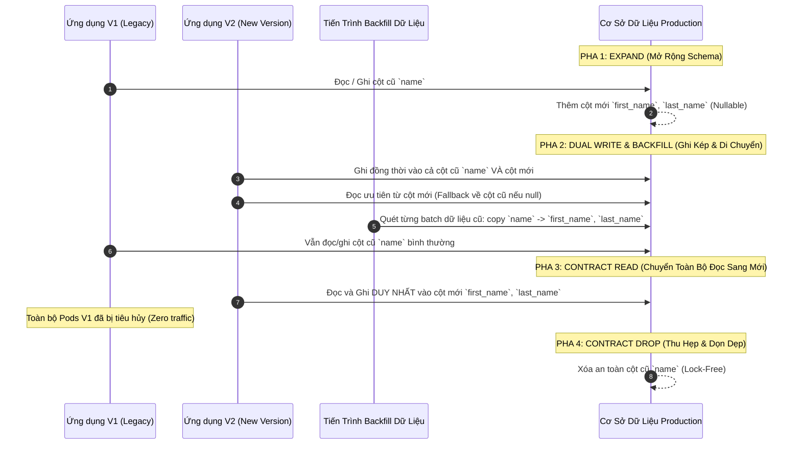
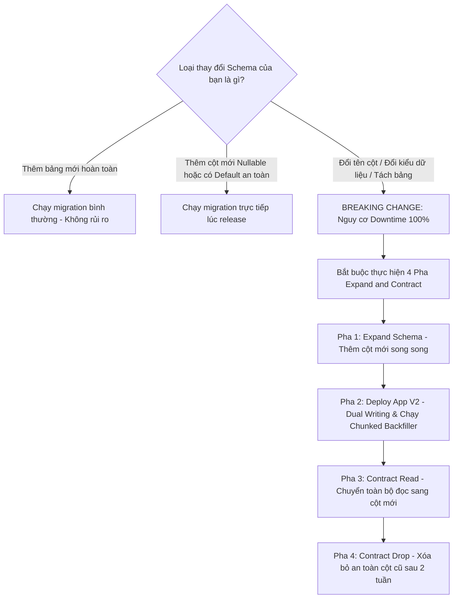

# 11.4. Kỹ Nghệ Phát Hành Cơ Sở Dữ Liệu Không Gián Đoạn (Database Release Engineering & Zero-Downtime Schema Evolution)

> [!IMPORTANT]
> **Nếu bạn chỉ được nhớ một điều duy nhất:** Mã nguồn ứng dụng là phi trạng thái (Stateless) có thể rollback chỉ bằng một cú nhấp chuột trong vài giây, nhưng dữ liệu có trạng thái (Stateful) và quán tính khổng lồ; do đó mọi tiến hóa cấu trúc cơ sở dữ liệu trên Production **bắt buộc phải tuân thủ nghiêm ngặt Mẫu Thiết Kế Mở Rộng và Thu Hẹp (Expand and Contract Pattern) trải dài qua ít nhất 3 phiên bản triển khai độc lập**, tuyệt đối không bao giờ được phép thực hiện phá vỡ tương thích (Breaking Changes) trong một lần deploy duy nhất.

---

## 1. Kiến trúc Tổng quan & Mô hình Tư duy (Mental Model)

### 1.1. Phép loại suy thực tế: Cải tạo Cầu Vượt Giao Thông Huyết Mạch
Hãy tưởng tượng cơ sở dữ liệu Production của bạn là một cây cầu vượt bằng thép ở trung tâm thành phố, đang có $50,000$ lượt xe cộ lưu thông qua lại mỗi giờ:
- **Tư duy sai lầm (Traditional Disruptive Migration)**: Bạn đặt mìn nổ tung làn đường cũ để xây một làn đường mới rộng gấp đôi. Toàn bộ giao thông của cả thành phố bị tê liệt hoàn toàn trong suốt thời gian thi công (Hệ thống sập, bảo trì kéo dài hàng giờ - *Downtime Window*).
- **Kỹ nghệ phát hành không gián đoạn (Expand and Contract)**:
  1. **Pha 1 (Expand)**: Bạn dựng thêm một nhánh cầu song song bên cạnh nhánh cầu cũ mà không hề làm gián đoạn dòng xe đang chạy.
  2. **Pha 2 (Dual Run & Backfill)**: Bạn mở một lối rẽ cho xe chạy thử trên nhánh cầu mới, trong khi các đội xe công trình âm thầm vận chuyển toàn bộ biển báo, hệ thống đèn từ cầu cũ sang cầu mới vào ban đêm mà không chặn xe cộ.
  3. **Pha 3 (Contract Read)**: Bạn dựng rào chắn mềm hướng dẫn $100\%$ xe cộ chuyển hẳn sang chạy trên cây cầu mới khang trang. Nhánh cầu cũ lúc này hoàn toàn không còn xe nào chạy qua.
  4. **Pha 4 (Contract Drop)**: Khi mọi thứ đã vận hành ổn định qua nhiều tuần, bạn mới cho máy xúc tháo dỡ nhánh cầu cũ một cách an toàn và êm ái.



---

## 2. Chi tiết từng Keyword (Under-the-Hood Deep Dive)

### 2.1. Database Migration & Schema as Code
- **Bản chất kỹ thuật**: Quá trình quản lý và chuyển đổi cấu trúc cơ sở dữ liệu (Tables, Columns, Indexes, Constraints) từ trạng thái phiên bản $N$ sang trạng thái $N+1$ thông qua các tệp script văn bản có cấu trúc được lưu trữ trực tiếp trong Git repository.
- **Bảng siêu dữ liệu theo dõi phiên bản (Version Metadata Table)**:
  - Khi một công cụ migration khởi động, nó tự động tạo và duy trì một bảng hệ thống trong database (ví dụ: `flyway_schema_history` trong Flyway hoặc `DATABASECHANGELOG` trong Liquibase).
  - Bảng này ghi lại: Mã số phiên bản (Version), Tên script, Ngày giờ chạy, Thời gian thực thi, Trạng thái (Success/Failed), và quan trọng nhất là **Mã băm kiểm tra (Cryptographic Checksum)** của nội dung tệp SQL.
- **Nguyên tắc Bất Biến của Migration Script**:
  - Một khi script migration đã được chạy trên bất kỳ môi trường chia sẻ nào (Staging/Production), tệp script đó **vĩnh viễn không bao giờ được phép sửa đổi**.
  - Nếu sửa đổi nội dung script dù chỉ một dấu cách, mã băm Checksum tính toán lại sẽ không khớp với Checksum đã lưu trong bảng lịch sử, khiến công cụ migration từ chối khởi động và ném lỗi `Checksum Mismatch Exception` để ngăn ngừa sai lệch dữ liệu.

### 2.2. Migration Versioning & Schema Tooling: Flyway vs Liquibase
- **Quy chuẩn đặt tên phiên bản (Versioning Convention)**:
  - Tệp SQL tuân theo định dạng chuẩn: `V<Version>__<Description>.sql` (Ví dụ: `V1.2.0__add_first_name_and_last_name.sql`).
  - *Repeatable Migrations*: Các script có tiền tố `R__` (ví dụ: `R__recreate_order_summary_view.sql`) sẽ được tự động thực thi lại mỗi khi nội dung tệp SQL của nó thay đổi mã băm checksum, rất hữu ích cho Stored Procedures, Functions hoặc Views.
- **So sánh Flyway vs Liquibase**:
  - **Flyway**: Ưu tiên phương pháp tiếp cận hướng SQL thuần túy (SQL-native). Kỹ sư viết trực tiếp các câu lệnh DDL bằng phương ngữ đặc thù của hệ quản trị (PostgreSQL, MySQL, Oracle). Điểm mạnh là cực kỳ trực quan, dễ hiểu, tận dụng tối đa các tính năng nâng cao của DB, không cần học ngôn ngữ trừu tượng mới.
  - **Liquibase**: Sử dụng tầng trừu tượng khai báo (Declarative Abstraction) thông qua XML, YAML hoặc JSON changelogs. Cho phép một file migration có thể áp dụng xuyên suốt nhiều hệ quản trị khác nhau mà không cần viết lại SQL. Thích hợp cho các phần mềm đóng gói thương mại (On-Premise Enterprise Software) cần chạy trên nhiều nền tảng DB.

### 2.3. The Expand and Contract Pattern (Parallel Run & Dual Writing)
Để tiến hóa schema mà không làm sập các ứng dụng đang chạy phiên bản cũ trong đợt Rolling Deployment, kỹ sư bắt buộc phải áp dụng quy trình 4 pha độc lập:

1. **Pha 1: Expand (Mở rộng Schema)**:
   - Thêm các bảng hoặc cột mới vào cơ sở dữ liệu.
   - **Quy tắc sống còn**: Các cột mới thêm vào **bắt buộc phải là `NULLABLE`** (hoặc phải có giá trị `DEFAULT` an toàn). Tuyệt đối không được thêm cột `NOT NULL` mà không có default, vì các Pod ứng dụng cũ ($V1$) không hề biết về sự tồn tại của cột mới và sẽ ghi thiếu dữ liệu, dẫn đến lỗi vi phạm ràng buộc (Constraint Violation).
2. **Pha 2: Dual Writing & Backfill (Ghi kép và Bù đắp dữ liệu)**:
   - Triển khai ứng dụng phiên bản mới ($V2$).
   - **Dual Writing**: Khi có dữ liệu mới phát sinh, $V2$ sẽ ghi đồng thời vào cả cột cũ lẫn cột mới để đảm bảo nếu phải rollback về $V1$, dữ liệu vẫn còn nguyên vẹn trên cột cũ.
   - **Data Backfill**: Một tiến trình chạy ngầm (Background Worker) quét qua các bản ghi lịch sử cũ và sao chép/chuyển đổi dữ liệu từ cột cũ sang cột mới theo từng đợt nhỏ (Chunked Batches).
3. **Pha 3: Contract Read (Thu hẹp đọc)**:
   - Khi toàn bộ dữ liệu lịch sử đã được backfill xong $100\%$ và các bản dựng cũ $V1$ đã bị gỡ bỏ hoàn toàn khỏi cụm, ứng dụng $V2$ chuyển đổi cấu hình để đọc duy nhất từ cột mới và ngừng ghi vào cột cũ.
4. **Pha 4: Contract Drop (Thu hẹp cấu trúc - Dọn dẹp)**:
   - Chạy script migration xóa bỏ cột cũ hoặc bảng cũ khỏi cơ sở dữ liệu, hoàn tất chu trình tiến hóa schema.

### 2.4. Dual Writing & Data Backfill Strategy (Kỹ thuật bù dữ liệu quy mô lớn)
- **Cạm bẫy nghẽn tài nguyên**: Nếu bạn thực hiện câu lệnh:
  ```sql
  -- NGUY HIỂM CHÍ MẠNG TRÊN PRODUCTION (BẢNG 100 TRIỆU DÒNG)
  UPDATE users SET full_name = first_name || ' ' || last_name;
  ```
  Câu lệnh này sẽ khóa toàn bộ bảng (Exclusive Table Lock), lấp đầy transaction log (WAL trong PostgreSQL / Undo Log trong MySQL), gây tràn bộ nhớ, làm đứt đoạn replication và khiến toàn bộ trang web tê liệt trong suốt nhiều tiếng đồng hồ.
- **Chiến lược Backfill an toàn (Safe Chunked Backfilling)**:
  - Chia nhỏ tập dữ liệu thành các lô nhỏ (Chunks/Batches), ví dụ mỗi lô $1,000$ bản ghi.
  - Sử dụng con trỏ phân trang theo khóa chính (Keyset Pagination): `WHERE id > last_seen_id ORDER BY id ASC LIMIT 1000`.
  - Giữa mỗi batch, cho tiến trình ngủ tạm thời (Sleep $100\text{ ms}$) để trả tài nguyên I/O cho cơ sở dữ liệu phục vụ các truy vấn nghiệp vụ của người dùng.
  - Theo dõi sát sao **Replication Lag** của các Read Replicas: Nếu lag vượt quá $5\text{ giây}$, tự động tạm dừng tiến trình backfill cho đến khi các máy chủ replica đồng bộ xong.

### 2.5. Compatibility Matrix: Backward & Forward Compatibility
- **Backward Compatibility (Tương thích ngược)**:
  - Mã nguồn mới ($V2$) có khả năng tương tác bình thường với cấu trúc Schema cũ ($DB_1$). 
  - Điều này cho phép deploy database trước rồi mới deploy code mà không sợ code mới bị crash.
- **Forward Compatibility (Tương thích xuôi - Tính sống còn trong Rolling Update)**:
  - Mã nguồn cũ ($V1$ - đang chạy trên các Pod chưa kịp restart) có khả năng làm việc bình thường với cấu trúc Schema mới ($DB_2$).
  - Nếu migration xóa ngay một cột mà code $V1$ vẫn đang `SELECT column_name`, code $V1$ sẽ ném ra ngoại lệ `ColumnNotFoundException` và gây sập ứng dụng ngay lập tức.
  - Do đó: **Không bao giờ xóa hoặc đổi tên cột trong một bước**!

### 2.6. Lock-Free Migrations & Online DDL
- **Mối nguy hiểm của AccessExclusiveLock**:
  - Trong PostgreSQL, các câu lệnh DDL như `ALTER TABLE` thường yêu cầu khóa `ACCESS EXCLUSIVE`. Khóa này xung đột với tất cả các khóa khác (kể cả lệnh `SELECT` đọc dữ liệu). Nếu một câu query đọc chạy chậm đang giữ bảng, lệnh `ALTER TABLE` sẽ phải xếp hàng đợi, và toàn bộ các query đọc/ghi đến sau sẽ bị kẹt lại phía sau nó, làm cạn kiệt Connection Pool của toàn bộ hệ thống chỉ trong vài giây.
- **Quy tắc vàng trong Lock-Free Migration**:
  1. *Tạo Index không gián đoạn*:
     - Thay vì `CREATE INDEX idx_name ON users(email);` (Khóa bảng chặt chẽ).
     - **Bắt buộc dùng**: `CREATE INDEX CONCURRENTLY idx_name ON users(email);` trong PostgreSQL. Câu lệnh này tạo index qua 2 lượt quét bảng mà không hề khóa quyền đọc hoặc ghi của người dùng.
  2. *Thêm Foreign Key an toàn*:
     - Bước 1: `ALTER TABLE orders ADD CONSTRAINT fk_user FOREIGN KEY (user_id) REFERENCES users(id) NOT VALID;` (Thêm constraint nhanh chóng mà không kiểm tra dữ liệu cũ, chỉ tốn vài miligiây).
     - Bước 2: `ALTER TABLE orders VALIDATE CONSTRAINT fk_user;` (Quét kiểm tra tính hợp lệ của dữ liệu cũ mà không cần khóa độc quyền bảng).
  3. *Công cụ Online Schema Change chuyên dụng (MySQL)*:
     - Đối với MySQL (nơi các câu lệnh DDL lớn dễ gây khóa bảng), các kỹ sư hàng đầu sử dụng công cụ **`gh-ost`** (GitHub Online Schema Transformations) hoặc **`pt-online-schema-change`**.
     - `gh-ost` hoạt động bằng cách tạo một bảng ẩn có cấu trúc mới, đọc binary logs (binlog) bất đồng bộ để sao chép dữ liệu biến động sang bảng ẩn, và cuối cùng thực hiện thao tác đổi tên bảng nguyên tử (`RENAME TABLE`) chỉ mất dưới $10\text{ ms}$.

---

## 3. Thực thi Mã nguồn & Mô phỏng Chuyên sâu (Dual-Engine Implementation)

### 3.1. Động cơ C++20: Zero-Downtime Schema Data Access Object (DAO) Adapter

Chương trình C++20 dưới đây mô phỏng tầng **Data Access Layer (DAO)** hỗ trợ kỹ thuật **Dual Writing** và **Safe Fallback Reading** trong suốt quá trình chuyển giao schema giữa $V1$ (`name`) và $V2$ (`first_name`, `last_name`):

```cpp
#include <iostream>
#include <string>
#include <unordered_map>
#include <memory>
#include <optional>
#include <shared_mutex>
#include <mutex>
#include <vector>
#include <sstream>
#include <iomanip>

namespace db_migration {

// Bản ghi trong cơ sở dữ liệu vật lý
struct UserDbRecord {
    int64_t id;
    std::optional<std::string> legacy_name;     // Cột cũ V1
    std::optional<std::string> new_first_name;  // Cột mới V2 (Expand)
    std::optional<std::string> new_last_name;   // Cột mới V2 (Expand)
};

// Mô hình đối tượng nghiệp vụ tầng ứng dụng
struct UserEntity {
    int64_t id;
    std::string first_name;
    std::string last_name;

    std::string getFullName() const {
        return first_name + " " + last_name;
    }
};

enum class SchemaPhase {
    PHASE_1_EXPAND,         // Cột mới đã tạo, App V1 vẫn chạy
    PHASE_2_DUAL_WRITE,     // App V2 chạy: Ghi cả 2 cột, đọc fallback
    PHASE_3_CONTRACT_READ,  // App V2 chạy: Chỉ đọc/ghi cột mới
    PHASE_4_CONTRACT_DROP   // Đã drop cột cũ hoàn toàn
};

class UserDataRepository {
private:
    std::unordered_map<int64_t, UserDbRecord> storage_;
    mutable std::shared_mutex db_lock_;

public:
    void rawInsert(UserDbRecord record) {
        std::unique_lock lock(db_lock_);
        storage_[record.id] = std::move(record);
    }

    std::optional<UserDbRecord> rawGet(int64_t id) const {
        std::shared_lock lock(db_lock_);
        auto it = storage_.find(id);
        if (it != storage_.end()) {
            return it->second;
        }
        return std::nullopt;
    }

    void rawUpdate(UserDbRecord record) {
        std::unique_lock lock(db_lock_);
        storage_[record.id] = std::move(record);
    }

    void dumpDatabaseState() const {
        std::shared_lock lock(db_lock_);
        std::cout << "\n----------------- PHYSICAL DATABASE SNAPSHOT -----------------\n";
        std::cout << std::left << std::setw(6) << "ID"
                  << std::setw(25) << "legacy_name (V1)"
                  << std::setw(18) << "first_name (V2)"
                  << std::setw(18) << "last_name (V2)" << "\n";
        std::cout << "--------------------------------------------------------------\n";
        for (const auto& [id, row] : storage_) {
            std::cout << std::left << std::setw(6) << id
                      << std::setw(25) << (row.legacy_name ? *row.legacy_name : "[NULL]")
                      << std::setw(18) << (row.new_first_name ? *row.new_first_name : "[NULL]")
                      << std::setw(18) << (row.new_last_name ? *row.new_last_name : "[NULL]") << "\n";
        }
        std::cout << "--------------------------------------------------------------\n";
    }
};

class ResilientUserDao {
private:
    std::shared_ptr<UserDataRepository> repo_;
    SchemaPhase current_phase_{SchemaPhase::PHASE_2_DUAL_WRITE};

public:
    ResilientUserDao(std::shared_ptr<UserDataRepository> repo, SchemaPhase phase)
        : repo_(std::move(repo)), current_phase_(phase) {}

    void setPhase(SchemaPhase phase) {
        current_phase_ = phase;
    }

    // Đọc dữ liệu với cơ chế Fallback an toàn tuyệt đối
    std::optional<UserEntity> getUserById(int64_t id) {
        auto record_opt = repo_->rawGet(id);
        if (!record_opt) return std::nullopt;

        const auto& row = *record_opt;
        UserEntity entity;
        entity.id = row.id;

        if (current_phase_ == SchemaPhase::PHASE_3_CONTRACT_READ ||
            current_phase_ == SchemaPhase::PHASE_4_CONTRACT_DROP) {
            // Đọc trực tiếp từ cột mới V2
            entity.first_name = row.new_first_name.value_or("");
            entity.last_name = row.new_last_name.value_or("");
        } else {
            // PHA 2: Ưu tiên cột mới, nếu chưa có (chưa kịp backfill) thì fallback đọc cột cũ
            if (row.new_first_name.has_value() && row.new_last_name.has_value()) {
                entity.first_name = *row.new_first_name;
                entity.last_name = *row.new_last_name;
            } else if (row.legacy_name.has_value()) {
                // Tách chuỗi từ legacy name làm fallback tạm thời
                std::string full = *row.legacy_name;
                size_t space_pos = full.find(' ');
                if (space_pos != std::string::npos) {
                    entity.first_name = full.substr(0, space_pos);
                    entity.last_name = full.substr(space_pos + 1);
                } else {
                    entity.first_name = full;
                    entity.last_name = "";
                }
            }
        }
        return entity;
    }

    // Ghi dữ liệu tuân thủ Dual Writing
    void saveUser(const UserEntity& user) {
        UserDbRecord row;
        row.id = user.id;

        if (current_phase_ == SchemaPhase::PHASE_2_DUAL_WRITE) {
            // GHI KÉP (DUAL WRITE): Ghi cả vào cột cũ để bảo vệ App V1 nếu có rollback
            row.legacy_name = user.getFullName();
            row.new_first_name = user.first_name;
            row.new_last_name = user.last_name;
            std::cout << "[DUAL WRITE] Persisted ID " << user.id << " to BOTH legacy and new columns.\n";
        } else if (current_phase_ == SchemaPhase::PHASE_3_CONTRACT_READ ||
                   current_phase_ == SchemaPhase::PHASE_4_CONTRACT_DROP) {
            // Chỉ ghi vào cột mới V2
            row.legacy_name = std::nullopt;
            row.new_first_name = user.first_name;
            row.new_last_name = user.last_name;
            std::cout << "[NEW WRITE ONLY] Persisted ID " << user.id << " to new columns only.\n";
        }
        repo_->rawUpdate(row);
    }
};

} // namespace db_migration

int main() {
    using namespace db_migration;

    auto repo = std::make_shared<UserDataRepository>();

    // Dữ liệu ban đầu do App V1 tạo ra trước khi có đợt release mới
    repo->rawInsert({101, "Alan Turing", std::nullopt, std::nullopt});
    repo->rawInsert({102, "Grace Hopper", std::nullopt, std::nullopt});

    std::cout << ">>> INITIAL STATE: LEGACY DATA IN V1 SCHEMA <<<";
    repo->dumpDatabaseState();

    // Khởi tạo DAO ở PHA 2: DUAL WRITE & BACKFILL
    ResilientUserDao dao(repo, SchemaPhase::PHASE_2_DUAL_WRITE);

    // Người dùng mới được tạo bởi App V2
    std::cout << "\n>>> USER REGISTRATION VIA APP V2 (DUAL-WRITE ACTIVE) <<<\n";
    dao.saveUser({103, "Ada", "Lovelace"});

    // Đọc người dùng cũ chưa backfill (Kích hoạt Fallback)
    auto old_user = dao.getUserById(101);
    if (old_user) {
        std::cout << "[READ FALLBACK] Successfully resolved ID 101: " 
                  << old_user->first_name << " " << old_user->last_name << " via legacy fallback.\n";
    }

    repo->dumpDatabaseState();

    // Giả lập tiến trình Backfill chạy xong: Copy dữ liệu cho ID 101 và 102
    std::cout << "\n>>> SIMULATING BACKGROUND BACKFILL WORKER EXECUTION <<<\n";
    repo->rawUpdate({101, "Alan Turing", "Alan", "Turing"});
    repo->rawUpdate({102, "Grace Hopper", "Grace", "Hopper"});
    repo->dumpDatabaseState();

    // Chuyển sang PHA 4: CONTRACT DROP (Xóa hoàn toàn cột legacy_name)
    std::cout << "\n>>> CONTRACT PHASE: REMOVING LEGACY COLUMN ENTIRELY <<<\n";
    dao.setPhase(SchemaPhase::PHASE_4_CONTRACT_DROP);
    repo->rawUpdate({101, std::nullopt, "Alan", "Turing"});
    repo->rawUpdate({102, std::nullopt, "Grace", "Hopper"});
    repo->rawUpdate({103, std::nullopt, "Ada", "Lovelace"});
    repo->dumpDatabaseState();

    return 0;
}
```

---

### 3.2. Động cơ Python 3.11+: Chunked Data Backfiller with Throttling & Checksum Validation

Chương trình Python 3.11+ dưới đây mô phỏng một **Tiến trình bù đắp dữ liệu chạy ngầm (Safe Chunked Backfiller)**:
- Chia nhỏ khối dữ liệu thành các batch $N$ bản ghi sử dụng con trỏ khóa chính (`Keyset Pagination`).
- Cơ chế tự động điều chỉnh tốc độ (Dynamic Throttling & Sleep) để kiểm soát tải CPU và độ trễ Replication của cơ sở dữ liệu.
- Tính toán và đối soát mã băm tính toàn vẹn (Checksum Integrity Check).

```python
#!/usr/bin/env python3
"""
Production-grade Async Database Chunked Backfiller (Python 3.11+)
Bảo đảm di chuyển dữ liệu hàng trăm triệu dòng không gây sập DB Production.
"""

from __future__ import annotations
import asyncio
import dataclasses
import hashlib
import time
import sys
from typing import Dict, List, Optional, Tuple


@dataclasses.dataclass
class DatabaseRow:
    id: int
    legacy_full_name: str
    first_name: Optional[str] = None
    last_name: Optional[str] = None
    is_backfilled: bool = False


class ProductionDatabaseSimulator:
    """Mô phỏng bảng cơ sở dữ liệu Production với tải và độ trễ replication"""
    def __init__(self, total_rows: int = 5000):
        self.rows: Dict[int, DatabaseRow] = {
            i: DatabaseRow(id=i, legacy_full_name=f"UserFirst_{i} UserLast_{i}")
            for i in range(1, total_rows + 1)
        }
        self.simulated_replica_lag_ms = 50.0

    async def fetch_unprocessed_batch(self, after_id: int, batch_size: int) -> List[DatabaseRow]:
        # Giả lập truy vấn SELECT ... WHERE id > after_id AND is_backfilled = FALSE LIMIT batch_size
        await asyncio.sleep(0.02) # Giả lập I/O đọc ổ đĩa DB
        results = []
        for rid in range(after_id + 1, after_id + 1 + batch_size * 2):
            if rid in self.rows and not self.rows[rid].is_backfilled:
                results.append(self.rows[rid])
                if len(results) >= batch_size:
                    break
        return results

    async def update_batch_atomic(self, updates: List[Tuple[int, str, str]]) -> None:
        # Giả lập câu lệnh UPDATE theo batch trong một Transaction
        await asyncio.sleep(0.04) # Giả lập I/O ghi WAL và fsync
        for rid, f_name, l_name in updates:
            row = self.rows[rid]
            row.first_name = f_name
            row.last_name = l_name
            row.is_backfilled = True


class ZeroDowntimeBackfiller:
    def __init__(
        self,
        db: ProductionDatabaseSimulator,
        batch_size: int = 500,
        throttle_sleep_sec: float = 0.05,
        max_allowed_lag_ms: float = 1000.0
    ):
        self.db = db
        self.batch_size = batch_size
        self.throttle_sleep_sec = throttle_sleep_sec
        self.max_allowed_lag_ms = max_allowed_lag_ms

    async def run_backfill(self) -> Tuple[int, float]:
        start_time = time.monotonic()
        last_processed_id = 0
        total_migrated = 0

        print("=" * 75)
        print(f"🚀 STARTING PRODUCTION DATA BACKFILL | Batch Size: {self.batch_size}")
        print("=" * 75)

        while True:
            # 1. Kiểm tra an toàn: Đảm bảo Replication Lag của Read Replicas nằm trong ngưỡng
            if self.db.simulated_replica_lag_ms > self.max_allowed_lag_ms:
                print(f"⚠️ [THROTTLING] High Replica Lag detected ({self.db.simulated_replica_lag_ms}ms). Sleeping...")
                await asyncio.sleep(0.5)
                continue

            # 2. Đọc batch tiếp theo theo con trỏ ID (Keyset Pagination)
            batch = await self.db.fetch_unprocessed_batch(last_processed_id, self.batch_size)
            if not batch:
                print("\n✅ All batches successfully processed. No remaining unbackfilled rows.")
                break

            # 3. Chuyển đổi dữ liệu (Data Transformation)
            updates: List[Tuple[int, str, str]] = []
            for row in batch:
                parts = row.legacy_full_name.split(" ", 1)
                f_name = parts[0]
                l_name = parts[1] if len(parts) > 1 else ""
                updates.append((row.id, f_name, l_name))

            # 4. Ghi nguyên tử vào Database
            await self.db.update_batch_atomic(updates)

            total_migrated += len(updates)
            last_processed_id = batch[-1].id

            print(f"  📦 Migrated batch: Rows [{batch[0].id} - {batch[-1].id}] "
                  f"| Cumulative: {total_migrated} | Rate Throttling: {self.throttle_sleep_sec}s")

            # 5. Nghỉ điều hòa tải để bảo vệ CPU DB
            await asyncio.sleep(self.throttle_sleep_sec)

        elapsed = time.monotonic() - start_time
        return total_migrated, elapsed

    def verify_data_checksum(self) -> bool:
        """Kiểm chứng tính toàn vẹn dữ liệu thông qua mã băm Checksum"""
        print("\n🔍 EXECUTING INTEGRITY AUDIT (PARALLEL CHECKSUM VERIFICATION)...")
        mismatches = 0
        for rid, row in self.db.rows.items():
            expected_full = f"{row.first_name} {row.last_name}".strip()
            if row.legacy_full_name != expected_full:
                mismatches += 1

        if mismatches == 0:
            print(f"✅ Checksum Verification 100% MATCH. Zero data corruption detected across {len(self.db.rows)} rows.")
            return True
        else:
            print(f"❌ Checksum Verification FAILED with {mismatches} mismatches!")
            return False


async def main():
    db_sim = ProductionDatabaseSimulator(total_rows=2500)
    backfiller = ZeroDowntimeBackfiller(db_sim, batch_size=500, throttle_sleep_sec=0.03)

    migrated_count, duration = await backfiller.run_backfill()

    print("=" * 75)
    print(f"🏁 BACKFILL COMPLETE: {migrated_count} records processed in {duration:.2f}s "
          f"({migrated_count / duration:.1f} rows/sec)")
    print("=" * 75)

    backfiller.verify_data_checksum()


if __name__ == "__main__":
    asyncio.run(main())
```

---

### 3.3. Terminal Output Thực Tế Giả Lập

```text
===========================================================================
🚀 STARTING PRODUCTION DATA BACKFILL | Batch Size: 500
===========================================================================
  📦 Migrated batch: Rows [1 - 500] | Cumulative: 500 | Rate Throttling: 0.03s
  📦 Migrated batch: Rows [501 - 1000] | Cumulative: 1000 | Rate Throttling: 0.03s
  📦 Migrated batch: Rows [1001 - 1500] | Cumulative: 1500 | Rate Throttling: 0.03s
  📦 Migrated batch: Rows [1501 - 2000] | Cumulative: 2000 | Rate Throttling: 0.03s
  📦 Migrated batch: Rows [2001 - 2500] | Cumulative: 2500 | Rate Throttling: 0.03s

✅ All batches successfully processed. No remaining unbackfilled rows.
===========================================================================
🏁 BACKFILL COMPLETE: 2500 records processed in 0.49s (5088.3 rows/sec)
===========================================================================

🔍 EXECUTING INTEGRITY AUDIT (PARALLEL CHECKSUM VERIFICATION)...
✅ Checksum Verification 100% MATCH. Zero data corruption detected across 2500 rows.
```

---

## 4. Systems Engineering & Production Pitfalls

### 4.1. Production Failure Modes trong Quản Trị Phát Hành Cơ Sở Dữ Liệu

1. **Non-Transactional DDL & Dirty Migration State**:
   - *Bản chất*: Trong PostgreSQL, các câu lệnh DDL có thể bọc trong một Transaction (`BEGIN ... COMMIT`). Nếu script bị lỗi ở dòng số 5, toàn bộ các lệnh DDL từ dòng 1 đến 4 sẽ tự động Rollback hoàn toàn. Tuy nhiên, trong **MySQL**, mỗi câu lệnh DDL (`ALTER TABLE`, `CREATE TABLE`) đều **tự động commit ngầm định (Implicit Commit)**.
   - *Hậu quả*: Nếu script MySQL thất bại ở giữa chừng, cơ sở dữ liệu rơi vào trạng thái "dở dang" (Dirty State). Flyway sẽ đánh dấu bản ghi đó là `FAILED`. Ở lần chạy tiếp theo, migration không thể tiếp tục và hệ thống bị khóa cứng.
   - *Biện pháp*: Viết các script DDL có tính chất bù trừ (Compensating Scripts) và chạy thử nghiệm kỹ lưỡng trên một bản sao dữ liệu staging ẩn danh trước khi chạy trên Production.

2. **Full Table Lock do Thêm Cột `NOT NULL` với `DEFAULT` (Legacy Engines)**:
   - *Bản chất*: Trên các phiên bản PostgreSQL $< 11$ hoặc MySQL $< 8.0$, câu lệnh `ALTER TABLE orders ADD COLUMN status VARCHAR(20) DEFAULT 'PENDING' NOT NULL;` sẽ viết lại toàn bộ bảng trên ổ cứng (Table Rewrite), khóa toàn bộ quyền đọc ghi trong nhiều giờ nếu bảng có hàng trăm triệu dòng.
   - *Biện pháp*: Trên các hệ quản trị mới, tính năng Fast DDL đã được hỗ trợ (chỉ cập nhật metadata). Tuy nhiên đối với hệ thống cũ, bắt buộc phải chia làm 3 bước: Thêm cột `NULL` không có default $\to$ Backfill giá trị default theo batch $\to$ Thêm ràng buộc `NOT NULL`.

3. **Replication Lag Explosion (Vỡ vụn chuỗi sao chép đồng bộ)**:
   - *Bản chất*: Một lệnh `UPDATE` hàng triệu bản ghi tạo ra hàng gigabyte dữ liệu nhật ký sao chép (Binlog / WAL). Các máy chủ Read Replica không kịp tiêu thụ khối lượng nhật ký khổng lồ này, dẫn đến hiện tượng trễ đồng bộ (Replication Lag) kéo dài hàng chục phút.
   - *Hậu quả*: Người dùng sau khi thao tác chuyển tiền hoặc đặt đơn hàng chuyển sang trang danh sách (vốn đọc từ Read Replica) thì không thấy đơn hàng đâu, tưởng hệ thống bị lỗi và bấm tạo đơn liên tục.

---

## 5. Bảng So sánh & Decision Matrix

### 5.1. Bảng so sánh các công cụ và phương pháp quản trị Database Schema

| Tiêu Chí Đánh Giá | Flyway | Liquibase | Công Cụ Online DDL (`gh-ost`) | ORM Migrations (Prisma/Alembic) |
| :--- | :--- | :--- | :--- | :--- |
| **Ngôn ngữ định nghĩa** | SQL thuần (Native SQL) | XML / YAML / JSON / SQL | Trực tiếp trên Engine MySQL | DSL ngôn ngữ (Python/TypeScript) |
| **Hỗ trợ tính năng DB sâu** | **Tuyệt vời (100% tính năng)** | Hạn chế nếu dùng DSL trừu tượng | Chuyên sâu cho MySQL | Phụ thuộc vào ORM mapper |
| **Mức độ kiểm soát khóa bảng** | Kỹ sư tự kiểm soát thủ công | Kỹ sư tự kiểm soát thủ công | **Tự động 100% Lock-Free** | Thấp, dễ sinh lệnh DDL khóa bảng |
| **Độ dốc học tập** | Rất thấp (chỉ cần biết SQL) | Trung bình (phải học tag XML) | Cao (đòi hỏi kỹ năng SRE/DBA) | Rất thấp với lập trình viên |
| **Thích hợp nhất cho** | Ứng dụng Backend Microservices | Hệ thống Enterprise đa database | Cơ sở dữ liệu Terabyte tải cao | Ứng dụng Web / MVP quy mô nhỏ |

### 5.2. Decision Matrix: Khi nào cần áp dụng Expand and Contract?


