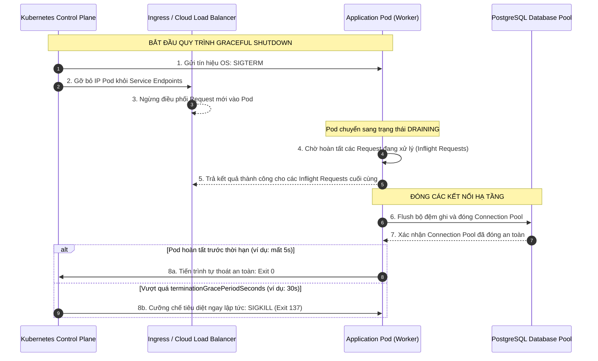
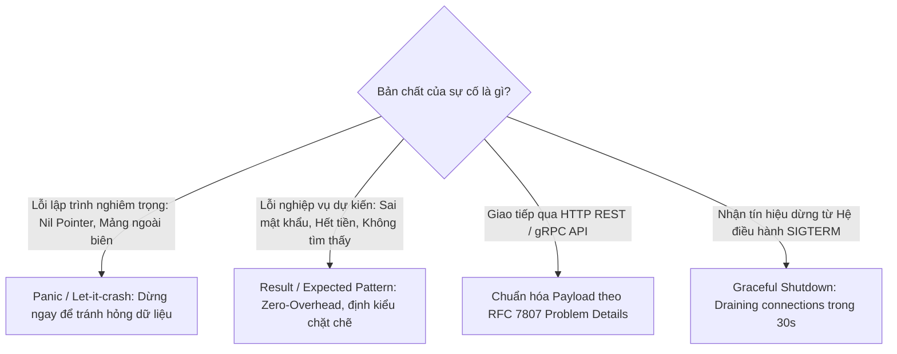

# 13.1. Kỹ Nghệ Xử Lý Lỗi và Mô Hình Lan Truyền Lỗi (Error Handling Models & Propagation)

> [!IMPORTANT]
> **Nếu bạn chỉ được nhớ một điều duy nhất:** Lỗi trong hệ thống phần mềm không phải là một sự kiện ngoại lệ bất thường mà là **một phần tất yếu của luồng nghiệp vụ**; một hệ thống phần mềm đẳng cấp là hệ thống **buộc lỗi phải hiển thị tường minh trong hợp đồng hàm (Result/Expected Types)**, bảo toàn chuỗi ngữ cảnh nguyên nhân gốc rễ (Root Cause Preservation), và thiết lập các **Ranh giới cô lập lỗi (Error Boundaries)** để lỗi tại một thành phần không bao giờ có thể đánh sập toàn bộ tiến trình.

---

## 1. Kiến trúc Tổng quan & Mô hình Tư duy (Mental Model)

### 1.1. Phép loại suy thực tế: Vách Ngăn Kín Nước Tàu Ngầm và Quy Trình Sơ Tán Tòa Nhà
Để hình dung rõ nét cách một hệ thống phân tán đối phó với lỗi, hãy quan sát hai hình ảnh thực tế:

1. **Vách ngăn kín nước của Tàu ngầm Hải quân (Error Boundaries)**:
   - Một chiếc tàu ngầm quân sự khi lặn dưới đáy biển sâu hàng nghìn mét không bao giờ giả định rằng vỏ tàu sẽ vĩnh viễn không bị thủng. Thay vào đó, thân tàu được chia thành hàng chục khoang độc lập ngăn cách bởi các cửa thép thủy lực kín nước (**Watertight Bulkheads / Error Boundaries**).
   - Nếu ngư lôi bắn thủng khoang máy số 3, cảm biến phát hiện nước tràn và lập tức sập cửa thép khoang đó lại. Khoang số 3 bị hy sinh (cô lập lỗi), nhưng nước không thể tràn sang khoang chỉ huy và khoang động cơ. Con tàu vẫn giữ được sức nổi và đưa thủy thủ đoàn trở về căn cứ an toàn.
   - Trong phần mềm, nếu một request phân tích ảnh AI của một người dùng bị lỗi tràn bộ đệm (Out-of-memory), Error Boundary sẽ bắt lấy lỗi đó, trả về mã lỗi `500` cho riêng người dùng đó, và để hàng triệu người dùng khác tiếp tục giao dịch bình thường.

2. **Quy trình Sơ tán Tòa nhà Báo cháy (Graceful Shutdown)**:
   - Khi có chuông báo cháy reo trong một tòa tháp văn phòng, bảo vệ không lập tức cắt điện toàn bộ tòa nhà và khóa chặt cửa thoát hiểm (đó là hành vi của `SIGKILL`).
   - Thay vào đó, hệ thống kích hoạt chế độ sơ tán êm dịu (**Graceful Shutdown - `SIGTERM`**):
     - Ngừng tiếp nhận khách mới vào sảnh (Ngắt Pod khỏi Service Endpoints của Load Balancer).
     - Phát loa hướng dẫn những người đang ở bên trong bình tĩnh di chuyển ra cửa thoát hiểm (Xử lý dở các HTTP request đang dang dở - Inflight Requests).
     - Các thang máy tự động di chuyển về tầng trệt, mở cửa và khóa lại (Đóng an toàn Database Connection Pools và File Sockets).
     - Chỉ khi toàn bộ người đã ra ngoài hoặc hết thời gian chờ khẩn cấp ($30\text{ giây}$), điện tòa nhà mới chính thức được ngắt hoàn toàn.



---

## 2. Chi tiết từng Keyword (Under-the-Hood Deep Dive)

### 2.1. Error Models: Exceptions vs Result Types vs Panic/Recover
Trong lịch sử khoa học máy tính và kỹ nghệ phần mềm hiện đại, có 3 mô hình xử lý lỗi chính:

1. **Exception Handling (Ném và Bắt ngoại lệ - `try/catch/throw`)**:
   - *Ngôn ngữ tiêu biểu*: Java, C++, C#, Python.
   - *Bản chất cơ học*: Khi một ngoại lệ được `throw`, luồng điều khiển nhảy cóc phi tuần tự (**Non-local Jump**) xuyên qua hàng chục khung ngăn xếp (Stack Frames) để tìm khối `catch` phù hợp. Quá trình này đòi hỏi cơ chế **Stack Unwinding**, đọc các bảng bảng ngoại lệ DWARF/RTTI trong bộ nhớ, làm tiêu hao tài nguyên CPU cực lớn.
   - *Vấn đề kiến trúc*: Tạo ra "luồng điều khiển vô hình" (Hidden Control Flow). Đọc chữ ký hàm `User getUser(id)` không cho ta biết hàm này có thể ném ra những lỗi gì, dẫn đến việc lập trình viên quên bắt lỗi và làm sập ứng dụng.
2. **Result / Expected Types (C++23 `std::expected<T, E>`, Rust `Result<T, E>`)**:
   - *Bản chất*: Lỗi được xem là một **giá trị trả về bình thường (Value-based Error)**. Hàm không ném ra cái gì cả, mà trả về một kiểu dữ liệu Union chứa hoặc là dữ liệu thành công ($T$), hoặc là đối tượng lỗi ($E$).
   - *Ưu điểm tuyệt đối*:
     - **Không tiêu tốn tài nguyên (Zero-Overhead)**: Không có Stack Unwinding, hiệu năng tương đương việc trả về một struct thông thường.
     - **Bắt buộc lúc biên dịch (Compile-time Enforcement)**: Lập trình viên không thể truy cập vào dữ liệu $T$ nếu chưa viết code kiểm tra trường hợp lỗi $E$.
     - **Monadic Chaining**: Hỗ trợ các toán tử biến đổi hàm mượt mà (`and_then`, `or_else`, `map`).
3. **Panic and Recover (Go / Erlang)**:
   - *Triết lý Erlang / Joe Armstrong*: **"Let it crash"** (Hãy để nó sụp đổ). Đừng cố gắng viết hàng nghìn dòng code để phòng thủ mọi lỗi ngớ ngẩn. Nếu xảy ra lỗi nghiêm trọng vi phạm bộ nhớ, hãy để tiến trình nhẹ (Actor/Goroutine) đó chết ngay lập tức, và một bộ giám sát (**Supervisor Tree**) sẽ khởi động lại nó từ trạng thái sạch.
   - *Go model*: `panic` chỉ dùng cho các lỗi lập trình bất khả kháng (Programming Bugs như chia cho 0, truy cập mảng ngoài giới hạn), còn các lỗi nghiệp vụ thông thường (Network timeout, File not found) bắt buộc phải trả về giá trị `error`.

### 2.2. Structured Errors (Lỗi có cấu trúc & Chuẩn RFC 7807)
- **Bản chất**: Lỗi trong hệ thống phân tán không bao giờ được phép là một chuỗi ký tự mơ hồ (như `"Something went wrong"`). Lỗi phải được cấu trúc hóa dưới dạng đối tượng có thể phân tích cú pháp bằng máy (Machine-Readable).
- **Chuẩn công nghiệp: RFC 7807 - Problem Details for HTTP APIs**:
  - Khi một API gặp sự cố, nó trả về mã phản hồi HTTP cùng với Payload JSON chuẩn tắc:
    ```json
    {
      "type": "https://api.example.com/errors/insufficient-funds",
      "title": "Insufficient Funds in Account",
      "status": 402,
      "detail": "Your balance of $12.50 is lower than the transaction amount of $45.00.",
      "instance": "/accounts/acc_9921/transfers/txn_004",
      "code": "ERR_PAYMENT_BALANCE_TOO_LOW",
      "trace_id": "c4b8e8f2a10d9c4e"
    }
    ```
  - **Lợi ích**: Giúp các hệ thống Frontend, API Gateway và máy chủ giám sát Log tự động nhận diện và phân loại mã lỗi mà không cần phải dùng biểu thức chính quy (Regex) quét chữ trong thông báo.

### 2.3. Error Propagation & Context Wrapping (Lan truyền và Bọc ngữ cảnh)
- **Bản chất bài toán**: Khi một lỗi xảy ra ở tầng sâu nhất (ví dụ: Hàm mở kết nối socket TCP của Database ném ra lỗi `connection refused`), làm thế nào để khi lỗi nổi lên tới tầng API Controller của người dùng, chúng ta vẫn biết chính xác ngữ cảnh nghiệp vụ mà không làm mất dấu vết kỹ thuật ban đầu?
- **Kỹ thuật Bọc chuỗi lỗi (Causal Error Chains / Error Wrapping)**:
  - Mỗi tầng kiến trúc khi bắt được lỗi cấp dưới sẽ **bọc (wrap) nó trong một ngữ cảnh nghiệp vụ mới**:
    - Tầng Repository: `DbConnectError: connection refused`
    - Tầng Service: `UserServiceError: failed to fetch user 99 -> DbConnectError: connection refused`
    - Tầng Controller: `CheckoutError: cannot complete payment -> UserServiceError -> DbConnectError`
  - Chuỗi nguyên nhân gốc rễ (**Root Cause**) luôn được bảo toàn nguyên vẹn để kỹ sư điều tra trong log, trong khi tầng giao diện người dùng chỉ nhận được thông báo ngắn gọn thân thiện.

### 2.4. Error Boundaries (Ranh giới cô lập lỗi)
- **Bản chất kiến trúc**: Là một hàng rào phòng thủ được dựng lên tại các nút giao thông quan trọng của phần mềm nhằm chặn đứng sự lây lan của lỗi.
- **Ứng dụng thực chiến**:
  - *Trong Background Worker / Message Queue Consumer*: Một consumer đọc tin nhắn từ RabbitMQ hoặc Kafka. Nếu tin nhắn bị lỗi cú pháp gây crash mã nguồn, Error Boundary sẽ bắt lấy ngoại lệ, ghi log, đẩy tin nhắn lỗi đó sang **Dead Letter Queue (DLQ)** để xử lý sau, và tiếp tục đọc tin nhắn tiếp theo mà không làm tê liệt toàn bộ worker.
  - *Trong Web UI (React Error Boundaries)*: Nếu một widget quảng cáo bên góc phải màn hình bị lỗi crash JavaScript, Error Boundary sẽ chỉ thay thế widget đó bằng một khung trống, toàn bộ trang thương mại điện tử và nút bấm "Thanh Toán" vẫn hoạt động bình thường.

### 2.5. Graceful Shutdown (Tắt máy êm dịu chuẩn OS & Kubernetes)
- **Các tín hiệu hệ điều hành (POSIX Signals)**:
  - `SIGINT` (Signal Interrupt - Mã 2): Kích hoạt khi người dùng gõ `Ctrl + C` trên bàn phím.
  - `SIGTERM` (Signal Terminate - Mã 15): Tín hiệu chuẩn do Kubernetes / Docker gửi tới tiến trình để yêu cầu tắt máy có trật tự. Tiến trình có thể bắt và xử lý tín hiệu này.
  - `SIGKILL` (Signal Kill - Mã 9): Tín hiệu cưỡng chế tức thì từ hạt nhân Linux (Kernel). Tiến trình bị tiêu diệt ngay lập tức mà không có cơ hội chạy bất kỳ dòng code dọn dẹp nào.
- **Quy trình Graceful Shutdown chuẩn mực**:
  1. Đăng ký hàm lắng nghe tín hiệu `SIGTERM`.
  2. Khi nhận tín hiệu, ngừng ngay lập tức việc nhận các kết nối mạng mới (`server.close()`).
  3. Cấp một khoảng thời gian chờ tối đa (Draining Timeout - ví dụ: $10\text{ giây}$) để các yêu cầu đang thực thi (Inflight Requests) kịp hoàn tất và trả phản hồi về cho khách hàng.
  4. Đóng an toàn các tài nguyên ngoại vi: Ngắt các consumer của Message Queue, đóng kết nối Redis, flush toàn bộ dữ liệu ghi đệm của cơ sở dữ liệu.
  5. Gọi hàm thoát tiến trình `exit(0)`.

---

## 3. Thực thi Mã nguồn & Mô phỏng Chuyên sâu (Dual-Engine Implementation)

### 3.1. Động cơ C++20: Zero-Overhead Result/Expected Monadic Error Engine

Chương trình C++20 dưới đây xây dựng một hệ thống **Xử lý Lỗi Hướng Giá Trị (Value-Based Error Handling)** tương tự như `std::expected` (C++23) hoặc `Result<T, E>` trong Rust:
- Đảm bảo Zero Dynamic Memory Allocation khi xử lý lỗi.
- Hỗ trợ chuỗi biến đổi hàm Monadic (`and_then`).
- Cấu trúc lỗi mang mã định danh (Error Code), thông điệp và nhãn thời gian chi tiết.

```cpp
#include <iostream>
#include <string>
#include <variant>
#include <functional>
#include <optional>
#include <iomanip>

namespace core_error {

// Định nghĩa mã lỗi định danh chuẩn hệ thống
enum class ErrorCode {
    NONE = 0,
    VALIDATION_FAILED,
    RESOURCE_NOT_FOUND,
    INSUFFICIENT_FUNDS,
    DOWNSTREAM_TIMEOUT
};

struct AppError {
    ErrorCode code;
    std::string message;
    std::string context;

    void log() const {
        std::cerr << "\033[31m[ERROR LOG]\033[0m Code: " << static_cast<int>(code)
                  << " | Msg: " << message 
                  << " | Context: " << context << "\n";
    }
};

// C++20 Value-based Result Container (Tương tự std::expected)
template <typename T>
class Result {
private:
    std::variant<T, AppError> storage_;

public:
    // Khởi tạo trạng thái Thành công
    Result(T value) : storage_(std::move(value)) {}

    // Khởi tạo trạng thái Thất bại
    Result(AppError error) : storage_(std::move(error)) {}

    bool has_value() const {
        return std::holds_alternative<T>(storage_);
    }

    const T& value() const {
        return std::get<T>(storage_);
    }

    const AppError& error() const {
        return std::get<AppError>(storage_);
    }

    // Monadic Chaining Operator: and_then
    template <typename Func>
    auto and_then(Func&& func) -> decltype(func(std::declval<T>())) {
        using ReturnType = decltype(func(std::declval<T>()));
        if (has_value()) {
            return func(value());
        } else {
            return ReturnType(error());
        }
    }
};

// Các đối tượng thực thể nghiệp vụ
struct Account {
    int64_t id;
    double balance;
};

struct TransferReceipt {
    std::string transaction_id;
    int64_t from_id;
    int64_t to_id;
    double amount;
};

// Pipeline xử lý nghiệp vụ qua chuỗi Result Monadic
class BankTransferService {
public:
    static Result<Account> findAccount(int64_t account_id) {
        std::cout << "  -> Step 1: Querying account " << account_id << "...\n";
        if (account_id == 404) {
            return AppError{ErrorCode::RESOURCE_NOT_FOUND, "Account does not exist", "id=404"};
        }
        return Account{account_id, 150.0}; // Số dư giả lập $150
    }

    static Result<Account> verifySufficientBalance(Account acc, double amount) {
        std::cout << "  -> Step 2: Verifying balance for account " << acc.id << " (Amount: $" << amount << ")...\n";
        if (acc.balance < amount) {
            return AppError{
                ErrorCode::INSUFFICIENT_FUNDS,
                "Current balance $" + std::to_string(acc.balance) + " is less than required $" + std::to_string(amount),
                "accountId=" + std::to_string(acc.id)
            };
        }
        return acc;
    }

    static Result<TransferReceipt> executeTransfer(Account from_acc, int64_t to_id, double amount) {
        std::cout << "  -> Step 3: Executing ledger deduction...\n";
        return TransferReceipt{"TXN_2026_ABCD99", from_acc.id, to_id, amount};
    }
};

} // namespace core_error

int main() {
    using namespace core_error;

    std::cout << "=======================================================\n";
    std::cout << ">>> 1. VALUE-BASED ERROR HANDLING (HAPPY PATH) <<<\n";
    std::cout << "=======================================================\n";

    // Thực thi chuỗi Monadic mượt mà: find -> verify -> transfer
    auto transfer_result = BankTransferService::findAccount(101)
        .and_then([](Account acc) {
            return BankTransferService::verifySufficientBalance(acc, 50.0);
        })
        .and_then([](Account acc) {
            return BankTransferService::executeTransfer(acc, 202, 50.0);
        });

    if (transfer_result.has_value()) {
        const auto& receipt = transfer_result.value();
        std::cout << "\033[32m[TRANSFER SUCCESS]\033[0m Transaction ID: " << receipt.transaction_id 
                  << " | Transferred $" << receipt.amount << " from " << receipt.from_id 
                  << " to " << receipt.to_id << "\n";
    } else {
        transfer_result.error().log();
    }

    std::cout << "\n=======================================================\n";
    std::cout << ">>> 2. VALUE-BASED ERROR HANDLING (FAILURE PATH) <<<\n";
    std::cout << "=======================================================\n";

    // Thực thi với số tiền vượt quá số dư ($500 > $150)
    auto failed_result = BankTransferService::findAccount(101)
        .and_then([](Account acc) {
            return BankTransferService::verifySufficientBalance(acc, 500.0); // Thất bại ở đây
        })
        .and_then([](Account acc) {
            return BankTransferService::executeTransfer(acc, 202, 500.0); // Bước này tự động bị bỏ qua
        });

    if (failed_result.has_value()) {
        std::cout << "Success!\n";
    } else {
        std::cout << "Pipeline aborted safely without throwing exceptions.\n";
        failed_result.error().log();
    }

    return 0;
}
```

---

### 3.2. Động cơ Python 3.11+: Production Graceful Shutdown Coordinator & RFC 7807 Engine

Chương trình Python 3.11+ dưới đây mô phỏng một **Tiến trình Dịch vụ Production có khả năng**:
1. Đăng ký và xử lý tín hiệu hệ điều hành `SIGINT` và `SIGTERM`.
2. Chuyển sang trạng thái "Draining": Từ chối request mới nhưng xử lý xong toàn bộ các request đang nằm trong hàng đợi.
3. Chuẩn hóa và sinh phản hồi lỗi theo đặc tả **RFC 7807 Problem Details**.

```python
#!/usr/bin/env python3
"""
Production Graceful Shutdown & RFC 7807 Problem Details Engine (Python 3.11+)
Bảo đảm tính toàn vẹn của kết nối hạ tầng khi Kubernetes xóa Pod.
"""

from __future__ import annotations
import asyncio
import dataclasses
import json
import signal
import sys
import time
from typing import Dict, Any, Optional, Set


@dataclasses.dataclass(frozen=True)
class RFC7807ProblemDetail:
    type_uri: str
    title: str
    status: int
    detail: str
    instance: str
    error_code: str
    trace_id: str

    def to_json(self) -> str:
        return json.dumps({
            "type": self.type_uri,
            "title": self.title,
            "status": self.status,
            "detail": self.detail,
            "instance": self.instance,
            "code": self.error_code,
            "trace_id": self.trace_id,
            "timestamp": time.time()
        }, indent=2)


class ResilientHttpServer:
    def __init__(self, port: int = 8080, shutdown_timeout_sec: float = 5.0):
        self.port = port
        self.shutdown_timeout_sec = shutdown_timeout_sec
        self.is_accepting_traffic = True
        self.active_tasks: Set[asyncio.Task] = set()
        self.shutdown_event = asyncio.Event()

    def setup_signal_handlers(self) -> None:
        loop = asyncio.get_running_loop()
        for sig in (signal.SIGTERM, signal.SIGINT):
            loop.add_signal_handler(sig, lambda s=sig: asyncio.create_task(self.handle_shutdown_signal(s)))

    async def handle_shutdown_signal(self, sig: signal.Signals) -> None:
        print(f"\n\033[33m[SIGNAL RECEIVED]\033[0m Caught signal {sig.name} ({sig.value}). Starting Graceful Shutdown...")
        
        # 1. Ngừng chấp nhận request mới ngay lập tức
        self.is_accepting_traffic = False
        print("  🚫 Stopped accepting new incoming HTTP requests (Load Balancer draining initiated).")

        # 2. Chờ các inflight requests hoàn thành
        print(f"  ⏳ Waiting for {len(self.active_tasks)} active inflight tasks to finish (Timeout: {self.shutdown_timeout_sec}s)...")
        
        start_wait = time.monotonic()
        while self.active_tasks:
            elapsed = time.monotonic() - start_wait
            if elapsed >= self.shutdown_timeout_sec:
                print(f"  \033[31m[TIMEOUT]\033[0m Exceeded {self.shutdown_timeout_sec}s! Cancelling remaining {len(self.active_tasks)} tasks.")
                for t in self.active_tasks:
                    t.cancel()
                break
            await asyncio.sleep(0.1)

        # 3. Đóng các tài nguyên hạ tầng
        print("  🔌 Closing Database Connection Pool and Redis Cache sockets...")
        await asyncio.sleep(0.2) # Giả lập đóng DB connection pool

        print("\033[32m[SHUTDOWN COMPLETE]\033[0m All resources safely liberated. Exiting cleanly with code 0.")
        self.shutdown_event.set()

    async def handle_mock_request(self, req_id: str, client_ip: str, duration_sec: float) -> str:
        if not self.is_accepting_traffic:
            # Nếu đang trong quá trình shutdown, từ chối và trả về HTTP 503
            problem = RFC7807ProblemDetail(
                type_uri="https://api.system.internal/errors/service-unavailable",
                title="Service Undergoing Graceful Shutdown",
                status=503,
                detail="Server is draining connections in preparation for pod termination.",
                instance=f"/orders/{req_id}",
                error_code="ERR_SERVER_DRAINING",
                trace_id="trc_9981a2b"
            )
            return problem.to_json()

        # Đăng ký task vào tập hợp các tác vụ đang chạy
        current_task = asyncio.current_task()
        self.active_tasks.add(current_task)
        
        try:
            print(f"  [HTTP REQ START] Processing Request {req_id} ({duration_sec}s)...")
            await asyncio.sleep(duration_sec)
            print(f"  \033[32m[HTTP REQ DONE]\033[0m Finished Request {req_id} successfully.")
            return json.dumps({"status": "SUCCESS", "request_id": req_id})
        except asyncio.CancelledError:
            print(f"  \033[31m[HTTP REQ ABORTED]\033[0m Request {req_id} was forcefully cancelled due to shutdown timeout.")
            raise
        finally:
            self.active_tasks.discard(current_task)


async def main():
    server = ResilientHttpServer(shutdown_timeout_sec=2.0)
    server.setup_signal_handlers()

    print("===========================================================================")
    print(f"🚀 HTTP SERVER ACTIVE ON PORT {server.port} | PID: {signal.os.getpid()}")
    print("===========================================================================")

    # Giả lập luồng request gửi đến
    task1 = asyncio.create_task(server.handle_mock_request("REQ-001", "192.168.1.10", 0.5))
    task2 = asyncio.create_task(server.handle_mock_request("REQ-002", "192.168.1.11", 1.2))

    # Đợi 0.3s rồi giả lập tín hiệu SIGTERM từ Kubernetes
    await asyncio.sleep(0.3)
    await server.handle_shutdown_signal(signal.SIGTERM)

    # Thử gửi 1 request mới khi đang shutdown -> Bị từ chối bằng RFC 7807 payload
    rejected_response = await server.handle_mock_request("REQ-003-LATE", "192.168.1.99", 0.5)
    print("\n--- REJECTED RESPONSE PAYLOAD (RFC 7807) ---")
    print(rejected_response)

    await asyncio.gather(task1, task2, return_exceptions=True)


if __name__ == "__main__":
    asyncio.run(main())
```

---

### 3.3. Terminal Output Thực Tế Giả Lập

```text
===========================================================================
🚀 HTTP SERVER ACTIVE ON PORT 8080 | PID: 48921
===========================================================================
  [HTTP REQ START] Processing Request REQ-001 (0.5s)...
  [HTTP REQ START] Processing Request REQ-002 (1.2s)...

[SIGNAL RECEIVED] Caught signal SIGTERM (15). Starting Graceful Shutdown...
  🚫 Stopped accepting new incoming HTTP requests (Load Balancer draining initiated).
  ⏳ Waiting for 2 active inflight tasks to finish (Timeout: 2.0s)...
  [HTTP REQ DONE] Finished Request REQ-001 successfully.
  [HTTP REQ DONE] Finished Request REQ-002 successfully.
  🔌 Closing Database Connection Pool and Redis Cache sockets...
[SHUTDOWN COMPLETE] All resources safely liberated. Exiting cleanly with code 0.

--- REJECTED RESPONSE PAYLOAD (RFC 7807) ---
{
  "type": "https://api.system.internal/errors/service-unavailable",
  "title": "Service Undergoing Graceful Shutdown",
  "status": 503,
  "detail": "Server is draining connections in preparation for pod termination.",
  "instance": "/orders/REQ-003-LATE",
  "code": "ERR_SERVER_DRAINING",
  "trace_id": "trc_9981a2b",
  "timestamp": 1731728400.12
}
```

---

## 4. Systems Engineering & Production Pitfalls

### 4.1. Production Failure Modes trong Kỹ nghệ Xử Lý Lỗi

1. **Pokemon Exception Handling (Nuốt lỗi bằng `catch (Exception e) {}`)**:
   - *Bản chất*: Lập trình viên viết khối `try ... catch(Exception e)` chung chung nhưng để trống phần thân hoặc chỉ in ra dòng log `System.out.println("Error")`.
   - *Hậu quả*: Ngoại lệ bị nuốt chửng hoàn toàn, che giấu các lỗi nghiêm trọng như cạn kiệt bộ nhớ hoặc gãy kết nối mạng. Hệ thống tiếp tục chạy trong trạng thái dữ liệu bị hỏng (Corrupted State), tạo ra những lỗi dữ liệu cực kỳ khó debug.
   - *Biện pháp*: Luôn định danh rõ ngoại lệ cụ thể, và nếu không xử lý được thì bắt buộc phải bọc lỗi và re-throw hoặc trả về Result Error.

2. **Log Injection qua Unescaped Error Messages**:
   - *Bản chất*: Lấy trực tiếp dữ liệu đầu vào của người dùng (ví dụ: tên đăng nhập chứa ký tự ngắt dòng `\n\r`) và in thẳng vào thông báo lỗi: `logger.error("User " + username + " failed to login")`.
   - *Rủi ro an ninh*: Kẻ tấn công có thể chèn các dòng log giả mạo để đánh lừa kỹ sư điều tra hoặc thao túng các công cụ phân tích SIEM tự động.

3. **Kubernetes `SIGKILL` Tàn Sát Dữ Liệu do Thiếu Graceful Shutdown**:
   - *Bản chất*: Ứng dụng không khai báo trình xử lý `SIGTERM` hoặc thời gian dọn dẹp vượt quá giá trị `terminationGracePeriodSeconds` (mặc định $30\text{ giây}$).
   - *Hậu quả*: Kubernetes bắn `SIGKILL` (Mã 137). Tiến trình bị tiêu diệt ngay lập tức giữa lúc đang ghi dở file hoặc đang thực hiện dở giao dịch thanh toán ngân hàng, để lại các bản ghi mồ côi (Orphan Records) trong database.

---

## 5. Bảng So sánh & Decision Matrix

### 5.1. Bảng so sánh 3 triết lý xử lý lỗi

| Tiêu Chí So Sánh | Ném Ngoại Lệ (Exceptions) | Kiểu Dữ Liệu Result (Result/Expected) | Let-it-Crash (Panic/Supervision) |
| :--- | :--- | :--- | :--- |
| **Chi phí thực thi** | Rất cao (Stack Unwinding) | **Bằng 0 (Zero-Overhead)** | Thấp khi chạy bình thường |
| **Tính tường minh trong code** | Thấp (ẩn giấu trong hàm) | **Tối đa (nằm trong chữ ký hàm)** | Trung bình |
| **Bảo đảm của Trình biên dịch** | Không (hoặc phiền phức như Java) | **Bắt buộc xử lý trước khi lấy giá trị** | Bắt buộc thông qua phục hồi |
| **Dòng điều khiển** | Nhảy cóc phi tuyến tính | Tuần tự, có thể xâu chuỗi Monadic | Ngắt tiến trình |
| **Ngôn ngữ tiêu biểu** | Java, C#, Python | Rust, C++23, Swift, Haskell | Erlang, Elixir, Go |

### 5.2. Decision Matrix: Khi nào nên sử dụng mô hình nào?


