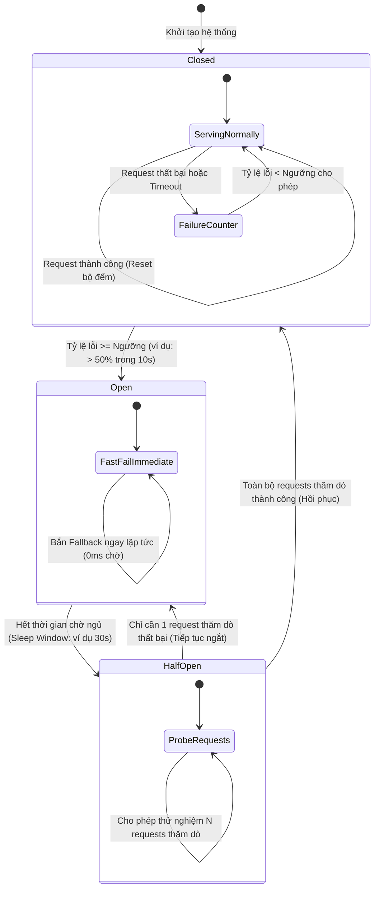
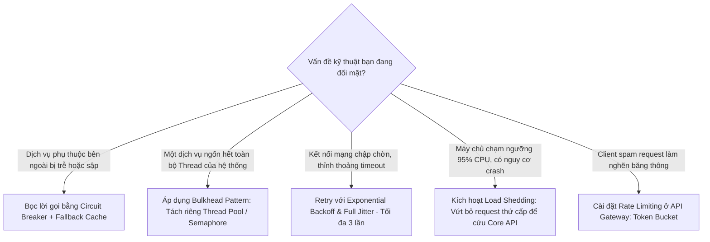

# 13.2. Các Mẫu Thiết Kế Chống Chịu Sự Cố (Resilience & Fault Tolerance Patterns)

> [!IMPORTANT]
> **Nếu bạn chỉ được nhớ một điều duy nhất:** Trong một hệ thống phân tán, mọi dịch vụ phụ thuộc đều chắc chắn sẽ có lúc bị trễ hoặc chết; năng lực chống chịu (Resilience) không phải là ảo tưởng ngăn chặn lỗi xảy ra, mà là **nghệ thuật cô lập hỏng hóc (Fault Isolation)** thông qua **Circuit Breaker** (Cắt nguồn phụ thuộc đang hỏng), **Bulkhead** (Ngăn cạn kiệt tài nguyên dùng chung), và **Thoái lui êm dịu (Graceful Degradation)** để hệ thống cốt lõi không bao giờ bị sụp đổ dây chuyền (Cascading Failure).

---

## 1. Kiến trúc Tổng quan & Mô hình Tư duy (Mental Model)

### 1.1. Phép loại suy thực tế: Cầu Dao Điện Tự Động (Aptomat) và Khoang Kín Nước Tàu Thủy
Để nắm bắt bản chất các mẫu thiết kế chống chịu, hãy quan sát hai cơ chế an toàn cơ khí trong đời sống:

1. **Cầu dao chống giật Aptomat (Circuit Breaker Mental Model)**:
   - Trong ngôi nhà của bạn, mạng lưới điện được chia thành nhiều nhánh: Phòng khách, Bếp, Máy lạnh.
   - Khi ấm siêu tốc ở nhà bếp bị chập mạch gây đoản mạch, dòng điện tăng vọt lên hàng nghìn ampe. Lúc này, cầu dao tự động của nhánh Bếp lập tức nhảy "CẠCH" (**Trạng thái OPEN**).
   - Nhánh bếp bị ngắt điện hoàn toàn (cô lập sự cố), nhưng TV ở phòng khách vẫn xem được và đèn phòng ngủ vẫn sáng. Cầu dao đã cứu toàn bộ hệ thống dây điện trong tường khỏi bị cháy rụi và cứu ngôi nhà khỏi một vụ hỏa hoạn thảm khốc.
   - Sau khi bạn rút phích cắm ấm siêu tốc ra, bạn gạt cầu dao lên thử (**Trạng thái HALF-OPEN**). Nếu không còn chập, cầu dao giữ nguyên vị trí (**Trạng thái CLOSED**).

2. **Vách ngăn khoang kín nước tàu thủy (Bulkhead Pattern)**:
   - Thuật ngữ "Bulkhead" bắt nguồn từ ngành đóng tàu biển. Thân tàu được chia thành các khoang độc lập bởi các vách ngăn kín nước.
   - Nếu một khoang bị tảng băng ngầm đâm thủng, nước chỉ ngập đầy một khoang đó. Con tàu có thể hơi nghiêng một chút nhưng lực đẩy của các khoang còn lại vẫn đủ để tàu tiếp tục nổi trên mặt đại dương.
   - Trong phần mềm, nếu dịch vụ "Gợi ý bài hát" bị treo do mạng lag, nó chỉ được phép tiêu tốn tối đa 10 threads trong Thread Pool riêng của nó. Nó tuyệt đối không được phép chiếm dụng sang 100 threads của dịch vụ "Phát nhạc trực tuyến".



---

## 2. Chi tiết từng Keyword (Under-the-Hood Deep Dive)

### 2.1. Traffic Shedding & Backpressure: Load Shedding vs Rate Limiting
- **Rate Limiting (Hạn ngạch bảo vệ phía Client)**:
  - *Bản chất*: Giới hạn tần suất gửi yêu cầu của một người dùng hoặc một API Key cụ thể (ví dụ: $100\text{ requests/phút}$) dựa trên thuật toán Token Bucket hoặc Leaky Bucket.
  - *Mục đích*: Chống gian lận, chống tấn công từ chối dịch vụ (DDoS) và bảo đảm tính công bằng giữa các người dùng.
- **Load Shedding (Tự vệ phía Máy chủ - Server Defense)**:
  - *Bản chất*: Khi máy chủ bị quá tải nghiêm trọng (CPU $> 90\%$, hàng đợi Thread Pool đầy, thời gian phản hồi p99 tăng vọt), máy chủ sẽ **chủ động vứt bỏ (Drop/Reject) một phần lưu lượng** để tự cứu lấy mình.
  - *Định luật Little (Little's Law)*: $L = \lambda \times W$ (Số lượng request trong hệ thống = Tốc độ đến $\times$ Thời gian phục vụ). Khi thời gian phục vụ $W$ tăng cao, hàng đợi $L$ sẽ phình to tới vô hạn và làm sập máy chủ vì cạn kiệt RAM.
  - Load Shedding sẽ lập tức từ chối các request không quan trọng (ví dụ: Request lấy avatar, request gửi thông báo marketing) bằng mã lỗi `HTTP 503 Service Unavailable`, ưu tiên toàn bộ tài nguyên còn lại để xử lý trơn tru các request quan trọng (như Thanh toán, Đặt lệnh chứng khoán).
- **Backpressure (Áp lực ngược)**:
  - Cơ chế trong đó một thành phần tiêu thụ (Consumer) báo hiệu cho thành phần sản xuất (Producer) biết rằng nó đang bị quá tải và yêu cầu Producer phải giảm tốc độ bơm dữ liệu (áp dụng trong Reactive Streams, TCP Flow Control Windowing, và Bounded Message Queues).

### 2.2. Graceful Degradation (Suy thoái êm dịu)
- **Bản chất**: Khả năng của hệ thống chủ động tắt bớt các tính năng thứ cấp (Non-critical Features) khi đối mặt với sự cố để bảo vệ bằng mọi giá các tính năng sống còn (Core Features).
- **Ví dụ thực chiến**:
  - Khi dịch vụ AI cá nhân hóa bị sập, thay vì báo lỗi toàn bộ trang chủ Netflix, hệ thống sẽ tự động hạ cấp xuống hiển thị danh sách tĩnh *"Top 10 phim xem nhiều nhất"* được cache sẵn từ hôm qua. Người dùng vẫn bấm xem phim bình thường và thậm chí không hề nhận ra hệ thống backend đang gặp sự cố.

### 2.3. Timeout Pattern & Deadline Propagation
- **Bản chất**: **Nguyên tắc sống còn số 1 trong mạng phân tán: Tuyệt đối không bao giờ thực hiện một lời gọi I/O từ xa (Remote Call) mà không cài đặt thời gian chờ (Timeout)**.
- **Hậu quả nếu thiếu Timeout**: Nếu một dịch vụ bên thứ ba bị treo do lỗi mạng, kết nối TCP sẽ bị giữ mãi mãi. Sau vài giây, toàn bộ các Thread của máy chủ gọi sẽ bị kẹt lại để chờ đợi, dẫn đến cạn kiệt tài nguyên (Thread Starvation) và kéo sập toàn bộ ứng dụng.
- **Deadline Propagation (Lan truyền hạn chót - gRPC Context)**:
  - Khi một yêu cầu đi qua chuỗi dịch vụ: $\text{Gateway} \to \text{Service A} \to \text{Service B} \to \text{Service C}$.
  - Nếu Gateway đặt thời hạn tối đa là $2.0\text{ giây}$. Khi request đến được Service C nhưng đã trôi qua $1.9\text{ giây}$, Service C biết rằng nó chỉ còn $0.1\text{ giây}$ để hoàn tất. Nếu Service C không thể làm kịp trong $0.1\text{ giây}$, nó sẽ hủy ngay lập tức thay vì tiếp tục tính toán một kết quả mà Gateway chắc chắn sẽ vứt bỏ.

### 2.4. Bulkhead Pattern (Khoang kín ngăn chìm tàu)
- **Bản chất kỹ thuật**: Cách ly tài nguyên phần cứng (Thread Pools, Connection Pools, Memory Quotas) thành các phân vùng độc lập để ngăn chặn lỗi ở một vùng làm cạn kiệt tài nguyên của toàn bộ hệ thống.
- **Hai phương pháp triển khai Bulkhead**:
  1. **Thread Pool Isolation (Cách ly theo Thread Pool)**:
     - Dịch vụ gọi duy trì các Thread Pool riêng biệt cho từng dịch vụ downstream (ví dụ: `PaymentThreadPool` có 20 threads, `RecommendationThreadPool` có 10 threads).
     - Nếu dịch vụ Recommendation bị treo, tối đa chỉ có 10 threads bị kẹt, 20 threads của Payment hoàn toàn không bị ảnh hưởng.
  2. **Semaphore Isolation (Cách ly theo biến đếm Semaphore)**:
     - Không tạo thêm thread mới (tiết kiệm chi phí chuyển ngữ cảnh Context Switch), mà chỉ dùng biến đếm nguyên tử Semaphore để giới hạn số lượng request đồng thời tối đa tới một dịch vụ. Nếu vượt quá ngưỡng, request bị từ chối ngay lập tức.

### 2.5. Circuit Breaker Pattern (Bộ ngắt mạch tự động - Michael Nygard)
- **Bản chất**: Một cỗ máy trạng thái (Finite State Machine) bọc xung quanh các lời gọi dịch vụ từ xa để phát hiện lỗi và tạm thời ngắt kết nối khi tỷ lệ lỗi vượt ngưỡng cho phép.
- **Ba trạng thái hoạt động**:
  1. **CLOSED (Đóng mạch - Bình thường)**: Mọi yêu cầu được gửi bình thường tới downstream. Nếu tỷ lệ lỗi trong một cửa sổ trượt (Sliding Window, ví dụ: 100 requests gần nhất) vượt quá $50\%$, mạch tự động nhảy sang trạng thái **OPEN**.
  2. **OPEN (Mở mạch - Ngắt kết nối)**: Toàn bộ các yêu cầu tiếp theo **bị chặn đứng ngay lập tức tại chỗ (Fast Fail)** mà không gửi bất kỳ gói tin mạng nào tới downstream. Phương thức Fallback được gọi ngay lập tức, tiết kiệm tài nguyên mạng và cho downstream thời gian để tự hồi phục.
  3. **HALF-OPEN (Nửa mở - Thử nghiệm)**: Sau một khoảng thời gian chờ (Sleep Window, ví dụ: 30 giây), mạch chuyển sang Half-Open và cho phép một số lượng nhỏ request thăm dò (ví dụ: 5 requests) đi qua. Nếu toàn bộ đều thành công, mạch đóng lại (**CLOSED**). Nếu chỉ cần 1 request thất bại, mạch lập tức nhảy lại **OPEN** thêm một chu kỳ nữa.

### 2.6. Fallback Pattern (Giá trị thay thế an toàn)
- **Bản chất**: Logic dự phòng được kích hoạt khi lời gọi chính bị lỗi, bị timeout hoặc khi Circuit Breaker đang ở trạng thái OPEN.
- **Các chiến lược Fallback**:
  - *Cache Fallback*: Trả về dữ liệu đã lưu trong Redis hoặc Local Cache từ lần gọi thành công trước.
  - *Stubbed Fallback*: Trả về giá trị mặc định tĩnh an toàn (ví dụ: Danh sách giỏ hàng rỗng, hoặc danh mục tĩnh).
  - *Silent Failure*: Ghi log lỗi và tiếp tục xử lý các phần còn lại của nghiệp vụ mà không ném ngoại lệ lên người dùng.

### 2.7. Retry with Exponential Backoff and Full Jitter
- **Bản chất bài toán Thundering Herd (Bầy thú dẫm đạp)**:
  - Nếu một dịch vụ downstream bị sập trong 10 giây và có $10,000$ client đồng loạt thực hiện Retry sau mỗi $1\text{ giây}$ cố định:
    - Đúng giây thứ 1, $10,000$ requests cùng đập vào dịch vụ.
    - Dịch vụ vừa chớm khởi động lại lập tức bị đè bẹp dí bởi làn sóng retry này và sập tiếp.
- **Công thức Exponential Backoff với Full Jitter (Amazon AWS Architecture)**:
  $$\text{Sleep Time} = \text{random}\left(0, \; \min\left(M, \; B \times 2^{\text{attempt}}\right)\right)$$
  - Trong đó: $B$ là Base delay (ví dụ: $100\text{ ms}$), $M$ là Max delay (ví dụ: $5,000\text{ ms}$), và $\text{attempt}$ là số lần thử lại.
  - **Full Jitter (Nhiễu loạn ngẫu nhiên toàn phần)**: Thay vì toàn bộ client cùng thức dậy sau đúng $800\text{ ms}$, việc rải ngẫu nhiên từ $0$ đến $800\text{ ms}$ sẽ biến một đỉnh tải nhọn hoắt thành một đường nằm ngang êm ái, giúp dịch vụ downstream hấp thụ tải mà không bị sốc.

### 2.8. Redundancy, Failover & Dead Man's Snitch
- **High Availability Redundancy**:
  - *Active-Active*: Nhiều cụm máy chủ cùng chạy đồng thời và cùng tiếp nhận lưu lượng truy cập qua Global Server Load Balancing (GSLB). Nếu một Data Center bị sập, lưu lượng tự động dồn sang Data Center còn lại.
  - *Active-Passive*: Cụm dự phòng (Standby) ở trạng thái chờ. Khi cụm chính gặp sự cố, hệ thống tự động kích hoạt chuyển hướng dữ liệu (Failover) sang cụm dự phòng.
- **Dead Man's Snitch (Còi báo tử cho Cron Jobs)**:
  - Một Cron Job chạy định kỳ lúc 03:00 AM để backup dữ liệu. Nếu máy chủ cron bị mất điện, nó không thể gửi email thông báo lỗi cho bạn được (vì nó đã chết hoàn toàn).
  - **Nguyên lý Heartbeat ngược (Inverted Heartbeat)**: Định kỳ mỗi lần backup xong, cron job sẽ gửi một tín hiệu "Ping" lên dịch vụ giám sát đám mây (Snitch). Nếu đến 03:15 AM mà Snitch **không nhận được tiếng Ping**, Snitch kết luận máy chủ đã chết và lập tức hú còi báo động qua PagerDuty cho kỹ sư trực ca.

---

## 3. Thực thi Mã nguồn & Mô phỏng Chuyên sâu (Dual-Engine Implementation)

### 3.1. Động cơ C++20: Production Circuit Breaker & Thread-Safe Bulkhead Semaphore

Chương trình C++20 dưới đây xây dựng một hệ thống **Circuit Breaker Finite State Machine** chuẩn mực kết hợp với cơ chế **Bulkhead Semaphore**:
- Đầy đủ 3 trạng thái: `CLOSED`, `OPEN`, `HALF_OPEN`.
- Tính toán tỷ lệ lỗi qua cửa sổ trượt (Sliding Error Window).
- Cách ly tài nguyên đồng thời bằng Semaphore (Bulkhead) và cơ chế Fallback tự động.

```cpp
#include <iostream>
#include <string>
#include <chrono>
#include <thread>
#include <mutex>
#include <atomic>
#include <functional>
#include <vector>
#include <iomanip>

namespace resilience {

enum class CircuitState { CLOSED, OPEN, HALF_OPEN };

std::string stateToString(CircuitState state) {
    switch (state) {
        case CircuitState::CLOSED:    return "\033[32mCLOSED (Healthy)\033[0m";
        case CircuitState::OPEN:      return "\033[31mOPEN (Tripped/Fast-Fail)\033[0m";
        case CircuitState::HALF_OPEN: return "\033[33mHALF_OPEN (Probing)\033[0m";
    }
    return "UNKNOWN";
}

class BulkheadSemaphore {
private:
    std::mutex mtx_;
    int capacity_;
    int available_;

public:
    explicit BulkheadSemaphore(int capacity) : capacity_(capacity), available_(capacity) {}

    bool tryAcquire() {
        std::lock_guard<std::mutex> lock(mtx_);
        if (available_ > 0) {
            --available_;
            return true;
        }
        return false;
    }

    void release() {
        std::lock_guard<std::mutex> lock(mtx_);
        if (available_ < capacity_) {
            ++available_;
        }
    }

    int getAvailable() const { return available_; }
};

class CircuitBreaker {
private:
    std::mutex mtx_;
    CircuitState state_{CircuitState::CLOSED};
    int failure_threshold_{3};          // Số lỗi liên tiếp để ngắt mạch
    int consecutive_failures_{0};
    int half_open_success_needed_{2};   // Số lần thăm dò thành công để hồi phục
    int half_open_success_count_{0};
    std::chrono::milliseconds sleep_window_{1000}; // Thời gian mở mạch (1s)
    std::chrono::steady_clock::time_point last_state_change_;

public:
    CircuitBreaker(int failure_threshold, std::chrono::milliseconds sleep_window)
        : failure_threshold_(failure_threshold), sleep_window_(sleep_window),
          last_state_change_(std::chrono::steady_clock::now()) {}

    template <typename Func, typename FallbackFunc>
    std::string execute(Func&& action, FallbackFunc&& fallback) {
        {
            std::lock_guard<std::mutex> lock(mtx_);
            auto now = std::chrono::steady_clock::now();

            // Kiểm tra chuyển từ OPEN sang HALF_OPEN khi hết Sleep Window
            if (state_ == CircuitState::OPEN) {
                if (now - last_state_change_ >= sleep_window_) {
                    state_ = CircuitState::HALF_OPEN;
                    half_open_success_count_ = 0;
                    last_state_change_ = now;
                    std::cout << "\n\033[33m[CIRCUIT STATE TRANSITION]\033[0m OPEN -> HALF_OPEN (Testing recovery)...\n";
                } else {
                    // FAST-FAIL: Đang OPEN thì gọi ngay fallback mà không chờ
                    return fallback("Circuit is OPEN: Fast-Fail active to protect downstream.");
                }
            }
        }

        // Thực thi tác vụ chính
        bool call_succeeded = false;
        std::string result;
        try {
            result = action();
            call_succeeded = true;
        } catch (...) {
            call_succeeded = false;
        }

        {
            std::lock_guard<std::mutex> lock(mtx_);
            if (call_succeeded) {
                onSuccess();
                return result;
            } else {
                onFailure();
                return fallback("Execution failed: Remote dependency timeout or error.");
            }
        }
    }

    CircuitState getState() const { return state_; }

private:
    void onSuccess() {
        if (state_ == CircuitState::HALF_OPEN) {
            ++half_open_success_count_;
            if (half_open_success_count_ >= half_open_success_needed_) {
                state_ = CircuitState::CLOSED;
                consecutive_failures_ = 0;
                last_state_change_ = std::chrono::steady_clock::now();
                std::cout << "\n\033[32m[CIRCUIT STATE TRANSITION]\033[0m HALF_OPEN -> CLOSED (Downstream fully recovered)!\n";
            }
        } else if (state_ == CircuitState::CLOSED) {
            consecutive_failures_ = 0;
        }
    }

    void onFailure() {
        ++consecutive_failures_;
        if (state_ == CircuitState::HALF_OPEN || consecutive_failures_ >= failure_threshold_) {
            state_ = CircuitState::OPEN;
            last_state_change_ = std::chrono::steady_clock::now();
            std::cout << "\n\033[31m[CIRCUIT STATE TRANSITION]\033[0m -> OPEN (Failure threshold breached!)\n";
        }
    }
};

} // namespace resilience

int main() {
    using namespace resilience;

    CircuitBreaker breaker(3, std::chrono::milliseconds(800));
    BulkheadSemaphore bulkhead(2); // Giới hạn tối đa 2 tác vụ đồng thời

    auto mock_remote_service = [](int req_id, bool simulate_error) -> std::string {
        if (simulate_error) {
            throw std::runtime_error("Downstream DB Connection Refused");
        }
        return "{\"status\": \"OK\", \"data\": \"Item_" + std::to_string(req_id) + "\"}";
    };

    auto fallback_handler = [](const std::string& reason) -> std::string {
        return "{\"status\": \"FALLBACK_SERVED\", \"cached_data\": true, \"reason\": \"" + reason + "\"}";
    };

    std::cout << "=======================================================\n";
    std::cout << ">>> 1. NORMAL HEALTHY TRAFFIC (CLOSED STATE) <<<\n";
    std::cout << "=======================================================\n";

    for (int i = 1; i <= 3; ++i) {
        std::string res = breaker.execute(
            [&]() { return mock_remote_service(i, false); },
            fallback_handler
        );
        std::cout << "Req #" << i << " | State: " << stateToString(breaker.getState()) << " | Res: " << res << "\n";
    }

    std::cout << "\n=======================================================\n";
    std::cout << ">>> 2. INJECTING REPEATED FAILURES (TRIPPING THE BREAKER) <<<\n";
    std::cout << "=======================================================\n";

    for (int i = 4; i <= 7; ++i) {
        std::string res = breaker.execute(
            [&]() { return mock_remote_service(i, true); }, // Giả lập lỗi
            fallback_handler
        );
        std::cout << "Req #" << i << " | State: " << stateToString(breaker.getState()) << " | Res: " << res << "\n";
    }

    std::cout << "\n=======================================================\n";
    std::cout << ">>> 3. FAST-FAIL (ZERO-LATENCY FALLBACK DURING OPEN) <<<\n";
    std::cout << "=======================================================\n";

    // Gửi tiếp request khi đang OPEN -> Fast Fail tức thì
    std::string fast_fail_res = breaker.execute(
        [&]() { return mock_remote_service(8, false); },
        fallback_handler
    );
    std::cout << "Req #8 | State: " << stateToString(breaker.getState()) << " | Res: " << fast_fail_res << "\n";

    std::cout << "\nSleeping 1000ms for sleep window to expire...\n";
    std::this_thread::sleep_for(std::chrono::milliseconds(1000));

    std::cout << "\n=======================================================\n";
    std::cout << ">>> 4. HALF-OPEN PROBING AND AUTOMATIC RECOVERY <<<\n";
    std::cout << "=======================================================\n";

    for (int i = 9; i <= 11; ++i) {
        std::string res = breaker.execute(
            [&]() { return mock_remote_service(i, false); }, // Downstream đã khỏe lại
            fallback_handler
        );
        std::cout << "Req #" << i << " | State: " << stateToString(breaker.getState()) << " | Res: " << res << "\n";
    }

    return 0;
}
```

---

### 3.2. Động cơ Python 3.11+: Resilience Orchestrator (Exponential Backoff with Full Jitter & Async Retry)

Chương trình Python 3.11+ dưới đây mô phỏng một **Hệ Thống Phục Hồi Lỗi Đa Tầng**:
- Thuật toán **Exponential Backoff kết hợp Full Jitter** giải quyết triệt để Thundering Herd Problem.
- Async Retry Decorator thông minh chỉ retry trên các lỗi tạm thời (Transient Errors như `503 Service Unavailable`, `Timeout`) và Fail-Fast trên các lỗi vĩnh viễn (`400 Bad Request`, `401 Unauthorized`).

```python
#!/usr/bin/env python3
"""
Advanced Resilience Orchestrator (Python 3.11+)
Bao gồm:
- Exponential Backoff with Full Jitter (AWS Algorithm)
- Transient vs Permanent Error Classification
- Resilient API Client with Fallback Cache
"""

from __future__ import annotations
import asyncio
import dataclasses
import random
import sys
import time
from typing import Callable, Any, Optional, Dict


class TransientError(Exception):
    """Lỗi tạm thời (Transient): Mạng chập chờn, DB quá tải tạm thời -> NÊN RETRY"""
    pass


class PermanentError(Exception):
    """Lỗi vĩnh viễn (Permanent): Sai tham số, sai mật khẩu -> KHÔNG BAO GIỜ RETRY"""
    pass


def exponential_backoff_full_jitter(attempt: int, base_delay: float = 0.1, max_delay: float = 2.0) -> float:
    """
    Công thức AWS Full Jitter:
    Sleep = Uniform_Random(0, Min(MaxDelay, BaseDelay * 2^attempt))
    """
    calculated_backoff = min(max_delay, base_delay * (2 ** attempt))
    jittered_sleep = random.uniform(0, calculated_backoff)
    return jittered_sleep


class ResilientApiClient:
    def __init__(self, service_name: str, max_retries: int = 4):
        self.service_name = service_name
        self.max_retries = max_retries
        self.local_cache: Dict[str, str] = {
            "user_item_101": "{\"item\": \"Laptop Pro\", \"price\": 1200, \"source\": \"L1_CACHE\"}"
        }

    async def call_with_retry_and_jitter(
        self,
        endpoint_func: Callable[[], Any],
        fallback_key: Optional[str] = None
    ) -> Any:
        start_ts = time.monotonic()

        for attempt in range(self.max_retries + 1):
            try:
                print(f"  [ATTEMPT #{attempt}] Invoking remote service '{self.service_name}'...")
                return await endpoint_func()
            except PermanentError as perm_err:
                # FAIL-FAST: Lỗi vĩnh viễn thì không lãng phí tài nguyên để retry
                print(f"  \033[31m❌ [PERMANENT ERROR]\033[0m {perm_err}. Aborting immediately without retry.")
                raise
            except TransientError as trans_err:
                if attempt == self.max_retries:
                    print(f"  \033[31m🚨 [RETRIES EXHAUSTED]\033[0m Failed after {attempt + 1} attempts: {trans_err}")
                    break

                # Tính toán thời gian ngủ với Full Jitter
                sleep_duration = exponential_backoff_full_jitter(attempt, base_delay=0.1, max_delay=1.5)
                print(f"  ⚠️ [TRANSIENT FAILURE] Caught: '{trans_err}'. "
                      f"Applying Full Jitter sleep: \033[36m{sleep_duration:.3f}s\033[0m...")
                await asyncio.sleep(sleep_duration)

        # Kích hoạt Fallback Pattern khi toàn bộ Retries cạn kiệt
        if fallback_key and fallback_key in self.local_cache:
            print(f"  \033[32m🛡️ [GRACEFUL FALLBACK]\033[0m Serving cached data for key '{fallback_key}'")
            return self.local_cache[fallback_key]

        raise RuntimeError(f"Service '{self.service_name}' is completely unavailable and no fallback exists.")


# Mô phỏng dịch vụ Backend không ổn định (Unstable Downstream)
class DownstreamBackendSimulator:
    def __init__(self):
        self.call_count = 0

    async def fetch_product_details(self, simulate_permanent: bool = False) -> str:
        self.call_count += 1
        await asyncio.sleep(0.05) # Độ trễ mạng giả lập

        if simulate_permanent:
            raise PermanentError("HTTP 401 Unauthorized: Invalid Secret Token")

        # Giả lập 2 lần đầu thất bại do nghẽn mạng, lần thứ 3 thành công
        if self.call_count <= 2:
            raise TransientError(f"HTTP 503 Service Unavailable (Attempt {self.call_count})")

        return "{\"item\": \"Laptop Pro\", \"price\": 1200, \"source\": \"LIVE_DATABASE\"}"


async def main():
    print("=" * 75)
    print(">>> SCENARIO 1: TRANSIENT FAULTS OVERCOME BY JITTERED RETRIES <<<")
    print("=" * 75)

    client = ResilientApiClient("inventory-service", max_retries=3)
    backend_transient = DownstreamBackendSimulator()

    result = await client.call_with_retry_and_jitter(
        endpoint_func=backend_transient.fetch_product_details,
        fallback_key="user_item_101"
    )
    print(f"Result: {result}")

    print("\n" + "=" * 75)
    print(">>> SCENARIO 2: PERMANENT ERROR WITH IMMEDIATE FAIL-FAST <<<")
    print("=" * 75)

    backend_perm = DownstreamBackendSimulator()
    try:
        await client.call_with_retry_and_jitter(
            endpoint_func=lambda: backend_perm.fetch_product_details(simulate_permanent=True),
            fallback_key="user_item_101"
        )
    except PermanentError:
        print("Safely handled permanent error without polluting network with retries.")

    print("\n" + "=" * 75)
    print(">>> SCENARIO 3: COMPLETE OUTAGE SERVED VIA GRACEFUL FALLBACK <<<")
    print("=" * 75)

    class DeadBackend:
        async def fetch(self):
            raise TransientError("HTTP 500 Downstream Connection Refused")

    dead_service = DeadBackend()
    fallback_data = await client.call_with_retry_and_jitter(
        endpoint_func=dead_service.fetch,
        fallback_key="user_item_101"
    )
    print(f"Fallback Payload Returned: {fallback_data}")


if __name__ == "__main__":
    asyncio.run(main())
```

---

### 3.3. Terminal Output Thực Tế Giả Lập

```text
===========================================================================
>>> SCENARIO 1: TRANSIENT FAULTS OVERCOME BY JITTERED RETRIES <<<
===========================================================================
  [ATTEMPT #0] Invoking remote service 'inventory-service'...
  ⚠️ [TRANSIENT FAILURE] Caught: 'HTTP 503 Service Unavailable (Attempt 1)'. Applying Full Jitter sleep: 0.084s...
  [ATTEMPT #1] Invoking remote service 'inventory-service'...
  ⚠️ [TRANSIENT FAILURE] Caught: 'HTTP 503 Service Unavailable (Attempt 2)'. Applying Full Jitter sleep: 0.142s...
  [ATTEMPT #2] Invoking remote service 'inventory-service'...
Result: {"item": "Laptop Pro", "price": 1200, "source": "LIVE_DATABASE"}

===========================================================================
>>> SCENARIO 2: PERMANENT ERROR WITH IMMEDIATE FAIL-FAST <<<
===========================================================================
  [ATTEMPT #0] Invoking remote service 'inventory-service'...
  ❌ [PERMANENT ERROR] HTTP 401 Unauthorized: Invalid Secret Token. Aborting immediately without retry.
Safely handled permanent error without polluting network with retries.

===========================================================================
>>> SCENARIO 3: COMPLETE OUTAGE SERVED VIA GRACEFUL FALLBACK <<<
===========================================================================
  [ATTEMPT #0] Invoking remote service 'inventory-service'...
  ⚠️ [TRANSIENT FAILURE] Caught: 'HTTP 500 Downstream Connection Refused'. Applying Full Jitter sleep: 0.038s...
  [ATTEMPT #1] Invoking remote service 'inventory-service'...
  ⚠️ [TRANSIENT FAILURE] Caught: 'HTTP 500 Downstream Connection Refused'. Applying Full Jitter sleep: 0.171s...
  [ATTEMPT #2] Invoking remote service 'inventory-service'...
  ⚠️ [TRANSIENT FAILURE] Caught: 'HTTP 500 Downstream Connection Refused'. Applying Full Jitter sleep: 0.329s...
  [ATTEMPT #3] Invoking remote service 'inventory-service'...
  ⚠️ [TRANSIENT FAILURE] Caught: 'HTTP 500 Downstream Connection Refused'. Applying Full Jitter sleep: 0.745s...
  🚨 [RETRIES EXHAUSTED] Failed after 4 attempts: HTTP 500 Downstream Connection Refused
  🛡️ [GRACEFUL FALLBACK] Serving cached data for key 'user_item_101'
Fallback Payload Returned: {"item": "Laptop Pro", "price": 1200, "source": "L1_CACHE"}
```

---

## 4. Systems Engineering & Production Pitfalls

### 4.1. Production Failure Modes trong Kỹ nghệ Chống Chịu

1. **Retry Storms & The Thundering Herd (Bão Retry đánh sập dịch vụ)**:
   - *Bản chất*: Khi một dịch vụ downstream gặp trục trặc nhẹ khiến độ trễ tăng từ $50\text{ ms}$ lên $500\text{ ms}$. Hàng trăm client cùng lúc kích hoạt cơ chế Retry mà không có Jitter và không có Circuit Breaker.
   - *Hậu quả*: Số lượng request đổ dồn vào downstream tăng gấp 5 lần so với tải thông thường. Dịch vụ downstream đang cố gắng hồi phục lập tức bị "đè chết tươi" và rơi vào tình trạng mất khả năng phục vụ hoàn toàn.
   - *Biện pháp*: **Bắt buộc dùng Full Jitter**, giới hạn số lần retry tối đa $\le 3$, và phải bọc bằng Circuit Breaker.

2. **Timeout Cấu hình Quá Dài (The Long Timeout Catastrophe)**:
   - *Bản chất*: Lập trình viên đặt `timeout = 60s` cho các lời gọi HTTP backend với suy nghĩ "để mạng chậm thì vẫn chờ được".
   - *Hậu quả*: Khi dịch vụ downstream bị treo, mỗi request đến sẽ chiếm dụng một Thread của máy chủ gọi trong suốt 60 giây. Chỉ cần 200 request đến trong 2 giây, toàn bộ 200 threads của Web Server sẽ bị khóa cứng. Toàn bộ máy chủ tê liệt hoàn toàn và không thể phục vụ bất kỳ người dùng nào khác.
   - *Biện pháp*: Quy tắc vàng p99: Đặt timeout bằng $2 \times \text{Latency p99}$ của dịch vụ downstream trong điều kiện bình thường (thường là $1\text{s} - 3\text{s}$).

3. **Fallback Data Ô Nhiễm Dữ Liệu Nghiệp Vụ Tài Chính**:
   - *Bản chất*: Áp dụng mẫu thiết kế Fallback một cách vô tội vạ cho các API giao dịch tiền bạc hoặc kiểm tra số dư tài khoản (ví dụ: Downstream lỗi thì fallback trả về số dư mặc định `$0` hoặc `$100`).
   - *Hậu quả*: Khách hàng bị trừ tiền sai hoặc hệ thống cho phép rút tiền khi tài khoản đã hết hạn mức.
   - *Biện pháp*: Chỉ áp dụng Fallback cho các tính năng đọc dữ liệu không quan trọng (Read-only / Non-critical). Đối với các giao dịch tài chính ghi dữ liệu, bắt buộc phải Fail-Fast và thông báo lỗi rõ ràng.

---

## 5. Bảng So sánh & Decision Matrix

### 5.1. Bảng so sánh các kỹ thuật chống chịu sự cố

| Mẫu Thiết Kế | Mục Đích Cốt Lõi | Cơ Chế Bảo Vệ | Thời Điểm Kích Hoạt | Rủi Ro Vận Hành |
| :--- | :--- | :--- | :--- | :--- |
| **Circuit Breaker** | Bảo vệ hệ thống gọi và downstream | Cắt đứt kết nối mạng (Fast-Fail) | Khi tỷ lệ lỗi $> 50\%$ | Mạch nhạy quá gây gián đoạn ảo |
| **Bulkhead** | Cô lập tài nguyên phần cứng | Giới hạn Thread / Semaphore | Luôn hoạt động | Lãng phí tài nguyên nếu chia nhỏ |
| **Retry + Full Jitter** | Vượt qua lỗi mạng tạm thời | Thử lại với độ trễ ngẫu nhiên | Khi gặp lỗi Transient | Nguy cơ gây Retry Storm nếu lạm dụng |
| **Rate Limiting** | Bảo vệ hạ tầng khỏi lạm dụng | Chặn request theo User Quota | Khi client vượt ngưỡng | Ảnh hưởng trải nghiệm người dùng |
| **Load Shedding** | Tự vệ khi CPU máy chủ cạn kiệt | Vứt bỏ request không quan trọng | Khi hệ thống quá tải ($>90\%$) | Khách hàng nhận lỗi 503 |

### 5.2. Decision Matrix: Khi nào cần áp dụng mẫu thiết kế nào?


