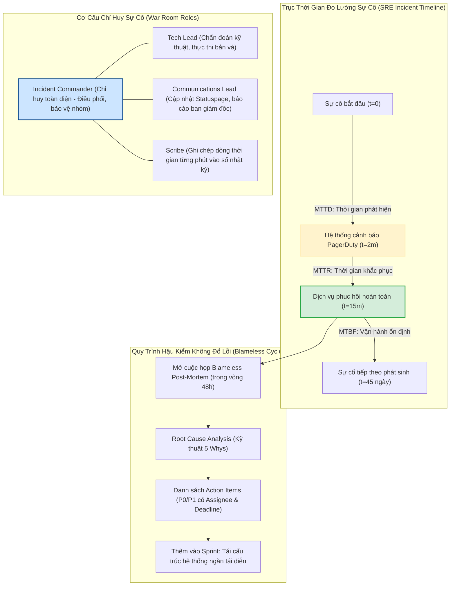
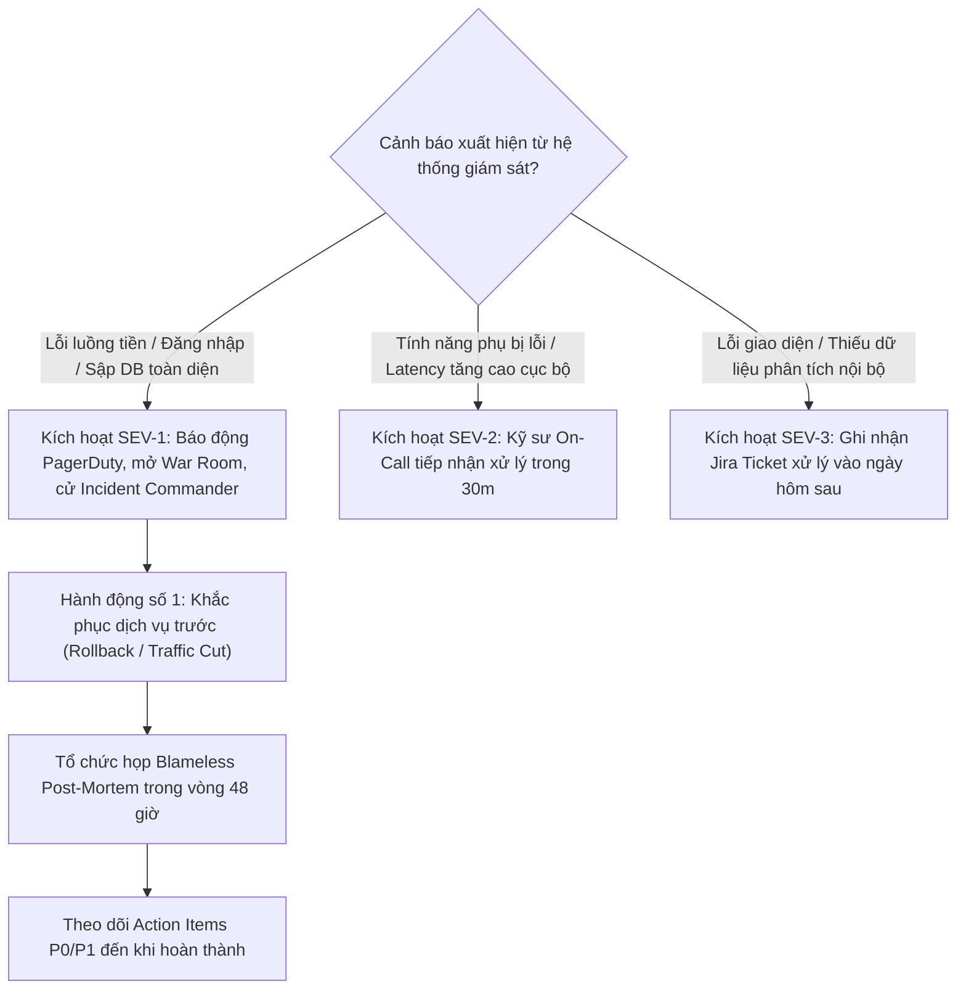

# 13.3. Quản Trị Sự Cố và Hậu Kiểm Không Đổ Lỗi (Incident Management & Blameless Post-Mortem)

> [!IMPORTANT]
> **Nếu bạn chỉ được nhớ một điều duy nhất:** Sự cố trên Production là cơ hội học tập đắt giá nhất của một tổ chức kỹ nghệ; một văn hóa kỹ thuật đỉnh cao không bao giờ tìm kiếm một cá nhân để trừng phạt hay sa thải, mà thực thi **Hậu kiểm Không Đổ Lỗi (Blameless Post-Mortem) kết hợp Phân tích Nguyên nhân Gốc rễ (Root Cause Analysis - 5 Whys)** để tái cấu trúc hệ thống và quy trình, biến việc tái phạm sai lầm đó thành điều bất khả thi về mặt kỹ thuật.

---

## 1. Kiến trúc Tổng quan & Mô hình Tư duy (Mental Model)

### 1.1. Phép loại suy thực tế: Hộp Đen Hàng Không (NTSB) và Đội Cứu Hỏa Hiện Trường
Để thấu hiểu bản chất của quản trị sự cố và văn hóa hậu kiểm không đổ lỗi, hãy quan sát hai ngành công nghiệp có mức độ an toàn cao nhất nhân loại:

1. **Hộp đen máy bay và Ủy ban An toàn Giao thông Quốc gia Hoa Kỳ (NTSB)**:
   - Khi một chiếc máy bay gặp nạn, các điều tra viên NTSB không bao giờ mở cuộc họp báo để chửi bới hay đổ lỗi: *"Do cơ trưởng gạt nhầm cần lái"*.
   - Triết lý hàng không giả định rằng: **Con người luôn hành động hợp lý nhất dựa trên lượng thông tin họ có tại thời điểm đó**. Nếu cơ trưởng gạt nhầm cần gạt, câu hỏi kỹ thuật phải là:
     - *Tại sao cần gạt bánh đáp lại được đặt ngay cạnh cần gạt cánh tà mà không có gờ ngăn cách?*
     - *Tại sao hệ thống cảnh báo âm thanh không vang lên trước khi máy bay chạm đất?*
     - *Tại sao tài liệu huấn luyện bay không mô phỏng kịch bản thời tiết cực đoan này?*
   - Toàn bộ ngành hàng không sau đó cải tiến thiết kế buồng lái và cập nhật quy chuẩn bay cho toàn thế giới. Nhờ văn hóa "hậu kiểm không đổ lỗi" này, hàng không đã trở thành phương tiện di chuyển an toàn nhất hành tinh.

2. **Cơ cấu Đội Cứu Hỏa Hiện Trường (Incident Command System - ICS)**:
   - Khi một tòa nhà bốc cháy, người đội trưởng chỉ huy (**Incident Commander - IC**) tuyệt đối không cầm vòi xịt nước xông vào biển lửa. Nếu người chỉ huy lao vào dập lửa, họ sẽ bị mất tầm nhìn toàn cảnh.
   - Vai trò của IC là đứng ở ngoài quan sát, thiết lập trạm chỉ huy, điều phối các mũi cứu hỏa, giữ liên lạc với bệnh viện và bảo vệ các chiến sĩ cứu hỏa khỏi nguy cơ sập mái. Trong kỹ nghệ phần mềm, IC đóng vai trò tương tự để các kỹ sư chuyên môn toàn tâm toàn ý giải cứu hệ thống.



---

## 2. Chi tiết từng Keyword (Under-the-Hood Deep Dive)

### 2.1. Incident Metrics: MTBF, MTTD, MTTR & Blast Radius
Hệ thống vận hành phân tán được đo lường độ tin cậy thông qua 4 chỉ số vàng của kỹ nghệ SRE:

1. **MTTD (Mean Time to Detect - Thời gian trung bình để phát hiện sự cố)**:
   - Khoảng thời gian từ lúc một bug xuất hiện hoặc một máy chủ bị sập cho đến khi hệ thống giám sát phát hiện và gửi cảnh báo tới kỹ sư trực ca.
   - *Mục tiêu kỹ thuật*: MTTD $\le 2\text{ phút}$. Đạt được thông qua hệ thống cảnh báo tự động đo lường tỷ lệ lỗi HTTP 5xx, p99 latency và biến động lưu lượng (Prometheus / Datadog).
2. **MTTR (Mean Time to Resolve / Restore - Thời gian trung bình để khôi phục)**:
   - Khoảng thời gian tính từ khi kỹ sư tiếp nhận cảnh báo cho đến khi dịch vụ được phục hồi về trạng thái phục vụ bình thường cho khách hàng.
   - *Nguyên tắc cốt lõi*: Trong lúc sự cố đang diễn ra, **mục tiêu duy nhất là khôi phục dịch vụ nhanh nhất (Mitigate first)** thông qua Rollback, ngắt cờ tính năng (Feature Flag), hoặc cắt lưu lượng (Traffic Shedding); tuyệt đối không cố gắng ngồi debug tìm root cause ngay giữa lúc dầu sôi lửa bỏng.
3. **MTBF (Mean Time Between Failures - Thời gian trung bình giữa các lần hỏng hóc)**:
   - Thước đo độ ổn định dài hạn của hệ thống. Khoảng thời gian mà hệ thống vận hành liên tục không có lỗi nghiêm trọng.
   - *Công thức*: $\text{Availability} = \frac{\text{MTBF}}{\text{MTBF} + \text{MTTR}}$.
4. **Blast Radius (Bán kính ảnh hưởng / Vùng nổ)**:
   - Phạm vi tối đa mà một sự cố có thể gây thiệt hại.
   - Một kiến trúc phân tán xuất sắc sử dụng **Kiến trúc Tế bào (Cell-based Architecture)** hoặc Phân vùng người dùng (Sharding) để bảo đảm: Nếu một Database Shard bị hỏng, nó chỉ ảnh hưởng tới $2\%$ người dùng, $98\%$ người dùng còn lại hoàn toàn không bị ảnh hưởng (Blast Radius siêu nhỏ).

### 2.2. Incident Response Workflow & Triage (Phân loại sự cố)
Một quy trình ứng cứu sự cố chuyên nghiệp phân loại mức độ nghiêm trọng (Severity Levels) rõ ràng để kích hoạt mức độ phản ứng tương ứng:
- **SEV-1 (Critical Outage - Thảm họa cấp cao nhất)**:
  - Hệ thống cốt lõi sập hoàn toàn (ví dụ: Khách hàng không thể đăng nhập hoặc thanh toán). Doanh thu bị tổn thất từng phút.
  - *Hành động*: Kích hoạt chuông báo động PagerDuty cho toàn bộ đội On-Call bất kể ngày đêm, lập War Room khẩn cấp, cập nhật trang Statuspage công khai sau mỗi 15 phút.
- **SEV-2 (Major Degradation - Suy giảm nghiêm trọng)**:
  - Một tính năng quan trọng bị hỏng nhưng có giải pháp thay thế tạm thời, hoặc hiệu năng hệ thống bị suy giảm nghiêm trọng cho một tập khách hàng lớn.
  - *Hành động*: Kỹ sư trực ca xử lý trong vòng 30 phút, thông báo nội bộ cho các bên liên quan.
- **SEV-3 (Minor Defect - Sự cố cục bộ nhỏ)**:
  - Lỗi giao diện người dùng, lỗi hiển thị thống kê không ảnh hưởng tới luồng tiền hoặc luồng giao dịch chính.
  - *Hành động*: Ghi nhận ticket và đưa vào kế hoạch xử lý trong giờ làm việc hành chính bình thường.

### 2.3. On-Call Rotation & Alert Hygiene (Trực ca kỹ thuật)
- **On-Call Rotation (Lịch trực ca luân phiên)**:
  - Các kỹ sư luân phiên trực ca 24/7 (thông qua PagerDuty hoặc Opsgenie) trong thời gian 1 tuần để tiếp nhận cảnh báo khẩn cấp. Phân chia rõ ràng giữa **Primary On-Call** (người tiếp nhận đầu tiên) và **Secondary On-Call** (người bọc lót nếu Primary không phản hồi sau 5 phút).
- **Alert Hygiene & Alert Fatigue (Hội chứng kiệt quệ vì cảnh báo rác)**:
  - Nếu hệ thống gửi hàng nghìn cảnh báo mỗi ngày về những lỗi nhỏ nhặt không cần hành động (ví dụ: "CPU chạm ngưỡng 85% trong 10 giây"), kỹ sư sẽ bị tê liệt nhận thức, tắt chuông điện thoại, và bỏ lỡ cảnh báo SEV-1 thực sự khi nó xảy ra.
  - **Quy tắc vàng của Google SRE**: **Chỉ dựng chuông cảnh báo PagerDuty cho những sự cố có tính hành động ngay lập tức (Actionable Alerts)** và có ảnh hưởng trực tiếp tới trải nghiệm người dùng (Symptoms/SLO), tuyệt đối không cảnh báo trên nguyên nhân suy đoán (Causes).

### 2.4. Incident Commander (IC) & Role Specialization
Khi một sự cố SEV-1 bùng phát, hệ thống ứng phó chia thành 4 vai trò chuyên trách trong War Room:
1. **Incident Commander (IC - Chỉ huy trưởng sự cố)**:
   - Người nắm quyền sinh sát tối cao trong War Room. IC điều phối cuộc họp, phân công nhiệm vụ, bảo vệ các kỹ sư kỹ thuật khỏi áp lực của ban giám đốc, và đưa ra quyết định cuối cùng (ví dụ: Quyết định có nên Rollback cơ sở dữ liệu hay không).
2. **Technical Lead (Trưởng nhóm kỹ thuật)**:
   - Kỹ sư giàu kinh nghiệm nhất trực tiếp lãnh đạo công tác điều tra kỹ thuật, phân tích logs, metrics và thực thi các biện pháp khắc phục.
3. **Communications Lead (Trưởng nhóm truyền thông)**:
   - Phụ trách luồng thông tin ra bên ngoài: Viết thông báo cập nhật lên trang Statuspage cho hàng triệu khách hàng, trả lời câu hỏi của bộ phận Chăm sóc khách hàng (CS) và Ban giám đốc.
4. **Scribe (Thư ký sự cố)**:
   - Ghi lại dòng thời gian chi tiết từng phút: Ai đã làm gì, lệnh gì đã được gõ trên production, lúc nào lưu lượng phục hồi. Nhật ký này là tài liệu vô giá cho buổi họp Post-Mortem.

### 2.5. Disaster Recovery (DR): RTO & RPO
- **Khôi phục sau thảm họa (Disaster Recovery)**: Kế hoạch ứng phó khi toàn bộ một trung tâm dữ liệu hoặc một AWS Region bị phá hủy hoàn toàn (động đất, hỏa hoạn, đứt cáp quang biển).
- **Hai chỉ số cốt tử**:
  1. **RTO (Recovery Time Objective - Thời hạn khôi phục tối đa)**:
     - Thời gian tối đa cho phép để toàn bộ hệ thống được dựng lại và chạy bình thường tại một Data Center dự phòng (ví dụ: $\text{RTO} = 2\text{ giờ}$).
  2. **RPO (Recovery Point Objective - Giới hạn mất mát dữ liệu tối đa)**:
     - Lượng dữ liệu tối đa mà doanh nghiệp chấp nhận bị mất mát vĩnh viễn (tính theo khoảng thời gian đồng bộ snapshot sao lưu cuối cùng, ví dụ: $\text{RPO} = 15\text{ phút}$).
- **Chaos Engineering & GameDays (Diễn tập hỗn loạn)**:
  - Một kế hoạch DR nằm trên giấy là một kế hoạch vô dụng. Các công ty hàng đầu định kỳ tổ chức các buổi **GameDay** (hoặc sử dụng công cụ Chaos Monkey): Chủ động "giết" một Data Center trên Production vào ban ngày để kiểm tra xem hệ thống có tự động Failover đúng như cam kết RTO/RPO hay không.

### 2.6. The Blameless Post-Mortem (Hậu kiểm không đổ lỗi)
- **Nguồn gốc triết học**: Được khởi xướng bởi John Allspaw (Etsy) và chuẩn hóa trong cuốn sách Google SRE.
- **Nguyên tắc nền tảng**:
  - **Loại bỏ hoàn toàn tư duy trừng phạt cá nhân**. Nếu kỹ sư Bob gõ nhầm lệnh `DROP DATABASE` làm sập Production, câu hỏi không phải là *"Tại sao Bob lại bất cẩn như vậy và trừ lương Bob bao nhiêu?"*.
  - Câu hỏi đúng phải là:
    - *Tại sao tài khoản của Bob lại có quyền gõ lệnh `DROP DATABASE` trực tiếp trên Production?*
    - *Tại sao công cụ CLI không yêu cầu phê duyệt từ 2 người (Two-Person Integrity Rule)?*
    - *Tại sao hệ thống cơ sở dữ liệu không tự động ngăn chặn các lệnh DROP TABLE thiếu cờ xác nhận?*
- **Tâm lý học an toàn (Psychological Safety)**:
  - Nếu kỹ sư sợ bị sa thải khi phạm lỗi, họ sẽ giấu giếm sự cố, sửa chữa lén lút, hoặc đổ lỗi cho người khác. Khi có môi trường an toàn tâm lý, kỹ sư sẽ dũng cảm công khai mọi sai lầm để cả tổ chức cùng học hỏi và vá lỗ hổng hệ thống.

### 2.7. Root Cause Analysis (RCA) & Kỹ Thuật 5 Whys
- **Kỹ thuật 5 Whys (5 Lần Tại Sao - Sakichi Toyoda)**:
  - Phương pháp đào sâu qua các lớp triệu chứng bề mặt để chạm tới **Nguyên nhân gốc rễ ở tầng kiến trúc hoặc quy trình**.

#### Ví dụ Phân tích 5 Whys Thực Chiến Trong Post-Mortem Kỹ Nghệ
> 1. *Tại sao trang web sập lúc 14:00?* $\to$ Vì cơ sở dữ liệu PostgreSQL bị cạn kiệt toàn bộ Connection Pool.
> 2. *Tại sao connection pool bị cạn kiệt?* $\to$ Vì có một câu query SQL mất tới 40 giây để thực thi, chiếm giữ toàn bộ kết nối.
> 3. *Tại sao câu query đó lại mất 40 giây?* $\to$ Vì bảng `transactions` vừa vượt mốc 50 triệu dòng và truy vấn phải thực hiện Full Table Scan.
> 4. *Tại sao bảng 50 triệu dòng lại phải Full Table Scan?* $\to$ Vì thiếu Index trên cột `merchant_id`.
> 5. *Tại sao thiếu Index lại có thể lọt lên Production?* $\to$ **NGUYÊN NHÂN GỐC RỄ (ROOT CAUSE)**: Vì quy trình CI/CD thiếu bước linter tự động kiểm tra giải thích kế hoạch truy vấn (`EXPLAIN ANALYZE`) trên dữ liệu giả lập quy mô lớn trước khi deploy!

### 2.8. Action Items (Biện pháp khắc phục bắt buộc)
- Một tài liệu Post-Mortem không có Action Items cụ thể thì chỉ là một bài tập làm văn vô nghĩa.
- Mỗi Action Item bắt buộc phải có:
  - **Mức độ ưu tiên**: P0 (phải làm ngay trong tuần) hoặc P1 (hoàn thành trong Sprint tiếp theo).
  - **Người chịu trách nhiệm duy nhất (Single Owner)**.
  - **Thời hạn hoàn thành (Deadline)**.
  - **Cơ chế xác minh**: Biến lỗi đó thành một bài kiểm thử tự động (Regression Test) trong CI Pipeline để bảo đảm lỗi đó **vĩnh viễn không bao giờ có cơ hội tái diễn**.

---

## 3. Thực thi Mã nguồn & Mô phỏng Chuyên sâu (Dual-Engine Implementation)

### 3.1. Động cơ C++20: Real-time SRE Incident Telemetry & Metric Engine

Chương trình C++20 dưới đây mô phỏng một **Hệ Thống Đo Lường Sự Cố Thời Gian Thực**:
- Thu thập luồng sự kiện vận hành và tính toán chính xác các chỉ số SRE: MTTD, MTTR, MTBF.
- Tự động phát hiện vi phạm SLO và leo thang cảnh báo SEV-1.

```cpp
#include <iostream>
#include <string>
#include <vector>
#include <chrono>
#include <numeric>
#include <iomanip>

namespace sre_telemetry {

struct IncidentRecord {
    std::string incident_id;
    std::string title;
    int severity; // 1 = SEV-1, 2 = SEV-2, 3 = SEV-3
    std::chrono::system_clock::time_point start_time;
    std::chrono::system_clock::time_point detected_time;
    std::chrono::system_clock::time_point resolved_time;

    // MTTD: Thời gian phát hiện (Phút)
    double getMTTDMinutes() const {
        auto dur = std::chrono::duration_cast<std::chrono::seconds>(detected_time - start_time);
        return dur.count() / 60.0;
    }

    // MTTR: Thời gian khôi phục (Phút)
    double getMTTRMinutes() const {
        auto dur = std::chrono::duration_cast<std::chrono::seconds>(resolved_time - detected_time);
        return dur.count() / 60.0;
    }

    // Tổng thời gian gián đoạn (Downtime Phút)
    double getTotalDowntimeMinutes() const {
        auto dur = std::chrono::duration_cast<std::chrono::seconds>(resolved_time - start_time);
        return dur.count() / 60.0;
    }
};

class IncidentAnalyticsEngine {
private:
    std::vector<IncidentRecord> incidents_;

public:
    void logIncident(IncidentRecord incident) {
        incidents_.push_back(std::move(incident));
    }

    double calculateAverageMTTD() const {
        if (incidents_.empty()) return 0.0;
        double total = 0.0;
        for (const auto& inc : incidents_) total += inc.getMTTDMinutes();
        return total / incidents_.size();
    }

    double calculateAverageMTTR() const {
        if (incidents_.empty()) return 0.0;
        double total = 0.0;
        for (const auto& inc : incidents_) total += inc.getMTTRMinutes();
        return total / incidents_.size();
    }

    // MTBF: Thời gian trung bình giữa các lần hỏng (Giờ)
    double calculateMTBFHours(double total_system_operating_hours) const {
        if (incidents_.empty()) return total_system_operating_hours;
        double total_downtime_hours = 0.0;
        for (const auto& inc : incidents_) total_downtime_hours += (inc.getTotalDowntimeMinutes() / 60.0);
        double uptime_hours = total_system_operating_hours - total_downtime_hours;
        return uptime_hours / incidents_.size();
    }

    void generateTelemetryReport(double operating_hours) const {
        std::cout << "\n=======================================================\n";
        std::cout << ">>> SRE INCIDENT METRICS & RELIABILITY DASHBOARD <<<\n";
        std::cout << "=======================================================\n";
        std::cout << std::left << std::setw(12) << "ID"
                  << std::setw(8) << "SEV"
                  << std::setw(12) << "MTTD (min)"
                  << std::setw(12) << "MTTR (min)"
                  << "Title" << "\n";
        std::cout << "-------------------------------------------------------\n";

        for (const auto& inc : incidents_) {
            std::cout << std::left << std::setw(12) << inc.incident_id
                      << "SEV-" << std::setw(4) << inc.severity
                      << std::setw(12) << std::fixed << std::setprecision(1) << inc.getMTTDMinutes()
                      << std::setw(12) << inc.getMTTRMinutes()
                      << inc.title << "\n";
        }
        std::cout << "-------------------------------------------------------\n";
        std::cout << "Average MTTD (Detection):  \033[36m" << calculateAverageMTTD() << " minutes\033[0m\n";
        std::cout << "Average MTTR (Resolution): \033[32m" << calculateAverageMTTR() << " minutes\033[0m\n";
        std::cout << "Estimated MTBF:            \033[33m" << calculateMTBFHours(operating_hours) << " hours\033[0m\n";
        
        double availability = (calculateMTBFHours(operating_hours) / (calculateMTBFHours(operating_hours) + (calculateAverageMTTR() / 60.0))) * 100.0;
        std::cout << "System Availability:       \033[1m" << std::setprecision(3) << availability << "%\033[0m\n\n";
    }
};

} // namespace sre_telemetry

int main() {
    using namespace sre_telemetry;

    IncidentAnalyticsEngine engine;
    auto now = std::chrono::system_clock::now();

    // Giả lập Sự cố 1: Connection Pool Exhaustion (Phát hiện sau 2m, sửa trong 12m)
    engine.logIncident({
        "INC-2026-01",
        "PostgreSQL Connection Pool Exhausted",
        1,
        now - std::chrono::minutes(120),
        now - std::chrono::minutes(118),
        now - std::chrono::minutes(106)
    });

    // Giả lập Sự cố 2: Kafka Consumer Lag Spike (Phát hiện sau 3m, sửa trong 8m)
    engine.logIncident({
        "INC-2026-02",
        "Kafka Consumer Group Rebalance Loop",
        2,
        now - std::chrono::minutes(60),
        now - std::chrono::minutes(57),
        now - std::chrono::minutes(49)
    });

    // Giả lập Sự cố 3: Memory Leak in AI Image Service (Phát hiện sau 5m, sửa trong 15m)
    engine.logIncident({
        "INC-2026-03",
        "OOMKilled Pod Crash in Image Resize",
        1,
        now - std::chrono::minutes(30),
        now - std::chrono::minutes(25),
        now - std::chrono::minutes(10)
    });

    // Xuất báo cáo cho 720 giờ hoạt động (1 tháng)
    engine.generateTelemetryReport(720.0);

    return 0;
}
```

---

### 3.2. Động cơ Python 3.11+: Automated Incident Management & Blameless Post-Mortem Exporter

Chương trình Python 3.11+ dưới đây mô phỏng một **Hệ Thống Quản Trị Vòng Đời Sự Cố Tự Động**:
- Điều phối các vai trò: Incident Commander, Tech Lead, Communications Lead.
- Phân tích nguyên nhân gốc rễ theo kỹ thuật **5 Whys Analysis**.
- Tự động biên soạn và xuất bản tài liệu **Blameless Post-Mortem** chuẩn mực Markdown.

```python
#!/usr/bin/env python3
"""
Production Incident Management & Blameless Post-Mortem Generator (Python 3.11+)
Bảo đảm tính minh bạch, an toàn tâm lý và cải tiến hệ thống liên tục.
"""

from __future__ import annotations
import dataclasses
import enum
import time
from typing import List, Dict, Optional


class Severity(enum.Enum):
    SEV1 = "SEV-1 (Critical Outage)"
    SEV2 = "SEV-2 (Major Degradation)"
    SEV3 = "SEV-3 (Minor Defect)"


@dataclasses.dataclass(frozen=True)
class ActionItem:
    priority: str          # P0, P1, P2
    description: str       # Công việc kỹ thuật cụ thể
    owner: str             # Người chịu trách nhiệm duy nhất
    deadline: str          # Thời hạn hoàn thành
    preventative: bool     # Có tính chất ngăn ngừa tái diễn


@dataclasses.dataclass
class PostMortemDocument:
    incident_id: str
    title: str
    severity: Severity
    incident_commander: str
    tech_lead: str
    scribe: str
    start_time: str
    resolved_time: str
    total_downtime_minutes: int
    impact_summary: str
    five_whys: List[str]
    root_cause: str
    action_items: List[ActionItem]

    def export_markdown(self) -> str:
        whys_formatted = "\n".join([f"{i+1}. {w}" for i, w in enumerate(self.five_whys)])
        actions_table = "\n".join([
            f"| `{a.priority}` | {a.description} | **{a.owner}** | `{a.deadline}` | {'✅' if a.preventative else 'ℹ️'} |"
            for a in self.action_items
        ])

        return f"""# Blameless Post-Mortem: {self.title}

> **Incident ID:** `{self.incident_id}` | **Severity:** {self.severity.value}  
> **Incident Commander:** {self.incident_commander} | **Tech Lead:** {self.tech_lead} | **Scribe:** {self.scribe}  
> **Duration:** {self.start_time} - {self.resolved_time} ({self.total_downtime_minutes} minutes)

---

## 1. Executive Summary & Blast Radius Impact
{self.impact_summary}

---

## 2. Root Cause Analysis (5 Whys Technique)
{whys_formatted}

**Identified Root Cause:**
> {self.root_cause}

---

## 3. Preventative Action Items (Never Happen Again)
| Priority | Action Item Description | Owner | Target Date | Preventative |
| :---: | :--- | :--- | :---: | :---: |
{actions_table}

---
*Authored with psychological safety under Google SRE Blameless Post-Mortem standards.*
"""


class IncidentCommandCoordinator:
    def __init__(self, incident_id: str, title: str, sev: Severity, ic: str, tl: str, scribe: str):
        self.doc = PostMortemDocument(
            incident_id=incident_id,
            title=title,
            severity=sev,
            incident_commander=ic,
            tech_lead=tl,
            scribe=scribe,
            start_time="2026-11-16 14:00:00 UTC",
            resolved_time="2026-11-16 14:18:00 UTC",
            total_downtime_minutes=18,
            impact_summary="4,200 checkout transactions failed with HTTP 500 errors. Estimated revenue impact: $18,500. 100% restored after DB index application.",
            five_whys=[],
            root_cause="",
            action_items=[]
        )

    def record_5_whys(self, whys: List[str], root_cause: str) -> None:
        self.doc.five_whys = whys
        self.doc.root_cause = root_cause

    def add_action_item(self, item: ActionItem) -> None:
        self.doc.action_items.append(item)

    def publish_post_mortem(self) -> str:
        return self.doc.export_markdown()


def main():
    coordinator = IncidentCommandCoordinator(
        incident_id="INC-8891-PROD",
        title="Production Checkout API Outage due to Connection Pool Starvation",
        sev=Severity.SEV1,
        ic="Alice Nguyen (Staff SRE)",
        tl="Bob Chen (Principal DB Architect)",
        scribe="Charlie Smith (DevOps Lead)"
    )

    # 1. Ghi lại phân tích 5 Whys
    coordinator.record_5_whys(
        whys=[
            "Tại sao Checkout API trả về HTTP 500? -> Do PostgreSQL Connection Pool cạn kiệt toàn bộ 200 connections.",
            "Tại sao Connection Pool cạn kiệt? -> Do một câu SQL query chạy mất 40 giây, khóa chặt kết nối.",
            "Tại sao query mất tới 40 giây? -> Bảng orders vượt 60 triệu dòng, query phải thực hiện Sequential Scan.",
            "Tại sao phải Sequential Scan? -> Thiếu B-Tree Index trên cột merchant_id trong truy vấn lọc mới.",
            "Tại sao thiếu Index lại lên được Production? -> CI Pipeline thiếu bước linter tự động chặn query thiếu index."
        ],
        root_cause="Hạ tầng CI/CD thiếu chốt chặn tự động phân tích chi phí truy vấn (Query Cost Analysis) trước khi phát hành mã nguồn mới."
    )

    # 2. Đăng ký các Action Items bắt buộc
    coordinator.add_action_item(ActionItem(
        priority="P0",
        description="Thêm linter tự động kiểm tra 'EXPLAIN' trên mọi câu query SQL mới vào CI Pipeline",
        owner="Bob Chen",
        deadline="2026-11-20",
        preventative=True
    ))
    coordinator.add_action_item(ActionItem(
        priority="P0",
        description="Cài đặt Statement Timeout 3000ms trên cơ sở dữ liệu để chống treo kết nối dài hạn",
        owner="Alice Nguyen",
        deadline="2026-11-18",
        preventative=True
    ))
    coordinator.add_action_item(ActionItem(
        priority="P1",
        description="Xây dựng bảng điều khiển Grafana giám sát tỷ lệ sử dụng Connection Pool với cảnh báo ở mức 80%",
        owner="Charlie Smith",
        deadline="2026-11-25",
        preventative=False
    ))

    # 3. Xuất tài liệu Markdown
    markdown_report = coordinator.publish_post_mortem()
    print(markdown_report)


if __name__ == "__main__":
    main()
```

---

### 3.3. Terminal Output Thực Tế Giả Lập

```text
# Blameless Post-Mortem: Production Checkout API Outage due to Connection Pool Starvation

> **Incident ID:** `INC-8891-PROD` | **Severity:** SEV-1 (Critical Outage)  
> **Incident Commander:** Alice Nguyen (Staff SRE) | **Tech Lead:** Bob Chen (Principal DB Architect) | **Scribe:** Charlie Smith (DevOps Lead)  
> **Duration:** 2026-11-16 14:00:00 UTC - 2026-11-16 14:18:00 UTC (18 minutes)

---

## 1. Executive Summary & Blast Radius Impact
4,200 checkout transactions failed with HTTP 500 errors. Estimated revenue impact: $18,500. 100% restored after DB index application.

---

## 2. Root Cause Analysis (5 Whys Technique)
1. Tại sao Checkout API trả về HTTP 500? -> Do PostgreSQL Connection Pool cạn kiệt toàn bộ 200 connections.
2. Tại sao Connection Pool cạn kiệt? -> Do một câu SQL query chạy mất 40 giây, khóa chặt kết nối.
3. Tại sao query mất tới 40 giây? -> Bảng orders vượt 60 triệu dòng, query phải thực hiện Sequential Scan.
4. Tại sao phải Sequential Scan? -> Thiếu B-Tree Index trên cột merchant_id trong truy vấn lọc mới.
5. Tại sao thiếu Index lại lên được Production? -> CI Pipeline thiếu bước linter tự động chặn query thiếu index.

**Identified Root Cause:**
> Hạ tầng CI/CD thiếu chốt chặn tự động phân tích chi phí truy vấn (Query Cost Analysis) trước khi phát hành mã nguồn mới.

---

## 3. Preventative Action Items (Never Happen Again)
| Priority | Action Item Description | Owner | Target Date | Preventative |
| :---: | :--- | :--- | :---: | :---: |
| `P0` | Thêm linter tự động kiểm tra 'EXPLAIN' trên mọi câu query SQL mới vào CI Pipeline | **Bob Chen** | `2026-11-20` | ✅ |
| `P0` | Cài đặt Statement Timeout 3000ms trên cơ sở dữ liệu để chống treo kết nối dài hạn | **Alice Nguyen** | `2026-11-18` | ✅ |
| `P1` | Xây dựng bảng điều khiển Grafana giám sát tỷ lệ sử dụng Connection Pool với cảnh báo ở mức 80% | **Charlie Smith** | `2026-11-25` | ℹ️ |

---
*Authored with psychological safety under Google SRE Blameless Post-Mortem standards.*
```

---

## 4. Systems Engineering & Production Pitfalls

### 4.1. Production Failure Modes trong Quản Trị Sự Cố

1. **Văn hóa Đổ Lỗi (The Blame Game Catastrophe)**:
   - *Bản chất*: Ban lãnh đạo tìm một lập trình viên để khiển trách, phạt tiền hoặc sa thải khi xảy ra lỗi nghiêm trọng.
   - *Hậu quả hủy diệt*: Kỹ sư sẽ bắt đầu che giấu sự cố, trì hoãn thông báo cho cấp trên, đổ vấy trách nhiệm cho phòng ban khác. Sự cố thay vì được khắc phục trong 15 phút sẽ kéo dài hàng ngày trong bóng tối.
   - *Khắc phục*: Ban lãnh đạo cấp cao phải cam kết thực thi văn hóa Blameless Post-Mortem và khen ngợi các kỹ sư dũng cảm công khai sai sót.

2. **War Room Hỗn Loạn do Thiếu Incident Commander**:
   - *Bản chất*: Khi sự cố SEV-1 nổ ra, 50 người cùng nhảy vào kênh họp (kỹ sư, giám đốc sản phẩm, marketing, CSKH). Mọi người cùng la hét, tranh cãi và đặt câu hỏi dồn dập khiến các kỹ sư đang debug bị phân tâm hoàn toàn.
   - *Khắc phục*: Thiết lập vai trò **Incident Commander (IC)** độc tài tích cực. Chỉ có IC và Tech Lead được nói về mặt kỹ thuật; Communications Lead sẽ tạo một kênh riêng để thông báo cho các bên liên quan ngoài War Room.

3. **Tài liệu Post-Mortem Hình Thức (Action Items Bị Lãng Quên)**:
   - *Bản chất*: Viết tài liệu Post-Mortem rất hay và chỉn chu, nhưng các Action Items không bao giờ được đưa vào Jira Sprint và không ai theo dõi tiến độ.
   - *Hậu quả*: Ba tháng sau, chính sự cố đó lại xảy ra y hệt, gây thiệt hại hàng triệu đô la lần thứ hai.
   - *Khắc phục*: Quy định chính sách SRE nghiêm ngặt: Nếu một nhóm còn tồn đọng Action Item P0 của sự cố trước, **nhóm đó bị phong tỏa việc phát triển tính năng mới (Feature Freeze)** cho đến khi hoàn thành xong Action Item đó.

---

## 5. Bảng So sánh & Decision Matrix

### 5.1. Bảng ma trận phân loại mức độ nghiêm trọng của sự cố (Severity Matrix)

| Tiêu Chí Đánh Giá | SEV-1 (Critical) | SEV-2 (Major) | SEV-3 (Minor) |
| :--- | :--- | :--- | :--- |
| **Tác động người dùng** | Toàn bộ hoặc $>20\%$ người dùng | Nhóm thiểu số ($<20\%$) | Cực nhỏ, không chặn luồng chính |
| **Mức độ phản ứng** | Ngay lập tức $24/7$ (chuông reo) | Trong vòng 15-30 phút | Trong giờ làm việc bình thường |
| **Cơ chế kích hoạt** | Mở War Room + Điều động IC | Kỹ sư trực ca xử lý | Tạo Issue/Ticket thông thường |
| **Tần suất cập nhật Status** | Sau mỗi 15-30 phút | Sau mỗi 1-2 giờ | Khi xử lý xong |
| **Yêu cầu Post-Mortem** | **Bắt buộc tổ chức trong 48h** | Khuyến nghị thực hiện | Không bắt buộc |

### 5.2. Decision Matrix: Khi nào cần kích hoạt quy trình ứng phó khẩn cấp?


