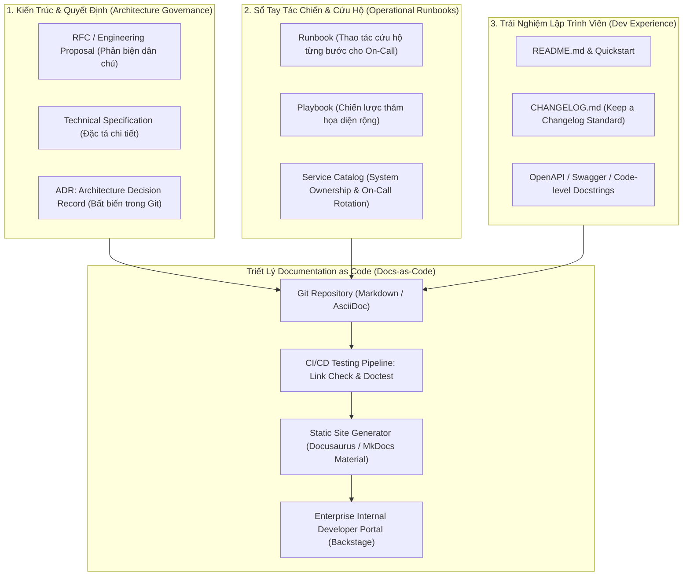
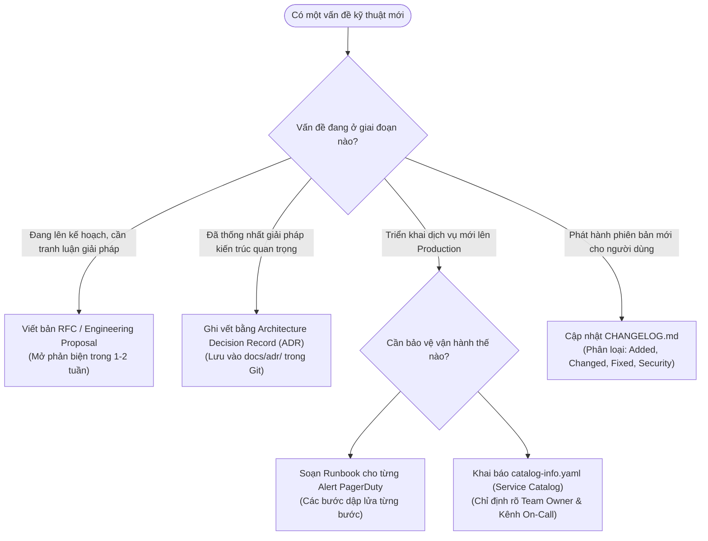

# 14.1. Kỹ Nghệ Tài Liệu Hóa và Quản Trị Tri Thức (Software Documentation & Knowledge Management)

> [!IMPORTANT]
> **Nếu bạn chỉ được nhớ một điều duy nhất:** Tài liệu kỹ thuật không phải là việc làm thủ tục sau khi viết code, mà là **một tài sản kỹ thuật sống (Living Technical Asset) được quản trị theo triết lý Docs-as-Code** — mọi quyết định kiến trúc lớn phải được phản biện qua RFC và ghi vết bất biến bằng ADR trong Git, mọi cảnh báo lúc 3 giờ sáng phải có Runbook thao tác từng bước, và mọi đoạn code mẫu trong tài liệu phải được kiểm thử tự động qua CI/CD để triệt tiêu hiện tượng thối rữa tài liệu (Documentation Rot).

---

## 1. Kiến trúc Tổng quan & Mô hình Tư duy (Mental Model)

### Ẩn dụ Đời sống: Hàng Không Dân Dụng & Sổ Tay Vận Hành Buồng Lái (Flight Operations Manuals)
Hãy hình dung kỹ nghệ tài liệu phần mềm tương tự như hệ thống tài liệu cứu sinh của ngành Hàng không Quốc tế:
- **RFC (Bản Thiết Kế Mẫu Máy Bay Mới Trình Cục Hàng Không)**: Trước khi chế tạo thân vỏ Boeing hay Airbus, các kỹ sư trưởng trình bản đề xuất kỹ thuật (RFC). Mọi phi công, kỹ sư cơ khí, chuyên gia khí động học được tự do phản biện các giải pháp dự phòng và đánh đổi nhiên liệu.
- **ADR - Architecture Decision Record (Biên Bản Ghi Nhận Tại Sao Dùng Động Cơ Phản Lực Đôi)**: 10 năm sau, một kỹ sư trẻ thắc mắc: *"Tại sao không lắp 4 động cơ cho an toàn hơn?"*. Nhờ lật lại cuốn sổ ADR số 0042, kỹ sư hiểu ngay rằng năm 2016 đội ngũ đã quyết định dùng 2 động cơ để tối ưu chi phí bảo dưỡng và đã chứng minh được độ tin cậy ETOPS-330 qua thực nghiệm.
- **Runbook (Bảng Danh Mục Thao Tác Khẩn Cấp - Quick Reference Handbook)**: Khi động cơ số 1 bốc cháy ở độ cao 10,000 mét, phi công không có thời gian đọc sách giáo khoa lý thuyết dài 500 trang. Họ mở ngay trang Runbook "Engine Fire In-Flight": Bước 1: Gạt cần ngắt nhiên liệu trái; Bước 2: Kéo chốt cứu hỏa số 1; Bước 3: Chờ 30 giây... Từng câu lệnh phải ngắn gọn, không thể hiểu sai, cứu sống toàn bộ máy bay.
- **Playbook (Kế Hoạch Khủng Hoảng Cấp Hãng Hàng Không)**: Khi toàn bộ hệ thống kiểm soát không lưu quốc gia bị tê liệt do bão tuyết, Playbook điều phối việc sơ tán hành khách, chuyển hướng bay sang sân bay dự bị, phát ngôn với báo chí và kích hoạt bảo hiểm.
- **Docs-as-Code (Quy Trình Kiểm Tra Kỹ Thuật Máy Bay Tự Động)**: Mọi trang tài liệu bay được in trên giấy chống nước, đánh số phiên bản, lưu trong tủ tài liệu buồng lái có niêm phong Git. Nếu có một trang bị rách hoặc thông tin áp suất lốp bị sai lệch, hệ thống kiểm thử tự động (CI/CD) sẽ lập tức báo còi và cấm máy bay cất cánh.



---

## 2. Chi tiết từng Keyword (Under-the-Hood Deep Dive)

### 2.1. Decision & Proposal Engineering: RFC, Technical Spec & ADR

#### 1. RFC (Request for Comments) & Engineering Proposal
- **Bản chất**: Văn hóa kỹ thuật dân chủ (xuất phát từ IETF và được hoàn thiện tại Google, Uber, Amazon, Netflix). Khi một kỹ sư muốn triển khai một kiến trúc mới (ví dụ: Chuyển đổi từ Monolith sang Event-Driven, thay đổi Database từ PostgreSQL sang Cassandra, hoặc thay thế REST bằng gRPC), kỹ sư đó **bắt buộc phải viết một tài liệu RFC**.
- **Cấu trúc cốt lõi của một bản RFC chuẩn mực**:
  1. *Context & Problem Statement*: Bài toán thực tế là gì? Tại sao giải pháp hiện tại không còn đáp ứng được?
  2. *Proposed Solution*: Mô hình kiến trúc đề xuất (có biểu đồ luồng dữ liệu).
  3. *Alternative Solutions Considered*: Liệt kê tối thiểu 2-3 giải pháp thay thế khác và lý do tại sao chúng bị loại bỏ.
  4. *Trade-offs & Constraints*: Đánh đổi về chi phí hạ tầng, độ trễ mạng, độ phức tạp vận hành và nhân sự.
  5. *Rollout & Deprecation Plan*: Kế hoạch triển khai phân pha, kế hoạch rollback khi thất bại.
- **Quy trình phản biện**: RFC được mở quyền bình luận (Google Docs / GitHub PR) cho toàn bộ tổ chức trong 1-2 tuần. Kỹ sư phải giải trình và trả lời thỏa đáng mọi câu hỏi trước khi được Architecture Board phê duyệt.

#### 2. Technical Specification (Tech Spec - Đặc Tả Kỹ Thuật)
- Tech Spec là bước hiện thực hóa sau khi RFC được duyệt: Chuyển đổi các ý tưởng kiến trúc cấp cao thành bản thiết kế thi công cụ thể:
  - Thiết kế Schema chi tiết (DDL SQL, chỉ mục Indexes).
  - Bản hợp đồng API (OpenAPI YAML hoặc Protobuf definitions).
  - Phân tích rủi ro an ninh mạng (Threat Modeling: STRIDE).
  - Dự toán chi phí tài nguyên Cloud (AWS/GCP Cost Estimation).

#### 3. Architecture Decision Record (ADR) & Decision Log
- **Vấn đề**: Sau 2 năm, khi đội ngũ kỹ sư ban đầu đã chuyển công tác, những kỹ sư mới đến thường thắc mắc: *"Tại sao hệ thống lại dùng Kafka thay vì RabbitMQ?"* hoặc *"Tại sao lại lưu tiền tệ dưới dạng số nguyên Cents thay vì số thực Float?"*. Nếu không có tài liệu, những người đến sau sẽ vô tình tái cấu trúc sai lầm và vấp phải chính những chiếc bẫy mà người đi trước đã tránh.
- **Cơ chế ADR (Michael Nygard format)**:
  - Mỗi quyết định quan trọng được lưu thành một file Markdown ngắn gọn trong thư mục `docs/adr/0001-use-postgresql-for-financial-ledger.md`.
  - **Trạng thái vòng đời của ADR**:
    - `Proposed`: Đang đề xuất thảo luận.
    - `Accepted`: Đã được chấp thuận và áp dụng vào mã nguồn.
    - `Rejected`: Đã bị từ chối sau phản biện.
    - `Deprecated`: Đã lỗi thời theo thời gian.
    - `Superseded`: Bị thay thế bởi một ADR mới hơn (ví dụ: ADR-0015 bị thay thế bởi ADR-0089).

---

### 2.2. Operational Documentation: Runbooks, Playbooks & System Ownership

#### 1. Runbook (Sổ Tay Cứu Hộ Cho Kỹ Sư Trực Ca On-Call)
- **Tâm lý học On-Call lúc 3 giờ sáng**: Khi chuông PagerDuty réo inh ỏi giữa đêm khuya, kỹ sư trực ca bị đánh thức trong trạng thái hốt hoảng, lượng cortisol trong máu tăng vọt, nhận thức logic suy giảm nghiêm trọng.
- **Tiêu chuẩn thiết kế một Runbook cứu sinh**:
  - Không viết văn xuôi dài dòng. Không giải thích triết lý.
  - Phải liên kết trực tiếp vào đường dẫn của Alert (`runbook_url` trong Prometheus / Datadog alert rule).
  - Cung cấp sẵn các câu lệnh Terminal chính xác (chỉ việc Copy-Paste).
  - Có 3 phần rõ ràng:
    1. *Quick Triage (Chẩn đoán 60 giây)*: Câu lệnh kiểm tra xem sự cố thật hay cảnh báo giả.
    2. *Mitigation Steps (Hạ nhiệt khẩn cấp)*: Các bước dập lửa ngay lập tức (Scale pod, bật cờ Feature Flag tắt tính năng lỗi, switch replica).
    3. *Escalation Path (Leo thang sự cố)*: Nếu quá 15 phút không khắc phục được, gọi điện trực tiếp cho ai kèm số điện thoại.

#### 2. Playbook (Kịch Bản Khủng Hoảng Cấp Cao)
- Khác với Runbook giải quyết một lỗi cụ thể, Playbook hướng dẫn xử lý khủng hoảng đa chiều liên quan đến nhiều phòng ban:
  - *Data Breach Incident Playbook*: Các bước cô lập máy chủ, giữ nguyên hiện trường RAM để điều tra pháp y (Forensics), liên hệ bộ phận Pháp chế (Legal) và chuẩn bị thông cáo báo chí trong vòng 72 giờ theo luật GDPR.
  - *Disaster Recovery (DR) Region Failover*: Kế hoạch chuyển toàn bộ lưu lượng của 200 microservices từ cụm `us-east-1` sang `us-west-2` khi AWS sập toàn diện.

#### 3. System Ownership & Service Catalog (Spotify Backstage)
- **Cơn ác mộng hệ thống vô chủ (Orphaned Services)**: Trong tổ chức có 500 microservices, một dịch vụ bị lỗi sập và không ai biết ai đã viết ra nó, repo Git nằm ở đâu, ai chịu trách nhiệm sửa chữa.
- **Service Catalog chuẩn mực**:
  Mỗi repo bắt buộc phải chứa file `catalog-info.yaml` (tiêu chuẩn Backstage):
  - `metadata.name`: Tên định danh dịch vụ.
  - `spec.owner`: Đội ngũ chịu trách nhiệm (`team-checkout-core`).
  - `spec.system`: Thuộc phân hệ kinh doanh nào.
  - `spec.lifecycle`: `production` hoặc `experimental`.
  - `links`: Đường dẫn tới Grafana Dashboard, Datadog SLOs, Sentry Error tracker, và Kênh Slack trực ban `#team-checkout-oncall`.

---

### 2.3. Modern Docs-as-Code: Keep a Changelog, README & Documentation Testing

#### 1. Triết Lý Docs-as-Code
- Tài liệu kỹ thuật được đối xử **bình đẳng như mã nguồn**:
  - *Ngôn ngữ văn bản thuần*: Viết bằng Markdown (`.md`) hoặc AsciiDoc (`.adoc`).
  - *Phiên bản hóa*: Lưu trữ cùng mã nguồn trong Git repository.
  - *Peer Review*: Mọi sửa đổi tài liệu đều phải tạo Pull Request và được đồng nghiệp thẩm định (Review).
  - *Tự động phát hành*: Khi merge vào nhánh `main`, pipeline CI/CD tự động build thành trang web tĩnh (Static Site Generator như Docusaurus, MkDocs Material, Hugo) và deploy lên môi trường nội bộ.

#### 2. Documentation Testing (Kiểm Thử Tài Liệu Tự Động)
- **Vấn đề thối rữa tài liệu (Documentation Rot)**: Code thay đổi liên tục nhưng tài liệu không được cập nhật. Kết quả là các đường link bị chết (404 Not Found), và các đoạn code mẫu trong tài liệu bị lỗi thời, gây ức chế cho các lập trình viên mới gia nhập.
- **Giải pháp kiểm thử tự động trong CI**:
  1. *Markdown Link Checker*: Tự động crawl toàn bộ các đường link nội bộ và ngoại vi trong tài liệu, fail pipeline nếu phát hiện link chết.
  2. *Doctest / Executable Code Snippets*: Sử dụng các công cụ như `doctest` (Python), `cargo test --doc` (Rust) để thực thi trực tiếp các đoạn code ví dụ nhúng trong Markdown. Nếu API đã đổi tham số mà code mẫu trong tài liệu chưa sửa, build pipeline sẽ báo đỏ ngay lập tức!

#### 3. Chuẩn Hóa Lịch Sử Thay Đổi Theo "Keep a Changelog" (v1.1.0)
- File `CHANGELOG.md` phải được định dạng cho con người đọc, phân loại rõ ràng theo Semantic Versioning (`MAJOR.MINOR.PATCH`):
  - `Added`: Các tính năng mới được bổ sung.
  - `Changed`: Các thay đổi trong chức năng hiện có.
  - `Deprecated`: Các tính năng sắp bị loại bỏ trong các phiên bản tương lai.
  - `Removed`: Các tính năng đã chính thức bị xóa bỏ.
  - `Fixed`: Các lỗi đã được sửa chữa.
  - `Security`: Các bản vá lỗ hổng an ninh mạng.

---

## 3. Thực thi Mã nguồn & Mô phỏng Chuyên sâu (Dual-Engine Implementation)

### 3.1. Phiên bản C++20: Bộ Công Cụ Tự Động Thẩm Định Tính Hợp Lệ Của ADR và Trạng Thái Vòng Đời

```cpp
#include <iostream>
#include <string>
#include <vector>
#include <format>
#include <regex>
#include <memory>
#include <chrono>
#include <sstream>

// ============================================================================
// 1. ADR DATA MODEL & LIFECYCLE STATUS
// ============================================================================
enum class AdrStatus {
    PROPOSED,
    ACCEPTED,
    REJECTED,
    DEPRECATED,
    SUPERSEDED
};

std::string adrStatusToString(AdrStatus status) {
    switch (status) {
        case AdrStatus::PROPOSED: return "PROPOSED";
        case AdrStatus::ACCEPTED: return "ACCEPTED";
        case AdrStatus::REJECTED: return "REJECTED";
        case AdrStatus::DEPRECATED: return "DEPRECATED";
        case AdrStatus::SUPERSEDED: return "SUPERSEDED";
    }
    return "UNKNOWN";
}

struct ArchitectureDecisionRecord {
    int id;
    std::string title;
    AdrStatus status;
    std::string context;
    std::string decision;
    std::string consequences;
    int supersededById{-1}; // ID của ADR thay thế nếu có
};

// ============================================================================
// 2. ADR COMPLIANCE & LINTER ENGINE
// ============================================================================
class AdrLinterEngine {
public:
    static bool validateAndLint(const ArchitectureDecisionRecord& adr, std::vector<std::string>& outErrors) {
        bool isValid = true;

        // 1. Kiểm tra tiêu đề và ID
        if (adr.id <= 0) {
            outErrors.push_back(std::format("ADR ID phải là số nguyên dương lớn hơn 0 (Hiện tại: {})", adr.id));
            isValid = false;
        }

        if (adr.title.length() < 10) {
            outErrors.push_back("Tiêu đề ADR quá ngắn! Phải mô tả rõ ràng quyết định kiến trúc.");
            isValid = false;
        }

        // 2. Kiểm tra tính toàn vẹn của nội dung theo chuẩn Michael Nygard
        if (adr.context.empty() || adr.context.length() < 30) {
            outErrors.push_back("Phần 'Context & Problem Statement' thiếu hoặc quá ngắn (Tối thiểu 30 ký tự).");
            isValid = false;
        }

        if (adr.decision.empty() || adr.decision.length() < 20) {
            outErrors.push_back("Phần 'Decision' thiếu hoặc không đủ chi tiết.");
            isValid = false;
        }

        if (adr.consequences.empty()) {
            outErrors.push_back("Phần 'Consequences & Trade-offs' bắt buộc phải có để đánh giá rủi ro.");
            isValid = false;
        }

        // 3. Kiểm tra tính hợp lệ khi bị Superseded
        if (adr.status == AdrStatus::SUPERSEDED && adr.supersededById <= 0) {
            outErrors.push_back("ADR ở trạng thái SUPERSEDED bắt buộc phải chỉ định ID của ADR thay thế!");
            isValid = false;
        }

        return isValid;
    }

    static std::string renderMarkdown(const ArchitectureDecisionRecord& adr) {
        std::stringstream ss;
        ss << std::format("# ADR-{:04d}: {}\n\n", adr.id, adr.title);
        ss << std::format("* **Trạng Thái**: `{}`", adrStatusToString(adr.status));
        if (adr.status == AdrStatus::SUPERSEDED) {
            ss << std::format(" (Bị thay thế bởi [ADR-{:04d}](adr-{:04d}.md))", adr.supersededById, adr.supersededById);
        }
        ss << "\n* **Thời Điểm Đánh Dấu**: 2026-11-16\n\n";

        ss << "## 1. Bối Cảnh & Bài Toán (Context & Problem Statement)\n";
        ss << adr.context << "\n\n";

        ss << "## 2. Quyết Định Kiến Trúc (Decision)\n";
        ss << adr.decision << "\n\n";

        ss << "## 3. Hệ Quả & Đánh Đổi (Consequences & Trade-offs)\n";
        ss << adr.consequences << "\n";

        return ss.str();
    }
};

int main() {
    std::cout << "=========================================================\n";
    std::cout << "  DEMO DOCS-AS-CODE: ADR LINTER & MARKDOWN GENERATOR     \n";
    std::cout << "=========================================================\n\n";

    // Khởi tạo một ADR hợp lệ
    ArchitectureDecisionRecord adr001{
        .id = 42,
        .title = "Chuyển Đổi Từ REST JSON Sang gRPC Protobuf Cho Giao Tiếp Nội Bộ",
        .status = AdrStatus::ACCEPTED,
        .context = "Hệ thống Microservices nội bộ đang chịu tải 150,000 QPS. Chi phí tuần tự hóa Text JSON qua HTTP/1.1 chiếm 35% CPU toàn cụm Kubernetes.",
        .decision = "Chúng tôi quyết định chuẩn hóa toàn bộ giao tiếp East-West giữa các Backend Services sang gRPC nhị phân chạy trên nền HTTP/2.",
        .consequences = "Tích cực: Giảm 65% tải CPU parsing, kích thước gói tin giảm 80%. Tiêu cực: Khó debug bằng cURL thông thường, đòi hỏi quản trị schema .proto tập trung.",
        .supersededById = -1
    };

    std::vector<std::string> lintErrors;
    bool isOk = AdrLinterEngine::validateAndLint(adr001, lintErrors);

    if (isOk) {
        std::cout << ">>> [CI/CD LINTER PASS] ADR Hợp Lệ 100%! Xuất bản Markdown:\n\n";
        std::cout << AdrLinterEngine::renderMarkdown(adr001);
    } else {
        std::cout << ">>> [CI/CD LINTER FAIL] Phát hiện lỗi trong ADR:\n";
        for (const auto& err : lintErrors) {
            std::cout << "  - " << err << "\n";
        }
    }

    return 0;
}
```

---

### 3.2. Phiên bản Python 3.11+: Bộ Kiểm Thử Tự Động Code Mẫu Nhúng Trong Tài Liệu (Doctest Runner)

```python
from __future__ import annotations
import re
import sys
import io
import contextlib
from typing import List, Tuple


class MarkdownDocTester:
    """Công cụ tự động trích xuất và thực thi các khối mã Python trong file Markdown."""

    @staticmethod
    def extract_python_snippets(markdown_content: str) -> List[Tuple[int, str]]:
        """Tìm các khối ```python ... ``` và lưu lại dòng bắt đầu."""
        pattern = re.compile(r"```python\n(.*?)\n```", re.DOTALL)
        snippets = []
        for match in pattern.finditer(markdown_content):
            code = match.group(1)
            # Tính số dòng xuất hiện trong tài liệu
            line_no = markdown_content[:match.start()].count("\n") + 1
            snippets.append((line_no, code))
        return snippets

    @staticmethod
    def run_tests(snippets: List[Tuple[int, str]]) -> bool:
        all_passed = True
        print(f"[DocTester] Bắt đầu kiểm thử {len(snippets)} đoạn code mẫu trong tài liệu...\n")

        for idx, (line_no, code) in enumerate(snippets, start=1):
            print(f"--- Đang chạy Code Block #{idx} (Dòng {line_no} trong Markdown) ---")
            stdout_capture = io.StringIO()
            
            try:
                # Chạy mã nguồn trong môi trường cô lập và bắt stdout
                with contextlib.redirect_stdout(stdout_capture):
                    global_scope = {"__name__": "__main__"}
                    exec(code, global_scope)
                
                print("  ✅ PASS: Đoạn mã thực thi thành công, không phát sinh ngoại lệ runtime!")
                output = stdout_capture.getvalue().strip()
                if output:
                    print(f"  [Output Captured]: {output}")
            except Exception as ex:
                all_passed = False
                print(f"  ❌ FAIL: Lỗi cú pháp hoặc runtime tại dòng {line_no}!")
                print(f"  [Traceback Error]: {type(ex).__name__} -> {ex}")
            print()

        return all_passed


if __name__ == "__main__":
    print("=" * 65)
    print("  DEMO DOCUMENTATION TESTING: EMBEDDED PYTHON SNIPPET RUNNER")
    print("=" * 65)

    sample_markdown_document = """
# Hướng Dẫn Sử Dụng Thư Viện Tiền Tệ Nội Bộ

Chào mừng bạn đến với tài liệu hướng dẫn. Dưới đây là code mẫu chuẩn:

```python
def calculate_discount(price_cents: int, discount_percent: float) -> int:
    assert 0.0 <= discount_percent <= 100.0, "Phần trăm giảm giá không hợp lệ"
    return int(price_cents * (1.0 - (discount_percent / 100.0)))

res = calculate_discount(10000, 15.0)
print(f"Giá sau giảm: {res} cents")
assert res == 8500
```

Một đoạn code mẫu khác kiểm tra xử lý chuỗi:

```python
username = "  john_doe_2026  "
clean_user = username.strip()
print(f"User chuẩn hóa: '{clean_user}'")
assert clean_user == "john_doe_2026"
```
"""

    tester = MarkdownDocTester()
    extracted = tester.extract_python_snippets(sample_markdown_document)
    success = tester.run_tests(extracted)

    print("=" * 65)
    print(f"KẾT QUẢ CI/CD TEST TÀI LIỆU: {'TOÀN BỘ PASS (CHO PHÉP DEPLOY)' if success else 'THẤT BẠI'}")
    print("=" * 65)
```

### 3.3. Giả Lập Terminal Output Thực Tế

```text
=========================================================
  DEMO DOCS-AS-CODE: ADR LINTER & MARKDOWN GENERATOR     
=========================================================

>>> [CI/CD LINTER PASS] ADR Hợp Lệ 100%! Xuất bản Markdown:

# ADR-0042: Chuyển Đổi Từ REST JSON Sang gRPC Protobuf Cho Giao Tiếp Nội Bộ

* **Trạng Thái**: `ACCEPTED`
* **Thời Điểm Đánh Dấu**: 2026-11-16

## 1. Bối Cảnh & Bài Toán (Context & Problem Statement)
Hệ thống Microservices nội bộ đang chịu tải 150,000 QPS. Chi phí tuần tự hóa Text JSON qua HTTP/1.1 chiếm 35% CPU toàn cụm Kubernetes.

## 2. Quyết Định Kiến Trúc (Decision)
Chúng tôi quyết định chuẩn hóa toàn bộ giao tiếp East-West giữa các Backend Services sang gRPC nhị phân chạy trên nền HTTP/2.

## 3. Hệ Quả & Đánh Đổi (Consequences & Trade-offs)
Tích cực: Giảm 65% tải CPU parsing, kích thước gói tin giảm 80%. Tiêu cực: Khó debug bằng cURL thông thường, đòi hỏi quản trị schema .proto tập trung.
```

---

## 4. Systems Engineering & Production Pitfalls

### Cạm Bẫy Sản Xuất Thường Gặp (Production Anti-Patterns & Gotchas)

1. **Căn Bệnh "Thối Rữa Tài Liệu" (The Documentation Rot Antipattern)**:
   - *Bản chất*: Tài liệu được viết rất hay khi dự án khởi động. Sau 1 năm, qua 200 bản PRs sửa đổi nghiệp vụ, không ai cập nhật tài liệu. Các hướng dẫn cài đặt môi trường và câu lệnh Runbook trở thành "bẫy tử thần": kỹ sư mới làm theo hướng dẫn cũ làm hỏng môi trường phát triển; kỹ sư on-call gõ câu lệnh cũ trong runbook làm xóa nhầm dữ liệu production.
   - *Giải pháp*: Biến tài liệu thành điều kiện tiên quyết trong Definition of Done (DoD). Bất kỳ PR nào thay đổi API hoặc luồng dữ liệu bắt buộc phải đính kèm commit cập nhật Markdown trong cùng một PR đó.

2. **Hội Chứng Nút Thắt Cổ Chai Tri Thức Bộ Lạc (Tribal Knowledge Bottleneck)**:
   - *Bản chất*: Toàn bộ cách vận hành hệ thống thanh toán cốt lõi chỉ nằm trong đầu của 1 kỹ sư kỳ cựu (Staff Engineer). Khi người đó đi nghỉ mát hoặc nghỉ việc, toàn bộ công ty rơi vào trạng thái tê liệt vì không ai biết cách debug khi hệ thống gặp sự cố (**Bus Factor = 1**).
   - *Giải pháp*: Tổ chức các buổi Architecture Review định kỳ; bắt buộc mọi quy trình vận hành phải được văn bản hóa thành Runbooks có kiểm duyệt trước khi tính năng được nghiệm thu.

3. **Tài Liệu Hóa Quá Mức Mang Tính Hình Thức (Documentation Over-Engineering)**:
   - *Bản chất*: Bắt kỹ sư phải điền những biểu mẫu báo cáo Word/Confluence dài 40 trang cho những tính năng nhỏ nhặt, biến việc viết tài liệu thành gánh nặng hành chính khiến năng suất phát triển phần mềm chạm đáy.
   - *Giải pháp*: Áp dụng quy chuẩn Lean Documentation: Tài liệu tập trung vào các quyết định bất biến (ADR) và cách thức khắc phục sự cố (Runbook). Các chi tiết triển khai biến đổi liên tục phải được tự động sinh ra từ mã nguồn (Self-documenting code, Swagger, Doxygen).

4. **Kỹ Thuật Chẩn Đoán & Giám Sát Production Bằng CLI**:
   ```bash
   # 1. Quét tìm toàn bộ các liên kết bị chết (Dead Links) trong kho tài liệu Markdown
   npx markdown-link-check docs/**/*.md

   # 2. Kiểm tra độ chuẩn hóa của các file ADR bằng adr-tools CLI
   adr list

   # 3. Thẩm định tính đầy đủ của file System Ownership (Service Catalog) trong repo
   npx @spotify/backstage-cli repo check-catalog-info
   ```

---

## 5. Bảng So sánh & Decision Matrix

### 5.1. So Sánh Các Định Dạng Tài Liệu Kỹ Thuật (Documentation Artifacts)

| Loại Tài Liệu | Đối Tượng Đọc Mục Tiêu | Mục Đích Cốt Lõi | Tần Suất Thay Đổi | Vị Trí Lưu Trữ Lý Tưởng |
| :--- | :--- | :--- | :---: | :--- |
| **RFC / Proposal** | Toàn bộ Kỹ sư, Tech Lead | Phản biện giải pháp trước khi code | Đóng lại sau khi duyệt | Google Docs / GitHub PR |
| **Tech Spec** | Đội ngũ phát triển trực tiếp | Kế hoạch thi công chi tiết từng task | Theo vòng đời dự án | Repo Git /docs/specs/ |
| **ADR** | Kỹ sư hiện tại và tương lai | Ghi lại quyết định và đánh đổi lịch sử| Bất biến (Không sửa, chỉ thay thế)| Repo Git /docs/adr/ |
| **Runbook** | Kỹ sư trực ca On-Call (SRE) | Dập tắt cảnh báo PagerDuty khẩn cấp | Thường xuyên cập nhật | Repo Git / Linked Alert |
| **Service Catalog** | Toàn bộ công ty, Security | Xác định System Ownership & Phân cấp | Khi đổi team quản lý | Spotify Backstage catalog |

### 5.2. Ma Trận Quyết Định Lựa Chọn Loại Tài Liệu Cần Soạn Thảo


