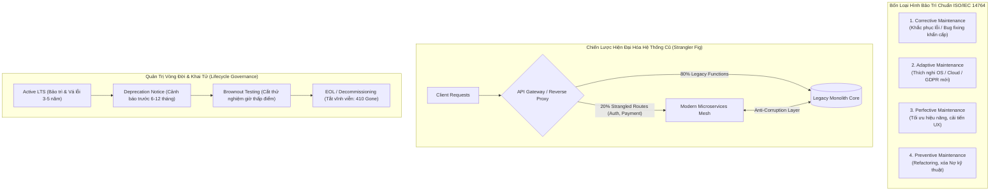
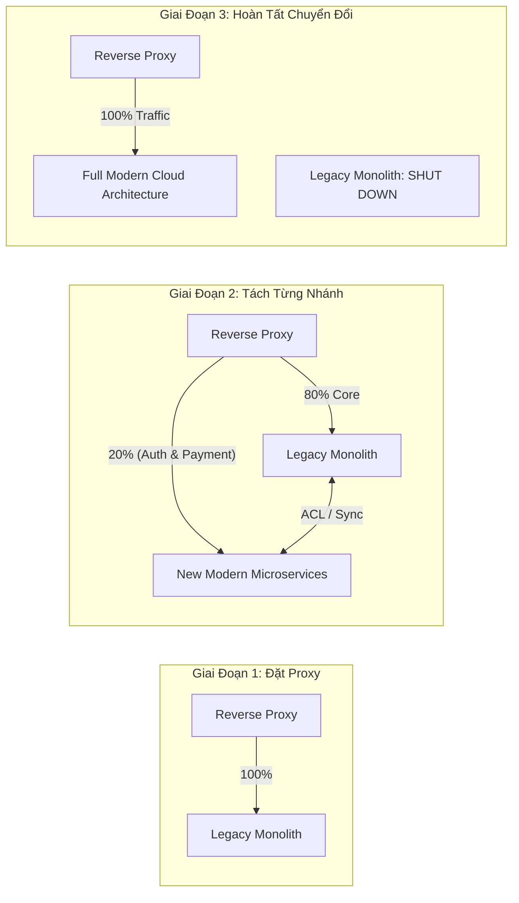

# 15.1. Bảo Trì và Tiến Hóa Hệ Thống Phần Mềm (Software Maintenance & Evolution Engineering)

> [!IMPORTANT]
> **Nếu bạn chỉ được nhớ một điều duy nhất:** Hơn $75\%$ tổng chi phí vòng đời của một hệ thống phần mềm thành công thuộc về giai đoạn Bảo trì và Tiến hóa — tuyệt đối không bao giờ chọn con đường "Đập đi xây lại toàn bộ" (The Big Bang Rewrite) vốn luôn dẫn tới phá sản dự án; chiến lược sống còn duy nhất là **tiến hóa gia tăng thông qua Mẫu hình Cây đa siết cây (Strangler Fig Pattern)**, thiết lập Lớp tương thích (Compatibility Layers) và quản trị nghiêm ngặt vòng đời sản phẩm từ LTS đến EOL.

---

## 1. Kiến trúc Tổng quan & Mô hình Tư duy (Mental Model)

### Ẩn dụ Đời sống: Đại Tu Ga Đường Sắt Trăm Năm Tuổi Trong Khi Tàu Vẫn Đang Chạy
Hãy hình dung việc bảo trì và tiến hóa một hệ thống phần mềm Core Banking hoặc E-Commerce lâu năm tương tự như việc nâng cấp Nhà Ga Trung Tâm Thành Phố 100 năm tuổi:
- **Hệ Thống Cũ (Legacy System)**: Tòa nhà cổ kính bằng gạch đỏ, hệ thống đường ray cũ kỹ nhưng mỗi ngày đang vận chuyển 500,000 lượt hành khách và tạo ra toàn bộ doanh thu của ngành đường sắt. Bạn không thể cho nổ tung nhà ga để xây mới từ đầu (The Big Bang Rewrite Anti-Pattern) vì thành phố sẽ lập tức tê liệt và hỗn loạn.
- **Strangler Fig Pattern (Mẫu Hình Cây Đa Siết Cây)**: Các kỹ sư xây dựng một sảnh đón khách bằng kính hiện đại ngay bên cạnh. Ban đầu, chỉ các hành khách mua vé hạng nhất được dẫn qua sảnh mới (10% Traffic). Dần dần, từng đường ray cao tốc mới được nối vào. Sau 5 năm, toàn bộ hành khách và tàu bè đều đi qua nhà ga mới, sảnh gạch cũ lúc này có thể đóng cửa và biến thành viện bảo tàng an toàn mà không làm gián đoạn dù chỉ một chuyến tàu.
- **Bốn Loại Hình Bảo Trì Chuẩn ISO/IEC 14764**:
  - *Corrective (Đội Cứu Hộ Đường Ray)*: Một thanh ray bị nứt lúc nửa đêm, công nhân khẩn cấp đến hàn lại để tàu sáng mai không bị trật bánh (Sửa Bug cấp bách).
  - *Adaptive (Thích Nghi Quy Chuẩn Điện Khí Mới)*: Chính phủ đổi điện áp lưới điện quốc gia từ 110V sang 220V, nhà ga phải thay mới toàn bộ trạm biến áp để tàu không bị chập điện (Nâng cấp tương thích OS/Cloud/Pháp lý mới).
  - *Perfective (Lắp Điều Hòa và Thang Máy Tốc Độ Cao)*: Hành khách phàn nàn nhà ga quá nóng vào mùa hè; ban quản lý lắp thêm máy lạnh để tăng sự hài lòng của khách (Tối ưu hóa hiệu năng và trải nghiệm).
  - *Preventive (Sơn Chống Rỉ Định Kỳ)*: Cứ mỗi 6 tháng, công nhân cạo gỉ sét và tra dầu mỡ vào các khớp nối cơ khí để thanh ray không bao giờ bị gãy (Refactoring và triệt tiêu Nợ kỹ thuật).
- **LTS & EOL (Cam Kết Bảo Hành Đầu Máy Xe Lửa)**: Nhà sản xuất cam kết cung cấp phụ tùng thay thế cho đầu máy diesel trong vòng 5 năm (LTS - Long-Term Support). Sau 5 năm, hãng chính thức tuyên bố hết vòng đời (EOL - End-of-Life); các ga tàu bắt buộc phải thanh lý đầu máy này vì không còn ai sản xuất phụ tùng phanh an toàn nữa.



---

## 2. Chi tiết từng Keyword (Under-the-Hood Deep Dive)

### 2.1. The 4 Categories of Maintenance (ISO/IEC 14764 Standard) & Định Luật Lehman

#### 1. Bốn Loại Hình Bảo Trì Phần Mềm Chuẩn Quốc Tế ISO/IEC 14764
1. **Corrective Maintenance (Bảo trì Khắc phục / Sửa lỗi)**:
   - *Bản chất*: Hành động phản ứng bị động (Reactive) khi có lỗi xuất hiện trên Production: crash tiến trình, sai số tính toán tài chính, vi phạm logic ràng buộc.
   - *Mục tiêu*: Khôi phục hệ thống về trạng thái hoạt động bình thường trong thời gian ngắn nhất (Giảm MTTR).
2. **Adaptive Maintenance (Bảo trì Thích nghi)**:
   - *Bản chất*: Chỉnh sửa phần mềm để thích ứng với những biến động của môi trường hạ tầng ngoại vi:
     - Nâng cấp hệ điều hành (Ubuntu 20.04 $\to$ 24.04 LTS), thay đổi phiên bản Node.js/Java/Python.
     - Tuân thủ các đạo luật mới (Nghị định bảo vệ dữ liệu cá nhân, GDPR, chuẩn thanh toán PCI-DSS v4.0).
     - Di chuyển hạ tầng từ On-Premises lên Cloud (AWS/GCP) hoặc đưa vào Kubernetes.
3. **Perfective Maintenance (Bảo trì Hoàn thiện)**:
   - *Bản chất*: Nâng cấp và mở rộng để đáp ứng các yêu cầu mới của người dùng và doanh nghiệp:
     - Tối ưu hóa câu truy vấn SQL chậm, giảm độ trễ API từ 500ms xuống 50ms.
     - Tinh chỉnh giao diện người dùng, bổ sung tính năng xuất báo cáo Excel/PDF.
4. **Preventive Maintenance (Bảo trì Phòng ngừa / Software Rejuvenation)**:
   - *Bản chất*: Hành động chủ động (Proactive) tái cấu trúc mã nguồn (Refactoring) mà không làm thay đổi hành vi bên ngoài của hệ thống.
   - *Mục tiêu*: Dọn dẹp nợ kỹ thuật (Technical Debt), giảm độ phức tạp chu trình (Cyclomatic Complexity), bổ sung Unit Tests, phòng ngừa hiện tượng "Lão hóa phần mềm" (Software Aging - rò rỉ bộ nhớ, phân mảnh tài nguyên).

#### 2. Các Định Luật Tiến Hóa Phần Mềm Của Lehman (Lehman's Laws of Software Evolution)
Meir M. Lehman đã đúc kết các quy luật tự nhiên chi phối mọi phần mềm thành công:
- **Định luật 1: Tiếp tục Biến đổi (Continuing Change)**: Một hệ thống phần mềm phản ánh thế giới thực bắt buộc phải liên tục thích nghi, nếu không nó sẽ dần trở nên vô dụng và tiến tới cái chết.
- **Định luật 2: Gia tăng Độ phức tạp (Increasing Complexity)**: Khi một hệ thống tiến hóa, cấu trúc nội tại của nó sẽ ngày càng trở nên hỗn loạn và phức tạp hơn, trừ khi có các nỗ lực chủ động đầu tư vào tái cấu trúc (Preventive Maintenance).
- **Định luật 6: Tiếp tục Tăng trưởng (Continuing Growth)**: Chức năng của hệ thống bắt buộc phải liên tục mở rộng để duy trì sự hài lòng của người dùng trong suốt vòng đời.

---

### 2.2. Legacy Modernization: Reverse Engineering, Reengineering & Strangler Fig Pattern

#### 1. Định Nghĩa Thực Chiến Về Legacy Code
- Theo Michael Feathers (*Working Effectively with Legacy Code*): **"Legacy code is simply code without automated tests"** (Code cũ đơn giản là code không có bài kiểm thử tự động).
- Một codebase dù mới viết bằng Rust hay Go tuần trước, nhưng nếu không có Unit Tests và Regression Tests bảo vệ, thì nó đã mang đầy đủ rủi ro của một hệ thống Legacy: không ai dám sửa đổi vì sợ làm gãy các tính năng ngầm.

#### 2. Thảm Họa "Đập Đi Xây Lại Từ Đầu" (The Big Bang Rewrite Anti-Pattern)
- **Cám dỗ**: Các kỹ sư mới thường tuyên bố: *"Code cũ nát quá, hãy vứt hết đi và viết lại toàn bộ bằng công nghệ hiện đại trong 6 tháng!"*.
- **Thực tế tàn khốc**:
  1. *Second-System Syndrome (Hội chứng hệ thống thứ hai)*: Đội ngũ tham lam nhồi nhét quá nhiều công nghệ và tính năng mới khiến dự án kéo dài từ 6 tháng thành 3 năm.
  2. *Bỏ sót hàng ngàn quy tắc biên (Edge Cases)*: Code cũ dù xấu xí nhưng đã chứa đựng 10 năm kinh nghiệm xử lý các trường hợp hy hữu trong kinh doanh. Viết lại từ đầu sẽ làm tái xuất hiện toàn bộ các con bọ (bugs) đã từng được sửa trong quá khứ.
  3. *Mục tiêu di động (Moving Target)*: Trong 3 năm viết lại, hệ thống cũ vẫn liên tục phải bổ sung tính năng mới để phục vụ kinh doanh. Khi hệ thống mới xong, nó đã bị tụt hậu so với chính hệ thống cũ. Dự án bị hủy bỏ, tiêu tốn hàng triệu USD vô ích.

#### 3. Mẫu Hình Cây Đa Siết Cây (Strangler Fig Pattern - Martin Fowler)
- **Chiến lược giải pháp**: Thay thế hệ thống cũ một cách tiệm tiến (Incremental Replacement) mà không làm gián đoạn kinh doanh dù chỉ 1 giây.
- **Quy trình 4 bước triển khai**:
  1. *Đặt ranh giới (Interception)*: Dựng một API Gateway / Reverse Proxy (như Nginx, Kong, Envoy) đứng trước toàn bộ hệ thống cũ. Tất cả request từ người dùng đều phải đi qua Proxy này.
  2. *Xây dựng tính năng mới bên ngoài (Build New)*: Khi cần phát triển một tính năng mới (hoặc tách một tính năng cũ như Payment), xây dựng nó thành một Microservice độc lập bằng công nghệ hiện đại đi kèm bài test $100\%$.
  3. *Chuyển hướng lưu lượng (Strangle)*: Cấu hình Gateway định tuyến các đường dẫn liên quan (ví dụ: `/api/v1/payments`) sang dịch vụ mới, trong khi $95\%$ các đường dẫn khác vẫn đi về Monolith cũ.
  4. *Khử bỏ (Eliminate)*: Lặp lại quy trình cho đến khi toàn bộ logic của Monolith cũ đã được chuyển dịch hoàn toàn. Lúc này, tắt Monolith cũ an toàn.



---

### 2.3. Lifecycle Governance: LTS, EOL, Sunsetting & Deprecation

#### 1. Long-Term Support (LTS) vs End-of-Life (EOL)
- **Active Support**: Giai đoạn phần mềm được phát triển tính năng mới, tối ưu hiệu năng và vá lỗi định kỳ.
- **Maintenance / LTS (Long-Term Support)**: Không thêm tính năng mới; chỉ tập trung phát hành các bản vá lỗi nghiêm trọng (Critical Bug Fixes) và lỗ hổng an ninh mạng (CVE Security Patches) trong một khung thời gian cam kết (thường là 3 đến 5 năm).
- **End-of-Life (EOL) / End-of-Support (EOS)**: Thời điểm nhà sản xuất ngừng hoàn toàn mọi hỗ trợ. Vận hành phần mềm đã EOL vi phạm trực tiếp các tiêu chuẩn bảo mật (PCI-DSS cấm vận hành hệ thống thanh toán trên nền tảng đã EOL).

#### 2. Quy Trình Khai Tử Dịch Vụ Và Kỹ Thuật Brownout Testing
- **Bước 1: Thông báo & Cảnh báo (Announcement & Deprecation)**:
  - Thông báo trước tối thiểu 6-12 tháng.
  - Gắn HTTP Header `Deprecation: true` và `Sunset: <Date>` theo RFC 8594.
- **Bước 2: Brownout Testing (Cúp Điện Thử Nghiệm Có Kiểm Soát)**:
  - *Vấn đề*: Rất nhiều khách hàng và dịch vụ phụ thuộc lờ đi các email cảnh báo và tiếp tục gọi vào API cũ.
  - *Kỹ thuật Brownout*: 1 tháng trước ngày Sunset chính thức, đội ngũ SRE chủ động tắt dịch vụ cũ trong 30 phút vào các khung giờ thấp điểm. Các hệ thống phụ thuộc sẽ phát sinh lỗi cảnh báo, buộc các kỹ sư của đối tác phải thức tỉnh và khẩn trương nâng cấp lên phiên bản mới.
- **Bước 3: Tắt vĩnh viễn (Decommissioning & Hard Sunset)**:
  - Toàn bộ request tới endpoint cũ sẽ trả về mã lỗi **`HTTP 410 Gone`** kèm thông báo chuyển dịch. Hủy bỏ toàn bộ máy chủ, cơ sở dữ liệu và khóa tài nguyên để tiết kiệm chi phí.

---

## 3. Thực thi Mã nguồn & Mô phỏng Chuyên sâu (Dual-Engine Implementation)

### 3.1. Phiên bản C++20: Bộ Điều Phối Định Tuyến Strangler Fig Proxy Hỗ Trợ Chuyển Đổi Từng Phần

```cpp
#include <iostream>
#include <string>
#include <memory>
#include <unordered_map>
#include <vector>
#include <format>
#include <functional>
#include <stdexcept>

// ============================================================================
// 1. DATA CONTRACTS
// ============================================================================
struct RequestPayload {
    std::string path;
    std::string method;
    std::string body;
};

struct ResponsePayload {
    int statusCode;
    std::string servedBy;
    std::string body;
};

// ============================================================================
// 2. LEGACY MONOLITH (Cũ kỹ nhưng đang gánh vác nghiệp vụ)
// ============================================================================
class LegacyMonolithSystem {
public:
    ResponsePayload handleRequest(const RequestPayload& req) {
        // Mô phỏng xử lý chậm chạp của hệ thống cũ
        return ResponsePayload{
            .statusCode = 200,
            .servedBy = "LEGACY_MONOLITH_V1 (COBOL/C++98 Engine)",
            .body = std::format("Processed '{}' by Legacy Monolith", req.path)
        };
    }
};

// ============================================================================
// 3. MODERN MICROSERVICE (Mới, hiện đại, tối ưu)
// ============================================================================
class ModernPaymentMicroservice {
public:
    ResponsePayload processPayment(const RequestPayload& req) {
        return ResponsePayload{
            .statusCode = 201,
            .servedBy = "MODERN_PAYMENT_SERVICE_V2 (Cloud-Native C++20)",
            .body = "{\"status\": \"PAID_SUCCESS\", \"engine\": \"gRPC_Nitro\"}"
        };
    }
};

// ============================================================================
// 4. STRANGLER FIG ROUTING PROXY (Bộ điều phối chuyển dịch tiệm tiến)
// ============================================================================
class StranglerFigRoutingProxy {
private:
    std::shared_ptr<LegacyMonolithSystem> legacyMonolith_;
    std::shared_ptr<ModernPaymentMicroservice> modernPaymentService_;
    // Danh sách các routes đã được "siết" (Strangled) thành công sang service mới
    std::unordered_map<std::string, bool> strangledRouteFlags_;

public:
    StranglerFigRoutingProxy(std::shared_ptr<LegacyMonolithSystem> legacy,
                             std::shared_ptr<ModernPaymentMicroservice> modern)
        : legacyMonolith_(std::move(legacy)), modernPaymentService_(std::move(modern)) {}

    void registerStrangledRoute(const std::string& path) {
        strangledRouteFlags_[path] = true;
        std::cout << std::format("  [Strangler Config] Đường dẫn '{}' đã được chuyển giao cho Microservice mới!\n", path);
    }

    ResponsePayload route(const RequestPayload& req) {
        // Nếu route đã được hiện đại hóa -> Định tuyến tới Modern Microservice
        if (strangledRouteFlags_.contains(req.path)) {
            std::cout << std::format("[Router] Chuyển tiếp '{}' sang >>> MODERN SERVICE <<<\n", req.path);
            return modernPaymentService_->processPayment(req);
        }

        // Ngược lại -> Tiếp tục duy trì qua Legacy Monolith
        std::cout << std::format("[Router] Giữ nguyên '{}' phục vụ bởi >>> LEGACY MONOLITH <<<\n", req.path);
        return legacyMonolith_->handleRequest(req);
    }
};

int main() {
    std::cout << "=========================================================\n";
    std::cout << "    DEMO STRANGLER FIG PATTERN IMPLEMENTATION (C++20)    \n";
    std::cout << "=========================================================\n\n";

    auto legacy = std::make_shared<LegacyMonolithSystem>();
    auto modernPayment = std::make_shared<ModernPaymentMicroservice>();
    StranglerFigRoutingProxy proxy(legacy, modernPayment);

    // Giai đoạn 1: Tất cả request đều đi vào Monolith cũ
    std::cout << "--- GIAI ĐOẠN 1: TẤT CẢ LƯU LƯỢNG ĐI VÀO HỆ THỐNG CŨ ---\n";
    RequestPayload reqOrder{ "/v1/orders/create", "POST", "{}" };
    RequestPayload reqPay{ "/v1/payments/process", "POST", "{}" };

    ResponsePayload res1 = proxy.route(reqOrder);
    std::cout << std::format("  -> Result: {} | Phục vụ bởi: {}\n\n", res1.statusCode, res1.servedBy);

    ResponsePayload res2 = proxy.route(reqPay);
    std::cout << std::format("  -> Result: {} | Phục vụ bởi: {}\n\n", res2.statusCode, res2.servedBy);

    // Giai đoạn 2: Hiện đại hóa tính năng thanh toán (Kích hoạt Strangler Fig cho Payments)
    std::cout << "--- GIAI ĐOẠN 2: CHUYỂN DỊCH TÍNH NĂNG PAYMENT SANG MICROSERVICE MỚI ---\n";
    proxy.registerStrangledRoute("/v1/payments/process");

    std::cout << "\n--- GIAI ĐOẠN 3: KIỂM THỬ ĐỊNH TUYẾN HYBRID (STRANGLER IN ACTION) ---\n";
    // Đơn hàng vẫn do Monolith cũ phục vụ
    ResponsePayload res3 = proxy.route(reqOrder);
    std::cout << std::format("  -> Phục vụ bởi: {}\n\n", res3.servedBy);

    // Thanh toán đã được chuyển hướng hoàn toàn sang Modern Microservice!
    ResponsePayload res4 = proxy.route(reqPay);
    std::cout << std::format("  -> Phục vụ bởi: {} | Body: {}\n", res4.servedBy, res4.body);

    return 0;
}
```

---

### 3.2. Phiên bản Python 3.11+: Bộ Mô Phỏng Vòng Đời Brownout Testing & Deprecation Governance

```python
from __future__ import annotations
import datetime
from dataclasses import dataclass
from typing import Dict, Optional, Tuple


@dataclass
class ServiceVersionPolicy:
    version: str
    is_deprecated: bool
    sunset_date: datetime.datetime
    brownout_active: bool # Bật cúp điện thử nghiệm có kiểm soát


class ApiLifecycleGovernanceEngine:
    def __init__(self):
        self._policies: Dict[str, ServiceVersionPolicy] = {}

    def register_policy(self, policy: ServiceVersionPolicy) -> None:
        self._policies[policy.version] = policy

    def handle_request(self, version: str, endpoint: str) -> Tuple[int, Dict[str, str], str]:
        policy = self._policies.get(version)
        if not policy:
            return 404, {}, "Phiên bản không tồn tại"

        now = datetime.datetime.now(datetime.timezone.utc)

        # 1. Kiểm tra nếu đã quá ngày Sunset vĩnh viễn (EOL)
        if now >= policy.sunset_date:
            return 410, {
                "Link": '<https://api.enterprise.com/docs/v2>; rel="sunset"'
            }, "HTTP 410 Gone: Phiên bản API này đã chính thức ngừng hoạt động vĩnh viễn (EOL)."

        # 2. Kiểm tra nếu đang trong giờ Brownout Testing (Cố tình cúp điện thử nghiệm)
        if policy.brownout_active:
            return 503, {
                "Retry-After": "300",
                "X-Brownout-Notice": "Scheduled brownout window in progress. Please upgrade to V2!"
            }, "HTTP 503 Service Unavailable: [BROWNOUT TEST] Đang diễn ra đợt tắt thử nghiệm trước ngày Sunset."

        # 3. Request bình thường nhưng đã bị Deprecated -> Gắn Sunset Headers (RFC 8594)
        headers = {
            "Content-Type": "application/json"
        }
        if policy.is_deprecated:
            headers["Deprecation"] = "true"
            headers["Sunset"] = policy.sunset_date.strftime("%a, %d %b %Y %H:%M:%S GMT")
            headers["Link"] = '<https://api.enterprise.com/docs/migration>; rel="sunset"'

        return 200, headers, f'{{"status": "SUCCESS", "version": "{version}", "endpoint": "{endpoint}"}}'


if __name__ == "__main__":
    print("=" * 65)
    print("  DEMO LIFECYCLE GOVERNANCE & BROWNOUT TESTING (PYTHON)")
    print("=" * 65)

    engine = ApiLifecycleGovernanceEngine()

    # Thiết lập chính sách cho API v1 (Sắp EOL)
    future_sunset = datetime.datetime.now(datetime.timezone.utc) + datetime.timedelta(days=30)
    policy_v1 = ServiceVersionPolicy(
        version="v1",
        is_deprecated=True,
        sunset_date=future_sunset,
        brownout_active=False
    )
    engine.register_policy(policy_v1)

    print("\n--- 1. GỌI API V1 TRONG GIAI ĐOẠN DEPRECATED BÌNH THƯỜNG ---")
    status, headers, body = engine.handle_request("v1", "/orders")
    print(f"Status Code: {status}")
    print(f"Headers Gắn Kèm: {headers}")
    print(f"Body: {body}")

    print("\n--- 2. KÍCH HOẠT BROWNOUT TESTING (CÚP ĐIỆN THỬ NGHIỆM 30 PHÚT) ---")
    policy_v1.brownout_active = True
    status_bo, headers_bo, body_bo = engine.handle_request("v1", "/orders")
    print(f"Status Code: {status_bo}")
    print(f"Notice: {headers_bo.get('X-Brownout-Notice')}")
    print(f"Body: {body_bo}")

    print("\n--- 3. MÔ PHỎNG THỜI ĐIỂM SAU NGÀY SUNSET VĨNH VIỄN (EOL) ---")
    policy_v1.brownout_active = False
    policy_v1.sunset_date = datetime.datetime.now(datetime.timezone.utc) - datetime.timedelta(days=1) # Đã qua khứ
    status_eol, headers_eol, body_eol = engine.handle_request("v1", "/orders")
    print(f"Status Code: {status_eol}")
    print(f"Body: {body_eol}")
```

### 3.3. Giả Lập Terminal Output Thực Tế

```text
=========================================================
    DEMO STRANGLER FIG PATTERN IMPLEMENTATION (C++20)    
=========================================================

--- GIAI ĐOẠN 1: TẤT CẢ LƯU LƯỢNG ĐI VÀO HỆ THỐNG CŨ ---
[Router] Giữ nguyên '/v1/orders/create' phục vụ bởi >>> LEGACY MONOLITH <<<
  -> Result: 200 | Phục vụ bởi: LEGACY_MONOLITH_V1 (COBOL/C++98 Engine)

[Router] Giữ nguyên '/v1/payments/process' phục vụ bởi >>> LEGACY MONOLITH <<<
  -> Result: 200 | Phục vụ bởi: LEGACY_MONOLITH_V1 (COBOL/C++98 Engine)

--- GIAI ĐOẠN 2: CHUYỂN DỊCH TÍNH NĂNG PAYMENT SANG MICROSERVICE MỚI ---
  [Strangler Config] Đường dẫn '/v1/payments/process' đã được chuyển giao cho Microservice mới!

--- GIAI ĐOẠN 3: KIỂM THỬ ĐỊNH TUYẾN HYBRID (STRANGLER IN ACTION) ---
[Router] Giữ nguyên '/v1/orders/create' phục vụ bởi >>> LEGACY MONOLITH <<<
  -> Phục vụ bởi: LEGACY_MONOLITH_V1 (COBOL/C++98 Engine)

[Router] Chuyển tiếp '/v1/payments/process' sang >>> MODERN SERVICE <<<
  -> Phục vụ bởi: MODERN_PAYMENT_SERVICE_V2 (Cloud-Native C++20) | Body: {"status": "PAID_SUCCESS", "engine": "gRPC_Nitro"}
```

---

## 4. Systems Engineering & Production Pitfalls

### Cạm Bẫy Sản Xuất Thường Gặp (Production Anti-Patterns & Gotchas)

1. **Lệch Dữ Liệu Khi Đồng Bộ Hai Chiều (Dual-Write Synchronization Drift)**:
   - *Bản chất*: Trong quá trình áp dụng Strangler Fig kéo dài hàng năm, cả hệ thống cũ và hệ thống mới cùng chạy song song và cùng ghi dữ liệu. Lập trình viên dùng cơ chế Dual-Write (ghi vào DB cũ rồi ghi vào DB mới). Nếu mạng bị lỗi ở bước ghi thứ 2, dữ liệu giữa 2 bên bị lệch pha nghiêm trọng, dẫn đến báo cáo tài chính sai lệch.
   - *Giải pháp*: Áp dụng **Change Data Capture (CDC)** bằng công cụ Debezium kết hợp Kafka: Chỉ ghi vào một Database nguồn chính (Single Source of Truth), sau đó Debezium đọc Transaction Log của database và stream dữ liệu sang database còn lại một cách phi đồng bộ có đảm bảo.

2. **Cạm Bẫy Brownout Không Báo Trước Gây Thiệt Hại Khách Hàng**:
   - *Bản chất*: Đội ngũ SRE kích hoạt Brownout Test đúng vào khung giờ thanh toán cao điểm (12h trưa) khiến hàng ngàn giao dịch của người dùng bị gián đoạn, gây tổn thất doanh thu và khủng hoảng truyền thông.
   - *Giải pháp*: Brownout phải được lên lịch chính xác, thông báo trước 2 tuần cho các bên liên quan, chỉ diễn ra trong vòng 15-30 phút vào ban đêm (2h - 3h sáng), và phải có nút hủy khẩn cấp (Emergency Kill-Switch) để khôi phục lưu lượng trong 10 giây nếu có sự cố ngoài dự kiến.

3. **Vòng Xoáy Lãng Phí Của Dự Án Viết Lại Từ Đầu (Big Bang Bankruptcy)**:
   - *Bản chất*: Ban lãnh đạo phê duyệt ngân sách 5 triệu USD để viết lại toàn bộ hệ thống lõi trong 12 tháng. Sau 18 tháng, dự án mới hoàn thành được 40% tính năng và liên tục trễ hạn vì phát sinh hàng trăm logic nghiệp vụ ngầm chưa từng được tài liệu hóa. Dự án bị cắt ngân sách và toàn bộ công sức bị hủy bỏ.
   - *Giải pháp*: Luôn kiên định với nguyên lý Strangler Fig: chia nhỏ dự án thành các đợt phát hành giá trị có thể đo lường được sau mỗi 2-4 tuần.

4. **Kỹ Thuật Chẩn Đoán & Giám Sát Production Bằng CLI**:
   ```bash
   # 1. Đo lường tỷ lệ phân phối lưu lượng giữa Monolith cũ và Service mới tại Nginx Proxy
   tail -n 10000 /var/log/nginx/access.log | awk '{print $NF}' | sort | uniq -c

   # 2. Quét tìm các thư viện phụ thuộc đã chạm mốc End-of-Life (EOL) bằng Trivy
   trivy fs --severity HIGH,CRITICAL --security-checks vuln ./

   # 3. Theo dõi số lượng sự kiện Change Data Capture (Debezium lag) đang đồng bộ dữ liệu
   kafka-consumer-groups.sh --bootstrap-server localhost:9092 --describe --group debezium-cdc-group
   ```

---

## 5. Bảng So sánh & Decision Matrix

### 5.1. So Sánh Hai Chiến Lược Hiện Đại Hóa Hệ Thống (Modernization Strategies)

| Tiêu Chí So Sánh | Đập Đi Xây Lại Từ Đầu (The Big Bang Rewrite) | Mẫu Hình Cây Đa Siết Cây (Strangler Fig Pattern) |
| :--- | :--- | :--- |
| **Mức độ rủi ro kinh doanh** | Cực kỳ cao (Có nguy cơ sụp đổ toàn bộ dự án) | Rất thấp (Rủi ro được chia nhỏ theo từng route) |
| **Thời gian đem lại giá trị (Time to Value)**| Rất lâu (Chỉ thấy kết quả sau 1-3 năm) | Tức thì (Đem lại giá trị mới sau mỗi sprint 2 tuần) |
| **Khả năng Rollback khi có lỗi** | Rất khó khăn (Khi đã cutover toàn bộ) | Cực kỳ dễ dàng (Chỉ cần đổi routing key ở Proxy) |
| **Bảo toàn quy tắc biên (Edge Cases)** | Rất kém (Dễ bỏ sót hàng trăm logic ẩn) | Rất cao (Hệ thống cũ vẫn gánh các logic chưa chuyển) |
| **Độ phức tạp kiến trúc ngắn hạn** | Thấp (Chỉ tập trung viết hệ thống mới) | Cao (Phải duy trì Proxy và đồng bộ dữ liệu song song) |
| **Chi phí tổng thể** | Thường vượt ngân sách từ $2\times$ đến $5\times$ | Được kiểm soát chặt chẽ theo từng giai đoạn |

### 5.2. Ma Trận Quyết Định Lựa Chọn Hành Động Bảo Trì

| Dấu Hiệu Nhận Biết Hiện Trạng | Loại Hình Bảo Trì Cần Áp Dụng | Hành Động Kỹ Thuật Trọng Tâm |
| :--- | :--- | :--- |
| **Hệ thống phát sinh lỗi crash trên Production** | **Corrective Maintenance** | Hotfix khẩn cấp, viết regression test, post-mortem |
| **Hệ điều hành / Thư viện nền tảng chạm mốc EOL** | **Adaptive Maintenance** | Nâng cấp base image, di chuyển sang Kubernetes/Cloud |
| **API phản hồi chậm khi người dùng tăng gấp 10 lần**| **Perfective Maintenance** | Tối ưu hóa Database Index, bổ sung Redis Cache |
| **Mã nguồn lộn xộn, độ phức tạp cao, không có Unit Test**| **Preventive Maintenance** | Refactoring, bọc test characterization (Golden Master) |
| **Hệ thống Monolith khổng lồ cản trở tốc độ phát triển**| **Legacy Modernization (Strangler Fig)**| Dựng Reverse Proxy, tách dần từng microservice mới |
