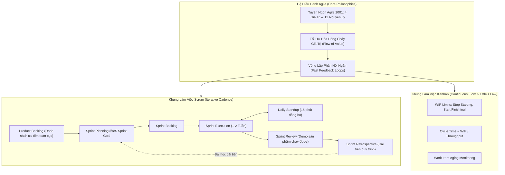
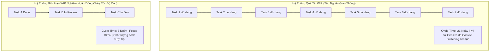
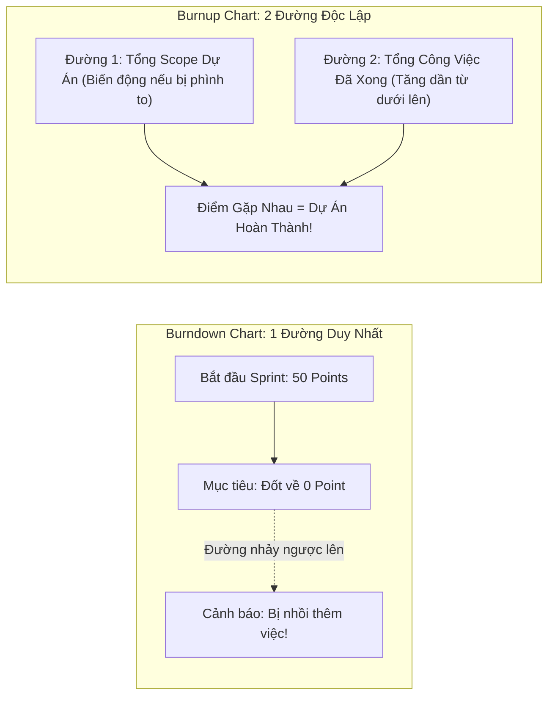
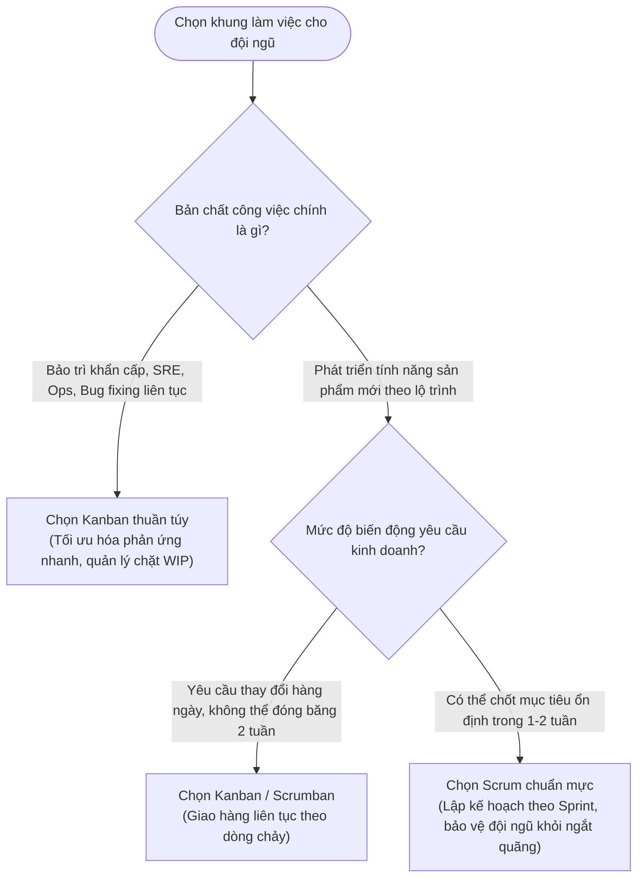

# 16.1. Quy Trình Làm Việc Agile và Lập Kế Hoạch Kỹ Thuật (Agile, Scrum & Kanban Planning)

> [!IMPORTANT]
> **Nếu bạn chỉ được nhớ một điều duy nhất:** Khung làm việc Agile không sinh ra để nhà quản lý kiểm soát vi mô hay bắt kỹ sư gánh thêm các cuộc họp hình thức, mà là **hệ điều hành toán học nhằm tối ưu hóa dòng chảy giá trị (Flow of Value)** — trong đó cốt lõi là Định luật Little: cách duy nhất để rút ngắn thời gian giao hàng (Cycle Time) mà không làm kiệt sức đội ngũ là **áp đặt giới hạn công việc đang xử lý (WIP Limits)** theo nguyên tắc *"Dừng bắt đầu, hãy tập trung kết thúc" (Stop starting, start finishing)*.

---

## 1. Kiến trúc Tổng quan & Mô hình Tư duy (Mental Model)

### Ẩn dụ Đời sống: Dòng Xe Lưu Thông Trên Cao Tốc & Đội Kỹ Thuật Pit-Stop Formula 1
Hãy hình dung quy trình vận hành kỹ thuật phần mềm tương tự như sự kết hợp giữa Quản lý Giao thông Cao tốc và Đội Đua Xe F1:
- **Dòng Xe Trên Đường Cao Tốc (Định Luật Little & WIP Limits)**: Khi một đường cao tốc được nhồi nhét $100\%$ công suất xe cộ (ai cũng nhận thêm việc dở dang - High WIP), toàn bộ tuyến đường lập tức rơi vào cảnh tắc nghẽn hoàn toàn, tốc độ di chuyển giảm về $0\text{ km/h}$. Nhưng khi có trạm thu phí điều tiết (WIP Limit), giữ cho mặt đường chỉ đầy $60\% - 70\%$, dòng xe sẽ lao vút đi với tốc độ tối đa ($120\text{ km/h}$) và tới đích nhanh gấp 10 lần.
- **Sprint (Vòng Đua Cố Định Của Xe F1)**: Mỗi chặng đua được chia thành các vòng chạy ngắn (Sprint 1-2 tuần). Cả đội thống nhất mục tiêu rõ ràng (Sprint Goal: Thay lốp mềm, chạy 15 vòng ổn định). Không ai nhảy vào xe yêu cầu đổi động cơ giữa vòng đua.
- **Scrum Ceremonies (Bộ 4 Nghi Thức Phối Hợp Đỉnh Cao)**:
  - *Sprint Planning (Họp Chiến Thuật Trước Chặng Đua)*: Thảo luận chiến thuật lốp, phân tích thời tiết và cam kết số vòng đua.
  - *Daily Standup (Tín Hiệu Bộ Đàm 15 Giây Giữa Tay Đua & Trưởng Đội)*: Báo cáo nhanh: Lốp xe thế nào? Cánh gió có bị kẹt không? Cần hỗ trợ khẩn cấp gì không? Tuyệt đối không đứng phân tích kỹ thuật động cơ tại đây.
  - *Sprint Review (Bục Nhận Giải & Dữ Liệu Chạy Thực Tế)*: Xe chạy thực sự trên đường trước mắt khán giả và ban giám khảo (Demo phần mềm chạy được).
  - *Sprint Retrospective (Phân Tích Dữ Liệu Hộp Đen Trong Gara)*: Đội ngũ kỹ sư ngồi lại với nhau: Tại sao súng siết ốc bánh sau bị trễ 0.5 giây? Làm thế nào để vòng sau thao tác nhanh hơn?
- **Story Points (Độ Dốc Và Khúc Cua Hiểm Trở Của Đường Đua)**: Ta không ước lượng đoạn đường bằng số phút, vì trời mưa hay nắng thời gian sẽ khác nhau. Ta đánh giá khúc cua là "Độ khó 8" (Khúc cua chữ S gấp), bất kể tay đua nào lái thì độ khó vật lý của nó vẫn là 8.
- **Burndown vs Burnup Chart (Đồng Hồ Nhiên Liệu vs Biểu Đồ Quãng Đường)**:
  - *Burndown*: Kim xăng chỉ lượng xăng còn lại trong bình, phải cạn đúng vạch 0 khi xe cán đích.
  - *Burnup*: Cho thấy rõ xe đã chạy được 40 vòng, nhưng ban tổ chức bất ngờ nới dài đường đua thêm 10 vòng nữa (Scope Creep), giúp minh oan cho đội đua rằng họ không hề chạy chậm!



---

## 2. Chi tiết từng Keyword (Under-the-Hood Deep Dive)

### 2.1. Scrum Architecture: Artifacts, Ceremonies & Velocity

#### 1. Cấu Trúc Các Hiện Vật Cốt Lõi (Scrum Artifacts)
- **Product Backlog**: Danh sách sống duy nhất chứa toàn bộ các yêu cầu chức năng, lỗi cần vá, và khoản nợ kỹ thuật (Technical Debt) của sản phẩm, được xếp thứ tự ưu tiên bởi Product Owner (PO).
- **Sprint Backlog**: Tập hợp các User Stories được nhóm phát triển lựa chọn trong buổi Sprint Planning kèm theo một **Sprint Goal (Mục tiêu tối thượng)** bất biến trong suốt chu kỳ.
- **Potentially Releasable Increment**: Phần gia tăng sản phẩm hoàn thiện, đã vượt qua toàn bộ tiêu chí trong **Definition of Done (DoD)** (code xong, test pass, review xong, deploy staging ổn định), sẵn sàng bàn giao cho người dùng bất cứ lúc nào.

#### 2. Bốn Nghi Thức Scrum Chuẩn Mực (Scrum Ceremonies)

| Nghi Thức | Thời Lượng Chuẩn | Mục Đích Cốt Lõi | Người Tham Dự Bắt Buộc | Sai Lầm Phổ Biến Cần Tránh |
| :--- | :---: | :--- | :--- | :--- |
| **Sprint Planning** | 2-4 giờ / sprint 2 tuần | Thống nhất Sprint Goal & Bóc tách task | Toàn bộ Scrum Team | PO ép nhóm nhận quá nhiều task; thiếu tiêu chí chấp nhận (AC). |
| **Daily Standup** | Tối đa 15 phút | Đồng bộ hóa & Phát hiện vật cản (Blockers) | Kỹ sư phát triển | Biến thành buổi báo cáo cho quản lý; thảo luận kỹ thuật sa đà > 1 tiếng. |
| **Sprint Review** | 1-2 giờ | Trình diễn phần mềm chạy thực tế | Nhóm + Khách hàng/Stakeholders | Trình chiếu slide PowerPoint lý thuyết thay vì demo ứng dụng thật. |
| **Sprint Retrospective**| 1-1.5 giờ | Nhìn nhận nội bộ để cải tiến quy trình | Chỉ nội bộ Scrum Team | Đổ lỗi cá nhân; họp xong không đưa ra được Action Item cụ thể nào. |

#### 3. Story Points, Planning Poker & Fibonacci Sequence
- **Tại sao không ước lượng bằng "Số giờ công" (Hours)?**
  - Con người mắc **Thiên kiến Lạc quan (Optimism Bias)**: Luôn nghĩ mình code xong trong 4 giờ mà quên mất thời gian debug, viết test, giải quyết xung đột Git, họp hành và review code.
  - Kỹ sư Senior code mất 2 giờ, kỹ sư Junior code mất 8 giờ. Dùng "giờ" làm thước đo sẽ gây bất đồng bộ trong đội ngũ.
- **Dãy số Fibonacci ($1, 2, 3, 5, 8, 13, 21$)**:
  - Phản ánh **Định luật Weber-Fechner trong tâm lý học**: Sự khác biệt giữa 1 điểm và 2 điểm rất rõ ràng, nhưng sự khác biệt giữa 20 điểm và 21 điểm là không thể phân biệt được. Do đó khoảng cách số tăng dần theo cấp số cộng của độ bất định.
  - Bất kỳ task nào được chấm $\ge 13$ điểm đều được coi là quá lớn (Epic) và bắt buộc phải bóc tách thành các task nhỏ hơn trước khi đưa vào Sprint.
- **Velocity (Vận Tốc Của Nhóm)**:
  - Tổng số Story Points trung bình nhóm hoàn thành thực tế trong 3-5 Sprint gần nhất.
  - *Nguyên tắc đạo đức*: Velocity chỉ là **công cụ dự báo nội bộ của nhóm**, tuyệt đối cấm dùng Velocity làm KPI để so sánh hoặc thi đua giữa hai đội ngũ khác nhau (dẫn đến lạm phát điểm - Story Point Inflation).

---

### 2.2. Kanban Engineering & Little's Law: WIP Limits, Lead Time vs Cycle Time

#### 1. Định Luật Little (Little's Law) Trong Kỹ Nghệ Phần Mềm
- Xuất phát từ Lý thuyết Hàng đợi Toán học của John Little (MIT, 1961):
  $$\text{Cycle Time (Thời gian hoàn thành)} = \frac{\text{WIP (Số lượng việc đang dở dang)}}{\text{Throughput (Tốc độ giao hàng)}}$$
- **Hệ quả kỹ thuật chấn động**:
  - Nếu bạn muốn nhóm giao hàng nhanh gấp đôi (giảm Cycle Time từ 10 ngày xuống 5 ngày), hầu hết các nhà quản lý sai lầm sẽ cố gắng ép kỹ sư làm việc tăng ca để tăng Throughput (vốn chỉ tăng được $5\% - 10\%$ nhưng gây kiệt sức).
  - Nhưng nếu bạn **cắt giảm số lượng task đang mở (WIP) xuống một nửa**, Cycle Time sẽ **ngay lập tức giảm đi một nửa** một cách toán học mà kỹ sư không phải làm thêm một giờ nào!



#### 2. WIP Limits (Giới Hạn Công Việc Đang Xử Lý)
- **Quy tắc vàng**: *"Stop starting, start finishing"* (Dừng nhận việc mới, hãy tập trung kết thúc việc cũ!).
- **Cơ chế hoạt động**: Trên bảng Kanban, mỗi cột được gán một con số giới hạn:
  - Cột `In Code Review (WIP: 2)`: Nếu đã có 2 PRs đang nằm chờ review, không một kỹ sư nào trong nhóm được phép kéo thêm task mới từ cột `In Progress` sang. Kỹ sư phải dừng việc gõ code và chuyển sang phụ đồng nghiệp review xong 2 PRs đó để giải phóng dòng chảy.

#### 3. Lead Time, Cycle Time & Work Item Aging
- **Lead Time**: Tính từ thời điểm ý tưởng/ticket được tạo trên Jira cho tới khi nó chạy thực tế trên Production.
- **Cycle Time**: Tính từ thời điểm kỹ sư bấm chuyển ticket sang trạng thái `In Progress` cho tới khi code được deploy thành công lên Production.
- **Work Item Aging (Độ già cỗi của công việc)**: Đo lường số ngày một task đã nằm trong quy trình. Task có tuổi đời càng cao thì xác suất dính lỗi, xung đột merge Git và thất bại càng lớn.

---

### 2.3. Progress Tracking: Burndown vs Burnup Charts

#### 1. Burndown Chart (Biểu Đồ Thiêu Đốt Công Việc)
- **Đặc điểm**:
  - Trục hoành: Thời gian của Sprint (Ngày 1 $\to$ Ngày 10).
  - Trục tung: Tổng số Story Points còn lại cần làm.
  - Đường lý thuyết: Dốc đều từ đỉnh xuống 0 vào ngày cuối cùng.
- **Các hình thái bất thường phát hiện sớm rủi ro**:
  - *Đường nằm ngang suốt 8 ngày đầu rồi rơi thẳng đứng ở ngày cuối*: Nhóm có thói quen dồn toàn bộ việc test và verify vào phút chót (Mini-Waterfall trong Scrum).
  - *Đường đi ngược lên trên*: Nhóm liên tục bị nhồi thêm việc mới vào Sprint (Scope Creep) hoặc ban đầu ước lượng quá sơ sài.

#### 2. Burnup Chart (Biểu Đồ Tích Lũy Công Việc)
- Khác với Burndown, Burnup Chart vẽ **hai đường độc lập**:
  1. *Đường Tổng Phạm Vi Dự Án (Total Scope Line)*: Cho biết tổng số Story Points của toàn bộ dự án theo thời gian.
  2. *Đường Công Việc Đã Hoàn Thành (Completed Work Line)*: Cho biết số điểm tích lũy đã thực sự xong.
- **Ưu thế vượt trội**: Khi dự án bị trễ hạn, Burnup Chart chỉ rõ cho Ban giám đốc thấy: Đường hoàn thành vẫn tăng trưởng rất đều đặn, nhưng đường Tổng phạm vi liên tục bị đẩy lên cao do các bên liên quan liên tục đòi thêm tính năng mới!



---

## 3. Thực thi Mã nguồn & Mô phỏng Chuyên sâu (Dual-Engine Implementation)

### 3.1. Phiên bản C++20: Mô Phỏng Bảng Kanban Với Cơ Chế Thực Thi WIP Limits Và Tính Toán Định Luật Little

```cpp
#include <iostream>
#include <string>
#include <vector>
#include <queue>
#include <memory>
#include <format>
#include <stdexcept>
#include <chrono>

// ============================================================================
// 1. DATA CONTRACTS: KANBAN WORK ITEM
// ============================================================================
struct WorkItem {
    int id;
    std::string title;
    int storyPoints;
    std::chrono::steady_clock::time_point startTime;
    std::chrono::steady_clock::time_point finishTime;
};

// ============================================================================
// 2. KANBAN COLUMN VỚI RÀNG BUỘC WIP LIMIT NGHIÊM NGẶT
// ============================================================================
class KanbanColumn {
private:
    std::string name_;
    size_t wipLimit_;
    std::vector<std::shared_ptr<WorkItem>> items_;

public:
    KanbanColumn(std::string name, size_t limit) : name_(std::move(name)), wipLimit_(limit) {}

    [[nodiscard]] const std::string& name() const noexcept { return name_; }
    [[nodiscard]] size_t size() const noexcept { return items_.size(); }
    [[nodiscard]] size_t limit() const noexcept { return wipLimit_; }
    [[nodiscard]] bool isFull() const noexcept { return items_.size() >= wipLimit_; }

    void add(std::shared_ptr<WorkItem> item) {
        if (isFull()) {
            throw std::runtime_error(std::format(
                "VI PHẠM WIP LIMIT! Cột '{}' đã đạt giới hạn tối đa ({}/{}). "
                "Cấm nhận thêm việc mới cho tới khi giải phóng các task cũ!",
                name_, items_.size(), wipLimit_
            ));
        }
        items_.push_back(item);
        std::cout << std::format("  [Kanban Event] Đã nạp Task #{:02d} ('{}') vào cột '{}' ({}/{})\n",
                                 item->id, item->title, name_, items_.size(), wipLimit_);
    }

    std::shared_ptr<WorkItem> remove(int itemId) {
        for (auto it = items_.begin(); it != items_.end(); ++it) {
            if ((*it)->id == itemId) {
                auto found = *it;
                items_.erase(it);
                return found;
            }
        }
        return nullptr;
    }
};

// ============================================================================
// 3. KANBAN BOARD SYSTEM WITH LITTLE'S LAW CALCULATOR
// ============================================================================
class EngineeringKanbanBoard {
private:
    KanbanColumn devCol_{"In Development", 3};   // WIP Limit = 3
    KanbanColumn reviewCol_{"In Code Review", 2}; // WIP Limit = 2
    std::vector<std::shared_ptr<WorkItem>> completedItems_;

public:
    void startTask(std::shared_ptr<WorkItem> item) {
        item->startTime = std::chrono::steady_clock::now();
        devCol_.add(item);
    }

    void submitForReview(int itemId) {
        // Kiểm tra cột Review có bị kẹt WIP không trước khi chuyển
        if (reviewCol_.isFull()) {
            std::cout << std::format("\n>>> CẢNH BÁO TẮC NGHẼN: Cột '{}' đã kẹt (WIP: {}/{})! "
                                     "Kỹ sư dừng code lại và đi review giúp đồng nghiệp! <<<\n",
                                     reviewCol_.name(), reviewCol_.size(), reviewCol_.limit());
        }
        auto item = devCol_.remove(itemId);
        if (!item) throw std::invalid_argument("Không tìm thấy task trong Dev!");
        reviewCol_.add(item);
    }

    void finishTask(int itemId) {
        auto item = reviewCol_.remove(itemId);
        if (!item) throw std::invalid_argument("Không tìm thấy task trong Review!");
        item->finishTime = std::chrono::steady_clock::now();
        completedItems_.push_back(item);
        std::cout << std::format("  [Deployment Done] Task #{:02d} đã deploy Production thành công!\n", item->id);
    }

    // Tính toán theo Định luật Little: Cycle Time = WIP / Throughput
    void printLittlesLawAnalysis(double currentWip, double throughputPerDay) {
        double expectedCycleTimeDays = currentWip / throughputPerDay;
        std::cout << "\n=== PHÂN TÍCH ĐỊNH LUẬT LITTLE (LITTLE'S LAW ANALYSIS) ===\n";
        std::cout << std::format("Work In Progress (WIP)       : {:.1f} tasks đang mở\n", currentWip);
        std::cout << std::format("Throughput (Thông lượng nhóm): {:.1f} tasks / ngày\n", throughputPerDay);
        std::cout << std::format("Cycle Time Kỳ Vọng           : {:.1f} ngày / task\n", expectedCycleTimeDays);
        std::cout << ">>> Kết luận: Nếu giảm WIP xuống còn 2.0 tasks, Cycle Time sẽ rút ngắn còn "
                  << (2.0 / throughputPerDay) << " ngày mà không cần tăng ca!\n";
    }
};

int main() {
    std::cout << "=========================================================\n";
    std::cout << "  DEMO KANBAN WIP LIMIT ENFORCEMENT & LITTLE'S LAW (C++20)\n";
    std::cout << "=========================================================\n\n";

    EngineeringKanbanBoard board;

    auto t1 = std::make_shared<WorkItem>(1, "Tích hợp OAuth2 Login", 5);
    auto t2 = std::make_shared<WorkItem>(2, "Tối ưu hóa Index PostgreSQL", 3);
    auto t3 = std::make_shared<WorkItem>(3, "Thiết kế Circuit Breaker API", 8);
    auto t4 = std::make_shared<WorkItem>(4, "Bổ sung Audit Logging", 2);

    std::cout << "--- 1. BẮT ĐẦU CÁC TÁC VỤ PHÁT TRIỂN (DEV WIP LIMIT = 3) ---\n";
    board.startTask(t1);
    board.startTask(t2);
    board.startTask(t3);

    std::cout << "\n--- 2. CỐ TÌNH NHẬN THÊM TASK THỨ 4 KHI ĐÃ ĐẦY WIP LIMIT ---\n";
    try {
        board.startTask(t4);
    } catch (const std::exception& ex) {
        std::cout << "  [Intercepted Exception]: " << ex.what() << "\n";
    }

    std::cout << "\n--- 3. GIẢI PHÓNG TASK SANG REVIEW ĐỂ LƯU THÔNG DÒNG CHẢY ---\n";
    board.submitForReview(1); // Task 1 sang Review
    board.startTask(t4);      // Lúc này Dev chỉ còn 2 items -> Task 4 được phép nhận!

    // Phân tích định luật Little
    board.printLittlesLawAnalysis(6.0, 1.5);

    return 0;
}
```

---

### 3.2. Phiên bản Python 3.11+: Bộ Mô Phỏng Biểu Đồ Burndown vs Burnup Chart

```python
from __future__ import annotations
from dataclasses import dataclass, field
from typing import List, Dict


@dataclass
class DailySprintProgress:
    day: int
    ideal_remaining: float
    actual_remaining: float
    total_scope: int
    completed_points: int


class SprintProgressTracker:
    def __init__(self, total_sprint_days: int, initial_scope_points: int):
        self._total_days = total_sprint_days
        self._initial_scope = initial_scope_points
        self._current_scope = initial_scope_points
        self._daily_logs: List[DailySprintProgress] = []

    def log_day(self, day: int, burned_today: int, scope_added: int = 0) -> None:
        self._current_scope += scope_added
        
        last_completed = self._daily_logs[-1].completed_points if self._daily_logs else 0
        total_completed = last_completed + burned_today
        actual_remaining = max(0, self._current_scope - total_completed)

        # Tính đường lý tưởng lý thuyết
        burn_per_day = self._initial_scope / self._total_days
        ideal_remaining = max(0.0, self._initial_scope - (day * burn_per_day))

        progress = DailySprintProgress(
            day=day,
            ideal_remaining=round(ideal_remaining, 1),
            actual_remaining=actual_remaining,
            total_scope=self._current_scope,
            completed_points=total_completed
        )
        self._daily_logs.append(progress)

    def render_ascii_charts(self) -> None:
        print("\n" + "=" * 65)
        print("          BURNDOWN CHART (THEO DÕI ĐIỂM CÒN LẠI)")
        print("=" * 65)
        print("Ngày | Lý Tưởng | Thực Tế | Trực Quan Tiến Độ")
        print("-----+----------+---------+-------------------------------------")
        for log in self._daily_logs:
            bar_actual = "#" * int(log.actual_remaining / 2)
            print(f"D{log.day:02d}  |  {log.ideal_remaining:5.1f}p  |  {log.actual_remaining:4d}p   | {bar_actual}")

        print("\n" + "=" * 65)
        print("          BURNUP CHART (PHÂN TÁCH XONG VS SCOPE CREEP)")
        print("=" * 65)
        print("Ngày | Đã Xong  | Tổng Scope | Trạng Thái Dự Án")
        print("-----+----------+------------+---------------------------------")
        for log in self._daily_logs:
            scope_drift = " (Scope Bị Nới Rộng!)" if log.total_scope > self._initial_scope else ""
            print(f"D{log.day:02d}  |  {log.completed_points:4d}p   |   {log.total_scope:4d}p     | Xong: {log.completed_points}/{log.total_scope}p{scope_drift}")


if __name__ == "__main__":
    print("=" * 65)
    print("  DEMO SPRINT PROGRESS: BURNDOWN VS BURNUP SIMULATOR (PYTHON)")
    print("=" * 65)

    # Khởi tạo Sprint 10 ngày với 40 Story Points ban đầu
    tracker = SprintProgressTracker(total_sprint_days=10, initial_scope_points=40)

    # Mô phỏng diễn biến 6 ngày đầu
    tracker.log_day(day=1, burned_today=4, scope_added=0)
    tracker.log_day(day=2, burned_today=5, scope_added=0)
    tracker.log_day(day=3, burned_today=0, scope_added=0) # Ngày gặp Blocker
    tracker.log_day(day=4, burned_today=6, scope_added=5) # PO nhồi thêm 5 points!
    tracker.log_day(day=5, burned_today=7, scope_added=0)
    tracker.log_day(day=6, burned_today=8, scope_added=0)

    tracker.render_ascii_charts()
```

### 3.3. Giả Lập Terminal Output Thực Tế

```text
=========================================================
  DEMO KANBAN WIP LIMIT ENFORCEMENT & LITTLE'S LAW (C++20)
=========================================================

--- 1. BẮT ĐẦU CÁC TÁC VỤ PHÁT TRIỂN (DEV WIP LIMIT = 3) ---
  [Kanban Event] Đã nạp Task #01 ('Tích hợp OAuth2 Login') vào cột 'In Development' (1/3)
  [Kanban Event] Đã nạp Task #02 ('Tối ưu hóa Index PostgreSQL') vào cột 'In Development' (2/3)
  [Kanban Event] Đã nạp Task #03 ('Thiết kế Circuit Breaker API') vào cột 'In Development' (3/3)

--- 2. CỐ TÌNH NHẬN THÊM TASK THỨ 4 KHI ĐÃ ĐẦY WIP LIMIT ---
  [Intercepted Exception]: VI PHẠM WIP LIMIT! Cột 'In Development' đã đạt giới hạn tối đa (3/3). Cấm nhận thêm việc mới cho tới khi giải phóng các task cũ!

--- 3. GIẢI PHÓNG TASK SANG REVIEW ĐỂ LƯU THÔNG DÒNG CHẢY ---
  [Kanban Event] Đã nạp Task #01 ('Tích hợp OAuth2 Login') vào cột 'In Code Review' (1/2)
  [Kanban Event] Đã nạp Task #04 ('Bổ sung Audit Logging') vào cột 'In Development' (3/3)

=== PHÂN TÍCH ĐỊNH LUẬT LITTLE (LITTLE'S LAW ANALYSIS) ===
Work In Progress (WIP)       : 6.0 tasks đang mở
Throughput (Thông lượng nhóm): 1.5 tasks / ngày
Cycle Time Kỳ Vọng           : 4.0 ngày / task
>>> Kết luận: Nếu giảm WIP xuống còn 2.0 tasks, Cycle Time sẽ rút ngắn còn 1.3 ngày mà không cần tăng ca!
```

---

## 4. Systems Engineering & Production Pitfalls

### Cạm Bẫy Sản Xuất Thường Gặp (Production Anti-Patterns & Gotchas)

1. **Vũ Khí Hóa Velocity Làm Thước Đo Đánh Giá Nhân Sự (Weaponized Velocity)**:
   - *Bản chất*: Ban giám đốc dùng Velocity để so sánh giữa các nhóm: *"Tại sao Team A đạt 60 points mà Team B chỉ đạt 30 points? Team B lười biếng!"*.
   - *Hậu quả tai hại*: Team B sẽ lập tức đối phó bằng **Lạm phát Story Points (Point Inflation)**: một task đơn giản sửa nút bấm từ 1 point được đội ngũ thổi phồng lên thành 8 points. Số điểm tăng vọt lên 80 points nhưng số tính năng thực tế giao cho khách hàng không tăng dù chỉ một chút.
   - *Giải pháp*: Velocity chỉ được dùng để dự báo năng lực nội bộ của một nhóm cụ thể qua thời gian. Đánh giá hiệu quả tổ chức bằng các chỉ số DORA (Deployment Frequency, Lead Time for Changes).

2. **Họp Daily Standup Kéo Dài 1 Giờ Biến Thành Buổi Báo Cáo Tội Lỗi (Zombie Standups)**:
   - *Bản chất*: Kỹ sư đứng báo cáo lê thê từng dòng code đã gõ, trong khi người quản lý chất vấn tại sao chưa xong. Cả đội mệt mỏi, chán chường và mất tập trung.
   - *Giải pháp*: Giữ đúng cam kết 15 phút. Không báo cáo quá khứ, chỉ tập trung vào: *"Có vật cản (Blocker) nào đang chặn bạn không?"* và *"Mục tiêu Sprint Goal hôm nay có gặp rủi ro gì không?"*. Mọi thảo luận kỹ thuật sâu phải được tách ra thành cuộc họp riêng (Parking Lot) sau Standup.

3. **Cơn Ác Mộng Nhảy Task Do Không Giới Hạn WIP (Context-Switching Thrashing)**:
   - *Bản chất*: Kỹ sư mở cùng lúc 5 tasks dở dang: đang code task 1 thì bị gọi sang hỗ trợ task 2, đang review task 3 thì nhảy sang fix bug task 4.
   - *Khoa học não bộ*: Nghiên cứu của Gerald Weinberg chỉ ra rằng việc nhảy qua lại giữa 5 tác vụ làm tiêu tốn **$75\%$ năng lượng não bộ chỉ cho chi phí chuyển đổi ngữ cảnh (Context Switching Overhead)**, chỉ còn lại $25\%$ công suất thực sự để suy nghĩ.
   - *Giải pháp*: Áp đặt WIP Limit cá nhân tối đa là 1 hoặc 2 tasks.

4. **Kỹ Thuật Chẩn Đoán & Giám Sát Production Bằng CLI**:
   ```bash
   # 1. Trích xuất thời gian hoàn thành (Cycle Time) từ các Pull Requests đã merge trên GitHub
   gh pr list --state merged --json number,title,createdAt,closedAt --limit 50 | \
     jq '.[] | {id: .number, title: .title, cycle_hours: ((.closedAt | fromdateiso8601) - (.createdAt | fromdateiso8601)) / 3600}'

   # 2. Đếm số lượng WIP branches đang mở dở dang trong Git repository
   git branch -r --no-merged origin/main | wc -l

   # 3. Phân tích độ biến động của commit messages theo chuẩn Conventional Commits
   git log --oneline -n 100 | awk '{print $2}' | sort | uniq -c
   ```

---

## 5. Bảng So sánh & Decision Matrix

### 5.1. So Sánh Hai Khung Làm Việc Thực Thi: Scrum vs Kanban

| Tiêu Chí So Sánh | Khung Làm Việc Scrum | Khung Làm Việc Kanban |
| :--- | :--- | :--- |
| **Nhịp điệu phân phối (Cadence)** | Theo từng Sprint cố định (1-2 tuần) | Dòng chảy liên tục (Continuous Delivery)|
| **Cơ chế cam kết phạm vi** | Cam kết danh sách Sprint Backlog | Cam kết giới hạn WIP Limits |
| **Thời điểm bàn giao sản phẩm** | Cuối mỗi Sprint (hoặc liên tục nếu CI/CD tốt)| Bất cứ khi nào 1 task chạm cột `Done` |
| **Vai trò bắt buộc** | Scrum Master, Product Owner, Dev Team | Không bắt buộc vai trò cụ thể |
| **Độ linh hoạt trước thay đổi** | Không đổi mục tiêu giữa Sprint | Thay đổi thứ tự ưu tiên bất cứ lúc nào |
| **Chỉ số đo lường trọng tâm** | Velocity (Story Points / Sprint) | Cycle Time, Lead Time, Throughput |
| **Môi trường phù hợp nhất** | Phát triển tính năng sản phẩm mới (Product Dev)| Đội bảo trì hệ thống, SRE, On-call, Hỗ trợ kỹ thuật |

### 5.2. Ma Trận Quyết Định Lựa Chọn Khung Vận Hành Kỹ Thuật


