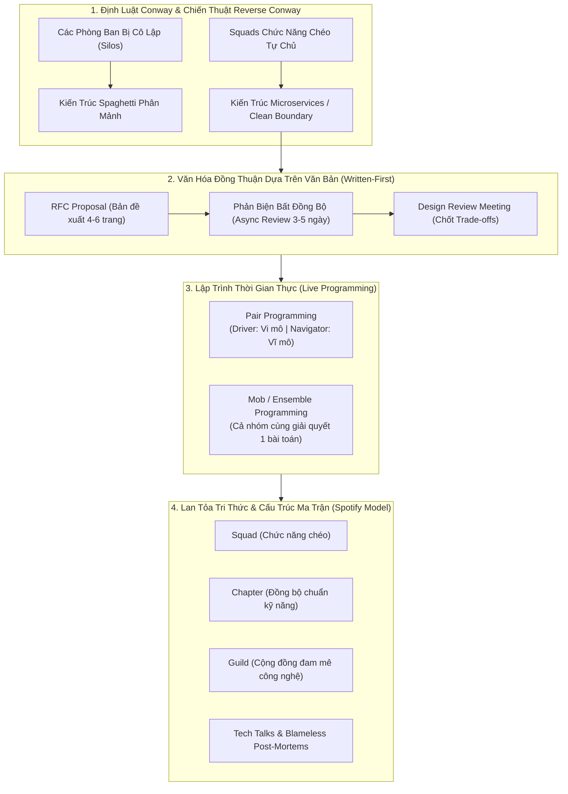

# 16.2. Văn Hóa Cộng Tác và Giao Tiếp Kỹ Thuật (Engineering Collaboration & Communication)

> [!IMPORTANT]
> **Nếu bạn chỉ được nhớ một điều duy nhất:** Theo Định luật Conway (1967), kiến trúc phần mềm luôn là tấm gương phản chiếu chính xác cấu trúc giao tiếp của tổ chức — muốn có một hệ thống phân tán phân tách độc lập (Loose Coupling) và module hóa cao, bắt buộc phải tái cấu trúc tổ chức (Reverse Conway Maneuver) sang các Squads chức năng chéo, đồng thuận kỹ thuật dựa trên văn bản (Written-First RFC) và nuôi dưỡng văn hóa an toàn tâm lý (Psychological Safety) để triệt tiêu các ốc đảo tri thức (Knowledge Silos).

---

## 1. Kiến trúc Tổng quan & Mô hình Tư duy (Mental Model)

### Ẩn dụ Đời sống: Dàn Nhạc Giao Hưởng Thính Phòng & Quản Trị Nguồn Lực Buồng Lái (Aviation CRM)
Hãy hình dung văn hóa cộng tác trong một tổ chức kỹ thuật quy mô lớn tương tự như sự phối hợp của một Dàn Nhạc Giao Hưởng và Phi hành đoàn Hàng không:
- **Định Luật Conway (Bản Hòa Âm Của Dàn Nhạc)**: Nếu bộ gõ, bộ dây và bộ kèn đồng ngồi ở 3 căn phòng cách âm riêng biệt và không bao giờ nhìn thấy nhau, bản giao hưởng khi phát ra sẽ là một đống âm thanh hỗn tạp, lỗi nhịp và lệch tông (Kiến trúc Monolith spaghetti bị chia cắt tùy tiện).
- **Written-First Culture (Bản Tổng Phổ Âm Nhạc Được Soạn Thảo Cẩn Trọng)**: Nhà soạn nhạc không vẫy tay nói miệng mơ hồ về giai điệu. Mọi nốt nhạc, cao độ, nhịp phách được ghi lại chính xác tuyệt đối trên bản tổng phổ (RFC Narrative Document). Mọi nhạc công cùng đọc, thẩm thấu và phản biện trước khi cây gậy chỉ huy vung lên.
- **Pair Programming (Cơ Trưởng & Cơ Phó Trong Buồng Lái)**:
  - *Driver (Cơ Phó đang điều khiển cần lái)*: Chăm chú vào đồng hồ tốc độ, độ cao, giữ thăng bằng cánh máy bay (Tập trung viết hàm, gõ code, vượt qua bài Unit Test trước mắt).
  - *Navigator (Cơ Trưởng quan sát)*: Theo dõi radar thời tiết, quét tầm nhìn xa 100 dặm, liên lạc với đài không lưu, dự báo các vùng nhiễu động (Quan sát kiến trúc tổng thể, bảo mật, edge cases).
  - Hai người liên tục giao tiếp bằng ngôn ngữ chuẩn hóa và đổi vai sau mỗi chu kỳ bay.
- **Mob / Ensemble Programming (Phòng Mổ Cấp Cứu Bệnh Viện)**: Khi một ca bệnh cực kỳ phức tạp cập bến (Một bài toán kiến trúc hóc búa), toàn bộ kíp mổ (Bác sĩ phẫu thuật chính, chuyên gia gây mê, y tá, dược sĩ) cùng đứng quanh bàn mổ. Một người cầm dao mổ dưới sự định hướng đồng thanh của cả kíp. Không có thời gian chờ đợi viết giấy chuyển viện (Xóa bỏ hoàn toàn độ trễ Code Review kéo dài hàng tuần).
- **Spotify Model: Squad, Tribe, Chapter & Guild (Tổ Chức Biệt Kích)**:
  - *Squad*: Đội đặc nhiệm hỗn hợp (Cross-functional) có đủ lính bắn tỉa, bác sĩ quân y, hoa tiêu (Dev, QA, PO, Designer) tự chủ tác chiến trên một mục tiêu cụ thể.
  - *Guild*: Câu lạc bộ các tay súng bắn tỉa trên toàn quân đoàn tụ họp vào cuối tuần để đàm đạo về các loại kính ngắm quang học mới (Chia sẻ chuyên môn công nghệ xuyên tổ chức).



---

## 2. Chi tiết từng Keyword (Under-the-Hood Deep Dive)

### 2.1. Written-First Architecture: Technical Discussions, RFC & Design Reviews

#### 1. Định Luật Conway (Conway's Law) & Reverse Conway Maneuver
- **Phát biểu của Melvin Conway (1967)**:
  *"Organizations which design systems are constrained to produce designs which are copies of the communication structures of these organizations."*
  (Các tổ chức thiết kế hệ thống phần mềm bị ràng buộc phải tạo ra các thiết kế là bản sao chép cấu trúc giao tiếp của chính tổ chức đó).
- **Hệ quả thực tế**:
  - Nếu công ty chia nhóm thành 3 phòng ban riêng biệt: Nhóm Giao diện (Frontend Team), Nhóm Xử lý nghiệp vụ (Backend Team) và Nhóm Cơ sở dữ liệu (DBA Team), thì hệ thống phần mềm sẽ luôn luôn bị ép vào mô hình 3 tầng cứng nhắc (3-Tier Architecture) với vô số xung đột giao tiếp qua lại giữa các phòng ban.
- **Chiến lược Đảo ngược Conway (Reverse Conway Maneuver)**:
  - Nếu muốn kiến trúc phần mềm bao gồm các Microservices độc lập, có ranh giới rành mạch (Bounded Contexts theo DDD), tổ chức **bắt buộc phải tái cấu trúc đội ngũ thành các Squads chức năng chéo (Cross-Functional Teams)**: Mỗi squad sở hữu trọn vẹn từ Frontend, Backend, Database cho tới hạ tầng CI/CD của dịch vụ đó.

#### 2. Văn Hóa Ưu Tiên Văn Bản (Written-First Culture - Amazon / Stripe Model)
- **Cơ chế Silent Reading Meetings (Amazon Narrative Memo)**:
  - Không ai dùng PowerPoint trình chiếu các gạch đầu dòng hời hợt.
  - Tác giả soạn một tài liệu văn bản mạch lạc dài 6 trang (Narrative 6-Pager) hoặc RFC.
  - Trong 20 phút đầu tiên của cuộc họp, **tất cả mọi người ngồi im lặng đọc tài liệu từ đầu đến cuối** và ghi chú các câu hỏi phản biện trực tiếp lên văn bản.
  - 40 phút còn lại chỉ tập trung tranh luận vào các điểm rủi ro, phân tích các giải pháp thay thế bị loại bỏ, và chốt phương án.
- **Quy tắc ứng xử trong tranh luận kỹ thuật (Technical Discussion Etiquette)**:
  - *Tách bạch cái tôi khỏi ý tưởng (Ego-less Engineering)*: Chỉ trích kiến trúc, không chỉ trích con người. Thay vì nói: *"Thiết kế của anh quá tệ và ngây thơ"*, hãy nói: *"Giải pháp này có rủi ro nghẽn I/O khi lưu lượng đạt 50,000 QPS, chúng ta đã có phương án dự phòng cho kịch bản đó chưa?"*.
  - *Hard on problems, soft on people*: Tôn trọng sự đa dạng quan điểm, tìm kiếm sự thật khách quan thông qua dữ liệu (Data-driven) và benchmark thực nghiệm thay vì dựa vào uy quyền chức danh.

---

### 2.2. Live Programming Collaboration: Pair Programming vs Mob Programming

#### 1. Pair Programming: Mô Hình Driver - Navigator & Ping-Pong Pairing
- **Vai trò Driver & Navigator**:
  - *Driver*: Chịu trách nhiệm về bàn phím, điều hướng file, viết mã chi tiết, giải quyết các lỗi cú pháp và đảm bảo code biên dịch thành công.
  - *Navigator*: Đọc lướt qua code mà Driver đang gõ, kiểm tra tính đúng đắn về thuật toán, suy nghĩ về các kịch bản lỗi biên (Edge Cases, Null values, Memory leaks), và ghi chú các task cần làm tiếp theo.
  - Đổi vai đều đặn sau mỗi 25-30 phút để duy trì sự tỉnh táo và tập trung cao độ.
- **Kỹ thuật Ping-Pong Pairing (Kết hợp với TDD)**:
  - Kỹ sư A viết một bài Unit Test thất bại (Red).
  - Kỹ sư B nhận bàn phím và viết mã tối giản để bài Test đó vượt qua (Green).
  - Kỹ sư B sau đó viết tiếp một bài Unit Test mới thất bại (Red).
  - Kỹ sư A nhận lại bàn phím và viết code để vượt qua (Green).
  - Cả hai cùng phối hợp tái cấu trúc (Refactor).

#### 2. Mob / Ensemble Programming (Lập Trình Tập Thể)
- **Bản chất**: Toàn bộ nhóm kỹ thuật (4-6 kỹ sư) cùng ngồi trước một màn hình lớn để giải quyết một bài toán nghiệp vụ phức tạp.
- **Quy tắc bàn phím (The Driver-Navigator Rule)**:
  - Người ngồi ở bàn phím (Driver) **không được tự ý gõ code từ suy nghĩ của chính mình**. Driver chỉ là "bộ gõ thông minh" nhận chỉ thị từ tập thể (Navigators). Nếu Driver có ý tưởng mới, Driver phải truyền bàn phím cho người khác và bước ra ngoài khu vực Navigator để giải thích ý tưởng.
- **Lợi ích kinh tế học**:
  - Triệt tiêu $100\%$ hiện tượng tồn đọng Pull Request (PR Backlog). Code được tạo ra đến đâu là đã được cả nhóm review và nghiệm thu đến đó, sẵn sàng deploy ngay lập tức.
  - Tốc độ lan tỏa tri thức trong nhóm đạt mức cực đại; các thành viên mới hòa nhập văn hóa và hiểu mã nguồn chỉ sau 1 tuần.

---

### 2.3. Knowledge Scaling: Guilds, Chapters, InnerSource & Blameless Culture

#### 1. Mô Hình Ma Trận Spotify (Squads, Tribes, Chapters & Guilds)
- **Squad**: Đơn vị chiến đấu cơ bản (6-8 người), tự chủ hoàn toàn (Autonomous), sở hữu toàn bộ vòng đời của một tính năng kinh doanh.
- **Tribe**: Tập hợp các Squads có cùng lĩnh vực kinh doanh (ví dụ: Payments Tribe, Search Tribe).
- **Chapter**: Nhóm chuyên môn kỹ thuật theo trục dọc trong Tribe (ví dụ: Chapter các kỹ sư Backend). Chapter Lead chịu trách nhiệm cố vấn nghề nghiệp, đánh giá năng lực và duy trì chuẩn mực kỹ thuật.
- **Guild**: Cộng đồng sở thích và chuyên môn mở rộng xuyên suốt toàn bộ tổ chức (Cross-Tribe). Bất kỳ ai quan tâm đến bảo mật đều có thể tham gia *Security Guild*, bất kỳ ai yêu thích ngôn ngữ Rust đều có thể gia nhập *Rust Guild*.

#### 2. Tech Talks, Brown Bag Sessions & InnerSource
- **Brown Bag Sessions**: Các buổi chia sẻ kỹ thuật thân mật vào giờ ăn trưa (mỗi người mang theo một túi đồ ăn - Brown Bag) để nghe một đồng nghiệp thuyết trình về một công nghệ mới, một thư viện hay ho, hoặc một bài học đau thương sau sự cố.
- **InnerSource**: Áp dụng các phương pháp luận của Mã Nguồn Mở (Open Source) vào nội bộ doanh nghiệp. Mọi kho chứa mã nguồn đều được mở quyền đọc công khai cho toàn bộ kỹ sư trong công ty. Nếu Team A cần một tính năng từ Service của Team B, thay vì chờ đợi Team B lên lịch trình sau 3 tháng, Team A có thể tự tay tạo Pull Request đóng góp mã nguồn trực tiếp vào repo của Team B.

#### 3. Văn Hóa Không Đổ Lỗi (Blameless Culture & Blameless Post-Mortems)
- **Nguyên lý An toàn Tâm lý (Psychological Safety - Amy Edmondson, Harvard)**:
  - Trong một tổ chức kỹ thuật đỉnh cao, lỗi lầm được coi là **cơ hội vàng để học hỏi về các khiếm khuyết của hệ thống**, chứ không phải là dịp để trừng phạt cá nhân.
  - Giả định cơ bản: *"Mọi kỹ sư đều có ý định tốt và đã đưa ra quyết định hợp lý nhất dựa trên lượng thông tin họ có tại thời điểm xảy ra sự cố"*.
  - Nếu một kỹ sư lỡ tay gõ nhầm lệnh xóa database, lỗi **không thuộc về kỹ sư đó**, mà lỗi thuộc về **hệ thống phòng thủ**: Tại sao hệ thống lại cho phép một câu lệnh nguy hiểm được thực thi trực tiếp mà không có cơ chế xác thực hai lớp (Two-Person Rule)?

---

## 3. Thực thi Mã nguồn & Mô phỏng Chuyên sâu (Dual-Engine Implementation)

### 3.1. Phiên bản C++20: Động Cơ Biểu Quyết Đồng Thuận Kỹ Thuật RFC (Consensus State Machine)

```cpp
#include <iostream>
#include <string>
#include <vector>
#include <unordered_map>
#include <memory>
#include <format>
#include <chrono>
#include <stdexcept>

// ============================================================================
// 1. DATA CONTRACTS: RFC PROPOSAL & VOTING DOMAIN
// ============================================================================
enum class RfcDecisionStatus {
    UNDER_REVIEW,
    APPROVED_ACCEPTED,
    REJECTED,
    DEADLOCKED
};

std::string statusToString(RfcDecisionStatus s) {
    switch (s) {
        case RfcDecisionStatus::UNDER_REVIEW: return "UNDER_REVIEW";
        case RfcDecisionStatus::APPROVED_ACCEPTED: return "APPROVED_ACCEPTED (Đã thông qua)";
        case RfcDecisionStatus::REJECTED: return "REJECTED (Bị từ chối)";
        case RfcDecisionStatus::DEADLOCKED: return "DEADLOCKED (Bế tắc - Cần can thiệp)";
    }
    return "UNKNOWN";
}

enum class VoteType { APPROVE, BLOCKING_OBJECTION, NEUTRAL };

struct EngineeringReviewer {
    std::string engineerId;
    std::string role; // Principal, Staff, Security Lead...
    bool hasVetoPower{false}; // Quyền phủ quyết về mặt bảo mật/kiến trúc
};

struct ReviewerFeedback {
    EngineeringReviewer reviewer;
    VoteType vote;
    std::string technicalRationale; // Lý do kỹ thuật bắt buộc phải có khi phản đối
};

// ============================================================================
// 2. RFC CONSENSUS STATE MACHINE ENGINE
// ============================================================================
class RfcConsensusEngine {
private:
    int rfcId_;
    std::string title_;
    std::vector<ReviewerFeedback> feedbacks_;

public:
    RfcConsensusEngine(int id, std::string title) : rfcId_(id), title_(std::move(title)) {}

    void submitReview(const EngineeringReviewer& reviewer, VoteType vote, const std::string& rationale) {
        if (vote == VoteType::BLOCKING_OBJECTION && rationale.length() < 20) {
            throw std::invalid_argument("Phủ quyết kỹ thuật (Blocking Objection) bắt buộc phải kèm lý do phân tích chi tiết!");
        }
        feedbacks_.push_back({reviewer, vote, rationale});
        std::cout << std::format("  [RFC Review Log] Kỹ sư {} ({}) đã gửi biểu quyết: {}\n",
                                 reviewer.engineerId, reviewer.role, 
                                 (vote == VoteType::APPROVE ? "TÁN THÀNH" : 
                                 (vote == VoteType::BLOCKING_OBJECTION ? "PHẢN ĐỐI KỸ THUẬT" : "TRUNG LẬP")));
    }

    [[nodiscard]] RfcDecisionStatus evaluateConsensus() const {
        int approvals = 0;
        bool hasBlockingVeto = false;

        for (const auto& fb : feedbacks_) {
            if (fb.vote == VoteType::BLOCKING_OBJECTION) {
                // Nếu người phủ quyết có quyền Veto (Security/Staff)
                if (fb.reviewer.hasVetoPower) {
                    return RfcDecisionStatus::REJECTED;
                }
                hasBlockingVeto = true;
            } else if (fb.vote == VoteType::APPROVE) {
                approvals++;
            }
        }

        if (hasBlockingVeto && approvals > 0) {
            return RfcDecisionStatus::DEADLOCKED; // Có mâu thuẫn cần họp Design Review trực tiếp
        }

        if (approvals >= 2 && !hasBlockingVeto) {
            return RfcDecisionStatus::APPROVED_ACCEPTED;
        }

        return RfcDecisionStatus::UNDER_REVIEW;
    }

    void printSummary() const {
        std::cout << "\n=== KẾT QUẢ ĐỒNG THUẬN KỸ THUẬT CHO RFC-" << rfcId_ << " ===\n";
        std::cout << "Tiêu đề: " << title_ << "\n";
        std::cout << "Trạng thái quyết định: " << statusToString(evaluateConsensus()) << "\n";
        std::cout << "Chi tiết ý kiến phản biện:\n";
        for (const auto& fb : feedbacks_) {
            std::cout << std::format("  * [{}] {}: {}\n", 
                                     fb.reviewer.engineerId, 
                                     (fb.vote == VoteType::APPROVE ? "Tán thành" : "Ý kiến"),
                                     fb.technicalRationale);
        }
    }
};

int main() {
    std::cout << "=========================================================\n";
    std::cout << "  DEMO WRITTEN-FIRST: RFC CONSENSUS STATE MACHINE (C++20)\n";
    std::cout << "=========================================================\n\n";

    RfcConsensusEngine rfc108(108, "Di Chuyển Hệ Thống Thanh Toán Sang Kiến Trúc Event-Driven Bằng Kafka");

    EngineeringReviewer leadDev{"alice_staff", "Staff Software Engineer", false};
    EngineeringReviewer secOfficer{"bob_sec", "Chief Security Officer", true};
    EngineeringReviewer sreLead{"carol_sre", "Principal SRE", false};

    std::cout << "--- BẮT ĐẦU VÒNG PHẢN BIỆN BẤT ĐỒNG BỘ TRÊN VĂN BẢN (ASYNC REVIEW) ---\n";
    rfc108.submitReview(leadDev, VoteType::APPROVE, "Kiến trúc bóc tách tốt, giảm coupling giữa Auth và Billing.");
    rfc108.submitReview(sreLead, VoteType::APPROVE, "Đã thẩm định kế hoạch monitoring Kafka Consumer Lag. Đạt chuẩn vận hành.");
    
    // Thử nghiệm Security phát hiện lỗ hổng mã hóa dữ liệu
    rfc108.submitReview(secOfficer, VoteType::BLOCKING_OBJECTION, 
                        "Payload trên Kafka Topic chứa số thẻ tín dụng thô mà không có mã hóa tầng ứng dụng (Envelope Encryption)!");

    rfc108.printSummary();

    return 0;
}
```

---

### 3.2. Phiên bản Python 3.11+: Bộ Đếm Thời Gian Hoán Đổi Vai Trò Pair Programming (Pomodoro & Driver-Navigator Rotation)

```python
from __future__ import annotations
import time
from dataclasses import dataclass
from typing import List, Tuple


@dataclass
class SoftwareEngineer:
    name: str
    github_handle: str
    strengths: str


class PairProgrammingSession:
    """Điều phối phiên làm việc Pair Programming với cơ chế luân phiên Driver-Navigator."""

    def __init__(self, engineer_a: SoftwareEngineer, engineer_b: SoftwareEngineer, rotation_interval_min: int = 25):
        self._eng_a = engineer_a
        self._eng_b = engineer_b
        self._interval_sec = rotation_interval_min * 60
        self._driver = engineer_a
        self._navigator = engineer_b
        self._round_count = 1

    def swap_roles(self) -> None:
        self._driver, self._navigator = self._navigator, self._driver
        self._round_count += 1
        print("\n" + "🔄 " * 20)
        print(f"  >>> HẾT CHU KỲ POMODORO! TIẾN HÀNH HOÁN ĐỔI VAI TRÒ (ROUND #{self._round_count}) <<<")
        print(f"  * DRIVER MỚI (Bàn phím & Unit Test)   : {self._driver.name} (@{self._driver.github_handle})")
        print(f"  * NAVIGATOR MỚI (Kiến trúc & An toàn) : {self._navigator.name} (@{self._navigator.github_handle})")
        print("🔄 " * 20 + "\n")

    def simulate_pairing_session(self, total_rounds: int = 3) -> None:
        print("=" * 65)
        print("    BẮT ĐẦU PHIÊN LÀM VIỆC CỘNG TÁC PAIR PROGRAMMING CHUYÊN SÂU")
        print("=" * 65)
        print(f"Kỹ sư 1: {self._eng_a.name} (Sở trường: {self._eng_a.strengths})")
        print(f"Kỹ sư 2: {self._eng_b.name} (Sở trường: {self._eng_b.strengths})")
        print(f"Khởi điểm: DRIVER là {self._driver.name} | NAVIGATOR là {self._navigator.name}\n")

        for r in range(1, total_rounds + 1):
            print(f"[Tiến trình] Vòng #{r} đang diễn ra: {self._driver.name} đang gõ mã nguồn...")
            print(f"             {self._navigator.name} đang đối soát edge cases và an ninh mạng...")
            time.sleep(0.5) # Mô phỏng thời gian tập trung
            if r < total_rounds:
                self.swap_roles()

        print("\n" + "=" * 65)
        print("    PHIÊN PAIR PROGRAMMING KẾT THÚC THÀNH CÔNG VĨ ĐẠI!")
        print("    Code đã được Review 100%, sẵn sàng merge vào Main branch!")
        print("=" * 65)


if __name__ == "__main__":
    dev1 = SoftwareEngineer(name="Nguyen Van Nam", github_handle="nam_backend", strengths="Tối ưu hóa Database, TDD")
    dev2 = SoftwareEngineer(name="Le Thi Mai", github_handle="mai_sec", strengths="Bảo mật ứng dụng, Clean Architecture")

    session = PairProgrammingSession(dev1, dev2, rotation_interval_min=25)
    session.simulate_pairing_session(total_rounds=3)
```

### 3.3. Giả Lập Terminal Output Thực Tế

```text
=========================================================
  DEMO WRITTEN-FIRST: RFC CONSENSUS STATE MACHINE (C++20)
=========================================================

--- BẮT ĐẦU VÒNG PHẢN BIỆN BẤT ĐỒNG BỘ TRÊN VĂN BẢN (ASYNC REVIEW) ---
  [RFC Review Log] Kỹ sư alice_staff (Staff Software Engineer) đã gửi biểu quyết: TÁN THÀNH
  [RFC Review Log] Kỹ sư carol_sre (Principal SRE) đã gửi biểu quyết: TÁN THÀNH
  [RFC Review Log] Kỹ sư bob_sec (Chief Security Officer) đã gửi biểu quyết: PHẢN ĐỐI KỸ THUẬT

=== KẾT QUẢ ĐỒNG THUẬN KỸ THUẬT CHO RFC-108 ===
Tiêu đề: Di Chuyển Hệ Thống Thanh Toán Sang Kiến Trúc Event-Driven Bằng Kafka
Trạng thái quyết định: REJECTED (Bị từ chối)
Chi tiết ý kiến phản biện:
  * [alice_staff] Tán thành: Kiến trúc bóc tách tốt, giảm coupling giữa Auth và Billing.
  * [carol_sre] Tán thành: Đã thẩm định kế hoạch monitoring Kafka Consumer Lag. Đạt chuẩn vận hành.
  * [bob_sec] Ý kiến: Payload trên Kafka Topic chứa số thẻ tín dụng thô mà không có mã hóa tầng ứng dụng (Envelope Encryption)!
```

---

## 4. Systems Engineering & Production Pitfalls

### Cạm Bẫy Sản Xuất Thường Gặp (Production Anti-Patterns & Gotchas)

1. **Hiểm Họa Sự Đồng Thuận Giả Tạo (The Illusion of Consensus / Groupthink)**:
   - *Bản chất*: Trong các buổi Design Review, kỹ sư ngại va chạm hoặc sợ mất lòng đồng nghiệp nên chỉ im lặng gật đầu đồng ý (`LGTM - Looks Good To Me`). Không ai dám lên tiếng chỉ ra lỗ hổng kiến trúc chí mạng. Khi hệ thống deploy lên Production và bị sập nguồn, tất cả mới thừa nhận: *"Thực ra ngay từ đầu tôi đã thấy phương án này có vấn đề"*.
   - *Giải pháp*: Áp dụng vai trò **"Trạng sư của Quỷ" (Devil's Advocate)** luân phiên trong mỗi buổi họp kiến trúc, người này có nhiệm vụ bắt buộc phải tìm ra ít nhất 3 kịch bản thất bại tồi tệ nhất của đề xuất.

2. **Cơn Ác Mộng Kiệt Sức Do Pair Programming Thiếu Điều Tiết (Pairing Exhaustion)**:
   - *Bản chất*: Ép buộc kỹ sư phải Pair Programming 8 tiếng liên tục mỗi ngày. Vì Pair Programming đòi hỏi mức độ tập trung nhận thức cực độ (High-Cognitive Demand), kỹ sư sẽ nhanh chóng rơi vào trạng thái kiệt quệ tinh thần (Burnout).
   - *Giải pháp*: Chỉ nên Pair Programming tối đa 3-4 tiếng mỗi ngày cho các bài toán phức tạp; dành thời gian còn lại cho kỹ sư làm việc độc lập (Solo Deep Work), nghiên cứu tài liệu và thư giãn.

3. **Cái Tôi Kỹ Sư Lấn Át Dữ Liệu (Ego-Driven Architecture)**:
   - *Bản chất*: Một kỹ sư kỳ cựu khăng khăng đòi chọn công nghệ mình yêu thích dù nó hoàn toàn không phù hợp với bài toán của doanh nghiệp (ví dụ: Ép dùng Blockchain hoặc Rust cho một ứng dụng CRUD nội bộ 10 người dùng).
   - *Giải pháp*: Buộc mọi đề xuất kiến trúc phải có ma trận so sánh đánh đổi (Trade-off Matrix) và chạy Benchmark thực nghiệm trên dữ liệu giả lập trước khi được phê duyệt.

4. **Kỹ Thuật Chẩn Đoán & Giám Sát Production Bằng CLI**:
   ```bash
   # 1. Đo lường tỷ lệ phân phối đóng góp code (Bus Factor risk analysis) bằng git-fame
   git-fame --cost=commits --loc=surviving --incl="src/.*\.cpp$"

   # 2. Phân tích các file mã nguồn thường xuyên bị sửa đổi cùng nhau (Temporal Coupling do Conway's Law)
   git log --name-only --oneline | grep -v ' ' | sort | uniq -c | sort -nr | head -n 25

   # 3. Quét kiểm tra độ tuân thủ tiêu chuẩn RFC/ADR trong thư mục docs
   find docs/adr -name "*.md" -exec grep -H "Status:" {} \;
   ```

---

## 5. Bảng So sánh & Decision Matrix

### 5.1. So Sánh Các Phương Thức Lập Trình Cộng Tác (Collaborative Programming Modes)

| Tiêu Chí So Sánh | Lập Trình Đơn Lẻ (Solo Coding) | Lập Trình Đôi (Pair Programming) | Lập Trình Tập Thể (Mob Programming) |
| :--- | :--- | :--- | :--- |
| **Số lượng người tham gia** | 1 người | 2 người (Driver + Navigator) | Toàn bộ nhóm (3-6 người) |
| **Tốc độ gõ code thô ban đầu**| Nhanh nhất | Chậm hơn 15% | Chậm hơn |
| **Chất lượng mã nguồn & Ít bug**| Thấp nhất (Dễ dính lỗi mù điểm) | Rất cao (Giảm 50% số bug) | Hoàn hảo nhất (Kiểm duyệt tức thì) |
| **Độ trễ chờ Code Review** | Rất lâu (Chờ PR từ 1 đến 5 ngày)| Không có (Code đã được review ngay)| Hoàn toàn bằng 0 |
| **Tốc độ lan tỏa tri thức** | 0% (Silo tri thức cá nhân) | Cao (Giữa 2 người) | Cực đại (Lan tỏa toàn đội ngũ) |
| **Mức độ tiêu hao năng lượng** | Trung bình | Rất cao (Cần nghỉ ngơi Pomodoro)| Cao nhưng có tính chia sẻ |

### 5.2. Ma Trận Quyết Định Lựa Chọn Cơ Chế Cộng Tác

| Tính Chất Bài Toán Kỹ Thuật | Phương Thức Cộng Tác Khuyên Dùng | Lý Do Kỹ Thuật Cốt Lõi |
| :--- | :--- | :--- |
| **Công việc CRUD lặp lại, tài liệu hướng dẫn đã rõ ràng** | **Solo Coding + Asynchronous PR Review** | Tối ưu hóa năng suất cá nhân, không lãng phí 2 người |
| **Refactoring module cốt lõi, áp dụng Design Pattern mới** | **Pair Programming (Driver - Navigator)** | Phát hiện sớm các lỗi biên kiến trúc, đảm bảo test tốt |
| **Xử lý sự cố Outage SEV-1 hoặc thiết kế kiến trúc mới tinh** | **Mob / Ensemble Programming** | Tập hợp trí tuệ tập thể, ra quyết định khẩn cấp tức thì |
| **Đề xuất thay đổi cơ sở dữ liệu hoặc framework toàn công ty**| **Written-First RFC Process (Async 5 ngày)** | Thu thập phản biện đa chiều từ Security, SRE, Tech Leads |
