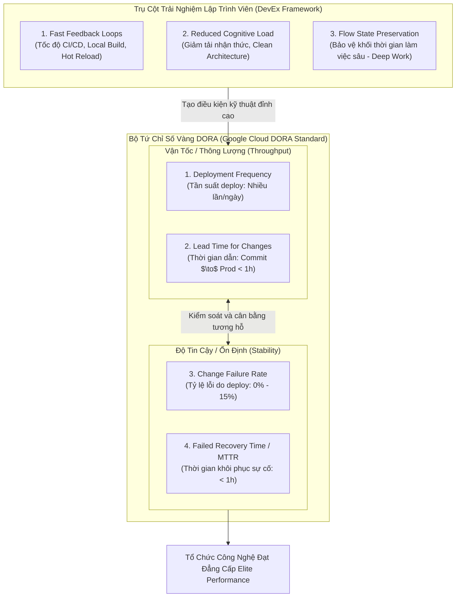
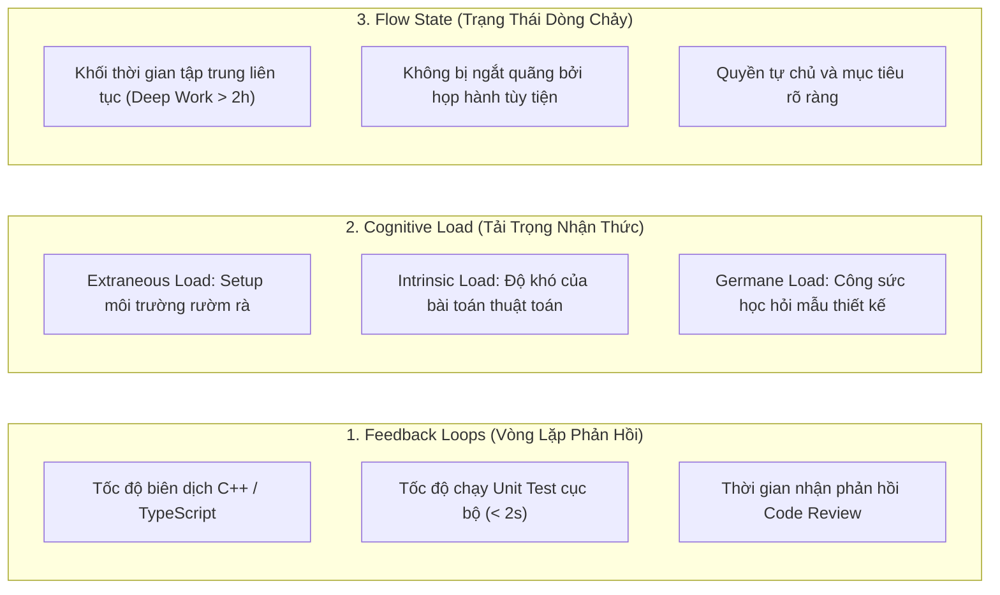

# 16.3. Đo Lường Hiệu Năng Kỹ Thuật và Trải Nghiệm Lập Trình Viên (Engineering Metrics, DORA & DevEx)

> [!IMPORTANT]
> **Nếu bạn chỉ được nhớ một điều duy nhất:** Đo lường sai lầm sẽ làm băng hoại văn hóa kỹ thuật (Định luật Goodhart: *"Khi một thước đo trở thành mục tiêu, nó sẽ không còn là một thước đo tốt nữa"* — đánh giá bằng số dòng code hay số commit sẽ sinh ra code rác) — chuẩn mực khoa học duy nhất để đo lường năng lực kỹ nghệ là **Bộ tứ chỉ số vàng DORA (cân bằng hoàn hảo giữa Vận tốc và Độ ổn định)** kết hợp với **khung đánh giá DevEx (tối ưu hóa Feedback Loops, triệt tiêu Cognitive Load và bảo vệ Flow State của kỹ sư)**.

---

## 1. Kiến trúc Tổng quan & Mô hình Tư duy (Mental Model)

### Ẩn dụ Đời sống: Bảng Điều Khiển Viễn Trắc Buồng Lái Máy Bay Siêu Thanh & Đồng Hồ Đo Thể Thao Đỉnh Cao F1
Hãy hình dung việc đo lường năng lực kỹ nghệ phần mềm tương tự như hệ thống cảm biến viễn trắc (Telemetry) của một chiếc xe đua F1 hoặc máy bay tiêm kích:
- **Định Luật Goodhart & Thước Đo Phù Phiếm (Số Lần Nhấn Chân Ga Không Đồng Nghĩa Với Vận Tốc)**: Nếu một đội đua đánh giá tay đua bằng "Số lần đạp chân ga mỗi phút" (tương tự đếm Số dòng code LOC hay Số Commits), tay đua sẽ liên tục đạp nhả chân ga điên cuồng trên đường thẳng mà xe vẫn không chạy nhanh hơn, chỉ làm cháy động cơ và lãng phí xăng.
- **Bộ Tứ DORA (Cặp Cân Bằng Hoàn Hảo Giữa Tốc Độ và Sự An Toàn)**:
  - *Deployment Frequency (Tần suất sang số & nhịp tim động cơ)*: Xe sang số mượt mà liên tục, không bị giật cục.
  - *Lead Time for Changes (Thời gian từ khi đạp ga đến khi xe tăng tốc)*: Phản ứng tức thì của động cơ điện (Từ lúc commit code đến khi chạy trên Production).
  - *Change Failure Rate - CFR (Tỷ lệ xe bị mất lái hoặc nổ lốp)*: Thước đo kiểm soát rủi ro an toàn, đảm bảo xe chạy nhanh nhưng không đâm vào rào chắn.
  - *Failed Deployment Recovery Time / MTTR (Thời gian đội cứu hộ kéo xe về đường đua)*: Khi bị trượt bánh, xe có thể quay trở lại cuộc đua trong bao nhiêu giây?
- **DevEx - Developer Experience (Giao Diện Buồng Lái & Sự Thoải Mái Của Phi Công)**:
  - *Fast Feedback Loops (Đồng hồ đo tốc độ tức thì)*: Khi phi công gạt cần lái, máy bay phản hồi trong 5 mili-giây (Mã nguồn biên dịch trong 5 giây, Unit Test chạy xong tức thì). Nếu gạt cần lái mà 30 phút sau cánh máy bay mới nhúc nhích (CI chạy mất 45 phút), phi công sẽ phát điên và đâm máy bay xuống đất.
  - *Cognitive Load (Bố cục nút bấm thông minh)*: Phi công chỉ cần nhìn vào màn hình hiển thị trước kính lái (HUD); không ai bắt phi công phải mở 40 cuốn sổ tay hướng dẫn cơ khí chỉ để bấm nút bật điều hòa buồng lái.
  - *Flow State (Khoảng thời gian tập trung cao độ không bị quấy rầy)*: Tay đua đang vào cua ở tốc độ $300\text{ km/h}$, đài chỉ huy tuyệt đối không được gọi điện hỏi những câu hành chính vụn vặt như: *"Hôm nay anh định ăn trưa lúc mấy giờ?"*.



---

## 2. Chi tiết từng Keyword (Under-the-Hood Deep Dive)

### 2.1. The 4 DORA Golden Metrics (Google Cloud DORA Standard)

#### 1. Bản Chất Khoa Học Của Nghiên Cứu DORA (Dr. Nicole Forsgren & Jez Humble)
Sau 7 năm khảo sát hơn 32,000 tổ chức công nghệ trên toàn cầu, DORA đã chứng minh một chân lý bác bỏ hoàn toàn quan niệm truyền thống:
- *Quan niệm sai lầm cổ điển*: "Muốn hệ thống ổn định thì phải deploy thật chậm, kiểm thử thủ công hàng tháng trời; deploy nhanh sẽ làm sập hệ thống!".
- *Kết luận khoa học của DORA*: **Các tổ chức đẳng cấp cao nhất (Elite Performers) vừa deploy NHANH GẤP HÀNG TRĂM LẦN, vừa có TỶ LỆ LỖI THẤP HƠN GẤP 3 LẦN và KHÔI PHỤC SỰ CỐ NHANH HƠN GẤP HÀNG NGHÌN LẦN** so với các tổ chức chậm chạp. Tốc độ và Sự ổn định không hề loại trừ nhau, chúng tương hỗ và củng cố lẫn nhau thông qua tự động hóa CI/CD.

#### 2. Chi Tiết 4 Chỉ Số DORA
1. **Deployment Frequency (Tần suất Triển khai - Đo lường Thông lượng)**:
   - Tần suất các thay đổi mã nguồn thành công được đẩy lên môi trường Production thực tế.
   - *Tại sao quan trọng*: Phản ánh kích thước của các lô hàng (Batch Size). Deploy càng thường xuyên nghĩa là mỗi đợt deploy chỉ chứa một vài thay đổi nhỏ, rủi ro cực thấp và dễ dàng rollback.
2. **Lead Time for Changes (Thời gian Dẫn cho Thay đổi - Đo lường Tốc độ)**:
   - Thời gian tính từ khi một commit đầu tiên được ghi nhận trên Git cho tới khi đoạn code đó chính thức phục vụ người dùng trên Production.
   - *Phân đoạn chu kỳ*: Thời gian Code $\to$ Thời gian Review PR $\to$ Thời gian chạy Pipeline CI $\to$ Thời gian Deploy CD.
3. **Change Failure Rate (CFR - Tỷ lệ Thất bại của Thay đổi - Đo lường Chất lượng)**:
   - Tỷ lệ phần trăm các lần deploy lên Production dẫn tới sự cố suy giảm dịch vụ (cần phải rollback khẩn cấp, tung bản vá hotfix hoặc phát sinh outage):
     $$\text{CFR} = \frac{\text{Số lần Deploy gây lỗi Production}}{\text{Tổng số lần Deploy trong kỳ}} \times 100\%$$
4. **Failed Deployment Recovery Time / MTTR (Thời gian Khôi phục Triển khai Hỏng)**:
   - Thời gian tính từ lúc sự cố do deploy được phát hiện cho tới khi hệ thống được khôi phục về trạng thái bình thường (nhờ Automated Rollback, Feature Flags hoặc Blue/Green Traffic Switching).

#### 3. Bảng Phân Loại Năng Lực Công Nghệ Toàn Cầu Theo DORA Benchmark

| Chỉ Số DORA | Elite Performers | High Performers | Medium Performers | Low Performers |
| :--- | :---: | :---: | :---: | :---: |
| **Deployment Frequency** | **Theo yêu cầu (Nhiều lần/ngày)** | 1 lần/tuần đến 1 lần/tháng | 1 lần/tháng đến 6 tháng | Ít hơn 1 lần/6 tháng |
| **Lead Time for Changes** | **$< 1$ Giờ** | 1 ngày đến 1 tuần | 1 tuần đến 1 tháng | 1 tháng đến 6 tháng |
| **Change Failure Rate** | **$0\% - 15\%$** | $16\% - 30\%$ | $16\% - 30\%$ | $46\% - 60\%$ |
| **Failed Recovery Time (MTTR)**| **$< 1$ Giờ** | $< 1$ Ngày | 1 ngày đến 1 tuần | $> 1$ Tháng |

---

### 2.2. Operational Pipeline Metrics: Review Time, Build Time & Defect Escape Rate

#### 1. Code Review Latency (Thời Gian Chờ Thẩm Định Mã Nguồn)
- **Vấn đề "Điểm nghẽn review"**: Một kỹ sư gõ code mất 2 giờ, nhưng Pull Request nằm im lìm trên GitHub suốt 4 ngày để chờ đồng nghiệp duyệt. Đây là nguyên nhân lớn nhất ($80\%$) làm phình to Lead Time for Changes.
- **Biện pháp cải thiện**: Giới hạn kích thước PR ($< 250$ dòng code), thiết lập SLA review tự động trong Slack (cảnh báo nếu PR chưa được ngó ngàng sau 4 giờ), và áp dụng Pair Programming cho các task phức tạp.

#### 2. Build Time & Test Execution Time (Tốc Độ Pipeline CI)
- **Quy tắc 10 Phút của Extreme Programming (Kent Beck)**: Toàn bộ pipeline từ lúc `git push` đến khi biên dịch, chạy Unit Tests, linter, static analysis và sinh artifact container **bắt buộc phải hoàn tất trong vòng dưới 10 phút**.
- Nếu pipeline chạy mất 45 phút, kỹ sư sẽ rời khỏi bàn làm việc, chuyển sang lướt mạng xã hội, làm đứt gãy trạng thái tập trung sâu.
- **Kỹ thuật tối ưu hóa**: Caching layer Docker, chia song song bài test (Test Parallelization / Sharding trên 10 runners), và chỉ chạy các bài test liên quan đến các file bị thay đổi (Impact Analysis).

#### 3. Defect Escape Rate & Rework Rate
- **Defect Escape Rate (Tỷ lệ Lỗi Lọt Lưới Ra Môi Trường Thật)**:
  $$\text{Defect Escape Rate} = \frac{\text{Số bug khách hàng phát hiện trên Production}}{\text{Tổng số bug phát hiện (Cả QA nội bộ + Production)}} \times 100\%$$
  - Một chỉ số Defect Escape Rate cao chứng tỏ bộ kiểm thử tự động (Unit Test, Integration Test) đang có lỗ hổng kiểm soát chất lượng nghiêm trọng.
- **Rework Rate (Tỷ lệ Làm lại Mã nguồn)**: Đo lường phần trăm công sức kỹ sư phải xóa bỏ hoặc sửa đổi lại code trong vòng 21 ngày kể từ khi viết ra. Rework rate cao thường bắt nguồn từ việc mô tả User Story thiếu rõ ràng hoặc Product Owner thay đổi yêu cầu liên tục giữa chừng.

---

### 2.3. Developer Experience (DevEx) & Engineering Productivity

#### 1. Khung Đánh Giá DevEx (Developer Experience - Abi Noda, Margaret-Anne Storey, Nicole Forsgren)
DevEx xác định 3 chiều kích tâm lý và kỹ thuật cốt lõi ảnh hưởng trực tiếp đến năng suất của lập trình viên:



1. **Feedback Loops (Tốc Độ Vòng Lặp Phản Hồi)**:
   - Khoảng thời gian từ lúc kỹ sư thay đổi 1 dòng code cho tới khi nhìn thấy kết quả kiểm chứng (Hot Reload, Local Test runner). Vòng lặp phản hồi càng ngắn, kỹ sư càng tự tin thử nghiệm và sáng tạo.
2. **Cognitive Load (Tải Trọng Nhận Thức)**:
   - *Extraneous Cognitive Load (Tải trọng ngoại lai - Kẻ thù số 1)*: Sự mệt mỏi tinh thần bắt nguồn từ các công cụ tồi tệ, tài liệu hướng dẫn lỗi thời, hoặc quy trình cài đặt môi trường phức tạp đòi hỏi 40 bước thủ công.
   - *Mục tiêu kỹ thuật*: Triệt tiêu tải trọng ngoại lai bằng **Nền tảng Tự phục vụ (Internal Developer Platform - IDP / Docker Compose 1-click startup)** để kỹ sư dồn $100\%$ não bộ vào *Intrinsic Cognitive Load* (giải quyết logic nghiệp vụ của khách hàng).
3. **Flow State (Trạng Thái Dòng Chảy - Mihaly Csikszentmihalyi)**:
   - Trạng thái tinh thần thăng hoa khi kỹ sư hoàn toàn đắm chìm vào công việc, năng suất tư duy tăng vọt gấp 5 lần.
   - Để bảo vệ Flow State, tổ chức cần thiết lập **"No-Meeting Days" (Ngày Không Họp Hành)** và tôn trọng thời gian biểu của người sáng tạo (Maker's Schedule vs Manager's Schedule).

#### 2. Khung Đo Lường SPACE (GitHub & Microsoft Research)
Bổ sung cho DORA bằng việc nhìn nhận năng suất kỹ sư qua 5 chiều kích toàn diện:
- **S** - *Satisfaction and Well-being* (Sự thỏa mãn và hạnh phúc trong công việc).
- **P** - *Performance* (Hiệu năng đầu ra: chất lượng code, độ tin cậy).
- **A** - *Activity* (Hoạt động kỹ thuật: commits, PRs, deploys).
- **C** - *Communication and Collaboration* (Giao tiếp, review code, tài liệu hóa).
- **E** - *Efficiency and Flow* (Hiệu quả dòng chảy, ít ma sát, tốc độ feedback).

---

## 3. Thực thi Mã nguồn & Mô phỏng Chuyên sâu (Dual-Engine Implementation)

### 3.1. Phiên bản C++20: Động Cơ Thu Thập Dữ Liệu Và Đánh Giá Hạng Năng Lực DORA Tự Động

```cpp
#include <iostream>
#include <string>
#include <vector>
#include <format>
#include <chrono>
#include <numeric>
#include <cmath>

// ============================================================================
// 1. DATA CONTRACTS: DORA TELEMETRY METRICS
// ============================================================================
enum class DoraPerformanceTier {
    ELITE,
    HIGH,
    MEDIUM,
    LOW
};

std::string tierToString(DoraPerformanceTier tier) {
    switch (tier) {
        case DoraPerformanceTier::ELITE:  return "ELITE PERFORMER (Đẳng Cấp Thế Giới)";
        case DoraPerformanceTier::HIGH:   return "HIGH PERFORMER (Năng Lực Cao)";
        case DoraPerformanceTier::MEDIUM: return "MEDIUM PERFORMER (Trung Bình)";
        case DoraPerformanceTier::LOW:    return "LOW PERFORMER (Cần Cải Tổ Khẩn Cấp)";
    }
    return "UNKNOWN";
}

struct DeploymentRecord {
    std::string deploymentId;
    std::chrono::system_clock::time_point timestamp;
    double leadTimeHours;
    bool isFailure; // Gây ra sự cố Production cần khắc phục
    double recoveryTimeHours; // Thời gian khôi phục nếu bị lỗi
};

// ============================================================================
// 2. DORA METRICS ANALYZER ENGINE
// ============================================================================
class DoraMetricsAnalyzer {
private:
    std::vector<DeploymentRecord> records_;

public:
    void recordDeployment(const DeploymentRecord& record) {
        records_.push_back(record);
    }

    [[nodiscard]] double calculateDeploymentFrequencyPerDay(int periodDays) const {
        if (periodDays <= 0) return 0.0;
        return static_cast<double>(records_.size()) / periodDays;
    }

    [[nodiscard]] double calculateAverageLeadTimeHours() const {
        if (records_.empty()) return 0.0;
        double totalLeadTime = std::accumulate(records_.begin(), records_.end(), 0.0,
            [](double acc, const DeploymentRecord& r) { return acc + r.leadTimeHours; });
        return totalLeadTime / records_.size();
    }

    [[nodiscard]] double calculateChangeFailureRatePercent() const {
        if (records_.empty()) return 0.0;
        size_t failCount = 0;
        for (const auto& r : records_) {
            if (r.isFailure) failCount++;
        }
        return (static_cast<double>(failCount) / records_.size()) * 100.0;
    }

    [[nodiscard]] double calculateMeanTimeToRestoreHours() const {
        double totalRecovery = 0.0;
        size_t failureCount = 0;
        for (const auto& r : records_) {
            if (r.isFailure) {
                totalRecovery += r.recoveryTimeHours;
                failureCount++;
            }
        }
        return (failureCount == 0) ? 0.0 : (totalRecovery / failureCount);
    }

    [[nodiscard]] DoraPerformanceTier evaluateTier(int periodDays) const {
        double freqPerDay = calculateDeploymentFrequencyPerDay(periodDays);
        double leadTime = calculateAverageLeadTimeHours();
        double cfr = calculateChangeFailureRatePercent();
        double mttr = calculateMeanTimeToRestoreHours();

        // Tiêu chuẩn Elite: Deploy > 1 lần/ngày, Lead Time < 1h, CFR < 15%, MTTR < 1h
        if (freqPerDay >= 1.0 && leadTime <= 1.0 && cfr <= 15.0 && mttr <= 1.0) {
            return DoraPerformanceTier::ELITE;
        }
        if (freqPerDay >= 0.2 && leadTime <= 24.0 * 7 && cfr <= 30.0 && mttr <= 24.0) {
            return DoraPerformanceTier::HIGH;
        }
        if (cfr <= 30.0 && mttr <= 24.0 * 7) {
            return DoraPerformanceTier::MEDIUM;
        }
        return DoraPerformanceTier::LOW;
    }
};

int main() {
    std::cout << "=========================================================\n";
    std::cout << "  DEMO DORA GOLDEN METRICS CALCULATOR & PROFILER (C++20) \n";
    std::cout << "=========================================================\n\n";

    DoraMetricsAnalyzer analyzer;
    auto now = std::chrono::system_clock::now();

    // Giả lập 20 lượt deploy trong 14 ngày của một đội ngũ kỹ nghệ hiện đại
    for (int i = 1; i <= 20; ++i) {
        bool failed = (i == 7 || i == 15); // Chỉ có 2 lần bị sự cố (CFR = 10%)
        double recovery = failed ? 0.45 : 0.0; // Khôi phục trong 27 phút (0.45h) nhờ Rollback tự động
        analyzer.recordDeployment({
            .deploymentId = std::format("deploy-git-sha-{:04d}", i),
            .timestamp = now,
            .leadTimeHours = 0.65, // Trung bình 39 phút từ Commit -> Prod
            .isFailure = failed,
            .recoveryTimeHours = recovery
        });
    }

    int periodDays = 14;
    double df = analyzer.calculateDeploymentFrequencyPerDay(periodDays);
    double lt = analyzer.calculateAverageLeadTimeHours();
    double cfr = analyzer.calculateChangeFailureRatePercent();
    double mttr = analyzer.calculateMeanTimeToRestoreHours();
    DoraPerformanceTier tier = analyzer.evaluateTier(periodDays);

    std::cout << "=== BÁO CÁO NĂNG LỰC KỸ NGHỆ DORA (14 NGÀY QUA) ===\n";
    std::cout << std::format("1. Deployment Frequency : {:.2f} deploys / ngày (Tổng: 20 deploys)\n", df);
    std::cout << std::format("2. Lead Time for Changes: {:.2f} giờ ({:.1f} phút)\n", lt, lt * 60.0);
    std::cout << std::format("3. Change Failure Rate  : {:.1f}%\n", cfr);
    std::cout << std::format("4. MTTR / Recovery Time : {:.2f} giờ ({:.1f} phút)\n", mttr, mttr * 60.0);
    std::cout << "---------------------------------------------------------\n";
    std::cout << std::format("XẾP HẠNG TỔ CHỨC        : {}\n", tierToString(tier));
    std::cout << "=========================================================\n";

    return 0;
}
```

---

### 3.2. Phiên bản Python 3.11+: Bộ Đo Lường Ma Sát Trải Nghiệm Lập Trình Viên (DevEx Latency Profiler)

```python
from __future__ import annotations
import time
from dataclasses import dataclass
from typing import List, Dict


@dataclass
class DevExFrictionMetric:
    action_name: str
    duration_seconds: float
    is_flow_disrupted: bool
    category: str # "Feedback Loop", "Cognitive Load", "Coordination"


class DeveloperExperienceAuditor:
    """Đo lường thời gian trễ trong các vòng lặp phản hồi của kỹ sư hàng ngày."""

    def __init__(self):
        self._metrics: List[DevExFrictionMetric] = []

    def record_interaction(self, action: str, duration_sec: float, category: str) -> None:
        # Nếu một thao tác phản hồi mất > 180 giây (3 phút) -> Phá vỡ trạng thái Flow State
        disrupted = duration_sec > 180.0
        self._metrics.append(DevExFrictionMetric(
            action_name=action,
            duration_seconds=duration_sec,
            is_flow_disrupted=disrupted,
            category=category
        ))

    def generate_devex_health_report(self) -> None:
        total_time_wasted = sum(m.duration_seconds for m in self._metrics)
        disrupted_count = sum(1 for m in self._metrics if m.is_flow_disrupted)

        print("\n" + "=" * 65)
        print("      BÁO CÁO SỨC KHỎE TRẢI NGHIỆM LẬP TRÌNH VIÊN (DEVEX)")
        print("=" * 65)
        print(f"Tổng số tương tác đo lường : {len(self._metrics)}")
        print(f"Tổng thời gian chờ đợi      : {total_time_wasted / 60:.1f} phút")
        print(f"Số lần gãy Flow State (>3p) : {disrupted_count} lần\n")

        print("Chi tiết các điểm ma sát kỹ thuật (Friction Points):")
        for m in self._metrics:
            status_icon = "❌ GÃY FLOW" if m.is_flow_disrupted else "✅ TỐT"
            print(f"  * [{m.category:13s}] {m.action_name:30s} | {m.duration_seconds:6.1f}s | {status_icon}")

        print("\n>>> KIẾN NGHỊ DEVEX TEAM:")
        if any(m.duration_seconds > 600 for m in self._metrics):
            print("  - CẦN HÀNH ĐỘNG KHẨN CẤP: Pipeline CI vượt quá 10 phút! Cần bổ sung Build Cache & Parallel Test.")
        else:
            print("  - Môi trường phản hồi rất tốt! Duy trì tải nhận thức ở mức thấp.")


if __name__ == "__main__":
    print("=" * 65)
    print("    DEVEX HEALTH AUDITOR: MEASURING DEVELOPER FRICTION (PYTHON)")
    print("=" * 65)

    auditor = DeveloperExperienceAuditor()

    # Mô phỏng một ngày làm việc của kỹ sư Backend
    auditor.record_interaction("Chạy Unit Test cục bộ (Pytest)", duration_sec=1.8, category="Feedback Loop")
    auditor.record_interaction("Khởi động môi trường qua Docker Compose", duration_sec=45.0, category="Cognitive Load")
    auditor.record_interaction("Chờ Pipeline CI chạy trên GitHub Actions", duration_sec=720.0, category="Feedback Loop") # 12 phút!
    auditor.record_interaction("Thời gian chờ phản hồi Code Review (PR)", duration_sec=14400.0, category="Coordination") # 4 tiếng!
    auditor.record_interaction("Chạy linter và format code tự động", duration_sec=3.2, category="Feedback Loop")

    auditor.generate_devex_health_report()
```

### 3.3. Giả Lập Terminal Output Thực Tế

```text
=========================================================
  DEMO DORA GOLDEN METRICS CALCULATOR & PROFILER (C++20) 
=========================================================

=== BÁO CÁO NĂNG LỰC KỸ NGHỆ DORA (14 NGÀY QUA) ===
1. Deployment Frequency : 1.43 deploys / ngày (Tổng: 20 deploys)
2. Lead Time for Changes: 0.65 giờ (39.0 phút)
3. Change Failure Rate  : 10.0%
4. MTTR / Recovery Time : 0.45 giờ (27.0 phút)
---------------------------------------------------------
XẾP HẠNG TỔ CHỨC        : ELITE PERFORMER (Đẳng Cấp Thế Giới)
=========================================================
```

---

## 4. Systems Engineering & Production Pitfalls

### Cạm Bẫy Sản Xuất Thường Gặp (Production Anti-Patterns & Gotchas)

1. **Hiểm Họa Vũ Khí Hóa DORA Metrics (Weaponizing DORA to Punish Engineers)**:
   - *Bản chất*: Lãnh đạo dùng chỉ số Change Failure Rate (CFR) để trừ thưởng hoặc kỷ luật nhóm kỹ sư mỗi khi có sự cố deploy.
   - *Hậu quả tai hại*: Kỹ sư sẽ sợ hãi và phản ứng bằng cách **ngừng deploy**. Họ gộp tất cả thay đổi lại và chỉ deploy 3 tháng một lần sau khi đã qua hàng chục vòng phê duyệt thủ công. Tần suất deploy sụp đổ, Lead Time kéo dài hàng tháng, và tổ chức từ Elite tụt thẳng xuống mức Low Performer.
   - *Quy chuẩn*: DORA là công cụ chẩn đoán sức khỏe hệ thống để đầu tư thêm công cụ tự động hóa, tuyệt đối không dùng làm công cụ phán xét năng lực cá nhân.

2. **Hiện Tượng "Gian Lận Số Commit" (Gaming Activity Metrics)**:
   - *Bản chất*: Quản lý đánh giá hiệu quả lập trình viên bằng số lượng Commits hàng ngày trên GitHub.
   - *Hậu quả*: Kỹ sư sẽ bẻ nhỏ một thay đổi đơn giản thành 30 commits vụn vặt (`fix typo 1`, `fix typo 2`, `format space`), làm rác rưởi lịch sử Git mà không mang lại bất kỳ giá trị sản phẩm nào.

3. **Bỏ Bê MTTR và Đánh Đổi Sự Sống Còn Bằng Vận Tốc Mù Quáng**:
   - *Bản chất*: Nhóm quá ám ảnh với Deployment Frequency nên deploy 50 lần mỗi ngày nhưng không hề có hệ thống Rollback tự động hay Canary testing. Khi có sự cố nghiêm trọng làm mất dữ liệu khách hàng, nhóm mất 3 ngày mới tìm ra nguyên nhân và khôi phục hệ thống (MTTR thảm họa).
   - *Quy chuẩn*: Luôn xây dựng cơ chế phục hồi tự động (Automated Rollback & Fast Telemetry) trước khi tăng tốc tần suất deploy.

4. **Kỹ Thuật Chẩn Đoán & Giám Sát Production Bằng CLI**:
   ```bash
   # 1. Tính toán tần suất deploy trong 30 ngày qua bằng GitHub Releases CLI
   gh release list --limit 100 --json publishedAt | jq -r '.[].publishedAt' | cut -d'T' -f1 | sort | uniq -c

   # 2. Đo lường thời gian trung bình chạy CI Workflow trên GitHub Actions
   gh run list --workflow="CI Pipeline" --status=success --limit 20 --json durationMs | \
     jq '[.[].durationMs / 60000] | add / length'

   # 3. Trích xuất tỷ lệ Hotfix Commits sau các bản phát hành để tính Change Failure Rate
   git log --oneline --since="30 days ago" | grep -Ei "hotfix|revert|fix\(prod\)" | wc -l
   ```

---

## 5. Bảng So sánh & Decision Matrix

### 5.1. So Sánh Đa Chiều Các Bộ Chỉ Số Kỹ Thuật (Metrics Frameworks)

| Bộ Chỉ Số | Đơn Vị Phát Triển | Trọng Tâm Đo Lường | Đối Tượng Đánh Giá | Nguy Cơ Bị Gian Lận (Gaming) |
| :--- | :--- | :--- | :--- | :---: |
| **DORA Metrics** | Google Cloud / DevOps Research| Tốc độ & Độ ổn định phân phối phần mềm | Cấp độ Tổ chức & Đội ngũ | Rất Thấp (Gắn liền với Prod)|
| **DevEx Framework**| Abi Noda / Margaret Storey | Ma sát kỹ thuật, Feedback loop, Flow | Trải nghiệm Lập trình viên | Rất Thấp (Đo sự hài lòng) |
| **SPACE Framework**| GitHub / Microsoft Research | Năng suất toàn diện 5 chiều kích | Đội ngũ & Cá nhân | Thấp |
| **Velocity (Story Points)**| Agile / Scrum Alliance | Tốc độ đốt task trong Sprint | Dự báo nội bộ nhóm | Rất Cao (Point Inflation) |
| **Lines of Code (LOC)**| Đo lường truyền thống cũ | Độ dài mã nguồn | Cá nhân | Cực Kỳ Nguy Hiểm (Code rác)|

### 5.2. Ma Trận Quyết Định Lựa Chọn Chỉ Số Cải Tiến Kỹ Thuật

| Vấn Đề Nhức Nhối Của Doanh Nghiệp | Chỉ Số Trọng Tâm Cần Theo Dõi | Hành Động Kỹ Thuật Cần Đầu Tư |
| :--- | :--- | :--- |
| **Phần mềm quá lâu mới đến tay khách hàng (Mất 3-6 tháng)**| **Lead Time for Changes (DORA)** | Chia nhỏ PRs, tự động hóa toàn bộ pipeline CI/CD |
| **Mỗi lần deploy là cả công ty nín thở lo sợ sập nguồn**| **Change Failure Rate & MTTR (DORA)** | Triển khai Canary Deployment, Automated Rollback |
| **Kỹ sư kêu ca kiệt sức, mất cả ngày chờ đợi máy tính chạy**| **Feedback Loops & Cognitive Load (DevEx)**| Tối ưu hóa Build Caching, trang bị máy tính cấu hình cao |
| **Không biết dự án trễ hạn do kỹ sư hay do phình to phạm vi**| **Burnup Chart (Scope vs Done Points)** | Đóng băng phạm vi Sprint, kiểm soát chặt Product Backlog |
