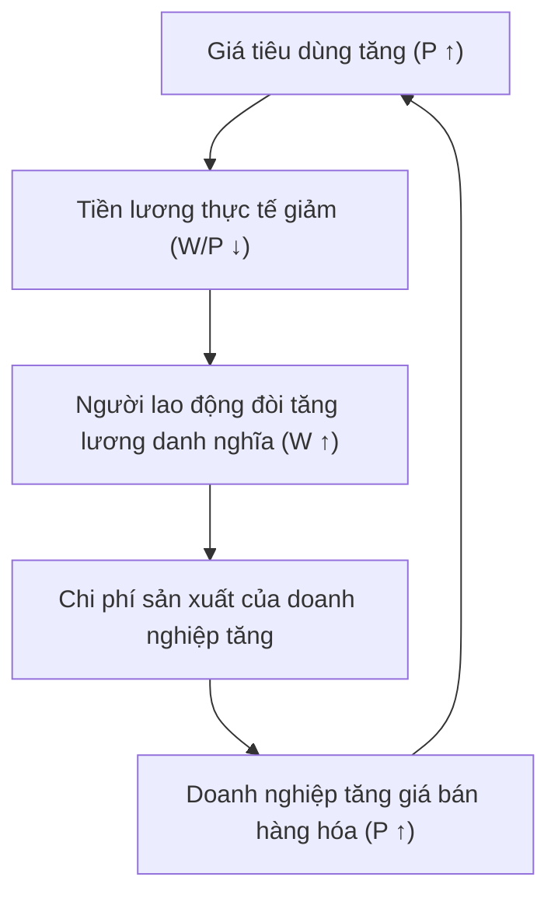

# Nguyên nhân và Động lực của Lạm phát (Causes and Dynamics of Inflation)

Chuyên đề này phân tích các nguồn gốc cốt lõi thúc đẩy mặt bằng giá cả chung tăng lên trong nền kinh tế: từ cú sốc cầu kéo, cú sốc cung chi phí đẩy, vòng xoáy tiền lương - giá cả, đến vai trò quyết định của kỳ vọng lạm phát và lạm phát nhập khẩu.

---

### Lạm phát chi phí đẩy (Cost-Push Inflation)

**1. Là gì?**
- Lạm phát chi phí đẩy là hiện tượng mức giá chung của nền kinh tế tăng lên do chi phí sản xuất đầu vào (tiền lương, nguyên vật liệu, năng lượng, chi phí vận tải) tăng cao đột ngột.
- Dưới tác động này, đường tổng cung ngắn hạn dịch chuyển sang trái, dẫn đến giá cả tăng trong khi sản lượng thực tế sụt giảm (nguy cơ đình lạm).
- Nếu chỉ nhớ một điều: **Lạm phát chi phí đẩy xảy ra khi đầu vào sản xuất đắt đỏ ép doanh nghiệp phải tăng giá bán lẻ dù thị trường không hề thừa tiền.**

**2. Hoạt động thế nào?**
- **Nguyên nhân:** Cú sốc nguồn cung bất lợi (giá dầu thô thế giới tăng vọt, thiên tai đứt gãy chuỗi cung ứng, thuế tăng, hoặc áp lực tăng lương tối thiểu vượt năng suất).
- **Cơ chế:** Chi phí biên ($MC$) của doanh nghiệp tăng $\implies$ doanh nghiệp cắt giảm sản lượng cung ứng ở mỗi mức giá $\implies$ đường $SRAS$ dịch sang trái $\implies$ sản lượng giảm ($Y < Y^*$), thất nghiệp tăng, nhưng mặt bằng giá tăng ($P \uparrow$).
- **Hệ quả:** Đây là loại lạm phát rất khó xử lý bằng chính sách tiền tệ vì thắt chặt tiền tệ sẽ kiềm chế được giá nhưng lại làm suy thoái kinh tế sâu hơn.

**3. Công thức & mô hình**
- Mô hình $AD-AS$:
  $$AS: P = P^e + \lambda (Y - Y^n) + \epsilon_{cung}$$
  Trong đó $\epsilon_{cung} > 0$ là cú sốc chi phí đẩy (ví dụ giá dầu tăng vọt).
- Đồ thị: Trục tung là Mức giá chung $P$, trục hoành là Sản lượng $Y$. Đường $SRAS$ dịch chuyển sang trái ($SRAS_1 \to SRAS_2$), điểm cân bằng dịch chuyển lên phía trên bên trái: $P$ tăng từ $P_1$ lên $P_2$, $Y$ giảm từ $Y_1$ xuống $Y_2$.

**4. Ví dụ**
- *Ví dụ số:* Một hãng vận tải có cơ cấu chi phí: xăng dầu chiếm 40%, tiền công 30%, khấu hao xe 30%. Khi giá xăng dầu tăng 50%, tổng chi phí vận hành tăng:
  $$\Delta TC = 40\% \times 50\% = 20\%$$
  Để bảo toàn biên lợi nhuận, hãng buộc phải tăng giá cước vận chuyển thêm 20%.
- *Ví dụ thực tế:* Cú sốc giá dầu mỏ toàn cầu năm 1973 (chiến tranh Ả Rập - Israel) và năm 2022 (xung đột Nga - Ukraine) đẩy giá dầu Brent vượt 120 USD/thùng, làm chi phí xăng dầu, phân bón và lương thực tăng vọt trên toàn cầu.
- *Counterfactual:* Nếu chính phủ sử dụng quỹ bình ổn giá và giảm thuế bảo vệ môi trường đối với xăng dầu kịp thời, cú sốc chi phí đẩy sẽ được hấp thụ một phần, ngăn đà lan tỏa sang giá các mặt hàng tiêu dùng khác.

**5. Ứng dụng & tranh luận**
- **Ứng dụng:** Định hướng chính sách hỗ trợ nguồn cung, giảm thuế phí đầu vào (VAT, thuế nhập khẩu nguyên liệu) thay vì chỉ dùng lãi suất.
- **Trade-off:** Cố gắng kích cầu để cứu sản lượng sẽ đẩy lạm phát lên cao hơn nữa; thắt chặt tiền tệ để chặn lạm phát thì chấp nhận tỷ lệ thất nghiệp tăng vọt.
- **Tranh luận / Lỗi thường gặp:** Cho rằng mọi đợt lạm phát đều do "in tiền". Lạm phát chi phí đẩy ban đầu bắt nguồn từ cú sốc thực tế ở phía cung, dù tiền tệ có thể duy trì nó nếu ngân hàng trung ương nới lỏng để thích ứng.

**6. Liên kết**
- Đọc tiếp: [Demand-Pull Inflation](file:///Users/ductri0981/Documents/Studying/Studying-Economic/02_Micro_and_Macro_Economics/08_Inflation_and_Deflation/03_Causes_and_Dynamics_of_Inflation.md#lam-phat-cau-keo-demand-pull-inflation), [Stagflation](file:///Users/ductri0981/Documents/Studying/Studying-Economic/02_Micro_and_Macro_Economics/08_Inflation_and_Deflation/01_Inflation_Deflation_and_Price_Stability.md#dinh-lam-stagflation).
- Mở rộng: [Aggregate Supply (AS)](file:///Users/ductri0981/Documents/Studying/Studying-Economic/02_Micro_and_Macro_Economics/07_Macroeconomic_Foundations/01_Macroeconomics_and_Aggregate_Measures.md#tong-cung-aggregate-supply-as).

---

### Lạm phát cầu kéo (Demand-Pull Inflation)

**1. Là gì?**
- Lạm phát cầu kéo là tình trạng mức giá chung bị kéo lên cao do tổng cầu ($AD$) của nền kinh tế tăng trưởng vượt quá khả năng cung ứng hàng hóa dịch vụ ở mức toàn dụng nhân công ($Y > Y_p$).
- Thường được mô tả ngắn gọn qua ngạn ngữ kinh tế: "Quá nhiều tiền đuổi theo quá ít hàng hóa" (Too much money chasing too few goods).
- Nếu chỉ nhớ một điều: **Lạm phát cầu kéo xảy ra khi sức mua của xã hội bùng nổ vượt xa năng lực sản xuất của nhà máy và nông trại.**

**2. Hoạt động thế nào?**
- **Nguyên nhân:** Cắt giảm thuế mạnh tay, chi tiêu chính phủ tăng vọt, mở rộng tín dụng quá mức với lãi suất siêu thấp, hoặc bùng nổ xuất khẩu.
- **Cơ chế:** Khi tổng cầu ($C + I + G + NX$) tăng mạnh, doanh nghiệp nhận thấy đơn đặt hàng vượt công suất $\implies$ tồn kho cạn kiệt $\implies$ tăng giá bán và thuê thêm lao động với giá cao $\implies$ mức giá chung tăng liên tục.
- **Cân bằng:** Sản lượng ngắn hạn có thể tạm thời vượt sản lượng tiềm năng ($Y > Y^*$, khoảng bù lạm phát - inflationary gap), nhưng cuối cùng tiền lương tăng sẽ kéo đường $SRAS$ lên, đưa sản lượng về lại mức tiềm năng ở một mặt bằng giá mới cao hơn.

**3. Công thức & mô hình**
- Phương trình số lượng tiền tệ (Quantity Theory of Money):
  $$M \cdot V = P \cdot Y$$
  Khi vận tốc tiền tệ ($V$) và sản lượng ($Y$) ổn định trong ngắn hạn, tốc độ tăng trưởng cung tiền ($\% \Delta M$) chuyển hóa trực tiếp thành lạm phát:
  $$\pi \approx \% \Delta M - \% \Delta Y$$
- Đồ thị: Đường $AD$ dịch chuyển sang phải ($AD_1 \to AD_2$) dọc theo đường tổng cung ngắn hạn $SRAS$, làm cả sản lượng $Y$ và mức giá $P$ cùng tăng.

**4. Ví dụ**
- *Ví dụ số:* Nền kinh tế có năng lực sản xuất tối đa 1.000 tấn gạo với giá 10 triệu VNĐ/tấn. Cung tiền tăng làm tổng sức cầu mua gạo tăng từ 10 tỷ lên 13 tỷ VNĐ. Vì không thể làm ra thêm gạo ngay lập tức ($Q = 1.000$), giá gạo bị kéo lên:
  $$P = \frac{13.000.000.000}{1.000} = 13.000.000 \text{ VNĐ/tấn (tăng 30\%)}$$
- *Ví dụ thực tế:* Tại Mỹ giai đoạn 2021–2022, các gói kích thích tài khóa quy mô hàng nghìn tỷ USD (CARES Act, American Rescue Plan) phát tiền trực tiếp vào tài khoản người dân kết hợp với lãi suất 0% đã đẩy nhu cầu mua sắm hàng tiêu dùng bùng nổ, kéo CPI tăng kỷ lục 9,1% (tháng 6/2022).
- *Counterfactual:* Nếu chính phủ tài trợ chi tiêu bằng cách tăng thuế tương ứng (ngân sách cân bằng) thay vì in tiền phát hành trái phiếu cho NHTW mua, sức cầu tư nhân sẽ giảm tương ứng và triệt tiêu áp lực cầu kéo.

**5. Ứng dụng & tranh luận**
- **Ứng dụng:** Cơ sở để NHTW tăng lãi suất điều hành và chính phủ thắt chặt tài khóa nhằm hạ nhiệt nền kinh tế quá nóng.
- **Trade-off:** Giảm tổng cầu để kiểm soát giá có thể làm suy giảm tốc độ tăng trưởng kinh tế và gây áp lực lên việc làm.
- **Tranh luận / Lỗi thường gặp:** Nhầm lẫn giữa tăng giá do cầu kéo tạm thời của một mặt hàng (như khẩu trang lúc dịch) với lạm phát cầu kéo mang tính vĩ mô bao trùm toàn bộ nền kinh tế.

**6. Liên kết**
- Đọc tiếp: [Cost-Push Inflation](file:///Users/ductri0981/Documents/Studying/Studying-Economic/02_Micro_and_Macro_Economics/08_Inflation_and_Deflation/03_Causes_and_Dynamics_of_Inflation.md#lam-phat-chi-phi-day-cost-push-inflation), [Money Supply](file:///Users/ductri0981/Documents/Studying/Studying-Economic/02_Micro_and_Macro_Economics/12_Economic_Indicators/06_Money_Supply_and_Credit.md#cung-tien-money-supply).
- Mở rộng: [Aggregate Demand (AD)](file:///Users/ductri0981/Documents/Studying/Studying-Economic/02_Micro_and_Macro_Economics/07_Macroeconomic_Foundations/01_Macroeconomics_and_Aggregate_Measures.md#tong-cau-aggregate-demand-ad).

---

### Vòng xoáy tiền lương - giá cả (Wage-Price Spiral)

**1. Là gì?**
- Vòng xoáy tiền lương - giá cả là hiện tượng vòng lặp nhân quả tự củng cố lẫn nhau giữa việc tăng tiền lương và tăng giá cả hàng hóa dịch vụ.
- Giá cả tăng khiến người lao động đòi hỏi tăng lương để bù đắp sinh hoạt phí; tiền lương tăng làm chi phí sản xuất của doanh nghiệp đội lên; doanh nghiệp lại nâng giá bán để bảo vệ biên lợi nhuận, kích hoạt đợt đòi tăng lương kế tiếp.
- Nếu chỉ nhớ một điều: **Lương đuổi theo giá, giá đuổi theo lương biến lạm phát thành một vòng xoáy trôn ốc khó kiểm soát.**

**2. Hoạt động thế nào?**
- **Bước 1 (Kích hoạt):** Một cú sốc ban đầu (giá dầu tăng hoặc kích cầu) làm giá tiêu dùng $P$ tăng.
- **Bước 2 (Đòi lương):** Công đoàn và người lao động nhận thấy tiền lương thực tế ($W/P$) sụt giảm, liền yêu cầu thương lượng tăng lương danh nghĩa ($W \uparrow$).
- **Bước 3 (Đội chi phí):** Doanh nghiệp đối mặt với chi phí nhân công cao hơn mà năng suất không đổi, dẫn đến chi phí biên tăng.
- **Bước 4 (Tăng giá bán):** Doanh nghiệp tăng giá niêm yết của thành phẩm để duy trì tỷ suất lợi nhuận.
- **Hệ quả:** Vòng lặp quay lại Bước 2 với cường độ mạnh hơn nếu ngân hàng trung ương không can thiệp dứt khoát để neo giữ kỳ vọng.

**3. Công thức & mô hình**
- Phương trình thiết lập tiền lương (Wage-setting) và thiết lập giá (Price-setting):
  $$W = P^e \cdot F(u, z)$$
  $$P = (1 + \mu) \cdot \frac{W}{A}$$
  Trong đó $P^e$ là mức giá kỳ vọng, $u$ là tỷ lệ thất nghiệp, $\mu$ là tỷ lệ cộng lãi (markup), $A$ là năng suất lao động.
- Khi $P^e$ điều chỉnh liên tục theo giá thực tế và $W$ tăng ngang bằng hoặc hơn lạm phát mà $A$ không tăng, $P$ sẽ tăng không ngừng.

**4. Ví dụ**
- *Ví dụ số:* Tiền lương ban đầu là 10 triệu/tháng, CPI tăng 10%. Người lao động đòi lương tăng lên 11 triệu (tăng 10%). Nếu chi phí nhân công chiếm 60% giá thành, chi phí sản phẩm tăng $6\%$. Doanh nghiệp tăng giá bán thêm $6\%$, làm CPI đợt 2 tăng thêm $6\%$, kích hoạt yêu cầu tăng lương tiếp theo.
- *Ví dụ thực tế:* Thời kỳ lạm phát đình đốn tại Anh và Mỹ thập niên 1970, quyền lực công đoàn mạnh mẽ đã thúc đẩy các hợp đồng lao động có điều khoản tự động trượt giá (COLA - Cost of Living Adjustments), biến lạm phát thành vòng xoáy dai dẳng suốt một thập kỷ.
- *Counterfactual:* Nếu tiền lương tăng lên nhưng đi kèm với năng suất lao động ($A$) tăng tương ứng hoặc cao hơn, chi phí đơn vị lao động (Unit Labor Cost) không đổi và vòng xoáy giá - lương sẽ bị triệt tiêu hoàn toàn.

**5. Ứng dụng & tranh luận**
- **Ứng dụng:** Giám sát chỉ số chi phí lao động (Employment Cost Index - ECI) và tăng trưởng tiền lương bình quân giờ để dự báo độ dai dẳng của lạm phát.
- **Trade-off:** Muốn bẻ gãy vòng xoáy này, NHTW thường phải tăng lãi suất đủ mạnh để làm nguội thị trường lao động, chấp nhận thất nghiệp tăng tạm thời.
- **Tranh luận / Lỗi thường gặp:** Đổ lỗi hoàn toàn cho người lao động "tham lam" đòi tăng lương hoặc doanh nghiệp "tham lam" tăng biên lãi. Về bản chất, đây là phản ứng tự vệ hợp lý của các tác nhân vi mô trong môi trường tiền tệ mất kiểm soát.

**6. Liên kết**
- Đọc tiếp: [Inflation Expectations](file:///Users/ductri0981/Documents/Studying/Studying-Economic/02_Micro_and_Macro_Economics/08_Inflation_and_Deflation/03_Causes_and_Dynamics_of_Inflation.md#ky-vong-lam-phat-inflation-expectations), [Wage Growth](file:///Users/ductri0981/Documents/Studying/Studying-Economic/02_Micro_and_Macro_Economics/09_Unemployment_and_Labor/04_Wages_Productivity_and_Skill_Premium.md#tang-truong-tien-luong-wage-growth).
- Mở rộng: [NAIRU](file:///Users/ductri0981/Documents/Studying/Studying-Economic/02_Micro_and_Macro_Economics/09_Unemployment_and_Labor/03_Natural_Rate_Full_Employment_and_NAIRU.md#nairu).

---

### Kỳ vọng lạm phát (Inflation Expectations)

**1. Là gì?**
- Kỳ vọng lạm phát là mức lạm phát mà các chủ thể kinh tế (hộ gia đình, doanh nghiệp, nhà đầu tư) dự đoán sẽ xảy ra trong tương lai (1 năm, 3 năm, hoặc 5–10 năm tới).
- Kỳ vọng này có tính chất tiên tri tự hoàn tất (self-fulfilling prophecy): nếu mọi người tin rằng giá sắp tăng mạnh, hành vi của họ sẽ trực tiếp làm giá tăng mạnh ngay trong hiện tại.
- Nếu chỉ nhớ một điều: **Kỳ vọng lạm phát là niềm tin của người dân về giá tương lai; một khi niềm tin bị lung lay, lạm phát thực tế sẽ bùng phát theo.**

**2. Hoạt động thế nào?**
- **Hai cơ chế hình thành kỳ vọng:**
  1. *Kỳ vọng thích nghi (Adaptive Expectations):* Nhìn về quá khứ; lấy lạm phát năm ngoái để đoán năm nay: $\pi_t^e = \pi_{t-1}$.
  2. *Kỳ vọng duy lý (Rational Expectations):* Nhìn về tương lai; sử dụng toàn bộ thông tin có sẵn về chính sách tiền tệ, tài khóa và chu kỳ kinh tế để dự báo.
- **Cơ chế tác động:**
  - Nếu người tiêu dùng nghĩ ngày mai giá tăng $10\%$, họ sẽ ồ ạt mua hàng gom tích trữ hôm nay $\implies$ tổng cầu tăng ngay lập tức $\implies$ giá tăng thật.
  - Doanh nghiệp định giá hàng hóa cho hợp đồng năm sau sẽ cộng thêm tỷ lệ lạm phát kỳ vọng.
- **Neo giữ kỳ vọng (Anchoring):** Khi NHTW có uy tín cao (credibility), kỳ vọng lạm phát dài hạn sẽ được neo chặt ở mức mục tiêu (ví dụ 2% hoặc 4%), giúp chi phí kiềm chế lạm phát thấp hơn rất nhiều.

**3. Công thức & mô hình**
- Đường cong Phillips mở rộng kỳ vọng (Expectations-Augmented Phillips Curve):
  $$\pi_t = \pi_t^e - \beta (u_t - u_n) + \nu_t$$
  Trong đó $\pi_t^e$ là lạm phát kỳ vọng, $u_t$ là thất nghiệp thực tế, $u_n$ là tỷ lệ thất nghiệp tự nhiên, $\nu_t$ là cú sốc cung.
- Đo lường kỳ vọng:
  - Khảo sát tâm lý: University of Michigan Survey, NY Fed Survey.
  - Thị trường tài chính: Tỷ lệ lạm phát hòa vốn (Breakeven Inflation Rate) từ trái phiếu TIPS:
    $$\pi_{kỳ\_vọng} = Y_{danh\_nghĩa} - Y_{thực\_tế\_TIPS}$$

**4. Ví dụ**
- *Ví dụ số:* Trái phiếu chính phủ Mỹ kỳ hạn 10 năm có lợi suất danh nghĩa $4,2\%$. Trái phiếu chống lạm phát TIPS kỳ hạn 10 năm có lợi suất thực tế $1,9\%$. Tỷ lệ lạm phát kỳ vọng bình quân 10 năm tới của thị trường là:
  $$\pi^e = 4,2\% - 1,9\% = 2,3\%/\text{năm}$$
- *Ví dụ thực tế:* Tại Thổ Nhĩ Kỳ giai đoạn 2021–2023, khi ngân hàng trung ương liên tục hạ lãi suất bất chấp lạm phát cao, niềm tin của người dân sụp đổ hoàn toàn. Kỳ vọng lạm phát mất neo khiến người dân lập tức bán đồng Lira đổi sang USD, vàng hoặc mua sắm ồ ạt hàng hóa xa xỉ, đẩy lạm phát vượt 80%.
- *Counterfactual:* Nếu Thống đốc NHTW tuyên bố chính sách thắt chặt và được thị trường tin tưởng tuyệt đối, lạm phát có thể giảm nhanh mà không cần gây ra suy thoái kinh tế sâu (hiện tượng disinflation không đánh đổi sản lượng).

**5. Ứng dụng & tranh luận**
- **Ứng dụng:** Trọng tâm quản trị chính sách tiền tệ hiện đại của Fed, ECB, Ngân hàng Nhà nước Việt Nam là quản trị kỳ vọng thị trường (Forward Guidance).
- **Trade-off:** Xây dựng uy tín mất hàng chục năm nhưng có thể bị đánh mất chỉ sau vài quyết định can thiệp chính trị sai lầm.
- **Tranh luận / Lỗi thường gặp:** Coi thường tâm lý người dân và chỉ tập trung vào số liệu quá khứ. Lạm phát kỳ vọng một khi đã "mất neo" (de-anchored) thì việc dùng lãi suất kéo lại đòi hỏi cái giá rất đắt về thất nghiệp.

**6. Liên kết**
- Đọc tiếp: [Inflation Targeting](file:///Users/ductri0981/Documents/Studying/Studying-Economic/02_Micro_and_Macro_Economics/08_Inflation_and_Deflation/04_Interest_Rates_Policy_and_Hedging.md#muc-tieu-lam-phat-inflation-targeting).
- Mở rộng: [Wage-Price Spiral](file:///Users/ductri0981/Documents/Studying/Studying-Economic/02_Micro_and_Macro_Economics/08_Inflation_and_Deflation/03_Causes_and_Dynamics_of_Inflation.md#vong-xoay-tien-luong-gia-ca-wage-price-spiral).

---

### Lạm phát nhập khẩu (Imported Inflation)

**1. Là gì?**
- Lạm phát nhập khẩu là hiện tượng mức giá chung nội địa tăng lên do giá hàng hóa, dịch vụ hoặc nguyên nhiên liệu nhập khẩu từ nước ngoài tăng cao.
- Có thể bắt nguồn từ hai yếu tố: giá cả trên thị trường quốc tế tăng bằng ngoại tệ (USD) hoặc đồng nội tệ bị mất giá (depreciation) so với các ngoại tệ mạnh.
- Nếu chỉ nhớ một điều: **Lạm phát nhập khẩu là việc một quốc gia "nhập khẩu" giá đắt từ thế giới bên ngoài vào bữa ăn và giọt xăng của người dân trong nước.**

**2. Hoạt động thế nào?**
- **Kênh truyền dẫn 1 (Hàng tiêu dùng trực tiếp):** Giá thịt bò nhập, sữa ngoại, đồ điện tử nhập khẩu tăng $\implies$ rổ CPI trực tiếp tăng.
- **Kênh truyền dẫn 2 (Đầu vào sản xuất - Pass-through):** Thép, xăng dầu, phân bón, chất bán dẫn nhập khẩu đắt hơn $\implies$ chi phí sản xuất trong nước tăng $\implies$ doanh nghiệp nội địa buộc phải nâng giá bán sản phẩm.
- **Kênh tỷ giá (Exchange Rate Pass-Through):** Ngay cả khi giá hàng quốc tế giữ nguyên tính bằng USD, nếu tỷ giá USD/VND tăng $5\%$, giá quy đổi ra VND của hàng nhập khẩu tự động tăng $5\%$.
- **Đặc điểm quốc gia:** Các nền kinh tế có độ mở thương mại lớn (như Việt Nam, Singapore) chịu rủi ro lạm phát nhập khẩu cao hơn nhiều so với các nền kinh tế khép kín.

**3. Công thức & mô hình**
- Mức giá hàng nhập khẩu bằng nội tệ:
  $$P_{nhap\_khau} = E \cdot P^*$$
  Trong đó $E$ là tỷ giá hối đoái danh nghĩa (số đơn vị nội tệ trên 1 đơn vị ngoại tệ, ví dụ VND/USD), $P^*$ là giá hàng hóa tính bằng ngoại tệ.
- Hệ số truyền dẫn tỷ giá sang lạm phát (Exchange Rate Pass-Through - ERPT):
  $$ERPT = \frac{\partial \ln(CPI)}{\partial \ln(E)}$$

**4. Ví dụ**
- *Ví dụ số:* Một thùng phân bón DAP nhập khẩu có giá 600 USD. Ban đầu tỷ giá là 23.500 VND/USD $\implies$ giá nhập là 14.100.000 VNĐ. Sau 6 tháng, giá quốc tế tăng lên 700 USD và tỷ giá tăng lên 25.000 VND/USD:
  $$P_{mới} = 700 \times 25.000 = 17.500.000 \text{ VNĐ}$$
  Mức giá tăng:
  $$\frac{17.500.000 - 14.100.000}{14.100.000} \approx 24,1\%$$
  Trong đó cú sốc giá hàng đóng góp $16,7\%$, còn tỷ giá đóng góp thêm $7,4\%$.
- *Ví dụ thực tế:* Năm 2022, Ngân hàng Nhà nước Việt Nam (NHNN) đã bán ra hơn 25 tỷ USD từ dự trữ ngoại hối và tăng lãi suất điều hành thêm 200 điểm cơ bản nhằm giữ tỷ giá VND không mất giá quá mạnh trước đà tăng của chỉ số DXY, qua đó chặn đứng nguy cơ lạm phát nhập khẩu tràn vào nền kinh tế.
- *Counterfactual:* Nếu Việt Nam thả nổi hoàn toàn tỷ giá vào năm 2022 và để VND mất giá 15–20% như một số đồng tiền mới nổi khác, CPI trong nước chắc chắn sẽ vượt trần mục tiêu 4% do cơ cấu nhập khẩu chiếm hơn 90% GDP.

**5. Ứng dụng & tranh luận**
- **Ứng dụng:** Là lý do cốt lõi để các ngân hàng trung ương tại các thị trường mới nổi theo dõi sát sao tỷ giá hối đoái và dự trữ ngoại hối trong mục tiêu ổn định kinh tế vĩ mô.
- **Trade-off:** Giữ giá đồng nội tệ để chống lạm phát nhập khẩu có thể làm giảm khả năng cạnh tranh về giá của các ngành xuất khẩu và tiêu hao dự trữ ngoại tệ.
- **Tranh luận / Lỗi thường gặp:** Cho rằng chỉ cần cấm nhập khẩu hoặc tự chủ sản xuất là hết lạm phát nhập khẩu. Thay thế hàng nhập khẩu bằng hàng nội kém cạnh tranh có thể gây ra chi phí sản xuất nội địa thậm chí còn đắt đỏ hơn.

**6. Liên kết**
- Đọc trước: [Cost-Push Inflation](file:///Users/ductri0981/Documents/Studying/Studying-Economic/02_Micro_and_Macro_Economics/08_Inflation_and_Deflation/03_Causes_and_Dynamics_of_Inflation.md#lam-phat-chi-phi-day-cost-push-inflation).
- Mở rộng: [Foreign Exchange Reserves](file:///Users/ductri0981/Documents/Studying/Studying-Economic/02_Micro_and_Macro_Economics/12_Economic_Indicators/05_Capital_Flows_and_Reserves.md#du-tru-ngoai-hoi-foreign-exchange-reserves).

---

## Câu hỏi tự kiểm tra

1. Phân biệt cơ chế tác động đến sản lượng ($Y$) và giá cả ($P$) giữa lạm phát cầu kéo và lạm phát chi phí đẩy trên mô hình $AD-AS$?
2. Vòng xoáy tiền lương - giá cả tự duy trì như thế nào và điều kiện kinh tế nào có thể chặn đứng vòng xoáy này?
3. Tại sao kỳ vọng lạm phát lại được coi là một "lời tiên tri tự hoàn tất"?
4. Tỷ giá hối đoái truyền dẫn sang lạm phát trong nước (ERPT) qua những kênh cụ thể nào?
5. Nếu một quốc gia có độ mở kinh tế lớn ($Kim\_ngach\_XNK / GDP > 150\%$), chính sách tỷ giá đóng vai trò gì trong việc kiểm soát CPI?

---

## Ghi chú nguồn
- Blanchard, O. (2021). *Macroeconomics* (8th ed.). Pearson.
- Mishkin, F. S. (2019). *The Economics of Money, Banking, and Financial Markets* (12th ed.). Pearson.
- Ngân hàng Nhà nước Việt Nam (SBV). Báo cáo thường niên và Báo cáo chính sách tiền tệ các năm 2021–2023.
