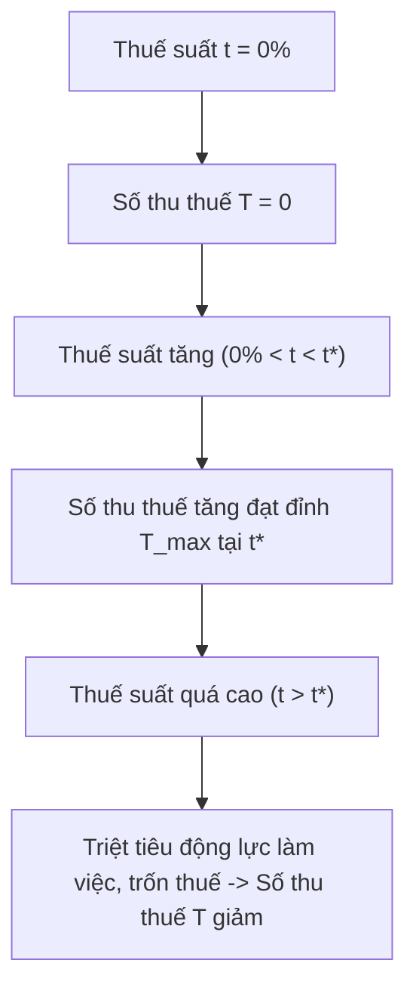

# Củng cố Tài khóa, Thắt lưng Buộc bụng và Chính sách Thuế (Consolidation, Austerity & Tax Policy)

Chuyên đề này phân tích các chiến lược xử lý khủng hoảng nợ và thiết kế hệ thống thuế: bản chất của củng cố tài khóa, cuộc tranh luận kinh điển về chính sách thắt lưng buộc bụng (Austerity), lý thuyết chính sách thuế hiện đại và sự gánh chịu thuế thực tế (Tax Incidence).

---

### Củng cố tài khóa (Fiscal Consolidation)

**1. Là gì?**
- Củng cố tài khóa là một chương trình chính sách kinh tế có chủ đích và có kế hoạch của Chính phủ nhằm giảm bớt thâm hụt ngân sách và đưa tỷ lệ nợ công trên GDP trở lại quỹ đạo an toàn và bền vững dài hạn.
- Được thực hiện thông qua hai công cụ chính: cắt giảm các khoản chi tiêu công không thiết yếu và/hoặc tăng cường các nguồn thu ngân sách từ thuế và chống thất thu.
- Nếu chỉ nhớ một điều: **Củng cố tài khóa là kế hoạch tổng thể của nhà nước để tái cấu trúc lại tài chính quốc gia, cắt bớt tiêu hoang và trả bớt nợ.**

**2. Hoạt động thế nào?**
- **Hai con đường củng cố tài khóa:**
  1. *Dựa vào chi tiêu (Spending-based consolidation):* Tập trung cắt giảm chi tiêu thường xuyên, tinh giản biên chế, tái cơ cấu đầu tư công. Kinh nghiệm quốc tế cho thấy phương thức này thường thành công bền vững hơn và ít gây tổn hại cho tăng trưởng dài hạn.
  2. *Dựa vào thuế (Tax-based consolidation):* Tập trung tăng thuế suất và đánh thêm các sắc thuế mới. Phương thức này thường vấp phải sự kháng cự xã hội và có nguy cơ bóp nghẹt động lực đầu tư tư nhân.
- **Thách thức kinh tế vĩ mô:** Trong ngắn hạn, việc cắt giảm chi tiêu và tăng thuế sẽ làm giảm tổng cầu, có thể gây suy giảm tăng trưởng kinh tế tạm thời trước khi đạt được sự ổn định vĩ mô.

**3. Công thức & mô hình**
- Mức độ điều chỉnh cán cân ngân sách sơ cấp cần thiết:
  $$\Delta pb \ge (r - g) \cdot d_0$$
  Để kéo tỷ lệ nợ/GDP ($d$) giảm dần qua các năm.

**4. Ví dụ**
- *Ví dụ số:* Một quốc gia có thâm hụt ngân sách lên tới $7\%$ GDP và nợ công chạm ngưỡng $90\%$ GDP. Chính phủ triển khai lộ trình củng cố tài khóa 5 năm: mỗi năm giảm thâm hụt $1\%$ GDP thông qua cắt giảm chi tiêu $0,6\%$ và tăng thu thuế $0,4\%$. Sau 5 năm, thâm hụt ngân sách giảm về mức an toàn $2\%$ GDP và tỷ lệ nợ công bắt đầu đi xuống.
- *Ví dụ thực tế:* Tại Việt Nam giai đoạn 2016–2020, Chính phủ đã thực hiện củng cố tài khóa rất thành công thông qua việc siết chặt kỷ luật ngân sách, kiểm soát trần bảo lãnh chính phủ và tái cơ cấu nợ công, giúp hạ tỷ lệ nợ công từ $63,7\%$ GDP xuống còn khoảng $55\%$ GDP trước khi đại dịch bùng phát.
- *Counterfactual:* Nếu chính phủ trì hoãn củng cố tài khóa khi nợ công đã vượt ngưỡng an toàn, chi phí trả lãi sẽ nuốt trọn ngân sách quốc gia và đẩy chính phủ vào tình thế bị thị trường quốc tế cắt nguồn vốn vay.

**5. Ứng dụng & tranh luận**
- **Ứng dụng:** Điều kiện tiên quyết trong các chương trình thỏa thuận vay vốn của IMF (Structural Adjustment Programs); phục hồi niềm tin của các nhà đầu tư quốc tế.
- **Trade-off:** Củng cố tài khóa trong bối cảnh nền kinh tế đang suy thoái có thể kích hoạt vòng xoáy suy thoái sâu hơn.
- **Tranh luận / Lỗi thường gặp:** Lầm tưởng củng cố tài khóa đồng nghĩa với việc dừng toàn bộ các dự án đầu tư. Củng cố tài khóa thông minh là cắt giảm chi tiêu lãng phí để dồn vốn vào các công trình hạ tầng trọng điểm mang lại hiệu quả cao.

**6. Liên kết**
- Đọc tiếp: [Austerity](file:///Users/ductri0981/Documents/Studying/Studying-Economic/02_Micro_and_Macro_Economics/11_Fiscal_Economics/06_Consolidation_Austerity_and_Tax_Policy.md#that-lung-buoc-bung-austerity).
- Mở rộng: [Debt Sustainability](file:///Users/ductri0981/Documents/Studying/Studying-Economic/02_Micro_and_Macro_Economics/11_Fiscal_Economics/03_Public_Debt_and_Sustainability.md#tinh-ben-vung-cua-no-debt-sustainability).

---

### Thắt lưng buộc bụng (Austerity)

**1. Là gì?**
- Thắt lưng buộc bụng (Austerity) là tập hợp các biện pháp chính sách kinh tế vô cùng nghiêm ngặt và khắc nghiệt mà Chính phủ áp dụng nhằm giảm mạnh chi tiêu công, cắt giảm lương hưu, trợ cấp an sinh xã hội, cắt giảm lương công chức và tăng mạnh các loại thuế nhằm đối phó với khủng hoảng nợ công hoặc đáp ứng các điều kiện vay vốn khẩn cấp từ các chủ nợ quốc tế.
- Thường gắn liền với các cuộc khủng hoảng tài chính trầm trọng khi chính phủ đứng trước bờ vực phá sản quốc gia.
- Nếu chỉ nhớ một điều: **Thắt lưng buộc bụng là liều thuốc đắng bóp nghẹt chi tiêu và cắt trợ cấp của dân chúng khi nhà nước đã ngập trong nợ nần không còn ai dám cho vay.**

**2. Hoạt động thế nào?**
- **Các biện pháp cụ thể thường thấy:**
  - Cắt giảm 10–20% lương của toàn bộ công chức, bác sĩ, giáo viên và lực lượng công an.
  - Cắt giảm lương hưu và tăng tuổi nghỉ hưu thêm 3–5 tuổi.
  - Bãi bỏ các khoản trợ cấp năng lượng, trợ cấp lương thực, tăng học phí và viện phí.
  - Tăng mạnh thuế suất thuế giá trị gia tăng (VAT).
- **Hệ quả kinh tế - xã hội (Vòng xoáy suy thoái do thắt lưng buộc bụng):**
  - Cắt giảm chi tiêu làm tổng cầu sụp đổ $\implies$ GDP tăng trưởng âm sâu $\implies$ thất nghiệp tăng vọt lên hai con số $\implies$ số thu thuế thực tế sụt giảm $\implies$ tỷ lệ Nợ/GDP thậm chí còn tăng cao hơn trước (Nghịch lý thắt lưng buộc bụng).
  - Gây ra các cuộc biểu tình đường phố, bãi công diện rộng và bất ổn chính trị dữ dội.

**3. Công thức & mô hình**
- Tác động tiêu cực tức thời lên GDP qua hệ số nhân tài khóa:
  $$\Delta Y = -k_G \cdot \Delta G_{cắt\_giảm} < 0$$
- Nếu số nhân tài khóa trong khủng hoảng $k_G > 1$, việc cắt giảm ngân sách sẽ làm sụt giảm sản lượng nhiều hơn số tiền tiết kiệm được.

**4. Ví dụ**
- *Ví dụ số:* Một quốc gia nợ 300 tỷ USD trên GDP 200 tỷ USD (tỷ lệ nợ $150\%$). Để hạ nợ, chính phủ cắt giảm chi tiêu 20 tỷ USD. Do số nhân tài khóa là 1,5, GDP sụt giảm mất $20 \times 1,5 = 30$ tỷ USD (GDP tụt xuống 170 tỷ USD).
  - Khối nợ sau khi giảm thâm hụt còn 290 tỷ USD.
  - Tỷ lệ nợ/GDP mới:
    $$\frac{290}{170} \times 100\% \approx 170,6\% \text{ (tăng từ 150\% lên 170,6\%!)}$$
  - Chính sách thắt lưng buộc bụng đã phản tác dụng hoàn toàn.
- *Ví dụ thực tế:* Cuộc khủng hoảng nợ công Hy Lạp giai đoạn 2010–2015: Nhóm chủ nợ "Bộ ba" (Troika: IMF, ECB, EC) đã ép Hy Lạp thực hiện các gói thắt lưng buộc bụng tàn khốc để đổi lấy các gói cứu trợ tài chính. Hậu quả là GDP Hy Lạp bốc hơi $25\%$, tỷ lệ thất nghiệp vượt $27\%$ và đời sống nhân dân bị kiệt quệ nghiêm trọng.
- *Counterfactual:* Nếu thay vì ép thắt lưng buộc bụng khắc nghiệt, các chủ nợ chấp nhận giãn hoãn nợ và cho phép chính phủ duy trì một mức chi tiêu công hợp lý để hỗ trợ tăng trưởng kinh tế, quốc gia sẽ phục hồi nhanh hơn và có nguồn thu để trả nợ bền vững hơn.

**5. Ứng dụng & tranh luận**
- **Ứng dụng:** Biện pháp cứu cánh cuối cùng để ngăn chặn vỡ nợ hoàn toàn khi không còn lựa chọn nào khác trên thị trường vốn.
- **Trade-off:** Cứu vãn uy tín tài chính quốc tế nhưng phải trả giá bằng sự đau khổ của nhiều thế hệ người dân nghèo.
- **Tranh luận / Lỗi thường gặp:** Nhầm tưởng thắt lưng buộc bụng là giải pháp phục hồi kinh tế. Nhà kinh tế học đoạt giải Nobel Paul Krugman và Joseph Stiglitz đã chỉ trích mạnh mẽ chính sách này, gọi nó là "cơn ác mộng tự hủy hoại" của chủ nghĩa kinh tế giáo điều.

**6. Liên kết**
- Đọc trước: [Fiscal Consolidation](file:///Users/ductri0981/Documents/Studying/Studying-Economic/02_Micro_and_Macro_Economics/11_Fiscal_Economics/06_Consolidation_Austerity_and_Tax_Policy.md#cung-co-tai-khoa-fiscal-consolidation).
- Mở rộng: [Sovereign Debt](file:///Users/ductri0981/Documents/Studying/Studying-Economic/02_Micro_and_Macro_Economics/11_Fiscal_Economics/03_Public_Debt_and_Sustainability.md#no-chu-quyen-sovereign-debt).

---

### Chính sách thuế (Tax Policy)

**1. Là gì?**
- Chính sách thuế là hệ thống các quyết định, quy định pháp luật và nguyên tắc do Nhà nước ban hành nhằm xác định các sắc thuế, đối tượng chịu thuế, căn cứ tính thuế, thuế suất và các chế độ miễn giảm thuế nhằm huy động nguồn tài chính cho ngân sách nhà nước, đồng thời điều tiết nền kinh tế và thực hiện công bằng xã hội.
- Adam Smith trong tác phẩm "Của cải của các quốc gia" (1776) đã đưa ra 4 nguyên tắc vàng kinh điển của chính sách thuế: (1) Công bằng (Equity), (2) Xác định rõ ràng (Certainty), (3) Thuận tiện (Convenience), và (4) Hiệu quả tiết kiệm (Economy).
- Nếu chỉ nhớ một điều: **Chính sách thuế là nghệ thuật nhà nước thu tiền thuế của dân sao cho được nhiều tiền nhất, công bằng nhất mà gây ít tổn hại nhất cho việc làm ăn kinh doanh.**

**2. Hoạt động thế nào?**
- **Phân loại hệ thống thuế:**
  1. *Thuế trực thu (Direct Taxes):* Đánh trực tiếp vào thu nhập hoặc tài sản của người nộp thuế, người nộp thuế cũng chính là người chịu thuế thực tế (Thuế thu nhập doanh nghiệp - TNDN, Thuế thu nhập cá nhân - TNCN, Thuế tài sản).
  2. *Thuế gián thu (Indirect Taxes):* Đánh vào việc tiêu dùng hàng hóa dịch vụ, người nộp thuế (doanh nghiệp bán hàng) chuyển gánh nặng thuế vào giá bán cho người tiêu dùng cuối cùng gánh chịu (Thuế giá trị gia tăng - VAT, Thuế tiêu thụ đặc biệt, Thuế xuất nhập khẩu).
- **Đường cong Laffer (Laffer Curve):**
  - Mối quan hệ giữa thuế suất ($t$) và tổng số thu ngân sách từ thuế ($T$).
  - Khi thuế suất bằng $0\% \implies$ thu thuế bằng 0.
  - Khi thuế suất tăng lên, số thu ngân sách tăng dần cho đến điểm cực đại $t^*$.
  - Nếu tiếp tục tăng thuế suất vượt quá $t^*$ (ví dụ $80-90\%$), người dân sẽ chán nản không muốn làm việc, doanh nghiệp trốn thuế ra nước ngoài, khiến tổng số thu ngân sách sụt giảm.

**3. Công thức & mô hình**
- Đường cong Laffer:
  $$T(t) = t \cdot B(t)$$
  Trong đó $B(t)$ là cơ sở tính thuế (Tax base). Vì $B'(t) < 0$ (thuế càng cao cơ sở kinh tế càng co lại), điểm cực đại thỏa mãn:
  $$\frac{dT}{dt} = B(t) + t \cdot B'(t) = 0 \implies t^* = -\frac{1}{\epsilon_{B, t}}$$

**4. Ví dụ**
- *Ví dụ số:* Khi thuế suất thu nhập doanh nghiệp là $25\%$, tổng lợi nhuận doanh nghiệp kê khai là 1.000 tỷ VNĐ $\implies$ thu ngân sách 250 tỷ VNĐ. Nếu chính phủ tăng thuế suất lên $50\%$, doanh nghiệp đóng cửa bớt hoặc chuyển lợi nhuận sang thiên đường thuế, cơ sở tính thuế co lại chỉ còn 400 tỷ VNĐ.
  $$\text{Số thu ngân sách mới} = 50\% \times 400 = 200 \text{ tỷ VNĐ}$$
  Tăng thuế suất gấp đôi nhưng số thu ngân sách thực tế bị mất 50 tỷ VNĐ do nằm ở nửa bên phải của đường cong Laffer.
- *Ví dụ thực tế:* Tại Việt Nam, cải cách chính sách thuế qua nhiều năm đã hạ dần thuế suất thuế TNDN phổ thông từ mức $32\%$ (năm 1999) xuống $28\%$, rồi $25\%$, $22\%$ và hiện nay là $20\%$. Mặc dù thuế suất giảm, tổng số thu từ thuế TNDN lại liên tục tăng trưởng mạnh mẽ nhờ khuyến khích doanh nghiệp mở rộng sản xuất kinh doanh và thu hút hàng trăm tỷ USD vốn FDI.
- *Counterfactual:* Nếu một quốc gia đánh thuế thu nhập $100\%$, không ai có động lực làm việc vì làm ra đồng nào nhà nước tịch thu hết đồng đó, và nền kinh tế sẽ hoàn toàn tê liệt.

**5. Ứng dụng & tranh luận**
- **Ứng dụng:** Hoạch định chính sách cải cách thuế, mở rộng cơ sở thu, tham gia Hiệp định Thuế tối thiểu toàn cầu (Global Minimum Tax - trụ cột 2 của OECD áp mức sàn $15\%$).
- **Trade-off:** Cân bằng giữa mục tiêu tối đa hóa nguồn thu cho ngân sách và việc bảo tồn động lực đổi mới sáng tạo, làm việc của doanh nghiệp và người lao động.
- **Tranh luận / Lỗi thường gặp:** Lầm tưởng cứ giảm thuế là số thu ngân sách sẽ tự động tăng theo đường cong Laffer. Lý thuyết này chỉ đúng khi thuế suất ban đầu đang nằm ở mức trừng phạt quá cao (bên phải điểm đỉnh); nếu thuế suất ban đầu đang ở mức hợp lý (bên trái đỉnh), việc giảm thuế chắc chắn sẽ làm hụt thu ngân sách.

**6. Liên kết**
- Đọc tiếp: [Tax Incidence](file:///Users/ductri0981/Documents/Studying/Studying-Economic/02_Micro_and_Macro_Economics/11_Fiscal_Economics/06_Consolidation_Austerity_and_Tax_Policy.md#su-ganh-chiu-thue-tax-incidence).
- Mở rộng: [Progressive Taxation](file:///Users/ductri0981/Documents/Studying/Studying-Economic/02_Micro_and_Macro_Economics/11_Fiscal_Economics/07_Taxation_Structure_and_Redistribution.md#thue-luy-tien-progressive-taxation).

---

### Sự gánh chịu thuế (Tax Incidence)

**1. Là gì?**
- Sự gánh chịu thuế (Tax Incidence) là sự phân bổ thực tế về gánh nặng kinh tế cuối cùng của một sắc thuế giữa người mua (người tiêu dùng) và người bán (nhà sản xuất), bất kể luật pháp quy định ai là người trực tiếp cầm tiền đi nộp cho cơ quan thuế.
- Đây là một trong những phát hiện sâu sắc nhất của kinh tế học vi mô: người bị luật pháp bắt nộp thuế chưa chắc là người thực sự phải gánh chịu khoản thuế đó.
- Nếu chỉ nhớ một điều: **Sự gánh chịu thuế cho biết túi tiền của ai thực sự bị mỏng đi khi nhà nước ban hành một sắc thuế mới.**

**2. Hoạt động thế nào?**
- **Quy tắc vàng về độ co giãn:** Gánh nặng thuế luôn rơi nhiều hơn vào bên nào **kém co giãn hơn** (ít nhạy cảm với giá hơn, ít phương án thay thế hơn):
  - Nếu Cầu kém co giãn hơn Cung ($|E_d| < |E_s|$): Người tiêu dùng bắt buộc phải mua hàng, không thể từ bỏ $\implies$ người bán dễ dàng chuyển phần lớn tiền thuế vào giá bán $\implies$ **Người mua chịu phần lớn thuế**.
  - Nếu Cung kém co giãn hơn Cầu ($|E_s| < |E_d|$): Người tiêu dùng dễ dàng quay lưng mua mặt hàng khác, trong khi người bán bị kẹt vốn không thể chuyển đổi sản xuất $\implies$ **Người bán chịu phần lớn thuế**.
- **Tính độc lập với hình thức pháp lý:** Việc chính phủ ban hành luật bắt người bán nộp thuế hay bắt người mua nộp thuế đem lại kết quả cân bằng kinh tế và sự phân chia gánh nặng thuế hoàn toàn giống hệt nhau.

**3. Công thức & mô hình**
- Tỷ lệ gánh nặng thuế phân chia theo độ co giãn:
  $$\frac{\text{Gánh nặng của Người mua}}{\text{Gánh nặng của Người bán}} = \frac{\Delta P_b}{\Delta P_s} = \frac{E_s}{|E_d|}$$
  Trong đó $E_s$ là độ co giãn của cung, $E_d$ là độ co giãn của cầu.
- Gánh nặng của người mua: $\Delta P_b = P_{sau\_thuế} - P_{cân\_bằng\_cũ}$.
- Gánh nặng của người bán: $\Delta P_s = P_{cân\_bằng\_cũ} - (P_{sau\_thuế} - t)$.

**4. Ví dụ**
- *Ví dụ số:* Thuốc lá có độ co giãn cầu rất thấp ($|E_d| = 0,4$) vì người nghiện thuốc khó bỏ, trong khi nguồn cung dồi dào ($E_s = 1,6$). Nhà nước đánh thuế thêm 10.000 VNĐ/bao thuốc lá.
  $$\frac{\text{Người mua chịu}}{\text{Người bán chịu}} = \frac{1,6}{0,4} = 4$$
  - Người mua thuốc lá chịu:
    $$10.000 \times \frac{4}{1 + 4} = 8.000 \text{ VNĐ/bao (chiếm 80\%)}$$
  - Nhà sản xuất thuốc lá chỉ phải chịu 2.000 VNĐ/bao (chiếm 20%). Giá bao thuốc trên thị trường tăng vọt từ 20.000 lên 28.000 VNĐ.
- *Ví dụ thực tế:* Năm 1990, Quốc hội Mỹ ban hành thuế xa xỉ đánh vào người giàu mua du thuyền đắt tiền nhằm mục đích bắt người giàu đóng thuế. Tuy nhiên, do du thuyền là mặt hàng xa xỉ có cầu cực kỳ co giãn (người giàu không mua du thuyền thì mua biệt thự hoặc trang sức), trong khi các xưởng đóng tàu có cung kém co giãn. Kết quả: các xưởng đóng tàu bị ế ẩm, hàng nghìn công nhân đóng tàu trung lưu bị sa thải. Chính những người thợ đóng tàu mới là người gánh chịu khoản thuế xa xỉ đó, buộc Quốc hội Mỹ phải bãi bỏ sắc thuế này sau vài năm.
- *Counterfactual:* Nếu một mặt hàng có cầu hoàn toàn co giãn ($|E_d| = \infty$), người bán sẽ phải chịu toàn bộ 100% khoản thuế; giá bán lẻ không thể nhích lên dù chỉ một đồng vì nếu tăng giá thì không ai mua nữa.

**5. Ứng dụng & tranh luận**
- **Ứng dụng:** Giúp các cơ quan làm chính sách thuế dự báo chính xác ai sẽ là đối tượng thực tế phải trả tiền thuế; thiết kế thuế tiêu thụ đặc biệt (rượu bia, thuốc lá, đồ uống có đường).
- **Trade-off:** Cố tình đánh thuế cao vào các mặt hàng thiết yếu (xăng dầu, lương thực) giúp thu được nhiều thuế vì cầu kém co giãn, nhưng sẽ đè nặng gánh nặng sinh hoạt lên người nghèo.
- **Tranh luận / Lỗi thường gặp:** Lầm tưởng quy định trên giấy tờ pháp lý quyết định ai là người trả thuế. Nghĩ rằng "đánh thuế vào các tập đoàn lớn" thì người chịu thuế là giới chủ tịch tập đoàn; trong thực tế, các tập đoàn có thể chuyển phần lớn thuế đó vào giá bán cho khách hàng hoặc cắt giảm lương của nhân viên.

**6. Liên kết**
- Đọc trước: [Price Elasticity of Demand](file:///Users/ductri0981/Documents/Studying/Studying-Economic/02_Micro_and_Macro_Economics/02_Supply_and_Demand/04_Elasticity_Concepts.md#co-gian-cua-cau-theo-gia-price-elasticity-of-demand).
- Mở rộng: [Deadweight Loss](file:///Users/ductri0981/Documents/Studying/Studying-Economic/02_Micro_and_Macro_Economics/02_Supply_and_Demand/06_Price_Controls_and_Deadweight_Loss.md#ton-that-vo-ich-deadweight-loss).

---

## Câu hỏi tự kiểm tra

1. Phân biệt sự khác nhau giữa củng cố tài khóa dựa vào cắt giảm chi tiêu và củng cố tài khóa dựa vào tăng thuế?
2. Tại sao chính sách "thắt lưng buộc bụng" (Austerity) tại Hy Lạp và Nam Âu lại bị chỉ trích là kích hoạt vòng xoáy suy thoái tự hủy hoại?
3. Trình bày ý nghĩa của Đường cong Laffer: Tại sao khi thuế suất vượt quá một ngưỡng tối ưu ($t^*$) thì việc tăng thuế suất lại làm giảm tổng số thu ngân sách?
4. Nguyên tắc vàng về sự gánh chịu thuế (Tax Incidence) là gì? Tại sao người mua thuốc lá lại phải gánh chịu phần lớn tiền thuế đánh vào thuốc lá?
5. Rút ra bài học kinh nghiệm từ sắc thuế xa xỉ đánh vào du thuyền tại Mỹ năm 1990 về sự sai lệch giữa ý đồ lập pháp và thực tế gánh chịu thuế?

---

## Ghi chú nguồn
- Stiglitz, J. E. (2000). *Economics of the Public Sector* (3rd ed.). W. W. Norton & Company.
- Laffer, A. B. (2004). *The Laffer Curve: Past, Present, and Future*. The Heritage Foundation.
- Alesina, A., Favero, C., & Giavazzi, F. (2019). *Austerity: When It Works and When It Doesn't*. Princeton University Press.
