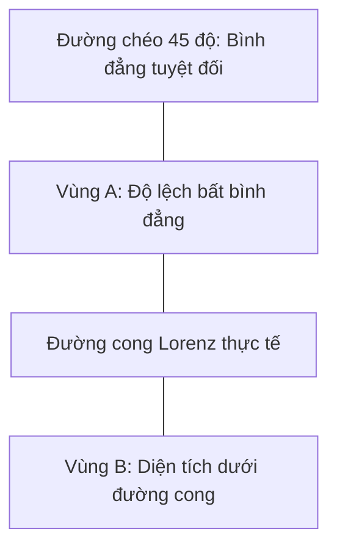

# Bất bình đẳng và Lý thuyết Lựa chọn Công cộng (Inequality & Public Choice)

Chuyên đề này phân tích các vấn đề nan giải về phân phối của cải và cơ chế ra quyết định của bộ máy nhà nước: bất bình đẳng thu nhập, hệ số Gini, đường cong Lorenz, bất bình đẳng tài sản và trường phái Lý thuyết Lựa chọn Công cộng (Public Choice Theory).

---

### Bất bình đẳng thu nhập (Income Inequality)

**1. Là gì?**
- Bất bình đẳng thu nhập là sự phân bổ không đồng đều và chênh lệch đáng kể về mức thu nhập hàng năm (từ tiền lương, lợi nhuận kinh doanh, lãi đầu tư) giữa các cá nhân, hộ gia đình hoặc các nhóm dân cư khác nhau trong một nền kinh tế.
- Là một hiện tượng tồn tại khách quan trong mọi nền kinh tế thị trường do sự khác biệt về năng lực cá nhân, trình độ học vấn, may mắn và quyền sở hữu tài sản ban đầu.
- Nếu chỉ nhớ một điều: **Bất bình đẳng thu nhập là khoảng cách khoảng cách giàu nghèo về số tiền kiếm được hàng tháng giữa người giàu và người nghèo trong xã hội.**

**2. Hoạt động thế nào?**
- **Các nguyên nhân cốt lõi:**
  1. *Chênh lệch kỹ năng & Công nghệ (SBTC):* Kỷ nguyên số trả lương cực cao cho người giỏi công nghệ và nén lương lao động giản đơn.
  2. *Toàn cầu hóa:* Mở rộng thị trường toàn cầu cho giới tinh hoa (Superstar phenomenon) trong khi làm gia tăng cạnh tranh giá rẻ đối với công nhân sản xuất nội địa.
  3. *Quyền sở hữu tài sản sinh lời:* Người giàu có vốn để đầu tư sinh lãi, trong khi người nghèo chỉ sống dựa vào tiền lương làm công ăn lương.
- **Tác động hai mặt:**
  - *Mặt tích cực (ở mức vừa phải):* Tạo động lực mạnh mẽ thúc đẩy mọi người nỗ lực học tập, rèn luyện kỹ năng và chấp nhận rủi ro để vươn lên làm giàu.
  - *Mặt tiêu cực (ở mức quá cao):* Bóp nghẹt cơ hội dịch chuyển xã hội (Social mobility), gây lãng phí nhân tài nghèo, làm suy giảm tổng cầu dài hạn và kích động bất ổn chính trị.

**3. Công thức & mô hình**
- Tỷ số chênh lệch thu nhập (Palma Ratio):
  $$\text{Palma Ratio} = \frac{\text{Tổng thu nhập của 10\% người giàu nhất}}{\text{Tổng thu nhập của 40\% người nghèo nhất}}$$
- Tỷ số 20/20 (Quintile Ratio): So sánh thu nhập bình quân của nhóm 20% giàu nhất so với nhóm 20% nghèo nhất.

**4. Ví dụ**
- *Ví dụ số:* Trong một xã hội, nhóm 20% người có thu nhập cao nhất kiếm được trung bình 80 triệu VNĐ/tháng, trong khi nhóm 20% người nghèo nhất kiếm được trung bình 4 triệu VNĐ/tháng.
  $$\text{Tỷ số chênh lệch 20/20} = \frac{80}{4} = 20 \text{ lần}$$
  Khoảng cách thu nhập giữa nhóm đỉnh và nhóm đáy là gấp 20 lần.
- *Ví dụ thực tế:* Tại Mỹ, theo số liệu của CBO, tỷ trọng thu nhập của nhóm 1% giàu nhất đã tăng gấp đôi từ khoảng $9\%$ GDP năm 1979 lên hơn $18\%$ GDP hiện nay, dẫn đến các phong trào xã hội như "Chiếm lấy Phố Wall" (Occupy Wall Street - We are the 99%).
- *Counterfactual:* Nếu một xã hội áp dụng chính sách cào bằng tuyệt đối thu nhập (bác sĩ phẫu thuật não nhận lương bằng đúng người quét rác), động lực học tập kiên trì và làm việc vất vả sẽ biến mất hoàn toàn, đẩy năng suất toàn xã hội lao dốc.

**5. Ứng dụng & tranh luận**
- **Ứng dụng:** Căn cứ then chốt để thiết kế chính sách thuế thu nhập cá nhân lũy tiến, mức lương tối thiểu và các chương trình mục tiêu quốc gia xóa đói giảm nghèo.
- **Trade-off:** Cố gắng san phẳng bất bình đẳng bằng thuế khóa quá nặng có thể gây tổn hại cho tính hiệu quả kinh tế và triệt tiêu động lực đổi mới sáng tạo.
- **Tranh luận / Lỗi thường gặp:** Nhầm lẫn giữa "Bình đẳng về kết quả" (Equality of Outcome) và "Bình đẳng về cơ hội" (Equality of Opportunity). Mục tiêu đúng đắn của chính sách công là bảo đảm mọi đứa trẻ sinh ra đều có cơ hội học tập và chăm sóc y tế công bằng, chứ không phải ép mọi người lớn lên phải có thu nhập bằng nhau.

**6. Liên kết**
- Đọc tiếp: [Gini Coefficient](file:///Users/ductri0981/Documents/Studying/Studying-Economic/02_Micro_and_Macro_Economics/11_Fiscal_Economics/08_Inequality_and_Public_Choice.md#he-so-gini-gini-coefficient), [Lorenz Curve](file:///Users/ductri0981/Documents/Studying/Studying-Economic/02_Micro_and_Macro_Economics/11_Fiscal_Economics/08_Inequality_and_Public_Choice.md#duong-cong-lorenz-lorenz-curve).
- Mở rộng: [Wealth Inequality](file:///Users/ductri0981/Documents/Studying/Studying-Economic/02_Micro_and_Macro_Economics/11_Fiscal_Economics/08_Inequality_and_Public_Choice.md#bat-binh-dang-tai-san-wealth-inequality).

---

### Hệ số Gini (Gini Coefficient)

**1. Là gì?**
- Hệ số Gini (hay tỷ số Gini) là thước đo thống kê chuẩn mực quốc tế phổ biến nhất dùng để định lượng mức độ bất bình đẳng trong phân phối thu nhập hoặc tài sản của một quốc gia.
- Có giá trị biến thiên trong khoảng từ **0 đến 1** (hoặc từ 0% đến 100%):
  - Bằng 0: Thể hiện sự **bình đẳng tuyệt đối** (mọi người dân đều có thu nhập bằng nhau chằn chặn).
  - Bằng 1: Thể hiện sự **bất bình đẳng tuyệt đối** (toàn bộ thu nhập của đất nước rơi vào tay đúng một người duy nhất, tất cả những người còn lại có thu nhập bằng 0).
- Nếu chỉ nhớ một điều: **Hệ số Gini là điểm số đo độ lệch giàu nghèo từ 0 đến 1; số càng gần 1 thì xã hội càng phân hóa giàu nghèo sâu sắc.**

**2. Hoạt động thế nào?**
- **Các ngưỡng cảnh báo quốc tế của Hệ số Gini:**
  - Dưới 0,30: Mức độ bất bình đẳng thấp (phân phối thu nhập tương đối bình đẳng, điển hình là các nước Bắc Âu).
  - Từ 0,30 đến 0,40: Mức độ bất bình đẳng hợp lý, chấp nhận được.
  - Từ 0,40 đến 0,50: Bất bình đẳng cao (mức 0,40 là ngưỡng cảnh báo đỏ của Liên Hợp Quốc về nguy cơ bất ổn xã hội).
  - Trên 0,50: Bất bình đẳng nghiêm trọng (điển hình tại một số nước Nam Phi và Mỹ Latinh).

**3. Công thức & mô hình**
- Định nghĩa hình học qua Đường cong Lorenz:
  $$G = \frac{A}{A + B}$$
  Trong đó:
  - $A$: Diện tích hình nằm giữa Đường phân phối bình đẳng tuyệt đối (đường chéo 45 độ) và Đường cong Lorenz thực tế.
  - $B$: Diện tích nằm phía dưới Đường cong Lorenz.
  - Do tổng diện tích tam giác $A + B = 0,5$, ta có: $G = 2A = 1 - 2B$.
- Công thức đại số tính từ mẫu khảo sát dân số:
  $$G = \frac{\sum_{i=1}^n \sum_{j=1}^n |y_i - y_j|}{2 n^2 \bar{y}}$$

**4. Ví dụ**
- *Ví dụ số:* Diện tích khu vực $A$ đo được trên đồ thị là 0,18. Hệ số Gini của quốc gia là:
  $$G = \frac{A}{0,5} = \frac{0,18}{0,5} = 0,36$$
  Nằm trong ngưỡng bất bình đẳng trung bình chấp nhận được.
- *Ví dụ thực tế:* Tại Việt Nam, theo số liệu Khảo sát mức sống dân cư (VHLSS) của Tổng cục Thống kê, hệ số Gini của Việt Nam năm 2022 là 0,375, phản ánh sự phân hóa thu nhập ở mức trung bình, có xu hướng tăng nhẹ so với giai đoạn trước do khoảng cách thu nhập giữa thành thị và nông thôn dãn rộng.
- *Counterfactual:* Nếu hệ số Gini của một quốc gia tăng vọt lên mức 0,65 (như Nam Phi), xã hội sẽ bị chia rẽ thành hai thế giới biệt lập: người giàu sống trong các khu biệt thự có rào điện và vệ sĩ vũ trang bảo vệ, trong khi người nghèo sống chen chúc trong các khu ổ chuột tăm tối.

**5. Ứng dụng & tranh luận**
- **Ứng dụng:** Đánh giá hiệu quả của các chính sách cải cách kinh tế và chương trình giảm nghèo; theo dõi mục tiêu phát triển bền vững SDG 10 (Giảm bất bình đẳng).
- **Trade-off:** Cố gắng kéo Gini xuống quá thấp (dưới 0,25) thường đồng nghĩa với sự can thiệp cào bằng thái quá của nhà nước, bóp chết tính năng động kinh tế.
- **Tranh luận / Lỗi thường gặp:** Hai quốc gia có hình dạng đường cong Lorenz hoàn toàn khác nhau nhưng vẫn có thể có cùng một con số Hệ số Gini giống hệt nhau. Do đó, Gini không cho biết chi tiết sự bất bình đẳng đang diễn ra ở tầng lớp dưới đáy hay tầng lớp trên đỉnh.

**6. Liên kết**
- Đọc tiếp: [Lorenz Curve](file:///Users/ductri0981/Documents/Studying/Studying-Economic/02_Micro_and_Macro_Economics/11_Fiscal_Economics/08_Inequality_and_Public_Choice.md#duong-cong-lorenz-lorenz-curve).
- Mở rộng: [Income Inequality](file:///Users/ductri0981/Documents/Studying/Studying-Economic/02_Micro_and_Macro_Economics/11_Fiscal_Economics/08_Inequality_and_Public_Choice.md#bat-binh-dang-thu-nhap-income-inequality).

---

### Đường cong Lorenz (Lorenz Curve)

**1. Là gì?**
- Đường cong Lorenz là đồ thị hình học biểu diễn trực quan mối quan hệ tích lũy giữa tỷ lệ phần trăm dân số (xếp theo thứ tự từ nghèo nhất đến giàu nhất) và tỷ lệ phần trăm tổng thu nhập quốc dân mà họ nắm giữ.
- Do nhà thống kê học người Mỹ Max O. Lorenz phát triển vào năm 1905.
- Nếu chỉ nhớ một điều: **Đường cong Lorenz là đường đồ thị cong hình cánh cung; cánh cung càng võng sâu xuống dưới thì xã hội càng bất bình đẳng.**

**2. Hoạt động thế nào?**
- **Cấu trúc đồ thị:**
  - Trục hoành: Tỷ lệ phần trăm tích lũy của dân số (từ $0\%$ đến $100\%$).
  - Trục tung: Tỷ lệ phần trăm tích lũy của tổng thu nhập (từ $0\%$ đến $100\%$).
- **Đường chuẩn bình đẳng tuyệt đối (Line of Perfect Equality):**
  - Là đường chéo nối từ gốc tọa độ $(0, 0)$ đến góc trên bên phải $(100, 100)$, nghiêng đúng 45 độ.
  - Trên đường này: $20\%$ dân số nắm đúng $20\%$ thu nhập; $50\%$ dân số nắm đúng $50\%$ thu nhập.
- **Đường cong Lorenz thực tế:**
  - Luôn nằm **phía dưới** đường chéo 45 độ và có độ cong lồi về phía trục hoành.
  - Khoảng cách giữa đường cong Lorenz và đường 45 độ càng lớn (diện tích $A$ càng rộng) thì mức độ bất bình đẳng thu nhập càng trầm trọng.

**3. Công thức & mô hình**
- Hàm số biểu diễn:
  $$L(p) = \frac{\int_0^p Q(t) dt}{\int_0^1 Q(t) dt}$$
  Trong đó $p \in [0, 1]$ là tỷ lệ phần trăm dân số tích lũy, $L(p)$ là tỷ lệ thu nhập tích lũy.
- Các tính chất toán học bắt buộc:
  1. $L(0) = 0$ và $L(1) = 1$.
  2. $L'(p) \ge 0$ (đơn điệu tăng).
  3. $L''(p) \ge 0$ (hàm lồi).
  4. $L(p) \le p$ với mọi $p$.

**4. Ví dụ**
- *Ví dụ số:* Đọc dữ liệu từ một đường cong Lorenz:
  - Tọa độ $(0,40; 0,15)$: Cho biết $40\%$ dân số nghèo nhất đất nước chỉ nắm giữ $15\%$ tổng thu nhập quốc gia.
  - Tọa độ $(0,80; 0,55)$: Cho biết $80\%$ dân số chỉ nắm giữ $55\%$ thu nhập. Điều này đồng nghĩa với việc $20\%$ dân số giàu nhất nắm giữ tới $100\% - 55\% = 45\%$ tổng thu nhập của cả nước.
- *Ví dụ thực tế:* Khi so sánh đường cong Lorenz của Đan Mạch và Brazil: Đường cong Lorenz của Đan Mạch uốn cong rất nông và áp sát đường 45 độ; trong khi đường cong Lorenz của Brazil võng sâu xuống đáy, phản ánh sự tương phản rõ rệt về công bằng xã hội giữa hai quốc gia.
- *Counterfactual:* Nếu đường cong Lorenz chạm góc vuông đáy (trục hoành và cạnh đứng bên phải), điều đó có nghĩa là 99,99% người dân không có đồng nào và người cuối cùng giữ trọn vẹn 100% tài sản (Hệ số Gini bằng đúng 1).

**5. Ứng dụng & tranh luận**
- **Ứng dụng:** Công cụ trực quan hóa sống động nhất để so sánh mức độ bất bình đẳng trước và sau khi thực hiện chính sách thuế và trợ cấp xã hội (Đường Lorenz sau thuế sẽ dịch chuyển ép sát về phía đường 45 độ).
- **Trade-off:** Việc vẽ đường cong Lorenz đòi hỏi các cuộc điều tra khảo sát mẫu dân số quy mô lớn và tốn kém ngân sách.
- **Tranh luận / Lỗi thường gặp:** Lầm tưởng đường cong Lorenz có thể có đoạn dốc xuống. Do đây là chuỗi số liệu tích lũy của những người được xếp thứ tự thu nhập tăng dần, đường cong Lorenz bắt buộc phải luôn luôn dốc lên và lồi xuống dưới.

**6. Liên kết**
- Đọc trước: [Gini Coefficient](file:///Users/ductri0981/Documents/Studying/Studying-Economic/02_Micro_and_Macro_Economics/11_Fiscal_Economics/08_Inequality_and_Public_Choice.md#he-so-gini-gini-coefficient).
- Mở rộng: [Redistribution of Income](file:///Users/ductri0981/Documents/Studying/Studying-Economic/02_Micro_and_Macro_Economics/11_Fiscal_Economics/07_Taxation_Structure_and_Redistribution.md#phan-phoi-lai-thu-nhap-redistribution-of-income).

---

### Bất bình đẳng tài sản (Wealth Inequality)

**1. Là gì?**
- Bất bình đẳng tài sản là sự phân bổ không đồng đều về tổng giá trị tài sản ròng tích lũy (bao gồm tiền gửi ngân hàng, cổ phiếu, trái phiếu, bất động sản nhà đất, doanh nghiệp kinh doanh trừ đi các khoản nợ phải trả) giữa các cá nhân hoặc hộ gia đình trong xã hội.
- Khác với bất bình đẳng thu nhập (đo lường dòng tiền kiếm được trong một năm - Flow), bất bình đẳng tài sản đo lường lượng của cải tích tụ qua nhiều thế hệ (Stock) và luôn **sâu sắc, tàn khốc hơn bất bình đẳng thu nhập gấp nhiều lần**.
- Nếu chỉ nhớ một điều: **Thu nhập chỉ là số tiền bạn kiếm được năm nay, còn tài sản là những mảnh đất và cổ phiếu bạn sở hữu; và hố sâu khoảng cách về đất đai tài sản mới là thứ khủng khiếp nhất.**

**2. Hoạt động thế nào?**
- **Quy luật $r > g$ của Thomas Piketty:**
  - Nhà kinh tế học người Pháp Thomas Piketty trong tác phẩm "Tư bản trong thế kỷ 21" (2014) chỉ ra rằng: Bất cứ khi nào tỷ suất sinh lời thực tế của tư bản ($r$: lãi suất, cổ tức, tăng giá đất) cao hơn tốc độ tăng trưởng kinh tế ($g$: tốc độ tăng GDP và tiền lương), của cải tích lũy trong quá khứ sẽ tăng trưởng nhanh hơn thu nhập từ lao động.
  - Người giàu sở hữu tài sản sẽ tự động giàu lên nhanh hơn người làm công ăn lương, biến xã hội thành một "chủ nghĩa tư bản thừa kế" (Patrimonial Capitalism).
- **Quyền lực truyền đời:** Tài sản có tính kế thừa liên thế hệ (thừa kế bất động sản, gia tộc giàu có), tạo ra sự bất bình đẳng ngay từ vạch xuất phát của những đứa trẻ sinh ra.

**3. Công thức & mô hình**
- Tài sản ròng của hộ gia đình:
  $$Net\_Wealth = \sum \text{Tài sản thực (BĐS)} + \sum \text{Tài sản tài chính} - \text{Nợ vay}$$
- Định luật cơ bản thứ hai của chủ nghĩa tư bản:
  $$\beta = \frac{s}{g}$$
  Trong đó $\beta$ là tỷ số giữa Tổng tài sản quốc gia trên GDP, $s$ là tỷ lệ tiết kiệm, $g$ là tốc độ tăng trưởng kinh tế. Khi tăng trưởng chậm lại ($g \downarrow$), tỷ số tài sản $\beta$ tăng vọt.

**4. Ví dụ**
- *Ví dụ số:* Trong một quốc gia:
  - Hệ số Gini về thu nhập là $0,38$ (mức trung bình).
  - Nhưng Hệ số Gini về tài sản lên tới $0,82$ (mức cực kỳ nghiêm trọng).
  - Nhóm 1% giàu nhất chỉ chiếm $15\%$ tổng thu nhập hàng năm, nhưng lại sở hữu tới $45\%$ tổng tài sản đất đai và chứng khoán của toàn quốc gia.
- *Ví dụ thực tế:* Tại Mỹ, theo báo cáo của Cục Dự trữ Liên bang (Fed), nhóm 10% dân số giàu nhất nắm giữ tới hơn $68\%$ tổng tài sản ròng của toàn nước Mỹ, trong khi nhóm 50% dân số phía dưới chỉ nắm giữ vỏn vẹn khoảng $3\%$ tổng tài sản. Tại Việt Nam, cơn sốt đất đai trong 3 thập kỷ qua đã tạo ra sự phân hóa tài sản cực lớn giữa những người nắm giữ nhiều bất động sản và những người trẻ làm công ăn lương không có tài sản thừa kế.
- *Counterfactual:* Nếu chính phủ áp dụng thuế thừa kế tài sản lũy tiến cao (như Nhật Bản và Hàn Quốc đánh thuế thừa kế lên tới $50\%$) kết hợp với thuế bất động sản căn nhà thứ hai, tốc độ tích tụ tài sản bất bình đẳng qua các thế hệ sẽ bị ghìm cương đáng kể.

**5. Ứng dụng & tranh luận**
- **Ứng dụng:** Tranh luận về việc ban hành Thuế tài sản ròng (Wealth Tax), thuế bất động sản và thuế thừa kế để ngăn chặn sự hình thành các triều đại tài phiệt lũng đoạn chính trị.
- **Trade-off:** Đánh thuế tài sản rất khó định giá trong thực tế (khó định giá tranh quý, công ty tư nhân chưa niêm yết) và thúc đẩy giới siêu giàu chuyển tài sản sang các thiên đường thuế offshore (Thụy Sĩ, Cayman).
- **Tranh luận / Lỗi thường gặp:** Đồng nhất giữa người có "thu nhập cao" và người "giàu có về tài sản". Một bác sĩ trẻ mới ra trường có thu nhập cao nhưng tài sản ròng âm vì đang gánh nợ tiền học đại học; trong khi một người về hưu sống bằng lương hưu thấp nhưng sở hữu căn nhà mặt tiền phố cổ trị giá hàng chục tỷ đồng.

**6. Liên kết**
- Đọc trước: [Income Inequality](file:///Users/ductri0981/Documents/Studying/Studying-Economic/02_Micro_and_Macro_Economics/11_Fiscal_Economics/08_Inequality_and_Public_Choice.md#bat-binh-dang-thu-nhap-income-inequality).
- Mở rộng: [Redistribution of Income](file:///Users/ductri0981/Documents/Studying/Studying-Economic/02_Micro_and_Macro_Economics/11_Fiscal_Economics/07_Taxation_Structure_and_Redistribution.md#phan-phoi-lai-thu-nhap-redistribution-of-income).

---

### Lý thuyết Lựa chọn Công cộng (Public Choice Theory)

**1. Là gì?**
- Lý thuyết Lựa chọn Công cộng là một nhánh chuyên sâu của kinh tế học ứng dụng các công cụ và giả định của kinh tế học vi mô (đặc biệt là giả định con người hành động duy lý và vị kỷ vì tư lợi) để phân tích hành vi của các tác nhân trong khu vực chính trị và bộ máy nhà nước (chính trị gia, cử tri, công chức quan liêu và các nhóm lợi ích).
- Do nhà kinh tế học đoạt giải Nobel James M. Buchanan và Gordon Tullock sáng lập, được tóm gọn qua định đề: "Chính trị không có sự lãng mạn" (Politics without romance).
- Nếu chỉ nhớ một điều: **Lý thuyết Lựa chọn Công cộng chứng minh rằng các quan chức và chính khách cũng là con người bằng xương bằng thịt, cũng mưu cầu lợi ích riêng chứ không phải những vị bồ tát chỉ biết hy sinh vì nhân dân.**

**2. Hoạt động thế nào?**
- **Động cơ của các chủ thể chính trị:**
  1. *Chính trị gia:* Tối đa hóa số phiếu bầu để tái đắc cử. Do đó họ thích ban hành các chính sách mang lại lợi ích cục bộ trước mắt (trước ngày bầu cử) và đẩy chi phí nợ nần cho tương lai.
  2. *Công chức quan liêu (Bureaucrats):* Tối đa hóa ngân sách và quy mô quyền lực của phòng ban mình (theo William Niskanen), dẫn đến bộ máy nhà nước liên tục phình to.
  3. *Nhóm lợi ích (Interest Groups):* Vận động hành lang (Lobbying) và Tìm kiếm địa tô (Rent-Seeking) để giành các đặc quyền, giấy phép độc quyền hoặc bảo hộ thuế quan.
  4. *Cử tri:* Thường rơi vào trạng thái "Thiếu hiểu biết duy lý" (Rational Ignorance): vì một lá phiếu cá nhân có xác suất thay đổi kết quả bầu cử gần bằng 0, cử tri không có động lực bỏ thời gian nghiên cứu kỹ lưỡng các chính sách phức tạp.
- **Thất bại của Chính phủ (Government Failure):** Tương tự như thị trường có khuyết tật (Market Failure), sự can thiệp của chính phủ cũng thường xuyên thất bại do thiếu áp lực cạnh tranh, thiếu thông tin và bị chi phối bởi các nhóm lợi ích thân hữu.

**3. Công thức & mô hình**
- Mô hình cử tri trung vị (Median Voter Theorem):
  - Trong cuộc bầu cử đa số giữa hai đảng, các chính trị gia sẽ có xu hướng điều chỉnh cương lĩnh tranh cử của mình hội tụ về quan điểm của người cử tri nằm chính giữa phổ chính trị (Median Voter) để tối đa hóa số phiếu.
- Mô hình chi phí tìm kiếm địa tô Tullock (Rent-Seeking Costs):
  $$\text{Tổn thất xã hội} = DWL + \text{Toàn bộ chi phí vận động hành lang chạy chọt}$$

**4. Ví dụ**
- *Ví dụ số:* Một chính sách thuế bảo hộ ngành đường mía giúp 10 doanh nghiệp sản xuất đường kiếm thêm 100 tỷ VNĐ lợi nhuận (mỗi chủ doanh nghiệp được 10 tỷ). Chi phí bảo hộ này làm 100 triệu người tiêu dùng phải mua đường đắt hơn 2.000 VNĐ/kg (mỗi người mất 20.000 VNĐ/năm).
  - 10 chủ doanh nghiệp sẵn sàng chi ra 20 tỷ VNĐ để vận động hành lang, tài trợ bầu cử nhằm duy trì sắc thuế bảo hộ (Lợi ích tập trung - Concentrated benefits).
  - 100 triệu người tiêu dùng dù bị thiệt hại tổng cộng 200 tỷ VNĐ nhưng vì mỗi người chỉ mất có 20.000 VNĐ nên không ai hơi đâu bỏ việc đi biểu tình (Chi phí phân tán - Diffuse costs).
  - Kết quả: Sắc thuế bất hợp lý vẫn được thông qua thuận lợi.
- *Ví dụ thực tế:* Các dự án "Thùng thịt heo" (Pork-barrel politics) tại Quốc hội Mỹ: Các nghị sĩ câu kết với nhau (Logrolling - bỏ phiếu đổi chác) để thông qua các dự án xây dựng cầu cống vô bổ tại bang nhà của mình bằng tiền thuế của người dân toàn quốc nhằm lấy lòng cử tri địa phương.
- *Counterfactual:* Nếu nền kinh tế thịnh hành cơ chế công khai minh bạch tài chính bầu cử, kiểm toán độc lập ngân sách và cơ chế giám sát phản biện xã hội mạnh mẽ, các hành vi tìm kiếm địa tô và lợi ích nhóm trong khu vực công sẽ bị kiềm chế đáng kể.

**5. Ứng dụng & tranh luận**
- **Ứng dụng:** Thiết kế thể chế hiến pháp kinh tế (Constitutional Economics), quy định mức trần nợ công bằng luật, quy chế kiểm soát vận động hành lang và cải cách tiền lương công vụ.
- **Trade-off:** Thiết lập cơ chế kiểm soát giám sát quyền lực quá dày đặc có thể làm phát sinh tệ nạn quan liêu giấy tờ và sự sợ sai, sợ trách nhiệm của cán bộ công quyền.
- **Tranh luận / Lỗi thường gặp:** Lầm tưởng trường phái Lựa chọn Công cộng phủ nhận hoàn toàn vai trò của nhà nước. Mục tiêu của trường phái này không phải là xóa bỏ nhà nước, mà là thiết kế các luật chơi thể chế sao cho ngay cả khi quan chức hành động vì tư lợi thì kết quả vẫn phải phục vụ lợi ích chung của xã hội.

**6. Liên kết**
- Đọc trước: [Market Failure](file:///Users/ductri0981/Documents/Studying/Studying-Economic/02_Micro_and_Macro_Economics/06_Market_Failures/01_Market_Failure_and_Externalities.md#that-bai-thi-truong-market-failure).
- Mở rộng: [Government Budget](file:///Users/ductri0981/Documents/Studying/Studying-Economic/02_Micro_and_Macro_Economics/11_Fiscal_Economics/02_Government_Budget_and_Balance.md#ngan-sach-chinh-phu-government-budget).

---

## Câu hỏi tự kiểm tra

1. Phân biệt sự khác nhau giữa Bất bình đẳng thu nhập (Income Inequality) và Bất bình đẳng tài sản (Wealth Inequality)? Thước đo nào có mức độ phân hóa sâu sắc hơn?
2. Trình bày ý nghĩa của Hệ số Gini và mối quan hệ hình học giữa Hệ số Gini với Đường cong Lorenz?
3. Tại sao nói quy luật $r > g$ của Thomas Piketty là nguyên nhân cốt lõi khiến bất bình đẳng tài sản tự động gia tăng trong chủ nghĩa tư bản hiện đại?
4. Định đề "Chính trị không có sự lãng mạn" trong Lý thuyết Lựa chọn Công cộng (Public Choice Theory) có ý nghĩa gì đối với việc phân tích hành vi của các quan chức nhà nước?
5. Hiện tượng "Lợi ích tập trung, chi phí phân tán" giải thích thế nào về việc các nhóm lợi ích thiểu số có thể thao túng chính sách công gây thiệt hại cho đa số nhân dân?

---

## Ghi chú nguồn
- Buchanan, J. M., & Tullock, G. (1962). *The Calculus of Consent: Logical Foundations of Constitutional Democracy*. University of Michigan Press.
- Piketty, T. (2014). *Capital in the Twenty-First Century*. Harvard University Press.
- Tổng cục Thống kê Việt Nam (GSO). Báo cáo khảo sát mức sống dân cư (VHLSS) năm 2022.
