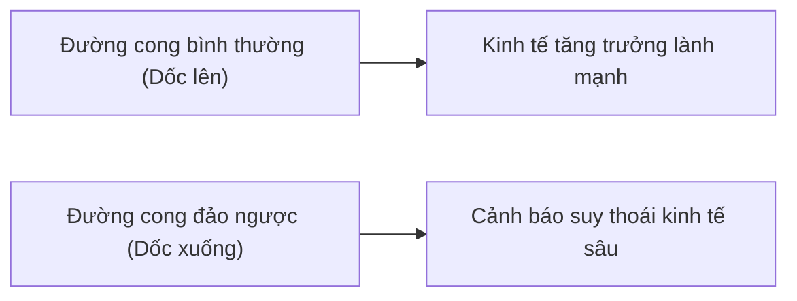

# Lợi suất, Hàng hóa và Chênh lệch Tín dụng (Yields, Commodities & Spreads)

Chuyên đề này phân tích các phong vũ biểu tinh vi nhất của thị trường tài chính quốc tế: Đường cong lợi suất (Yield Curve), Lợi suất trái phiếu (Bond Yields), Lợi suất Kho bạc Mỹ (Treasury Yields), Chênh lệch tín dụng (Credit Spreads), và Chỉ số giá hàng hóa nguyên liệu toàn cầu (Commodity Price Index).

---

### Đường cong lợi suất (Yield Curve)

**1. Là gì?**
- Đường cong lợi suất là đồ thị biểu diễn mối quan hệ hình học giữa mức lợi suất đáo hạn (Yield to Maturity) và các kỳ hạn đáo hạn khác nhau (từ 1 tháng, 3 tháng, 2 năm, 5 năm, 10 năm đến 30 năm) của các trái phiếu chính phủ có cùng chất lượng tín dụng tại một thời điểm nhất định.
- Được coi là "pha lê tiên tri" chuẩn xác nhất của thị trường tài chính toàn cầu để dự báo tăng trưởng kinh tế, lạm phát và các bước ngoặt của chu kỳ kinh doanh.
- Nếu chỉ nhớ một điều: **Đường cong lợi suất bình thường thì dốc lên (vay lâu lãi cao); nếu nó bị dốc ngược xuống (vay ngắn lãi cao hơn vay dài) thì gần như chắc chắn kinh tế sắp suy thoái.**

**2. Hoạt động thế nào?**
- **3 hình dạng kinh điển của đường cong:**
  1. *Đường cong bình thường (Normal Yield Curve - Dốc lên):* Lợi suất dài hạn cao hơn lợi suất ngắn hạn. Nhà đầu tư đòi hỏi một phần bù kỳ hạn (Term Premium) để bù đắp rủi ro lạm phát và chôn vốn lâu dài $\implies$ báo hiệu kinh tế đang tăng trưởng lành mạnh.
  2. *Đường cong phẳng (Flat Yield Curve):* Lợi suất ngắn hạn và dài hạn xấp xỉ ngang bằng nhau $\implies$ giai đoạn chuyển tiếp, thị trường hoang mang về triển vọng kinh tế.
  3. *Đường cong đảo ngược (Inverted Yield Curve - Dốc xuống):* Lợi suất ngắn hạn cao hơn lợi suất dài hạn. Xảy ra khi Ngân hàng Trung ương tăng mạnh lãi suất ngắn hạn để chống lạm phát, trong khi nhà đầu tư đổ xô mua gom trái phiếu dài hạn vì tin rằng kinh tế sắp suy thoái và lãi suất tương lai sẽ phải giảm sâu $\implies$ **Tín hiệu cảnh báo suy thoái có độ tin cậy trên 95%**.

**3. Công thức & mô hình**
- Độ dốc đường cong lợi suất (Yield Curve Slope / Term Spread):
  $$\text{Slope} = Y_{10Y} - Y_{2Y} \quad \text{hoặc} \quad Y_{10Y} - Y_{3M}$$
  Khi $\text{Slope} < 0$, đường cong chính thức bị đảo ngược.

**4. Ví dụ**
- *Ví dụ số:* Lợi suất trái phiếu Kho bạc Mỹ kỳ hạn 10 năm là $3,8\%$. Lợi suất trái phiếu kỳ hạn 2 năm là $4,6\%$.
  $$\text{Chênh lệch 10Y - 2Y} = 3,8\% - 4,6\% = -0,8\% = -80 \text{ bps}$$
  Đường cong lợi suất bị đảo ngược sâu 80 điểm cơ bản, phát đi tín hiệu cảnh báo suy thoái đỏ rực.
- *Ví dụ thực tế:* Hiện tượng đảo ngược đường cong lợi suất đã dự báo chính xác mọi cuộc suy thoái kinh tế Mỹ trong suốt 7 thập kỷ qua (1970, 1980, 1990, 2001, 2008, 2020). Từ tháng 7/2022, đường cong 10Y-2Y của Mỹ đã trải qua đợt đảo ngược dài kỷ lục nhất lịch sử (kéo dài hơn 2 năm liên tiếp) sau khi Fed tăng lãi suất dồn dập.
- *Counterfactual:* Nếu một chính phủ kiểm soát đường cong lợi suất (YCC - Yield Curve Control như Ngân hàng Trung ương Nhật Bản BOJ từng làm bằng cách cam kết mua vô hạn trái phiếu để ghim lợi suất 10 năm ở mức 0%), đường cong sẽ mất đi tính năng phản ánh thị trường tự do.

**5. Ứng dụng & tranh luận**
- **Ứng dụng:** La bàn định hướng phân bổ tài sản của các nhà quản lý quỹ đầu tư toàn cầu; căn cứ ra quyết định điều hành chính sách tiền tệ.
- **Trade-off:** Thời gian từ lúc đường cong đảo ngược đến khi suy thoái thực tế nổ ra có độ trễ dao động rất rộng (từ 6 đến 24 tháng), khiến các nhà đầu tư dễ bị non gan hành động quá sớm.
- **Tranh luận / Lỗi thường gặp:** Lầm tưởng đường cong đảo ngược "gây ra" suy thoái. Bản thân đường cong không gây ra suy thoái; nó chỉ là tấm gương phản ánh dự báo tập thể của hàng triệu nhà đầu tư thông minh về sự đổ vỡ kinh tế sắp tới.

**6. Liên kết**
- Đọc tiếp: [Bond Yields](file:///Users/ductri0981/Documents/Studying/Studying-Economic/02_Micro_and_Macro_Economics/12_Economic_Indicators/07_Yields_Commodities_and_Spreads.md#loi-suat-trai-phieu-bond-yields), [Treasury Yields](file:///Users/ductri0981/Documents/Studying/Studying-Economic/02_Micro_and_Macro_Economics/12_Economic_Indicators/07_Yields_Commodities_and_Spreads.md#loi-suat-kho-bac-treasury-yields).
- Mở rộng: [Leading Economic Indicators](file:///Users/ductri0981/Documents/Studying/Studying-Economic/02_Micro_and_Macro_Economics/12_Economic_Indicators/01_Cyclical_and_Sentiment_Indicators.md#chi-bao-kinh-te-dan-dat-leading-economic-indicators).

---

### Lợi suất trái phiếu (Bond Yields)

**1. Là gì?**
- Lợi suất trái phiếu là tỷ suất sinh lợi tính theo tỷ lệ phần trăm hàng năm mà một nhà đầu tư nhận được từ việc nắm giữ trái phiếu, được xác định dựa trên mối tương quan giữa dòng tiền lãi coupon, giá mua thị trường hiện hành và mệnh giá hoàn trả khi đáo hạn.
- Phản ánh chi phí vốn thực tế trên thị trường nợ đối với chủ thể phát hành trái phiếu (chính phủ hoặc doanh nghiệp).
- Nếu chỉ nhớ một điều: **Lợi suất trái phiếu là tỷ lệ phần trăm tiền lời thực tế bạn kiếm được từ trái phiếu theo giá thị trường bạn mua.**

**2. Hoạt động thế nào?**
- **Mối quan hệ nghịch biến bất di bất dịch giữa Giá và Lợi suất:**
  $$\text{Giá trái phiếu (Price)} \uparrow \iff \text{Lợi suất trái phiếu (Yield)} \downarrow$$
  - Khi thị trường hoảng loạn (Risk-off) $\implies$ mọi người tranh nhau mua trái phiếu an toàn $\implies$ giá trái phiếu tăng vọt $\implies$ lợi suất bị nén giảm sâu.
  - Khi lạm phát tăng cao hoặc rủi ro vỡ nợ tăng $\implies$ nhà đầu tư bán tháo trái phiếu $\implies$ giá trái phiếu sụp đổ $\implies$ lợi suất nhảy vọt lên cao.
- **Các loại lợi suất phổ biến:**
  - *Lợi suất hiện hành (Current Yield):* Lấy tiền lãi coupon hàng năm chia trực tiếp cho giá thị trường hiện tại.
  - *Lợi suất đáo hạn (Yield to Maturity - YTM):* Thước đo chuẩn mực nhất, tính toán toàn bộ dòng tiền lãi và chênh lệch vốn nếu giữ trái phiếu đến ngày đáo hạn.

**3. Công thức & mô hình**
- Lợi suất hiện hành:
  $$CY = \frac{C}{P}$$
- Lợi suất đáo hạn (YTM - nghiệm $y$ của phương trình định giá):
  $$P = \sum_{t=1}^n \frac{C}{(1 + y)^t} + \frac{M}{(1 + y)^n}$$

**4. Ví dụ**
- *Ví dụ số:* Một trái phiếu mệnh giá $M = 100.000$ VNĐ, trả lãi coupon cố định 8.000 VNĐ/năm ($8\%$). Do thị trường thắt chặt, giá trái phiếu trên sàn giao dịch bị rớt xuống $P = 80.000$ VNĐ. Lợi suất hiện hành là:
  $$CY = \frac{8.000}{80.000} \times 100\% = 10,0\%$$
  Mặc dù lãi suất ghi trên hợp đồng là $8\%$, người mua mới ở mức giá 80.000 VNĐ thực chất đang hưởng mức lợi suất lên tới $10\%$.
- *Ví dụ thực tế:* Tại thị trường trái phiếu doanh nghiệp Việt Nam cuối năm 2022 sau sự kiện Vạn Thịnh Phát, tâm lý hoang mang khiến các nhà đầu tư bán tháo trái phiếu bất động sản với giá chiết khấu $30-40\%$ dưới mệnh giá, đẩy lợi suất trái phiếu doanh nghiệp trên thị trường thứ cấp vọt lên mức không tưởng $25\% - 30\%$/năm.
- *Counterfactual:* Nếu một chính phủ có xếp hạng tín nhiệm hoàn hảo và lạm phát duy trì ở mức 0%, lợi suất trái phiếu chính phủ sẽ giảm về mức cực thấp (chỉ 1–2%), giúp nhà nước vay vốn xây dựng đất nước với chi phí rẻ như cho.

**5. Ứng dụng & tranh luận**
- **Ứng dụng:** Tham chiếu định giá chi phí sử dụng vốn bình quân (WACC) của doanh nghiệp; công cụ chiết khấu dòng tiền định giá cổ phiếu.
- **Trade-off:** Lợi suất trái phiếu tăng cao làm tăng chi phí huy động vốn của toàn bộ nền kinh tế, bóp nghẹt các kế hoạch mở rộng đầu tư của doanh nghiệp.
- **Tranh luận / Lỗi thường gặp:** Nhầm lẫn giữa Lãi suất danh nghĩa (Coupon) và Lợi suất thị trường (Yield). Lãi suất coupon là con số cố định in trên giấy; còn lợi suất thị trường là biến số nhảy múa liên tục theo từng giây giao dịch trên bảng điện tử.

**6. Liên kết**
- Đọc tiếp: [Treasury Yields](file:///Users/ductri0981/Documents/Studying/Studying-Economic/02_Micro_and_Macro_Economics/12_Economic_Indicators/07_Yields_Commodities_and_Spreads.md#loi-suat-kho-bac-treasury-yields), [Credit Spreads](file:///Users/ductri0981/Documents/Studying/Studying-Economic/02_Micro_and_Macro_Economics/12_Economic_Indicators/07_Yields_Commodities_and_Spreads.md#chenh-lech-tin-dung-credit-spreads).
- Mở rộng: [Government Bonds](file:///Users/ductri0981/Documents/Studying/Studying-Economic/02_Micro_and_Macro_Economics/11_Fiscal_Economics/03_Public_Debt_and_Sustainability.md#trai-phieu-chinh-phu-government-bonds).

---

### Lợi suất Kho bạc (Treasury Yields)

**1. Là gì?**
- Lợi suất Kho bạc (Treasury Yields) là mức lợi suất đáo hạn của các công cụ nợ do Bộ Tài chính Hoa Kỳ (US Department of the Treasury) phát hành, bao gồm Tín phiếu Kho bạc (T-Bills, dưới 1 năm), Trái phiếu kỳ hạn ngắn và trung (T-Notes, 2–10 năm), và Trái phiếu kỳ hạn dài (T-Bonds, 20–30 năm).
- Được tôn vinh là **tài sản phi rủi ro chuẩn mực toàn cầu (Risk-Free Benchmark)** của toàn bộ hệ thống tài chính thế giới, vì chính phủ Mỹ được coi là không bao giờ vỡ nợ bằng đồng USD.
- Trong đó, **Lợi suất Kho bạc Mỹ kỳ hạn 10 năm (US 10-Year Treasury Yield)** là lãi suất quan trọng nhất hành tinh, là trục xoay định giá cho mọi loại tài sản từ cổ phiếu, bất động sản đến tiền tệ toàn cầu.
- Nếu chỉ nhớ một điều: **Lợi suất Kho bạc Mỹ kỳ hạn 10 năm là chiếc nhiệt kế đo nhịp tim của toàn bộ hệ thống tài chính thế giới.**

**2. Hoạt động thế nào?**
- **Vai trò định chuẩn lãi suất phi rủi ro ($R_f$):**
  - Mọi mô hình tài chính (CAPM, DCF) đều lấy Lợi suất Kho bạc Mỹ làm lãi suất phi rủi ro nền tảng.
  - Khi lợi suất Kho bạc 10 năm tăng từ $1,5\%$ lên $5,0\% \implies$ tỷ suất chiết khấu tăng vọt $\implies$ định giá của mọi tài sản rủi ro (đặc biệt là cổ phiếu công nghệ tăng trưởng) bị nén giảm nghiêm trọng.
- **Kênh dẫn truyền tỷ giá hối đoái:** Khi lợi suất Kho bạc Mỹ tăng cao hơn lợi suất trái phiếu của các nước khác $\implies$ dòng vốn toàn cầu đổ xô đổi sang USD để mua trái phiếu Mỹ $\implies$ chỉ số Dollar Index (DXY) tăng vọt, gây áp lực mất giá lên mọi đồng tiền khác (bao gồm cả VND).

**3. Công thức & mô hình**
- Mô hình định giá tài sản vốn (CAPM):
  $$E(R_i) = R_f + \beta_i [E(R_m) - R_f]$$
  Trong đó $R_f$ chính là Lợi suất Trái phiếu Kho bạc Mỹ kỳ hạn 10 năm.

**4. Ví dụ**
- *Ví dụ số:* Một cổ phiếu công nghệ tạo ra dòng tiền 1.000 USD/năm mãi mãi.
  - Khi lợi suất Kho bạc Mỹ là $R_f = 2\%$ (tỷ suất vốn hóa $r = 5\%$): Định giá cổ phiếu là $P = 1.000 / 0,05 = 20.000$ USD.
  - Khi lợi suất Kho bạc Mỹ vọt lên $R_f = 5\%$ (tỷ suất vốn hóa tăng lên $r = 8\%$): Định giá cổ phiếu giảm xuống $P = 1.000 / 0,08 = 12.500$ USD.
  - Cổ phiếu bốc hơi gần $40\%$ giá trị thuần túy do Lợi suất Kho bạc Mỹ tăng cao.
- *Ví dụ thực tế:* Tháng 10/2023, khi Lợi suất Kho bạc Mỹ 10 năm chạm mốc $5,0\%$/năm (lần đầu tiên kể từ năm 2007), toàn bộ thị trường chứng khoán toàn cầu chao đảo, chỉ số VN-Index của Việt Nam bị điều chỉnh giảm hơn 15% trong vòng 2 tháng và tỷ giá USD/VND chịu áp lực kịch trần.
- *Counterfactual:* Nếu nước Mỹ bị các tổ chức xếp hạng tín nhiệm hạ bậc xuống mức mất khả năng thanh toán (điều cực kỳ khó xảy ra), vị thế "phi rủi ro" của lợi suất Kho bạc Mỹ sẽ sụp đổ và gây ra cuộc đại khủng hoảng tài chính toàn cầu.

**5. Ứng dụng & tranh luận**
- **Ứng dụng:** Tham chiếu định giá cho các hợp đồng vay thế chấp mua nhà 30 năm tại Mỹ, trái phiếu doanh nghiệp toàn cầu và lãi suất cho vay thương mại quốc tế.
- **Trade-off:** Lợi suất Kho bạc Mỹ neo quá cao trong thời gian dài sẽ hút cạn thanh khoản của các thị trường mới nổi và gia tăng gánh nặng trả nợ nước ngoài bằng USD của các nước nghèo.
- **Tranh luận / Lỗi thường gặp:** Cho rằng Fed trực tiếp ấn định lợi suất Kho bạc 10 năm. Fed chỉ trực tiếp ấn định lãi suất qua đêm ngắn hạn (Fed Funds Rate); lợi suất 10 năm hoàn toàn do cung cầu mua bán tự do trên thị trường tài chính quốc tế quyết định.

**6. Liên kết**
- Đọc trước: [Bond Yields](file:///Users/ductri0981/Documents/Studying/Studying-Economic/02_Micro_and_Macro_Economics/12_Economic_Indicators/07_Yields_Commodities_and_Spreads.md#loi-suat-trai-phieu-bond-yields).
- Mở rộng: [Credit Spreads](file:///Users/ductri0981/Documents/Studying/Studying-Economic/02_Micro_and_Macro_Economics/12_Economic_Indicators/07_Yields_Commodities_and_Spreads.md#chenh-lech-tin-dung-credit-spreads).

---

### Chênh lệch tín dụng (Credit Spreads)

**1. Là gì?**
- Chênh lệch tín dụng (Credit Spread) là sự chênh lệch về tỷ lệ lợi suất giữa hai công cụ nợ (trái phiếu) có cùng kỳ hạn đáo hạn nhưng khác nhau về mức độ rủi ro tín dụng, phổ biến nhất là sự chênh lệch giữa **Lợi suất Trái phiếu Doanh nghiệp** so với **Lợi suất Trái phiếu Chính phủ phi rủi ro** (như Trái phiếu Kho bạc Mỹ).
- Phản ánh trực tiếp khoản "Phần bù rủi ro" (Risk Premium) mà các nhà đầu tư đòi hỏi để chấp nhận gánh chịu rủi ro doanh nghiệp có thể bị vỡ nợ hoặc phá sản không trả được nợ.
- Nếu chỉ nhớ một điều: **Chênh lệch tín dụng đo lường nỗi sợ hãi của thị trường: chênh lệch càng dãn rộng thì thị trường càng sợ doanh nghiệp bị vỡ nợ quỵt tiền.**

**2. Hoạt động thế nào?**
- **Các phân khúc tín dụng chính:**
  1. *Trái phiếu hạng đầu tư (Investment Grade - IG):* Xếp hạng tín nhiệm từ AAA đến BBB. Rủi ro vỡ nợ rất thấp, chênh lệch tín dụng thường hẹp (từ 100 đến 200 điểm cơ bản).
  2. *Trái phiếu lợi suất cao / rác (High Yield / Junk Bonds - HY):* Xếp hạng tín nhiệm từ BB trở xuống. Rủi ro vỡ nợ cao, chênh lệch tín dụng rộng (từ 300 đến trên 1.000 điểm cơ bản).
- **Động thái chu kỳ (Phong vũ biểu đo nỗi sợ):**
  - Trong thời kỳ kinh tế bùng nổ, làm ăn dễ dàng $\implies$ chênh lệch tín dụng thu hẹp lại mức thấp kỷ lục (nhà đầu tư chủ quan xem nhẹ rủi ro).
  - Khi kinh tế chớm suy thoái hoặc nổ ra khủng hoảng ngân hàng $\implies$ nhà đầu tư hoảng loạn tháo chạy khỏi trái phiếu doanh nghiệp để tìm về trái phiếu chính phủ $\implies$ **Chênh lệch tín dụng nới rộng đột biến (Spike)**.

**3. Công thức & mô hình**
- Công thức tính:
  $$\text{Credit Spread} = Y_{doanh\_nghiệp} - Y_{chính\_phủ}$$
  Đơn vị đo: Điểm cơ bản (bps, $1\% = 100 \text{ bps}$).

**4. Ví dụ**
- *Ví dụ số:* Lợi suất trái phiếu Kho bạc Mỹ kỳ hạn 5 năm là $4,0\%$. Lợi suất trái phiếu kỳ hạn 5 năm của một tập đoàn bất động sản xếp hạng B là $9,5\%$.
  $$\text{Credit Spread} = 9,5\% - 4,0\% = 5,5\% = 550 \text{ bps}$$
  Thị trường đòi hỏi phần bù rủi ro 550 điểm cơ bản để dám cho tập đoàn này vay tiền. Nếu nền kinh tế gặp khó khăn, chênh lệch này có thể dãn rộng lên 1.000 bps ($10\%$).
- *Ví dụ thực tế:* Trong cuộc Khủng hoảng tài chính toàn cầu 2008, chỉ số chênh lệch tín dụng trái phiếu lợi suất cao của Mỹ (US High Yield Option-Adjusted Spread - OAS) đã nhảy vọt lên mức kỷ lục lịch sử gần 2.000 điểm cơ bản (20%), báo hiệu tình trạng đóng băng tín dụng toàn diện.
- *Counterfactual:* Nếu chênh lệch tín dụng bị nén chặt xuống mức quá thấp phi lý (như trước năm 2007), đó là tín hiệu cảnh báo thị trường đang rơi vào trạng thái chủ quan tột độ và tích tụ rủi ro hệ thống.

**5. Ứng dụng & tranh luận**
- **Ứng dụng:** Chỉ báo dẫn dắt hàng đầu để nhận diện các điểm căng thẳng thanh khoản (Financial Stress) của hệ thống tài chính; công cụ quản trị rủi ro danh mục trái phiếu.
- **Trade-off:** Chênh lệch tín dụng dãn rộng sẽ trực tiếp làm tăng chi phí vốn vay của doanh nghiệp, đẩy nhanh nguy cơ phá sản thực tế.
- **Tranh luận / Lỗi thường gặp:** Lầm tưởng chênh lệch tín dụng tăng là do trái phiếu chính phủ có vấn đề. Chênh lệch dãn rộng thường phản ánh việc trái phiếu chính phủ được săn đón mua vào (giảm lợi suất) trong khi trái phiếu doanh nghiệp bị bán tháo dữ dội (tăng lợi suất).

**6. Liên kết**
- Đọc trước: [Bond Yields](file:///Users/ductri0981/Documents/Studying/Studying-Economic/02_Micro_and_Macro_Economics/12_Economic_Indicators/07_Yields_Commodities_and_Spreads.md#loi-suat-trai-phieu-bond-yields).
- Mở rộng: [Stress Testing](file:///Users/ductri0981/Documents/Studying/Studying-Economic/02_Micro_and_Macro_Economics/13_Forecasting_and_Scenarios/04_Stress_Testing_and_Uncertainty.md#kiem-tra-suc-chiu-dung-stress-testing).

---

### Chỉ số giá hàng hóa (Commodity Price Index)

**1. Là gì?**
- Chỉ số giá hàng hóa là thước đo thống kê tổng hợp đo lường sự biến động giá cả theo thời gian của một rổ các hàng hóa nguyên nhiên vật liệu thô cơ bản được giao dịch trên các sở giao dịch hàng hóa kỳ hạn toàn cầu.
- Các nhóm hàng hóa chủ lực bao gồm:
  1. *Năng lượng:* Dầu thô (Brent, WTI), khí đốt tự nhiên, than đá.
  2. *Kim loại công nghiệp:* Đồng, nhôm, quặng sắt, kẽm, niken.
  3. *Nông sản & Lương thực:* Đậu tương, ngô, lúa mì, cà phê, đường, cao su.
  4. *Kim loại quý:* Vàng, bạc, bạch kim.
- Nếu chỉ nhớ một điều: **Chỉ số giá hàng hóa là thước đo giá cả của các nguyên liệu đầu vào thô sơ nhất cấu thành nên toàn bộ sản phẩm của thế giới.**

**2. Hoạt động thế nào?**
- **Vai trò chỉ báo sớm của lạm phát:**
  - Hàng hóa thô là mắt xích đầu tiên của chuỗi cung ứng toàn cầu.
  - Khi giá dầu, giá đồng và phân bón tăng vọt $\implies$ chi phí sản xuất của các nhà máy tăng ngay lập tức $\implies$ sau 3–6 tháng sẽ truyền dẫn vào chỉ số giá sản xuất (PPI) và giá tiêu dùng (CPI).
- **"Bác sĩ Đồng" (Dr. Copper):** Kim loại đồng có mặt trong mọi ngành công nghiệp từ xây dựng, lưới điện, sản xuất ô tô đến thiết bị điện tử. Giá đồng được coi là có "bằng tiến sĩ kinh tế" vì nó phản ánh cực kỳ nhạy bén sức khỏe thực tế của nền kinh tế toàn cầu: giá đồng tăng chứng tỏ kinh tế đang bùng nổ, giá đồng giảm chứng tỏ sản xuất đang thu hẹp.

**3. Công thức & mô hình**
- Các chỉ số hàng hóa nổi tiếng nhất:
  - *S&P GSCI (Goldman Sachs Commodity Index):* Thâm dụng năng lượng (dầu mỏ chiếm trên 60% trọng số).
  - *Bloomberg Commodity Index (BCOM):* Phân bổ cân bằng hơn giữa năng lượng, kim loại và nông sản.
  - *CRB Index (Commodity Research Bureau Index).*

**4. Ví dụ**
- *Ví dụ số:* Chỉ số hàng hóa Bloomberg Commodity Index tăng vọt $+35\%$ trong 6 tháng do xung đột địa chính trị làm gián đoạn nguồn cung dầu khí và ngũ cốc. Tín hiệu này cảnh báo chắc chắn chỉ số lạm phát CPI của các nền kinh tế lớn sẽ tăng tốc phi mã trong 2 quý tiếp theo.
- *Ví dụ thực tế:* Giai đoạn 2002–2008 là thời kỳ "Siêu chu kỳ hàng hóa" (Commodity Supercycle) do sự trỗi dậy của quá trình đô thị hóa và công nghiệp hóa khổng lồ tại Trung Quốc đã hút cạn nguồn cung dầu mỏ, quặng sắt và đồng của thế giới, đẩy giá dầu Brent lên đỉnh lịch sử gần 150 USD/thùng vào mùa hè năm 2008.
- *Counterfactual:* Nếu kinh tế toàn cầu rơi vào suy thoái trầm trọng, nhu cầu tiêu thụ nhiên liệu máy bay và vật liệu xây dựng sụp đổ sẽ khiến chỉ số giá hàng hóa lao dốc không phanh (như giá dầu WTI từng rơi xuống mức âm kỹ thuật vào tháng 4/2020 do không còn kho chứa).

**5. Ứng dụng & tranh luận**
- **Ứng dụng:** Giúp các ngân hàng trung ương nhận diện sớm các cú sốc lạm phát chi phí đẩy; công cụ phòng hộ rủi ro của các tập đoàn sản xuất tiêu thụ nhiều nhiên liệu (hãng hàng không mua hợp đồng bảo hiểm giá dầu).
- **Trade-off:** Giá hàng hóa chịu ảnh hưởng rất mạnh bởi đầu cơ tài chính trên thị trường phái sinh và các yếu tố địa chính trị bất thường (chiến tranh, cấm vận) chứ không thuần túy là cung cầu vật chất.
- **Tranh luận / Lỗi thường gặp:** Lầm tưởng giá hàng hóa cao luôn có lợi cho mọi quốc gia. Các nước xuất khẩu tài nguyên (như Ả Rập Xê Út, Úc, Nga) hưởng lợi lớn; nhưng các nước nhập khẩu ròng tài nguyên sẽ đối mặt với thâm hụt thương mại và lạm phát nhập khẩu nghiêm trọng.

**6. Liên kết**
- Đọc trước: [Bond Yields](file:///Users/ductri0981/Documents/Studying/Studying-Economic/02_Micro_and_Macro_Economics/12_Economic_Indicators/07_Yields_Commodities_and_Spreads.md#loi-suat-trai-phieu-bond-yields).
- Mở rộng: [Cost-Push Inflation](file:///Users/ductri0981/Documents/Studying/Studying-Economic/02_Micro_and_Macro_Economics/08_Inflation_and_Deflation/03_Causes_and_Dynamics_of_Inflation.md#lam-phat-chi-phi-day-cost-push-inflation), [Producer Price Index](file:///Users/ductri0981/Documents/Studying/Studying-Economic/02_Micro_and_Macro_Economics/08_Inflation_and_Deflation/02_Measuring_Inflation.md#chi-so-gia-san-xuat-producer-price-index-ppi).

---

## Câu hỏi tự kiểm tra

1. Tại sao hiện tượng Đường cong lợi suất đảo ngược (Inverted Yield Curve) lại được coi là chỉ báo cảnh báo suy thoái kinh tế có độ chính xác cao nhất lịch sử?
2. Mối quan hệ nghịch biến giữa Giá trái phiếu và Lợi suất trái phiếu hoạt động theo cơ chế toán học và thị trường như thế nào?
3. Tại sao Lợi suất Trái phiếu Kho bạc Mỹ kỳ hạn 10 năm lại đóng vai trò là "lãi suất phi rủi ro chuẩn mực" của toàn bộ hệ thống tài chính thế giới?
4. Chênh lệch tín dụng (Credit Spread) đo lường điều gì và tại sao nó lại dãn rộng đột biến trong các thời kỳ khủng hoảng kinh tế?
5. Tại sao kim loại đồng lại được giới tài chính đặt biệt danh là "Bác sĩ Đồng" (Dr. Copper) trong việc chẩn đoán sức khỏe kinh tế toàn cầu?

---

## Ghi chú nguồn
- Fabozzi, F. J. (2021). *Bond Markets, Analysis, and Strategies* (10th ed.). MIT Press.
- Estrella, A., & Mishkin, F. S. (1998). *Predicting U.S. Recessions: Financial Variables as Leading Indicators*. The Review of Economics and Statistics, 80(1), 45-61.
- Bloomberg L.P. *Bloomberg Commodity Index (BCOM) Methodology*.
