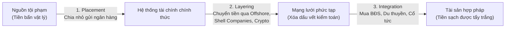

# Chuyên đề: Lạm Dụng Thị Trường và Tội Phạm Tài Chính (Market Abuse & Financial Crimes)

Tài liệu này nghiên cứu chuyên sâu về các hành vi vi phạm liêm chính thị trường và tội phạm tài chính nguy hiểm nhất, bao gồm giao dịch nội gián, hành vi đón đầu lệnh ủy thác (Front Running) và các chu kỳ rửa tiền bất hợp pháp làm tha hóa hệ thống tài chính toàn cầu.

---

## 1. Insider Trading (Giao dịch nội gián)

### 1. Là gì?
- **Định nghĩa học thuật:** Giao dịch nội gián (*Insider Trading*) là hành vi mua, bán chứng khoán hoặc các công cụ tài chính của một công ty dựa trên việc nắm giữ thông tin trọng yếu chưa được công bố ra công chúng (*Material Non-Public Information - MNPI*), hoặc hành vi tiết lộ thông tin đó cho người khác (*tipping*) để họ thực hiện giao dịch nhằm trục lợi cá nhân hoặc tránh lỗ.
- **Bản chất trực giác:** Hãy tưởng tượng bạn đang chơi một ván bài Poker với 5 người khác. Bạn lén lắp camera bí mật nhìn thấu bài của tất cả đối thủ dưới gầm bàn. Bạn luôn biết chắc chắn ai cầm bài mạnh, ai cầm bài yếu để đặt cược. Đó không phải là tài năng chơi bài mà là hành vi gian lận trơ trẽn. Giao dịch nội gián trên sàn chứng khoán chính là việc "nhìn thấu bài" của người khác trước khi tiếng còi khai cuộc vang lên.
- **Nếu chỉ nhớ một điều:** Giao dịch nội gián phá hủy sân chơi bình đẳng của thị trường tài chính bằng cách trục lợi từ sự bất đối xứng thông tin đặc quyền, vi phạm nghĩa vụ ủy thác đối với cổ đông.

### 2. Hoạt động thế nào?
1. **Ai là người nội bộ (Insiders)?**
   - **Người nội bộ trực tiếp (Primary Insiders):** Thành viên Hội đồng Quản trị, Tổng Giám đốc, Kế toán trưởng, Giám đốc tài chính (CFO), Kiểm toán viên nội bộ.
   - **Người nội bộ tạm thời (Temporary / Constructive Insiders):** Luật sư tư vấn M&A, ngân hàng đầu tư bảo lãnh phát hành, chuyên gia kiểm toán độc lập bên ngoài được tiếp cận hồ sơ tuyệt mật.
   - **Người nhận tin (Tippees):** Người thân, bạn bè, đối tác nhận thông tin rò rỉ từ người nội bộ và thực hiện giao dịch chứng khoán.
2. **Tiêu chuẩn của thông tin nội gián (MNPI):**
   - **Tính trọng yếu (Material):** Thông tin mà nếu được công bố công khai sẽ có khả năng cao tác động đáng kể đến giá chứng khoán (như doanh thu sụt giảm nghiêm trọng, sắp bị phá sản, tìm thấy mỏ dầu mới, chuẩn bị được thâu tóm với giá cao).
   - **Chưa công bố (Non-Public):** Thông tin chưa được phát hành rộng rãi qua các kênh thông tin chính thức của Sở Giao dịch hoặc cơ quan quản lý.
3. **Chế tài xử lý:** Tịch thu toàn bộ số tiền lãi hoặc số tiền tránh lỗ, phạt tiền gấp nhiều lần giá trị vi phạm, cấm đảm nhiệm chức vụ quản lý trọn đời và phạt tù hình sự nghiêm khắc.

### 3. Công thức & Mô hình toán học
Mô hình phát hiện giao dịch nội gián qua **Tỷ suất sinh lời bất thường tích lũy (Cumulative Abnormal Return - CAR) và Tỷ lệ giao dịch bất thường trước sự kiện:**
$$AR_{i,t} = R_{i,t} - \left( \alpha_i + \beta_i R_{m,t} \right)$$
$$CAR_i(\tau_1, \tau_2) = \sum_{t=\tau_1}^{\tau_2} AR_{i,t}$$

Trong đó:
- $[\tau_1, \tau_2]$: Cửa sổ thời gian từ 5 đến 20 ngày ngay trước ngày công bố thông tin chính thức ($t = 0$).
- Nếu trước ngày công bố tin tốt (ví dụ: công ty được tập đoàn nước ngoài chào mua công khai với giá cao hơn $50\%$) mà $CAR_i$ đã tăng liên tục và khối lượng mua gom phái sinh quyền chọn mua (*Call Options*) tăng vọt $500\%$:
$$\text{Insider Suspicion Metric} = \frac{\text{Pre-event Volume}}{\bar{V}_{normal}} \times CAR_i(\tau_1, 0) > \theta_{threshold}$$
Hệ thống giám sát của SEC/UBCK sẽ tự động truy xuất danh sách các tài khoản đã mua vào trong giai đoạn $[\tau_1, 0]$ để đối chiếu mối quan hệ thân tộc với ban lãnh đạo công ty.

### 4. Ví dụ
- **Ví dụ số học:** Giám đốc tài chính (CFO) của Công ty Dược phẩm BioTech biết trước kết quả thử nghiệm lâm sàng giai đoạn 3 của thuốc trị ung thư thất bại hoàn toàn (tin sẽ công bố sau 3 ngày). CFO lập tức bí mật bán sạch 200.000 cổ phiếu cá nhân ở mức giá 100 USD/cổ phiếu, thu về 20 triệu USD. Sau 3 ngày, tin tức công bố, giá cổ phiếu lao dốc xuống 20 USD/cổ phiếu.
  - Số tiền tổn thất mà CFO đã tránh được bất hợp pháp (*Loss Avoided*):
  $$\text{Loss Avoided} = 200.000 \times (100 - 20) = 16.000.000 \text{ USD}$$
  CFO bị kết án tội giao dịch nội gián, bị tịch thu 16 triệu USD, phạt thêm 32 triệu USD (gấp đôi) và chịu án 7 năm tù giam.
- **Thực tế Quốc tế:** Vụ án bê bối nội gián Raj Rajaratnam (nhà sáng lập Quỹ đầu tư Galleon Group) năm 2011 tại Mỹ. Rajaratnam đã xây dựng mạng lưới hối lộ thông tin tay trong tại Intel, McKinsey và Goldman Sachs (nhận tin mật từ cựu Giám đốc McKinsey kiêm thành viên HĐQT Goldman Sachs Rajat Gupta về việc Warren Buffett sắp rót 5 tỷ USD vào Goldman Sachs năm 2008). Rajaratnam bị kết án 11 năm tù giam và nộp phạt hơn 150 triệu USD.
- **Kịch bản phản thực tế (Counterfactual):** Một số nhà kinh tế học cực đoan thuộc trường phái Chicago (như Henry Manne) từng lập luận rằng nên hợp pháp hóa giao dịch nội gián vì nó giúp giá cổ phiếu phản ánh nhanh nhất thông tin thực tế. Tuy nhiên, nếu hợp pháp hóa, công chúng sẽ hoàn toàn mất niềm tin vào thị trường, người gửi tiền sẽ tẩy chay thị trường chứng khoán vì coi đó là sới bạc gian lận của giới lãnh đạo, dẫn tới sự đổ vỡ của toàn bộ kênh dẫn vốn đại chúng.

### 5. Ứng dụng & Tranh luận
- **Ứng dụng thực tiễn:** Quy định thời gian đóng băng giao dịch (*Blackout Periods* - cấm lãnh đạo giao dịch cổ phiếu 30 ngày trước kỳ công bố BCTC), đăng ký trước kế hoạch bán cổ phiếu định kỳ (Kế hoạch Rule 10b5-1 tại Mỹ).
- **Tranh luận & Đánh đổi:** Ranh giới mong manh giữa "Nghiên cứu thị trường thông minh" (Thuyết Mảnh ghép - *Mosaic Theory*: tự ghép nối các nguồn tin vụn vặt công khai để ra quyết định) và "Giao dịch nội gián bất hợp pháp".
- **Cạm bẫy tư duy:** Tưởng rằng chỉ có lãnh đạo công ty mới bị kết tội giao dịch nội gián. Bất kỳ ai vô tình nghe lỏm được thông tin mật (ví dụ: tài xế taxi nghe hai sếp M&A nói chuyện trên xe) mà biết đó là tin mật chưa công bố nhưng vẫn dùng tiền mua cổ phiếu kiếm lời thì đều có thể bị truy tố hình sự.

### 6. Liên kết khái niệm
- [Securities Regulation](file:///Users/ductri0981/Documents/Studying/Studying-Economic/03_Money_Banking_and_Financial_Systems/06_Financial_Regulation_and_Stability/04_Safety_Nets_and_Market_Integrity.md#3-securities-regulation-dieu-tiet-thi-truong-chung-khoan) (Cơ quan điều tiết điều tra nội gián)
- [Market Manipulation](file:///Users/ductri0981/Documents/Studying/Studying-Economic/03_Money_Banking_and_Financial_Systems/06_Financial_Regulation_and_Stability/04_Safety_Nets_and_Market_Integrity.md#4-market-manipulation-thao-tung-thi-truong) (Hành vi sai phạm thị trường đồng hành)
- [Front Running](file:///Users/ductri0981/Documents/Studying/Studying-Economic/03_Money_Banking_and_Financial_Systems/06_Financial_Regulation_and_Stability/05_Market_Abuse_and_Financial_Crimes.md#2-front-running-giao-dich-don-dau--chay-truoc-lenh) (Hành vi lạm dụng thông tin lệnh khách hàng)

---

## 2. Front Running (Giao dịch đón đầu / Chạy trước lệnh)

### 2.1. Là gì?
- **Định nghĩa học thuật:** Giao dịch đón đầu (*Front Running*) là hành vi phi đạo đức và bất hợp pháp của một nhà môi giới (*broker*), chuyên viên giao dịch (*trader*), hoặc tổ chức tạo lập thị trường khi họ tận dụng việc biết trước một lệnh giao dịch có quy mô rất lớn của khách hàng (*block trade*) sắp được đưa vào hệ thống, để tự đặt lệnh mua/bán cho tài khoản cá nhân hoặc tài khoản tự doanh của chính mình trước nhằm trục lợi từ sự biến động giá mà lệnh của khách hàng chắc chắn sẽ tạo ra sau đó.
- **Bản chất trực giác:** Bạn là một nhân viên môi giới chứng khoán. Một quỹ đầu tư khổng lồ gọi điện cho bạn đặt lệnh: "Hãy mua ngay cho tôi 10 triệu cổ phiếu VNM trên sàn". Bạn thừa biết rằng một lệnh mua khổng lồ 10 triệu cổ phiếu chắc chắn sẽ đẩy giá cổ phiếu tăng vọt. Thay vì nhập lệnh cho khách ngay, bạn lén mở tài khoản riêng mua trước 50.000 cổ phiếu ở giá thấp, rồi mới bấm enter nhập lệnh cho quỹ. Giá cổ phiếu vọt lên, bạn lập tức bán 50.000 cổ phiếu ra chốt lời. Bạn đã "chạy trước lệnh" của khách hàng để ăn cắp lợi nhuận.
- **Nếu chỉ nhớ một điều:** Front Running là hành vi "ăn cắp mỡ màng" của khách hàng bằng cách chen ngang vị trí xếp hàng giao dịch, vi phạm trắng trợn nghĩa vụ trung thành của người hành nghề tài chính.

### 2.2. Hoạt động thế nào?
1. **Các hình thức Front Running chính:**
   - **Môi giới truyền thống (Traditional Broker Front Running):** Nhân viên môi giới nhận lệnh lớn của khách tổ chức, bí mật dùng tài khoản người thân mua trước trên sàn.
   - **Giao dịch cao tần hiện đại (High-Frequency Trading - HFT Front Running):** Các quỹ HFT đặt máy chủ siêu tốc ngay sát sàn giao dịch (*Co-location*). Khi phát hiện một lệnh mua lớn đang được định tuyến qua các sàn giao dịch khác nhau, máy tính HFT sử dụng đường truyền cáp quang nhanh hơn vài micro-giây để chạy sang sàn tiếp theo mua trước cổ phiếu ở giá rẻ rồi bán lại ngay cho chính khách hàng đó với giá đắt hơn một xu (được Michael Lewis mô tả chấn động trong cuốn sách *Flash Boys*).
   - **Front Running trong thế giới Crypto (MEV - Maximal Extractable Value):** Các "thợ đào" (Miners/Validators) hoặc robot kiểm tra bể giao dịch chờ xử lý (*Mempool*), cố tình sắp xếp lệnh của chính mình đứng trước lệnh lớn của người dùng (tấn công bánh kẹp - *Sandwich Attack*) bằng cách trả phí gas cao hơn.
2. **Hậu quả kinh tế:** Làm tăng trượt giá (*slippage*) và chi phí giao dịch cho các quỹ đầu tư (vốn quản lý tiền lương hưu của hàng triệu người lao động).

### 2.3. Công thức & Mô hình toán học
Đo lường mức độ thiệt hại của khách hàng do bị Front Running qua **Chi phí thực thi bổ sung (Execution Shortfall / Price Impact - $IS$):**
$$IS = P_{\text{actual}} - P_{\text{benchmark}}$$
$$\text{Chi phí thiệt hại} = Q_{\text{client}} \times \left( P_{\text{actual}} - P_0 \right)$$

Trong đó:
- $P_0$: Mức giá thị trường tại thời điểm khách hàng ký ủy thác chuyển lệnh cho môi giới.
- $P_{\text{actual}}$: Mức giá thực tế khách hàng phải mua sau khi bị kẻ gian chạy trước gom hàng đẩy giá lên.
- $Q_{\text{client}}$: Khối lượng cổ phiếu của khách hàng.
- Lợi nhuận phi pháp của kẻ thực hiện Front Running:
$$\text{Profit}_{\text{FrontRunner}} = Q_{\text{front}} \times (P_{\text{sell}} - P_{\text{buy}})$$

### 2.4. Ví dụ
- **Ví dụ số học:** Quỹ hưu trí ủy thác cho nhà môi giới K mua 1.000.000 cổ phiếu đang có giá $P_0 = 50.000$ VND.
  - K không thực hiện ngay mà bí mật dùng tài khoản riêng mua trước 50.000 cổ phiếu ở giá 50.000 VND.
  - Sau đó K mới giải ngân lệnh 1.000.000 cổ phiếu của quỹ, lực mua mạnh đẩy giá cổ phiếu tăng lên 52.000 VND ($P_{\text{actual}} = 52.000$ VND).
  - Quỹ hưu trí bị thiệt hại do mua đắt thêm:
  $$\text{Loss}_{\text{Fund}} = 1.000.000 \times (52.000 - 50.000) = 2.000.000.000 \text{ VND}$$
  - Nhà môi giới K lập tức bán 50.000 cổ phiếu chốt lời ở giá 52.000 VND, đút túi phi pháp:
  $$\text{Profit}_K = 50.000 \times (52.000 - 50.000) = 100.000.000 \text{ VND}$$
- **Thực tế Quốc tế:** Năm 2013, SEC và Bộ Tư pháp Mỹ đã phạt ngân hàng Merrill Lynch 131 triệu USD vì hành vi hệ thống của các chuyên viên giao dịch tự doanh đã liên tục "chạy trước lệnh" các hợp đồng giao dịch quy mô lớn của các khách hàng tổ chức suốt nhiều năm.
- **Kịch bản phản thực tế (Counterfactual):** Nếu các Sở Giao dịch và thị trường tài chính không áp dụng quy tắc khớp lệnh theo thứ tự ưu tiên thời gian và giá (Price-Time Priority) kèm theo quy định nghiêm cấm Front Running, các nhà đầu tư lớn sẽ hoàn toàn rời bỏ sàn giao dịch công khai, chuyển toàn bộ giao dịch vào các "Hồ tối" bí mật (*Dark Pools*) hoặc giao dịch tay đôi ngoài sàn (OTC), khiến thị trường chứng khoán công khai cạn kiệt thanh khoản.

### 2.5. Ứng dụng & Tranh luận
- **Ứng dụng thực tiễn:** Bắt buộc phân tách tuyệt đối giữa bộ phận Môi giới phục vụ khách hàng (*Brokerage*) và bộ phận Tự doanh (*Proprietary Trading*) bằng "Bức tường lửa thông tin" (*Chinese Wall*); ghi âm toàn bộ cuộc gọi điện thoại và lưu trữ nhật ký tin nhắn của chuyên viên môi giới.
- **Tranh luận & Đánh đổi:** 
  - *Tranh cãi về Thanh toán cho Luồng Lệnh (Payment for Order Flow - PFOF):* Các ứng dụng giao dịch miễn phí hoa hồng (như Robinhood) bán luồng lệnh của nhà đầu tư cá nhân cho các nhà tạo lập thị trường HFT (như Citadel Securities). Nhiều người chỉ trích đây là một biến thể hợp pháp hóa của hành vi Front Running tinh vi.
- **Cạm bẫy tư duy:** Nhầm lẫn giữa việc một chuyên viên giao dịch phân tích dự đoán đúng dòng tiền thị trường để mua trước (hoạt động đầu tư hợp pháp) với việc lợi dụng quyền tiếp cận dữ liệu lệnh ủy thác của khách hàng chưa vào sàn để trục lợi (Front Running bất hợp pháp).

### 2.6. Liên kết khái niệm
- [Insider Trading](file:///Users/ductri0981/Documents/Studying/Studying-Economic/03_Money_Banking_and_Financial_Systems/06_Financial_Regulation_and_Stability/05_Market_Abuse_and_Financial_Crimes.md#1-insider-trading-giao-dich-noi-gian) (Hành vi cùng bản chất lạm dụng thông tin phi công khai)
- [Brokerage Firms](file:///Users/ductri0981/Documents/Studying/Studying-Economic/03_Money_Banking_and_Financial_Systems/05_Financial_Institutions/04_Market_Intermediaries_and_Infrastructure.md) (Thực thể trung gian có nguy cơ cao xảy ra sai phạm Front Running)
- [Market Manipulation](file:///Users/ductri0981/Documents/Studying/Studying-Economic/03_Money_Banking_and_Financial_Systems/06_Financial_Regulation_and_Stability/04_Safety_Nets_and_Market_Integrity.md#4-market-manipulation-thao-tung-thi-truong) (Hành vi méo mó thị trường liên quan)

---

## 3. Money Laundering (Rửa tiền)

### 3.1. Là gì?
- **Định nghĩa học thuật:** Rửa tiền (*Money Laundering*) là quá trình hợp pháp hóa nguồn gốc của các khoản tiền hoặc tài sản do phạm tội mà có (buôn lậu ma túy, tham nhũng, hối lộ, buôn lậu vũ khí, trốn thuế, gian lận tài chính), thông qua một chuỗi các giao dịch tài chính và thương mại phức tạp nhằm biến các dòng tiền "bẩn" (*dirty money*) thành tiền "sạch" (*clean/legitimate money*) có vỏ bọc nguồn gốc hợp pháp để lưu thông tự do trong nền kinh tế.
- **Bản chất trực giác:** Một tên tội phạm buôn lậu ma túy kiếm được 10 triệu USD tiền mặt chứa đầy trong các va-li. Hắn không thể mang 10 triệu USD tiền mặt này đến ngân hàng để gửi hoặc mua một căn biệt thự siêu sang vì ngân hàng và cơ quan thuế sẽ hỏi ngay: "Tiền này từ đâu ra?". Hắn bắt buộc phải mua lại một chuỗi tiệm giặt là hoặc nhà hàng cà phê thu tiền mặt, trộn lẫn số tiền bẩn đó vào doanh thu bán cà phê hàng ngày, nộp thuế đầy đủ cho nhà nước để biến số tiền đó thành "tiền sạch" hợp pháp rút từ tài khoản công ty.
- **Nếu chỉ nhớ một điều:** Rửa tiền là cỗ máy biến đổi huyết mạch của tội phạm: ngụy trang nguồn gốc phi pháp của tài sản phạm tội để kẻ phạm tội có thể thảnh thơi hưởng thụ thành quả tội ác mà không bị pháp luật sờ gáy.

### 3.2. Hoạt động thế nào?
1. **Ba giai đoạn kinh điển của quy trình rửa tiền:**
   - **Giai đoạn 1: Gửi tiền / Đặt tiền (Placement):** Đưa số tiền mặt bẩn vật lý ban đầu vào hệ thống tài chính chính thức. Đây là giai đoạn nguy hiểm và dễ bị bắt nhất của tội phạm. Thủ thuật phổ biến: Chia nhỏ số tiền dưới ngưỡng báo cáo nộp vào hàng trăm tài khoản ngân hàng khác nhau (*Smurfing / Structuring*), hoặc buôn lậu tiền mặt qua biên giới.
   - **Giai đoạn 2: Tách lớp / Phân tầng (Layering):** Thực hiện hàng trăm giao dịch chuyển đổi tiền tệ lòng vòng qua các công ty bình phong (*Shell Companies*), các thiên đường thuế trốn thuế (Offshore Tax Havens), mua bán hóa đơn khống, chuyển đổi sang tiền mã hóa (Bitcoin, Privacy Coins) để xóa sạch dấu vết kiểm toán (*Audit Trail*).
   - **Giai đoạn 3: Hội nhập (Integration):** Dòng tiền đã được tẩy sạch hoàn toàn chảy ngược về túi kẻ phạm tội dưới danh nghĩa lợi nhuận kinh doanh hợp pháp, cổ tức, hoặc mua bán bất động sản cao cấp, tranh nghệ thuật, du thuyền.

### 3.3. Mô hình toán học & Sơ đồ luân chuyển dòng tiền

Mô hình phát hiện giao dịch đáng ngờ dựa trên **Điểm số phân loại dòng tiền bất thường (Anomaly Detection Score - $S_{AML}$):**
$$S_{AML}(x) = \frac{1}{1 + e^{-(\mathbf{w}^T \mathbf{x} + b)}}$$
Trong đó véc-tơ đặc trưng $\mathbf{x}$ bao gồm:
- Tần suất nộp tiền mặt sát dưới ngưỡng khai báo (ví dụ: liên tục nộp 9.900 USD trong khi ngưỡng báo cáo là 10.000 USD).
- Tỷ lệ rút tiền ngay sau khi vừa nhận chuyển khoản từ nước ngoài.
- Dòng tiền không tương xứng với thu nhập khai báo trong hồ sơ eKYC.

### 3.4. Ví dụ
- **Ví dụ số học:** Một đường dây cờ bạc lậu thu lợi bất chính 100 tỷ VND tiền mặt. Để tránh ngưỡng báo cáo giao dịch tiền mặt từ 400 triệu VND của Ngân hàng Nhà nước, kẻ cầm đầu thuê 30 người (mỗi người cầm 3.3 tỷ VND), mỗi ngày đi đến 10 phòng giao dịch ngân hàng khác nhau nộp các món tiền nhỏ 350 triệu VND vào tài khoản (hoàn thành giai đoạn *Placement*). Sau đó, số tiền này được chuyển khoản cấp tập sang 5 công ty bất động sản "ma" không có hoạt động kinh doanh thực tế, xuất hóa đơn tư vấn khống (hoàn thành *Layering*). Cuối cùng, các công ty ma mua lại một dự án resort nghỉ dưỡng để chia cổ tức sạch sẽ cho kẻ cầm đầu (giai đoạn *Integration*).
- **Thực tế Quốc tế:** Đại án bê bối rửa tiền của Ngân hàng HSBC năm 2012. Chi nhánh HSBC tại Mexico và Mỹ đã lơ là hệ thống kiểm soát chống rửa tiền, để các băng đảng ma túy khét tiếng Sinaloa Cartel vận chuyển các thùng tiền mặt ma túy hàng tỷ USD qua quầy giao dịch mà không khai báo. HSBC bị Bộ Tư pháp Mỹ phạt kỷ lục 1.9 tỷ USD và phải chịu sự giám sát tư pháp đặc biệt trong 5 năm.
- **Kịch bản phản thực tế (Counterfactual):** Nếu hệ thống ngân hàng toàn cầu không có các quy định kiểm soát phòng chống rửa tiền (như khuyến nghị của FATF), các tổ chức khủng bố quốc tế và các trùm ma túy xuyên quốc gia sẽ thoải mái sử dụng hệ thống tài khoản ngân hàng chính thống để tích lũy tài nguyên, tài trợ vũ khí hủy diệt hàng loạt và thao túng các định chế chính trị của nhiều quốc gia.

### 3.5. Ứng dụng & Tranh luận
- **Ứng dụng thực tiễn:** Báo cáo Giao dịch Đáng ngờ (Suspicious Activity Reports - SARs) gửi lên Cơ quan Phòng Chống Rửa tiền (FIU), phong tỏa tài sản của các tổ chức tội phạm, giám sát chặt chẽ các cá nhân có tầm ảnh hưởng chính trị (*Politically Exposed Persons - PEPs*).
- **Tranh luận & Đánh đổi:** 
  - *Sự phiền hà cho người dân lương thiện (De-risking):* Để tránh bị phạt nặng, nhiều ngân hàng quốc tế áp dụng chính sách "loại trừ rủi ro mù quáng", từ chối mở tài khoản hoặc đóng tài khoản của hàng loạt doanh nghiệp nhỏ lương thiện và các tổ chức từ thiện hoạt động tại các quốc gia đang phát triển.
  - *Quyền riêng tư cá nhân:* Các biện pháp giám sát dòng tiền gắt gao làm dấy lên lo ngại về việc xâm phạm quyền riêng tư và quyền tự do tài chính của công dân.
- **Cạm bẫy tư duy:** Tưởng rằng rửa tiền chỉ gắn liền với ma túy và buôn lậu. Một doanh nhân trốn thuế thu nhập doanh nghiệp rồi đem số tiền trốn thuế đó đi mua nhà đất đứng tên người thân cũng hoàn toàn phạm tội rửa tiền theo Bộ luật Hình sự.

### 3.6. Liên kết khái niệm
- [Anti-Money Laundering (AML)](file:///Users/ductri0981/Documents/Studying/Studying-Economic/03_Money_Banking_and_Financial_Systems/06_Financial_Regulation_and_Stability/06_AML_KYC_and_International_Standards.md#1-anti-money-laundering-aml-phong-chong-rua-tien) (Khung chiến lược triệt tiêu rửa tiền)
- [Know Your Customer (KYC)](file:///Users/ductri0981/Documents/Studying/Studying-Economic/03_Money_Banking_and_Financial_Systems/06_Financial_Regulation_and_Stability/06_AML_KYC_and_International_Standards.md#2-know-your-customer-kyc-nhan-biet-khach-hang) (Tuyến phòng thủ đầu tiên ngăn chặn rửa tiền)
- [Financial Action Task Force (FATF)](file:///Users/ductri0981/Documents/Studying/Studying-Economic/03_Money_Banking_and_Financial_Systems/06_Financial_Regulation_and_Stability/06_AML_KYC_and_International_Standards.md#4-financial-action-task-force-fatf-luc-luong-dac-nhiem-tai-chinh) (Cơ quan quốc tế đặt ra chuẩn mực chống rửa tiền)

---

## Câu hỏi tự kiểm tra (Self-Quiz)
1. Trong luật chứng khoán quốc tế, một thông tin được coi là Thông tin Nội gián (*Material Non-Public Information - MNPI*) khi hội đủ hai tiêu chuẩn cốt lõi nào?
2. Hành vi "Chạy trước lệnh" (*Front Running*) của nhân viên môi giới vi phạm nghĩa vụ pháp lý cơ bản nào đối với khách hàng ủy thác?
3. Phân biệt sự khác nhau căn bản giữa ba giai đoạn của một chu trình rửa tiền: Đặt tiền (*Placement*), Tách lớp (*Layering*) và Hội nhập (*Integration*)? Giai đoạn nào kẻ phạm tội dễ bị phát hiện nhất?
4. Kỹ thuật "Smurfing / Structuring" trong hoạt động rửa tiền là gì và các ngân hàng thương mại được yêu cầu nhận diện kỹ thuật này như thế nào?
5. Tại sao giao dịch cao tần (HFT) và các thị trường tài chính phi tập trung (DeFi MEV) lại tạo ra các hình thức Front Running kiểu mới vượt ra ngoài tầm với của các quy định truyền thống?

---

## Ghi chú nguồn tham khảo
- Bhattacharya, U., & Daouk, H. (2002). *The world price of insider trading*. The Journal of Finance, 57(1), 75-108.
- Lewis, M. (2014). *Flash Boys: A Wall Street Revolt*. W. W. Norton & Company.
- Financial Action Task Force (FATF). (2023). *International Standards on Combating Money Laundering and the Financing of Terrorism & Proliferation* (The FATF Recommendations).
- U.S. Securities and Exchange Commission (SEC). (2020). *Insider Trading: Rule 10b-5 and Enforcement Actions*.
- Quốc hội Việt Nam: *Bộ luật Hình sự số 100/2015/QH13 (sửa đổi, bổ sung 2017 - Điều 209 về tội Cố ý công bố thông tin sai lệch hoặc che giấu thông tin trong hoạt động chứng khoán, Điều 324 về tội Rửa tiền)*.
