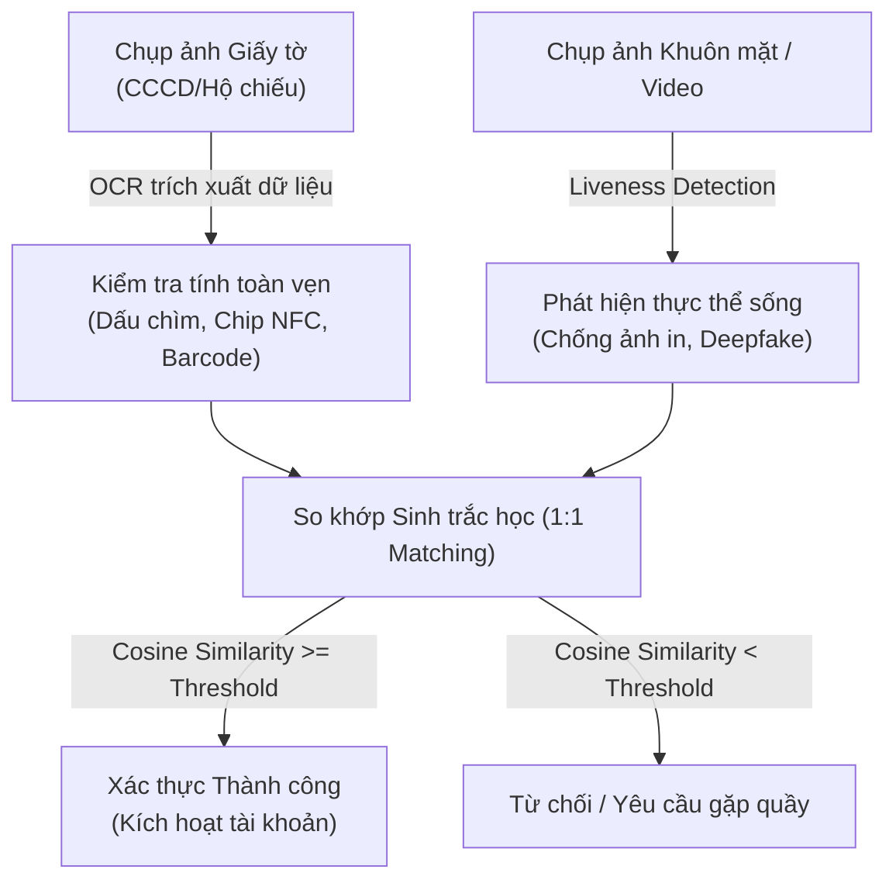

# Chuyên đề: Phòng Chống Rửa Tiền, Định Danh Khách Hàng và Chuẩn Mực Quốc Tế (AML, KYC & International Standards)

Tài liệu này nghiên cứu chuyên sâu về các lá chắn pháp lý và công nghệ phòng chống rửa tiền, cơ chế nhận biết khách hàng (KYC/eKYC), hoạt động ngăn chặn tài trợ khủng bố (CTF) và các chuẩn mực toàn cầu do Lực lượng Đặc nhiệm Tài chính (FATF) ban hành.

---

## 1. Anti-Money Laundering (AML) (Phòng chống rửa tiền)

### 1. Là gì?
- **Định nghĩa học thuật:** Phòng chống rửa tiền (*Anti-Money Laundering - AML*) là hệ thống toàn diện các đạo luật, quy định quản lý, quy trình nghiệp vụ và công nghệ kiểm soát do các cơ quan nhà nước và định chế tài chính thiết lập nhằm phát hiện, ngăn chặn, điều tra và báo cáo các hành vi cố tình biến đổi dòng tiền có nguồn gốc phi pháp thành tài sản hợp pháp.
- **Bản chất trực giác:** Nếu bọn tội phạm coi hệ thống ngân hàng như một chiếc "máy giặt" để tẩy trắng tiền bẩn, thì AML chính là hệ thống cảm biến thông minh được lắp đặt bên trong máy giặt đó: nó quét từng tờ tiền được nộp vào, nếu phát hiện có mùi khét của ma túy hoặc vết dầu của tội phạm, nó sẽ lập tức báo động đỏ, khóa cửa máy giặt và gửi thông báo cho cảnh sát tới bắt giữ.
- **Nếu chỉ nhớ một điều:** AML là lá chắn phòng thủ chủ động của ngành tài chính toàn cầu nhằm tước đoạt oxy sống (dòng tiền) của các tổ chức tội phạm có tổ chức.

### 2. Hoạt động thế nào?
1. **Ba tuyến phòng thủ (Three Lines of Defense) của AML tại định chế:**
   - **Tuyến 1 (Tuyến đầu - Đơn vị kinh doanh):** Nhân viên giao dịch tại quầy, chuyên viên quan hệ khách hàng trực tiếp tiếp xúc, thu thập hồ sơ định danh và kiểm tra nguồn gốc tiền nộp.
   - **Tuyến 2 (Bộ phận Tuân thủ & Quản trị Rủi ro AML):** Giám sát độc lập các giao dịch toàn hệ thống, cấu hình hệ thống phát hiện giao dịch bất thường (AML Rule-based & AI Engine) và soạn thảo Báo cáo Giao dịch Đáng ngờ (SAR).
   - **Tuyến 3 (Kiểm toán nội bộ):** Định kỳ kiểm tra, đánh giá độc lập tính hiệu lực của toàn bộ hệ thống kiểm soát AML của ngân hàng.
2. **Nghĩa vụ báo cáo bắt buộc của các định chế:**
   - **Báo cáo Giao dịch Tiền mặt Lớn (Cash Transaction Report - CTR):** Mọi giao dịch nộp/rút tiền mặt vượt ngưỡng luật định (ví dụ: từ 10.000 USD tại Mỹ; từ 400 triệu VND tại Việt Nam) đều phải tự động gửi báo cáo về Cơ quan Tình báo Tài chính (FIU).
   - **Báo cáo Giao dịch Đáng ngờ (Suspicious Activity Report - SAR / STR):** Bất kể số tiền lớn hay nhỏ, nếu nhân viên phát hiện hành vi có dấu hiệu bất thường, mờ ám, né tránh định danh thì phải lập báo cáo gửi FIU trong thời hạn quy định (thường là trong 24–48 giờ).

### 3. Công thức & Mô hình toán học
Khung tính toán rủi ro rửa tiền theo phương pháp tiếp cận trên cơ sở rủi ro (Risk-Based Approach - RBA):
$$\text{AML Risk Score}_i = w_C \cdot C_i + w_G \cdot G_i + w_P \cdot P_i + w_D \cdot D_i$$

Trong đó:
- $C_i$: Rủi ro khách hàng (*Customer Risk* - ví dụ: cá nhân có tầm ảnh hưởng chính trị PEP được chấm điểm rủi ro tối đa).
- $G_i$: Rủi ro địa lý (*Geographic Risk* - khách hàng đến từ các quốc gia nằm trong danh sách đen/xám của FATF hoặc thiên đường thuế).
- $P_i$: Rủi ro sản phẩm/dịch vụ (*Product Risk* - các sản phẩm nhạy cảm như tài khoản vãng lai không ghi danh, thẻ trả trước vô danh, chuyển tiền kiều hối ẩn danh).
- $D_i$: Rủi ro kênh phân phối (*Delivery Channel Risk* - giao dịch trực tuyến xuyên biên giới rủi ro cao hơn giao dịch gặp mặt trực tiếp tại quầy).
- **Phân loại hành động:**
  - Nếu $\text{Score} \ge \text{Ngưỡng cao}$: Bắt buộc áp dụng Thẩm định nâng cao (*Enhanced Due Diligence - EDD*).

### 4. Ví dụ
- **Ví dụ số học:** Một công ty mới thành lập có vốn điều lệ 100 triệu VND, nhưng ngay trong tuần đầu tiên tài khoản liên tục nhận 50 lệnh chuyển tiền từ nước ngoài mỗi lệnh 390 triệu VND (ngay sát dưới ngưỡng báo cáo 400 triệu VND), tổng cộng 19.5 tỷ VND, và sau đó lập tức chuyển hết sang tài khoản một công ty xây dựng khác.
  Hệ thống AML tự động gắn cờ vi phạm: Tần suất cao bất thường + Dấu hiệu né tránh báo cáo tiền mặt (*Structuring*) + Tỷ lệ luân chuyển nhanh ($100\%$). Hệ thống tự động tạo mã SAR số 8923 và gửi ngay tới Cục Phòng, chống rửa tiền trong vòng 24 giờ.
- **Thực tế Việt Nam:** Luật Phòng, chống rửa tiền số 14/2022/QH15 và Quyết định 11/2023/QĐ-TTg của Thủ tướng Chính phủ quy định mức giao dịch có giá trị lớn phải báo cáo là từ 400.000.000 (bốn trăm triệu) đồng trở lên. Ngân hàng Nhà nước thành lập Cục Phòng, chống rửa tiền (thuộc Cơ quan Thanh tra, giám sát ngân hàng) đóng vai trò là Cơ quan Tình báo Tài chính (FIU) của Việt Nam.
- **Kịch bản phản thực tế (Counterfactual):** Nếu các ngân hàng Thụy Sĩ không bãi bỏ chế độ bảo mật tài khoản ngân hàng vô danh số hiệu (*Numbered Accounts*) và không áp dụng các chuẩn mực AML quốc tế trong thập niên 2000, quốc gia này sẽ tiếp tục là nơi cất giấu an toàn hàng nghìn tỷ USD tài sản tham nhũng của các nhà độc tài và các trùm tội phạm toàn cầu mà không ai có thể truy vết.

### 5. Ứng dụng & Tranh luận
- **Ứng dụng thực tiễn:** Điều tra thu hồi tài sản tham nhũng, triệt phá các đường dây đánh bạc nghìn tỷ qua mạng, phong tỏa nguồn tài chính của các tổ chức tội phạm ma túy xuyên quốc gia.
- **Tranh luận & Đánh đổi:** 
  - *Chi phí tuân thủ khổng lồ:* Các ngân hàng lớn trên thế giới phải chi hàng tỷ USD mỗi năm để thuê hàng vạn chuyên viên tuân thủ và mua phần mềm giám sát AML, làm tăng chi phí dịch vụ ngân hàng cho toàn bộ xã hội.
  - *Tỷ lệ báo động giả cao (High False Positive Rates):* Hơn $95\%$ các cảnh báo do các thuật toán AML truyền thống gắn cờ thực chất là giao dịch hợp pháp của khách hàng lương thiện, gây phiền hà và làm đóng băng oan tài khoản của người dân.
- **Cạm bẫy tư duy:** Tưởng rằng chỉ có các ngân hàng mới phải làm AML. Luật AML hiện đại bắt buộc cả các tổ chức phi tài chính như: Công ty bất động sản, sòng bạc (Casino), đại lý mua bán vàng bạc đá quý, luật sư, công chứng viên khi thực hiện các giao dịch mua bán tài sản lớn cho khách hàng đều phải tuân thủ nghiêm ngặt các quy định AML.

### 6. Liên kết khái niệm
- [Money Laundering](file:///Users/ductri0981/Documents/Studying/Studying-Economic/03_Money_Banking_and_Financial_Systems/06_Financial_Regulation_and_Stability/05_Market_Abuse_and_Financial_Crimes.md#3-money-laundering-rua-tien) (Tội phạm nguồn mà AML nhắm tới)
- [Know Your Customer (KYC)](file:///Users/ductri0981/Documents/Studying/Studying-Economic/03_Money_Banking_and_Financial_Systems/06_Financial_Regulation_and_Stability/06_AML_KYC_and_International_Standards.md#2-know-your-customer-kyc-nhan-biet-khach-hang) (Công cụ đầu vào quan trọng nhất của AML)
- [Financial Action Task Force (FATF)](file:///Users/ductri0981/Documents/Studying/Studying-Economic/03_Money_Banking_and_Financial_Systems/06_Financial_Regulation_and_Stability/06_AML_KYC_and_International_Standards.md#4-financial-action-task-force-fatf-luc-luong-dac-nhiem-tai-chinh) (Cơ quan định hình quy chuẩn AML quốc tế)

---

## 2. Know Your Customer (KYC) (Nhận biết khách hàng)

### 2.1. Là gì?
- **Định nghĩa học thuật:** Nhận biết khách hàng (*Know Your Customer - KYC*) là quy trình thẩm định bắt buộc mà một định chế tài chính phải thực hiện để xác minh danh tính thực tế của khách hàng trước khi mở tài khoản hoặc thiết lập quan hệ giao dịch, đồng thời liên tục giám sát hoạt động của khách hàng nhằm đảm bảo các giao dịch phát sinh phù hợp với hồ sơ kinh doanh và mức độ rủi ro đã được thẩm định.
- **Bản chất trực giác:** KYC giống như việc làm thủ tục kiểm tra an ninh tại sân bay: bạn không thể chỉ đội mũ, đeo kính râm và nói "hãy tin tôi, tôi là người tốt" rồi bước lên máy bay. Nhân viên an ninh buộc bạn phải cởi kính, xuất trình hộ chiếu có dán ảnh thật, đối chiếu vân tay và quét hành lý qua máy X-quang để bảo đảm không có ai mang bom lên máy bay.
- **Nếu chỉ nhớ một điều:** KYC là chiếc cổng gác đầu tiên của định chế tài chính: không một ai được phép bước vào hệ thống tài chính chính thức dưới một danh tính nặc danh hoặc giả mạo.

### 2.2. Hoạt động thế nào?
1. **Ba cấp độ thẩm định khách hàng:**
   - **Xác định danh tính khách hàng (Customer Identification Program - CIP):** Thu thập thông tin cơ bản: Họ tên, ngày sinh, địa chỉ, số CMND/CCCD/Hộ chiếu, mã số thuế.
   - **Thẩm định thông thường (Customer Due Diligence - CDD):** Xác minh mục đích mở tài khoản, tìm hiểu ngành nghề kinh doanh, và đặc biệt là xác định ai là **Người hưởng lợi cuối cùng (Ultimate Beneficial Owner - UBO)** của doanh nghiệp (người sở hữu từ $25\%$ cổ phần trở lên hoặc người thực tế nắm quyền kiểm soát công ty).
   - **Thẩm định nâng cao (Enhanced Due Diligence - EDD):** Áp dụng cho các khách hàng có rủi ro cao (như các chính trị gia PEP, các công ty bình phong từ hải ngoại, các giao dịch chuyển tiền xuyên biên giới lớn). Yêu cầu chứng minh nguồn gốc tài sản (*Source of Wealth*) và nguồn gốc tiền (*Source of Funds*).
2. **Sự chuyển dịch sang Định danh điện tử (eKYC):**
   - Ứng dụng công nghệ nhận diện ký tự quang học (OCR), đối chiếu sinh trắc học khuôn mặt (Facial Recognition), phát hiện người thật chống giả mạo (Liveness Detection) và kết nối Cơ sở dữ liệu Căn cước công dân quốc gia.

### 2.3. Quy trình Xác minh Danh tính Sinh trắc học (eKYC Verification Pipeline)

Đo lường độ tin cậy của thuật toán so khớp sinh trắc học khuôn mặt:
$$\text{Cosine Similarity}(\mathbf{u}, \mathbf{v}) = \frac{\mathbf{u} \cdot \mathbf{v}}{\|\mathbf{u}\| \|\mathbf{v}\|} \ge \tau \quad (\text{thường đặt } \tau \ge 0.85)$$
Trong đó $\mathbf{u}$ là véc-tơ đặc trưng khuôn mặt trích xuất từ ảnh chụp trực tiếp và $\mathbf{v}$ là véc-tơ trích xuất từ ảnh thẻ căn cước gắn chip.

### 2.4. Ví dụ
- **Ví dụ số học:** Khách hàng sử dụng ứng dụng ngân hàng số để mở tài khoản eKYC. Hệ thống AI quét chip CCCD trích xuất dữ liệu và đo đạc 128 điểm mốc khuôn mặt qua video selfie trực tiếp.
  - Kết quả kiểm tra Liveness: Điểm số chống giả mạo đạt $99.8\%$ (vượt ngưỡng yêu cầu $95\%$).
  - Độ tương đồng Cosine giữa ảnh selfie và ảnh trong chip đạt $0.92 > 0.85$.
  - Tài khoản được phê duyệt hạn mức giao dịch tự động tối đa 100 triệu VND/tháng theo quy định NHNN. Nếu muốn nâng hạn mức lên không giới hạn, khách hàng bắt buộc phải đến phòng giao dịch để làm thủ tục KYC trực tiếp.
- **Thực tế Việt Nam:** Quyết định 2345/QĐ-NHNN của Ngân hàng Nhà nước (có hiệu lực từ ngày 01/07/2024) là một bước tiến mang tính cách mạng: Bắt buộc mọi giao dịch chuyển tiền trực tuyến vượt quá 10 triệu VND/lần hoặc tổng giá trị vượt 20 triệu VND/ngày đều phải xác thực sinh trắc học khuôn mặt đối chiếu khớp đúng với dữ liệu trong chip CCCD đã được Bộ Công an cấp. Biện pháp này đã bẻ gãy gần như hoàn toàn các đường dây tội phạm mua bán tài khoản ngân hàng "rác" để lừa đảo.
- **Kịch bản phản thực tế (Counterfactual):** Nếu các ngân hàng không áp dụng KYC và cho phép mở tài khoản vô danh qua mạng, một tên tin tặc ngồi tại Đông Âu có thể tạo ra 10.000 tài khoản ảo tại các ngân hàng Việt Nam trong 5 phút để nhận tiền chuộc từ các vụ tấn công mã độc tống tiền (Ransomware), khiến cơ quan an ninh mạng hoàn toàn bất lực trong việc tìm ra thủ phạm.

### 2.5. Ứng dụng & Tranh luận
- **Ứng dụng thực tiễn:** Ngân hàng số mở tài khoản tức thì (Onboarding trong 60 giây), ngăn chặn gian lận mạo danh người khác vay tiền tiêu dùng, làm sạch cơ sở dữ liệu khách hàng.
- **Tranh luận & Đánh đổi:** 
  - *Rủi ro công nghệ Deepfake:* Bọn tội phạm sử dụng trí tuệ nhân tạo tạo video khuôn mặt động giả mạo danh tính để đánh lừa camera eKYC, châm ngòi cho cuộc chạy đua vũ trang công nghệ bảo mật sinh trắc học.
  - *Rào cản tiếp cận tài chính:* Các quy định KYC quá cứng nhắc có thể loại trừ hàng triệu người nghèo, người già hoặc người tàn tật ở vùng sâu vùng xa không có giấy tờ tùy thân chuẩn hóa khỏi các dịch vụ ngân hàng cơ bản.
- **Cạm bẫy tư duy:** Tưởng rằng KYC chỉ cần làm một lần khi mở tài khoản là xong. Chuẩn mực quốc tế yêu cầu phải thực hiện **KYC định kỳ và liên tục (Ongoing Due Diligence)**: nếu một khách hàng bình thường đột nhiên nhận chuyển nhượng hàng chục triệu USD từ nước ngoài, ngân hàng phải lập tức yêu cầu khách hàng cập nhật lại hồ sơ KYC để giải trình.

### 2.6. Liên kết khái niệm
- [Anti-Money Laundering (AML)](file:///Users/ductri0981/Documents/Studying/Studying-Economic/03_Money_Banking_and_Financial_Systems/06_Financial_Regulation_and_Stability/06_AML_KYC_and_International_Standards.md#1-anti-money-laundering-aml-phong-chong-rua-tien) (Khung bảo trợ mà KYC phục vụ)
- [Counter-Terrorist Financing (CTF)](file:///Users/ductri0981/Documents/Studying/Studying-Economic/03_Money_Banking_and_Financial_Systems/06_Financial_Regulation_and_Stability/06_AML_KYC_and_International_Standards.md#3-counter-terrorist-financing-ctf-chong-tai-tro-khung-bo) (Ứng dụng KYC để chặn tài trợ khủng bố)
- [Digital Banking](file:///Users/ductri0981/Documents/Studying/Studying-Economic/03_Money_Banking_and_Financial_Systems/03_Banking_Systems/02_Digital_Alternative_and_Specialized_Banking.md) (Môi trường ứng dụng bùng nổ của eKYC)

---

## 3. Counter-Terrorist Financing (CTF) (Chống tài trợ khủng bố)

### 3.1. Là gì?
- **Định nghĩa học thuật:** Chống tài trợ khủng bố (*Counter-Terrorist Financing - CTF*) là tập hợp các biện pháp luật pháp, tình báo và tài chính nhằm ngăn chặn việc cung cấp hoặc thu thập tiền tệ, tài sản (bằng bất kỳ phương tiện nào, trực tiếp hoặc gián tiếp) với ý định sử dụng hoặc nhận thức rằng chúng sẽ được sử dụng cho các hành vi khủng bố, hoặc cho các cá nhân, tổ chức khủng bố.
- **Bản chất trực giác:** Nếu AML là chặn "tiền bẩn đi tìm sự sạch sẽ" (từ tội phạm ma túy muốn tẩy trắng tiền), thì CTF là chặn "tiền sạch lẫn tiền bẩn đi làm điều ác" (từ những đồng tiền quyên góp từ thiện hợp pháp nhưng lại bị chuyển đến tay kẻ đánh bom liều chết).
- **Nếu chỉ nhớ một điều:** CTF tập trung vào **mục đích sử dụng tương lai** của đồng tiền (phục vụ bạo lực khủng bố), chứ không chỉ nhìn vào nguồn gốc hình thành trong quá khứ của đồng tiền đó.

### 3.2. Hoạt động thế nào?
1. **So sánh bản chất giữa AML và CTF:**
   | Đặc điểm | Phòng chống rửa tiền (AML) | Chống tài trợ khủng bố (CTF) |
   | :--- | :--- | :--- |
   | **Nguồn gốc tiền** | Luôn luôn là tiền bất hợp pháp (tiền bẩn) | Có thể là tiền hợp pháp (lương, từ thiện, quyên góp) |
   | **Quy mô dòng tiền** | Thường là các món tiền rất lớn để hưởng thụ | Thường là các món tiền rất nhỏ (chỉ vài ngàn USD) |
   | **Mục đích cuối cùng** | Tẩy trắng tiền để kẻ tội phạm tiêu xài | Tài trợ cho các hành vi phá hoại, mua vũ khí, thuốc nổ |
   | **Dấu hiệu nhận diện** | Tài sản khổng lồ không rõ nguồn gốc | Dòng tiền luân chuyển phức tạp ra các vùng chiến sự |
2. **Cơ chế rà soát danh sách trừng phạt (Sanctions Screening):**
   - Mọi định chế tài chính bắt buộc phải đối chiếu tên của người gửi, người nhận và ngân hàng trung gian với các danh sách đen toàn cầu theo thời gian thực (real-time filtering), tiêu biểu là: Danh sách trừng phạt của Hội đồng Bảo an Liên Hợp Quốc (UN Sanctions List) và Danh sách Công dân bị Chỉ định Đặc biệt của Mỹ (OFAC SDN List).
   - Nếu phát hiện trùng khớp: Ngân hàng phải lập tức phong tỏa tài sản (*Asset Freeze*) không chậm trễ mà không cần phải báo trước cho chủ tài khoản.

### 3.3. Công thức & Mô hình toán học
Thuật toán so khớp chuỗi ký tự mờ nhận diện tên khủng bố trong danh sách đen (**Fuzzy Name Matching Algorithm - Levenshtein Distance & Jaro-Winkler Metric**):
Khoảng cách Levenshtein $\text{lev}(s_1, s_2)$ giữa hai chuỗi ký tự $s_1$ (tên khách hàng) và $s_2$ (tên trong danh sách đen khủng bố) là số bước chỉnh sửa tối thiểu (chèn, xóa, thay thế ký tự):
$$\text{Similarity Score} = 1 - \frac{\text{lev}(s_1, s_2)}{\max(|s_1|, |s_2|)}$$

Nếu $\text{Similarity Score} \ge 0.85$, lệnh chuyển tiền sẽ tự động bị hệ thống chặn lại để chuyên viên phân tích tuân thủ vào kiểm tra thủ công thông tin ngày sinh và số hộ chiếu.

### 3.4. Ví dụ
- **Ví dụ số học:** Khách hàng tên "Osama Al-Masri" gửi điện chuyển tiền 3.000 USD từ một thành phố biên giới sang Trung Đông. Danh sách OFAC có đối tượng khủng bố tên "Usamah Al Masry".
  - Thuật toán Jaro-Winkler tính toán độ tương đồng chuỗi đạt $0.89 > 0.85$.
  - Hệ thống tự động giữ lại khoản tiền (Soft Stop). Chuyên viên tuân thủ đối chiếu ngày sinh và quốc tịch phát hiện trùng khớp $100\%$.
  - Lệnh chuyển tiền bị từ chối, tài khoản bị phong tỏa ngay lập tức và điện báo cáo khẩn cấp được gửi về cơ quan an ninh chống khủng bố trong vòng 2 giờ.
- **Thực tế Quốc tế:** Sau sự kiện ngày 11/9/2001, Quốc hội Mỹ ban hành Đạo luật Yêu nước (USA PATRIOT Act), trao cho Bộ Tài chính Mỹ và mạng lưới FinCEN quyền lực tối thượng cắt đứt quyền tiếp cận hệ thống thanh toán đồng USD đối với bất kỳ ngân hàng nước ngoài nào có dính líu đến việc mở tài khoản cho các tổ chức khủng bố (như Al-Qaeda hay ISIS).
- **Kịch bản phản thực tế (Counterfactual):** Cuộc tấn công khủng bố 11/9 cướp đi sinh mạng của gần 3.000 người chỉ tiêu tốn của bọn khủng bố khoảng 400.000 đến 500.000 USD tổng chi phí học lái máy bay và sinh hoạt phí (chia nhỏ thành các giao dịch vài ngàn USD gửi qua dịch vụ chuyển tiền nhanh). Nếu cơ chế CTF và việc chia sẻ dữ liệu tình báo tài chính được kích hoạt từ trước, các dòng tiền rời rạc này đã bị phát hiện và âm mưu khủng bố có thể đã bị chặn đứng.

### 3.5. Ứng dụng & Tranh luận
- **Ứng dụng thực tiễn:** Chặn đứng mạng lưới tài chính của các tổ chức khủng bố, giám sát các tổ chức phi chính phủ phi lợi nhuận (NPOs) có nguy cơ bị lợi dụng, ngăn chặn việc phổ biến vũ khí hủy diệt hàng loạt (Proliferation Financing).
- **Tranh luận & Đánh đổi:** 
  - *Trừng phạt đơn phương và Ngoại giao tài chính:* Mỹ thường sử dụng vị thế độc quyền của đồng USD để áp đặt các lệnh trừng phạt tài chính đơn phương lên các quốc gia đối thủ, gây tranh cãi về mặt luật pháp quốc tế và thúc đẩy xu hướng "phi đô-la hóa" (*De-dollarization*).
  - *Nghẽn dòng viện trợ nhân đạo:* Các quy định CTF quá khắt khe khiến các tổ chức nhân đạo quốc tế (như Chữ Thập Đỏ) gặp khó khăn tột cùng khi chuyển tiền cứu trợ lương thực cho trẻ em đói khổ tại các vùng chiến sự (Yemen, Afghanistan, Syria) vì các ngân hàng sợ vi phạm luật CTF.
- **Cạm bẫy tư duy:** Tưởng rằng kẻ tài trợ khủng bố luôn dùng tiền mặt hoặc các loại vũ khí mờ ám. Rất nhiều mạng lưới khủng bố hiện đại huy động vốn thông qua các kênh chuyển tiền kiều hối phi chính thức truyền thống lâu đời (như mạng lưới *Hawala* ở Trung Đông và Nam Á) hoàn toàn nằm ngoài tầm ngắm của các báo cáo ngân hàng chính thức.

### 3.6. Liên kết khái niệm
- [Anti-Money Laundering (AML)](file:///Users/ductri0981/Documents/Studying/Studying-Economic/03_Money_Banking_and_Financial_Systems/06_Financial_Regulation_and_Stability/06_AML_KYC_and_International_Standards.md#1-anti-money-laundering-aml-phong-chong-rua-tien) (Khái niệm luôn đi kèm AML/CTF)
- [Financial Action Task Force (FATF)](file:///Users/ductri0981/Documents/Studying/Studying-Economic/03_Money_Banking_and_Financial_Systems/06_Financial_Regulation_and_Stability/06_AML_KYC_and_International_Standards.md#4-financial-action-task-force-fatf-luc-luong-dac-nhiem-tai-chinh) (Cơ quan xây dựng 40 Khuyến nghị AML/CTF)
- [SWIFT](file:///Users/ductri0981/Documents/Studying/Studying-Economic/03_Money_Banking_and_Financial_Systems/07_Payment_Systems_and_Financial_Technology/02_Wholesale_and_Retail_Payment_Rails.md) (Hạ tầng viễn thông thanh toán nơi cài đặt các bộ lọc CTF)

---

## 4. Financial Action Task Force (FATF) (Lực lượng đặc nhiệm tài chính)

### 4.1. Là gì?
- **Định nghĩa học thuật:** Lực lượng Đặc nhiệm Tài chính về Chống Rửa tiền (*Financial Action Task Force - FATF*) là một tổ chức liên chính phủ độc lập được thành lập năm 1989 theo sáng kiến của Nhóm các nước công nghiệp phát triển G7, có trụ sở tại Paris (Pháp). FATF là cơ quan thiết lập tiêu chuẩn toàn cầu tối cao (*global standard-setter*) nhằm thúc đẩy việc thực thi hiệu quả các biện pháp pháp lý, điều hành và hoạt động để chống rửa tiền, chống tài trợ khủng bố và chống tài trợ phổ biến vũ khí hủy diệt hàng loạt.
- **Bản chất trực giác:** Hãy tưởng tượng FATF là "Ban kiểm tra kỷ luật tài chính toàn cầu". Họ không trực tiếp đi bắt tội phạm, mà họ ban hành một bộ "40 tiêu chuẩn vàng" về cách xây dựng luật pháp và kiểm soát ngân hàng. Định kỳ, họ cử các đoàn chuyên gia đến từng quốc gia để chấm điểm. Quốc gia nào làm không tốt, hệ thống pháp luật lỏng lẻo sẽ bị FATF dán nhãn bêu tên lên "Danh sách xám" hoặc "Danh sách đen" cho toàn thế giới thấy.
- **Nếu chỉ nhớ một điều:** FATF là "tòa án uy tín tài chính quốc tế", sở hữu quyền lực mềm vô cùng đáng sợ thông qua việc đưa một quốc gia vào Danh sách Đen hoặc Danh sách Xám, có thể cô lập nền kinh tế đó khỏi hệ thống tài chính toàn cầu.

### 4.2. Hoạt động thế nào?
1. **Bộ 40 Khuyến nghị của FATF (FATF 40 Recommendations):**
   - Chuẩn mực toàn cầu bao quát toàn bộ hệ thống tư pháp hình sự, thẩm quyền của cơ quan thực thi pháp luật, nghĩa vụ phòng ngừa của các định chế tài chính và hợp tác quốc tế.
2. **Cơ chế Đánh giá Đa phương (Mutual Evaluations):**
   - Các quốc gia thành viên tự chấm điểm và cử đoàn chuyên gia liên quốc gia đến thanh tra chéo lẫn nhau để đo lường hai tiêu chí: (1) Tính tuân thủ kỹ thuật (*Technical Compliance* - luật pháp đã viết đúng chuẩn chưa), và (2) Tính hiệu quả thực tế (*Effectiveness* - có bắt và xử tù được tội phạm rửa tiền nào không).
3. **Hai danh sách công khai định kỳ của FATF:**
   - **Danh sách Đen (Black List / Call for Action):** Các quốc gia có lỗ hổng chiến lược nghiêm trọng và không hợp tác (hiện gồm Triều Tiên, Iran, Myanmar). Mọi ngân hàng trên thế giới bị yêu cầu phải áp dụng các biện pháp trừng phạt tài chính tối đa đối với các quốc gia này.
   - **Danh sách Xám (Grey List / Increased Monitoring):** Các quốc gia có thiếu sót chiến lược trong hệ thống AML/CFT nhưng đã cam kết thực hiện Kế hoạch Hành động dưới sự giám sát tăng cường của FATF.

### 4.3. Mô hình toán học & Tác động dòng vốn khi rơi vào Danh sách Xám
Nghiên cứu thực nghiệm của Quỹ Tiền tệ Quốc tế (IMF Working Paper, Kida & Paetzold, 2021) ước tính tác động của việc bị đưa vào **Danh sách Xám của FATF đối với dòng vốn ròng luân chuyển (Capital Inflows):**
$$\Delta \text{Capital Inflow}_t = \beta_0 + \beta_1 \text{GreyList}_t + \mathbf{\gamma}^T \mathbf{X}_t + \epsilon_t$$

Kết quả kinh tế lượng cho thấy hệ số $\beta_1$ có ý nghĩa thống kê âm rất lớn:
- Dòng vốn đầu tư trực tiếp nước ngoài (FDI) bình quân giảm: $-3.0\% \text{ GDP}$.
- Dòng vốn đầu tư gián tiếp danh mục (Portfolio Inflows) giảm: $-1.4\% \text{ GDP}$.
- Dòng vốn vay thương mại khác (Other Inflows) giảm: $-3.6\% \text{ GDP}$.
- **Tổng dòng vốn nước ngoài chảy vào một quốc gia giảm bình quân $7.6\% \text{ GDP}$** khi quốc gia đó bị liệt vào Danh sách Xám của FATF!

### 4.4. Ví dụ
- **Ví dụ số học:** Một quốc gia có quy mô GDP là 400 tỷ USD. Nếu bị FATF đưa vào Danh sách Xám, theo mô hình thực nghiệm của IMF, quốc gia này đối mặt với nguy cơ sụt giảm dòng vốn tài chính quốc tế hàng năm lên tới:
  $$\text{Thiệt hại dòng vốn} \approx 7.6\% \times 400 \text{ tỷ USD} = 30.4 \text{ tỷ USD/năm}$$
  Các ngân hàng quốc tế lớn sẽ đồng loạt cắt đứt quan hệ đại lý (De-risking), chi phí mở thư tín dụng xuất nhập khẩu (L/C) của các doanh nghiệp trong nước sẽ bị đội lên thêm $1\% - 2\%$ phí bảo hiểm rủi ro.
- **Thực tế Việt Nam:** Tháng 6/2023, FATF đã đưa Việt Nam vào "Danh sách Giám sát Tăng cường" (Danh sách Xám). Ngay lập tức, Thủ tướng Chính phủ Phạm Minh Chính đã ký ban hành Quyết định 194/QĐ-TTg ngày 14/02/2024 về Kế hoạch hành động quốc gia thực hiện cam kết của Chính phủ Việt Nam với FATF gồm 17 hành động cụ thể (như hoàn thiện khung pháp lý quản lý tài sản ảo/tiền số, nâng cao hiệu quả thanh tra giám sát AML, siết chặt quản trị rủi ro tại các ngân hàng) với mục tiêu sớm nhất đưa Việt Nam ra khỏi Danh sách Xám.
- **Kịch bản phản thực tế (Counterfactual):** Các quốc gia như Pakistan hay UAE sau khi bị đưa vào Danh sách Xám đã nỗ lực cải cách toàn diện thể chế tư pháp, siết chặt kiểm soát dòng tiền và đã được FATF chính thức đưa ra khỏi Danh sách Xám. Nếu một quốc gia phớt lờ các cảnh báo của FATF và bị đẩy từ Danh sách Xám xuống Danh sách Đen, hệ thống ngoại thương của quốc gia đó sẽ bị tê liệt hoàn toàn do các ngân hàng quốc tế từ chối xử lý lệnh chuyển tiền thương mại.

### 4.5. Ứng dụng & Tranh luận
- **Ứng dụng thực tiễn:** Thúc đẩy cải cách tư pháp và minh bạch tài chính toàn cầu, chuẩn hóa quy định quản lý tài sản số (Quy tắc Chuyển giao Thông tin - *FATF Travel Rule* cho các nhà cung cấp dịch vụ tài sản ảo VASP).
- **Tranh luận & Đánh đổi:** 
  - *Áp lực chính trị của phương Tây:* Nhiều quốc gia đang phát triển cho rằng FATF chịu sự chi phối ngầm của các nước phương Tây, sử dụng các tiêu chuẩn kỹ thuật làm công cụ gây áp lực chính trị và kinh tế lên các quốc gia không theo đường lối của họ.
  - *Gánh nặng cho các nước nghèo:* Việc áp dụng bộ tiêu chuẩn 40 khuyến nghị vô cùng phức tạp và tốn kém đôi khi vượt quá năng lực tài chính và trình độ công nghệ của các nước nghèo châu Phi.
- **Cạm bẫy tư duy:** Tưởng rằng FATF là cơ quan của Liên Hợp Quốc có quyền ra lệnh bắt bớ hoặc áp lệnh trừng phạt kinh tế trực tiếp. FATF không có thẩm quyền lập pháp hay tài phán tư pháp; quyền lực của FATF hoàn toàn đến từ "uy tín thị trường" – khi FATF phát tín hiệu cảnh báo, tự khắc các ngân hàng thương mại tư nhân trên khắp thế giới sẽ tự động cắt giao dịch với quốc gia đó để tự bảo vệ mình.

### 4.6. Liên kết khái niệm
- [Anti-Money Laundering (AML)](file:///Users/ductri0981/Documents/Studying/Studying-Economic/03_Money_Banking_and_Financial_Systems/06_Financial_Regulation_and_Stability/06_AML_KYC_and_International_Standards.md#1-anti-money-laundering-aml-phong-chong-rua-tien) (Khuyến nghị của FATF là nền tảng của AML)
- [Counter-Terrorist Financing (CTF)](file:///Users/ductri0981/Documents/Studying/Studying-Economic/03_Money_Banking_and_Financial_Systems/06_Financial_Regulation_and_Stability/06_AML_KYC_and_International_Standards.md#3-counter-terrorist-financing-ctf-chong-tai-tro-khung-bo) (Khuyến nghị đặc biệt của FATF về CTF)
- [Financial Stability Board (FSB)](file:///Users/ductri0981/Documents/Studying/Studying-Economic/03_Money_Banking_and_Financial_Systems/06_Financial_Regulation_and_Stability/07_Global_Regulatory_Frameworks.md#2-financial-stability-board-fsb-hoi-dong-on-dinh-tai-chinh) (Đối tác chiến lược điều phối chuẩn mực tài chính)

---

## Câu hỏi tự kiểm tra (Self-Quiz)
1. Trình bày mô hình "Ba tuyến phòng thủ" (*Three Lines of Defense*) trong công tác phòng, chống rửa tiền (AML) tại một ngân hàng thương mại? Tuyến nào giữ vai trò tiếp xúc trực tiếp đầu tiên?
2. Phân biệt sự khác nhau cốt lõi về bản chất nguồn gốc dòng tiền và quy mô giao dịch giữa Phòng chống rửa tiền (AML) và Chống tài trợ khủng bố (CTF)?
3. Quy định xác thực sinh trắc học theo Quyết định 2345/QĐ-NHNN của Ngân hàng Nhà nước Việt Nam giải quyết được lỗ hổng bảo mật nào trong quy trình định danh điện tử eKYC truyền thống?
4. Khái niệm "Người hưởng lợi cuối cùng" (*Ultimate Beneficial Owner - UBO*) trong quy trình thẩm định khách hàng doanh nghiệp (CDD) được xác định như thế nào?
5. Việc một quốc gia bị FATF đưa vào "Danh sách Xám" (*Grey List*) sẽ gây ra những hệ lụy kinh tế vĩ mô cụ thể nào đối với dòng vốn FDI và chi phí tài chính thương mại quốc tế?

---

## Ghi chú nguồn tham khảo
- Financial Action Task Force (FATF). (2023). *Outcomes of FATF Plenary*. FATF-GAFI.org.
- Kida, M., & Paetzold, S. (2021). *The Impact of Gray-Listing by the Financial Action Task Force on Capital Flows: An Analysis of the Impact on Foreign Direct Investment, Portfolio, and Other Inflows*. IMF Working Papers, WP/21/153.
- Basel Institute on Governance. (2023). *Basel AML Index: 12th Public Edition*.
- Ngân hàng Nhà nước Việt Nam: *Luật Phòng, chống rửa tiền số 14/2022/QH15*; *Nghị định 19/2023/NĐ-CP*; *Quyết định 2345/QĐ-NHNN về giải pháp an toàn trong thanh toán trực tuyến*.
