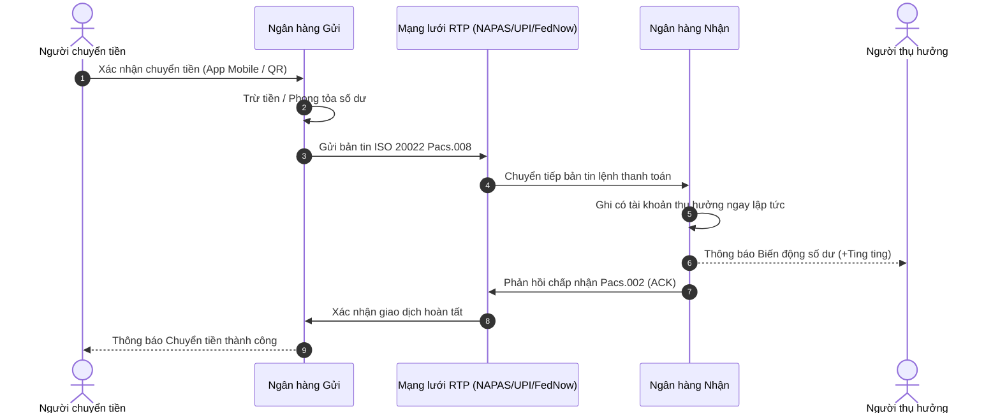
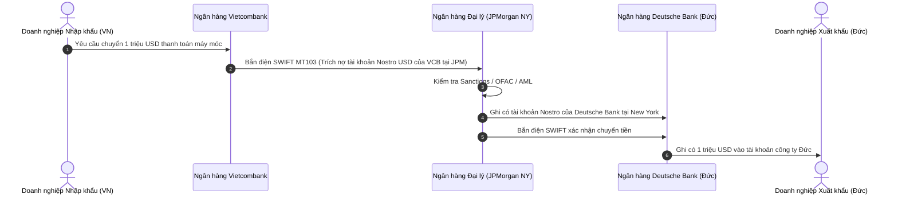

# Chuyên đề: Các Đường Ray Thanh Toán Bán Buôn và Bán Lẻ (Wholesale & Retail Payment Rails)

Tài liệu này nghiên cứu chuyên sâu về các "đường ray" thanh toán (Payment Rails) huyết mạch của nền kinh tế thế giới: mạng lưới bù trừ tự động ACH, hệ thống thanh toán thời gian thực (RTP), mạng lưới viễn thông tài chính quốc tế SWIFT và nghiệp vụ thanh toán cho đơn vị chấp nhận thẻ (Merchant Acquiring).

---

## 1. Automated Clearing House (ACH) (Trung tâm bù trừ tự động)

### 1. Là gì?
- **Định nghĩa học thuật:** Trung tâm bù trừ tự động (*Automated Clearing House - ACH*) là một mạng lưới máy tính điện tử trung gian xử lý các giao dịch thanh toán chuyển khoản và trích nợ định kỳ theo lô (*batch processing*) giữa các định chế tài chính, phục vụ chủ yếu cho các khoản thanh toán giá trị nhỏ hoặc trung bình của doanh nghiệp, người tiêu dùng và chính phủ.
- **Bản chất trực giác:** ACH giống như một chuyến tàu chở hàng chuyển phát thư từ: thay vì gửi từng người đưa thư chạy riêng lẻ trên đường cho mỗi lá thư, bưu điện gom toàn bộ 100.000 lá thư gửi đi trong ngày vào các toa tàu lớn, chạy theo lịch trình cố định (ví dụ: chuyến 12h trưa và 6h tối) để phân loại và giao hàng loạt. Chi phí cho mỗi lá thư nhờ đó rẻ như cho điểm.
- **Nếu chỉ nhớ một điều:** ACH là "đường ray giá rẻ, xử lý hàng loạt" của hệ thống thanh toán bán lẻ, vận hành theo cơ chế gom lô và độ trễ từ vài giờ đến vài ngày để đạt được hiệu quả kinh tế theo quy mô tối đa.

### 2. Hoạt động thế nào?
1. **Hai loại hình giao dịch cốt lõi:**
   - **Giao dịch Ghi có ACH (Direct Deposit / ACH Credit):** Dòng tiền "đẩy" (*Push payment*) từ người trả tiền sang người nhận. Ví dụ: Doanh nghiệp chi trả lương hàng loạt vào tài khoản nhân viên, chính phủ chi trả trợ cấp an sinh xã hội, hoàn thuế thu nhập cá nhân.
   - **Giao dịch Ghi nợ ACH (Direct Debit / ACH Debit):** Dòng tiền "kéo" (*Pull payment*) do người thụ hưởng chủ động rút từ tài khoản người trả tiền dựa trên giấy ủy quyền đã ký trước. Ví dụ: Công ty điện lực thoại tự động trừ tiền cước internet, công ty bảo hiểm trừ phí bảo hiểm hàng tháng, thanh toán dư nợ thẻ tín dụng tự động.
2. **Quy trình luân chuyển:**
   $$\text{Originator} \longrightarrow \text{ODFI (Ngân hàng gửi)} \longrightarrow \text{ACH Operator} \longrightarrow \text{RDFI (Ngân hàng nhận)} \longrightarrow \text{Receiver}$$
   - Mạng lưới ACH tại Mỹ được điều hành bởi NACHA (Hiệp hội Thanh toán Điện tử Quốc gia) với hai nhà vận hành: FedACH (thuộc Cục Dự trữ Liên bang) và The Clearing House (EPN).

### 3. Công thức & Mô hình toán học
Cấu trúc chi phí biên tối ưu của hệ thống xử lý hàng loạt theo lô (*Batch Economics*):
$$C(N) = F + c \cdot N$$
$$\text{Chi phí bình quân trên mỗi giao dịch} = AC(N) = \frac{F}{N} + c$$

Trong đó:
- $F$: Chi phí cố định khổng lồ đầu tư hệ thống máy chủ, đường truyền viễn thông và phần mềm bù trừ.
- $c$: Chi phí biên xử lý thêm một dòng lệnh điện tử (gần như bằng 0, chỉ khoảng vài cent).
- $N$: Tổng số lượng giao dịch được gom trong lô.
- **Tính kinh tế theo quy mô:** Khi $N \to \infty$, chi phí bình quân $AC \to c$. Đây là lý do tại sao chi phí giao dịch ACH rẻ hơn hàng chục lần so với chi phí quẹt thẻ tín dụng ($1.5\% - 3\%$) hay chuyển tiền quốc tế qua SWIFT.

### 4. Ví dụ
- **Ví dụ số học:** Một tập đoàn bán lẻ tại Mỹ có 200.000 nhân viên. Nếu chi trả lương bằng séc giấy, chi phí in ấn, ký séc và gửi thư là 2.50 USD/nhân viên (tổng 500.000 USD/tháng). Nếu chuyển qua đường ray ACH (Direct Deposit), chi phí nhà mạng ACH thu chỉ là 0.05 USD/giao dịch (tổng 10.000 USD/tháng). Doanh nghiệp tiết kiệm được 490.000 USD mỗi tháng ($98\%$ chi phí).
- **Thực tế Việt Nam:** Hệ thống bù trừ điện tử tự động ACH của NAPAS (triển khai chính thức từ năm 2020) xử lý các giao dịch thanh toán bán lẻ giá trị nhỏ dưới 500 triệu VND, hỗ trợ dịch vụ trích nợ tự động tiền điện, tiền nước, cước viễn thông cho hàng chục ngân hàng thành viên.
- **Kịch bản phản thực tế (Counterfactual):** Nếu hệ thống FedACH không hoạt động trong đợt cứu trợ đại dịch COVID-19 năm 2020, Bộ Tài chính Mỹ sẽ phải mất từ 6 đến 12 tháng để in và gửi hơn 100 triệu tấm séc giấy cứu trợ qua đường bưu điện, đẩy hàng chục triệu người dân mất việc vào cảnh cùng quẫn vì không kịp nhận tiền trợ cấp.

### 5. Ứng dụng & Tranh luận
- **Ứng dụng thực tiễn:** Thanh toán lương (Payroll), trích nợ hóa đơn dịch vụ công tự động (Utility bills), nộp thuế, thanh toán B2B khối lượng lớn.
- **Tranh luận & Đánh đổi:** 
  - *Độ trễ thời gian (Settlement Delay):* Hệ thống ACH truyền thống mất từ 1 đến 3 ngày làm việc để quyết toán tiền tệ (T+1 đến T+3). Dù hiện nay đã phát triển Same-Day ACH (xử lý trong ngày), ACH vẫn không thể đáp ứng được nhu cầu mua sắm tức thời của người tiêu dùng trong kỷ nguyên số.
  - *Rủi ro trả lại lệnh (ACH Returns / Fraud):* Giao dịch Direct Debit có nguy cơ tài khoản không đủ số dư (NSF) hoặc khách hàng khiếu nại lệnh bị đánh cắp trong vòng 60 ngày, gây rủi ro bồi hoàn cho người bán.
- **Cạm bẫy tư duy:** Tưởng rằng ACH là thanh toán thời gian thực vì thấy tài khoản ngân hàng lập tức bị trừ tiền. Đó chỉ là việc ngân hàng người gửi tạm khóa tiền (memo-posting); tiền thực tế chưa hề được chuyển sang ngân hàng nhận cho đến phiên quyết toán bù trừ lô tiếp theo của nhà mạng ACH.

### 6. Liên kết khái niệm
- [Electronic Funds Transfer (EFT)](file:///Users/ductri0981/Documents/Studying/Studying-Economic/03_Money_Banking_and_Financial_Systems/07_Payment_Systems_and_Financial_Technology/01_Payment_Systems_Infrastructure_and_Clearing.md#5-electronic-funds-transfer-eft-chuyen-tien-dien-tu) (ACH là dạng thức tiêu biểu của EFT)
- [Payment Clearing](file:///Users/ductri0981/Documents/Studying/Studying-Economic/03_Money_Banking_and_Financial_Systems/07_Payment_Systems_and_Financial_Technology/01_Payment_Systems_Infrastructure_and_Clearing.md#2-payment-clearing-bu-tru-thanh-toan) (Bản chất chức năng của ACH)
- [Real-Time Payments](file:///Users/ductri0981/Documents/Studying/Studying-Economic/03_Money_Banking_and_Financial_Systems/07_Payment_Systems_and_Financial_Technology/02_Wholesale_and_Retail_Payment_Rails.md#2-real-time-payments-thanh-toan-thoi-gian-thuc) (Thế hệ đường ray tiếp theo thay thế ACH)

---

## 2. Real-Time Payments (Thanh toán thời gian thực)

### 2.1. Là gì?
- **Định nghĩa học thuật:** Thanh toán thời gian thực (*Real-Time Payments - RTP* hoặc *Fast Payment Systems - FPS*) là cơ sở hạ tầng thanh toán bán lẻ vận hành liên tục 24/7/365, cho phép khởi tạo, truyền tin, bù trừ và ghi có tiền khả dụng ngay lập tức (*immediate funds availability*) vào tài khoản người thụ hưởng trong vòng vài giây, đồng thời việc quyết toán liên ngân hàng được thực hiện tức thời hoặc gần như tức thời không thể đảo ngược.
- **Bản chất trực giác:** Thanh toán truyền thống giống như gửi thư bưu điện: bạn gửi hôm nay, 2 ngày sau bạn bè mới nhận được. Thanh toán thời gian thực giống như nhắn tin qua Zalo, Messenger: bạn vừa bấm nút "Gửi", chuông điện thoại của người nhận lập tức reo "ting ting" và họ có thể rút tiền mặt ra mua bánh mì ngay lập tức, bất kể là nửa đêm Chủ Nhật hay ngày mùng 1 Tết.
- **Nếu chỉ nhớ một điều:** Thanh toán thời gian thực là sự kết hợp hoàn hảo giữa "tốc độ tính bằng giây", "tính sẵn sàng 24/7" và "tiền tươi thóc thật có thể sử dụng ngay lập tức".

### 2.2. Hoạt động thế nào?
1. **Các mạng lưới RTP tiêu biểu trên thế giới:**
   - **UPI (Unified Payments Interface) tại Ấn Độ:** Kỳ tích thanh toán số thế giới, xử lý hơn 13 tỷ giao dịch mỗi tháng.
   - **Pix tại Brazil:** Do Ngân hàng Trung ương Brazil vận hành, đạt hơn 150 triệu người dùng chỉ sau 3 năm.
   - **NAPAS 247 / VietQR tại Việt Nam:** Phủ sóng toàn diện thanh toán bán lẻ và chuyển tiền cá nhân.
   - **FedNow và RTP (The Clearing House) tại Mỹ:** Mạng lưới thanh toán nhanh quốc gia.
   - **Faster Payments Service (FPS) tại Anh; PayNow tại Singapore; PromptPay tại Thái Lan.**
2. **Ba đặc tính công nghệ khác biệt:**
   - **Xử lý từng lệnh riêng lẻ (Transaction-by-transaction):** Không gom lô chờ đợi như ACH.
   - **Chuẩn dữ liệu ISO 20022:** Cho phép đính kèm khối lượng dữ liệu khổng lồ trong tin nhắn chuyển tiền (hóa đơn số, mã sản phẩm, thuế, ghi chú chi tiết).
   - **Giao tiếp qua Định danh đại diện (Proxy/Alias-based):** Không cần nhớ số tài khoản dài dòng, chỉ cần quét mã QR, số điện thoại hoặc mã CCCD là tiền tự động định tuyến chính xác.

### 2.3. Quy trình Xử lý Giao dịch RTP trong 3 Giây

### 2.4. Ví dụ
- **Ví dụ số học:** Một người đi chợ đêm lúc 23:30 Chủ Nhật quét mã QR mua nải chuối giá 35.000 VND từ một tiểu thương khác ngân hàng.
  - Sau 1.8 giây, tài khoản người mua bị trừ 35.000 VND.
  - Tài khoản người bán tại một ngân hàng khác hiện thông báo nhận đủ 35.000 VND.
  - Người bán dùng ngay 35.000 VND này chuyển tiếp cho người giao hàng kế bên. Tốc độ lưu thông tiền tệ ($Velocity\ of\ Money$) tăng lên mức tối đa.
- **Thực tế Việt Nam:** Sự thành công ngoạn mục của phương thức thanh toán VietQR do NAPAS phối hợp cùng các ngân hàng thương mại triển khai. Hiện nay từ các siêu thị lớn đến người bán trà đá vỉa hè, tài xế xe ôm công nghệ đều sử dụng mã VietQR. Hệ thống vận hành liên tục 24/7/365 với độ sẵn sàng dịch vụ ($Uptime$) đạt $99.99\%$.
- **Kịch bản phản thực tế (Counterfactual):** Nếu các quốc gia đang phát triển như Ấn Độ hay Brazil không xây dựng mạng lưới RTP quốc gia (UPI, Pix) mà phó mặc cho các tập đoàn thẻ quốc tế tư nhân, hàng trăm triệu người dân nghèo không đủ điều kiện mở thẻ tín dụng sẽ tiếp tục bị gạt ra ngoài lề hệ thống tài chính chính thức và thương mại điện tử sẽ không thể nào bùng nổ đến vùng nông thôn.

### 2.5. Ứng dụng & Tranh luận
- **Ứng dụng thực tiễn:** Thanh toán P2P (chia tiền bữa ăn), thanh toán quét mã tại điểm bán lẻ (QR merchant), giải ngân vốn vay tiêu dùng khẩn cấp, chi trả lương theo ngày làm việc thực tế (Earned Wage Access - EWA).
- **Tranh luận & Đánh đổi:** 
  - *Tấn công lừa đảo chuyển tiền được ủy quyền (Authorised Push Payment - APP Fraud):* Vì tiền đến ngay lập tức và tính không thể đảo ngược, nếu kẻ gian lừa được người dùng tự tay bấm mã OTP chuyển tiền (bẫy tình cảm, bẫy việc làm), nạn nhân không có cách nào chặn hay thu hồi lại tiền như thẻ tín dụng.
  - *Áp lực thanh khoản 24/7 cho ngân hàng:* Các ngân hàng phải liên tục duy trì đủ lượng dự trữ tại Ngân hàng Trung ương vào ban đêm và ngày nghỉ lễ, đòi hỏi NHTW phải mở các cửa sổ tái cấp vốn trong ngày tự động.
- **Cạm bẫy tư duy:** Tưởng rằng thanh toán thời gian thực là thanh toán bằng công nghệ Blockchain. Hầu hết các hệ thống RTP hàng đầu thế giới (UPI, Pix, Fast, FedNow) đều là hệ thống máy tính tập trung truyền thống (*Centralised High-Performance Computing*), đạt tốc độ xử lý hàng chục ngàn giao dịch mỗi giây (TPS) vượt trội hơn nhiều so với các blockchain phi tập trung công khai.

### 2.6. Liên kết khái niệm
- [QR Code Payments](file:///Users/ductri0981/Documents/Studying/Studying-Economic/03_Money_Banking_and_Financial_Systems/07_Payment_Systems_and_Financial_Technology/04_Digital_and_Mobile_Payment_Innovations.md#4-qr-code-payments-thanh-toan-qua-ma-qr) (Giao diện người dùng phổ biến nhất của RTP)
- [Interbank Transfers](file:///Users/ductri0981/Documents/Studying/Studying-Economic/03_Money_Banking_and_Financial_Systems/07_Payment_Systems_and_Financial_Technology/01_Payment_Systems_Infrastructure_and_Clearing.md#4-interbank-transfers-chuyen-tien-lien-ngan-hang) (Bản chất liên ngân hàng của RTP)
- [Velocity of Money](file:///Users/ductri0981/Documents/Studying/Studying-Economic/03_Money_Banking_and_Financial_Systems/01_Money_and_Monetary_Systems/05_Money_Creation_and_Multiplier.md) (RTP đẩy tốc độ chu chuyển tiền tệ lên mức cực đại)

---

## 3. SWIFT (Hệ thống viễn thông tài chính liên ngân hàng quốc tế)

### 3.1. Là gì?
- **Định nghĩa học thuật:** Hiệp hội Viễn thông Tài chính Liên ngân hàng Toàn cầu (*Society for Worldwide Interbank Financial Telecommunication - SWIFT*) là một hợp tác xã toàn cầu thuộc sở hữu của hơn 11.000 định chế tài chính tại hơn 200 quốc gia và vùng lãnh thổ, có trụ sở chính tại La Hulpe (Bỉ). SWIFT vận hành một mạng lưới viễn thông tài chính bảo mật tiêu chuẩn hóa cao, cho phép các ngân hàng trên khắp thế giới gửi và nhận các thông tin tài chính (chỉ dẫn chuyển tiền, xác nhận giao dịch chứng khoán, phát hành L/C) một cách tin cậy và tự động.
- **Bản chất trực giác:** Nhiều người lầm tưởng SWIFT là một cái kho tiền lớn hoặc một hệ thống chuyển tiền. Thực chất, **SWIFT không hề giữ một xu tiền nào và cũng không thực hiện chuyển tiền**. SWIFT chính là "Hệ thống tin nhắn SMS / Zalo tuyệt mật và chuẩn hóa tối cao" của giới ngân hàng toàn cầu: khi Ngân hàng A muốn chuyển tiền cho Ngân hàng B ở bên kia bán cầu, A gửi một tin nhắn bảo mật qua mạng SWIFT bảo B hãy trừ tiền tài khoản Nostro/Vostro tương ứng.
- **If only remember one thing:** SWIFT là "ngôn ngữ viễn thông chung độc quyền" của tài chính quốc tế; bị ngắt kết nối khỏi SWIFT đồng nghĩa với việc bị cắt đứt lưỡi và đôi tai trong thương mại toàn cầu.

### 3.2. Hoạt động thế nào?
1. **Mã nhận diện ngân hàng chuẩn quốc tế (BIC / SWIFT Code):**
   - Mã gồm 8 hoặc 11 ký tự chuẩn hóa (ISO 9362): Ví dụ `BFTVVNVX` (Vietcombank Việt Nam).
     - 4 ký tự đầu: Mã định danh ngân hàng (`BFTV` - Bank for Foreign Trade of Vietnam).
     - 2 ký tự kế: Mã quốc gia (`VN` - Việt Nam).
     - 2 ký tự kế: Mã địa bàn (`VX` - Hà Nội).
     - 3 ký tự cuối: Mã chi nhánh cụ thể (tùy chọn).
2. **Các định dạng điện báo chuẩn hóa:**
   - Hệ thống chuẩn cũ: Điện báo MT (*Message Type*), ví dụ: MT103 (Lệnh chuyển tiền khách hàng cá nhân), MT202 (Lệnh chuyển tiền giữa các tổ chức tài chính), MT700 (Mở thư tín dụng L/C).
   - Hệ thống chuẩn mới: Chuyển dịch toàn diện sang chuẩn **ISO 20022 (Điện báo MX - XML format)**, mang lại dung lượng dữ liệu phong phú, minh bạch và tương thích với AI.
3. **Mối quan hệ pháp lý và Giám sát:**
   - Đăng ký theo luật pháp Bỉ, SWIFT được giám sát bởi Ngân hàng Quốc gia Bỉ (NBB) cùng với các ngân hàng trung ương lớn thuộc nhóm G10 (Fed, ECB, BOE, BOJ,...).

### 3.3. Quy trình Chuyển tiền Quốc tế qua Mạng lưới SWIFT

### 3.4. Ví dụ
- **Ví dụ số học:** Doanh nghiệp Việt Nam nhập khẩu lô hàng sữa bột 500.000 USD từ New Zealand. Vietcombank phát đi một bức điện SWIFT MT103 sang ngân hàng ANZ (Auckland). Bức điện được mã hóa PKI, chuyển qua các nút mạng SWIFT tại Hà Lan và Mỹ. Trong vòng 15 phút, ANZ nhận bức điện, giải mã chữ ký điện tử hợp lệ và hạch toán vào tài khoản doanh nghiệp New Zealand.
- **Thực tế Địa chính trị Quốc tế:** "Vũ khí hạt nhân tài chính": Sau khi nổ ra xung đột Nga - Ukraine năm 2022, Mỹ và Liên minh Châu Âu (EU) đã phối hợp đưa ra quyết định loại bỏ hàng loạt ngân hàng thương mại lớn nhất của Nga (như Sberbank, VTB) ra khỏi hệ thống viễn thông SWIFT. Hành động này đã cắt đứt tức thì năng lực xuất khẩu và chuyển đổi dòng ngoại tệ của các ngân hàng Nga với thị trường phương Tây, buộc Nga phải đẩy mạnh hệ thống tin nhắn riêng SPFS và chuyển sang giao dịch bằng đồng Rúp và Nhân dân tệ.
- **Kịch bản phản thực tế (Counterfactual):** Trước năm 1973 (năm SWIFT thành lập), các ngân hàng quốc tế liên lạc với nhau qua mạng máy điện báo Telex thủ công. Tốc độ chậm chạp, lỗi đánh máy thường xuyên và dễ bị nghe trộm, làm giả mạo chứng từ chuyển tiền khiến thương mại toàn cầu bị giới hạn ở quy mô rất nhỏ.

### 3.5. Ứng dụng & Tranh luận
- **Ứng dụng thực tiễn:** Thanh toán tài trợ thương mại quốc tế (L/C, bảo lãnh), chuyển tiền kiều hối xuyên quốc gia, thanh toán mua bán chứng khoán và kim loại quý toàn cầu.
- **Tranh luận & Đánh đổi:** 
  - *Vấn đề trung lập chính trị của SWIFT:* Vốn được thành lập như một hợp tác xã kỹ thuật trung lập, nhưng việc SWIFT chịu sự chi phối của lệnh trừng phạt Mỹ và EU (ngắt kết nối Iran năm 2012, Nga năm 2022) khiến nhiều quốc gia (như khối BRICS) lo ngại và đang xây dựng các hệ thống viễn thông thanh toán thay thế để tránh phụ thuộc (như CIPS của Trung Quốc, SPFS của Nga).
- **Cạm bẫy tư duy:** Tưởng rằng bị ngắt SWIFT là ngân hàng bị phong tỏa mất hết tiền. Ngân hàng bị ngắt SWIFT chỉ bị mất "kênh gửi tin nhắn điện tử nhanh và tự động"; trên lý thuyết họ vẫn có thể dùng điện thoại, email mã hóa hoặc thư tín giấy để chuyển tiền nhưng chi phí vô cùng đắt đỏ và tốc độ chậm hơn hàng trăm lần.

### 3.6. Liên kết khái niệm
- [Correspondent Banking](file:///Users/ductri0981/Documents/Studying/Studying-Economic/03_Money_Banking_and_Financial_Systems/03_Banking_Systems/02_Digital_Alternative_and_Specialized_Banking.md) (Mô hình tài khoản ngân hàng đại lý làm nền tảng cho SWIFT)
- [Foreign Currency](file:///Users/ductri0981/Documents/Studying/Studying-Economic/03_Money_Banking_and_Financial_Systems/01_Money_and_Monetary_Systems/03_Currency_Types_and_Reserves.md) (Ngoại tệ thanh toán qua SWIFT)
- [Counter-Terrorist Financing (CTF)](file:///Users/ductri0981/Documents/Studying/Studying-Economic/03_Money_Banking_and_Financial_Systems/06_Financial_Regulation_and_Stability/06_AML_KYC_and_International_Standards.md#3-counter-terrorist-financing-ctf-chong-tai-tro-khung-bo) (Mọi bức điện SWIFT đều bị quét danh sách trừng phạt)

---

## 4. Merchant Acquiring (Nghiệp vụ thanh toán cho đơn vị chấp nhận thẻ)

### 4.1. Là gì?
- **Định nghĩa học thuật:** Nghiệp vụ thanh toán cho đơn vị chấp nhận thẻ (*Merchant Acquiring*) là dịch vụ tài chính do một ngân hàng (*Acquiring Bank*) hoặc một tổ chức thanh toán trung gian cung cấp cho các thương nhân (*Merchants*), cho phép người bán hàng tiếp nhận, xử lý và quyết toán các giao dịch thanh toán bằng thẻ thanh toán (thẻ tín dụng, thẻ ghi nợ) hoặc phương tiện điện tử từ khách hàng.
- **Bản chất trực giác:** Một chủ tiệm bánh mì muốn khách hàng có thể quẹt thẻ Visa hoặc quét mã để trả tiền. Chủ tiệm không thể tự chạy sang ngân hàng của từng người mua để đòi tiền. Ngân hàng thanh toán (*Acquirer*) đứng ra lắp máy POS tại tiệm bánh, cài phần mềm cổng thanh toán trực tuyến, cam kết thu hộ toàn bộ tiền bán hàng của khách và chuyển tiền vào tài khoản tiệm bánh vào mỗi cuối ngày sau khi trừ đi một khoản hoa hồng nhỏ.
- **Nếu chỉ nhớ một điều:** Merchant Acquiring là cầu nối đưa các doanh nghiệp bán lẻ thực tế hòa mạng vào dòng chảy thanh toán không tiền mặt toàn cầu.

### 4.2. Hoạt động thế nào?
1. **Các tác nhân trong chuỗi Acquiring:**
   - **Người bán (Merchant):** Doanh nghiệp bán lẻ trực tiếp (quán cà phê, khách sạn) hoặc gian hàng thương mại điện tử.
   - **Ngân hàng Thanh toán (Acquirer):** Ngân hàng mở tài khoản thương nhân (*Merchant Account*) và chịu rủi ro tín dụng nếu người bán phá sản.
   - **Nhà cung ứng dịch vụ thanh toán (Payment Service Provider - PSP / ISO):** Các công ty công nghệ (như Stripe, Square/Block, VNPay) cung cấp thiết bị phần cứng POS và API cổng thanh toán.
2. **Quy trình luân chuyển dòng tiền:**
   - *Bước 1: Quẹt thẻ / Nhập thông tin:* Dữ liệu truyền từ POS đến Acquirer $\to$ Mạng lưới thẻ (Visa/Mastercard) $\to$ Ngân hàng phát hành (Issuer).
   - *Bước 2: Phê duyệt (Approval):* Issuer phong tỏa tiền, phản hồi trong 1.5 giây.
   - *Bước 3: Quyết toán và Bỏ túi (Batch Settlement):* Đêm hôm đó, Acquirer thanh toán cho Merchant giá trị đơn hàng sau khi trừ đi **Phí chiết khấu chấp nhận thẻ (MDR - Merchant Discount Rate)**.

### 4.3. Công thức & Mô hình toán học
Cơ cấu phân rã **Phí chiết khấu thanh toán người bán (Merchant Discount Rate - $MDR$):**
$$\text{Tiền người bán nhận được} = \text{Giá trị đơn hàng} \times (1 - MDR)$$
$$MDR = \text{Interchange Fee} + \text{Assessment/Scheme Fee} + \text{Acquirer Margin}$$

Trong đó:
- $\text{Interchange Fee}$: Khoản phí cố định nộp cho Ngân hàng phát hành thẻ (chiếm $70\% - 85\%$ của MDR).
- $\text{Assessment Fee}$: Khoản phí nộp cho Tổ chức mạng lưới thẻ (Visa/Mastercard/NAPAS, chiếm khoảng $5\% - 10\%$).
- $\text{Acquirer Margin}$: Lợi nhuận biên thực tế của Ngân hàng thanh toán và nhà cung cấp máy POS (chiếm $10\% - 20\%$).
- Tỷ lệ $MDR$ thông thường dao động từ:
  - Thẻ ghi nợ nội địa: $0.3\% - 0.8\%$
  - Thẻ tín dụng quốc tế (Visa/Mastercard): $1.8\% - 3.5\%$

### 4.4. Ví dụ
- **Ví dụ số học:** Khách hàng quẹt thẻ tín dụng quốc tế mua một chiếc áo khoác trị giá 2.000.000 VND tại một cửa hàng thời trang. Hợp đồng Acquiring quy định $MDR = 2.5\%$.
  - Tổng số tiền phí chiết khấu cửa hàng phải trả:
    $$\text{Phí MDR} = 2.000.000 \times 2.5\% = 50.000 \text{ VND}$$
  - Cửa hàng thực tế nhận về tài khoản ngân hàng sáng hôm sau:
    $$\text{Số tiền thực nhận} = 2.000.000 - 50.000 = 1.950.000 \text{ VND}$$
  - Phân bổ 50.000 VND tiền phí: Ngân hàng phát hành thẻ nhận 36.000 VND (Interchange), Visa nhận 4.000 VND (Scheme fee), Ngân hàng Acquirer nhận 10.000 VND (Margin).
- **Thực tế Việt Nam:** Sự cạnh tranh quyết liệt giữa các ngân hàng lớn (Vietcombank, BIDV, Techcombank) và các trung gian thanh toán FinTech (VNPay, Payoo, SmartPay) trong việc lắp đặt máy POS và mã thanh toán tại hàng trăm ngàn chuỗi cửa hàng tiện lợi, nhà hàng, quán ăn trên toàn quốc.
- **Kịch bản phản thực tế (Counterfactual):** Nếu các ngân hàng Acquirer không chấp nhận rủi ro hoàn trả tiền (*Chargeback Risk*), khi một đại lý vé máy bay bán vé thu trước tiền của khách rồi bất ngờ phá sản hủy chuyến bay, người tiêu dùng sẽ bị mất trắng tiền và niềm tin vào việc mua hàng trực tuyến qua mạng sẽ hoàn toàn sụp đổ.

### 4.5. Ứng dụng & Tranh luận
- **Ứng dụng thực tiễn:** Thiết bị POS thông minh (SmartPOS in hóa đơn điện tử kết nối thuế), thanh toán một chạm (SoftPOS biến điện thoại thành máy quẹt thẻ), cổng thanh toán thương mại điện tử.
- **Tranh luận & Đánh đổi:** 
  - *Quy định cấm phụ thu người tiêu dùng (No-Surcharge Rule):* Các hãng thẻ cấm người bán hàng cộng thêm phí MDR vào hóa đơn của khách hàng quẹt thẻ. Nhiều chủ cửa hàng nhỏ phản ứng bằng cách từ chối nhận quẹt thẻ với các đơn hàng giá trị nhỏ (dưới 100.000 VND) hoặc bí mật yêu cầu khách chuyển khoản ngân hàng trực tiếp để tránh mất phí MDR.
- **Cạm bẫy tư duy:** Tưởng rằng ngân hàng Acquirer chỉ làm mỗi việc thu tiền và ăn phí hoa hồng nhàn hạ. Acquirer phải gánh chịu rủi ro tín dụng rất lớn: nếu người bán là một công ty lừa đảo (bán hàng giả rồi đóng cửa biến mất), ngân hàng Acquirer có nghĩa vụ pháp lý phải móc tiền túi của chính mình ra đền bù 100% tiền bồi hoàn (*Chargeback*) cho người mua thẻ.

### 4.6. Liên kết khái niệm
- [Card Networks](file:///Users/ductri0981/Documents/Studying/Studying-Economic/03_Money_Banking_and_Financial_Systems/07_Payment_Systems_and_Financial_Technology/03_Card_Networks_and_Payment_Gateways.md#1-card-networks-mang-luoi-the) (Hệ thống kết nối trực tiếp với Acquirer)
- [Payment Gateway](file:///Users/ductri0981/Documents/Studying/Studying-Economic/03_Money_Banking_and_Financial_Systems/07_Payment_Systems_and_Financial_Technology/03_Card_Networks_and_Payment_Gateways.md#4-payment-gateway-cong-thanh-toan) (Giao diện kỹ thuật mặt trước của Acquirer trên website)
- [Credit Card Networks](file:///Users/ductri0981/Documents/Studying/Studying-Economic/03_Money_Banking_and_Financial_Systems/07_Payment_Systems_and_Financial_Technology/03_Card_Networks_and_Payment_Gateways.md#2-credit-card-networks-mang-luoi-the-tin-dung) (Mạng lưới thẻ cung cấp giao dịch)

---

## Câu hỏi tự kiểm tra (Self-Quiz)
1. Tại sao hệ thống bù trừ tự động (ACH) lại có chi phí giao dịch trên mỗi đơn vị rẻ hơn rất nhiều so với hệ thống thẻ tín dụng và chuyển tiền điện tử RTGS?
2. Trình bày 3 đặc tính công nghệ vượt trội của Hệ thống Thanh toán Thời gian thực (Real-Time Payments - RTP) so với hệ thống thanh toán liên ngân hàng truyền thống?
3. Bản chất hoạt động của Hiệp hội SWIFT là gì? SWIFT có trực tiếp nắm giữ tiền gửi hoặc thực hiện chuyển giao số dư tiền mặt giữa các quốc gia hay không?
4. Trong cơ cấu Phí chiết khấu người bán (Merchant Discount Rate - MDR), khoản phí hoán đổi (*Interchange Fee*) được chuyển cho bên nào và nhằm mục đích kinh tế gì?
5. Tại sao các ngân hàng thanh toán (*Acquiring Banks*) lại phải đối mặt với rủi ro bồi hoàn (*Chargeback Risk*) khi cung cấp dịch vụ POS cho các thương nhân kinh doanh dịch vụ đặt trước (như vé máy bay, du lịch lữ hành)?

---

## Ghi chú nguồn tham khảo
- Bank for International Settlements (BIS). (2020). *Fast payment systems: features, barriers, and opportunities*. Committee on Payments and Market Infrastructures.
- SWIFT. (2023). *ISO 20022: The new global standard for payments messaging*. SWIFT Standards.
- NACHA. (2022). *ACH Operating Rules & Guidelines*. National Automated Clearing House Association.
- Evans, D. S., & Schmalensee, R. (2005). *Paying with Plastic: The Digital Revolution in Buying and Borrowing*. MIT Press.
- Ngân hàng Nhà nước Việt Nam: *Quy định vận hành Hệ thống chuyển mạch tài chính và bù trừ điện tử*.
