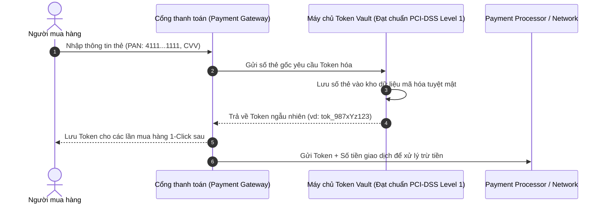

# Chuyên đề: Mạng Lưới Thẻ và Cổng Thanh Toán Trực Tuyến (Card Networks & Payment Gateways)

Tài liệu này phân tích cấu trúc kinh tế và hạ tầng công nghệ của thị trường hai mặt (Two-Sided Market) trong thanh toán thẻ: các mạng lưới thẻ quốc tế và nội địa, sự phân định giữa thẻ tín dụng và thẻ ghi nợ, cùng với vai trò trung chuyển của Cổng thanh toán (Payment Gateway) và Đơn vị xử lý thanh toán (Payment Processor).

---

## 1. Card Networks (Mạng lưới thẻ)

### 1. Là gì?
- **Định nghĩa học thuật:** Mạng lưới thẻ (*Card Network* hoặc *Card Payment Scheme*) là tổ chức tài chính và công nghệ trung gian thiết lập các quy tắc hoạt động, tiêu chuẩn kỹ thuật, cơ sở hạ tầng chuyển mạch và thương hiệu cho việc phát hành và chấp nhận thẻ thanh toán, đóng vai trò kết nối giữa các Ngân hàng Phát hành thẻ (*Issuers*) và các Ngân hàng Thanh toán (*Acquirers*).
- **Bản chất trực giác:** Hãy tưởng tượng nếu mỗi ngân hàng tự in ra một chiếc thẻ nhựa riêng và chỉ quẹt được tại máy quẹt thẻ của chính ngân hàng đó. Một người tiêu dùng sẽ phải mang theo 20 chiếc thẻ trong ví, và mỗi cửa hàng phải để 20 chiếc máy POS khác nhau trên bàn thu ngân. Mạng lưới thẻ (như Visa, Mastercard, NAPAS) ra đời như một "ngôn ngữ chung toàn cầu": in logo của họ lên thẻ và lên máy POS, bảo đảm thẻ của bất kỳ ngân hàng nào cũng quẹt được tại bất kỳ máy POS nào trên thế giới.
- **Nếu chỉ nhớ một điều:** Mạng lưới thẻ không trực tiếp phát hành thẻ cho bạn và cũng không cho bạn vay tiền; họ vận hành "siêu xa lộ kết nối" để tiền có thể chạy mượt mà giữa ngân hàng của bạn và ngân hàng của người bán.

### 2. Hoạt động thế nào?
1. **Mô hình Mạng lưới 4 bên (Four-Party Model / Open Loop):**
   - Visa, Mastercard, NAPAS:
   $$\text{Chủ thẻ (Cardholder)} \leftrightarrow \text{Ngân hàng Phát hành (Issuer)} \leftrightarrow \mathbf{Card\ Network} \leftrightarrow \text{Ngân hàng Thanh toán (Acquirer)} \leftrightarrow \text{Người bán (Merchant)}$$
2. **Mô hình Mạng lưới 3 bên (Three-Party Model / Closed Loop):**
   - American Express (Amex), Discover, Diners Club:
   $$\text{Chủ thẻ} \longleftrightarrow \mathbf{Tổ\ chức\ Thẻ\ (Vừa\ là\ Issuer,\ vừa\ là\ Acquirer)} \longleftrightarrow \text{Người bán}$$
3. **Nguồn doanh thu của Mạng lưới thẻ:**
   - Không kiếm lời từ lãi suất cho vay (phần lãi do ngân hàng phát hành hưởng).
   - Doanh thu đến từ: Phí mạng lưới (*Assessment / Scheme Fees* thu trên mỗi giao dịch, thường $0.10\% - 0.15\%$), phí dịch vụ dữ liệu, phí cấp quyền sử dụng thương hiệu và dịch vụ an ninh phòng chống gian lận.

### 3. Công thức & Kinh tế học Thị trường Hai Mặt (Two-Sided Markets)
Lý thuyết định giá thị trường hai mặt của Rochet & Tirole (2003, 2006):
Mạng lưới thẻ tối đa hóa tổng giá trị giao dịch ($V$) bằng cách trợ cấp cho một bên (người tiêu dùng) và thu phí cao bên còn lại (người bán):
$$\max_{f_B, f_S} \Pi = N_B(f_B) \cdot N_S(f_S) \cdot (f_B + f_S - c)$$

Trong đó:
- $N_B$: Số lượng chủ thẻ (*Buyers*), $N_S$: Số lượng người bán chấp nhận thẻ (*Sellers*).
- $f_B$: Mức phí người mua phải chịu (thường $f_B \le 0$ - người mua không mất phí mà còn được hoàn tiền Cashback, tặng điểm thưởng dặm bay).
- $f_S$: Phí người bán phải chịu ($f_S = MDR > 0$).
- $c$: Chi phí biên xử lý giao dịch của mạng lưới.
- **Cân bằng Rochet-Tirole:** Để giải quyết bài toán "Con gà và Quả trứng" (Người tiêu dùng chỉ mở thẻ khi có nhiều quán chấp nhận thẻ; Quán chỉ lắp máy POS khi có nhiều người cầm thẻ), mạng lưới sử dụng phí Interchange chuyển từ người bán sang trợ cấp cho ngân hàng phát hành để chi trả quyền lợi hoàn tiền cho người mua, tạo hiệu ứng mạng lưới (*Network Effects*) bùng nổ.

### 4. Ví dụ
- **Ví dụ số học:** Mạng lưới thẻ Visa xử lý hơn 250 tỷ giao dịch mỗi năm với tổng khối lượng giao dịch đạt hơn 14.000 tỷ USD. Với mức phí mạng lưới trung bình chỉ $0.12\%$:
  $$\text{Doanh thu dịch vụ mạng lưới} \approx 14.000 \text{ tỷ USD} \times 0.12\% \approx 16.8 \text{ tỷ USD}$$
  Nhờ quy mô giao dịch khổng lồ trên toàn cầu, biên lợi nhuận hoạt động (*Operating Margin*) của Visa thường xuyên đạt mức kỷ lục trên $65\%$.
- **Thực tế Việt Nam:** Thẻ nội địa NAPAS (sử dụng chuẩn chip VCCS) đóng vai trò là mạng lưới thẻ quốc gia. Trong khi thẻ Visa/Mastercard chiếm ưu thế trong các giao dịch quốc tế và thương mại điện tử xuyên biên giới, thẻ NAPAS chiếm ưu thế tuyệt đối về mạng lưới rút tiền ATM, thanh toán dịch vụ công và các giao dịch bán lẻ nội địa với chi phí phí xử lý rẻ hơn nhiều cho các ngân hàng Việt Nam.
- **Kịch bản phản thực tế (Counterfactual):** Nếu các mạng lưới thẻ quốc tế không phát minh ra Tiêu chuẩn Chip thông minh EMV (Europay-Mastercard-Visa) có gắn mật mã động thay cho dải từ tính truyền thống (*Magnetic Stripe*), các vụ sao chép thông tin thẻ (*Card Skimming*) sẽ tăng theo cấp số nhân và hệ thống thẻ tín dụng toàn cầu sẽ bị tê liệt bởi các đường dây tội phạm làm thẻ giả.

### 5. Ứng dụng & Tranh luận
- **Ứng dụng thực tiễn:** Thanh toán toàn cầu tại hơn 200 quốc gia không cần đổi ngoại tệ mặt, bảo hiểm du lịch tự động, tích điểm thưởng khách hàng thân thiết.
- **Tranh luận & Đánh đổi:** 
  - *Vị thế độc quyền nhóm (Duopoly):* Visa và Mastercard kiểm soát hơn 80% thị phần thẻ toàn cầu ngoài Trung Quốc, liên tục bị các nhà bán lẻ và cơ quan chống độc quyền (Mỹ, EU) kiện vì áp đặt phí hoán đổi quá cao.
- **Cạm bẫy tư duy:** Tưởng rằng Visa hoặc Mastercard là chủ nợ của bạn khi bạn nợ tiền thẻ tín dụng. Chủ nợ duy nhất của bạn là ngân hàng đã phát hành chiếc thẻ đó (như Vietcombank, Techcombank); Visa/Mastercard chỉ là đường truyền dữ liệu trung gian và không can thiệp vào hợp đồng tín dụng giữa bạn và ngân hàng.

### 6. Liên kết khái niệm
- [Credit Card Networks](file:///Users/ductri0981/Documents/Studying/Studying-Economic/03_Money_Banking_and_Financial_Systems/07_Payment_Systems_and_Financial_Technology/03_Card_Networks_and_Payment_Gateways.md#2-credit-card-networks-mang-luoi-the-tin-dung) (Phân nhánh thẻ tín dụng của mạng lưới)
- [Debit Card Networks](file:///Users/ductri0981/Documents/Studying/Studying-Economic/03_Money_Banking_and_Financial_Systems/07_Payment_Systems_and_Financial_Technology/03_Card_Networks_and_Payment_Gateways.md#3-debit-card-networks-mang-luoi-the-ghi-no) (Phân nhánh thẻ ghi nợ của mạng lưới)
- [Merchant Acquiring](file:///Users/ductri0981/Documents/Studying/Studying-Economic/03_Money_Banking_and_Financial_Systems/07_Payment_Systems_and_Financial_Technology/02_Wholesale_and_Retail_Payment_Rails.md#4-merchant-acquiring-nghiep-vu-thanh-toan-cho-don-vi-chap-nhan-the) (Khâu kết nối phía người bán)

---

## 2. Credit Card Networks (Mạng lưới thẻ tín dụng)

### 2.1. Là gì?
- **Định nghĩa học thuật:** Mạng lưới thẻ tín dụng (*Credit Card Network*) là phân hệ mạng lưới thanh toán chuyên biệt hỗ trợ các giao dịch thực hiện bằng Thẻ tín dụng (*Credit Card*), nơi người tiêu dùng được cấp một hạn mức tín dụng tuần hoàn (*Revolving Line of Credit*) không tài sản bảo đảm từ ngân hàng phát hành để chi tiêu trước và thanh toán sau theo chu kỳ sao kê.
- **Bản chất trực giác:** Quẹt thẻ tín dụng giống như việc bạn đi ăn nhà hàng mà người bạn giàu có (ngân hàng) đi cùng đứng ra trả tiền hộ bạn trước cho chủ quán. Sau 45 ngày, người bạn đó mới đưa hóa đơn yêu cầu bạn hoàn trả: nếu bạn trả đủ đúng hạn, họ không lấy thêm một đồng lãi nào; nhưng nếu bạn chậm trả hoặc chỉ trả số tiền tối thiểu, họ sẽ tính lãi suất rất cao trên số nợ còn lại.
- **Nếu chỉ nhớ một điều:** Thẻ tín dụng là công cụ "Pay Later" (Tiêu tiền của ngân hàng), kết hợp giữa chức năng thanh toán không tiền mặt và chức năng cấp tín dụng tiêu dùng ngắn hạn.

### 2.2. Hoạt động thế nào?
1. **Chu kỳ vận hành của thẻ tín dụng:**
   - **Kỳ sao kê (Billing Cycle):** Thường kéo dài 30 ngày. Mọi chi tiêu trong kỳ được cộng dồn vào Dư nợ sao kê (*Statement Balance*).
   - **Thời gian ân hạn miễn lãi (Grace Period):** Khoảng từ 15 đến 25 ngày sau ngày sao kê. Nếu chủ thẻ thanh toán $100\%$ dư nợ sao kê trước ngày đến hạn, họ được miễn lãi $0\%$ cho toàn bộ các giao dịch mua sắm trong kỳ (lên tới 45–55 ngày không tính lãi).
   - **Khoản thanh toán tối thiểu (Minimum Payment):** Thường là $5\%$ dư nợ gốc + lãi và phí phạt. Nếu chỉ trả số tối thiểu, toàn bộ số dư nợ còn lại sẽ bị tính lãi suất dồn tích ngược về từ ngày quẹt thẻ.
2. **Cơ chế kinh tế của Ngân hàng Phát hành thẻ tín dụng:**
   - Thu nhập từ lãi suất dư nợ quay vòng (*Revolving Interest Rate* - thường từ $20\% - 36\%/\text{năm}$).
   - Thu nhập từ phí thường niên, phí phạt chậm trả, phí rút tiền mặt, phí chuyển đổi ngoại tệ.
   - Thu nhập từ Phí hoán đổi (Interchange Fee do người bán trả, thường từ $1.5\% - 2.5\%$).

### 2.3. Công thức & Mô hình toán học
Hạch toán lãi vay thẻ tín dụng theo phương pháp **Số dư nợ bình quân hàng ngày (Average Daily Balance - $ADB$):**
$$ADB = \frac{\sum_{t=1}^{N} B_t}{N}$$
$$\text{Tiền lãi trong kỳ (Finance Charge)} = ADB \times \left( \frac{\text{APR}}{365} \right) \times N$$

Trong đó:
- $B_t$: Dư nợ vào cuối ngày thứ $t$.
- $N$: Số ngày trong chu kỳ thanh toán (thường là 30 hoặc 31 ngày).
- $\text{APR}$: Lãi suất phần trăm danh nghĩa hàng năm ghi trên hợp đồng.
- *Lưu ý:* Ngay khi bạn mất quyền lợi ân hạn (do không trả đủ 100% sao kê), lãi suất sẽ được tính trên từng giao dịch phát sinh kể từ ngày giao dịch được ghi sổ, chứ không phải từ ngày chốt sao kê.

### 2.4. Ví dụ
- **Ví dụ số học:** Khách hàng có chu kỳ sao kê từ 01/10 đến 31/10 (31 ngày), ngày đến hạn là 15/11. Ngày 05/10 khách quẹt thẻ mua laptop 30 triệu VND. Lãi suất $\text{APR} = 30\%/\text{năm}$.
  - Nếu ngày 15/11 khách trả đủ 30 triệu VND: Tiền lãi phải trả = 0 VND (hưởng trọn 41 ngày miễn lãi).
  - Nếu ngày 15/11 khách chỉ trả mức tối thiểu 1.5 triệu VND (còn nợ 28.5 triệu VND): Khách bị mất quyền miễn lãi. Tiền lãi tháng sau sẽ tính trên toàn bộ 30 triệu từ ngày 05/10 đến 15/11, và tính trên 28.5 triệu từ 16/11 đến 30/11:
    $$\text{Tiền lãi phát sinh tháng kế tiếp} \approx 30.000.000 \times \frac{30\%}{365} \times 41 + 28.500.000 \times \frac{30\%}{365} \times 15 \approx 1.362.000 \text{ VND}$$
- **Thực tế Việt Nam:** Các dòng thẻ tín dụng quốc tế (Cashback, Travel miles) bùng nổ mạnh mẽ tại các ngân hàng như VPBank, VIB, Techcombank, HSBC. VIB tiên phong cá nhân hóa các dòng thẻ tín dụng số mở trực tuyến không cần chứng minh thu nhập bảng lương truyền thống thông qua việc áp dụng chấm điểm tín dụng Big Data.
- **Kịch bản phản thực tế (Counterfactual):** Nếu các ngân hàng không thu được phí Interchange từ mạng lưới thẻ tín dụng, họ sẽ không thể duy trì các chương trình hoàn tiền $5\% - 10\%$ cho người tiêu dùng và buộc phải thu phí thường niên rất cao đối với mọi chủ thẻ, khiến quy mô sử dụng thẻ tín dụng co cụm lại chỉ dành cho giới siêu giàu.

### 2.5. Ứng dụng & Tranh luận
- **Ứng dụng thực tiễn:** Quản lý dòng tiền cá nhân linh hoạt, thuê xe khách sạn quốc tế (cần phong tỏa hạn mức cọc), xây dựng lịch sử điểm tín dụng cá nhân (Credit Score).
- **Tranh luận & Đánh đổi:** 
  - *Bẫy nợ tiêu dùng (Debt Trap):* Thẻ tín dụng tạo ra "Ảo tưởng thanh toán không đau đớn" (*Pain of Paying* giảm mạnh so với tiền mặt), khiến người trẻ dễ chi tiêu bốc đồng vượt khả năng chi trả, rơi vào vòng xoáy nợ thẻ với lãi suất cắt cổ.
- **Cạm bẫy tư duy:** Dùng thẻ tín dụng để rút tiền mặt tại cây ATM. Rút tiền mặt từ thẻ tín dụng **không được hưởng ân hạn miễn lãi**, bị tính phí rút tiền ngay lập tức ($3\% - 4\%$) và bị tính lãi suất vay tiêu dùng cực cao tính từ giây phút tiền nhả ra khỏi cây ATM.

### 2.6. Liên kết khái niệm
- [Credit Card](file:///Users/ductri0981/Documents/Studying/Studying-Economic/03_Money_Banking_and_Financial_Systems/04_Credit_and_Lending/06_Credit_Cards_and_Revolving_Lines.md) (Chi tiết sản phẩm thẻ tín dụng)
- [Card Networks](file:///Users/ductri0981/Documents/Studying/Studying-Economic/03_Money_Banking_and_Financial_Systems/07_Payment_Systems_and_Financial_Technology/03_Card_Networks_and_Payment_Gateways.md#1-card-networks-mang-luoi-the) (Hạ tầng mạng lưới vận hành thẻ)
- [Debit Card Networks](file:///Users/ductri0981/Documents/Studying/Studying-Economic/03_Money_Banking_and_Financial_Systems/07_Payment_Systems_and_Financial_Technology/03_Card_Networks_and_Payment_Gateways.md#3-debit-card-networks-mang-luoi-the-ghi-no) (Sản phẩm thẻ đối sánh tiêu tiền của chính mình)

---

## 3. Debit Card Networks (Mạng lưới thẻ ghi nợ)

### 3.1. Là gì?
- **Định nghĩa học thuật:** Mạng lưới thẻ ghi nợ (*Debit Card Network*) là hệ thống thanh toán kết nối trực tiếp với tài khoản tiền gửi thanh toán (*Demand Deposit Account - DDA*) của chủ thẻ tại ngân hàng phát hành, cho phép khấu trừ tiền ngay lập tức (*Pay Now*) từ số dư khả dụng thực tế của khách hàng khi thực hiện giao dịch thanh toán hoặc rút tiền mặt.
- **Bản chất trực giác:** Nếu thẻ tín dụng là "tiêu tiền đi vay của ngân hàng" thì thẻ ghi nợ là "tiêu tiền tươi thóc thật của chính mình". Bạn chỉ có thể quẹt thẻ mua chiếc điện thoại 10 triệu đồng nếu trong tài khoản ngân hàng của bạn đang có sẵn từ 10 triệu đồng trở lên. Ngay khi tiếng "bíp" vang lên tại máy POS, số dư trong tài khoản của bạn bị trừ tức thì.
- **Nếu chỉ nhớ một điều:** Thẻ ghi nợ là chiếc chìa khóa điện tử mở thẳng vào két tiền gửi thanh toán của bạn: không phát sinh nợ vay, không chịu lãi suất và bị giới hạn tuyệt đối bởi số dư tiền mặt bạn có sẵn.

### 3.2. Hoạt động thế nào?
1. **Hai phương thức xác thực và mạng lưới định tuyến:**
   - **Thẻ ghi nợ trực tuyến / Xác thực bằng mã PIN (Online Debit / PIN-Debit):** Thường định tuyến qua mạng lưới chuyển mạch nội địa (như NAPAS tại Việt Nam; Interlink, Star, Pulse tại Mỹ). Khách hàng bấm mã PIN trên bàn phím POS; số dư tài khoản bị khấu trừ và quyết toán theo thời gian thực.
   - **Thẻ ghi nợ chữ ký (Signature Debit / Offline Debit):** Mang logo Visa Debit hoặc Mastercard Debit. Khách hàng quẹt thẻ hoặc chạm thẻ và ký tên (hoặc không cần mã PIN với món tiền nhỏ). Giao dịch được định tuyến qua xa lộ của Visa/Mastercard, tiền bị phong tỏa tạm thời và quyết toán sau 1–2 ngày.
2. **Quy định điều tiết phí Durbin (Durbin Amendment - Dodd-Frank Act tại Mỹ):**
   - Đạo luật áp trần tối đa phí Interchange đối với thẻ ghi nợ của các ngân hàng lớn ở mức 21 cent + $0.05\%$ giá trị giao dịch, làm giảm đáng kể chi phí chấp nhận thẻ cho người bán.

### 3.3. So sánh Đối sánh Kỹ thuật Thẻ Ghi Nợ (Debit) vs. Thẻ Tín Dụng (Credit)
| Tiêu chí | Thẻ Ghi Nợ (Debit Card) | Thẻ Tín Dụng (Credit Card) |
| :--- | :--- | :--- |
| **Nguồn tiền chi trả** | Tiền gửi của chính chủ thẻ (DDA) | Tiền vay từ hạn mức ngân hàng cấp |
| **Thời điểm trừ tiền** | Khấu trừ ngay lập tức (*Pay Now*) | Trả chậm sau 45–55 ngày (*Pay Later*) |
| **Rủi ro nợ nần & Lãi suất** | Không bao giờ bị tính lãi nợ vay | Lãi suất cao nếu không trả đủ sao kê |
| **Phí Interchange (MDR)** | Thấp ($0.3\% - 0.8\%$) | Cao ($1.5\% - 3.5\%$) |
| **Bảo vệ chống gian lận** | Tiền thật bị mất ngay khỏi tài khoản | Tiền của ngân hàng, dễ khiếu nại bồi hoàn |

### 3.4. Ví dụ
- **Ví dụ số học:** Khách hàng dùng thẻ Visa Debit mua đơn hàng 500.000 VND tại siêu thị:
  - Máy POS gửi bản tin kiểm tra số dư tới Ngân hàng phát hành qua mạng Visa.
  - Số dư khả dụng của khách là 1.200.000 VND $\ge 500.000$ VND $\Rightarrow$ Giao dịch được duyệt (Approved).
  - Tài khoản khách hàng lập tức bị trừ 500.000 VND (số dư khả dụng còn 700.000 VND).
  - Siêu thị chỉ phải chịu mức phí chiết khấu $MDR \approx 0.6\%$ (mất 3.000 VND phí), rẻ hơn nhiều so với việc khách quẹt thẻ tín dụng quốc tế ($2\% \Rightarrow 10.000$ VND phí).
- **Thực tế Việt Nam:** Thẻ ATM ghi nợ nội địa NAPAS là loại thẻ thanh toán có số lượng phát hành lớn nhất Việt Nam (hơn 100 triệu thẻ). Thực hiện Thông tư 41/2018/TT-NHNN, toàn bộ hệ thống ngân hàng Việt Nam đã hoàn tất chiến dịch chuyển đổi 100% thẻ từ ghi nợ sang thẻ chip không tiếp xúc chuẩn VCCS nhằm triệt tiêu nạn đánh cắp thông tin thẻ tại cây ATM.
- **Kịch bản phản thực tế (Counterfactual):** Nếu các ngân hàng không phát hành thẻ ghi nợ kết nối tài khoản thanh toán, người dân muốn mua sắm không tiền mặt bắt buộc phải xin cấp thẻ tín dụng (đòi hỏi chứng minh thu nhập khắt khe), loại bỏ hơn $80\%$ dân số lao động tự do, sinh viên và nông dân khỏi nền kinh tế thanh toán số.

### 3.5. Ứng dụng & Tranh luận
- **Ứng dụng thực tiễn:** Rút tiền mặt tại ATM, chi tiêu tiêu dùng trong hạn mức kiểm soát của bản thân, nhận lương trực tiếp từ doanh nghiệp.
- **Tranh luận & Đánh đổi:** 
  - *Rủi ro mất tiền trực tiếp khi bị lộ thẻ:* Khi thẻ ghi nợ bị kẻ gian đánh cắp thông tin để mua hàng online, tiền mặt thực tế trong tài khoản của bạn sẽ bốc hơi ngay lập tức. Dù bạn có khiếu nại thành công, quá trình điều tra tra soát kéo dài 30–45 ngày có thể đẩy bạn vào khủng hoảng tài chính tạm thời do không còn tiền chi tiêu hàng ngày.
- **Cạm bẫy tư duy:** Tưởng rằng thẻ ghi nợ quốc tế (Visa Debit) có thể dùng để làm thủ tục đặt cọc thuê phòng khách sạn hoặc thuê xe hơi ở nước ngoài một cách thuận tiện. Khách sạn sẽ phong tỏa một khoản tiền cọc lớn (ví dụ 1.000 USD) ngay trên tài khoản tiền gửi của bạn, khiến bạn không thể sử dụng số tiền đó trong suốt chuyến đi.

### 3.6. Liên kết khái niệm
- [Card Networks](file:///Users/ductri0981/Documents/Studying/Studying-Economic/03_Money_Banking_and_Financial_Systems/07_Payment_Systems_and_Financial_Technology/03_Card_Networks_and_Payment_Gateways.md#1-card-networks-mang-luoi-the) (Mạng lưới chuyển mạch thẻ ghi nợ)
- [Credit Card Networks](file:///Users/ductri0981/Documents/Studying/Studying-Economic/03_Money_Banking_and_Financial_Systems/07_Payment_Systems_and_Financial_Technology/03_Card_Networks_and_Payment_Gateways.md#2-credit-card-networks-mang-luoi-the-tin-dung) (Sản phẩm thẻ tín dụng đối trọng)
- [Demand Deposits](file:///Users/ductri0981/Documents/Studying/Studying-Economic/03_Money_Banking_and_Financial_Systems/03_Banking_Systems/03_Bank_Types_and_Deposit_Instruments.md) (Tài khoản gốc neo giữ thẻ ghi nợ)

---

## 4. Payment Gateway (Cổng thanh toán)

### 4.1. Là gì?
- **Định nghĩa học thuật:** Cổng thanh toán (*Payment Gateway*) là một ứng dụng phần mềm trung gian công nghệ đóng vai trò là giao diện an toàn giữa một website/ứng dụng thương mại điện tử (*e-commerce merchant*) và các đơn vị xử lý thanh toán tài chính (*Payment Processors / Acquirers*), chịu trách nhiệm mã hóa dữ liệu thanh toán nhạy cảm (số thẻ, CVV, thông tin cá nhân) và truyền dẫn an toàn qua mạng Internet.
- **Bản chất trực giác:** Cổng thanh toán chính là chiếc "máy POS ảo bằng phần mềm" trên website. Khi bạn mua hàng tại cửa hàng thực tế, bạn đưa thẻ vào máy POS vật lý. Khi bạn mua hàng trên Shopee, Tiki hay Amazon, bạn gõ số thẻ vào một biểu mẫu thanh toán đẹp đẽ trên màn hình máy tính: chính Cổng thanh toán là người bảo vệ chiếc hộp đó, khóa mã hóa thông tin và gửi sang ngân hàng xử lý.
- **Nếu chỉ nhớ một điều:** Payment Gateway là "cửa ngõ tiếp nhận mặt trước" (*Front-end software bridge*), bảo vệ và vận chuyển dữ liệu thanh toán số từ trình duyệt người dùng đến hạ tầng tài chính phía sau.

### 4.2. Hoạt động thế nào?
1. **Các nhiệm vụ kỹ thuật cốt lõi:**
   - **Thu thập và Mã hóa (Capture & Encryption):** Mã hóa dữ liệu thẻ bằng giao thức TLS/SSL và kỹ thuật Tokenization (biến số thẻ 16 số thành một chuỗi mã token ngẫu nhiên vô nghĩa đối với tin tặc).
   - **Định tuyến thông minh (Smart Routing):** Tự động phân tích và chọn kênh ngân hàng có tỷ lệ xử lý thành công cao nhất và chi phí rẻ nhất để chuyển lệnh.
   - **Xác thực bảo mật 3-D Secure (3DS / OTP):** Kích hoạt lớp xác thực bảo vệ thứ hai (Visa Secure, Mastercard Identity Check) yêu cầu nhập mã OTP gửi về điện thoại hoặc sinh trắc học trên ứng dụng ngân hàng.
   - **Kiểm soát gian lận (Fraud Screening):** Quét địa chỉ IP, dấu vân tay thiết bị (Device Fingerprinting), kiểm tra địa chỉ thanh toán (AVS) để từ chối các giao dịch đáng ngờ.
2. **Các hình thức tích hợp cổng thanh toán:**
   - *Hosted Payment Page:* Khách hàng được chuyển hướng sang trang thanh toán bảo mật của bên thứ ba (như PayPal, VNPay).
   - *Embedded / API / iFrame:* Biểu mẫu thanh toán nhúng trực tiếp ngay trên trang web bán hàng (như Stripe Elements), mang lại trải nghiệm liền mạch không rời trang.

### 4.3. Công nghệ Token hóa Dữ liệu Thẻ (Card Tokenization Architecture)

*Lợi ích sống còn:* Doanh nghiệp bán hàng hoàn toàn không lưu trữ số thẻ gốc trên máy chủ của mình, do đó không lo bị tin tặc tấn công rò rỉ dữ liệu thẻ và không phải tốn kém chi phí chứng nhận bảo mật PCI-DSS cấp độ cao nhất.

### 4.4. Ví dụ
- **Ví dụ số học:** Một trang web bán khóa học online tích hợp cổng thanh toán Stripe. Khách hàng mua khóa học 100 USD.
  - Cổng thanh toán Stripe thu thập thông tin thẻ, mã hóa token gửi đến ngân hàng phát hành kèm xác thực 3-D Secure.
  - Trong 1.2 giây, ngân hàng cấp phép giao dịch thành công.
  - Stripe trừ phí cổng và phí xử lý $2.9\% + \$0.30 = \$3.20$.
  - Tài khoản người bán được ghi có $100 - 3.20 = \$96.80$.
- **Thực tế Việt Nam:** Các cổng thanh toán nổi tiếng: VNPAY-QR, OnePay, MoMo Payment Gateway, ZaloPay Gateway, PayOS. Hầu hết các trang thương mại điện tử lớn tại Việt Nam đều tích hợp cổng thanh toán đa kênh (All-in-one Gateway), cho phép khách hàng chọn linh hoạt: quẹt thẻ quốc tế, quét mã VietQR, dùng thẻ ATM nội địa, hoặc thanh toán qua ví điện tử.
- **Kịch bản phản thực tế (Counterfactual):** Nếu công nghệ Cổng thanh toán và chuẩn Tokenization không ra đời, các website bán hàng nhỏ lẻ sẽ phải tự lập trình hệ thống lưu số thẻ tín dụng của khách vào cơ sở dữ liệu nội bộ. Chỉ cần một lỗi lập trình cơ bản của nhân viên IT, hàng triệu thông tin thẻ tín dụng sẽ bị hacker đánh cắp mỗi tuần, làm sụp đổ toàn bộ nền kinh tế thương mại điện tử.

### 4.5. Ứng dụng & Tranh luận
- **Ứng dụng thực tiễn:** Thanh toán thương mại điện tử, thanh toán thuê bao định kỳ tự động (Netflix, Spotify SaaS billing), thanh toán một chạm lưu thẻ (1-Click checkout).
- **Tranh luận & Đánh đổi:** 
  - *Tỷ lệ rớt đơn hàng do rào cản xác thực (Checkout Friction):* Quy trình bảo mật 3-D Secure bắt khách hàng chờ đợi nhập OTP đôi khi gây lỗi đường truyền viễn thông hoặc làm phiền lòng khách hàng, khiến tỷ lệ từ bỏ giỏ hàng (*Cart Abandonment Rate*) tăng từ $10\% - 20\%$. Cổng thanh toán phải ứng dụng chuẩn 3DS 2.0 (Risk-Based Authentication) để tự động miễn trừ nhập OTP cho các giao dịch rủi ro thấp.
- **Cạm bẫy tư duy:** Nhầm lẫn Cổng thanh toán (*Payment Gateway*) với Tài khoản người bán (*Merchant Account*). Cổng thanh toán chỉ là đường ống kỹ thuật dẫn dữ liệu; nó không phải là nơi giữ tiền doanh thu của bạn. Tiền bán hàng phải chảy qua đơn vị xử lý để vào Tài khoản ngân hàng thực tế của doanh nghiệp.

### 4.6. Liên kết khái niệm
- [Payment Processor](file:///Users/ductri0981/Documents/Studying/Studying-Economic/03_Money_Banking_and_Financial_Systems/07_Payment_Systems_and_Financial_Technology/03_Card_Networks_and_Payment_Gateways.md#5-payment-processor-don-vi-xu-ly-thanh-toan) (Động cơ xử lý phía sau Cổng thanh toán)
- [Merchant Acquiring](file:///Users/ductri0981/Documents/Studying/Studying-Economic/03_Money_Banking_and_Financial_Systems/07_Payment_Systems_and_Financial_Technology/02_Wholesale_and_Retail_Payment_Rails.md#4-merchant-acquiring-nghiep-vu-thanh-toan-cho-don-vi-chap-nhan-the) (Dịch vụ tổng thể bao bọc cổng thanh toán)
- [Digital Wallet](file:///Users/ductri0981/Documents/Studying/Studying-Economic/03_Money_Banking_and_Financial_Systems/07_Payment_Systems_and_Financial_Technology/04_Digital_and_Mobile_Payment_Innovations.md#1-digital-wallet-vi-dien-tu) (Phương tiện thanh toán tích hợp vào cổng)

---

## 5. Payment Processor (Đơn vị xử lý thanh toán)

### 5.1. Là gì?
- **Định nghĩa học thuật:** Đơn vị xử lý thanh toán (*Payment Processor*) là một định chế công nghệ và tài chính hậu cần (*back-end financial engine*) được các ngân hàng thanh toán (*Acquirers*) ủy quyền hoặc sở hữu, chịu trách nhiệm tiếp nhận lệnh giao dịch từ cổng thanh toán hoặc máy POS, định tuyến dữ liệu qua các mạng lưới thẻ, thực hiện kiểm tra gian lận, xin phê duyệt cấp phép từ ngân hàng phát hành và điều phối quy trình bù trừ, quyết toán tiền mặt cuối cùng vào tài khoản người bán.
- **Bản chất trực giác:** Nếu Cổng thanh toán (*Payment Gateway*) là "người phục vụ bàn" duyên dáng nhận thực đơn (thông tin thẻ) từ khách hàng mang vào bếp; thì Đơn vị xử lý thanh toán (*Payment Processor*) chính là "đầu bếp trưởng và đội ngũ hậu cần" trong bếp: kiểm tra xem nguyên liệu còn không (tài khoản còn tiền không), nổi lửa nấu nướng (xử lý kỹ thuật, bù trừ) và dọn đĩa thức ăn hoàn chỉnh ra bàn (chuyển tiền thật vào tài khoản ngân hàng của chủ tiệm).
- **Nếu chỉ nhớ một điều:** Payment Processor là "động cơ hậu cần thực tế" biến thông tin thanh toán được phê duyệt thành việc dịch chuyển tiền mặt liên ngân hàng vào cuối ngày.

### 5.2. Hoạt động thế nào?
1. **Các gã khổng lồ xử lý thanh toán toàn cầu:**
   - **Tích hợp toàn diện (Full-stack Gateway & Processor):** Stripe, Adyen, Square/Block, Checkout.com (cung cấp cả cổng tiếp nhận lẫn động cơ xử lý).
   - **Bộ xử lý truyền thống bán buôn:** Fiserv (First Data), FIS (Worldpay), Global Payments (chuyên bán sỉ hạ tầng xử lý cho hàng ngàn ngân hàng trên khắp thế giới).
2. **Hai giai đoạn vận hành then chốt:**
   - **Cấp phép giao dịch (Front-end Authorization):** Diễn ra trong tích tắc (vài trăm mili-giây): Kiểm tra tính hợp lệ của thẻ, số dư tài khoản, đối chiếu AVS/CVV và gửi mã phản hồi (Approval Code hoặc Decline Reason).
   - **Xử lý hậu kỳ và Quyết toán (Back-end Settlement):** Gom toàn bộ các giao dịch thành công trong ngày vào các tệp điện tử, gửi sang mạng lưới thẻ để thực hiện thanh toán bù trừ, và lệnh chuyển tiền giải ngân (Payout) về tài khoản ngân hàng của thương nhân vào ngày làm việc tiếp theo (T+1 hoặc T+2).
3. **Quản trị rủi ro bồi hoàn và Giữ tiền bảo đảm (Reserve Account):**
   - Processor áp dụng cơ chế giữ lại một tỷ lệ tiền doanh thu (Rolling Reserve, thường $5\% - 10\%$ trong 90–180 ngày) đối với các thương nhân kinh doanh ngành nghề rủi ro cao để phòng ngừa trường hợp khách hàng đòi bồi hoàn tiền.

### 5.3. Mô hình Định giá Dịch vụ Xử lý Thanh toán
1. **Mô hình Giá cố định (Flat-Rate Pricing):**
   $$\text{Fee} = \alpha\% \times \text{Amount} + \beta \quad (\text{Ví dụ Stripe: } 2.9\% + \$0.30)$$
   - *Ưu điểm:* Cực kỳ đơn giản, dễ dự toán, phù hợp cho doanh nghiệp nhỏ.
   - *Nhược điểm:* Đắt đỏ đối với các giao dịch thẻ ghi nợ vốn có phí Interchange rất rẻ.
2. **Mô hình Phí hoán đổi cộng thêm (Interchange-Plus Pricing):**
   $$\text{Fee} = \text{Interchange Actual} + \text{Network Assessment Actual} + \text{Processor Markup}$$
   - *Ví dụ:* $\text{Interchange} (1.2\%) + \text{Visa Fee} (0.13\%) + \text{Processor} (0.20\% + \$0.10)$.
   - *Ưu điểm:* Hoàn toàn minh bạch, giúp các doanh nghiệp lớn tiết kiệm hàng triệu USD chi phí thanh toán khi khách hàng sử dụng thẻ ghi nợ nội địa.

### 5.4. Ví dụ
- **Ví dụ số học:** So sánh chi phí giữa hai mô hình khi xử lý một đơn hàng 100 USD thanh toán bằng thẻ ghi nợ (có phí Interchange thực tế chỉ $0.30\% + \$0.22$, phí mạng lưới Visa $0.15\%$):
  - Theo gói Flat-rate của Stripe ($2.9\% + \$0.30$): Người bán mất đứt:
    $$\text{Phí} = 100 \times 2.9\% + 0.30 = 3.20 \text{ USD}$$
  - Theo gói Interchange-Plus (Markup của Processor là $0.20\% + \$0.10$):
    $$\text{Phí} = (0.30 + 0.22) + 0.15 + (0.20 + 0.10) = 0.97 \text{ USD}$$
  Doanh nghiệp lớn sử dụng mô hình Interchange-Plus tiết kiệm được $3.20 - 0.97 = 2.23 \text{ USD}$ ($70\%$ chi phí) trên từng đơn hàng!
- **Thực tế Quốc tế:** Tập đoàn Adyen (Hà Lan) vươn lên thành một trong những công ty công nghệ tài chính giá trị nhất châu Âu nhờ xây dựng một nền tảng xử lý thanh toán đơn nhất toàn cầu (Single Platform), cho phép các đại công ty như Uber, Spotify, McDonald's xử lý thanh toán thẻ tại hơn 100 quốc gia qua duy nhất một đầu mối kết nối API.
- **Kịch bản phản thực tế (Counterfactual):** Nếu các Payment Processor không xây dựng các hệ thống AI phát hiện gian lận theo thời gian thực (như Radar của Stripe), các đợt tấn công thẻ tín dụng đánh cắp quy mô lớn từ dark web sẽ làm tê liệt hàng ngàn website thương mại điện tử nhỏ do bị ngân hàng phát hành phạt tiền bồi hoàn vượt quá ngưỡng cho phép và bị đóng tài khoản thanh toán vĩnh viễn.

### 5.5. Ứng dụng & Tranh luận
- **Ứng dụng thực tiễn:** Quản lý dòng tiền doanh nghiệp toàn cầu, thanh toán đa tiền tệ, tự động hóa hạch toán kế toán và đối soát dữ liệu bán hàng.
- **Tranh luận & Đánh đổi:** 
  - *Quyền lực đóng băng tài khoản đơn phương:* Các processor (như PayPal hay Stripe) có thể tự động đóng băng tài khoản và giam giữ tiền hàng trăm ngàn USD của doanh nghiệp trong 180 ngày chỉ dựa trên một sự cố bất thường của thuật toán rủi ro, gây khốn đốn cho các doanh nghiệp khởi nghiệp vô tội mà không có cơ chế khiếu nại nhanh chóng.
- **Cạm bẫy tư duy:** Tưởng rằng một công ty khởi nghiệp phần mềm SaaS có thể tự mình làm Payment Processor mà không cần hợp tác với ngân hàng. Hoạt động xử lý thanh toán đòi hỏi phải kết nối vào mạng lưới thanh toán bù trừ ngân hàng, tuân thủ các quy định tài chính ngặt nghèo và phải có giấy phép thanh toán trung gian từ Ngân hàng Trung ương.

### 5.6. Liên kết khái niệm
- [Payment Gateway](file:///Users/ductri0981/Documents/Studying/Studying-Economic/03_Money_Banking_and_Financial_Systems/07_Payment_Systems_and_Financial_Technology/03_Card_Networks_and_Payment_Gateways.md#4-payment-gateway-cong-thanh-toan) (Giao diện phía trước kết nối vào Processor)
- [Payment Processors](file:///Users/ductri0981/Documents/Studying/Studying-Economic/03_Money_Banking_and_Financial_Systems/05_Financial_Institutions/05_Specialized_and_Alternative_Financial_Entities.md#2-payment-processors-to-chuc-xu-ly-thanh-toan) (Tổng quan định chế tài chính trong Module III.5)
- [Payment Settlement](file:///Users/ductri0981/Documents/Studying/Studying-Economic/03_Money_Banking_and_Financial_Systems/07_Payment_Systems_and_Financial_Technology/01_Payment_Systems_Infrastructure_and_Clearing.md#3-payment-settlement-quyet-toan-thanh-toan) (Khâu hoàn tất cuối cùng mà Processor thực thi)

---

## Câu hỏi tự kiểm tra (Self-Quiz)
1. Trong lý thuyết Thị trường Hai Mặt (*Two-Sided Markets*) của Rochet và Tirole, tại sao các Mạng lưới Thẻ (như Visa, Mastercard) lại áp dụng cơ chế chuyển giao phí Interchange từ phía người bán sang phía người mua để trợ cấp cho các chương trình hoàn tiền (*Cashback*)?
2. Phân biệt sự khác biệt về mặt bản chất dòng tiền và thời điểm chuyển giao giá trị giữa Thẻ tín dụng (*Credit Card - Pay Later*) và Thẻ ghi nợ (*Debit Card - Pay Now*)?
3. Nếu một khách hàng không thanh toán đủ $100\%$ dư nợ sao kê thẻ tín dụng trước ngày đến hạn, quyền lợi ân hạn miễn lãi (*Grace Period*) sẽ bị ảnh hưởng như thế nào và tiền lãi sẽ được tính toán hồi tố ra sao?
4. Trình bày cơ chế Token hóa dữ liệu thẻ (*Card Tokenization*) trong Cổng thanh toán (Payment Gateway)? Tại sao công nghệ này lại giúp doanh nghiệp bán hàng loại trừ được rủi ro rò rỉ dữ liệu thẻ theo chuẩn bảo mật PCI-DSS?
5. So sánh ưu và nhược điểm của Mô hình định giá cố định (*Flat-Rate Pricing*) so với Mô hình định giá chi phí hoán đổi cộng thêm (*Interchange-Plus Pricing*) đối với một doanh nghiệp thương mại điện tử quy mô lớn?

---

## Ghi chú nguồn tham khảo
- Rochet, J. C., & Tirole, J. (2006). *Two-sided markets: a progress report*. The RAND Journal of Economics, 37(3), 645-667.
- Schmalensee, R. (2002). *Payment systems and interchange fees*. The Journal of Industrial Economics, 50(2), 103-122.
- PCI Security Standards Council. (2022). *Payment Card Industry Data Security Standard (PCI DSS) Requirements and Testing Procedures Version 4.0*.
- Visa Inc. (2023). *Visa Core Rules and Visa Product and Service Rules*.
- Ngân hàng Nhà nước Việt Nam: *Thông tư 19/2016/TT-NHNN và Thông tư 41/2018/TT-NHNN quy định về hoạt động thẻ ngân hàng*.
