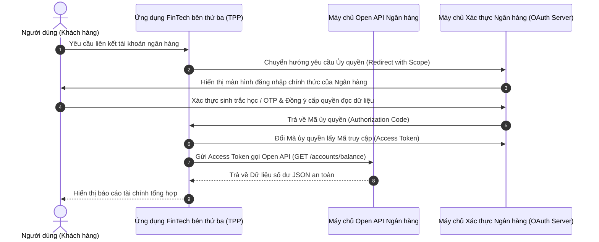

# Chuyên đề: Tài Chính Thay Thế và Các Mô Hình Tín Dụng Mới (Alternative Finance & Lending Models)

Tài liệu này nghiên cứu chuyên sâu về các mô hình tài chính đột phá đang tái định hình cấu trúc trung gian tín dụng truyền thống: Ngân hàng mở (Open Banking), Tài chính nhúng (Embedded Finance), Mua trước trả sau (BNPL), Cho vay ngang hàng (P2P Lending) và Gọi vốn cộng đồng (Crowdfunding).

---

## 1. Open Banking (Ngân hàng mở)

### 1. Là gì?
- **Định nghĩa học thuật:** Ngân hàng mở (*Open Banking*) là một cơ chế dịch vụ tài chính dựa trên khung pháp lý bắt buộc hoặc tự nguyện, trong đó các ngân hàng truyền thống cho phép các nhà cung cấp dịch vụ tài chính bên thứ ba (*Third-Party Providers - TPPs*) tiếp cận một cách bảo mật với dữ liệu tài khoản, lịch sử giao dịch của khách hàng và khởi tạo các lệnh thanh toán thông qua Giao diện Lập trình Ứng dụng Mở (*Open Application Programming Interfaces - Open APIs*), dựa trên sự đồng thuận rõ ràng của chủ tài khoản.
- **Bản chất trực giác:** Trước đây, dữ liệu lịch sử chuyển tiền, số dư tài khoản của bạn bị ngân hàng giam giữ như một "hộp đen bí mật", thuộc sở hữu độc quyền của ngân hàng đó. Ngân hàng mở tuyên bố một nguyên lý cách mạng: **Dữ liệu tài chính là tài sản của chính bạn, không phải của ngân hàng**. Bạn có toàn quyền cho phép một ứng dụng tài chính thông minh (như ứng dụng quản lý chi tiêu) kết nối vào ngân hàng để đọc số dư và giúp bạn tự động tìm gói tiết kiệm có lãi suất cao nhất thị trường.
- **Nếu chỉ nhớ một điều:** Ngân hàng mở biến ngân hàng từ "pháo đài dữ liệu khép kín" thành một "nền tảng kết nối API mở", chuyển quyền kiểm soát dữ liệu tài chính từ định chế sang tay người dùng.

### 2. Hoạt động thế nào?
1. **Khung pháp lý tiên phong trên thế giới:**
   - **Chỉ thị Dịch vụ Thanh toán Sửa đổi của Châu Âu (PSD2 - Payment Services Directive 2):** Luật bắt buộc mọi ngân hàng châu Âu phải mở Open API miễn phí cho hai nhóm thực thể thứ ba:
     - **AISP (Account Information Service Provider):** Đơn vị cung ứng dịch vụ thông tin tài khoản (gom dữ liệu từ 5 ngân hàng khác nhau về một màn hình duy nhất).
     - **PISP (Payment Initiation Service Provider):** Đơn vị cung ứng dịch vụ khởi tạo thanh toán (cho phép khách hàng thanh toán trực tiếp từ tài khoản ngân hàng trên website thương mại điện tử mà không cần qua thẻ Visa/Mastercard).
2. **Cơ chế hoạt động kỹ thuật:**
   - **Giao thức cấp quyền OAuth 2.0:** Khách hàng không bao giờ phải tiết lộ tên đăng nhập và mật khẩu ngân hàng cho ứng dụng thứ ba. Ứng dụng chuyển hướng khách hàng sang trang web chính thức của ngân hàng để xác thực vân tay, sau đó ngân hàng cấp một mã Token truy cập tạm thời cho ứng dụng.

### 3. Kiến trúc Luồng Ủy Quyền Ngân Hàng Mở (OAuth 2.0 Open Banking Flow)

### 4. Ví dụ
- **Ví dụ số học:** Người dùng có tài khoản tại 3 ngân hàng khác nhau: Ngân hàng A (số dư 50 triệu), Ngân hàng B (số dư 20 triệu), Ngân hàng C (khoản nợ thẻ tín dụng 15 triệu).
  - Trước Open Banking: Người dùng phải tải 3 ứng dụng khác nhau, đăng nhập 3 lần để tự ghi chép sổ sách thủ công.
  - Sau Open Banking: Người dùng mở ứng dụng FinTech tổng hợp (như Plaid, Emma). Ứng dụng kết nối Open API đến cả 3 ngân hàng trong 5 giây, tính toán ngay lập tức: Tổng tài sản ròng = $50 + 20 - 15 = 55$ triệu VND, đồng thời tự động cảnh báo ngày mai Ngân hàng C sẽ trừ nợ thẻ và gợi ý chuyển tiền từ A sang C để tránh bị phạt lãi chậm trả.
- **Thực tế Quốc tế & Việt Nam:** Tại Anh, hơn 7 triệu người tiêu dùng và doanh nghiệp vừa và nhỏ sử dụng các dịch vụ Open Banking hàng ngày. Tại Việt Nam, Ngân hàng Nhà nước đã ban hành Quyết định phê duyệt Kế hoạch chuyển đổi số ngành Ngân hàng đến năm 2025, định hướng năm 2030, trong đó phát triển chuẩn Open API là một trọng tâm cốt lõi. Các ngân hàng tiên phong như VietinBank (iConnect Open API), OCB (Open API Platform), BIDV đã mở hàng trăm API cho các đối tác bán lẻ và công ty chứng khoán tích hợp.
- **Kịch bản phản thực tế (Counterfactual):** Nếu các cơ quan quản lý không ban hành luật Open Banking bắt buộc, các ngân hàng truyền thống độc quyền sẽ vĩnh viễn khóa chặt dữ liệu khách hàng. Các công ty FinTech muốn kết nối dữ liệu sẽ phải sử dụng kỹ thuật nguy hiểm là "Cào dữ liệu màn hình" (*Screen Scraping* - yêu cầu khách hàng cung cấp mật khẩu ngân hàng cho app để robot tự đăng nhập đọc dữ liệu), tiềm ẩn nguy cơ bảo mật thảm khốc.

### 5. Ứng dụng & Tranh luận
- **Ứng dụng thực tiễn:** Tự động hóa kế toán cho doanh nghiệp vừa và nhỏ, chấm điểm tín dụng thông minh dựa trên lịch sử dòng tiền thực tế (*Cash-flow based underwriting*), thanh toán từ tài khoản sang tài khoản (A2A Payments) không qua mạng thẻ.
- **Tranh luận & Đánh đổi:** 
  - *Rủi ro an ninh mạng và Rò rỉ dữ liệu cá nhân:* Việc mở cửa API cho hàng trăm công ty FinTech khởi nghiệp bên ngoài kết nối làm gia tăng bề mặt tấn công của tin tặc (*Attack Surface*). Nếu một FinTech nhỏ có hệ thống bảo mật kém bị hack, dữ liệu của khách hàng ngân hàng có thể bị lộ lọt.
- **Cạm bẫy tư duy:** Tưởng rằng Ngân hàng mở đồng nghĩa với việc bất kỳ ai cũng có thể tùy tiện xem thông tin tài khoản của bạn. Mọi hành vi truy cập dữ liệu bắt buộc phải có sự cho phép cụ thể, tường minh của chính bạn (*Explicit Consent*), và bạn có quyền thu hồi quyền truy cập đó bất kỳ lúc nào chỉ bằng một cú nhấp chuột.

### 6. Liên kết khái niệm
- [Embedded Finance](file:///Users/ductri0981/Documents/Studying/Studying-Economic/03_Money_Banking_and_Financial_Systems/07_Payment_Systems_and_Financial_Technology/05_Alternative_Finance_and_Lending_Models.md#2-embedded-finance-tai-chinh-nhung) (Mô hình phát triển tự nhiên dựa trên nền tảng Open Banking)
- [Financial Technology Companies (FinTech)](file:///Users/ductri0981/Documents/Studying/Studying-Economic/03_Money_Banking_and_Financial_Systems/05_Financial_Institutions/05_Specialized_and_Alternative_Financial_Entities.md#4-financial-technology-companies-fintech-cong-ty-cong-nghe-tai-chinh) (Người thụ hưởng chính của Open API)
- [Digital Banking](file:///Users/ductri0981/Documents/Studying/Studying-Economic/03_Money_Banking_and_Financial_Systems/03_Banking_Systems/02_Digital_Alternative_and_Specialized_Banking.md) (Nền tảng hạ tầng phía ngân hàng)

---

## 2. Embedded Finance (Tài chính nhúng)

### 2.1. Là gì?
- **Định nghĩa học thuật:** Tài chính nhúng (*Embedded Finance*) là việc tích hợp liền mạch các dịch vụ tài chính (thanh toán, cho vay, bảo hiểm, đầu tư) vào các nền tảng kinh doanh phi tài chính (*Non-financial platforms*) hoặc các hành trình trải nghiệm số thông thường của khách hàng (như ứng dụng gọi xe, sàn thương mại điện tử, phần mềm quản lý bán hàng), cho phép người dùng tiếp cận và tiêu dùng dịch vụ tài chính ngay tại điểm có nhu cầu phát sinh mà không cần phải chuyển sang ứng dụng của ngân hàng.
- **Bản chất trực giác:** Hãy nhớ lại trải nghiệm bạn đi taxi truyền thống: đến nơi, tài xế bấm đồng hồ, bạn lục ví tìm tiền mặt hoặc lấy thẻ quẹt, chờ in hóa đơn (rất nhiều ma sát). Khi bạn đi xe Grab hay Uber: bạn lên xe, đến nơi mở cửa bước xuống. Việc thanh toán diễn ra hoàn toàn vô hình trong nền tảng ứng dụng. Dịch vụ thanh toán đã bị "nhúng chìm" vào hành trình di chuyển.
- **Nếu chỉ nhớ một điều:** Tài chính nhúng đưa dịch vụ tài chính đến tận nơi khách hàng đang sinh sống và mua sắm số, dựa trên triết lý: "Khách hàng không cần ngân hàng, họ cần dịch vụ ngân hàng" (Bill Gates).

### 2.2. Hoạt động thế nào?
1. **Bộ ba cấu trúc kiến trúc của Tài chính nhúng:**
   - **Bên phân phối mặt trước (Distributor / Front-end Platform):** Các nền tảng phi tài chính sở hữu lượng người dùng trung thành khổng lồ (Shopify, Grab, Shopee, Apple, TikTok).
   - **Bên kết nối công nghệ trung gian (FinTech Enabler / BaaS Platform):** Cung cấp các gói API và SDK kết nối (Stripe, Marqeta, Plaid).
   - **Bên cung cấp hạ tầng tài chính có giấy phép (Balance-sheet / Balance Provider):** Các ngân hàng thương mại hoặc công ty bảo hiểm truyền thống có giấy phép hoạt động hợp pháp đứng sau gánh chịu rủi ro và cung cấp nguồn vốn.
2. **Các dạng thức Tài chính nhúng phổ biến:**
   - **Thanh toán nhúng (Embedded Payments):** Thanh toán tự động trong Uber, Starbucks App.
   - **Cho vay nhúng (Embedded Lending):** Dịch vụ Mua trước trả sau (BNPL) tại trang giỏ hàng; Shopify Capital cho các chủ shop vay tiền mở rộng kho dựa trên dữ liệu doanh thu bán hàng trên sàn.
   - **Bảo hiểm nhúng (Embedded Insurance):** Một cú nhấp chuột mua bảo hiểm trễ chuyến bay khi đặt vé máy bay trên Traveloka, hoặc bảo hiểm màn hình khi mua điện thoại trên Thế Giới Di Động.
   - **Đầu tư nhúng (Embedded Investments):** Tự động làm tròn số tiền lẻ sau mỗi bữa ăn để gom vào mua chứng chỉ quỹ đầu tư (như tính năng Acorns).

### 2.3. Công thức & Mô hình Kinh tế học Tài chính Nhúng
Giá trị gia tăng cho nền tảng phi tài chính qua **Giá trị giao dịch gộp và Mức độ thâm nhập tài chính (FinTech Take Rate - $TR$):**
$$\text{Doanh thu FinTech của Nền tảng} = \text{GMV} \times \text{Penetration Rate } (\alpha) \times \text{Take Rate } (TR)$$

Trong đó:
- $\text{GMV}$ (*Gross Merchandise Value*): Tổng giá trị hàng hóa giao dịch trên sàn phi tài chính.
- $\alpha$: Tỷ lệ người mua hàng sử dụng dịch vụ tài chính nhúng (vay trả góp, mua bảo hiểm) trên sàn.
- $TR$: Tỷ lệ hoa hồng dịch vụ tài chính nền tảng được chia sẻ từ ngân hàng đối tác.
- Đối với nhiều tập đoàn công nghệ (như Shopify hay Grab), doanh thu từ các dịch vụ tài chính nhúng này hiện chiếm tới $50\% - 60\%$ tổng doanh thu của cả tập đoàn, vượt xa doanh thu từ phí phần mềm ban đầu!

### 2.4. Ví dụ
- **Ví dụ số học:** Một sàn thương mại điện tử có $\text{GMV} = 1$ tỷ USD/năm. Sàn tích hợp gói dịch vụ Cho vay nhúng cho các nhà bán hàng (Merchant Cash Advance).
  - Tỷ lệ chủ shop vay vốn: $\alpha = 10\%$ ($\text{Dư nợ giải ngân} = 100$ triệu USD).
  - Ngân hàng đối tác tài trợ vốn và chia sẻ cho sàn mức Take Rate: $TR = 3.5\%$.
  - Doanh thu tài chính ròng sàn thu về:
    $$\text{Doanh thu} = 100.000.000 \times 3.5\% = 3.500.000 \text{ USD}$$
  Sàn có thêm 3.5 triệu USD lợi nhuận thuần mà không cần xin giấy phép ngân hàng và không phải tự bỏ vốn rủi ro.
- **Thực tế Việt Nam:** Ứng dụng Grab tại Việt Nam tích hợp dịch vụ Tài chính GrabFinancial (hợp tác cùng các ngân hàng và công ty bảo hiểm): cung cấp bảo hiểm chuyến đi với giá chỉ từ 2.000 đồng/cuốc xe, cho tài xế vay tiêu dùng nhỏ, và cho vay vốn lưu động đối với các nhà hàng bán thức ăn trên GrabFood dựa trên dữ liệu doanh số hàng tháng.
- **Kịch bản phản thực tế (Counterfactual):** Nếu không có mô hình Tài chính nhúng (BaaS), một chuỗi siêu thị bán lẻ muốn cấp thẻ tín dụng tích điểm riêng cho khách hàng sẽ phải mất từ 3 đến 5 năm để thành lập một ngân hàng mới, xin giấy phép tài chính phức tạp và chi hàng chục triệu USD duy trì bộ máy tuân thủ cồng kềnh.

### 2.5. Ứng dụng & Tranh luận
- **Ứng dụng thực tiễn:** Tăng tỷ lệ chuyển đổi đơn hàng cho sàn thương mại điện tử, tối ưu hóa dòng tiền cho chuỗi cung ứng B2B, tạo nguồn thu nhập thứ hai béo bở cho các công ty phần mềm SaaS.
- **Tranh luận & Đánh đổi:** 
  - *Sự mờ nhạt về trách nhiệm pháp lý:* Khi sản phẩm tài chính nhúng gặp sự cố (bị tính lãi sai, rò rỉ dữ liệu), khách hàng thường không biết phải khiếu nại ai: công ty công nghệ mặt trước (nơi họ bấm mua) hay ngân hàng ẩn giấu phía sau (nơi thực tế cấp vốn).
  - *Rủi ro phụ thuộc nền tảng:* Ngân hàng truyền thống đứng sau có nguy cơ bị biến thành các "đường ống ngầm vô danh" (*Dumb Pipes*), mất quyền kiểm soát mối quan hệ trực tiếp và sự trung thành của khách hàng vào tay các đại công ty công nghệ.
- **Cạm bẫy tư duy:** Tưởng rằng mọi công ty công nghệ cung cấp dịch vụ tài chính nhúng đều là ngân hàng. Về mặt pháp lý, họ chỉ là "đại lý phân phối kỹ thuật"; mọi nghiệp vụ nhận tiền gửi và cho vay bắt buộc phải neo vào một định chế tài chính có giấy phép đứng sau theo quy định pháp luật.

### 2.6. Liên kết khái niệm
- [Open Banking](file:///Users/ductri0981/Documents/Studying/Studying-Economic/03_Money_Banking_and_Financial_Systems/07_Payment_Systems_and_Financial_Technology/05_Alternative_Finance_and_Lending_Models.md#1-open-banking-ngan-hang-mo) (Công nghệ API cho phép nhúng tài chính)
- [Buy Now, Pay Later (BNPL)](file:///Users/ductri0981/Documents/Studying/Studying-Economic/03_Money_Banking_and_Financial_Systems/07_Payment_Systems_and_Financial_Technology/05_Alternative_Finance_and_Lending_Models.md#3-buy-now-pay-later-bnpl-mua-truoc-tra-sau) (Ví dụ điển hình nhất của tài chính nhúng)
- [InsurTech](file:///Users/ductri0981/Documents/Studying/Studying-Economic/03_Money_Banking_and_Financial_Systems/07_Payment_Systems_and_Financial_Technology/06_WealthTech_RegTech_and_InsurTech.md#3-insurtech-cong-nghe-bao-hiem) (Lĩnh vực bảo hiểm nhúng bùng nổ)

---

## 3. Buy Now, Pay Later (BNPL) (Mua trước trả sau)

### 3.1. Là gì?
- **Định nghĩa học thuật:** Mua trước, trả sau (*Buy Now, Pay Later - BNPL*) là một hình thức tín dụng tài trợ điểm bán (*Point-of-Sale Financing*) ngắn hạn dựa trên công nghệ, cho phép người tiêu dùng mua hàng hóa ngay lập tức và chia nhỏ giá trị thanh toán thành nhiều kỳ hạn bằng nhau (thường là 3 đến 4 kỳ hạn, trả trong vòng vài tuần hoặc vài tháng), trong đó người mua thường không phải chịu bất kỳ khoản lãi suất danh nghĩa nào ($0\%$ APR) nếu thanh toán đúng hạn.
- **Bản chất trực giác:** Bạn nhìn thấy một đôi giày thể thao tuyệt đẹp giá 2 triệu đồng nhưng tuần sau mới có lương. Nút bấm BNPL trên trang thanh toán cho phép bạn nhận đôi giày ngay lập tức: hôm nay bạn chỉ cần trả 500.000 đồng, 3 kỳ tiếp theo cứ mỗi 2 tuần bạn trả tiếp 500.000 đồng. Không cần thẻ tín dụng, không cần giấy tờ chứng minh thu nhập phức tạp, chỉ cần vài giây thẩm định qua ứng dụng.
- **Nếu chỉ nhớ một điều:** BNPL là phiên bản số hóa hiện đại của hình thức mua trả góp truyền thống nhưng được tích hợp tức thì tại giỏ hàng thương mại điện tử với trải nghiệm không ma sát.

### 3.2. Hoạt động thế nào?
1. **Các công ty BNPL thống trị toàn cầu:**
   - Klarna (Thụy Điển), Afterpay (Úc - đã được Block mua lại), Affirm (Mỹ), Kredivo, Atome.
2. **Cơ chế phân bổ dòng tiền và Doanh thu:**
   - **Người bán (Merchant):** Nhận được ngay $100\%$ giá trị đơn hàng từ công ty BNPL (trừ đi mức phí chiết khấu chấp nhận BNPL khá cao, thường từ $4\% - 6\%$).
   - **Người mua (Consumer):** Chia nhỏ trả góp định kỳ (ví dụ mô hình Pay-in-4: trả $25\%$ ngay lúc mua, các khoản còn lại trả sau 2, 4, 6 tuần).
   - **Nguồn lợi nhuận của công ty BNPL:**
     - Nguồn thu chủ đạo: Phí dịch vụ do người bán trả (người bán sẵn sàng trả phí cao vì BNPL giúp tăng giá trị đơn hàng bình quân AOV lên $40\% - 50\%$).
     - Nguồn thu thứ hai: Phí phạt chậm trả (*Late Fees*) thu từ những người mua trả trễ hạn.

### 3.3. Mô hình Toán học Quản trị Rủi ro Tín dụng Siêu tốc của BNPL
Khác với ngân hàng truyền thống (mất vài ngày thẩm định hồ sơ), BNPL sử dụng thuật toán học máy phân tích dữ liệu thay thế (*Alternative Data Underwriting*) trong vòng 500 mili-giây:
$$P(\text{Default}) = \sigma \left( \mathbf{w}_1 \cdot \text{DeviceData} + \mathbf{w}_2 \cdot \text{CartContent} + \mathbf{w}_3 \cdot \text{PastRepayment} + \mathbf{w}_4 \cdot \text{SocialBehavior} \right)$$

Nếu xác suất vỡ nợ $P(\text{Default}) \le \text{Threshold}$, hệ thống tự động giải ngân. Để kiểm soát rủi ro, BNPL áp dụng chiến lược cấp hạn mức tín dụng bậc thang (*Stepped Limits*): Lần đầu chỉ cho vay tối đa 1–2 triệu đồng; chỉ khi người dùng trả nợ đúng hạn nhiều lần, hạn mức mới được tự động nâng lên 5–10 triệu đồng.

### 3.4. Ví dụ
- **Ví dụ số học:** Khách hàng mua điện thoại giá 6.000.000 VND qua cổng BNPL (chia làm 3 kỳ, mỗi tháng 2.000.000 VND, lãi suất $0\%$).
  - Khách hàng thanh toán kỳ 1: 2.000.000 VND.
  - Công ty BNPL giải ngân cho cửa hàng điện thoại:
    $$\text{Tiền cửa hàng nhận} = 6.000.000 \times (1 - 5\% \text{ phí BNPL}) = 5.700.000 \text{ VND}$$
  - Công ty BNPL thu được 300.000 VND doanh thu dịch vụ từ cửa hàng. Nếu khách hàng trả đủ 2 kỳ còn lại đúng hạn, công ty BNPL đạt tỷ suất sinh lời gộp $5\%$ trên số vốn luân chuyển chỉ trong vòng 3 tháng (tương đương lợi suất năm rất cao).
- **Thực tế Việt Nam:** Sự trỗi dậy của các giải pháp BNPL như Kredivo, Home PayLater (kết hợp với Tiki, Thế Giới Di Động), Shopee SPayLater, MoMo Ví Trả Sau. Người tiêu dùng trẻ (Gen Z và Millennials) ưa chuộng BNPL vì không yêu cầu chứng minh thu nhập sao kê lương phức tạp như khi mở thẻ tín dụng tại các ngân hàng truyền thống.
- **Kịch bản phản thực tế (Counterfactual):** Nếu các công ty BNPL buộc phải thực hiện quy trình thẩm định tín dụng truyền thống tại quầy và gửi báo cáo CIC như ngân hàng, trải nghiệm mua hàng 1-Click trên sàn thương mại điện tử sẽ bị phá vỡ hoàn toàn, và tỷ lệ chuyển đổi giỏ hàng của các mặt hàng thời trang, mỹ phẩm sẽ sụt giảm mạnh.

### 3.5. Ứng dụng & Tranh luận
- **Ứng dụng thực tiễn:** Kích cầu tiêu dùng bán lẻ, tăng giá trị đơn hàng trung bình (AOV), hỗ trợ thanh toán chi phí học tập, mua sắm đồ dùng gia đình cho người trẻ thu nhập chưa ổn định.
- **Tranh luận & Đánh đổi:** 
  - *Khủng hoảng nợ ngầm của giới trẻ:* BNPL tạo cảm giác các món hàng "rất rẻ" (thay vì nhìn thấy giá 4 triệu, người dùng chỉ nhìn thấy số 1 triệu kỳ đầu), kích thích hành vi mua sắm vô tội vạ. Nhiều người trẻ nợ cùng lúc 4–5 ứng dụng BNPL khác nhau dẫn tới mất khả năng thanh toán.
  - *Lỗ hổng pháp lý:* Nhiều quốc gia chưa đưa BNPL vào luật quản lý tín dụng tiêu dùng, khiến các khoản nợ BNPL không được ghi nhận trên cơ sở dữ liệu tín dụng quốc gia, che giấu mức độ đòn bẩy nợ thực tế của người dân.
- **Cạm bẫy tư duy:** Tưởng rằng BNPL là "miễn phí hoàn toàn". Nếu bạn trễ hạn thanh toán dù chỉ 1 ngày, các khoản phí phạt chậm trả và lãi phạt lũy kế có thể đội giá trị món hàng lên thêm $20\% - 30\%$, và bạn sẽ bị chặn tài khoản mua sắm vĩnh viễn.

### 3.6. Liên kết khái niệm
- [Credit Cards](file:///Users/ductri0981/Documents/Studying/Studying-Economic/03_Money_Banking_and_Financial_Systems/04_Credit_and_Lending/06_Credit_Cards_and_Revolving_Lines.md) (Đối thủ cạnh tranh trực tiếp mà BNPL đang giành giật thị phần người trẻ)
- [Embedded Finance](file:///Users/ductri0981/Documents/Studying/Studying-Economic/03_Money_Banking_and_Financial_Systems/07_Payment_Systems_and_Financial_Technology/05_Alternative_Finance_and_Lending_Models.md#2-embedded-finance-tai-chinh-nhung) (Hình thức kiến trúc của BNPL)
- [Consumer Financial Protection](file:///Users/ductri0981/Documents/Studying/Studying-Economic/03_Money_Banking_and_Financial_Systems/06_Financial_Regulation_and_Stability/04_Safety_Nets_and_Market_Integrity.md#5-consumer-financial-protection-bao-ve-nguoi-tieu-dung-tai-chinh) (Lĩnh vực quản lý nóng bỏng đối với BNPL)

---

## 4. Peer-to-Peer Lending (Cho vay ngang hàng / P2P)

### 4.1. Là gì?
- **Định nghĩa học thuật:** Cho vay ngang hàng (*Peer-to-Peer Lending - P2P Lending* hoặc *Marketplace Lending*) là mô hình tài chính kết nối trực tiếp giữa các cá nhân hoặc tổ chức có tiền nhàn rỗi muốn cho vay (*Investors / Lenders*) với các cá nhân hoặc doanh nghiệp có nhu cầu vay vốn (*Borrowers*) thông qua một nền tảng kỹ thuật số trực tuyến mà không thông qua sự tham gia trung gian tài chính truyền thống của các ngân hàng thương mại.
- **Bản chất trực giác:** Thay vì bạn gửi tiền vào ngân hàng lấy lãi tiết kiệm $6\%/\text{năm}$, rồi ngân hàng đem số tiền đó cho một tiểu thương vay với lãi suất $14\%/\text{năm}$ (ngân hàng ăn chênh lệch biên lãi $8\%$). Sàn giao dịch P2P đóng vai trò là "ông tơ bà nguyệt": kết nối bạn gặp thẳng tiểu thương đó qua mạng, bạn cho họ vay với lãi suất $10\%/\text{năm}$ (bạn lãi cao hơn gửi ngân hàng, tiểu thương vay rẻ hơn ngân hàng), và sàn P2P chỉ thu một khoản phí kết nối phần mềm nhỏ.
- **Nếu chỉ nhớ một điều:** P2P Lending là sự "phi trung gian hóa ngân hàng" (*Disintermediation*), biến các cá nhân bình thường thành các nhà đầu tư tín dụng vi mô trực tiếp.

### 4.2. Hoạt động thế nào?
1. **Quy trình hoạt động của sàn P2P:**
   - **Bên đi vay nộp hồ sơ:** Đăng ký khoản vay online, tải lên thông tin thu nhập, danh bạ, tài khoản mạng xã hội.
   - **Chấm điểm và Phân hạng rủi ro (Risk Grading):** Thuật toán sàn tự động chấm điểm và xếp hạng rủi ro từ A (an toàn nhất, lãi thấp) đến E/HR (rủi ro cao, lãi suất cao).
   - **Mở bán khoản vay (Listing):** Khoản vay được đưa lên sàn. Một khoản vay 100 triệu có thể được góp vốn bởi 50 nhà đầu tư khác nhau (mỗi người bỏ 2 triệu đồng) để phân tán rủi ro.
   - **Thu hồi nợ và Phân phối dòng tiền:** Sàn P2P chịu trách nhiệm nhắc nợ, thu tiền gốc/lãi hàng tháng và chia tự động về tài khoản của từng nhà đầu tư.
2. **Các nền tảng P2P nổi tiếng:**
   - LendingClub, Prosper (Mỹ); Zopa, Funding Circle (Anh).

### 4.3. Công thức & Mô hình toán học
Tỷ suất sinh lời kỳ vọng của Nhà đầu tư trên danh mục P2P Lending đã đa dạng hóa:
$$E(R_p) = \sum_{k=1}^{K} w_k \cdot \left[ (1 - PD_k) \cdot r_k - PD_k \cdot LGD_k \right] - c_{servicing}$$

Trong đó:
- $w_k$: Tỷ trọng vốn đầu tư vào khoản vay $k$ ($\sum w_k = 1$).
- $r_k$: Lãi suất danh nghĩa theo hợp đồng của khoản vay $k$.
- $PD_k$: Xác suất vỡ nợ của người vay $k$.
- $LGD_k$: Tỷ lệ tổn thất khi người vay vỡ nợ (trong P2P không tài sản đảm bảo, $LGD$ thường rất cao, từ $80\% - 100\%$).
- $c_{servicing}$: Tỷ lệ phí quản lý mà sàn P2P thu của nhà đầu tư (thường $1\%/\text{năm}$).
- *Quy tắc vàng của P2P:* Không bao giờ dồn toàn bộ vốn cho một người vay; bắt buộc phải chia nhỏ vốn cho hàng trăm khoản vay độc lập để đa dạng hóa rủi ro vỡ nợ.

### 4.4. Ví dụ
- **Ví dụ số học:** Nhà đầu tư bỏ 100 triệu VND vào sàn P2P, chia đều thành 100 khoản vay (1 triệu VND/khoản) có mức lãi suất cam kết $15\%/\text{năm}$.
  - Sau 1 năm: Có 94 người trả nợ đầy đủ cả gốc lẫn lãi. Có 6 người quỵt nợ biến mất hoàn toàn ($LGD = 100\%$, mất trắng 6 triệu vốn).
  - Thu nhập từ 94 khoản vay tốt: $94 \times 1.000.000 \times 15\% = 14.100.000$ VND.
  - Tổn thất mất vốn: 6.000.000 VND.
  - Lợi nhuận ròng thực tế = $14.100.000 - 6.000.000 = 8.100.000$ VND.
  - Tỷ suất sinh lời thực tế đạt $8.1\%/\text{năm}$ (vẫn cao hơn mức gửi tiết kiệm ngân hàng $6\%$).
- **Thực tế Quốc tế & Bài học Trung Quốc:** Sự bùng nổ và sụp đổ thảm khốc của P2P Lending tại Trung Quốc giai đoạn 2015–2018. Thiếu quy định quản lý, hàng ngàn sàn P2P đã biến tướng thành các mô hình đa cấp lừa đảo Ponzi (điển hình là đại án sàn Ezubao lừa đảo hơn 50 tỷ Nhân dân tệ của 900.000 nhà đầu tư). Chính phủ Trung Quốc sau đó đã phải ra tay xóa sổ hoàn toàn toàn bộ ngành P2P Lending trên toàn quốc.
- **Thực tế Việt Nam:** Các nền tảng P2P Lending (như Tima, Fiin Credit, Lendbiz) hoạt động chủ yếu dưới giấy phép công ty tư vấn đầu tư hoặc công nghệ kết nối do Việt Nam chưa có khung pháp lý chính thức. Chính phủ đang xây dựng Cơ chế thử nghiệm có kiểm soát (*FinTech Sandbox*) để đưa P2P vào quỹ đạo quản lý lành mạnh.
- **Kịch bản phản thực tế (Counterfactual):** Nếu các ngân hàng thương mại đáp ứng đầy đủ và dễ dàng nhu cầu vay vốn của các hộ kinh doanh cá thể và người lao động nghèo, mô hình P2P Lending sẽ không có đất diễn và không thể nào thu hút được hàng triệu người tham gia.

### 4.5. Ứng dụng & Tranh luận
- **Ứng dụng thực tiễn:** Cung cấp nguồn vốn tín chấp cho các doanh nghiệp siêu nhỏ (SMEs) bị ngân hàng từ chối, tạo kênh đầu tư có lợi suất hấp dẫn cho nhà đầu tư cá nhân có khẩu vị rủi ro cao.
- **Tranh luận & Đánh đổi:** 
  - *Rủi ro bất đối xứng thông tin tột độ:* Sàn P2P chỉ thu phí trung gian, họ không chịu rủi ro mất tiền trực tiếp khi người vay vỡ nợ (rủi ro đổ hết lên đầu nhà đầu tư). Điều này tạo động cơ đạo đức xấu khiến sàn có xu hướng nới lỏng thẩm định để tăng tối đa khối lượng giải ngân nhằm thu nhiều phí.
  - *Biến tướng tín dụng đen và Đòi nợ khủng bố:* Nhiều băng nhóm cho vay nặng lãi đội lốt sàn P2P để giải ngân với lãi suất lên tới $200\% - 500\%/\text{năm}$ kèm hành vi khủng bố tinh thần người vay.
- **Cạm bẫy tư duy:** Tưởng rằng sàn P2P có nghĩa vụ "bảo lãnh bồi thường tiền gốc" nếu người vay quỵt nợ. Về bản chất luật pháp, sàn P2P chỉ là nền tảng môi giới công nghệ; nhà đầu tư tự chịu trách nhiệm $100\%$ về các quyết định cho vay của mình.

### 4.6. Liên kết khái niệm
- [Crowdfunding](file:///Users/ductri0981/Documents/Studying/Studying-Economic/03_Money_Banking_and_Financial_Systems/07_Payment_Systems_and_Financial_Technology/05_Alternative_Finance_and_Lending_Models.md#5-crowdfunding-goi-von-cong-dong) (Khái niệm bao trùm huy động vốn từ đám đông)
- [Default Risk](file:///Users/ductri0981/Documents/Studying/Studying-Economic/03_Money_Banking_and_Financial_Systems/04_Credit_and_Lending/08_Underwriting_Ratios_and_Credit_Risk.md) (Rủi ro trọng yếu nhất trong P2P Lending)
- [Moral Hazard](file:///Users/ductri0981/Documents/Studying/Studying-Economic/03_Money_Banking_and_Financial_Systems/06_Financial_Regulation_and_Stability/03_Prudential_Safeguards_and_Moral_Hazard.md#1-moral-hazard-rui-ro-dao-duc) (Xung đột lợi ích giữa nền tảng P2P và nhà đầu tư)

---

## 5. Crowdfunding (Gọi vốn cộng đồng)

### 5.1. Là gì?
- **Định nghĩa học thuật:** Gọi vốn cộng đồng (*Crowdfunding*) là phương thức huy động vốn để tài trợ cho một dự án, một ý tưởng sáng tạo hoặc một doanh nghiệp khởi nghiệp thông qua việc thu hút các khoản đóng góp tài chính nhỏ (*micro-contributions*) từ một số lượng lớn các cá nhân trong công chúng (đám đông), chủ yếu được thực hiện thông qua các nền tảng mạng xã hội và cổng thông tin trực tuyến trên Internet.
- **Bản chất trực giác:** Thay vì một người sáng chế phải quỳ lụy gõ cửa các ngân hàng lớn hoặc các quỹ đầu tư mạo hiểm khó tính để xin 1 tỷ đồng (và thường bị từ chối vì ý tưởng quá mới lạ), họ quay một đoạn video giới thiệu sản phẩm đăng lên mạng Internet và kêu gọi: "Nếu bạn thích chiếc đồng hồ thông minh này, hãy ủng hộ tôi 500.000 đồng, khi chế tạo xong tôi sẽ gửi tặng bạn chiếc đồng hồ đầu tiên". 2.000 người trên khắp thế giới hưởng ứng, và nhà sáng chế có đủ 1 tỷ đồng để sản xuất.
- **Nếu chỉ nhớ một điều:** Gọi vốn cộng đồng là sự "dân chủ hóa cơ hội tiếp cận vốn", chuyển quyền quyết định sự tồn tại của một ý tưởng sáng tạo từ tay một vài chuyên gia ngân hàng sang sự phán xét trực tiếp của cộng đồng người tiêu dùng.

### 5.2. Hoạt động thế nào?
1. **Bốn mô hình Gọi vốn cộng đồng chính:**
   - **Gọi vốn dựa trên phần thưởng (Reward-based Crowdfunding):** Người ủng hộ đóng góp tiền để nhận lại sản phẩm đầu tiên hoặc quà tặng lưu niệm (như Kickstarter, Indiegogo). Rất phổ biến cho các sản phẩm công nghệ sáng tạo, trò chơi boardgame, phim ảnh độc lập.
   - **Gọi vốn từ thiện / quyên góp (Donation-based Crowdfunding):** Quyên góp tiền cứu trợ thiên tai, viện phí cho bệnh nhân hiểm nghèo mà không đòi hỏi bất kỳ sự đền đáp vật chất nào (như GoFundMe, quỹ ủng hộ Mặt trận Tổ quốc).
   - **Gọi vốn nợ (Lending-based Crowdfunding):** Chính là mô hình Cho vay ngang hàng (P2P Lending).
   - **Gọi vốn cổ phần (Equity Crowdfunding):** Người đóng góp tiền trở thành cổ đông sở hữu một phần cổ phần thực tế của công ty khởi nghiệp.
2. **Hai cơ chế giải ngân:**
   - **Được ăn cả, ngã về không (All-or-Nothing):** Dự án đặt mục tiêu huy động 100.000 USD trong 30 ngày. Nếu hết thời hạn mà chỉ đạt 99.000 USD ($99\%$), toàn bộ số tiền sẽ tự động hoàn trả lại cho người ủng hộ và chủ dự án không nhận được một xu nào (bảo vệ người ủng hộ khỏi các dự án thiếu vốn dở dang).
   - **Nhận tất cả (Keep-it-All / Flexible Funding):** Huy động được bao nhiêu tiền thì chủ dự án được nhận bấy nhiêu sau khi trừ phí nền tảng (thường $5\%$).

### 5.3. Công thức & Xác suất Thành công của Chiến dịch Gọi vốn
Mô hình ước lượng xác suất cán đích thành công của chiến dịch (*Success Probability - Mollick, 2014*):
$$\ln \left( \frac{p}{1 - p} \right) = \alpha + \beta_1 \ln(\text{Goal}) + \beta_2 \text{Video} + \beta_3 \text{Updates} + \beta_4 \text{EarlyPledges} + \epsilon$$

Trong đó:
- $\text{Goal}$: Mục tiêu số tiền cần gọi (Mục tiêu càng thực tế và vừa phải thì tỷ lệ thành công càng cao, $\beta_1 < 0$).
- $\text{Video}$: Dự án có video giới thiệu sản phẩm chất lượng cao làm tăng tỷ lệ thành công lên hơn gấp đôi ($\beta_2 > 0$).
- $\text{EarlyPledges}$: Khối lượng tiền ủng hộ thu hút được trong **48 giờ đầu tiên** (Hiệu ứng tâm lý bầy đàn - nếu trong 2 ngày đầu đạt được $30\%$ mục tiêu, xác suất thành công chung cuộc vượt trên $80\%$).

### 5.4. Ví dụ
- **Ví dụ số học:** Dự án đồng hồ thông minh Pebble Time trên nền tảng Kickstarter năm 2015 đặt mục tiêu ban đầu là 500.000 USD. Sau 48 giờ, chiến dịch đã vượt mốc 10 triệu USD. Khi kết thúc chiến dịch 30 ngày, dự án đã huy động được kỷ lục 20.338.986 USD từ 78.471 người ủng hộ trên toàn thế giới, trở thành minh chứng lịch sử cho sức mạnh của gọi vốn cộng đồng.
- **Thực tế Việt Nam:** Các chiến dịch gọi vốn cộng đồng sáng tạo tại Việt Nam: Dự án xuất bản truyện tranh "Long Thần Tướng" huy động thành công hàng trăm triệu đồng trên nền tảng Betado / Comicola; các dự án boardgame thuần Việt; các chiến dịch quyên góp từ thiện cứu trợ lũ lụt miền Trung thông qua ví MoMo và ứng dụng ngân hàng.
- **Kịch bản phản thực tế (Counterfactual):** Nếu các nền tảng gọi vốn cộng đồng không xuất hiện, hàng ngàn ý tưởng phần cứng đột phá, các bộ phim nghệ thuật độc lập và các trò chơi điện tử sáng tạo sẽ bị "chết yểu" ngay trên trang giấy phác thảo vì không phù hợp với khẩu vị đầu tư thuần túy tìm kiếm lợi nhuận ngắn hạn của các ngân hàng thương mại.

### 5.5. Ứng dụng & Tranh luận
- **Ứng dụng thực tiễn:** Khảo sát và thẩm định nhu cầu thị trường trước khi sản xuất hàng loạt (*Market Validation*), xây dựng cộng đồng khách hàng trung thành ủng hộ thương hiệu, tài trợ các dự án xã hội vì cộng đồng.
- **Tranh luận & Đánh đổi:** 
  - *Rủi ro "Bùng hàng" và Chậm trễ tiến độ:* Hơn $70\%$ các chiến dịch gọi vốn cộng đồng phần cứng không giao hàng đúng thời hạn cam kết, và một tỷ lệ không nhỏ các chủ dự án cầm tiền xong thì biến mất hoặc tuyên bố phá sản do đánh giá sai chi phí sản xuất, đẩy người ủng hộ vào tình trạng mất trắng mà không có cơ chế bảo vệ.
- **Cạm bẫy tư duy:** Nhầm lẫn giữa việc "Ủng hộ dự án Crowdfunding dựa trên phần thưởng" với việc "Mua hàng trên sàn thương mại điện tử". Trên Kickstarter, bạn đang **tài trợ cho một quá trình thử nghiệm mạo hiểm**, bạn không phải là người mua một sản phẩm đã có sẵn trong kho; nếu dự án nghiên cứu thất bại, bạn có thể không nhận được sản phẩm nào.

### 5.6. Liên kết khái niệm
- [Equity Crowdfunding](file:///Users/ductri0981/Documents/Studying/Studying-Economic/03_Money_Banking_and_Financial_Systems/07_Payment_Systems_and_Financial_Technology/07_Blockchain_DeFi_and_Digital_Assets.md#5-equity-crowdfunding-goi-von-co-phan-cong-dong) (Nhánh gọi vốn cộng đồng đổi lấy cổ phần pháp lý)
- [Peer-to-Peer Lending](file:///Users/ductri0981/Documents/Studying/Studying-Economic/03_Money_Banking_and_Financial_Systems/07_Payment_Systems_and_Financial_Technology/05_Alternative_Finance_and_Lending_Models.md#4-peer-to-peer-lending-cho-vay-ngang-hang--p2p) (Nhánh gọi vốn cộng đồng bằng nợ vay)
- [Venture Capital Firms](file:///Users/ductri0981/Documents/Studying/Studying-Economic/03_Money_Banking_and_Financial_Systems/05_Financial_Institutions/03_Private_Capital_and_Sovereign_Wealth.md) (Đối thủ cạnh tranh hoặc đối tác tiếp nối sau khi startup hoàn thành crowdfunding)

---

## Câu hỏi tự kiểm tra (Self-Quiz)
1. Nguyên tắc cốt lõi của Ngân hàng Mở (*Open Banking*) thay đổi quyền sở hữu dữ liệu tài chính của khách hàng như thế nào so với kỷ nguyên ngân hàng truyền thống?
2. Giao thức OAuth 2.0 giải quyết bài toán bảo mật thông tin như thế nào để ứng dụng FinTech bên thứ ba có thể đọc được dữ liệu số dư mà không bao giờ biết mật khẩu ngân hàng của người dùng?
3. Mô hình Tài chính Nhúng (*Embedded Finance*) tạo ra dòng doanh thu mới (*Take Rate*) như thế nào cho các nền tảng phi tài chính (như Grab hay Shopify)?
4. Phân tích nguyên nhân khiến hình thức Mua trước trả sau (BNPL) thu hút mạnh mẽ nhóm khách hàng trẻ tuổi Gen Z, và những rủi ro tài chính tiềm ẩn đối với người tiêu dùng nếu lạm dụng công cụ này?
5. So sánh sự khác nhau căn bản về mặt quyền lợi tài chính giữa người tham gia Gọi vốn cộng đồng dựa trên phần thưởng (*Reward-based Crowdfunding*) và Gọi vốn cộng đồng nhận cổ phần (*Equity Crowdfunding*)?

---

## Ghi chú nguồn tham khảo
- European Parliament and Council. (2015). *Directive (EU) 2015/2366 on payment services in the internal market (PSD2)*.
- Mollick, E. (2014). *The dynamics of crowdfunding: An exploratory study*. Journal of Business Venturing, 29(1), 1-16.
- Morse, A. (2015). *Peer-to-peer crowdfunding: Information and the potential for disruption in consumer lending*. Annual Review of Financial Economics, 7, 463-482.
- McKinsey & Company. (2022). *Embedded finance: Who will lead the next-generation financial services ecosystem?*
- Ngân hàng Nhà nước Việt Nam: *Quyết định 810/QĐ-NHNN về Kế hoạch chuyển đổi số ngành Ngân hàng đến năm 2025, định hướng đến năm 2030*.
